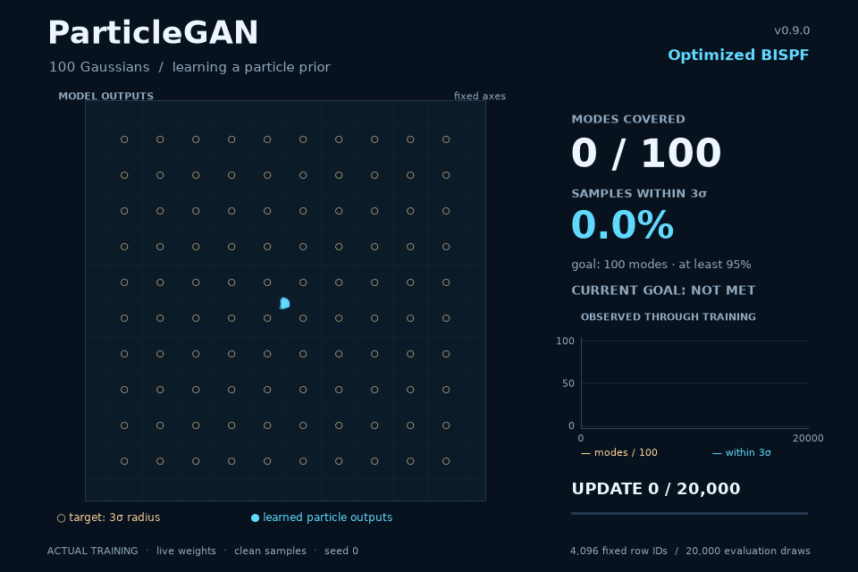
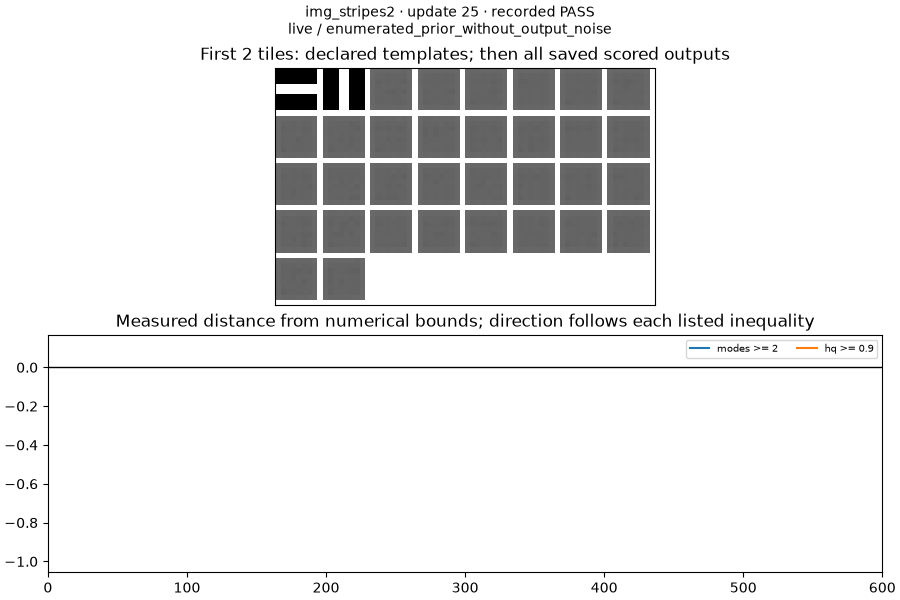
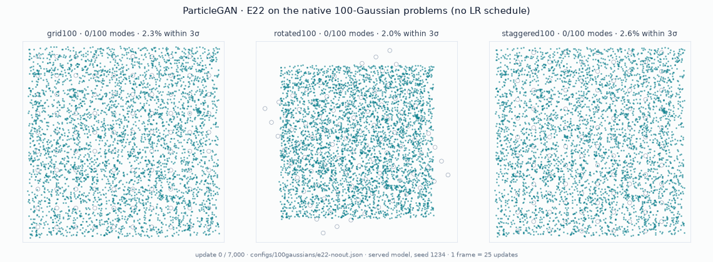

# ParticleGAN


[](https://github.com/255BITS/ParticleGAN/actions/workflows/tests.yml)

**GANs with a learnable particle prior, for PyTorch.**

A GAN usually draws its latent code from a fixed Gaussian. ParticleGAN replaces that
noise with a table of learnable latent vectors (*particles*), optimized together with
the generator, so that the prior itself can move toward the data's modes. You write an
ordinary PyTorch GAN loop, or call `GANTrainer`, and a *recipe* builds the optimizers,
critic penalty and prior regularizer.

## Install

Requires Python 3.11+. PyTorch and NumPy are installed as dependencies.

```bash
python -m pip install particlegan           # the library (0.9.4)
```

To run the examples, experiments and tests, install from source with the extras you need:

```bash
git clone https://github.com/255BITS/ParticleGAN.git
cd ParticleGAN
python -m pip install -e '.[dev,experiments]'   # tests plus examples/experiments (the toy100 CI job)
python -m pip install -e '.[dev,experiments,images,lunar]'   # what the main CI test job installs
```

| Extra | Adds | Needed for |
| --- | --- | --- |
| `dev` | pytest | the test suite |
| `experiments` | NumPy, Matplotlib, Pillow, PyYAML, POT, SciPy | examples, `python -m experiments.forge` and the toy benchmarks |
| `images` | torchvision, Pillow, torch-fidelity, SciPy <1.18, tqdm | CIFAR and other image experiments, FID |
| `mog` | SciPy | faster exact nearest-neighbour calibration of mixture-of-Gaussians priors (falls back to Torch without it) |
| `gym` | Gymnasium with Box2D | Gym control experiments |
| `lunar` | the `gym` extra plus rich, Pillow and imageio | the Lunar Lander world model and controllers |

Version pins live in [`pyproject.toml`](pyproject.toml). For CUDA, install a
torch/torchvision build that matches your driver before installing the extras.

## Train a GAN

You supply ordinary PyTorch modules. `GANTrainer` binds the recipe's optimizers,
critic penalty and prior regularizer:

```python
import torch
from torch import nn
from particlegan import GANTrainer, get_recipe, init

def real_batch(n):  # replace with your DataLoader: 8 Gaussians on a ring
    angle = torch.randint(8, (n, 1)) * torch.pi / 4
    return torch.cat([angle.cos(), angle.sin()], 1) + 0.05 * torch.randn(n, 2)

recipe = get_recipe(total_steps=2000)
G = nn.Sequential(nn.Linear(recipe.z_dim, 128), nn.LeakyReLU(0.2), nn.Linear(128, 2))
D = nn.Sequential(nn.Linear(2, 128), nn.LeakyReLU(0.2), nn.Linear(128, 1))
init.deterministic_orthogonal_(G, seed=0)
init.deterministic_orthogonal_(D, seed=1)
prior = init.deterministic_orthogonal_(recipe.make_prior())
trainer = GANTrainer(recipe, G, D, prior=prior, seed=0)
for _ in range(recipe.total_steps):
    trainer.step(real_batch(recipe.batch_size))
samples = trainer.sample(1024)
```

`get_recipe()` returns the default recipe, **optimized BISPF** (`DEFAULT_RECIPE =
"bispf_optimized"` in [particlegan/recipes.py](particlegan/recipes.py)). It uses a
non-saturating loss, a Born-Infeld critic penalty, an SBNP prior regularizer,
zero-momentum DualNorm and constant rates. The acronyms are expanded in the
[research glossary](RESEARCH_GLOSSARY.md#acronyms-and-short-names), and the
[recipe settings and evidence](docs/api.md#recipes-and-defaults) explain the configuration.

Without `prior=`, the trainer builds a randomly drawn particle table. Networks
and device placement belong to the caller. The trainer does not reinitialize
supplied modules, so load pretrained weights before constructing it and
initialize only fresh parameters. Optimizers exclude frozen parameters while
retaining gradients through frozen modules to trainable inputs.

Caller-owned loops use the recipe's role-named factories, including
`make_optimizers`, `make_critic_penalty` and `make_prior_regularizer`.
Save the resolved `recipe.to_dict()` and the complete `trainer.state_dict()`
for continuation. Changing the current default does not migrate an old run.
See the [API reference](docs/api.md#recipes-and-defaults) for component ownership
and optimizer contracts.

## Results and status

The single current status page is the
**[technique inventory](reports/forge/technique-inventory.md)**. It shows every recipe
family against the same declared tests, failures included, with links to gates,
metrics, receipts and training GIFs. Other report pages are historical records.

What the evidence does and does not show today:

- **The default is a research selection, not a qualified winner.** In the inventory's
  full-suite table on 2026-10-25, the default BISPF recipe records 18 PASS,
  11 FAIL and 20 unmeasured out of 49 distinct tests. Forge's screening calibration
  is still provisional.
- **Controlled prior comparison** ([matched prior ablation, 2026-10-25](reports/prior-ablation-2026-10-25/README.md)).
  Each arm changes only the prior policy. Architecture, data, budget, seed 0 and
  the initial table are the same. These are one-seed diagnostics with no
  qualification credit.

  | Prior | Toy tests passed (15 graded in all arms) | Ring16 high-quality fraction | CIFAR-10 DDGAN FID50k ↓ |
  | --- | ---: | ---: | ---: |
  | Learned particle table (default) | 7 | 0.95 | 79.7 |
  | Frozen table | 5 | 0.61 | 108.5* |
  | Fresh N(0, I) latent | 5 | 0.53 | 82.7 |

  \* Final checkpoint only; the same run scored 80.8 FID5k at step 7500, so this
  is most likely a bad excursion. All FIDs are single point estimates.

  On the toy suite the learned table buys sample precision at seed 0: it alone
  passes `ring16_acquisition` and `mode_hold` (2 of the 15 matched tests, both at
  a +0.00 margin with no recorded noise floor). The fixed priors cover the 100-mode grids
  more evenly but less precisely, and every arm fails those grids. On CIFAR the
  gaps are inside the run's own checkpoint-to-checkpoint and rerun noise
  (up to 9.4 FID5k between same-config reruns), so no image-scale prior effect is
  established.
- **Headline numbers below are single runs** without error bars, unless a linked
  report says otherwise.

### The 100-Gaussian animations

These three animations use different recipes. Only the first two use the package default.

| Animation | Recipe | What it shows | Pass/fail metric | Result |
| --- | --- | --- | --- | --- |
| [`100gaussians.gif`](100gaussians.gif) | **Default** (`get_recipe()` in 0.9.0). This is the current default's training settings with its pre-0.9.1 execution policy (native SVD, FP32). | 100-Gaussian grid, public deterministic initialization, protocol seed 0, 20,000 updates. | All 100 modes with ≥10 samples within 3σ, **and** `hq` (share of samples within 3σ) ≥ 0.95, at each of 5 terminal checks. | **FAIL**: 100/100 modes, but `hq` 42.1% ([receipt](reports/readme-100gaussians/README.md#current-default)) |
| [stripes GIF](reports/forge/bispf-throughput/media/bispf-throughput-v1/img_stripes2.gif) | **Default** from 0.9.1 (batched SVD, BF16/channels-last) | Fixed 600-update `img_stripes2` image task | The task's declared Forge gate, including all required modes | **PASS** ([readout](reports/forge/bispf-throughput/README.md)) |
| [E22 GIF](reports/e22-animation/e22-100gaussians.gif) | **Not the default.** Opt-in preset `get_recipe("e22", ...)` with an identity `nn.Linear(2, 2)` generator, a 20,000-row table, batch 2,048 and seed 1234 | Grid, rotated and staggered 100-Gaussian layouts, 7,000 updates each | Native gates: worst live precision over the last 5 checks ≥ 0.97 and worst centre error ≤ 0.20σ | **PASS** on all three layouts (precision .9822–.9851); the animation draws reach `hq` 98.3–98.6% ([E22 results](docs/e22.md#results), [animation](reports/e22-animation/README.md)). In the Forge suite, E22 is 0/115: its policy cohort is blocked or incompatible with the current task definitions. |







The E22 run uses a different generator, table size, batch and seed, so it is not
a matched comparison with the default's animation.

## Releases, Forge and throughput

**Running experiments or proposing ideas:** start with
[ParticleGAN Forge — read before running ideas](EXPERIMENTATION.md). The
[research attempt catalog](reports/forge/research-catalog/README.md) lists source-bound
results, reusable lessons, failures and publication links. The
[experiments by tier](reports/forge/EXPERIMENTS_BY_TIER.md) page shows goals and
training GIFs. The [experiment memory](reports/forge/EXPERIMENT_MEMORY.md) explains the
hypotheses, comparisons and recommendations behind the recorded results. These views
are regenerated as experiments change. Release selection requires completed Forge
qualification and review of the winner. The
[0.10 Forge requirements](reports/forge/convergence-policy-010/README.md) make accurate
acquisition, settling, endurance and recovery required again.

**Changing the default.** A promotion changes one line in
[particlegan/recipes.py](particlegan/recipes.py): `DEFAULT_RECIPE = "bispf_optimized"`.
All model-family factories inherit that trainer preset. Explicit presets such as
`get_recipe("ka2")` remain available. This is the owner-selected research default;
Forge calibration remains provisional.

**0.9.1 throughput.** Version 0.9.1 made the faster BISPF execution policy the
default, and kept explicit historical settings and saved-recipe restoration (see the
[changelog](CHANGELOG.md) for compatibility limits). Batched convolution updates and
BF16/channels-last training accelerate supported CUDA image networks. Weights,
optimizer arithmetic and sampling stay FP32. CPU and nonconvolutional networks keep
their previous execution. The [throughput readout](reports/forge/bispf-throughput/README.md)
preserves 19 passing and 11 failing task verdicts. It measures 2.15× faster 256×256
DCGAN updates and about 2.3× faster small image updates than 0.9.0. Across all six
DCGAN workloads, speedups range from 1.02× to 2.15×. These results do not establish
natural-image convergence or a universal architecture guarantee.

## Repeatable initialization

The recipe never touches your weights: networks train from whatever they are
built with. `particlegan.init` is optional tooling in the spirit of
`torch.nn.init`, and the examples use it:

```python
from particlegan import init

init.deterministic_orthogonal_(G, seed=0)   # G, D and an encoder get different seeds
init.deterministic_orthogonal_(D, seed=1)
prior = init.deterministic_orthogonal_(recipe.make_prior())
```

It writes orthogonal matrices at PyTorch's default scale, patterned biases and
an evenly spread particle table, derived from `seed` alone: the same seed and
architecture give the same weights, and no random state is used. Call it on
fresh networks, before loading weights or building optimizers. A custom layer
it does not know raises an error until you declare it with `init.register`.
Values depend on each parameter's position in the module you pass, so
initialize whole networks: a submodule initialized on its own gets different
values. Projects with custom layers can guard this with a one-line test that
`init.declarations(net)` has no `None` entries
([example](docs/api.md#declarationsmodule)).
See the [API reference](docs/api.md#initialization) and the
[math and architecture guide](docs/initialization.md).

## Model families

`get_recipe(name)` selects a model family or an E22 policy preset.

| Name | Model |
| --- | --- |
| `gan` (default) | GAN with a learnable particle prior |
| `e22` | Scalar particle GAN with stationarity control, row evidence, birth/death, learned noise and served averages |
| `e22_routed` | Conditional dense-bank adaptation with paired row evidence and guarded birth/death |
| `mog` | GAN with a mixture-of-Gaussians particle prior |
| `ddgan` | Denoising-diffusion GAN with a UCD (class-conditional) critic |
| `ddgan_mog` | `ddgan` with a mixture-of-Gaussians prior |
| `ae_gan` | Autoencoder GAN: an encoder routes data to particles |
| `vae_gan` | Variational variant of `ae_gan` |
| `ae_ddgan` | Autoencoder denoising-diffusion GAN |

Any field can be overridden: `get_recipe("mog", total_steps=20_000)`.
For E22, set the task's dimensions and output noise explicitly:
`get_recipe("e22", num_particles=20_000, z_dim=2, batch_size=2048, output_noise_std=.029)`.
[`E22Policy`](docs/e22.md) exposes the same controls used by `GANTrainer` for
caller-owned backward passes and optimizer steps, with checkpointing and served snapshots.
For conditional softmax blends, use `get_recipe("e22_routed", ...)` with the
explicit [`RoutedRows` contract](docs/e22_routed.md). This adaptation measures
the whole conditional forward and validates row moves on separate guard
contexts. Frozen BF16 modules can accompany FP32 trainable parameters and tables.
Multiple token routing sites can share one bank and controller through the
[full-model routing contract](docs/e22_routed_sites.md). Candidate checks rerun
the complete model, including downstream sites and the final paired output.
`RoutedRows(probe_interval=20)` schedules expensive row probes separately from
per-update gradient evidence and saves its clock in checkpoints. The optional
`output_error_guard=True` bounds clean paired-output MSE on guard contexts;
it does not establish repair of the noisy adversarial game. Split rows
transport their parent's Adam history at half mass.

## Learn more

- [Optimized BISPF settings and measured behavior](reports/forge/bispf-optimized/README.md)
- [Historical KA2 formulation](docs/ka2.md), including several critics and conditional critics
- [E22](docs/e22.md): a schedule-free configuration for the native 100-Gaussian problems with no data-space statistics
- [ParticleGAN Atlas](docs/atlas.md): illustrated E22 comparison, local population corrections and automatic backend selection
- [Routed paired E22](docs/e22_routed.md): conditional row evidence, guarded moves and clean serving
- [Shared-bank routing sites](docs/e22_routed_sites.md): sequential token routing and a matched spatial comparison
- [Whole-model checkpoint replay](docs/e22_routed_sites.md#activation-checkpointed-whole-model-replay): per-site DV12 without repeated training draws or diagnostics
- [Routed noisy-game qualification](docs/e22_routed_game.md): token penalty units, mass invariance and matched longer training
- [Many-site synchronization](docs/e22_routed_readbacks.md): deferred DV12 diagnostics and batched routing validation
- [API reference](docs/api.md) and a [minimal DDGAN + UCD loop](docs/api.md#a-minimal-ddgan--ucd-loop)
- Examples: [`quickstart_gan.py`](examples/quickstart_gan.py) (GANTrainer with checkpoints),
  [`e22_external_loop.py`](examples/e22_external_loop.py) (E22 in a caller-owned loop),
  [`e22_routed_paired.py`](examples/e22_routed_paired.py) (source/time-conditioned paired-error training),
  [`e22_routed_sites.py`](examples/e22_routed_sites.py) (sequential shared-bank routing and spatial ablations),
  [`pytorch_loop.py`](examples/pytorch_loop.py) (the full update in your own loop),
  [`100gaussians.py`](examples/100gaussians.py) (the benchmark above),
  [`particle_autoencoder.py`](examples/particle_autoencoder.py) (AE/VAE-GAN),
  [`fast_lander.py`](examples/fast_lander.py) (world model and controllers for Lunar Lander)
- [Changelog](CHANGELOG.md) · [Releasing](docs/releasing.md)

## Citation

```bibtex
@software{particlegan2025,
  author = {Martyn Garcia},
  title = {ParticleGAN: Learnable Priors for Stable GANs},
  year = {2025},
  url = {https://github.com/255BITS/ParticleGAN}
}
```

## License

MIT
