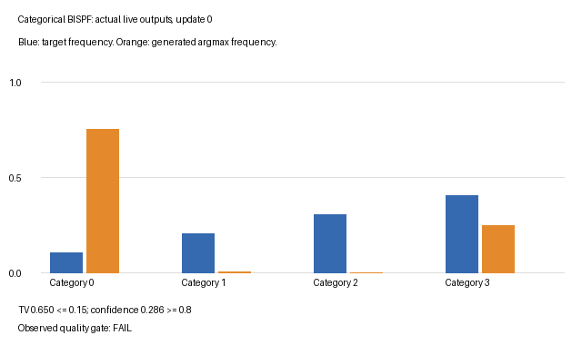

# BISPF: continuous vectors or categorical choices?

PR [#509](https://github.com/255BITS/ParticleGAN/pull/509) lets you tell the
BISPF **critic penalty** what its input means. It addresses two cases that
shape alone cannot distinguish:

- A language model's 1,024 hidden activations are 1,024 continuous coordinates.
- A distribution over four tokens is four categorical probabilities.

Both are matrices shaped `[batch, width]`. Width does not identify their meaning.
The declaration selects an existing penalty rule. It does not build a classifier,
tokenize text, convert logits to probabilities, or change your generator or loss.

## Choose the domain where you build the trainer

```python
from particlegan import GANTrainer, get_recipe

recipe = get_recipe("bispf_optimized")
trainer = GANTrainer(
    recipe, generator, critic,
    penalty_options={"input_domain": "categorical"},
    seed=0,
)
```

Use `"continuous"` for continuous feature vectors, regardless of width. Use
`"categorical"` when each row represents choices in a categorical codebook,
including small vocabularies. A common real input is one-hot rows; a generator
can emit differentiable softmax probabilities with the same width. Integer
category IDs and raw logits need a host-defined representation first.

The default `"auto"` preserves the existing shape gates. With default gates:

| Declaration | A `[batch, 4]` matrix | A `[batch, 1024]` matrix |
| --- | --- | --- |
| omitted / `"auto"` | continuous rule | categorical rule |
| `"continuous"` | continuous rule | continuous rule |
| `"categorical"` | categorical rule | categorical rule |

The automatic categorical threshold is **170**, including width 170. It is a
legacy heuristic, not evidence that the values are probabilities. `develop` also
exposes `bispf_shape_gates` and `bispf_gate_overrides`: these still control `auto`.
An explicit domain takes precedence over the automatic simplex gate, including
when that gate is disabled. Other declared shape gates retain their settings.

Categorical inputs must have native rank-two `[batch, categories]` geometry.
For sequence data, the host must decide what one observation is and how to
represent it. Arbitrarily flattening an entire sequence changes that meaning.
The declaration does not validate probability sums or repair a representation.
`"continuous"` also preserves existing image behavior for image-shaped tensors;
it is not an instruction to flatten images into feature vectors.

## What changes in the penalty?

The penalty controls how sharply the critic score changes with its inputs.
Write `g = dD(x)/dx`, the vector of input derivatives.

| Behavior with default gates | Continuous vector rule | Categorical rule |
| --- | --- | --- |
| Gradient measurement | RMS, `length(g) / sqrt(width)`, for widths above four; raw length at widths one to four | Raw `length(g)` |
| Cap on large gradients | Smooth cap | Squared excess above the cap |
| Squared-gradient regularization (`floor_pen` diagnostic) | Applied | Zero |
| Mean-score centering (`gauge_loss` diagnostic) | Applied | Zero |
| Extra real/fake transport chords | Used for small continuous vectors; bypassed for wide vectors under default settings | Bypassed |
| Thermal cooling | Existing continuous rules | Scale one |

The `floor_pen` name is historical: its expression penalizes squared gradients;
it does not enforce a positive minimum gradient length. The categorical rule is
an endpoint gradient cap. It can be **zero** when gradients are already below
the cap; the adversarial loss still trains the networks.

For a concrete calculation, let `D(x) = 0.2 * sum(x) + 0.3`. Every coordinate
has derivative `0.2`. At width 1,024 the raw length is `6.4` but the RMS length
is `0.2`. Those values lead to different caps. This is why declaring a wide
hidden vector continuous matters, even though its shape stays the same.

Run the arithmetic walkthrough:

```sh
python examples/bispf_input_domains.py
```

It prints all nine combinations of widths 4, 170 and 1,024 with the three
declarations, checks the expected gradient length, and performs backward passes.
Its hand-set linear critic is an explicit arithmetic fixture, not a learned GAN.

## Train an actual four-category GAN

From the source checkout, install the example dependencies first. GIF rendering
uses Pillow from the `experiments` extra.

```sh
python -m pip install -e '.[experiments,dev]'
python examples/bispf_categorical.py --output runs/software/bispf-categorical
```

The target category frequencies are `[0.1, 0.2, 0.3, 0.4]`. Real examples are
one-hot vectors such as `[0, 0, 1, 0]`. A small generator maps learnable latent
particles to four softmax probabilities. The critic sees the same four-coordinate
representation for real and fake data, and the trainer explicitly declares
`input_domain="categorical"`. Training never applies `argmax`, so gradients can
flow through the generator's softmax. `argmax` is only the demo's evaluation
decoder; a host that samples tokens stochastically needs to measure that separate
sampling law.

The script performs 2,000 updates on CPU and writes:

- `metrics.json`: the resolved recipe, domain, target, fixed gates, and observed
  category frequencies and confidence over training.
- `training.gif`: target and generated category frequencies at actual training
  states, with measured quality displayed on each frame.
- `checkpoint.pt`: the complete trainer, data RNG and observation history.

Progress is flushed as JSON lines. Protocol seed 0, the public deterministic
initializer, and separate training, data and evaluation streams make the run
repeatable. Evaluation uses 4,096 clean live outputs with fixed evaluation draws.

Two measurements answer different questions:

1. **Mass TV <= 0.15:** half the sum of absolute errors between target frequencies
   and generated `argmax` frequencies. This detects missing or overrepresented categories.
2. **Mean confidence >= 0.8:** the average largest probability in each generated
   row. This detects diffuse outputs that do not resemble the one-hot data.

The full example's quality gate requires both bounds at the last five scheduled
observations, after at least the declared 2,000-update budget. The scorer accepts
an exact one-hot oracle and rejects collapsed and diffuse controls in the tests.
Use `--check-quality` to make a failed full gate exit nonzero. A normal run always
reports its measured result; passing finite-loss software checks alone never
establishes learned quality. This teaching example supplies no Forge qualification,
native language-model quality claim or new default recipe.

The checked CPU run passes all final five observations. At update 2,000,
generated category frequencies are `[0.0884, 0.2263, 0.2883, 0.3970]`, mass TV
is `0.0263`, and mean confidence is `0.99998`. The
[saved measurements and resolved recipe](assets/bispf-categorical/metrics.json)
retain all 21 observations, including the failing initial state. The animation
shows those actual states, rather than interpolating a desired outcome:



For a quick software check, run `--steps 4`. Its reported quality result is
deliberately false because it has not completed the full learning protocol.

## Checkpoint the same run

```sh
python examples/bispf_categorical.py --steps 2000 --stop-after 1000 \
  --output runs/software/bispf-first-half
python examples/bispf_categorical.py --steps 2000 \
  --resume runs/software/bispf-first-half/checkpoint.pt \
  --output runs/software/bispf-resumed
```

Keep the full `--steps` budget the same. Resume restores the saved recipe through
`Recipe.from_dict`, the complete trainer and the caller-owned data RNG. The
trainer checkpoint includes `penalty_options` and rejects a different domain.
The tests compare uninterrupted and resumed trainer states, data streams and
observation histories exactly. Component-loop callers must save their domain
declaration alongside the recipe and optimizer states themselves:

```python
optimizer = recipe.make_critic_optimizer(critic)
penalty = recipe.make_critic_penalty(optimizer, input_domain="continuous")
```

PR [#508](https://github.com/255BITS/ParticleGAN/pull/508), also brought over from
`master`, makes the recipe choice explicit: use `get_recipe()` for a new run and
`Recipe.from_dict(saved_fields)` for restoration. Partial `Recipe(...)`
construction now raises instead of silently selecting historical defaults.
