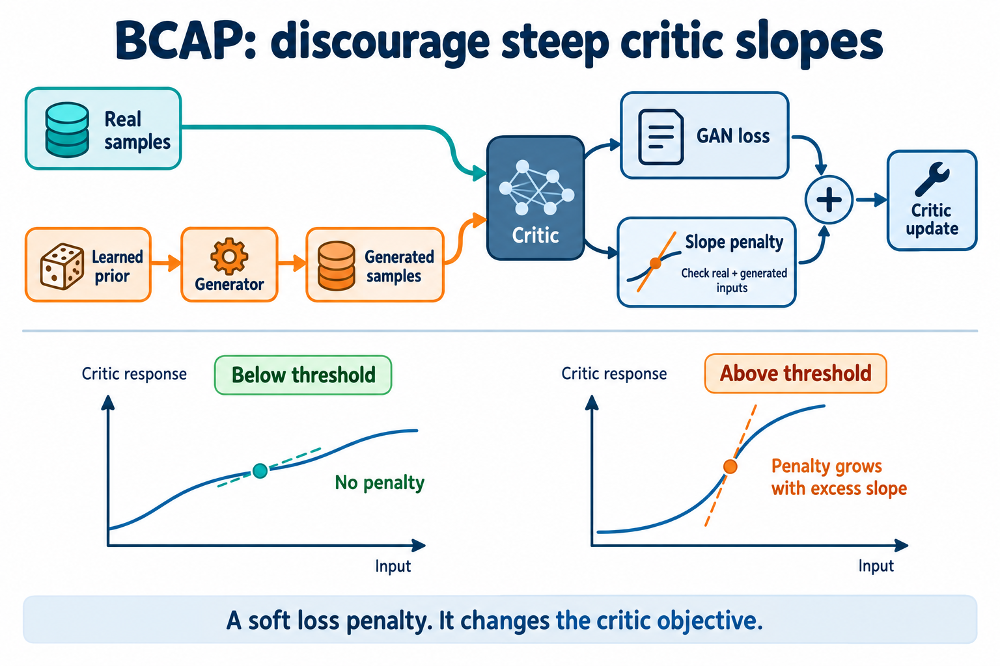

<!-- Generated Forge family report -->

# BCAP

[← Family leaderboard](../technique-inventory.md)

**Tags:** [adversarial-training](../technique-inventory.md#tag-adversarial-training) · [capped-input-gradients](../technique-inventory.md#tag-capped-input-gradients) · [critic-gradient-penalty](../technique-inventory.md#tag-critic-gradient-penalty) · [selectable-loss](../technique-inventory.md#tag-selectable-loss)

## Technique overview

BCAP adds a fixed critic penalty whenever the input-gradient norm exceeds a threshold, evaluated separately on real and generated data. This high-level formulation defines the family. Adam, normalized-gradient and DualNorm optimizers, learning rates, momentum and loss settings are configuration choices. The current benchmark uses the explicitly selected winning DualNorm recipe. Historical BCAP-with-K3P formulations and optimizer alternatives retain their complete, separate evidence below.



Conceptual illustration of the BCAP critic-loss mechanism, not measured training results. Generator/prior updates are described below.

## Mathematical formulation

$G$ is the generator, $D$ the raw-score critic, $P$ the task prior, $x$ a real batch, $z\sim P$ a latent batch and $y$ the generated batch, including any declared output noise. $C$ is the critic actually evaluated: $C=D$ without input noise; otherwise every forward evaluates $D(u+\epsilon_{\mathrm{in}})$ with a fresh draw. $\mathbb E$ means a sample mean, $\lVert\cdot\rVert_2$ is the Euclidean norm, $(a)_+=\max(a,0)$ and $\operatorname{softplus}(a)=\log(1+e^a)$. The scalar sketch detaches $y$ during the critic update and resamples differentiable $y$ after that update; joint and auxiliary hosts retain task-owned objectives. $g_r=\nabla_x C(x)$ and $g_f=\nabla_y C(y)$ are per-sample input gradients; $d$ counts critic-input coordinates. $\lambda$ is penalty strength and $\kappa$ the cap threshold. $\eta_0$ is the global base LR, $m_D$ and $m_P$ the role multipliers. A joint host also has an encoder $E$, whose adversarial objective must train both joint critic streams.

**Default paired adversarial loss**

$$
\begin{aligned}\ell_D&=\mathbb E\!\left[\operatorname{softplus}(C(y)-C(x))\right],\\\ell_G&=\mathbb E\!\left[\operatorname{softplus}(C(x)-C(y))\right].\end{aligned}
$$

These scalar losses are minimized. The critic objective is $\ell_D+R$; the generator adds only its declared auxiliary objectives. Critic fakes are detached, and generator fakes and both scores are recomputed after the critic step. $C$ includes any declared fresh input noise. This equation is the canonical paired-loss example; non-saturating, hinge, Wasserstein and least-squares options keep their own loss formulas, and joint hosts use their explicit generator/encoder objective.

**Fixed capped input-gradient penalty**

$$
R_{\mathrm{BCAP}}=\frac{\lambda}{2}\left\{\mathbb E\!\left[(\lVert g_r\rVert_2-\kappa)_+^2\right]+\mathbb E\!\left[(\lVert g_f\rVert_2-\kappa)_+^2\right]\right\}.
$$

The cap is a soft loss penalty on real and fake critic input-gradient norms, without division by input dimension. It does not directly clip critic parameter gradients or weights. The canonical BCAP cards use $\lambda=1$ and $\kappa=1$; source-bound selected recipes may differ.

## Simplified pseudocode

```text
Choose an adversarial loss, optimizer and its configuration.
For each task-owned training update:
  Sample real x and latent z from the task prior P; compute y=G(z).
  Critic objective = adversarial_D(D(x), D(stop_gradient(y))) + fixed BCAP penalty.
  Compute BCAP from real and fake input-gradient norms; the penalty updates D only.
  Backpropagate the critic objective and step D using the configured optimizer.
  With D fixed, recompute differentiable fake samples and scores.
  Backpropagate adversarial_G plus task-owned auxiliary objectives.
  Step G, trainable prior P and encoder E when present using their configured rates.
  Joint encoder/generator hosts reverse labels on both critic streams.
```


## Configuration differences

- The fixed capped input-gradient penalty defines BCAP. Optimizer choice, learning rates, momentum, numerical floors and adversarial-loss settings stay within this solution family.
- The selected configuration table reports the executed trainer recipe. Task-owned architecture, initialization, prior, sampling, update budget and auxiliary objectives remain bound to each experiment.
- One whole recorded configuration supplies every displayed result. Passing cells from different recipes or sources are never combined.
- The cap is a soft loss penalty on critic input gradients, not a hard bound on parameter gradients. The L2 norm is not divided by input dimension.
- Corrected joint-host candidates use both generator and encoder adversarial terms. Earlier incompatible receipts preserve their original source and verdicts.
- BCAP with K3P retains its additional K3P training mechanisms and is reported as a separate formulation.
- The opt-in per-offset DualNorm convolution extension completes the four previously unsupported image tasks, but all four sustained gates fail. This separate source-bound diagnostic retains constant learning rates and does not replace the selected configuration or original Tier 2 setup errors. See [the convolution readout](../bcap-convolution/README.md).

<details>
<summary>Implementation and recipe sources</summary>

These links support the explanation. Recorded results below remain bound to their own executed source.

- [particlegan/recipes.py](../../../particlegan/recipes.py)
- [particlegan/gan_loss.py](../../../particlegan/gan_loss.py)
- [particlegan/grad_regularizers.py](../../../particlegan/grad_regularizers.py)
- [particlegan/recipe_schedules.py](../../../particlegan/recipe_schedules.py)
- [configs/forge/ideas/bcap-pure-adam-v2.json](../../../configs/forge/ideas/bcap-pure-adam-v2.json)
- [reports/forge/pure-bcap/README.md](../pure-bcap/README.md)
- [particlegan/optim/dualnorm.py](../../../particlegan/optim/dualnorm.py)
- [docs/dualnorm-convolution.md](../../../docs/dualnorm-convolution.md)
- [reports/forge/bcap-convolution/README.md](../bcap-convolution/README.md)
- [reports/forge/bcap-convolution/readout.json](../bcap-convolution/readout.json)

</details>

Generated from one selected configuration per runtime. Recorded verdicts retain their original scientific contracts; grouping them under current views grants no new qualification.

## Performance

DCGAN on deterministic mock RGB data measures finite-update speed and memory. These separate performance-source receipts confer no image-quality, scientific qualification or default-promotion credit. Standard BatchNorm is retained in generator and critic; critic input gradients therefore include batch coupling. The shared critic uses a flattened 4×4 Linear scalar head for policy feature extraction; its module layout is fixed across recipes.

Synchronized wall time for one public trainer update, including its critic/generator/prior work; warmup, construction, mock-data generation, evaluation, GIFs and checkpoint writes are excluded.

Every cell is one run; timings are never pooled across devices or contention states. Compare only rows with the same task and matched key (source, runtime/dtype, physical device, initialization and batch streams). Unknown or contended observations are unpaired. Resolution progression changes the task, while each candidate keeps one global recipe. Images/s is B divided by full update time (one D and one G/prior update with separate real batches). Three warmup and ten measured updates give short-window median/p95 measurements; long-horizon policy costs and component phase times remain unknown.

[Compact performance evidence index](../scaling-performance.json) · [Protocol and bounded reproduction](../../../docs/forge-scaling-performance.md)

This registration covers 8 complete recipes. Historical alternatives outside its registered family roster add no missing benchmark cells. A changed selected recipe within a registered family remains unknown until measured.

No current selected-recipe update timings are measured. Missing timing cells remain **unknown**.

<a name="cohort-cuda-1bf9d7d34422"></a>

## Current benchmark

Runtime: **cuda**. Selected configuration: [recipe-prior-refactor-bcap-pure-v1](../../../configs/forge/ideas/recipe-prior-refactor-bcap-pure-v1.json).

Recorded qualification: **tier 1**, discriminator_stability revision 9. Other view rows below are navigation over recorded task evidence, not recomputed qualification. Their counts follow the declared view revisions (adaptation 4, clockfree_continuous 5, discriminator_stability 14, formulation_comparison 3, host_profile_transfer 6, quality_coverage 4); the recorded qualification keeps discriminator_stability revision 9 until new ordinary evidence is registered.

<details>
<summary>Configuration, source and runtime provenance</summary>

Source digest: `a5eafc73e4c4a995cc388b9be00bea5aec289fd35863099e369008e7def0ab14`. Candidate revision: `f1c9188b6987d8ba26d7c9ed484d1db0db34065afab7ce4a05ecdf3711584540`. Runtime cohort: `8a6ee0b1c9ce171bdb3f16e833253381dbb40ac16da53d973088a19764a7fb40`.

[Frozen numerical evidence](../technique-evidence/29979e41c9c05e3304156cf4a43ed9c9dda6953bffd0fb47096fe47d6b8af13a.json) · [Complete recipe, prior, initialization and sampling bindings](../technique-inventory.json)

Selection: recorded_source_measurement. Recorded source-bound original measurement retained; stale against current task contracts. No current measurement, qualification reuse or comparable live ranking. Original selection: Retain the declared selected recipe after explicit prior-ownership migration; fresh ordinary evidence only, no outcome ranking or archived qualification transfer.

</details>

## Current benchmark configuration

Uses the explicitly selected family configuration, regardless of alternative pass counts. Each count comes from this one complete configuration. Source differences preserve separate evidence contracts; the selection does not establish a controlled win or default adoption.

Recorded trainer recipe; task-owned architecture, prior, initialization, budget and sampling remain in the experiment receipts below. Null role overrides inherit the shared value. Optimizer parameters only apply to optimizers that consume them.

| Setting | Selected value |
| --- | --- |
| Adversarial loss | loss=non_saturating; loss_labels=[0.0, 1.0, 1.0] |
| Optimizer | optimizer_family=dualnorm; optimizer_momentum=0.0; optimizer_smoothing=0.001 |
| Learning rates | lr=0.012; d_lr_mult=1.5; prior_lr_mult=2.5 |
| Rate schedule | lr_schedule=cosine; lr_floor=1.0; network_lr_floor=1.0; network_lr_horizon_cap=None |
| Critic penalty | reg_arm=b_cap; reg_coeff=1.0; reg_kappa=1.0; reg_every=1; reg_anchor_weight=0.0 |
| Damping and guards | d_guard_ratio=0.0; latent_damping_max_rate=0.0; direct_particle_gain=False |
| Training noise | input_noise_std=0.0; output_noise_std=0.0; output_noise_mode=fixed |
| Averaging | ema_decay=0.0; serve_average=0.0 |

Base network rate: **0.012**; critic rate: **0.018**; prior rate: **0.03** before any declared schedule or host adaptation.

Selected optimizer rule: For matrix weights, use momentum m=mu*m+g and the polar update sqrt(max(1, fan_out/fan_in))*polar(m). Normalize bias/vector momentum per tensor. Skip matrix gradients below epsilon. Sampled prior rows receive independent normalized-gradient steps with no momentum; unsampled rows do not move. No Adam components.

<details>
<summary>Other recorded configurations in this family</summary>

These are whole configurations under their original sources. Their individual passing cells do not contribute to the selected result.

| Configuration | Required passes | Executed source | Display selection |
| --- | ---: | --- | --- |
| [recipe-prior-refactor-bcap-pure-v1](bcap-dualnorm.md) | 71/115 (9 not run, 7 blocked, 3 diagnostic attempts) | `a5eafc73e4c4` | Selected |
| [bcap-pure-adam-v2](bcap-pure-configuration.md) | 0/115 (115 not run) | `cbb19c5e55e9` | Alternative |

</details>

| View | Tier 1 tests | Tier 2 tests | Tier 3 tests | Tier 4 tests | Total distinct tests | Held (measured, not counted) |
| --- | ---: | ---: | ---: | ---: | ---: | ---: |
| [adaptation](bcap-pure.md#cohort-cuda-1bf9d7d34422-adaptation) | [3/3](bcap-pure.md#cohort-cuda-1bf9d7d34422-adaptation-tier-1) | [8/12](bcap-pure.md#cohort-cuda-1bf9d7d34422-adaptation-tier-2) | [0/1 (1 diagnostic attempt)](bcap-pure.md#cohort-cuda-1bf9d7d34422-adaptation-tier-3) | [0/0](bcap-pure.md#cohort-cuda-1bf9d7d34422-adaptation-tier-4) | [11/16 (1 diagnostic attempt)](bcap-pure.md#cohort-cuda-1bf9d7d34422-adaptation) | [0/7](bcap-pure.md#cohort-cuda-1bf9d7d34422-held) |
| [clockfree_continuous](bcap-pure.md#cohort-cuda-1bf9d7d34422-clockfree_continuous) | [4/4](bcap-pure.md#cohort-cuda-1bf9d7d34422-clockfree_continuous-tier-1) | [8/12](bcap-pure.md#cohort-cuda-1bf9d7d34422-clockfree_continuous-tier-2) | [0/6 (4 blocked, 2 diagnostic attempts)](bcap-pure.md#cohort-cuda-1bf9d7d34422-clockfree_continuous-tier-3) | [0/0](bcap-pure.md#cohort-cuda-1bf9d7d34422-clockfree_continuous-tier-4) | [12/22 (4 blocked, 2 diagnostic attempts)](bcap-pure.md#cohort-cuda-1bf9d7d34422-clockfree_continuous) | [0/7](bcap-pure.md#cohort-cuda-1bf9d7d34422-held) |
| [discriminator_stability](bcap-pure.md#cohort-cuda-1bf9d7d34422-discriminator_stability) | [6/13 (7 not run)](bcap-pure.md#cohort-cuda-1bf9d7d34422-discriminator_stability-tier-1) | [9/16 (2 not run)](bcap-pure.md#cohort-cuda-1bf9d7d34422-discriminator_stability-tier-2) | [0/1 (1 blocked)](bcap-pure.md#cohort-cuda-1bf9d7d34422-discriminator_stability-tier-3) | [0/0](bcap-pure.md#cohort-cuda-1bf9d7d34422-discriminator_stability-tier-4) | [15/30 (9 not run, 1 blocked)](bcap-pure.md#cohort-cuda-1bf9d7d34422-discriminator_stability) | [0/13 (6 not run)](bcap-pure.md#cohort-cuda-1bf9d7d34422-held) |
| [formulation_comparison](bcap-pure.md#cohort-cuda-1bf9d7d34422-formulation_comparison) | [3/3](bcap-pure.md#cohort-cuda-1bf9d7d34422-formulation_comparison-tier-1) | [8/12](bcap-pure.md#cohort-cuda-1bf9d7d34422-formulation_comparison-tier-2) | [0/1 (1 blocked)](bcap-pure.md#cohort-cuda-1bf9d7d34422-formulation_comparison-tier-3) | [0/0](bcap-pure.md#cohort-cuda-1bf9d7d34422-formulation_comparison-tier-4) | [11/16 (1 blocked)](bcap-pure.md#cohort-cuda-1bf9d7d34422-formulation_comparison) | [0/7](bcap-pure.md#cohort-cuda-1bf9d7d34422-held) |
| [host_profile_transfer](bcap-pure.md#cohort-cuda-1bf9d7d34422-host_profile_transfer) | [3/3](bcap-pure.md#cohort-cuda-1bf9d7d34422-host_profile_transfer-tier-1) | [8/12](bcap-pure.md#cohort-cuda-1bf9d7d34422-host_profile_transfer-tier-2) | [0/1 (1 blocked)](bcap-pure.md#cohort-cuda-1bf9d7d34422-host_profile_transfer-tier-3) | [0/0](bcap-pure.md#cohort-cuda-1bf9d7d34422-host_profile_transfer-tier-4) | [11/16 (1 blocked)](bcap-pure.md#cohort-cuda-1bf9d7d34422-host_profile_transfer) | [0/7](bcap-pure.md#cohort-cuda-1bf9d7d34422-held) |
| [quality_coverage](bcap-pure.md#cohort-cuda-1bf9d7d34422-quality_coverage) | [3/3](bcap-pure.md#cohort-cuda-1bf9d7d34422-quality_coverage-tier-1) | [8/12](bcap-pure.md#cohort-cuda-1bf9d7d34422-quality_coverage-tier-2) | [0/0](bcap-pure.md#cohort-cuda-1bf9d7d34422-quality_coverage-tier-3) | [0/0](bcap-pure.md#cohort-cuda-1bf9d7d34422-quality_coverage-tier-4) | [11/15](bcap-pure.md#cohort-cuda-1bf9d7d34422-quality_coverage) | [0/7](bcap-pure.md#cohort-cuda-1bf9d7d34422-held) |

Separate cohort coverage (excluded from family totals):

| View | Tier 1 tests | Tier 2 tests | Tier 3 tests | Tier 4 tests | Total distinct tests |
| --- | ---: | ---: | ---: | ---: | ---: |
| [lazy_cadence_coverage](bcap-pure.md#cohort-cuda-1bf9d7d34422-lazy_cadence_coverage) | [0/0](bcap-pure.md#cohort-cuda-1bf9d7d34422-lazy_cadence_coverage-tier-1) | [0/0](bcap-pure.md#cohort-cuda-1bf9d7d34422-lazy_cadence_coverage-tier-2) | [0/0](bcap-pure.md#cohort-cuda-1bf9d7d34422-lazy_cadence_coverage-tier-3) | [0/0](bcap-pure.md#cohort-cuda-1bf9d7d34422-lazy_cadence_coverage-tier-4) | [0/0](bcap-pure.md#cohort-cuda-1bf9d7d34422-lazy_cadence_coverage) |
| [tier1_policy_coverage](bcap-pure.md#cohort-cuda-1bf9d7d34422-tier1_policy_coverage) | [0/7 (7 not run)](bcap-pure.md#cohort-cuda-1bf9d7d34422-tier1_policy_coverage-tier-1) | [0/0](bcap-pure.md#cohort-cuda-1bf9d7d34422-tier1_policy_coverage-tier-2) | [0/0](bcap-pure.md#cohort-cuda-1bf9d7d34422-tier1_policy_coverage-tier-3) | [0/0](bcap-pure.md#cohort-cuda-1bf9d7d34422-tier1_policy_coverage-tier-4) | [0/7 (7 not run)](bcap-pure.md#cohort-cuda-1bf9d7d34422-tier1_policy_coverage) |

With run-attempt coverage, not run means no attempt; incompatible means a constructor refusal; blocked means a missing required artifact; diagnostic attempts retain separate-runtime outcomes. Other cohorts retain their recorded missing/preflight counts. All remain in the required denominator. PASS and FAIL both count as executed. Attempted errors retain their status and cause; changes to today's test definition are shown separately from execution coverage.

<a name="cohort-cuda-1bf9d7d34422-tier-1"></a>

### Tier 1 across views

Shared experiments appear once in this list; the family numerator/denominator count their view requirements.

| Experiment | Required by | Recorded result | Test definition |
| --- | --- | --- | --- |
| [ae_gan_hold](bcap-pure.md#cohort-cuda-1bf9d7d34422-experiment-ae_gan_hold) | [adaptation](bcap-pure.md#cohort-cuda-1bf9d7d34422-adaptation-tier-1), [clockfree_continuous](bcap-pure.md#cohort-cuda-1bf9d7d34422-clockfree_continuous-tier-1), [discriminator_stability](bcap-pure.md#cohort-cuda-1bf9d7d34422-discriminator_stability-tier-1), [formulation_comparison](bcap-pure.md#cohort-cuda-1bf9d7d34422-formulation_comparison-tier-1), [host_profile_transfer](bcap-pure.md#cohort-cuda-1bf9d7d34422-host_profile_transfer-tier-1), [quality_coverage](bcap-pure.md#cohort-cuda-1bf9d7d34422-quality_coverage-tier-1) | PASS | changed since run |
| [clockfree_audit_measurement_v1](bcap-pure.md#cohort-cuda-1bf9d7d34422-experiment-clockfree_audit_measurement_v1) | [clockfree_continuous](bcap-pure.md#cohort-cuda-1bf9d7d34422-clockfree_continuous-tier-1) | PASS | matches recorded run |
| [five_word_joint_smoke](bcap-pure.md#cohort-cuda-1bf9d7d34422-experiment-five_word_joint_smoke) | [discriminator_stability](bcap-pure.md#cohort-cuda-1bf9d7d34422-discriminator_stability-tier-1) | PASS | changed since run |
| [gaussian1d_smoke](bcap-pure.md#cohort-cuda-1bf9d7d34422-experiment-gaussian1d_smoke) | [discriminator_stability](bcap-pure.md#cohort-cuda-1bf9d7d34422-discriminator_stability-tier-1) | PASS | matches recorded run |
| [model_ae_ddgan_gaussian_chain](bcap-pure.md#cohort-cuda-1bf9d7d34422-experiment-model_ae_ddgan_gaussian_chain) | [discriminator_stability](bcap-pure.md#cohort-cuda-1bf9d7d34422-discriminator_stability-tier-1) | UNKNOWN | recorded definition unavailable |
| [model_ae_gan_multimodal](bcap-pure.md#cohort-cuda-1bf9d7d34422-experiment-model_ae_gan_multimodal) | [discriminator_stability](bcap-pure.md#cohort-cuda-1bf9d7d34422-discriminator_stability-tier-1) | UNKNOWN | recorded definition unavailable |
| [model_ae_reconstruction](bcap-pure.md#cohort-cuda-1bf9d7d34422-experiment-model_ae_reconstruction) | [discriminator_stability](bcap-pure.md#cohort-cuda-1bf9d7d34422-discriminator_stability-tier-1) | UNKNOWN | recorded definition unavailable |
| [model_ddgan_gaussian_chain](bcap-pure.md#cohort-cuda-1bf9d7d34422-experiment-model_ddgan_gaussian_chain) | [discriminator_stability](bcap-pure.md#cohort-cuda-1bf9d7d34422-discriminator_stability-tier-1) | UNKNOWN | recorded definition unavailable |
| [model_vae_categorical](bcap-pure.md#cohort-cuda-1bf9d7d34422-experiment-model_vae_categorical) | [discriminator_stability](bcap-pure.md#cohort-cuda-1bf9d7d34422-discriminator_stability-tier-1) | UNKNOWN | recorded definition unavailable |
| [model_vae_hard](bcap-pure.md#cohort-cuda-1bf9d7d34422-experiment-model_vae_hard) | [discriminator_stability](bcap-pure.md#cohort-cuda-1bf9d7d34422-discriminator_stability-tier-1) | UNKNOWN | recorded definition unavailable |
| [ring16_acquisition](bcap-pure.md#cohort-cuda-1bf9d7d34422-experiment-ring16_acquisition) | [discriminator_stability](bcap-pure.md#cohort-cuda-1bf9d7d34422-discriminator_stability-tier-1) | PASS | matches recorded run |
| [two_pole](bcap-pure.md#cohort-cuda-1bf9d7d34422-experiment-two_pole) | [adaptation](bcap-pure.md#cohort-cuda-1bf9d7d34422-adaptation-tier-1), [clockfree_continuous](bcap-pure.md#cohort-cuda-1bf9d7d34422-clockfree_continuous-tier-1), [discriminator_stability](bcap-pure.md#cohort-cuda-1bf9d7d34422-discriminator_stability-tier-1), [formulation_comparison](bcap-pure.md#cohort-cuda-1bf9d7d34422-formulation_comparison-tier-1), [host_profile_transfer](bcap-pure.md#cohort-cuda-1bf9d7d34422-host_profile_transfer-tier-1), [quality_coverage](bcap-pure.md#cohort-cuda-1bf9d7d34422-quality_coverage-tier-1) | PASS | changed since run |
| [unused_token_hold](bcap-pure.md#cohort-cuda-1bf9d7d34422-experiment-unused_token_hold) | [adaptation](bcap-pure.md#cohort-cuda-1bf9d7d34422-adaptation-tier-1), [clockfree_continuous](bcap-pure.md#cohort-cuda-1bf9d7d34422-clockfree_continuous-tier-1), [discriminator_stability](bcap-pure.md#cohort-cuda-1bf9d7d34422-discriminator_stability-tier-1), [formulation_comparison](bcap-pure.md#cohort-cuda-1bf9d7d34422-formulation_comparison-tier-1), [host_profile_transfer](bcap-pure.md#cohort-cuda-1bf9d7d34422-host_profile_transfer-tier-1), [quality_coverage](bcap-pure.md#cohort-cuda-1bf9d7d34422-quality_coverage-tier-1) | PASS | changed since run |
| [zero_tanh_smoke](bcap-pure.md#cohort-cuda-1bf9d7d34422-experiment-zero_tanh_smoke) | [discriminator_stability](bcap-pure.md#cohort-cuda-1bf9d7d34422-discriminator_stability-tier-1) | UNKNOWN | recorded definition unavailable |

<a name="cohort-cuda-1bf9d7d34422-tier-2"></a>

### Tier 2 across views

Shared experiments appear once in this list; the family numerator/denominator count their view requirements.

| Experiment | Required by | Recorded result | Test definition |
| --- | --- | --- | --- |
| [cover_leftover](bcap-pure.md#cohort-cuda-1bf9d7d34422-experiment-cover_leftover) | [adaptation](bcap-pure.md#cohort-cuda-1bf9d7d34422-adaptation-tier-2), [clockfree_continuous](bcap-pure.md#cohort-cuda-1bf9d7d34422-clockfree_continuous-tier-2), [discriminator_stability](bcap-pure.md#cohort-cuda-1bf9d7d34422-discriminator_stability-tier-2), [formulation_comparison](bcap-pure.md#cohort-cuda-1bf9d7d34422-formulation_comparison-tier-2), [host_profile_transfer](bcap-pure.md#cohort-cuda-1bf9d7d34422-host_profile_transfer-tier-2), [quality_coverage](bcap-pure.md#cohort-cuda-1bf9d7d34422-quality_coverage-tier-2) | PASS | changed since run |
| [five_word_joint_hold](bcap-pure.md#cohort-cuda-1bf9d7d34422-experiment-five_word_joint_hold) | [discriminator_stability](bcap-pure.md#cohort-cuda-1bf9d7d34422-discriminator_stability-tier-2) | PASS | changed since run |
| [gaussian1d_stability](bcap-pure.md#cohort-cuda-1bf9d7d34422-experiment-gaussian1d_stability) | [discriminator_stability](bcap-pure.md#cohort-cuda-1bf9d7d34422-discriminator_stability-tier-2) | FAIL | matches recorded run |
| [grid100](bcap-pure.md#cohort-cuda-1bf9d7d34422-experiment-grid100) | [adaptation](bcap-pure.md#cohort-cuda-1bf9d7d34422-adaptation-tier-2), [clockfree_continuous](bcap-pure.md#cohort-cuda-1bf9d7d34422-clockfree_continuous-tier-2), [discriminator_stability](bcap-pure.md#cohort-cuda-1bf9d7d34422-discriminator_stability-tier-2), [formulation_comparison](bcap-pure.md#cohort-cuda-1bf9d7d34422-formulation_comparison-tier-2), [host_profile_transfer](bcap-pure.md#cohort-cuda-1bf9d7d34422-host_profile_transfer-tier-2), [quality_coverage](bcap-pure.md#cohort-cuda-1bf9d7d34422-quality_coverage-tier-2) | FAIL | changed since run |
| [img_stripes2](bcap-pure.md#cohort-cuda-1bf9d7d34422-experiment-img_stripes2) | [adaptation](bcap-pure.md#cohort-cuda-1bf9d7d34422-adaptation-tier-2), [clockfree_continuous](bcap-pure.md#cohort-cuda-1bf9d7d34422-clockfree_continuous-tier-2), [discriminator_stability](bcap-pure.md#cohort-cuda-1bf9d7d34422-discriminator_stability-tier-2), [formulation_comparison](bcap-pure.md#cohort-cuda-1bf9d7d34422-formulation_comparison-tier-2), [host_profile_transfer](bcap-pure.md#cohort-cuda-1bf9d7d34422-host_profile_transfer-tier-2), [quality_coverage](bcap-pure.md#cohort-cuda-1bf9d7d34422-quality_coverage-tier-2) | PASS | matches recorded run |
| [mid_scale_identity](bcap-pure.md#cohort-cuda-1bf9d7d34422-experiment-mid_scale_identity) | [adaptation](bcap-pure.md#cohort-cuda-1bf9d7d34422-adaptation-tier-2), [clockfree_continuous](bcap-pure.md#cohort-cuda-1bf9d7d34422-clockfree_continuous-tier-2), [discriminator_stability](bcap-pure.md#cohort-cuda-1bf9d7d34422-discriminator_stability-tier-2), [formulation_comparison](bcap-pure.md#cohort-cuda-1bf9d7d34422-formulation_comparison-tier-2), [host_profile_transfer](bcap-pure.md#cohort-cuda-1bf9d7d34422-host_profile_transfer-tier-2), [quality_coverage](bcap-pure.md#cohort-cuda-1bf9d7d34422-quality_coverage-tier-2) | PASS | changed since run |
| [mode_hold](bcap-pure.md#cohort-cuda-1bf9d7d34422-experiment-mode_hold) | [adaptation](bcap-pure.md#cohort-cuda-1bf9d7d34422-adaptation-tier-2), [clockfree_continuous](bcap-pure.md#cohort-cuda-1bf9d7d34422-clockfree_continuous-tier-2), [discriminator_stability](bcap-pure.md#cohort-cuda-1bf9d7d34422-discriminator_stability-tier-2), [formulation_comparison](bcap-pure.md#cohort-cuda-1bf9d7d34422-formulation_comparison-tier-2), [host_profile_transfer](bcap-pure.md#cohort-cuda-1bf9d7d34422-host_profile_transfer-tier-2), [quality_coverage](bcap-pure.md#cohort-cuda-1bf9d7d34422-quality_coverage-tier-2) | FAIL | matches recorded run |
| [model_ae_ddgan_bimodal_chain](bcap-pure.md#cohort-cuda-1bf9d7d34422-experiment-model_ae_ddgan_bimodal_chain) | [discriminator_stability](bcap-pure.md#cohort-cuda-1bf9d7d34422-discriminator_stability-tier-2) | UNKNOWN | recorded definition unavailable |
| [model_ddgan_bimodal_chain](bcap-pure.md#cohort-cuda-1bf9d7d34422-experiment-model_ddgan_bimodal_chain) | [discriminator_stability](bcap-pure.md#cohort-cuda-1bf9d7d34422-discriminator_stability-tier-2) | UNKNOWN | recorded definition unavailable |
| [residual_student](bcap-pure.md#cohort-cuda-1bf9d7d34422-experiment-residual_student) | [adaptation](bcap-pure.md#cohort-cuda-1bf9d7d34422-adaptation-tier-2), [clockfree_continuous](bcap-pure.md#cohort-cuda-1bf9d7d34422-clockfree_continuous-tier-2), [discriminator_stability](bcap-pure.md#cohort-cuda-1bf9d7d34422-discriminator_stability-tier-2), [formulation_comparison](bcap-pure.md#cohort-cuda-1bf9d7d34422-formulation_comparison-tier-2), [host_profile_transfer](bcap-pure.md#cohort-cuda-1bf9d7d34422-host_profile_transfer-tier-2), [quality_coverage](bcap-pure.md#cohort-cuda-1bf9d7d34422-quality_coverage-tier-2) | PASS | changed since run |
| [rotated100](bcap-pure.md#cohort-cuda-1bf9d7d34422-experiment-rotated100) | [adaptation](bcap-pure.md#cohort-cuda-1bf9d7d34422-adaptation-tier-2), [clockfree_continuous](bcap-pure.md#cohort-cuda-1bf9d7d34422-clockfree_continuous-tier-2), [discriminator_stability](bcap-pure.md#cohort-cuda-1bf9d7d34422-discriminator_stability-tier-2), [formulation_comparison](bcap-pure.md#cohort-cuda-1bf9d7d34422-formulation_comparison-tier-2), [host_profile_transfer](bcap-pure.md#cohort-cuda-1bf9d7d34422-host_profile_transfer-tier-2), [quality_coverage](bcap-pure.md#cohort-cuda-1bf9d7d34422-quality_coverage-tier-2) | FAIL | changed since run |
| [staggered100](bcap-pure.md#cohort-cuda-1bf9d7d34422-experiment-staggered100) | [adaptation](bcap-pure.md#cohort-cuda-1bf9d7d34422-adaptation-tier-2), [clockfree_continuous](bcap-pure.md#cohort-cuda-1bf9d7d34422-clockfree_continuous-tier-2), [discriminator_stability](bcap-pure.md#cohort-cuda-1bf9d7d34422-discriminator_stability-tier-2), [formulation_comparison](bcap-pure.md#cohort-cuda-1bf9d7d34422-formulation_comparison-tier-2), [host_profile_transfer](bcap-pure.md#cohort-cuda-1bf9d7d34422-host_profile_transfer-tier-2), [quality_coverage](bcap-pure.md#cohort-cuda-1bf9d7d34422-quality_coverage-tier-2) | FAIL | changed since run |
| [trajectory](bcap-pure.md#cohort-cuda-1bf9d7d34422-experiment-trajectory) | [adaptation](bcap-pure.md#cohort-cuda-1bf9d7d34422-adaptation-tier-2), [clockfree_continuous](bcap-pure.md#cohort-cuda-1bf9d7d34422-clockfree_continuous-tier-2), [discriminator_stability](bcap-pure.md#cohort-cuda-1bf9d7d34422-discriminator_stability-tier-2), [formulation_comparison](bcap-pure.md#cohort-cuda-1bf9d7d34422-formulation_comparison-tier-2), [host_profile_transfer](bcap-pure.md#cohort-cuda-1bf9d7d34422-host_profile_transfer-tier-2), [quality_coverage](bcap-pure.md#cohort-cuda-1bf9d7d34422-quality_coverage-tier-2) | PASS | changed since run |
| [unipolar](bcap-pure.md#cohort-cuda-1bf9d7d34422-experiment-unipolar) | [adaptation](bcap-pure.md#cohort-cuda-1bf9d7d34422-adaptation-tier-2), [clockfree_continuous](bcap-pure.md#cohort-cuda-1bf9d7d34422-clockfree_continuous-tier-2), [discriminator_stability](bcap-pure.md#cohort-cuda-1bf9d7d34422-discriminator_stability-tier-2), [formulation_comparison](bcap-pure.md#cohort-cuda-1bf9d7d34422-formulation_comparison-tier-2), [host_profile_transfer](bcap-pure.md#cohort-cuda-1bf9d7d34422-host_profile_transfer-tier-2), [quality_coverage](bcap-pure.md#cohort-cuda-1bf9d7d34422-quality_coverage-tier-2) | PASS | changed since run |
| [vector_spiral](bcap-pure.md#cohort-cuda-1bf9d7d34422-experiment-vector_spiral) | [adaptation](bcap-pure.md#cohort-cuda-1bf9d7d34422-adaptation-tier-2), [clockfree_continuous](bcap-pure.md#cohort-cuda-1bf9d7d34422-clockfree_continuous-tier-2), [discriminator_stability](bcap-pure.md#cohort-cuda-1bf9d7d34422-discriminator_stability-tier-2), [formulation_comparison](bcap-pure.md#cohort-cuda-1bf9d7d34422-formulation_comparison-tier-2), [host_profile_transfer](bcap-pure.md#cohort-cuda-1bf9d7d34422-host_profile_transfer-tier-2), [quality_coverage](bcap-pure.md#cohort-cuda-1bf9d7d34422-quality_coverage-tier-2) | PASS | matches recorded run |
| [vector_two_broad](bcap-pure.md#cohort-cuda-1bf9d7d34422-experiment-vector_two_broad) | [adaptation](bcap-pure.md#cohort-cuda-1bf9d7d34422-adaptation-tier-2), [clockfree_continuous](bcap-pure.md#cohort-cuda-1bf9d7d34422-clockfree_continuous-tier-2), [discriminator_stability](bcap-pure.md#cohort-cuda-1bf9d7d34422-discriminator_stability-tier-2), [formulation_comparison](bcap-pure.md#cohort-cuda-1bf9d7d34422-formulation_comparison-tier-2), [host_profile_transfer](bcap-pure.md#cohort-cuda-1bf9d7d34422-host_profile_transfer-tier-2), [quality_coverage](bcap-pure.md#cohort-cuda-1bf9d7d34422-quality_coverage-tier-2) | PASS | matches recorded run |

Held at this tier (measured and shown, not counted):

| Experiment | Held in | Recorded result | Test definition |
| --- | --- | --- | --- |
| [img_bars4](bcap-pure.md#cohort-cuda-1bf9d7d34422-experiment-img_bars4) | [adaptation](bcap-pure.md#cohort-cuda-1bf9d7d34422-adaptation-tier-2), [clockfree_continuous](bcap-pure.md#cohort-cuda-1bf9d7d34422-clockfree_continuous-tier-2), [discriminator_stability](bcap-pure.md#cohort-cuda-1bf9d7d34422-discriminator_stability-tier-2), [formulation_comparison](bcap-pure.md#cohort-cuda-1bf9d7d34422-formulation_comparison-tier-2), [host_profile_transfer](bcap-pure.md#cohort-cuda-1bf9d7d34422-host_profile_transfer-tier-2), [quality_coverage](bcap-pure.md#cohort-cuda-1bf9d7d34422-quality_coverage-tier-2) | FAIL | matches recorded run |
| [img_blobs4](bcap-pure.md#cohort-cuda-1bf9d7d34422-experiment-img_blobs4) | [adaptation](bcap-pure.md#cohort-cuda-1bf9d7d34422-adaptation-tier-2), [clockfree_continuous](bcap-pure.md#cohort-cuda-1bf9d7d34422-clockfree_continuous-tier-2), [discriminator_stability](bcap-pure.md#cohort-cuda-1bf9d7d34422-discriminator_stability-tier-2), [formulation_comparison](bcap-pure.md#cohort-cuda-1bf9d7d34422-formulation_comparison-tier-2), [host_profile_transfer](bcap-pure.md#cohort-cuda-1bf9d7d34422-host_profile_transfer-tier-2), [quality_coverage](bcap-pure.md#cohort-cuda-1bf9d7d34422-quality_coverage-tier-2) | FAIL | matches recorded run |
| [img_intensity2](bcap-pure.md#cohort-cuda-1bf9d7d34422-experiment-img_intensity2) | [adaptation](bcap-pure.md#cohort-cuda-1bf9d7d34422-adaptation-tier-2), [clockfree_continuous](bcap-pure.md#cohort-cuda-1bf9d7d34422-clockfree_continuous-tier-2), [discriminator_stability](bcap-pure.md#cohort-cuda-1bf9d7d34422-discriminator_stability-tier-2), [formulation_comparison](bcap-pure.md#cohort-cuda-1bf9d7d34422-formulation_comparison-tier-2), [host_profile_transfer](bcap-pure.md#cohort-cuda-1bf9d7d34422-host_profile_transfer-tier-2), [quality_coverage](bcap-pure.md#cohort-cuda-1bf9d7d34422-quality_coverage-tier-2) | FAIL | matches recorded run |
| [vector_anisotropic](bcap-pure.md#cohort-cuda-1bf9d7d34422-experiment-vector_anisotropic) | [adaptation](bcap-pure.md#cohort-cuda-1bf9d7d34422-adaptation-tier-2), [clockfree_continuous](bcap-pure.md#cohort-cuda-1bf9d7d34422-clockfree_continuous-tier-2), [discriminator_stability](bcap-pure.md#cohort-cuda-1bf9d7d34422-discriminator_stability-tier-2), [formulation_comparison](bcap-pure.md#cohort-cuda-1bf9d7d34422-formulation_comparison-tier-2), [host_profile_transfer](bcap-pure.md#cohort-cuda-1bf9d7d34422-host_profile_transfer-tier-2), [quality_coverage](bcap-pure.md#cohort-cuda-1bf9d7d34422-quality_coverage-tier-2) | FAIL | matches recorded run |
| [vector_overlap](bcap-pure.md#cohort-cuda-1bf9d7d34422-experiment-vector_overlap) | [adaptation](bcap-pure.md#cohort-cuda-1bf9d7d34422-adaptation-tier-2), [clockfree_continuous](bcap-pure.md#cohort-cuda-1bf9d7d34422-clockfree_continuous-tier-2), [discriminator_stability](bcap-pure.md#cohort-cuda-1bf9d7d34422-discriminator_stability-tier-2), [formulation_comparison](bcap-pure.md#cohort-cuda-1bf9d7d34422-formulation_comparison-tier-2), [host_profile_transfer](bcap-pure.md#cohort-cuda-1bf9d7d34422-host_profile_transfer-tier-2), [quality_coverage](bcap-pure.md#cohort-cuda-1bf9d7d34422-quality_coverage-tier-2) | FAIL | matches recorded run |
| [vector_unequal_mass](bcap-pure.md#cohort-cuda-1bf9d7d34422-experiment-vector_unequal_mass) | [adaptation](bcap-pure.md#cohort-cuda-1bf9d7d34422-adaptation-tier-2), [clockfree_continuous](bcap-pure.md#cohort-cuda-1bf9d7d34422-clockfree_continuous-tier-2), [discriminator_stability](bcap-pure.md#cohort-cuda-1bf9d7d34422-discriminator_stability-tier-2), [formulation_comparison](bcap-pure.md#cohort-cuda-1bf9d7d34422-formulation_comparison-tier-2), [host_profile_transfer](bcap-pure.md#cohort-cuda-1bf9d7d34422-host_profile_transfer-tier-2), [quality_coverage](bcap-pure.md#cohort-cuda-1bf9d7d34422-quality_coverage-tier-2) | FAIL | matches recorded run |
| [vector_unequal_width](bcap-pure.md#cohort-cuda-1bf9d7d34422-experiment-vector_unequal_width) | [adaptation](bcap-pure.md#cohort-cuda-1bf9d7d34422-adaptation-tier-2), [clockfree_continuous](bcap-pure.md#cohort-cuda-1bf9d7d34422-clockfree_continuous-tier-2), [discriminator_stability](bcap-pure.md#cohort-cuda-1bf9d7d34422-discriminator_stability-tier-2), [formulation_comparison](bcap-pure.md#cohort-cuda-1bf9d7d34422-formulation_comparison-tier-2), [host_profile_transfer](bcap-pure.md#cohort-cuda-1bf9d7d34422-host_profile_transfer-tier-2), [quality_coverage](bcap-pure.md#cohort-cuda-1bf9d7d34422-quality_coverage-tier-2) | FAIL | matches recorded run |

<a name="cohort-cuda-1bf9d7d34422-tier-3"></a>

### Tier 3 across views

Shared experiments appear once in this list; the family numerator/denominator count their view requirements.

| Experiment | Required by | Recorded result | Test definition |
| --- | --- | --- | --- |
| [clockfree_audit](bcap-pure.md#cohort-cuda-1bf9d7d34422-experiment-clockfree_audit) | [clockfree_continuous](bcap-pure.md#cohort-cuda-1bf9d7d34422-clockfree_continuous-tier-3) | UNKNOWN | recorded definition unavailable |
| [grid100_14k](bcap-pure.md#cohort-cuda-1bf9d7d34422-experiment-grid100_14k) | [clockfree_continuous](bcap-pure.md#cohort-cuda-1bf9d7d34422-clockfree_continuous-tier-3) | UNKNOWN | recorded definition unavailable |
| [ring_extension](bcap-pure.md#cohort-cuda-1bf9d7d34422-experiment-ring_extension) | [clockfree_continuous](bcap-pure.md#cohort-cuda-1bf9d7d34422-clockfree_continuous-tier-3), [discriminator_stability](bcap-pure.md#cohort-cuda-1bf9d7d34422-discriminator_stability-tier-3), [formulation_comparison](bcap-pure.md#cohort-cuda-1bf9d7d34422-formulation_comparison-tier-3), [host_profile_transfer](bcap-pure.md#cohort-cuda-1bf9d7d34422-host_profile_transfer-tier-3) | UNKNOWN | matches recorded run |
| [rotated100_14k](bcap-pure.md#cohort-cuda-1bf9d7d34422-experiment-rotated100_14k) | [clockfree_continuous](bcap-pure.md#cohort-cuda-1bf9d7d34422-clockfree_continuous-tier-3) | UNKNOWN | recorded definition unavailable |
| [staggered100_14k](bcap-pure.md#cohort-cuda-1bf9d7d34422-experiment-staggered100_14k) | [clockfree_continuous](bcap-pure.md#cohort-cuda-1bf9d7d34422-clockfree_continuous-tier-3) | UNKNOWN | recorded definition unavailable |
| [target_shift_recovery](bcap-pure.md#cohort-cuda-1bf9d7d34422-experiment-target_shift_recovery) | [adaptation](bcap-pure.md#cohort-cuda-1bf9d7d34422-adaptation-tier-3), [clockfree_continuous](bcap-pure.md#cohort-cuda-1bf9d7d34422-clockfree_continuous-tier-3) | UNKNOWN | recorded definition unavailable |

Held at this tier (measured and shown, not counted):

| Experiment | Held in | Recorded result | Test definition |
| --- | --- | --- | --- |
| [zero_tanh_rail_escape](bcap-pure.md#cohort-cuda-1bf9d7d34422-experiment-zero_tanh_rail_escape) | [discriminator_stability](bcap-pure.md#cohort-cuda-1bf9d7d34422-discriminator_stability-tier-3) | UNKNOWN | recorded definition unavailable |

Removed from the count at this tier (still measured):

| Experiment | Removed in | Reason | Recorded result |
| --- | --- | --- | --- |
| [ring_hold](bcap-pure.md#cohort-cuda-1bf9d7d34422-experiment-ring_hold) | [clockfree_continuous](bcap-pure.md#cohort-cuda-1bf9d7d34422-clockfree_continuous-tier-3), [discriminator_stability](bcap-pure.md#cohort-cuda-1bf9d7d34422-discriminator_stability-tier-3), [formulation_comparison](bcap-pure.md#cohort-cuda-1bf9d7d34422-formulation_comparison-tier-3), [host_profile_transfer](bcap-pure.md#cohort-cuda-1bf9d7d34422-host_profile_transfer-tier-3) | [removed: phase of ring_extension (counted there)](../test-dispositions-20261015/README.md#ring_hold) | UNKNOWN |

<a name="cohort-cuda-1bf9d7d34422-tier-4"></a>

### Tier 4 across views

Shared experiments appear once in this list; the family numerator/denominator count their view requirements.

| Experiment | Required by | Recorded result | Test definition |
| --- | --- | --- | --- |

Held at this tier (measured and shown, not counted):

| Experiment | Held in | Recorded result | Test definition |
| --- | --- | --- | --- |
| [grid100_mlp16](bcap-pure.md#cohort-cuda-1bf9d7d34422-experiment-grid100_mlp16) | [discriminator_stability](bcap-pure.md#cohort-cuda-1bf9d7d34422-discriminator_stability-tier-4) | UNKNOWN | recorded definition unavailable |
| [grid100_res16_tanh](bcap-pure.md#cohort-cuda-1bf9d7d34422-experiment-grid100_res16_tanh) | [discriminator_stability](bcap-pure.md#cohort-cuda-1bf9d7d34422-discriminator_stability-tier-4) | UNKNOWN | recorded definition unavailable |
| [misgan_block_neural_imputer](bcap-pure.md#cohort-cuda-1bf9d7d34422-experiment-misgan_block_neural_imputer) | [discriminator_stability](bcap-pure.md#cohort-cuda-1bf9d7d34422-discriminator_stability-tier-4) | UNKNOWN | recorded definition unavailable |
| [misgan_block_recovery](bcap-pure.md#cohort-cuda-1bf9d7d34422-experiment-misgan_block_recovery) | [discriminator_stability](bcap-pure.md#cohort-cuda-1bf9d7d34422-discriminator_stability-tier-4) | UNKNOWN | recorded definition unavailable |
| [ring16_bigan_continuous](bcap-pure.md#cohort-cuda-1bf9d7d34422-experiment-ring16_bigan_continuous) | [discriminator_stability](bcap-pure.md#cohort-cuda-1bf9d7d34422-discriminator_stability-tier-4) | UNKNOWN | recorded definition unavailable |

<a name="cohort-cuda-1bf9d7d34422-held"></a>

### Held tests (still measured)

These tests keep running and keep this recipe's recorded result, but they do not count toward its totals or qualification. Each counts again once its re-entry rule is met.

| Experiment | Held in | Recorded result | Reason | Summary | Re-entry rule |
| --- | --- | --- | --- | --- | --- |
| [img_bars4](bcap-pure.md#cohort-cuda-1bf9d7d34422-experiment-img_bars4) | [adaptation / Tier 2](bcap-pure.md#cohort-cuda-1bf9d7d34422-adaptation-tier-2), [clockfree_continuous / Tier 2](bcap-pure.md#cohort-cuda-1bf9d7d34422-clockfree_continuous-tier-2), [discriminator_stability / Tier 2](bcap-pure.md#cohort-cuda-1bf9d7d34422-discriminator_stability-tier-2), [formulation_comparison / Tier 2](bcap-pure.md#cohort-cuda-1bf9d7d34422-formulation_comparison-tier-2), [host_profile_transfer / Tier 2](bcap-pure.md#cohort-cuda-1bf9d7d34422-host_profile_transfer-tier-2), [quality_coverage / Tier 2](bcap-pure.md#cohort-cuda-1bf9d7d34422-quality_coverage-tier-2) | FAIL | [held: no one recipe passes it together with the counted tests](../test-dispositions-20261015/README.md#img_bars4) | Four bar pictures: BCAP and BISPF draw clean bars but only 2 of the 4. R1/R2 and GAN v3 pass it but fail Tier 1 tests and img_stripes2; under the current declarations no recipe passes both bars4 and stripes2. | Count again when one global recipe has an ordinary PASS on this unchanged declaration and, with the same configuration, still passes img_stripes2 and every other counted Tier 1 and Tier 2 test. |
| [img_blobs4](bcap-pure.md#cohort-cuda-1bf9d7d34422-experiment-img_blobs4) | [adaptation / Tier 2](bcap-pure.md#cohort-cuda-1bf9d7d34422-adaptation-tier-2), [clockfree_continuous / Tier 2](bcap-pure.md#cohort-cuda-1bf9d7d34422-clockfree_continuous-tier-2), [discriminator_stability / Tier 2](bcap-pure.md#cohort-cuda-1bf9d7d34422-discriminator_stability-tier-2), [formulation_comparison / Tier 2](bcap-pure.md#cohort-cuda-1bf9d7d34422-formulation_comparison-tier-2), [host_profile_transfer / Tier 2](bcap-pure.md#cohort-cuda-1bf9d7d34422-host_profile_transfer-tier-2), [quality_coverage / Tier 2](bcap-pure.md#cohort-cuda-1bf9d7d34422-quality_coverage-tier-2) | FAIL | [held: no one recipe passes it together with the counted tests](../test-dispositions-20261015/README.md#img_blobs4) | Four corner-blob pictures: BCAP covers 2 corners (24/32 clean), BISPF 3 (28/32); the test needs all 4 corners and 29/32 clean. Every recipe passing its current declaration fails or cannot run Tier 1 tests. | Count again when one global recipe has an ordinary PASS on this unchanged declaration and, with the same configuration, still passes img_stripes2 and every other counted Tier 1 and Tier 2 test. |
| [img_intensity2](bcap-pure.md#cohort-cuda-1bf9d7d34422-experiment-img_intensity2) | [adaptation / Tier 2](bcap-pure.md#cohort-cuda-1bf9d7d34422-adaptation-tier-2), [clockfree_continuous / Tier 2](bcap-pure.md#cohort-cuda-1bf9d7d34422-clockfree_continuous-tier-2), [discriminator_stability / Tier 2](bcap-pure.md#cohort-cuda-1bf9d7d34422-discriminator_stability-tier-2), [formulation_comparison / Tier 2](bcap-pure.md#cohort-cuda-1bf9d7d34422-formulation_comparison-tier-2), [host_profile_transfer / Tier 2](bcap-pure.md#cohort-cuda-1bf9d7d34422-host_profile_transfer-tier-2), [quality_coverage / Tier 2](bcap-pure.md#cohort-cuda-1bf9d7d34422-quality_coverage-tier-2) | FAIL | [held: no one recipe passes it together with the counted tests](../test-dispositions-20261015/README.md#img_intensity2) | Two brightness levels: BCAP draws both but 10 of 32 pictures are off in brightness; BISPF collapses to one level. The three recipes passing its current declaration fail Tier 1 tests that BCAP and BISPF pass. | Count again when one global recipe has an ordinary PASS on this unchanged declaration and, with the same configuration, still passes img_stripes2 and every other counted Tier 1 and Tier 2 test. |
| [vector_anisotropic](bcap-pure.md#cohort-cuda-1bf9d7d34422-experiment-vector_anisotropic) | [adaptation / Tier 2](bcap-pure.md#cohort-cuda-1bf9d7d34422-adaptation-tier-2), [clockfree_continuous / Tier 2](bcap-pure.md#cohort-cuda-1bf9d7d34422-clockfree_continuous-tier-2), [discriminator_stability / Tier 2](bcap-pure.md#cohort-cuda-1bf9d7d34422-discriminator_stability-tier-2), [formulation_comparison / Tier 2](bcap-pure.md#cohort-cuda-1bf9d7d34422-formulation_comparison-tier-2), [host_profile_transfer / Tier 2](bcap-pure.md#cohort-cuda-1bf9d7d34422-host_profile_transfer-tier-2), [quality_coverage / Tier 2](bcap-pure.md#cohort-cuda-1bf9d7d34422-quality_coverage-tier-2) | FAIL | [held: no one recipe passes it together with the counted tests](../test-dispositions-20261015/README.md#vector_anisotropic) | Three stretched, tilted blobs: BCAP and BISPF draw the shapes but the wrong amounts (mass TV 0.196 and 0.191; limit 0.15). Of the 16 recipes passing its current declaration, 12 fail Tier 1 ring16_acquisition, 1 timed out on it and 3 fail mode_hold. | Count again when one global recipe (one recipe hash and source, seed 0, the public initializer and one runtime) passes this test under its unchanged declaration and also passes every counted Tier 1 and Tier 2 test, including ring16_acquisition and mode_hold. |
| [vector_overlap](bcap-pure.md#cohort-cuda-1bf9d7d34422-experiment-vector_overlap) | [adaptation / Tier 2](bcap-pure.md#cohort-cuda-1bf9d7d34422-adaptation-tier-2), [clockfree_continuous / Tier 2](bcap-pure.md#cohort-cuda-1bf9d7d34422-clockfree_continuous-tier-2), [discriminator_stability / Tier 2](bcap-pure.md#cohort-cuda-1bf9d7d34422-discriminator_stability-tier-2), [formulation_comparison / Tier 2](bcap-pure.md#cohort-cuda-1bf9d7d34422-formulation_comparison-tier-2), [host_profile_transfer / Tier 2](bcap-pure.md#cohort-cuda-1bf9d7d34422-host_profile_transfer-tier-2), [quality_coverage / Tier 2](bcap-pure.md#cohort-cuda-1bf9d7d34422-quality_coverage-tier-2) | FAIL | [held: no one recipe passes it together with the counted tests](../test-dispositions-20261015/README.md#vector_overlap) | One broad cloud made of two overlapping blobs: BCAP and BISPF reach it early, then drift (centre error 0.39 and 0.28; limit 0.15). All 15 recipes passing its current declaration fail Tier 1 ring16_acquisition or mode_hold. | Count again when one global recipe (one recipe hash and source, seed 0, the public initializer and one runtime) passes this test under its unchanged declaration and also passes every counted Tier 1 and Tier 2 test, including ring16_acquisition and mode_hold. |
| [vector_unequal_mass](bcap-pure.md#cohort-cuda-1bf9d7d34422-experiment-vector_unequal_mass) | [adaptation / Tier 2](bcap-pure.md#cohort-cuda-1bf9d7d34422-adaptation-tier-2), [clockfree_continuous / Tier 2](bcap-pure.md#cohort-cuda-1bf9d7d34422-clockfree_continuous-tier-2), [discriminator_stability / Tier 2](bcap-pure.md#cohort-cuda-1bf9d7d34422-discriminator_stability-tier-2), [formulation_comparison / Tier 2](bcap-pure.md#cohort-cuda-1bf9d7d34422-formulation_comparison-tier-2), [host_profile_transfer / Tier 2](bcap-pure.md#cohort-cuda-1bf9d7d34422-host_profile_transfer-tier-2), [quality_coverage / Tier 2](bcap-pure.md#cohort-cuda-1bf9d7d34422-quality_coverage-tier-2) | FAIL | [held: no one recipe passes it together with the counted tests](../test-dispositions-20261015/README.md#vector_unequal_mass) | The rare 2% blob loses its share or collapses (BCAP eigen ratio 0.009, BISPF 0.004; need 0.15). Perfect samples pass 200/200 runs. Its passers fail counted tests, except some round-5 research recipes that fail only held tests and never ran most of the counted suite. | Count again when one global recipe (one recipe hash and source, seed 0, the public initializer and one runtime) passes this test under its unchanged declaration and also passes every counted Tier 1 and Tier 2 test, including ring16_acquisition and mode_hold. Round 5 shows it trades off against vector_unequal_width, so the two will likely return together. |
| [vector_unequal_width](bcap-pure.md#cohort-cuda-1bf9d7d34422-experiment-vector_unequal_width) | [adaptation / Tier 2](bcap-pure.md#cohort-cuda-1bf9d7d34422-adaptation-tier-2), [clockfree_continuous / Tier 2](bcap-pure.md#cohort-cuda-1bf9d7d34422-clockfree_continuous-tier-2), [discriminator_stability / Tier 2](bcap-pure.md#cohort-cuda-1bf9d7d34422-discriminator_stability-tier-2), [formulation_comparison / Tier 2](bcap-pure.md#cohort-cuda-1bf9d7d34422-formulation_comparison-tier-2), [host_profile_transfer / Tier 2](bcap-pure.md#cohort-cuda-1bf9d7d34422-host_profile_transfer-tier-2), [quality_coverage / Tier 2](bcap-pure.md#cohort-cuda-1bf9d7d34422-quality_coverage-tier-2) | FAIL | [held: no one recipe passes it together with the counted tests](../test-dispositions-20261015/README.md#vector_unequal_width) | Equal shares, very different widths: BCAP and BISPF get the shares wrong (mass TV 0.29 and 0.25; limit 0.15). Perfect samples pass 200/200 runs. Cell-moment passers fail counted tests; round-5 balanced assignment fails only held tests but never ran most of the counted suite. | Count again when one global recipe (one recipe hash and source, seed 0, the public initializer and one runtime) passes this test under its unchanged declaration and also passes every counted Tier 1 and Tier 2 test, including ring16_acquisition and mode_hold. Round 5 shows it trades off against vector_unequal_mass, so the two will likely return together. |
| [zero_tanh_rail_escape](bcap-pure.md#cohort-cuda-1bf9d7d34422-experiment-zero_tanh_rail_escape) | [discriminator_stability / Tier 3](bcap-pure.md#cohort-cuda-1bf9d7d34422-discriminator_stability-tier-3) | UNKNOWN | [held: no recipe has passed its current declaration](../test-dispositions-20261015/README.md#unresolved) | Dynamic target shift (+0.90, -0.90) -> (0.0, 0.0) rail escape with 400-update deadline held pending passing recipe. | Count again when one global recipe passes zero_tanh_rail_escape under its unchanged declaration and satisfies all Tier 1-3 requirements. |
| [grid100_mlp16](bcap-pure.md#cohort-cuda-1bf9d7d34422-experiment-grid100_mlp16) | [discriminator_stability / Tier 4](bcap-pure.md#cohort-cuda-1bf9d7d34422-discriminator_stability-tier-4) | UNKNOWN | [held: no recipe has passed its current declaration](../test-dispositions-20261015/README.md#unresolved) | 16-hidden-layer 128-wide LeakyReLU MLP generator on grid100 target held pending passing recipe across all 100 modes. | Count again when one global recipe passes grid100_mlp16 under its unchanged declaration and satisfies all counted requirements. |
| [grid100_res16_tanh](bcap-pure.md#cohort-cuda-1bf9d7d34422-experiment-grid100_res16_tanh) | [discriminator_stability / Tier 4](bcap-pure.md#cohort-cuda-1bf9d7d34422-discriminator_stability-tier-4) | UNKNOWN | [held: no recipe has passed its current declaration](../test-dispositions-20261015/README.md#unresolved) | 16-layer residual MLP with S=5.25 bounded tanh head on grid100 target held pending non-saturating passing recipe. | Count again when one global recipe passes grid100_res16_tanh under its unchanged declaration without saturation. |
| [misgan_block_neural_imputer](bcap-pure.md#cohort-cuda-1bf9d7d34422-experiment-misgan_block_neural_imputer) | [discriminator_stability / Tier 4](bcap-pure.md#cohort-cuda-1bf9d7d34422-discriminator_stability-tier-4) | UNKNOWN | [held: no recipe has passed its current declaration](../test-dispositions-20261015/README.md#unresolved) | 3-pair MisGAN neural imputer on ambiguous single-sensor queries held pending passing recipe without ppost fallback. | Count again when one global recipe passes misgan_block_neural_imputer under its unchanged declaration. |
| [misgan_block_recovery](bcap-pure.md#cohort-cuda-1bf9d7d34422-experiment-misgan_block_recovery) | [discriminator_stability / Tier 4](bcap-pure.md#cohort-cuda-1bf9d7d34422-discriminator_stability-tier-4) | UNKNOWN | [held: no recipe has passed its current declaration](../test-dispositions-20261015/README.md#unresolved) | 2-pair incomplete-data MisGAN on 8D block problem held pending passing recipe for manifold recovery and ppost imputation. | Count again when one global recipe passes misgan_block_recovery under its unchanged declaration. |
| [ring16_bigan_continuous](bcap-pure.md#cohort-cuda-1bf9d7d34422-experiment-ring16_bigan_continuous) | [discriminator_stability / Tier 4](bcap-pure.md#cohort-cuda-1bf9d7d34422-discriminator_stability-tier-4) | UNKNOWN | [held: no recipe has passed its current declaration](../test-dispositions-20261015/README.md#unresolved) | Continuous 2D multimodal joint BiGAN (G, E, D) on 16-Gaussian ring held pending passing generation and reconstruction recipe. | Count again when one global recipe passes ring16_bigan_continuous under its unchanged declaration. |

<a name="cohort-cuda-1bf9d7d34422-adaptation"></a>

## adaptation

**adaptation — revision 4**. [View declaration](../../../configs/forge/views/adaptation.json).

Qualification requires every required experiment to pass, with all lower tiers and task dependencies passed first. Required counts (Tier 1 / 2 / 3 / 4): **3 / 12 / 1 / 0**. Held counts (measured and shown, not counted): **0 / 7 / 0 / 0**.

Calibration: **provisional**. Phase D historical calibration remains required

<a name="cohort-cuda-1bf9d7d34422-adaptation-tier-1"></a>

### Tier 1

| Experiment | Role | Recorded result | Test definition |
| --- | --- | --- | --- |
| [two_pole](bcap-pure.md#cohort-cuda-1bf9d7d34422-experiment-two_pole) | required | PASS | changed since run |
| [unused_token_hold](bcap-pure.md#cohort-cuda-1bf9d7d34422-experiment-unused_token_hold) | required | PASS | changed since run |
| [ae_gan_hold](bcap-pure.md#cohort-cuda-1bf9d7d34422-experiment-ae_gan_hold) | required | PASS | changed since run |

<a name="cohort-cuda-1bf9d7d34422-adaptation-tier-2"></a>

### Tier 2

| Experiment | Role | Recorded result | Test definition |
| --- | --- | --- | --- |
| [trajectory](bcap-pure.md#cohort-cuda-1bf9d7d34422-experiment-trajectory) | required | PASS | changed since run |
| [residual_student](bcap-pure.md#cohort-cuda-1bf9d7d34422-experiment-residual_student) | required | PASS | changed since run |
| [unipolar](bcap-pure.md#cohort-cuda-1bf9d7d34422-experiment-unipolar) | required | PASS | changed since run |
| [cover_leftover](bcap-pure.md#cohort-cuda-1bf9d7d34422-experiment-cover_leftover) | required | PASS | changed since run |
| [mid_scale_identity](bcap-pure.md#cohort-cuda-1bf9d7d34422-experiment-mid_scale_identity) | required | PASS | changed since run |
| [mode_hold](bcap-pure.md#cohort-cuda-1bf9d7d34422-experiment-mode_hold) | required | FAIL | matches recorded run |
| [vector_two_broad](bcap-pure.md#cohort-cuda-1bf9d7d34422-experiment-vector_two_broad) | required | PASS | matches recorded run |
| [vector_unequal_mass](bcap-pure.md#cohort-cuda-1bf9d7d34422-experiment-vector_unequal_mass) | [held: no one recipe passes it together with the counted tests](../test-dispositions-20261015/README.md#vector_unequal_mass) | FAIL | matches recorded run |
| [vector_unequal_width](bcap-pure.md#cohort-cuda-1bf9d7d34422-experiment-vector_unequal_width) | [held: no one recipe passes it together with the counted tests](../test-dispositions-20261015/README.md#vector_unequal_width) | FAIL | matches recorded run |
| [vector_anisotropic](bcap-pure.md#cohort-cuda-1bf9d7d34422-experiment-vector_anisotropic) | [held: no one recipe passes it together with the counted tests](../test-dispositions-20261015/README.md#vector_anisotropic) | FAIL | matches recorded run |
| [vector_overlap](bcap-pure.md#cohort-cuda-1bf9d7d34422-experiment-vector_overlap) | [held: no one recipe passes it together with the counted tests](../test-dispositions-20261015/README.md#vector_overlap) | FAIL | matches recorded run |
| [vector_spiral](bcap-pure.md#cohort-cuda-1bf9d7d34422-experiment-vector_spiral) | required | PASS | matches recorded run |
| [img_stripes2](bcap-pure.md#cohort-cuda-1bf9d7d34422-experiment-img_stripes2) | required | PASS | matches recorded run |
| [img_bars4](bcap-pure.md#cohort-cuda-1bf9d7d34422-experiment-img_bars4) | [held: no one recipe passes it together with the counted tests](../test-dispositions-20261015/README.md#img_bars4) | FAIL | matches recorded run |
| [img_blobs4](bcap-pure.md#cohort-cuda-1bf9d7d34422-experiment-img_blobs4) | [held: no one recipe passes it together with the counted tests](../test-dispositions-20261015/README.md#img_blobs4) | FAIL | matches recorded run |
| [img_intensity2](bcap-pure.md#cohort-cuda-1bf9d7d34422-experiment-img_intensity2) | [held: no one recipe passes it together with the counted tests](../test-dispositions-20261015/README.md#img_intensity2) | FAIL | matches recorded run |
| [grid100](bcap-pure.md#cohort-cuda-1bf9d7d34422-experiment-grid100) | required | FAIL | changed since run |
| [rotated100](bcap-pure.md#cohort-cuda-1bf9d7d34422-experiment-rotated100) | required | FAIL | changed since run |
| [staggered100](bcap-pure.md#cohort-cuda-1bf9d7d34422-experiment-staggered100) | required | FAIL | changed since run |

<a name="cohort-cuda-1bf9d7d34422-adaptation-tier-3"></a>

### Tier 3

| Experiment | Role | Recorded result | Test definition |
| --- | --- | --- | --- |
| [target_shift_recovery](bcap-pure.md#cohort-cuda-1bf9d7d34422-experiment-target_shift_recovery) | required | UNKNOWN | recorded definition unavailable |

<a name="cohort-cuda-1bf9d7d34422-adaptation-tier-4"></a>

### Tier 4

No experiments assigned.

<a name="cohort-cuda-1bf9d7d34422-bcap-develop-integration-deeper-diagnostic-v1"></a>

## bcap-develop-integration-deeper-diagnostic-v1

**bcap-develop-integration-deeper-diagnostic-v1 — revision 1**. [View declaration](../../../configs/forge/views/bcap-develop-integration-deeper-diagnostic-v1.json).

Diagnostic-only view; its outcomes are excluded from the family totals and grant no qualification.

Calibration: **provisional**. Revision8 acquisition/hold separation is provisional and requires bounded calibration before default adoption. Historical task declarations and gates retain their original identities.

<a name="cohort-cuda-1bf9d7d34422-bcap-develop-integration-deeper-diagnostic-v1-tier-1"></a>

### Tier 1

| Experiment | Role | Recorded result | Test definition |
| --- | --- | --- | --- |
| [gaussian1d_smoke](bcap-pure.md#cohort-cuda-1bf9d7d34422-experiment-gaussian1d_smoke) | diagnostic | PASS | matches recorded run |
| [gaussian1d_stability](bcap-pure.md#cohort-cuda-1bf9d7d34422-experiment-gaussian1d_stability) | diagnostic | FAIL | matches recorded run |
| [trajectory](bcap-pure.md#cohort-cuda-1bf9d7d34422-experiment-trajectory) | diagnostic | PASS | changed since run |
| [residual_student](bcap-pure.md#cohort-cuda-1bf9d7d34422-experiment-residual_student) | diagnostic | PASS | changed since run |
| [unipolar](bcap-pure.md#cohort-cuda-1bf9d7d34422-experiment-unipolar) | diagnostic | PASS | changed since run |
| [cover_leftover](bcap-pure.md#cohort-cuda-1bf9d7d34422-experiment-cover_leftover) | diagnostic | PASS | changed since run |
| [mid_scale_identity](bcap-pure.md#cohort-cuda-1bf9d7d34422-experiment-mid_scale_identity) | diagnostic | PASS | changed since run |
| [mode_hold](bcap-pure.md#cohort-cuda-1bf9d7d34422-experiment-mode_hold) | diagnostic | FAIL | matches recorded run |
| [vector_two_broad](bcap-pure.md#cohort-cuda-1bf9d7d34422-experiment-vector_two_broad) | diagnostic | PASS | matches recorded run |
| [vector_unequal_mass](bcap-pure.md#cohort-cuda-1bf9d7d34422-experiment-vector_unequal_mass) | diagnostic | FAIL | matches recorded run |
| [vector_unequal_width](bcap-pure.md#cohort-cuda-1bf9d7d34422-experiment-vector_unequal_width) | diagnostic | FAIL | matches recorded run |
| [vector_anisotropic](bcap-pure.md#cohort-cuda-1bf9d7d34422-experiment-vector_anisotropic) | diagnostic | FAIL | matches recorded run |
| [vector_overlap](bcap-pure.md#cohort-cuda-1bf9d7d34422-experiment-vector_overlap) | diagnostic | FAIL | matches recorded run |
| [vector_spiral](bcap-pure.md#cohort-cuda-1bf9d7d34422-experiment-vector_spiral) | diagnostic | PASS | matches recorded run |
| [img_stripes2](bcap-pure.md#cohort-cuda-1bf9d7d34422-experiment-img_stripes2) | diagnostic | PASS | matches recorded run |
| [img_bars4](bcap-pure.md#cohort-cuda-1bf9d7d34422-experiment-img_bars4) | diagnostic | FAIL | matches recorded run |
| [img_blobs4](bcap-pure.md#cohort-cuda-1bf9d7d34422-experiment-img_blobs4) | diagnostic | FAIL | matches recorded run |
| [img_intensity2](bcap-pure.md#cohort-cuda-1bf9d7d34422-experiment-img_intensity2) | diagnostic | FAIL | matches recorded run |
| [grid100](bcap-pure.md#cohort-cuda-1bf9d7d34422-experiment-grid100) | diagnostic | FAIL | changed since run |
| [rotated100](bcap-pure.md#cohort-cuda-1bf9d7d34422-experiment-rotated100) | diagnostic | FAIL | changed since run |
| [staggered100](bcap-pure.md#cohort-cuda-1bf9d7d34422-experiment-staggered100) | diagnostic | FAIL | changed since run |

<a name="cohort-cuda-1bf9d7d34422-bcap-develop-integration-deeper-diagnostic-v1-tier-2"></a>

### Tier 2

No experiments assigned.

<a name="cohort-cuda-1bf9d7d34422-bcap-develop-integration-deeper-diagnostic-v1-tier-3"></a>

### Tier 3

No experiments assigned.

<a name="cohort-cuda-1bf9d7d34422-bcap-develop-integration-deeper-diagnostic-v1-tier-4"></a>

### Tier 4

No experiments assigned.

<a name="cohort-cuda-1bf9d7d34422-bcap-projection-baseline-repair-diagnostic-v1"></a>

## bcap-projection-baseline-repair-diagnostic-v1

**bcap-projection-baseline-repair-diagnostic-v1 — revision 1**. [View declaration](../../../configs/forge/views/bcap-projection-baseline-repair-diagnostic-v1.json).

Diagnostic-only view; its outcomes are excluded from the family totals and grant no qualification.

Calibration: **provisional**. Revision8 acquisition/hold separation is provisional and requires bounded calibration before default adoption. Historical task declarations and gates retain their original identities.

<a name="cohort-cuda-1bf9d7d34422-bcap-projection-baseline-repair-diagnostic-v1-tier-1"></a>

### Tier 1

| Experiment | Role | Recorded result | Test definition |
| --- | --- | --- | --- |
| [gaussian1d_smoke](bcap-pure.md#cohort-cuda-1bf9d7d34422-experiment-gaussian1d_smoke) | diagnostic | PASS | matches recorded run |
| [two_pole](bcap-pure.md#cohort-cuda-1bf9d7d34422-experiment-two_pole) | diagnostic | PASS | changed since run |
| [unused_token_hold](bcap-pure.md#cohort-cuda-1bf9d7d34422-experiment-unused_token_hold) | diagnostic | PASS | changed since run |
| [ae_gan_hold](bcap-pure.md#cohort-cuda-1bf9d7d34422-experiment-ae_gan_hold) | diagnostic | PASS | changed since run |
| [ring16_acquisition](bcap-pure.md#cohort-cuda-1bf9d7d34422-experiment-ring16_acquisition) | diagnostic | PASS | matches recorded run |
| [five_word_joint_smoke](bcap-pure.md#cohort-cuda-1bf9d7d34422-experiment-five_word_joint_smoke) | diagnostic | PASS | changed since run |
| [gaussian1d_stability](bcap-pure.md#cohort-cuda-1bf9d7d34422-experiment-gaussian1d_stability) | diagnostic | FAIL | matches recorded run |
| [five_word_joint_hold](bcap-pure.md#cohort-cuda-1bf9d7d34422-experiment-five_word_joint_hold) | diagnostic | PASS | changed since run |
| [trajectory](bcap-pure.md#cohort-cuda-1bf9d7d34422-experiment-trajectory) | diagnostic | PASS | changed since run |
| [residual_student](bcap-pure.md#cohort-cuda-1bf9d7d34422-experiment-residual_student) | diagnostic | PASS | changed since run |
| [vector_unequal_mass](bcap-pure.md#cohort-cuda-1bf9d7d34422-experiment-vector_unequal_mass) | diagnostic | FAIL | matches recorded run |
| [vector_unequal_width](bcap-pure.md#cohort-cuda-1bf9d7d34422-experiment-vector_unequal_width) | diagnostic | FAIL | matches recorded run |
| [vector_anisotropic](bcap-pure.md#cohort-cuda-1bf9d7d34422-experiment-vector_anisotropic) | diagnostic | FAIL | matches recorded run |
| [grid100](bcap-pure.md#cohort-cuda-1bf9d7d34422-experiment-grid100) | diagnostic | FAIL | changed since run |
| [rotated100](bcap-pure.md#cohort-cuda-1bf9d7d34422-experiment-rotated100) | diagnostic | FAIL | changed since run |
| [staggered100](bcap-pure.md#cohort-cuda-1bf9d7d34422-experiment-staggered100) | diagnostic | FAIL | changed since run |

<a name="cohort-cuda-1bf9d7d34422-bcap-projection-baseline-repair-diagnostic-v1-tier-2"></a>

### Tier 2

No experiments assigned.

<a name="cohort-cuda-1bf9d7d34422-bcap-projection-baseline-repair-diagnostic-v1-tier-3"></a>

### Tier 3

No experiments assigned.

<a name="cohort-cuda-1bf9d7d34422-bcap-projection-baseline-repair-diagnostic-v1-tier-4"></a>

### Tier 4

No experiments assigned.

<a name="cohort-cuda-1bf9d7d34422-bcap-tier1-stability-diagnostic-v1"></a>

## bcap-tier1-stability-diagnostic-v1

**bcap-tier1-stability-diagnostic-v1 — revision 1**. [View declaration](../../../configs/forge/views/bcap-tier1-stability-diagnostic-v1.json).

Diagnostic-only view; its outcomes are excluded from the family totals and grant no qualification.

Calibration: **provisional**. Revision8 acquisition/hold separation is provisional and requires bounded calibration before default adoption. Historical task declarations and gates retain their original identities.

<a name="cohort-cuda-1bf9d7d34422-bcap-tier1-stability-diagnostic-v1-tier-1"></a>

### Tier 1

| Experiment | Role | Recorded result | Test definition |
| --- | --- | --- | --- |
| [two_pole](bcap-pure.md#cohort-cuda-1bf9d7d34422-experiment-two_pole) | diagnostic | PASS | changed since run |

<a name="cohort-cuda-1bf9d7d34422-bcap-tier1-stability-diagnostic-v1-tier-2"></a>

### Tier 2

No experiments assigned.

<a name="cohort-cuda-1bf9d7d34422-bcap-tier1-stability-diagnostic-v1-tier-3"></a>

### Tier 3

No experiments assigned.

<a name="cohort-cuda-1bf9d7d34422-bcap-tier1-stability-diagnostic-v1-tier-4"></a>

### Tier 4

No experiments assigned.

<a name="cohort-cuda-1bf9d7d34422-bcap-tier1-stability-repairs-diagnostic-v1"></a>

## bcap-tier1-stability-repairs-diagnostic-v1

**bcap-tier1-stability-repairs-diagnostic-v1 — revision 1**. [View declaration](../../../configs/forge/views/bcap-tier1-stability-repairs-diagnostic-v1.json).

Diagnostic-only view; its outcomes are excluded from the family totals and grant no qualification.

Calibration: **provisional**. Revision8 acquisition/hold separation is provisional and requires bounded calibration before default adoption. Historical task declarations and gates retain their original identities.

<a name="cohort-cuda-1bf9d7d34422-bcap-tier1-stability-repairs-diagnostic-v1-tier-1"></a>

### Tier 1

| Experiment | Role | Recorded result | Test definition |
| --- | --- | --- | --- |
| [two_pole](bcap-pure.md#cohort-cuda-1bf9d7d34422-experiment-two_pole) | diagnostic | PASS | changed since run |

<a name="cohort-cuda-1bf9d7d34422-bcap-tier1-stability-repairs-diagnostic-v1-tier-2"></a>

### Tier 2

No experiments assigned.

<a name="cohort-cuda-1bf9d7d34422-bcap-tier1-stability-repairs-diagnostic-v1-tier-3"></a>

### Tier 3

No experiments assigned.

<a name="cohort-cuda-1bf9d7d34422-bcap-tier1-stability-repairs-diagnostic-v1-tier-4"></a>

### Tier 4

No experiments assigned.

<a name="cohort-cuda-1bf9d7d34422-bcap_convolution_images"></a>

## bcap_convolution_images

**bcap_convolution_images — revision 1**. [View declaration](../../../configs/forge/views/bcap_convolution_images.json).

Diagnostic-only view; its outcomes are excluded from the family totals and grant no qualification.

Calibration: **provisional**. Four source-bound image diagnostics do not qualify a new source or adopt public defaults.

<a name="cohort-cuda-1bf9d7d34422-bcap_convolution_images-tier-1"></a>

### Tier 1

| Experiment | Role | Recorded result | Test definition |
| --- | --- | --- | --- |
| [img_stripes2](bcap-pure.md#cohort-cuda-1bf9d7d34422-experiment-img_stripes2) | diagnostic | PASS | matches recorded run |
| [img_bars4](bcap-pure.md#cohort-cuda-1bf9d7d34422-experiment-img_bars4) | diagnostic | FAIL | matches recorded run |
| [img_blobs4](bcap-pure.md#cohort-cuda-1bf9d7d34422-experiment-img_blobs4) | diagnostic | FAIL | matches recorded run |
| [img_intensity2](bcap-pure.md#cohort-cuda-1bf9d7d34422-experiment-img_intensity2) | diagnostic | FAIL | matches recorded run |

<a name="cohort-cuda-1bf9d7d34422-bcap_convolution_images-tier-2"></a>

### Tier 2

No experiments assigned.

<a name="cohort-cuda-1bf9d7d34422-bcap_convolution_images-tier-3"></a>

### Tier 3

No experiments assigned.

<a name="cohort-cuda-1bf9d7d34422-bcap_convolution_images-tier-4"></a>

### Tier 4

No experiments assigned.

<a name="cohort-cuda-1bf9d7d34422-bispf_fastpath_quality"></a>

## bispf_fastpath_quality

**bispf_fastpath_quality — revision 1**. [View declaration](../../../configs/forge/views/bispf_fastpath_quality.json).

Diagnostic-only view; its outcomes are excluded from the family totals and grant no qualification.

Calibration: **undeclared**. Calibration and robustness are separate from recorded task passes.

<a name="cohort-cuda-1bf9d7d34422-bispf_fastpath_quality-tier-1"></a>

### Tier 1

| Experiment | Role | Recorded result | Test definition |
| --- | --- | --- | --- |
| [img_stripes2_w64_optimizer_diagnostic](bcap-pure.md#cohort-cuda-1bf9d7d34422-experiment-img_stripes2_w64_optimizer_diagnostic) | diagnostic | UNKNOWN | recorded definition unavailable |
| [img_bars4_w64_optimizer_diagnostic](bcap-pure.md#cohort-cuda-1bf9d7d34422-experiment-img_bars4_w64_optimizer_diagnostic) | diagnostic | UNKNOWN | recorded definition unavailable |

<a name="cohort-cuda-1bf9d7d34422-bispf_fastpath_quality-tier-2"></a>

### Tier 2

No experiments assigned.

<a name="cohort-cuda-1bf9d7d34422-bispf_fastpath_quality-tier-3"></a>

### Tier 3

No experiments assigned.

<a name="cohort-cuda-1bf9d7d34422-bispf_fastpath_quality-tier-4"></a>

### Tier 4

No experiments assigned.

<a name="cohort-cuda-1bf9d7d34422-clockfree_continuous"></a>

## clockfree_continuous

**clockfree_continuous — revision 5**. [View declaration](../../../configs/forge/views/clockfree_continuous.json).

Qualification requires every required experiment to pass, with all lower tiers and task dependencies passed first. Required counts (Tier 1 / 2 / 3 / 4): **4 / 12 / 6 / 0**. Held counts (measured and shown, not counted): **0 / 7 / 0 / 0**.

Calibration: **provisional**. Phase D historical calibration remains required

Additional eligibility requirements:

- Capability: named_rng
- Capability: checkpoint
- Claim learning: clockfree
- Claim shared_settings: True

<a name="cohort-cuda-1bf9d7d34422-clockfree_continuous-tier-1"></a>

### Tier 1

| Experiment | Role | Recorded result | Test definition |
| --- | --- | --- | --- |
| [two_pole](bcap-pure.md#cohort-cuda-1bf9d7d34422-experiment-two_pole) | required | PASS | changed since run |
| [unused_token_hold](bcap-pure.md#cohort-cuda-1bf9d7d34422-experiment-unused_token_hold) | required | PASS | changed since run |
| [ae_gan_hold](bcap-pure.md#cohort-cuda-1bf9d7d34422-experiment-ae_gan_hold) | required | PASS | changed since run |
| [clockfree_audit_measurement_v1](bcap-pure.md#cohort-cuda-1bf9d7d34422-experiment-clockfree_audit_measurement_v1) | required | PASS | matches recorded run |

<a name="cohort-cuda-1bf9d7d34422-clockfree_continuous-tier-2"></a>

### Tier 2

| Experiment | Role | Recorded result | Test definition |
| --- | --- | --- | --- |
| [trajectory](bcap-pure.md#cohort-cuda-1bf9d7d34422-experiment-trajectory) | required | PASS | changed since run |
| [residual_student](bcap-pure.md#cohort-cuda-1bf9d7d34422-experiment-residual_student) | required | PASS | changed since run |
| [unipolar](bcap-pure.md#cohort-cuda-1bf9d7d34422-experiment-unipolar) | required | PASS | changed since run |
| [cover_leftover](bcap-pure.md#cohort-cuda-1bf9d7d34422-experiment-cover_leftover) | required | PASS | changed since run |
| [mid_scale_identity](bcap-pure.md#cohort-cuda-1bf9d7d34422-experiment-mid_scale_identity) | required | PASS | changed since run |
| [mode_hold](bcap-pure.md#cohort-cuda-1bf9d7d34422-experiment-mode_hold) | required | FAIL | matches recorded run |
| [vector_two_broad](bcap-pure.md#cohort-cuda-1bf9d7d34422-experiment-vector_two_broad) | required | PASS | matches recorded run |
| [vector_unequal_mass](bcap-pure.md#cohort-cuda-1bf9d7d34422-experiment-vector_unequal_mass) | [held: no one recipe passes it together with the counted tests](../test-dispositions-20261015/README.md#vector_unequal_mass) | FAIL | matches recorded run |
| [vector_unequal_width](bcap-pure.md#cohort-cuda-1bf9d7d34422-experiment-vector_unequal_width) | [held: no one recipe passes it together with the counted tests](../test-dispositions-20261015/README.md#vector_unequal_width) | FAIL | matches recorded run |
| [vector_anisotropic](bcap-pure.md#cohort-cuda-1bf9d7d34422-experiment-vector_anisotropic) | [held: no one recipe passes it together with the counted tests](../test-dispositions-20261015/README.md#vector_anisotropic) | FAIL | matches recorded run |
| [vector_overlap](bcap-pure.md#cohort-cuda-1bf9d7d34422-experiment-vector_overlap) | [held: no one recipe passes it together with the counted tests](../test-dispositions-20261015/README.md#vector_overlap) | FAIL | matches recorded run |
| [vector_spiral](bcap-pure.md#cohort-cuda-1bf9d7d34422-experiment-vector_spiral) | required | PASS | matches recorded run |
| [img_stripes2](bcap-pure.md#cohort-cuda-1bf9d7d34422-experiment-img_stripes2) | required | PASS | matches recorded run |
| [img_bars4](bcap-pure.md#cohort-cuda-1bf9d7d34422-experiment-img_bars4) | [held: no one recipe passes it together with the counted tests](../test-dispositions-20261015/README.md#img_bars4) | FAIL | matches recorded run |
| [img_blobs4](bcap-pure.md#cohort-cuda-1bf9d7d34422-experiment-img_blobs4) | [held: no one recipe passes it together with the counted tests](../test-dispositions-20261015/README.md#img_blobs4) | FAIL | matches recorded run |
| [img_intensity2](bcap-pure.md#cohort-cuda-1bf9d7d34422-experiment-img_intensity2) | [held: no one recipe passes it together with the counted tests](../test-dispositions-20261015/README.md#img_intensity2) | FAIL | matches recorded run |
| [grid100](bcap-pure.md#cohort-cuda-1bf9d7d34422-experiment-grid100) | required | FAIL | changed since run |
| [rotated100](bcap-pure.md#cohort-cuda-1bf9d7d34422-experiment-rotated100) | required | FAIL | changed since run |
| [staggered100](bcap-pure.md#cohort-cuda-1bf9d7d34422-experiment-staggered100) | required | FAIL | changed since run |

<a name="cohort-cuda-1bf9d7d34422-clockfree_continuous-tier-3"></a>

### Tier 3

| Experiment | Role | Recorded result | Test definition |
| --- | --- | --- | --- |
| [clockfree_audit](bcap-pure.md#cohort-cuda-1bf9d7d34422-experiment-clockfree_audit) | required | UNKNOWN | recorded definition unavailable |
| [ring_hold](bcap-pure.md#cohort-cuda-1bf9d7d34422-experiment-ring_hold) | [removed: phase of ring_extension (counted there)](../test-dispositions-20261015/README.md#ring_hold) | UNKNOWN | matches recorded run |
| [ring_extension](bcap-pure.md#cohort-cuda-1bf9d7d34422-experiment-ring_extension) | required | UNKNOWN | matches recorded run |
| [grid100_14k](bcap-pure.md#cohort-cuda-1bf9d7d34422-experiment-grid100_14k) | required | UNKNOWN | recorded definition unavailable |
| [rotated100_14k](bcap-pure.md#cohort-cuda-1bf9d7d34422-experiment-rotated100_14k) | required | UNKNOWN | recorded definition unavailable |
| [staggered100_14k](bcap-pure.md#cohort-cuda-1bf9d7d34422-experiment-staggered100_14k) | required | UNKNOWN | recorded definition unavailable |
| [target_shift_recovery](bcap-pure.md#cohort-cuda-1bf9d7d34422-experiment-target_shift_recovery) | required | UNKNOWN | recorded definition unavailable |

<a name="cohort-cuda-1bf9d7d34422-clockfree_continuous-tier-4"></a>

### Tier 4

No experiments assigned.

<a name="cohort-cuda-1bf9d7d34422-dcgan_performance"></a>

## dcgan_performance

**dcgan_performance — revision 1**. [View declaration](../../../configs/forge/views/dcgan_performance.json).

Diagnostic-only view; its outcomes are excluded from the family totals and grant no qualification.

Calibration: **undeclared**. Calibration and robustness are separate from recorded task passes.

<a name="cohort-cuda-1bf9d7d34422-dcgan_performance-tier-1"></a>

### Tier 1

| Experiment | Role | Recorded result | Test definition |
| --- | --- | --- | --- |
| [dcgan_performance_r32](bcap-pure.md#cohort-cuda-1bf9d7d34422-experiment-dcgan_performance_r32) | diagnostic | UNKNOWN | recorded definition unavailable |
| [dcgan_performance_r64](bcap-pure.md#cohort-cuda-1bf9d7d34422-experiment-dcgan_performance_r64) | diagnostic | UNKNOWN | recorded definition unavailable |
| [dcgan_performance_r128](bcap-pure.md#cohort-cuda-1bf9d7d34422-experiment-dcgan_performance_r128) | diagnostic | UNKNOWN | recorded definition unavailable |
| [dcgan_performance_r256](bcap-pure.md#cohort-cuda-1bf9d7d34422-experiment-dcgan_performance_r256) | diagnostic | UNKNOWN | recorded definition unavailable |
| [dcgan_performance_b64](bcap-pure.md#cohort-cuda-1bf9d7d34422-experiment-dcgan_performance_b64) | diagnostic | UNKNOWN | recorded definition unavailable |
| [dcgan_performance_w128](bcap-pure.md#cohort-cuda-1bf9d7d34422-experiment-dcgan_performance_w128) | diagnostic | UNKNOWN | recorded definition unavailable |

<a name="cohort-cuda-1bf9d7d34422-dcgan_performance-tier-2"></a>

### Tier 2

No experiments assigned.

<a name="cohort-cuda-1bf9d7d34422-dcgan_performance-tier-3"></a>

### Tier 3

No experiments assigned.

<a name="cohort-cuda-1bf9d7d34422-dcgan_performance-tier-4"></a>

### Tier 4

No experiments assigned.

<a name="cohort-cuda-1bf9d7d34422-dcgan_performance_cpu_smoke"></a>

## dcgan_performance_cpu_smoke

**dcgan_performance_cpu_smoke — revision 1**. [View declaration](../../../configs/forge/views/dcgan_performance_cpu_smoke.json).

Diagnostic-only view; its outcomes are excluded from the family totals and grant no qualification.

Calibration: **undeclared**. Calibration and robustness are separate from recorded task passes.

<a name="cohort-cuda-1bf9d7d34422-dcgan_performance_cpu_smoke-tier-1"></a>

### Tier 1

| Experiment | Role | Recorded result | Test definition |
| --- | --- | --- | --- |
| [dcgan_performance_cpu_smoke](bcap-pure.md#cohort-cuda-1bf9d7d34422-experiment-dcgan_performance_cpu_smoke) | diagnostic | UNKNOWN | recorded definition unavailable |

<a name="cohort-cuda-1bf9d7d34422-dcgan_performance_cpu_smoke-tier-2"></a>

### Tier 2

No experiments assigned.

<a name="cohort-cuda-1bf9d7d34422-dcgan_performance_cpu_smoke-tier-3"></a>

### Tier 3

No experiments assigned.

<a name="cohort-cuda-1bf9d7d34422-dcgan_performance_cpu_smoke-tier-4"></a>

### Tier 4

No experiments assigned.

<a name="cohort-cuda-1bf9d7d34422-discriminator_stability"></a>

## discriminator_stability

**discriminator_stability — revision 14**. [View declaration](../../../configs/forge/views/discriminator_stability.json).

Qualification requires every required experiment to pass, with all lower tiers and task dependencies passed first. Required counts (Tier 1 / 2 / 3 / 4): **13 / 16 / 1 / 0**. Held counts (measured and shown, not counted): **0 / 7 / 1 / 5**. Its highest tier, Tier 4, has only held tests, so while they are held the view never shows PASS: a recipe that passes every counted tier gets HELD.

Calibration: **provisional**. Revision9 recipe-owned prior comparisons are provisional and require bounded calibration before scientific default adoption. Archived task declarations and gates retain their original identities.

<a name="cohort-cuda-1bf9d7d34422-discriminator_stability-tier-1"></a>

### Tier 1

| Experiment | Role | Recorded result | Test definition |
| --- | --- | --- | --- |
| [gaussian1d_smoke](bcap-pure.md#cohort-cuda-1bf9d7d34422-experiment-gaussian1d_smoke) | required | PASS | matches recorded run |
| [two_pole](bcap-pure.md#cohort-cuda-1bf9d7d34422-experiment-two_pole) | required | PASS | changed since run |
| [unused_token_hold](bcap-pure.md#cohort-cuda-1bf9d7d34422-experiment-unused_token_hold) | required | PASS | changed since run |
| [ae_gan_hold](bcap-pure.md#cohort-cuda-1bf9d7d34422-experiment-ae_gan_hold) | required | PASS | changed since run |
| [ring16_acquisition](bcap-pure.md#cohort-cuda-1bf9d7d34422-experiment-ring16_acquisition) | required | PASS | matches recorded run |
| [five_word_joint_smoke](bcap-pure.md#cohort-cuda-1bf9d7d34422-experiment-five_word_joint_smoke) | required | PASS | changed since run |
| [zero_tanh_smoke](bcap-pure.md#cohort-cuda-1bf9d7d34422-experiment-zero_tanh_smoke) | required | UNKNOWN | recorded definition unavailable |
| [model_ae_ddgan_gaussian_chain](bcap-pure.md#cohort-cuda-1bf9d7d34422-experiment-model_ae_ddgan_gaussian_chain) | required | UNKNOWN | recorded definition unavailable |
| [model_ae_gan_multimodal](bcap-pure.md#cohort-cuda-1bf9d7d34422-experiment-model_ae_gan_multimodal) | required | UNKNOWN | recorded definition unavailable |
| [model_ae_reconstruction](bcap-pure.md#cohort-cuda-1bf9d7d34422-experiment-model_ae_reconstruction) | required | UNKNOWN | recorded definition unavailable |
| [model_ddgan_gaussian_chain](bcap-pure.md#cohort-cuda-1bf9d7d34422-experiment-model_ddgan_gaussian_chain) | required | UNKNOWN | recorded definition unavailable |
| [model_vae_categorical](bcap-pure.md#cohort-cuda-1bf9d7d34422-experiment-model_vae_categorical) | required | UNKNOWN | recorded definition unavailable |
| [model_vae_hard](bcap-pure.md#cohort-cuda-1bf9d7d34422-experiment-model_vae_hard) | required | UNKNOWN | recorded definition unavailable |
| [clockfree_audit_measurement_v1](bcap-pure.md#cohort-cuda-1bf9d7d34422-experiment-clockfree_audit_measurement_v1) | diagnostic | PASS | matches recorded run |

<a name="cohort-cuda-1bf9d7d34422-discriminator_stability-tier-2"></a>

### Tier 2

| Experiment | Role | Recorded result | Test definition |
| --- | --- | --- | --- |
| [gaussian1d_stability](bcap-pure.md#cohort-cuda-1bf9d7d34422-experiment-gaussian1d_stability) | required | FAIL | matches recorded run |
| [five_word_joint_hold](bcap-pure.md#cohort-cuda-1bf9d7d34422-experiment-five_word_joint_hold) | required | PASS | changed since run |
| [trajectory](bcap-pure.md#cohort-cuda-1bf9d7d34422-experiment-trajectory) | required | PASS | changed since run |
| [residual_student](bcap-pure.md#cohort-cuda-1bf9d7d34422-experiment-residual_student) | required | PASS | changed since run |
| [unipolar](bcap-pure.md#cohort-cuda-1bf9d7d34422-experiment-unipolar) | required | PASS | changed since run |
| [cover_leftover](bcap-pure.md#cohort-cuda-1bf9d7d34422-experiment-cover_leftover) | required | PASS | changed since run |
| [mid_scale_identity](bcap-pure.md#cohort-cuda-1bf9d7d34422-experiment-mid_scale_identity) | required | PASS | changed since run |
| [mode_hold](bcap-pure.md#cohort-cuda-1bf9d7d34422-experiment-mode_hold) | required | FAIL | matches recorded run |
| [vector_two_broad](bcap-pure.md#cohort-cuda-1bf9d7d34422-experiment-vector_two_broad) | required | PASS | matches recorded run |
| [vector_unequal_mass](bcap-pure.md#cohort-cuda-1bf9d7d34422-experiment-vector_unequal_mass) | [held: no one recipe passes it together with the counted tests](../test-dispositions-20261015/README.md#vector_unequal_mass) | FAIL | matches recorded run |
| [vector_unequal_width](bcap-pure.md#cohort-cuda-1bf9d7d34422-experiment-vector_unequal_width) | [held: no one recipe passes it together with the counted tests](../test-dispositions-20261015/README.md#vector_unequal_width) | FAIL | matches recorded run |
| [vector_anisotropic](bcap-pure.md#cohort-cuda-1bf9d7d34422-experiment-vector_anisotropic) | [held: no one recipe passes it together with the counted tests](../test-dispositions-20261015/README.md#vector_anisotropic) | FAIL | matches recorded run |
| [vector_overlap](bcap-pure.md#cohort-cuda-1bf9d7d34422-experiment-vector_overlap) | [held: no one recipe passes it together with the counted tests](../test-dispositions-20261015/README.md#vector_overlap) | FAIL | matches recorded run |
| [vector_spiral](bcap-pure.md#cohort-cuda-1bf9d7d34422-experiment-vector_spiral) | required | PASS | matches recorded run |
| [img_stripes2](bcap-pure.md#cohort-cuda-1bf9d7d34422-experiment-img_stripes2) | required | PASS | matches recorded run |
| [img_bars4](bcap-pure.md#cohort-cuda-1bf9d7d34422-experiment-img_bars4) | [held: no one recipe passes it together with the counted tests](../test-dispositions-20261015/README.md#img_bars4) | FAIL | matches recorded run |
| [img_blobs4](bcap-pure.md#cohort-cuda-1bf9d7d34422-experiment-img_blobs4) | [held: no one recipe passes it together with the counted tests](../test-dispositions-20261015/README.md#img_blobs4) | FAIL | matches recorded run |
| [img_intensity2](bcap-pure.md#cohort-cuda-1bf9d7d34422-experiment-img_intensity2) | [held: no one recipe passes it together with the counted tests](../test-dispositions-20261015/README.md#img_intensity2) | FAIL | matches recorded run |
| [grid100](bcap-pure.md#cohort-cuda-1bf9d7d34422-experiment-grid100) | required | FAIL | changed since run |
| [rotated100](bcap-pure.md#cohort-cuda-1bf9d7d34422-experiment-rotated100) | required | FAIL | changed since run |
| [staggered100](bcap-pure.md#cohort-cuda-1bf9d7d34422-experiment-staggered100) | required | FAIL | changed since run |
| [model_ae_ddgan_bimodal_chain](bcap-pure.md#cohort-cuda-1bf9d7d34422-experiment-model_ae_ddgan_bimodal_chain) | required | UNKNOWN | recorded definition unavailable |
| [model_ddgan_bimodal_chain](bcap-pure.md#cohort-cuda-1bf9d7d34422-experiment-model_ddgan_bimodal_chain) | required | UNKNOWN | recorded definition unavailable |

<a name="cohort-cuda-1bf9d7d34422-discriminator_stability-tier-3"></a>

### Tier 3

| Experiment | Role | Recorded result | Test definition |
| --- | --- | --- | --- |
| [ring_hold](bcap-pure.md#cohort-cuda-1bf9d7d34422-experiment-ring_hold) | [removed: phase of ring_extension (counted there)](../test-dispositions-20261015/README.md#ring_hold) | UNKNOWN | matches recorded run |
| [ring_extension](bcap-pure.md#cohort-cuda-1bf9d7d34422-experiment-ring_extension) | required | UNKNOWN | matches recorded run |
| [zero_tanh_rail_escape](bcap-pure.md#cohort-cuda-1bf9d7d34422-experiment-zero_tanh_rail_escape) | [held: no recipe has passed its current declaration](../test-dispositions-20261015/README.md#unresolved) | UNKNOWN | recorded definition unavailable |

<a name="cohort-cuda-1bf9d7d34422-discriminator_stability-tier-4"></a>

### Tier 4

| Experiment | Role | Recorded result | Test definition |
| --- | --- | --- | --- |
| [grid100_mlp16](bcap-pure.md#cohort-cuda-1bf9d7d34422-experiment-grid100_mlp16) | [held: no recipe has passed its current declaration](../test-dispositions-20261015/README.md#unresolved) | UNKNOWN | recorded definition unavailable |
| [grid100_res16_tanh](bcap-pure.md#cohort-cuda-1bf9d7d34422-experiment-grid100_res16_tanh) | [held: no recipe has passed its current declaration](../test-dispositions-20261015/README.md#unresolved) | UNKNOWN | recorded definition unavailable |
| [misgan_block_recovery](bcap-pure.md#cohort-cuda-1bf9d7d34422-experiment-misgan_block_recovery) | [held: no recipe has passed its current declaration](../test-dispositions-20261015/README.md#unresolved) | UNKNOWN | recorded definition unavailable |
| [misgan_block_neural_imputer](bcap-pure.md#cohort-cuda-1bf9d7d34422-experiment-misgan_block_neural_imputer) | [held: no recipe has passed its current declaration](../test-dispositions-20261015/README.md#unresolved) | UNKNOWN | recorded definition unavailable |
| [ring16_bigan_continuous](bcap-pure.md#cohort-cuda-1bf9d7d34422-experiment-ring16_bigan_continuous) | [held: no recipe has passed its current declaration](../test-dispositions-20261015/README.md#unresolved) | UNKNOWN | recorded definition unavailable |

<a name="cohort-cuda-1bf9d7d34422-formulation_comparison"></a>

## formulation_comparison

**formulation_comparison — revision 3**. [View declaration](../../../configs/forge/views/formulation_comparison.json).

Qualification requires every required experiment to pass, with all lower tiers and task dependencies passed first. Required counts (Tier 1 / 2 / 3 / 4): **3 / 12 / 1 / 0**. Held counts (measured and shown, not counted): **0 / 7 / 0 / 0**.

Calibration: **provisional**. Host-profile transfer and full current-cohort positive/negative reference calibration remain required; no archived pass is imported.

<a name="cohort-cuda-1bf9d7d34422-formulation_comparison-tier-1"></a>

### Tier 1

| Experiment | Role | Recorded result | Test definition |
| --- | --- | --- | --- |
| [two_pole](bcap-pure.md#cohort-cuda-1bf9d7d34422-experiment-two_pole) | required | PASS | changed since run |
| [unused_token_hold](bcap-pure.md#cohort-cuda-1bf9d7d34422-experiment-unused_token_hold) | required | PASS | changed since run |
| [ae_gan_hold](bcap-pure.md#cohort-cuda-1bf9d7d34422-experiment-ae_gan_hold) | required | PASS | changed since run |

<a name="cohort-cuda-1bf9d7d34422-formulation_comparison-tier-2"></a>

### Tier 2

| Experiment | Role | Recorded result | Test definition |
| --- | --- | --- | --- |
| [trajectory](bcap-pure.md#cohort-cuda-1bf9d7d34422-experiment-trajectory) | required | PASS | changed since run |
| [residual_student](bcap-pure.md#cohort-cuda-1bf9d7d34422-experiment-residual_student) | required | PASS | changed since run |
| [unipolar](bcap-pure.md#cohort-cuda-1bf9d7d34422-experiment-unipolar) | required | PASS | changed since run |
| [cover_leftover](bcap-pure.md#cohort-cuda-1bf9d7d34422-experiment-cover_leftover) | required | PASS | changed since run |
| [mid_scale_identity](bcap-pure.md#cohort-cuda-1bf9d7d34422-experiment-mid_scale_identity) | required | PASS | changed since run |
| [mode_hold](bcap-pure.md#cohort-cuda-1bf9d7d34422-experiment-mode_hold) | required | FAIL | matches recorded run |
| [vector_two_broad](bcap-pure.md#cohort-cuda-1bf9d7d34422-experiment-vector_two_broad) | required | PASS | matches recorded run |
| [vector_unequal_mass](bcap-pure.md#cohort-cuda-1bf9d7d34422-experiment-vector_unequal_mass) | [held: no one recipe passes it together with the counted tests](../test-dispositions-20261015/README.md#vector_unequal_mass) | FAIL | matches recorded run |
| [vector_unequal_width](bcap-pure.md#cohort-cuda-1bf9d7d34422-experiment-vector_unequal_width) | [held: no one recipe passes it together with the counted tests](../test-dispositions-20261015/README.md#vector_unequal_width) | FAIL | matches recorded run |
| [vector_anisotropic](bcap-pure.md#cohort-cuda-1bf9d7d34422-experiment-vector_anisotropic) | [held: no one recipe passes it together with the counted tests](../test-dispositions-20261015/README.md#vector_anisotropic) | FAIL | matches recorded run |
| [vector_overlap](bcap-pure.md#cohort-cuda-1bf9d7d34422-experiment-vector_overlap) | [held: no one recipe passes it together with the counted tests](../test-dispositions-20261015/README.md#vector_overlap) | FAIL | matches recorded run |
| [vector_spiral](bcap-pure.md#cohort-cuda-1bf9d7d34422-experiment-vector_spiral) | required | PASS | matches recorded run |
| [img_stripes2](bcap-pure.md#cohort-cuda-1bf9d7d34422-experiment-img_stripes2) | required | PASS | matches recorded run |
| [img_bars4](bcap-pure.md#cohort-cuda-1bf9d7d34422-experiment-img_bars4) | [held: no one recipe passes it together with the counted tests](../test-dispositions-20261015/README.md#img_bars4) | FAIL | matches recorded run |
| [img_blobs4](bcap-pure.md#cohort-cuda-1bf9d7d34422-experiment-img_blobs4) | [held: no one recipe passes it together with the counted tests](../test-dispositions-20261015/README.md#img_blobs4) | FAIL | matches recorded run |
| [img_intensity2](bcap-pure.md#cohort-cuda-1bf9d7d34422-experiment-img_intensity2) | [held: no one recipe passes it together with the counted tests](../test-dispositions-20261015/README.md#img_intensity2) | FAIL | matches recorded run |
| [grid100](bcap-pure.md#cohort-cuda-1bf9d7d34422-experiment-grid100) | required | FAIL | changed since run |
| [rotated100](bcap-pure.md#cohort-cuda-1bf9d7d34422-experiment-rotated100) | required | FAIL | changed since run |
| [staggered100](bcap-pure.md#cohort-cuda-1bf9d7d34422-experiment-staggered100) | required | FAIL | changed since run |
| [img_intensity2_residual16](bcap-pure.md#cohort-cuda-1bf9d7d34422-experiment-img_intensity2_residual16) | diagnostic | UNKNOWN | recorded definition unavailable |
| [vector_two_broad_published](bcap-pure.md#cohort-cuda-1bf9d7d34422-experiment-vector_two_broad_published) | diagnostic | UNKNOWN | recorded definition unavailable |
| [vector_unequal_mass_published](bcap-pure.md#cohort-cuda-1bf9d7d34422-experiment-vector_unequal_mass_published) | diagnostic | UNKNOWN | recorded definition unavailable |
| [vector_unequal_width_published](bcap-pure.md#cohort-cuda-1bf9d7d34422-experiment-vector_unequal_width_published) | diagnostic | UNKNOWN | recorded definition unavailable |
| [vector_anisotropic_published](bcap-pure.md#cohort-cuda-1bf9d7d34422-experiment-vector_anisotropic_published) | diagnostic | UNKNOWN | recorded definition unavailable |
| [vector_overlap_published](bcap-pure.md#cohort-cuda-1bf9d7d34422-experiment-vector_overlap_published) | diagnostic | UNKNOWN | recorded definition unavailable |
| [vector_spiral_published](bcap-pure.md#cohort-cuda-1bf9d7d34422-experiment-vector_spiral_published) | diagnostic | UNKNOWN | recorded definition unavailable |
| [img_stripes2_residual16](bcap-pure.md#cohort-cuda-1bf9d7d34422-experiment-img_stripes2_residual16) | diagnostic | UNKNOWN | recorded definition unavailable |
| [img_bars4_residual16](bcap-pure.md#cohort-cuda-1bf9d7d34422-experiment-img_bars4_residual16) | diagnostic | UNKNOWN | recorded definition unavailable |
| [img_blobs4_residual16](bcap-pure.md#cohort-cuda-1bf9d7d34422-experiment-img_blobs4_residual16) | diagnostic | UNKNOWN | recorded definition unavailable |
| [grid100_affine_square_named_v1](bcap-pure.md#cohort-cuda-1bf9d7d34422-experiment-grid100_affine_square_named_v1) | diagnostic | UNKNOWN | recorded definition unavailable |
| [rotated100_affine_square_named_v1](bcap-pure.md#cohort-cuda-1bf9d7d34422-experiment-rotated100_affine_square_named_v1) | diagnostic | UNKNOWN | recorded definition unavailable |
| [staggered100_affine_square_named_v1](bcap-pure.md#cohort-cuda-1bf9d7d34422-experiment-staggered100_affine_square_named_v1) | diagnostic | UNKNOWN | recorded definition unavailable |
| [grid100_affine_paired_laws_v1](bcap-pure.md#cohort-cuda-1bf9d7d34422-experiment-grid100_affine_paired_laws_v1) | diagnostic | UNKNOWN | recorded definition unavailable |
| [grid100_release07_cloud_named_v1](bcap-pure.md#cohort-cuda-1bf9d7d34422-experiment-grid100_release07_cloud_named_v1) | diagnostic | UNKNOWN | recorded definition unavailable |

<a name="cohort-cuda-1bf9d7d34422-formulation_comparison-tier-3"></a>

### Tier 3

| Experiment | Role | Recorded result | Test definition |
| --- | --- | --- | --- |
| [ring_hold](bcap-pure.md#cohort-cuda-1bf9d7d34422-experiment-ring_hold) | [removed: phase of ring_extension (counted there)](../test-dispositions-20261015/README.md#ring_hold) | UNKNOWN | matches recorded run |
| [ring_extension](bcap-pure.md#cohort-cuda-1bf9d7d34422-experiment-ring_extension) | required | UNKNOWN | matches recorded run |

<a name="cohort-cuda-1bf9d7d34422-formulation_comparison-tier-4"></a>

### Tier 4

No experiments assigned.

<a name="cohort-cuda-1bf9d7d34422-host_profile_transfer"></a>

## host_profile_transfer

**host_profile_transfer — revision 6**. [View declaration](../../../configs/forge/views/host_profile_transfer.json).

Qualification requires every required experiment to pass, with all lower tiers and task dependencies passed first. Required counts (Tier 1 / 2 / 3 / 4): **3 / 12 / 1 / 0**. Held counts (measured and shown, not counted): **0 / 7 / 0 / 0**.

Calibration: **provisional**. Host-profile transfer and full current-cohort positive/negative reference calibration remain required; no archived pass is imported.

<a name="cohort-cuda-1bf9d7d34422-host_profile_transfer-tier-1"></a>

### Tier 1

| Experiment | Role | Recorded result | Test definition |
| --- | --- | --- | --- |
| [two_pole](bcap-pure.md#cohort-cuda-1bf9d7d34422-experiment-two_pole) | required | PASS | changed since run |
| [unused_token_hold](bcap-pure.md#cohort-cuda-1bf9d7d34422-experiment-unused_token_hold) | required | PASS | changed since run |
| [ae_gan_hold](bcap-pure.md#cohort-cuda-1bf9d7d34422-experiment-ae_gan_hold) | required | PASS | changed since run |

<a name="cohort-cuda-1bf9d7d34422-host_profile_transfer-tier-2"></a>

### Tier 2

| Experiment | Role | Recorded result | Test definition |
| --- | --- | --- | --- |
| [trajectory](bcap-pure.md#cohort-cuda-1bf9d7d34422-experiment-trajectory) | required | PASS | changed since run |
| [residual_student](bcap-pure.md#cohort-cuda-1bf9d7d34422-experiment-residual_student) | required | PASS | changed since run |
| [unipolar](bcap-pure.md#cohort-cuda-1bf9d7d34422-experiment-unipolar) | required | PASS | changed since run |
| [cover_leftover](bcap-pure.md#cohort-cuda-1bf9d7d34422-experiment-cover_leftover) | required | PASS | changed since run |
| [mid_scale_identity](bcap-pure.md#cohort-cuda-1bf9d7d34422-experiment-mid_scale_identity) | required | PASS | changed since run |
| [mode_hold](bcap-pure.md#cohort-cuda-1bf9d7d34422-experiment-mode_hold) | required | FAIL | matches recorded run |
| [vector_two_broad](bcap-pure.md#cohort-cuda-1bf9d7d34422-experiment-vector_two_broad) | required | PASS | matches recorded run |
| [vector_unequal_mass](bcap-pure.md#cohort-cuda-1bf9d7d34422-experiment-vector_unequal_mass) | [held: no one recipe passes it together with the counted tests](../test-dispositions-20261015/README.md#vector_unequal_mass) | FAIL | matches recorded run |
| [vector_unequal_width](bcap-pure.md#cohort-cuda-1bf9d7d34422-experiment-vector_unequal_width) | [held: no one recipe passes it together with the counted tests](../test-dispositions-20261015/README.md#vector_unequal_width) | FAIL | matches recorded run |
| [vector_anisotropic](bcap-pure.md#cohort-cuda-1bf9d7d34422-experiment-vector_anisotropic) | [held: no one recipe passes it together with the counted tests](../test-dispositions-20261015/README.md#vector_anisotropic) | FAIL | matches recorded run |
| [vector_overlap](bcap-pure.md#cohort-cuda-1bf9d7d34422-experiment-vector_overlap) | [held: no one recipe passes it together with the counted tests](../test-dispositions-20261015/README.md#vector_overlap) | FAIL | matches recorded run |
| [vector_spiral](bcap-pure.md#cohort-cuda-1bf9d7d34422-experiment-vector_spiral) | required | PASS | matches recorded run |
| [img_stripes2](bcap-pure.md#cohort-cuda-1bf9d7d34422-experiment-img_stripes2) | required | PASS | matches recorded run |
| [img_bars4](bcap-pure.md#cohort-cuda-1bf9d7d34422-experiment-img_bars4) | [held: no one recipe passes it together with the counted tests](../test-dispositions-20261015/README.md#img_bars4) | FAIL | matches recorded run |
| [img_blobs4](bcap-pure.md#cohort-cuda-1bf9d7d34422-experiment-img_blobs4) | [held: no one recipe passes it together with the counted tests](../test-dispositions-20261015/README.md#img_blobs4) | FAIL | matches recorded run |
| [img_intensity2](bcap-pure.md#cohort-cuda-1bf9d7d34422-experiment-img_intensity2) | [held: no one recipe passes it together with the counted tests](../test-dispositions-20261015/README.md#img_intensity2) | FAIL | matches recorded run |
| [grid100](bcap-pure.md#cohort-cuda-1bf9d7d34422-experiment-grid100) | required | FAIL | changed since run |
| [rotated100](bcap-pure.md#cohort-cuda-1bf9d7d34422-experiment-rotated100) | required | FAIL | changed since run |
| [staggered100](bcap-pure.md#cohort-cuda-1bf9d7d34422-experiment-staggered100) | required | FAIL | changed since run |
| [img_intensity2_residual16](bcap-pure.md#cohort-cuda-1bf9d7d34422-experiment-img_intensity2_residual16) | diagnostic | UNKNOWN | recorded definition unavailable |
| [vector_two_broad_published](bcap-pure.md#cohort-cuda-1bf9d7d34422-experiment-vector_two_broad_published) | diagnostic | UNKNOWN | recorded definition unavailable |
| [vector_unequal_mass_published](bcap-pure.md#cohort-cuda-1bf9d7d34422-experiment-vector_unequal_mass_published) | diagnostic | UNKNOWN | recorded definition unavailable |
| [vector_unequal_width_published](bcap-pure.md#cohort-cuda-1bf9d7d34422-experiment-vector_unequal_width_published) | diagnostic | UNKNOWN | recorded definition unavailable |
| [vector_anisotropic_published](bcap-pure.md#cohort-cuda-1bf9d7d34422-experiment-vector_anisotropic_published) | diagnostic | UNKNOWN | recorded definition unavailable |
| [vector_overlap_published](bcap-pure.md#cohort-cuda-1bf9d7d34422-experiment-vector_overlap_published) | diagnostic | UNKNOWN | recorded definition unavailable |
| [vector_spiral_published](bcap-pure.md#cohort-cuda-1bf9d7d34422-experiment-vector_spiral_published) | diagnostic | UNKNOWN | recorded definition unavailable |
| [img_stripes2_residual16](bcap-pure.md#cohort-cuda-1bf9d7d34422-experiment-img_stripes2_residual16) | diagnostic | UNKNOWN | recorded definition unavailable |
| [img_bars4_residual16](bcap-pure.md#cohort-cuda-1bf9d7d34422-experiment-img_bars4_residual16) | diagnostic | UNKNOWN | recorded definition unavailable |
| [img_blobs4_residual16](bcap-pure.md#cohort-cuda-1bf9d7d34422-experiment-img_blobs4_residual16) | diagnostic | UNKNOWN | recorded definition unavailable |
| [grid100_affine_square_named_v1](bcap-pure.md#cohort-cuda-1bf9d7d34422-experiment-grid100_affine_square_named_v1) | diagnostic | UNKNOWN | recorded definition unavailable |
| [rotated100_affine_square_named_v1](bcap-pure.md#cohort-cuda-1bf9d7d34422-experiment-rotated100_affine_square_named_v1) | diagnostic | UNKNOWN | recorded definition unavailable |
| [staggered100_affine_square_named_v1](bcap-pure.md#cohort-cuda-1bf9d7d34422-experiment-staggered100_affine_square_named_v1) | diagnostic | UNKNOWN | recorded definition unavailable |

<a name="cohort-cuda-1bf9d7d34422-host_profile_transfer-tier-3"></a>

### Tier 3

| Experiment | Role | Recorded result | Test definition |
| --- | --- | --- | --- |
| [ring_hold](bcap-pure.md#cohort-cuda-1bf9d7d34422-experiment-ring_hold) | [removed: phase of ring_extension (counted there)](../test-dispositions-20261015/README.md#ring_hold) | UNKNOWN | matches recorded run |
| [ring_extension](bcap-pure.md#cohort-cuda-1bf9d7d34422-experiment-ring_extension) | required | UNKNOWN | matches recorded run |

<a name="cohort-cuda-1bf9d7d34422-host_profile_transfer-tier-4"></a>

### Tier 4

No experiments assigned.

<a name="cohort-cuda-1bf9d7d34422-k3p_two_pole_horizon"></a>

## k3p_two_pole_horizon

**k3p_two_pole_horizon — revision 1**. [View declaration](../../../configs/forge/views/k3p_two_pole_horizon.json).

Diagnostic-only view; its outcomes are excluded from the family totals and grant no qualification.

Calibration: **provisional**. Bounded budget/schedule diagnostic supplies no ordinary qualification, screen calibration or default adoption.

<a name="cohort-cuda-1bf9d7d34422-k3p_two_pole_horizon-tier-1"></a>

### Tier 1

| Experiment | Role | Recorded result | Test definition |
| --- | --- | --- | --- |
| [two_pole_800_schedule80_diagnostic_v1](bcap-pure.md#cohort-cuda-1bf9d7d34422-experiment-two_pole_800_schedule80_diagnostic_v1) | diagnostic | UNKNOWN | recorded definition unavailable |
| [two_pole_800_schedule800_diagnostic_v1](bcap-pure.md#cohort-cuda-1bf9d7d34422-experiment-two_pole_800_schedule800_diagnostic_v1) | diagnostic | UNKNOWN | recorded definition unavailable |

<a name="cohort-cuda-1bf9d7d34422-k3p_two_pole_horizon-tier-2"></a>

### Tier 2

No experiments assigned.

<a name="cohort-cuda-1bf9d7d34422-k3p_two_pole_horizon-tier-3"></a>

### Tier 3

No experiments assigned.

<a name="cohort-cuda-1bf9d7d34422-k3p_two_pole_horizon-tier-4"></a>

### Tier 4

No experiments assigned.

<a name="cohort-cuda-1bf9d7d34422-lazy_cadence_coverage"></a>

## lazy_cadence_coverage

**lazy_cadence_coverage — revision 1**. [View declaration](../../../configs/forge/views/lazy_cadence_coverage.json).

Separately scoped cohort. This ordinary lane retains its own required gates and execution policy; its measurements are excluded from family totals and give no parent-cohort credit.

Qualification requires every required experiment to pass, with all lower tiers and task dependencies passed first. Required counts (Tier 1 / 2 / 3 / 4): **0 / 0 / 0 / 0**.

Calibration: **undeclared**. Calibration and robustness are separate from recorded task passes.

<a name="cohort-cuda-1bf9d7d34422-lazy_cadence_coverage-tier-1"></a>

### Tier 1

| Experiment | Role | Recorded result | Test definition |
| --- | --- | --- | --- |
| [gaussian1d_smoke](bcap-pure.md#cohort-cuda-1bf9d7d34422-experiment-gaussian1d_smoke) | diagnostic | PASS | matches recorded run |
| [two_pole](bcap-pure.md#cohort-cuda-1bf9d7d34422-experiment-two_pole) | diagnostic | PASS | changed since run |
| [unused_token_hold](bcap-pure.md#cohort-cuda-1bf9d7d34422-experiment-unused_token_hold) | diagnostic | PASS | changed since run |
| [ae_gan_hold](bcap-pure.md#cohort-cuda-1bf9d7d34422-experiment-ae_gan_hold) | diagnostic | PASS | changed since run |
| [ring16_acquisition](bcap-pure.md#cohort-cuda-1bf9d7d34422-experiment-ring16_acquisition) | diagnostic | PASS | matches recorded run |
| [five_word_joint_smoke](bcap-pure.md#cohort-cuda-1bf9d7d34422-experiment-five_word_joint_smoke) | diagnostic | PASS | changed since run |
| [gaussian1d_stability](bcap-pure.md#cohort-cuda-1bf9d7d34422-experiment-gaussian1d_stability) | diagnostic | FAIL | matches recorded run |
| [five_word_joint_hold](bcap-pure.md#cohort-cuda-1bf9d7d34422-experiment-five_word_joint_hold) | diagnostic | PASS | changed since run |
| [trajectory](bcap-pure.md#cohort-cuda-1bf9d7d34422-experiment-trajectory) | diagnostic | PASS | changed since run |
| [residual_student](bcap-pure.md#cohort-cuda-1bf9d7d34422-experiment-residual_student) | diagnostic | PASS | changed since run |
| [unipolar](bcap-pure.md#cohort-cuda-1bf9d7d34422-experiment-unipolar) | diagnostic | PASS | changed since run |
| [cover_leftover](bcap-pure.md#cohort-cuda-1bf9d7d34422-experiment-cover_leftover) | diagnostic | PASS | changed since run |
| [mid_scale_identity](bcap-pure.md#cohort-cuda-1bf9d7d34422-experiment-mid_scale_identity) | diagnostic | PASS | changed since run |
| [mode_hold](bcap-pure.md#cohort-cuda-1bf9d7d34422-experiment-mode_hold) | diagnostic | FAIL | matches recorded run |
| [vector_two_broad](bcap-pure.md#cohort-cuda-1bf9d7d34422-experiment-vector_two_broad) | diagnostic | PASS | matches recorded run |
| [vector_unequal_mass](bcap-pure.md#cohort-cuda-1bf9d7d34422-experiment-vector_unequal_mass) | diagnostic | FAIL | matches recorded run |
| [vector_unequal_width](bcap-pure.md#cohort-cuda-1bf9d7d34422-experiment-vector_unequal_width) | diagnostic | FAIL | matches recorded run |
| [vector_anisotropic](bcap-pure.md#cohort-cuda-1bf9d7d34422-experiment-vector_anisotropic) | diagnostic | FAIL | matches recorded run |
| [vector_overlap](bcap-pure.md#cohort-cuda-1bf9d7d34422-experiment-vector_overlap) | diagnostic | FAIL | matches recorded run |
| [vector_spiral](bcap-pure.md#cohort-cuda-1bf9d7d34422-experiment-vector_spiral) | diagnostic | PASS | matches recorded run |
| [img_stripes2](bcap-pure.md#cohort-cuda-1bf9d7d34422-experiment-img_stripes2) | diagnostic | PASS | matches recorded run |
| [img_bars4](bcap-pure.md#cohort-cuda-1bf9d7d34422-experiment-img_bars4) | diagnostic | FAIL | matches recorded run |
| [img_blobs4](bcap-pure.md#cohort-cuda-1bf9d7d34422-experiment-img_blobs4) | diagnostic | FAIL | matches recorded run |
| [img_intensity2](bcap-pure.md#cohort-cuda-1bf9d7d34422-experiment-img_intensity2) | diagnostic | FAIL | matches recorded run |
| [grid100](bcap-pure.md#cohort-cuda-1bf9d7d34422-experiment-grid100) | diagnostic | FAIL | changed since run |
| [rotated100](bcap-pure.md#cohort-cuda-1bf9d7d34422-experiment-rotated100) | diagnostic | FAIL | changed since run |
| [staggered100](bcap-pure.md#cohort-cuda-1bf9d7d34422-experiment-staggered100) | diagnostic | FAIL | changed since run |
| [ring_hold](bcap-pure.md#cohort-cuda-1bf9d7d34422-experiment-ring_hold) | diagnostic | UNKNOWN | matches recorded run |
| [ring_extension](bcap-pure.md#cohort-cuda-1bf9d7d34422-experiment-ring_extension) | diagnostic | UNKNOWN | matches recorded run |
| [clockfree_audit_measurement_v1](bcap-pure.md#cohort-cuda-1bf9d7d34422-experiment-clockfree_audit_measurement_v1) | diagnostic | PASS | matches recorded run |

<a name="cohort-cuda-1bf9d7d34422-lazy_cadence_coverage-tier-2"></a>

### Tier 2

No experiments assigned.

<a name="cohort-cuda-1bf9d7d34422-lazy_cadence_coverage-tier-3"></a>

### Tier 3

No experiments assigned.

<a name="cohort-cuda-1bf9d7d34422-lazy_cadence_coverage-tier-4"></a>

### Tier 4

No experiments assigned.

<a name="cohort-cuda-1bf9d7d34422-quality_coverage"></a>

## quality_coverage

**quality_coverage — revision 4**. [View declaration](../../../configs/forge/views/quality_coverage.json).

Qualification requires every required experiment to pass, with all lower tiers and task dependencies passed first. Required counts (Tier 1 / 2 / 3 / 4): **3 / 12 / 0 / 0**. Held counts (measured and shown, not counted): **0 / 7 / 0 / 0**.

Calibration: **provisional**. Phase D historical calibration remains required

<a name="cohort-cuda-1bf9d7d34422-quality_coverage-tier-1"></a>

### Tier 1

| Experiment | Role | Recorded result | Test definition |
| --- | --- | --- | --- |
| [two_pole](bcap-pure.md#cohort-cuda-1bf9d7d34422-experiment-two_pole) | required | PASS | changed since run |
| [unused_token_hold](bcap-pure.md#cohort-cuda-1bf9d7d34422-experiment-unused_token_hold) | required | PASS | changed since run |
| [ae_gan_hold](bcap-pure.md#cohort-cuda-1bf9d7d34422-experiment-ae_gan_hold) | required | PASS | changed since run |

<a name="cohort-cuda-1bf9d7d34422-quality_coverage-tier-2"></a>

### Tier 2

| Experiment | Role | Recorded result | Test definition |
| --- | --- | --- | --- |
| [trajectory](bcap-pure.md#cohort-cuda-1bf9d7d34422-experiment-trajectory) | required | PASS | changed since run |
| [residual_student](bcap-pure.md#cohort-cuda-1bf9d7d34422-experiment-residual_student) | required | PASS | changed since run |
| [unipolar](bcap-pure.md#cohort-cuda-1bf9d7d34422-experiment-unipolar) | required | PASS | changed since run |
| [cover_leftover](bcap-pure.md#cohort-cuda-1bf9d7d34422-experiment-cover_leftover) | required | PASS | changed since run |
| [mid_scale_identity](bcap-pure.md#cohort-cuda-1bf9d7d34422-experiment-mid_scale_identity) | required | PASS | changed since run |
| [mode_hold](bcap-pure.md#cohort-cuda-1bf9d7d34422-experiment-mode_hold) | required | FAIL | matches recorded run |
| [vector_two_broad](bcap-pure.md#cohort-cuda-1bf9d7d34422-experiment-vector_two_broad) | required | PASS | matches recorded run |
| [vector_unequal_mass](bcap-pure.md#cohort-cuda-1bf9d7d34422-experiment-vector_unequal_mass) | [held: no one recipe passes it together with the counted tests](../test-dispositions-20261015/README.md#vector_unequal_mass) | FAIL | matches recorded run |
| [vector_unequal_width](bcap-pure.md#cohort-cuda-1bf9d7d34422-experiment-vector_unequal_width) | [held: no one recipe passes it together with the counted tests](../test-dispositions-20261015/README.md#vector_unequal_width) | FAIL | matches recorded run |
| [vector_anisotropic](bcap-pure.md#cohort-cuda-1bf9d7d34422-experiment-vector_anisotropic) | [held: no one recipe passes it together with the counted tests](../test-dispositions-20261015/README.md#vector_anisotropic) | FAIL | matches recorded run |
| [vector_overlap](bcap-pure.md#cohort-cuda-1bf9d7d34422-experiment-vector_overlap) | [held: no one recipe passes it together with the counted tests](../test-dispositions-20261015/README.md#vector_overlap) | FAIL | matches recorded run |
| [vector_spiral](bcap-pure.md#cohort-cuda-1bf9d7d34422-experiment-vector_spiral) | required | PASS | matches recorded run |
| [img_stripes2](bcap-pure.md#cohort-cuda-1bf9d7d34422-experiment-img_stripes2) | required | PASS | matches recorded run |
| [img_bars4](bcap-pure.md#cohort-cuda-1bf9d7d34422-experiment-img_bars4) | [held: no one recipe passes it together with the counted tests](../test-dispositions-20261015/README.md#img_bars4) | FAIL | matches recorded run |
| [img_blobs4](bcap-pure.md#cohort-cuda-1bf9d7d34422-experiment-img_blobs4) | [held: no one recipe passes it together with the counted tests](../test-dispositions-20261015/README.md#img_blobs4) | FAIL | matches recorded run |
| [img_intensity2](bcap-pure.md#cohort-cuda-1bf9d7d34422-experiment-img_intensity2) | [held: no one recipe passes it together with the counted tests](../test-dispositions-20261015/README.md#img_intensity2) | FAIL | matches recorded run |
| [grid100](bcap-pure.md#cohort-cuda-1bf9d7d34422-experiment-grid100) | required | FAIL | changed since run |
| [rotated100](bcap-pure.md#cohort-cuda-1bf9d7d34422-experiment-rotated100) | required | FAIL | changed since run |
| [staggered100](bcap-pure.md#cohort-cuda-1bf9d7d34422-experiment-staggered100) | required | FAIL | changed since run |

<a name="cohort-cuda-1bf9d7d34422-quality_coverage-tier-3"></a>

### Tier 3

No experiments assigned.

<a name="cohort-cuda-1bf9d7d34422-quality_coverage-tier-4"></a>

### Tier 4

No experiments assigned.

<a name="cohort-cuda-1bf9d7d34422-recipe-prior-refactor-k3p-diagnostic-v1"></a>

## recipe-prior-refactor-k3p-diagnostic-v1

**recipe-prior-refactor-k3p-diagnostic-v1 — revision 1**. [View declaration](../../../configs/forge/views/recipe-prior-refactor-k3p-diagnostic-v1.json).

Diagnostic-only view; its outcomes are excluded from the family totals and grant no qualification.

Calibration: **provisional**. Revision9 recipe-owned prior comparisons are provisional and require bounded calibration before scientific default adoption. Archived task declarations and gates retain their original identities.

<a name="cohort-cuda-1bf9d7d34422-recipe-prior-refactor-k3p-diagnostic-v1-tier-1"></a>

### Tier 1

| Experiment | Role | Recorded result | Test definition |
| --- | --- | --- | --- |
| [five_word_joint_smoke](bcap-pure.md#cohort-cuda-1bf9d7d34422-experiment-five_word_joint_smoke) | diagnostic | PASS | changed since run |
| [gaussian1d_smoke](bcap-pure.md#cohort-cuda-1bf9d7d34422-experiment-gaussian1d_smoke) | diagnostic | PASS | matches recorded run |
| [gaussian1d_stability](bcap-pure.md#cohort-cuda-1bf9d7d34422-experiment-gaussian1d_stability) | diagnostic | FAIL | matches recorded run |
| [five_word_joint_hold](bcap-pure.md#cohort-cuda-1bf9d7d34422-experiment-five_word_joint_hold) | diagnostic | PASS | changed since run |
| [trajectory](bcap-pure.md#cohort-cuda-1bf9d7d34422-experiment-trajectory) | diagnostic | PASS | changed since run |
| [residual_student](bcap-pure.md#cohort-cuda-1bf9d7d34422-experiment-residual_student) | diagnostic | PASS | changed since run |
| [unipolar](bcap-pure.md#cohort-cuda-1bf9d7d34422-experiment-unipolar) | diagnostic | PASS | changed since run |
| [cover_leftover](bcap-pure.md#cohort-cuda-1bf9d7d34422-experiment-cover_leftover) | diagnostic | PASS | changed since run |
| [mid_scale_identity](bcap-pure.md#cohort-cuda-1bf9d7d34422-experiment-mid_scale_identity) | diagnostic | PASS | changed since run |
| [mode_hold](bcap-pure.md#cohort-cuda-1bf9d7d34422-experiment-mode_hold) | diagnostic | FAIL | matches recorded run |
| [vector_two_broad](bcap-pure.md#cohort-cuda-1bf9d7d34422-experiment-vector_two_broad) | diagnostic | PASS | matches recorded run |
| [vector_unequal_mass](bcap-pure.md#cohort-cuda-1bf9d7d34422-experiment-vector_unequal_mass) | diagnostic | FAIL | matches recorded run |
| [vector_unequal_width](bcap-pure.md#cohort-cuda-1bf9d7d34422-experiment-vector_unequal_width) | diagnostic | FAIL | matches recorded run |
| [vector_anisotropic](bcap-pure.md#cohort-cuda-1bf9d7d34422-experiment-vector_anisotropic) | diagnostic | FAIL | matches recorded run |
| [vector_overlap](bcap-pure.md#cohort-cuda-1bf9d7d34422-experiment-vector_overlap) | diagnostic | FAIL | matches recorded run |
| [vector_spiral](bcap-pure.md#cohort-cuda-1bf9d7d34422-experiment-vector_spiral) | diagnostic | PASS | matches recorded run |
| [img_stripes2](bcap-pure.md#cohort-cuda-1bf9d7d34422-experiment-img_stripes2) | diagnostic | PASS | matches recorded run |
| [img_bars4](bcap-pure.md#cohort-cuda-1bf9d7d34422-experiment-img_bars4) | diagnostic | FAIL | matches recorded run |
| [img_blobs4](bcap-pure.md#cohort-cuda-1bf9d7d34422-experiment-img_blobs4) | diagnostic | FAIL | matches recorded run |
| [img_intensity2](bcap-pure.md#cohort-cuda-1bf9d7d34422-experiment-img_intensity2) | diagnostic | FAIL | matches recorded run |
| [grid100](bcap-pure.md#cohort-cuda-1bf9d7d34422-experiment-grid100) | diagnostic | FAIL | changed since run |
| [rotated100](bcap-pure.md#cohort-cuda-1bf9d7d34422-experiment-rotated100) | diagnostic | FAIL | changed since run |
| [staggered100](bcap-pure.md#cohort-cuda-1bf9d7d34422-experiment-staggered100) | diagnostic | FAIL | changed since run |

<a name="cohort-cuda-1bf9d7d34422-recipe-prior-refactor-k3p-diagnostic-v1-tier-2"></a>

### Tier 2

No experiments assigned.

<a name="cohort-cuda-1bf9d7d34422-recipe-prior-refactor-k3p-diagnostic-v1-tier-3"></a>

### Tier 3

No experiments assigned.

<a name="cohort-cuda-1bf9d7d34422-recipe-prior-refactor-k3p-diagnostic-v1-tier-4"></a>

### Tier 4

No experiments assigned.

<a name="cohort-cuda-1bf9d7d34422-recipe-prior-refactor-ka2-diagnostic-v1"></a>

## recipe-prior-refactor-ka2-diagnostic-v1

**recipe-prior-refactor-ka2-diagnostic-v1 — revision 1**. [View declaration](../../../configs/forge/views/recipe-prior-refactor-ka2-diagnostic-v1.json).

Diagnostic-only view; its outcomes are excluded from the family totals and grant no qualification.

Calibration: **provisional**. Revision9 recipe-owned prior comparisons are provisional and require bounded calibration before scientific default adoption. Archived task declarations and gates retain their original identities.

<a name="cohort-cuda-1bf9d7d34422-recipe-prior-refactor-ka2-diagnostic-v1-tier-1"></a>

### Tier 1

| Experiment | Role | Recorded result | Test definition |
| --- | --- | --- | --- |
| [five_word_joint_smoke](bcap-pure.md#cohort-cuda-1bf9d7d34422-experiment-five_word_joint_smoke) | diagnostic | PASS | changed since run |
| [gaussian1d_smoke](bcap-pure.md#cohort-cuda-1bf9d7d34422-experiment-gaussian1d_smoke) | diagnostic | PASS | matches recorded run |
| [gaussian1d_stability](bcap-pure.md#cohort-cuda-1bf9d7d34422-experiment-gaussian1d_stability) | diagnostic | FAIL | matches recorded run |
| [five_word_joint_hold](bcap-pure.md#cohort-cuda-1bf9d7d34422-experiment-five_word_joint_hold) | diagnostic | PASS | changed since run |
| [trajectory](bcap-pure.md#cohort-cuda-1bf9d7d34422-experiment-trajectory) | diagnostic | PASS | changed since run |
| [residual_student](bcap-pure.md#cohort-cuda-1bf9d7d34422-experiment-residual_student) | diagnostic | PASS | changed since run |
| [unipolar](bcap-pure.md#cohort-cuda-1bf9d7d34422-experiment-unipolar) | diagnostic | PASS | changed since run |
| [cover_leftover](bcap-pure.md#cohort-cuda-1bf9d7d34422-experiment-cover_leftover) | diagnostic | PASS | changed since run |
| [mid_scale_identity](bcap-pure.md#cohort-cuda-1bf9d7d34422-experiment-mid_scale_identity) | diagnostic | PASS | changed since run |
| [mode_hold](bcap-pure.md#cohort-cuda-1bf9d7d34422-experiment-mode_hold) | diagnostic | FAIL | matches recorded run |
| [vector_two_broad](bcap-pure.md#cohort-cuda-1bf9d7d34422-experiment-vector_two_broad) | diagnostic | PASS | matches recorded run |
| [vector_unequal_mass](bcap-pure.md#cohort-cuda-1bf9d7d34422-experiment-vector_unequal_mass) | diagnostic | FAIL | matches recorded run |
| [vector_unequal_width](bcap-pure.md#cohort-cuda-1bf9d7d34422-experiment-vector_unequal_width) | diagnostic | FAIL | matches recorded run |
| [vector_anisotropic](bcap-pure.md#cohort-cuda-1bf9d7d34422-experiment-vector_anisotropic) | diagnostic | FAIL | matches recorded run |
| [vector_overlap](bcap-pure.md#cohort-cuda-1bf9d7d34422-experiment-vector_overlap) | diagnostic | FAIL | matches recorded run |
| [vector_spiral](bcap-pure.md#cohort-cuda-1bf9d7d34422-experiment-vector_spiral) | diagnostic | PASS | matches recorded run |
| [img_stripes2](bcap-pure.md#cohort-cuda-1bf9d7d34422-experiment-img_stripes2) | diagnostic | PASS | matches recorded run |
| [img_bars4](bcap-pure.md#cohort-cuda-1bf9d7d34422-experiment-img_bars4) | diagnostic | FAIL | matches recorded run |
| [img_blobs4](bcap-pure.md#cohort-cuda-1bf9d7d34422-experiment-img_blobs4) | diagnostic | FAIL | matches recorded run |
| [img_intensity2](bcap-pure.md#cohort-cuda-1bf9d7d34422-experiment-img_intensity2) | diagnostic | FAIL | matches recorded run |
| [grid100](bcap-pure.md#cohort-cuda-1bf9d7d34422-experiment-grid100) | diagnostic | FAIL | changed since run |
| [rotated100](bcap-pure.md#cohort-cuda-1bf9d7d34422-experiment-rotated100) | diagnostic | FAIL | changed since run |
| [staggered100](bcap-pure.md#cohort-cuda-1bf9d7d34422-experiment-staggered100) | diagnostic | FAIL | changed since run |

<a name="cohort-cuda-1bf9d7d34422-recipe-prior-refactor-ka2-diagnostic-v1-tier-2"></a>

### Tier 2

No experiments assigned.

<a name="cohort-cuda-1bf9d7d34422-recipe-prior-refactor-ka2-diagnostic-v1-tier-3"></a>

### Tier 3

No experiments assigned.

<a name="cohort-cuda-1bf9d7d34422-recipe-prior-refactor-ka2-diagnostic-v1-tier-4"></a>

### Tier 4

No experiments assigned.

<a name="cohort-cuda-1bf9d7d34422-recipe-prior-refactor-r1r2-diagnostic-v1"></a>

## recipe-prior-refactor-r1r2-diagnostic-v1

**recipe-prior-refactor-r1r2-diagnostic-v1 — revision 1**. [View declaration](../../../configs/forge/views/recipe-prior-refactor-r1r2-diagnostic-v1.json).

Diagnostic-only view; its outcomes are excluded from the family totals and grant no qualification.

Calibration: **provisional**. Revision9 recipe-owned prior comparisons are provisional and require bounded calibration before scientific default adoption. Archived task declarations and gates retain their original identities.

<a name="cohort-cuda-1bf9d7d34422-recipe-prior-refactor-r1r2-diagnostic-v1-tier-1"></a>

### Tier 1

| Experiment | Role | Recorded result | Test definition |
| --- | --- | --- | --- |
| [five_word_joint_smoke](bcap-pure.md#cohort-cuda-1bf9d7d34422-experiment-five_word_joint_smoke) | diagnostic | PASS | changed since run |
| [gaussian1d_smoke](bcap-pure.md#cohort-cuda-1bf9d7d34422-experiment-gaussian1d_smoke) | diagnostic | PASS | matches recorded run |
| [gaussian1d_stability](bcap-pure.md#cohort-cuda-1bf9d7d34422-experiment-gaussian1d_stability) | diagnostic | FAIL | matches recorded run |
| [five_word_joint_hold](bcap-pure.md#cohort-cuda-1bf9d7d34422-experiment-five_word_joint_hold) | diagnostic | PASS | changed since run |
| [trajectory](bcap-pure.md#cohort-cuda-1bf9d7d34422-experiment-trajectory) | diagnostic | PASS | changed since run |
| [residual_student](bcap-pure.md#cohort-cuda-1bf9d7d34422-experiment-residual_student) | diagnostic | PASS | changed since run |
| [unipolar](bcap-pure.md#cohort-cuda-1bf9d7d34422-experiment-unipolar) | diagnostic | PASS | changed since run |
| [cover_leftover](bcap-pure.md#cohort-cuda-1bf9d7d34422-experiment-cover_leftover) | diagnostic | PASS | changed since run |
| [mid_scale_identity](bcap-pure.md#cohort-cuda-1bf9d7d34422-experiment-mid_scale_identity) | diagnostic | PASS | changed since run |
| [mode_hold](bcap-pure.md#cohort-cuda-1bf9d7d34422-experiment-mode_hold) | diagnostic | FAIL | matches recorded run |
| [vector_two_broad](bcap-pure.md#cohort-cuda-1bf9d7d34422-experiment-vector_two_broad) | diagnostic | PASS | matches recorded run |
| [vector_unequal_mass](bcap-pure.md#cohort-cuda-1bf9d7d34422-experiment-vector_unequal_mass) | diagnostic | FAIL | matches recorded run |
| [vector_unequal_width](bcap-pure.md#cohort-cuda-1bf9d7d34422-experiment-vector_unequal_width) | diagnostic | FAIL | matches recorded run |
| [vector_anisotropic](bcap-pure.md#cohort-cuda-1bf9d7d34422-experiment-vector_anisotropic) | diagnostic | FAIL | matches recorded run |
| [vector_overlap](bcap-pure.md#cohort-cuda-1bf9d7d34422-experiment-vector_overlap) | diagnostic | FAIL | matches recorded run |
| [vector_spiral](bcap-pure.md#cohort-cuda-1bf9d7d34422-experiment-vector_spiral) | diagnostic | PASS | matches recorded run |
| [img_stripes2](bcap-pure.md#cohort-cuda-1bf9d7d34422-experiment-img_stripes2) | diagnostic | PASS | matches recorded run |
| [img_bars4](bcap-pure.md#cohort-cuda-1bf9d7d34422-experiment-img_bars4) | diagnostic | FAIL | matches recorded run |
| [img_blobs4](bcap-pure.md#cohort-cuda-1bf9d7d34422-experiment-img_blobs4) | diagnostic | FAIL | matches recorded run |
| [img_intensity2](bcap-pure.md#cohort-cuda-1bf9d7d34422-experiment-img_intensity2) | diagnostic | FAIL | matches recorded run |
| [grid100](bcap-pure.md#cohort-cuda-1bf9d7d34422-experiment-grid100) | diagnostic | FAIL | changed since run |
| [rotated100](bcap-pure.md#cohort-cuda-1bf9d7d34422-experiment-rotated100) | diagnostic | FAIL | changed since run |
| [staggered100](bcap-pure.md#cohort-cuda-1bf9d7d34422-experiment-staggered100) | diagnostic | FAIL | changed since run |

<a name="cohort-cuda-1bf9d7d34422-recipe-prior-refactor-r1r2-diagnostic-v1-tier-2"></a>

### Tier 2

No experiments assigned.

<a name="cohort-cuda-1bf9d7d34422-recipe-prior-refactor-r1r2-diagnostic-v1-tier-3"></a>

### Tier 3

No experiments assigned.

<a name="cohort-cuda-1bf9d7d34422-recipe-prior-refactor-r1r2-diagnostic-v1-tier-4"></a>

### Tier 4

No experiments assigned.

<a name="cohort-cuda-1bf9d7d34422-recipe-prior-refactor-release07-gan-v3-diagnostic-v1"></a>

## recipe-prior-refactor-release07-gan-v3-diagnostic-v1

**recipe-prior-refactor-release07-gan-v3-diagnostic-v1 — revision 1**. [View declaration](../../../configs/forge/views/recipe-prior-refactor-release07-gan-v3-diagnostic-v1.json).

Diagnostic-only view; its outcomes are excluded from the family totals and grant no qualification.

Calibration: **provisional**. Revision9 recipe-owned prior comparisons are provisional and require bounded calibration before scientific default adoption. Archived task declarations and gates retain their original identities.

<a name="cohort-cuda-1bf9d7d34422-recipe-prior-refactor-release07-gan-v3-diagnostic-v1-tier-1"></a>

### Tier 1

| Experiment | Role | Recorded result | Test definition |
| --- | --- | --- | --- |
| [five_word_joint_smoke](bcap-pure.md#cohort-cuda-1bf9d7d34422-experiment-five_word_joint_smoke) | diagnostic | PASS | changed since run |
| [gaussian1d_smoke](bcap-pure.md#cohort-cuda-1bf9d7d34422-experiment-gaussian1d_smoke) | diagnostic | PASS | matches recorded run |
| [gaussian1d_stability](bcap-pure.md#cohort-cuda-1bf9d7d34422-experiment-gaussian1d_stability) | diagnostic | FAIL | matches recorded run |
| [five_word_joint_hold](bcap-pure.md#cohort-cuda-1bf9d7d34422-experiment-five_word_joint_hold) | diagnostic | PASS | changed since run |
| [trajectory](bcap-pure.md#cohort-cuda-1bf9d7d34422-experiment-trajectory) | diagnostic | PASS | changed since run |
| [residual_student](bcap-pure.md#cohort-cuda-1bf9d7d34422-experiment-residual_student) | diagnostic | PASS | changed since run |
| [unipolar](bcap-pure.md#cohort-cuda-1bf9d7d34422-experiment-unipolar) | diagnostic | PASS | changed since run |
| [cover_leftover](bcap-pure.md#cohort-cuda-1bf9d7d34422-experiment-cover_leftover) | diagnostic | PASS | changed since run |
| [mid_scale_identity](bcap-pure.md#cohort-cuda-1bf9d7d34422-experiment-mid_scale_identity) | diagnostic | PASS | changed since run |
| [mode_hold](bcap-pure.md#cohort-cuda-1bf9d7d34422-experiment-mode_hold) | diagnostic | FAIL | matches recorded run |
| [vector_two_broad](bcap-pure.md#cohort-cuda-1bf9d7d34422-experiment-vector_two_broad) | diagnostic | PASS | matches recorded run |
| [vector_unequal_mass](bcap-pure.md#cohort-cuda-1bf9d7d34422-experiment-vector_unequal_mass) | diagnostic | FAIL | matches recorded run |
| [vector_unequal_width](bcap-pure.md#cohort-cuda-1bf9d7d34422-experiment-vector_unequal_width) | diagnostic | FAIL | matches recorded run |
| [vector_anisotropic](bcap-pure.md#cohort-cuda-1bf9d7d34422-experiment-vector_anisotropic) | diagnostic | FAIL | matches recorded run |
| [vector_overlap](bcap-pure.md#cohort-cuda-1bf9d7d34422-experiment-vector_overlap) | diagnostic | FAIL | matches recorded run |
| [vector_spiral](bcap-pure.md#cohort-cuda-1bf9d7d34422-experiment-vector_spiral) | diagnostic | PASS | matches recorded run |
| [img_stripes2](bcap-pure.md#cohort-cuda-1bf9d7d34422-experiment-img_stripes2) | diagnostic | PASS | matches recorded run |
| [img_bars4](bcap-pure.md#cohort-cuda-1bf9d7d34422-experiment-img_bars4) | diagnostic | FAIL | matches recorded run |
| [img_blobs4](bcap-pure.md#cohort-cuda-1bf9d7d34422-experiment-img_blobs4) | diagnostic | FAIL | matches recorded run |
| [img_intensity2](bcap-pure.md#cohort-cuda-1bf9d7d34422-experiment-img_intensity2) | diagnostic | FAIL | matches recorded run |
| [grid100](bcap-pure.md#cohort-cuda-1bf9d7d34422-experiment-grid100) | diagnostic | FAIL | changed since run |
| [rotated100](bcap-pure.md#cohort-cuda-1bf9d7d34422-experiment-rotated100) | diagnostic | FAIL | changed since run |
| [staggered100](bcap-pure.md#cohort-cuda-1bf9d7d34422-experiment-staggered100) | diagnostic | FAIL | changed since run |

<a name="cohort-cuda-1bf9d7d34422-recipe-prior-refactor-release07-gan-v3-diagnostic-v1-tier-2"></a>

### Tier 2

No experiments assigned.

<a name="cohort-cuda-1bf9d7d34422-recipe-prior-refactor-release07-gan-v3-diagnostic-v1-tier-3"></a>

### Tier 3

No experiments assigned.

<a name="cohort-cuda-1bf9d7d34422-recipe-prior-refactor-release07-gan-v3-diagnostic-v1-tier-4"></a>

### Tier 4

No experiments assigned.

<a name="cohort-cuda-1bf9d7d34422-selected-family-coverage-diagnostic-v1"></a>

## selected-family-coverage-diagnostic-v1

**selected-family-coverage-diagnostic-v1 — revision 1**. [View declaration](../../../configs/forge/views/selected-family-coverage-diagnostic-v1.json).

Diagnostic-only view; its outcomes are excluded from the family totals and grant no qualification.

Calibration: **undeclared**. Calibration and robustness are separate from recorded task passes.

<a name="cohort-cuda-1bf9d7d34422-selected-family-coverage-diagnostic-v1-tier-1"></a>

### Tier 1

| Experiment | Role | Recorded result | Test definition |
| --- | --- | --- | --- |
| [clockfree_audit](bcap-pure.md#cohort-cuda-1bf9d7d34422-experiment-clockfree_audit) | diagnostic | UNKNOWN | recorded definition unavailable |

<a name="cohort-cuda-1bf9d7d34422-selected-family-coverage-diagnostic-v1-tier-2"></a>

### Tier 2

No experiments assigned.

<a name="cohort-cuda-1bf9d7d34422-selected-family-coverage-diagnostic-v1-tier-3"></a>

### Tier 3

No experiments assigned.

<a name="cohort-cuda-1bf9d7d34422-selected-family-coverage-diagnostic-v1-tier-4"></a>

### Tier 4

No experiments assigned.

<a name="cohort-cuda-1bf9d7d34422-tier1_policy_coverage"></a>

## tier1_policy_coverage

**tier1_policy_coverage — revision 1**. [View declaration](../../../configs/forge/views/tier1_policy_coverage.json).

Separately scoped cohort. This ordinary lane retains its own required gates and execution policy; its measurements are excluded from family totals and give no parent-cohort credit.

Qualification requires every required experiment to pass, with all lower tiers and task dependencies passed first. Required counts (Tier 1 / 2 / 3 / 4): **7 / 0 / 0 / 0**.

Calibration: **undeclared**. Calibration and robustness are separate from recorded task passes.

<a name="cohort-cuda-1bf9d7d34422-tier1_policy_coverage-tier-1"></a>

### Tier 1

| Experiment | Role | Recorded result | Test definition |
| --- | --- | --- | --- |
| [gaussian1d_acquisition_tier1_policy_selected_cloud_v1](bcap-pure.md#cohort-cuda-1bf9d7d34422-experiment-gaussian1d_acquisition_tier1_policy_selected_cloud_v1) | required | UNKNOWN | recorded definition unavailable |
| [two_pole_tier1_policy_selected_cloud_v1](bcap-pure.md#cohort-cuda-1bf9d7d34422-experiment-two_pole_tier1_policy_selected_cloud_v1) | required | UNKNOWN | recorded definition unavailable |
| [unused_token_hold_tier1_policy_selected_cloud_v1](bcap-pure.md#cohort-cuda-1bf9d7d34422-experiment-unused_token_hold_tier1_policy_selected_cloud_v1) | required | UNKNOWN | recorded definition unavailable |
| [ae_gan_hold_tier1_policy_selected_cloud_v1](bcap-pure.md#cohort-cuda-1bf9d7d34422-experiment-ae_gan_hold_tier1_policy_selected_cloud_v1) | required | UNKNOWN | recorded definition unavailable |
| [ring16_acquisition_tier1_policy_selected_cloud_v1](bcap-pure.md#cohort-cuda-1bf9d7d34422-experiment-ring16_acquisition_tier1_policy_selected_cloud_v1) | required | UNKNOWN | recorded definition unavailable |
| [five_word_joint_acquisition_tier1_policy_selected_cloud_v1](bcap-pure.md#cohort-cuda-1bf9d7d34422-experiment-five_word_joint_acquisition_tier1_policy_selected_cloud_v1) | required | UNKNOWN | recorded definition unavailable |
| [clockfree_audit_tier1_policy_selected_cloud_v1](bcap-pure.md#cohort-cuda-1bf9d7d34422-experiment-clockfree_audit_tier1_policy_selected_cloud_v1) | required | UNKNOWN | recorded definition unavailable |

<a name="cohort-cuda-1bf9d7d34422-tier1_policy_coverage-tier-2"></a>

### Tier 2

No experiments assigned.

<a name="cohort-cuda-1bf9d7d34422-tier1_policy_coverage-tier-3"></a>

### Tier 3

No experiments assigned.

<a name="cohort-cuda-1bf9d7d34422-tier1_policy_coverage-tier-4"></a>

### Tier 4

No experiments assigned.

<a name="cohort-cuda-1bf9d7d34422-vaegan_coverage"></a>

## vaegan_coverage

**vaegan_coverage — revision 1**. [View declaration](../../../configs/forge/views/vaegan_coverage.json).

Diagnostic-only view; its outcomes are excluded from the family totals and grant no qualification.

Calibration: **provisional**. Two toy gates do not establish screen calibration or whole-suite adoption.

<a name="cohort-cuda-1bf9d7d34422-vaegan_coverage-tier-1"></a>

### Tier 1

| Experiment | Role | Recorded result | Test definition |
| --- | --- | --- | --- |
| [model_vae_hard](bcap-pure.md#cohort-cuda-1bf9d7d34422-experiment-model_vae_hard) | diagnostic | UNKNOWN | recorded definition unavailable |
| [model_vae_categorical](bcap-pure.md#cohort-cuda-1bf9d7d34422-experiment-model_vae_categorical) | diagnostic | UNKNOWN | recorded definition unavailable |

<a name="cohort-cuda-1bf9d7d34422-vaegan_coverage-tier-2"></a>

### Tier 2

No experiments assigned.

<a name="cohort-cuda-1bf9d7d34422-vaegan_coverage-tier-3"></a>

### Tier 3

No experiments assigned.

<a name="cohort-cuda-1bf9d7d34422-vaegan_coverage-tier-4"></a>

### Tier 4

No experiments assigned.

<a name="cohort-cuda-1bf9d7d34422-experiments"></a>

## Experiment metrics and pass criteria

One evidence entry per experiment is shared by its view rows. Test-definition changes describe differences from the recorded run, independently of whether it was executed. Earlier verdicts are preserved.

<a name="cohort-cuda-1bf9d7d34422-experiment-ae_gan_hold"></a>

### ae_gan_hold

**ae_gan_hold: PASS**. [Current experiment declaration](../../../configs/forge/tasks/ae_gan_hold.json).

Test definition: **changed since run**. Test definition changed since this run: evaluation (gates or sampling law). Earlier verdict preserved. recomputed complete live curve and terminal suffix

Run attempt: **PASS** (retained_receipt; qualification unchanged). Matched existing execution receipt. [Attempt evidence](../tier-coverage-20261014/results.json).

Actual task device: `cuda:0` (recorded execution receipt).

Used by: [adaptation / Tier 1](bcap-pure.md#cohort-cuda-1bf9d7d34422-adaptation-tier-1) · [bcap-projection-baseline-repair-diagnostic-v1 / Tier 1](bcap-pure.md#cohort-cuda-1bf9d7d34422-bcap-projection-baseline-repair-diagnostic-v1-tier-1) · [clockfree_continuous / Tier 1](bcap-pure.md#cohort-cuda-1bf9d7d34422-clockfree_continuous-tier-1) · [discriminator_stability / Tier 1](bcap-pure.md#cohort-cuda-1bf9d7d34422-discriminator_stability-tier-1) · [formulation_comparison / Tier 1](bcap-pure.md#cohort-cuda-1bf9d7d34422-formulation_comparison-tier-1) · [host_profile_transfer / Tier 1](bcap-pure.md#cohort-cuda-1bf9d7d34422-host_profile_transfer-tier-1) · [lazy_cadence_coverage / Tier 1](bcap-pure.md#cohort-cuda-1bf9d7d34422-lazy_cadence_coverage-tier-1) · [quality_coverage / Tier 1](bcap-pure.md#cohort-cuda-1bf9d7d34422-quality_coverage-tier-1).

Recorded final metric checks:

| Metric | Measured | Recorded bound | Recorded check |
| --- | ---: | --- | --- |
| hold | 0.015781 | <= 0.35 | PASS |
| recon_mse | 0.00435301 | <= 0.05 | PASS |

Recorded terminal passing observations: **22**; required: 5.

[Compact metrics and receipt provenance](../technique-receipts/f9d406c6d8094cbeb0a1ac58195a7392.json)

Recorded conditions: mog prior (sigma 0.025); generated_and_reconstructed_prior_with_scheduled_output_noise; weights live; output noise public_recipe_schedule.

Current pass criteria:

| Metric | Required bound |
| --- | --- |
| recon_mse | <= 0.05 |
| hold | <= 0.35 |

At least 5 consecutive passing terminal observations.
All 24 declared observations and final live metrics are required.
Execution guards: finite state = True; optimizer roles = encoder, generator, prior, discriminator; mechanism exercised = True; rng isolation = True.

Declared budget: 250 updates; timeout 300 seconds.

Current measurement: mog prior (sigma 0.025); generated_and_reconstructed_prior_with_scheduled_output_noise; weights live; output noise public_recipe_schedule.

<a name="cohort-cuda-1bf9d7d34422-experiment-ae_gan_hold_tier1_policy_selected_cloud_v1"></a>

### ae_gan_hold_tier1_policy_selected_cloud_v1

**ae_gan_hold_tier1_policy_selected_cloud_v1: UNKNOWN**. [Current experiment declaration](../../../configs/forge/task-variants/tier1_policy_selected_cloud_v1/ae_gan_hold_tier1_policy_selected_cloud_v1.json).

Test definition: **recorded definition unavailable**. Recorded test definition unavailable; compatibility with today's declaration cannot be checked. No recorded result for this selected configuration and source.

Execution: **not run**.

Policy-cohort variant of [ae_gan_hold](../../../configs/forge/tasks/ae_gan_hold.json); parent task SHA256 `607689de7b76e774f30f3d0cc26f5c5524b40d36ed86e353f29c29134a5a8c8b`. This measurement supplies no cells to the parent clean cohort.

Used by: [tier1_policy_coverage / Tier 1](bcap-pure.md#cohort-cuda-1bf9d7d34422-tier1_policy_coverage-tier-1).

Current pass criteria:

| Metric | Required bound |
| --- | --- |
| recon_mse | <= 0.05 |
| hold | <= 0.35 |

At least 5 consecutive passing terminal observations.
All 24 declared observations and final live metrics are required.
Execution guards: finite state = True; mechanism exercised = True; optimizer roles = encoder, generator, prior, discriminator; rng isolation = True.

Declared budget: 250 updates; timeout 300 seconds.

Current measurement: particle_cloud prior (sigma 0); tier1_selected_generated_and_reconstructed_prior_with_scheduled_output_noise; weights state_selected; output noise public_recipe_schedule.

<a name="cohort-cuda-1bf9d7d34422-experiment-clockfree_audit"></a>

### clockfree_audit

**clockfree_audit: UNKNOWN**. [Current experiment declaration](../../../configs/forge/tasks/clockfree_audit.json).

Test definition: **recorded definition unavailable**. Recorded test definition unavailable; compatibility with today's declaration cannot be checked. No recorded result for this selected configuration and source.

Run attempt: **PASS** (retained_receipt; qualification unchanged). Matched existing execution receipt. [Attempt evidence](../tier-coverage-20261014/clockfree-receipt.json).

Used by: [clockfree_continuous / Tier 3](bcap-pure.md#cohort-cuda-1bf9d7d34422-clockfree_continuous-tier-3) · [selected-family-coverage-diagnostic-v1 / Tier 1](bcap-pure.md#cohort-cuda-1bf9d7d34422-selected-family-coverage-diagnostic-v1-tier-1).

Current pass criteria:

Exact state/output parity for: step_label, horizon, evaluation_cadence, restart; bound source audit required.

Declared budget: 24 updates; timeout 300 seconds.

Current measurement: mog prior (sigma 0.025); public_prior_without_output_noise; weights live; output noise clean.

<a name="cohort-cuda-1bf9d7d34422-experiment-clockfree_audit_measurement_v1"></a>

### clockfree_audit_measurement_v1

**clockfree_audit_measurement_v1: PASS**. [Current experiment declaration](../../../configs/forge/tasks/clockfree_audit_measurement_v1.json).

Test definition: **matches recorded run**. Test definition matches the recorded conditions. declared state/horizon/cadence/restart comparisons agree; source audit bound

Run attempt: **PASS** (retained_receipt; qualification unchanged). Matched existing execution receipt. [Attempt evidence](../tier-coverage-20261014/results.json).

Actual task device: `1` (recorded execution receipt).

Used by: [clockfree_continuous / Tier 1](bcap-pure.md#cohort-cuda-1bf9d7d34422-clockfree_continuous-tier-1) · [discriminator_stability / Tier 1](bcap-pure.md#cohort-cuda-1bf9d7d34422-discriminator_stability-tier-1) · [lazy_cadence_coverage / Tier 1](bcap-pure.md#cohort-cuda-1bf9d7d34422-lazy_cadence_coverage-tier-1).

Recorded final metrics:

| Metric | Measured |
| --- | ---: |
| parity_comparisons | 4 |

[Compact metrics and receipt provenance](../technique-receipts/00dd0a0638e04570800c05467cc322cd.json)

Recorded conditions: mog prior (sigma 0.025); public_prior_without_output_noise; weights live; output noise clean.

Current pass criteria:

Exact state/output parity for: step_label, horizon, evaluation_cadence, restart; bound source audit required.

Declared budget: 24 updates; timeout 300 seconds.

Current measurement: mog prior (sigma 0.025); public_prior_without_output_noise; weights live; output noise clean.

<a name="cohort-cuda-1bf9d7d34422-experiment-clockfree_audit_tier1_policy_selected_cloud_v1"></a>

### clockfree_audit_tier1_policy_selected_cloud_v1

**clockfree_audit_tier1_policy_selected_cloud_v1: UNKNOWN**. [Current experiment declaration](../../../configs/forge/task-variants/tier1_policy_selected_cloud_v1/clockfree_audit_tier1_policy_selected_cloud_v1.json).

Test definition: **recorded definition unavailable**. Recorded test definition unavailable; compatibility with today's declaration cannot be checked. No recorded result for this selected configuration and source.

Execution: **not run**.

Policy-cohort variant of [clockfree_audit](../../../configs/forge/tasks/clockfree_audit.json); parent task SHA256 `d7748d04db85633e5c678622486b94b2a44f0e462ffb9c4b0179216db7840258`. This measurement supplies no cells to the parent clean cohort.

Used by: [tier1_policy_coverage / Tier 1](bcap-pure.md#cohort-cuda-1bf9d7d34422-tier1_policy_coverage-tier-1).

Current pass criteria:

Exact state/output parity for: step_label, horizon, evaluation_cadence, restart; bound source audit required.

Declared budget: 24 updates; timeout 300 seconds.

Current measurement: particle_cloud prior (sigma 0); tier1_selected_public_prior_without_output_noise; weights state_selected; output noise clean.

<a name="cohort-cuda-1bf9d7d34422-experiment-cover_leftover"></a>

### cover_leftover

**cover_leftover: PASS**. [Current experiment declaration](../../../configs/forge/tasks/cover_leftover.json).

Test definition: **changed since run**. Test definition changed since this run: evaluation (gates or sampling law). Earlier verdict preserved. recomputed complete live curve and terminal suffix

Run attempt: **PASS** (retained_receipt; qualification unchanged). Matched existing execution receipt. [Attempt evidence](../tier-coverage-20261014/results.json).

Actual task device: `cuda:0` (recorded execution receipt).

Used by: [adaptation / Tier 2](bcap-pure.md#cohort-cuda-1bf9d7d34422-adaptation-tier-2) · [bcap-develop-integration-deeper-diagnostic-v1 / Tier 1](bcap-pure.md#cohort-cuda-1bf9d7d34422-bcap-develop-integration-deeper-diagnostic-v1-tier-1) · [clockfree_continuous / Tier 2](bcap-pure.md#cohort-cuda-1bf9d7d34422-clockfree_continuous-tier-2) · [discriminator_stability / Tier 2](bcap-pure.md#cohort-cuda-1bf9d7d34422-discriminator_stability-tier-2) · [formulation_comparison / Tier 2](bcap-pure.md#cohort-cuda-1bf9d7d34422-formulation_comparison-tier-2) · [host_profile_transfer / Tier 2](bcap-pure.md#cohort-cuda-1bf9d7d34422-host_profile_transfer-tier-2) · [lazy_cadence_coverage / Tier 1](bcap-pure.md#cohort-cuda-1bf9d7d34422-lazy_cadence_coverage-tier-1) · [quality_coverage / Tier 2](bcap-pure.md#cohort-cuda-1bf9d7d34422-quality_coverage-tier-2) · [recipe-prior-refactor-k3p-diagnostic-v1 / Tier 1](bcap-pure.md#cohort-cuda-1bf9d7d34422-recipe-prior-refactor-k3p-diagnostic-v1-tier-1) · [recipe-prior-refactor-ka2-diagnostic-v1 / Tier 1](bcap-pure.md#cohort-cuda-1bf9d7d34422-recipe-prior-refactor-ka2-diagnostic-v1-tier-1) · [recipe-prior-refactor-r1r2-diagnostic-v1 / Tier 1](bcap-pure.md#cohort-cuda-1bf9d7d34422-recipe-prior-refactor-r1r2-diagnostic-v1-tier-1) · [recipe-prior-refactor-release07-gan-v3-diagnostic-v1 / Tier 1](bcap-pure.md#cohort-cuda-1bf9d7d34422-recipe-prior-refactor-release07-gan-v3-diagnostic-v1-tier-1).

Recorded final metric checks:

| Metric | Measured | Recorded bound | Recorded check |
| --- | ---: | --- | --- |
| content_kept | 0.986414 | >= 0.75 | PASS |
| leak_ratio | 0.016776 | <= 0.2 | PASS |
| pole_rel_err_minus | 0.0150323 | <= 0.2 | PASS |
| pole_rel_err_plus | 0.0159148 | <= 0.2 | PASS |
| same_dir | 0.00243978 | <= 0.25 | PASS |
| u_kept | 0.986895 | >= 0.85 | PASS |

Recorded terminal passing observations: **22**; required: 5.

[Compact metrics and receipt provenance](../technique-receipts/068d08ffad624489a4021e889f717b98.json)

Recorded conditions: particle_cloud prior (sigma 0); learned_parameter_measurement; weights live; output noise not_applied_to_measurement.

Current pass criteria:

| Metric | Required bound |
| --- | --- |
| u_kept | >= 0.85 |
| content_kept | >= 0.75 |
| leak_ratio | <= 0.2 |
| pole_rel_err_plus | <= 0.2 |
| pole_rel_err_minus | <= 0.2 |
| same_dir | <= 0.25 |

At least 5 consecutive passing terminal observations.
All 24 declared observations and final live metrics are required.

Declared budget: 800 updates; timeout 1800 seconds.

Current measurement: particle_cloud prior (sigma 0); learned_parameter_measurement; weights live; output noise not_applied_to_measurement.

<a name="cohort-cuda-1bf9d7d34422-experiment-dcgan_performance_b64"></a>

### dcgan_performance_b64

**dcgan_performance_b64: UNKNOWN**. [Current experiment declaration](../../../configs/forge/tasks/dcgan_performance_b64.json).

Test definition: **recorded definition unavailable**. Recorded test definition unavailable; compatibility with today's declaration cannot be checked. No recorded result for this selected configuration and source.

Execution: **not run**.

Used by: [dcgan_performance / Tier 1](bcap-pure.md#cohort-cuda-1bf9d7d34422-dcgan_performance-tier-1).

Current pass criteria:


Declared budget: 13 updates; timeout 180 seconds.

Current measurement: particle_cloud prior (sigma 0); training_update_measurement; weights live; output noise not_applied_to_measurement.

<a name="cohort-cuda-1bf9d7d34422-experiment-dcgan_performance_cpu_smoke"></a>

### dcgan_performance_cpu_smoke

**dcgan_performance_cpu_smoke: UNKNOWN**. [Current experiment declaration](../../../configs/forge/tasks/dcgan_performance_cpu_smoke.json).

Test definition: **recorded definition unavailable**. Recorded test definition unavailable; compatibility with today's declaration cannot be checked. No recorded result for this selected configuration and source.

Execution: **not run**.

Used by: [dcgan_performance_cpu_smoke / Tier 1](bcap-pure.md#cohort-cuda-1bf9d7d34422-dcgan_performance_cpu_smoke-tier-1).

Current pass criteria:


Declared budget: 3 updates; timeout 120 seconds.

Current measurement: mog prior (sigma 0.1); training_update_measurement; weights live; output noise not_applied_to_measurement.

<a name="cohort-cuda-1bf9d7d34422-experiment-dcgan_performance_r128"></a>

### dcgan_performance_r128

**dcgan_performance_r128: UNKNOWN**. [Current experiment declaration](../../../configs/forge/tasks/dcgan_performance_r128.json).

Test definition: **recorded definition unavailable**. Recorded test definition unavailable; compatibility with today's declaration cannot be checked. No recorded result for this selected configuration and source.

Execution: **not run**.

Used by: [dcgan_performance / Tier 1](bcap-pure.md#cohort-cuda-1bf9d7d34422-dcgan_performance-tier-1).

Current pass criteria:


Declared budget: 13 updates; timeout 180 seconds.

Current measurement: particle_cloud prior (sigma 0); training_update_measurement; weights live; output noise not_applied_to_measurement.

<a name="cohort-cuda-1bf9d7d34422-experiment-dcgan_performance_r256"></a>

### dcgan_performance_r256

**dcgan_performance_r256: UNKNOWN**. [Current experiment declaration](../../../configs/forge/tasks/dcgan_performance_r256.json).

Test definition: **recorded definition unavailable**. Recorded test definition unavailable; compatibility with today's declaration cannot be checked. No recorded result for this selected configuration and source.

Execution: **not run**.

Used by: [dcgan_performance / Tier 1](bcap-pure.md#cohort-cuda-1bf9d7d34422-dcgan_performance-tier-1).

Current pass criteria:


Declared budget: 13 updates; timeout 300 seconds.

Current measurement: particle_cloud prior (sigma 0); training_update_measurement; weights live; output noise not_applied_to_measurement.

<a name="cohort-cuda-1bf9d7d34422-experiment-dcgan_performance_r32"></a>

### dcgan_performance_r32

**dcgan_performance_r32: UNKNOWN**. [Current experiment declaration](../../../configs/forge/tasks/dcgan_performance_r32.json).

Test definition: **recorded definition unavailable**. Recorded test definition unavailable; compatibility with today's declaration cannot be checked. No recorded result for this selected configuration and source.

Execution: **not run**.

Used by: [dcgan_performance / Tier 1](bcap-pure.md#cohort-cuda-1bf9d7d34422-dcgan_performance-tier-1).

Current pass criteria:


Declared budget: 13 updates; timeout 180 seconds.

Current measurement: particle_cloud prior (sigma 0); training_update_measurement; weights live; output noise not_applied_to_measurement.

<a name="cohort-cuda-1bf9d7d34422-experiment-dcgan_performance_r64"></a>

### dcgan_performance_r64

**dcgan_performance_r64: UNKNOWN**. [Current experiment declaration](../../../configs/forge/tasks/dcgan_performance_r64.json).

Test definition: **recorded definition unavailable**. Recorded test definition unavailable; compatibility with today's declaration cannot be checked. No recorded result for this selected configuration and source.

Execution: **not run**.

Used by: [dcgan_performance / Tier 1](bcap-pure.md#cohort-cuda-1bf9d7d34422-dcgan_performance-tier-1).

Current pass criteria:


Declared budget: 13 updates; timeout 180 seconds.

Current measurement: particle_cloud prior (sigma 0); training_update_measurement; weights live; output noise not_applied_to_measurement.

<a name="cohort-cuda-1bf9d7d34422-experiment-dcgan_performance_w128"></a>

### dcgan_performance_w128

**dcgan_performance_w128: UNKNOWN**. [Current experiment declaration](../../../configs/forge/tasks/dcgan_performance_w128.json).

Test definition: **recorded definition unavailable**. Recorded test definition unavailable; compatibility with today's declaration cannot be checked. No recorded result for this selected configuration and source.

Execution: **not run**.

Used by: [dcgan_performance / Tier 1](bcap-pure.md#cohort-cuda-1bf9d7d34422-dcgan_performance-tier-1).

Current pass criteria:


Declared budget: 13 updates; timeout 180 seconds.

Current measurement: particle_cloud prior (sigma 0); training_update_measurement; weights live; output noise not_applied_to_measurement.

<a name="cohort-cuda-1bf9d7d34422-experiment-five_word_joint_acquisition_tier1_policy_selected_cloud_v1"></a>

### five_word_joint_acquisition_tier1_policy_selected_cloud_v1

**five_word_joint_acquisition_tier1_policy_selected_cloud_v1: UNKNOWN**. [Current experiment declaration](../../../configs/forge/task-variants/tier1_policy_selected_cloud_v1/five_word_joint_acquisition_tier1_policy_selected_cloud_v1.json).

Test definition: **recorded definition unavailable**. Recorded test definition unavailable; compatibility with today's declaration cannot be checked. No recorded result for this selected configuration and source.

Execution: **not run**.

Policy-cohort variant of [five_word_joint_acquisition](../../../configs/forge/tasks/five_word_joint_acquisition.json); parent task SHA256 `26875d18d2d8572a479fe8170894bb8cde0798de38e639514fb077c88344d1f8`. This measurement supplies no cells to the parent clean cohort.

Used by: [tier1_policy_coverage / Tier 1](bcap-pure.md#cohort-cuda-1bf9d7d34422-tier1_policy_coverage-tier-1).

Current pass criteria:

| Metric | Required bound |
| --- | --- |
| sample_count | >= 1024 |
| quality_fraction | >= 0.95 |
| modes | == 5 |
| mass_tv | <= 0.1 |
| reconstruction_exact | == 1 |
| minimum_reconstruction_token_probability | >= 0.9 |

At least 5 consecutive passing terminal observations.
All 24 declared observations and final live metrics are required.
Execution guards: exact optimizer updates = True; finite state = True; mechanism exercised = True; optimizer roles = generator, encoder, prior, discriminator; rng isolation = True.

Declared budget: 20001 updates; timeout 900 seconds.

Current measurement: particle_cloud prior (sigma 0); tier1_selected_generated_and_paired_reconstructed_prior_without_output_noise; weights state_selected; output noise clean.

[Explanation and existing training artifacts](../five-word-joint/README.md)

<a name="cohort-cuda-1bf9d7d34422-experiment-five_word_joint_hold"></a>

### five_word_joint_hold

**five_word_joint_hold: PASS**. [Current experiment declaration](../../../configs/forge/tasks/five_word_joint_hold.json).

Test definition: **changed since run**. Test definition changed since this run: evaluation (gates or sampling law). Earlier verdict preserved. every joint generation/inverse check throughout the fixed continuation window

Run attempt: **PASS** (retained_receipt; qualification unchanged). Matched existing execution receipt. [Attempt evidence](../tier-coverage-20261014/results.json).

Actual task device: `0` (recorded execution receipt).

Used by: [bcap-projection-baseline-repair-diagnostic-v1 / Tier 1](bcap-pure.md#cohort-cuda-1bf9d7d34422-bcap-projection-baseline-repair-diagnostic-v1-tier-1) · [discriminator_stability / Tier 2](bcap-pure.md#cohort-cuda-1bf9d7d34422-discriminator_stability-tier-2) · [lazy_cadence_coverage / Tier 1](bcap-pure.md#cohort-cuda-1bf9d7d34422-lazy_cadence_coverage-tier-1) · [recipe-prior-refactor-k3p-diagnostic-v1 / Tier 1](bcap-pure.md#cohort-cuda-1bf9d7d34422-recipe-prior-refactor-k3p-diagnostic-v1-tier-1) · [recipe-prior-refactor-ka2-diagnostic-v1 / Tier 1](bcap-pure.md#cohort-cuda-1bf9d7d34422-recipe-prior-refactor-ka2-diagnostic-v1-tier-1) · [recipe-prior-refactor-r1r2-diagnostic-v1 / Tier 1](bcap-pure.md#cohort-cuda-1bf9d7d34422-recipe-prior-refactor-r1r2-diagnostic-v1-tier-1) · [recipe-prior-refactor-release07-gan-v3-diagnostic-v1 / Tier 1](bcap-pure.md#cohort-cuda-1bf9d7d34422-recipe-prior-refactor-release07-gan-v3-diagnostic-v1-tier-1).

Recorded final metrics:

| Metric | Measured |
| --- | ---: |
| completed_steps | 4834 |
| mass_apple | 0.21582 |
| mass_berry | 0.191406 |
| mass_grape | 0.205078 |
| mass_lemon | 0.193359 |
| mass_melon | 0.194336 |
| mass_tv | 0.0208984 |
| minimum_reconstruction_token_probability | 0.951635 |
| modes | 5 |
| output_noise_added | 0 |
| policy_latent_perturbation | 0 |
| quality_fraction | 1 |
| reconstruction_exact | 1 |
| reconstruction_nll | 0.00218637 |
| sample_count | 1024 |
| served_averaged | 0 |
| step | 4834 |

[Compact metrics and receipt provenance](../technique-receipts/e50a9a6089a341e2a0928a3626c04579.json)

Recorded conditions: particle_cloud prior (sigma 0); generated_and_paired_reconstructed_prior_without_output_noise; weights live; output noise clean.

Current pass criteria:

| Metric | Required bound |
| --- | --- |
| sample_count | >= 1024 |
| quality_fraction | >= 0.95 |
| modes | == 5 |
| mass_tv | <= 0.1 |
| reconstruction_exact | == 1 |
| minimum_reconstruction_token_probability | >= 0.9 |

Execution guards: finite state = True; optimizer roles = generator, encoder, prior, discriminator; mechanism exercised = True; rng isolation = True; exact optimizer updates = False.

Declared budget: 4000 updates; timeout 300 seconds.

Current measurement: particle_cloud prior (sigma 0); generated_and_paired_reconstructed_prior_without_output_noise; weights live; output noise clean.

Dependencies: five_word_joint_smoke (checkpoint).

[Explanation and existing training artifacts](../five-word-tier-split/README.md)

<a name="cohort-cuda-1bf9d7d34422-experiment-five_word_joint_smoke"></a>

### five_word_joint_smoke

**five_word_joint_smoke: PASS**. [Current experiment declaration](../../../configs/forge/tasks/five_word_joint_smoke.json).

Test definition: **changed since run**. Test definition changed since this run: evaluation (gates or sampling law). Earlier verdict preserved. any scheduled full joint pass plus independent same-state confirmation

Run attempt: **PASS** (retained_receipt; qualification unchanged). Matched existing execution receipt. [Attempt evidence](../tier-coverage-20261014/results.json).

Actual task device: `1` (recorded execution receipt).

Used by: [bcap-projection-baseline-repair-diagnostic-v1 / Tier 1](bcap-pure.md#cohort-cuda-1bf9d7d34422-bcap-projection-baseline-repair-diagnostic-v1-tier-1) · [discriminator_stability / Tier 1](bcap-pure.md#cohort-cuda-1bf9d7d34422-discriminator_stability-tier-1) · [lazy_cadence_coverage / Tier 1](bcap-pure.md#cohort-cuda-1bf9d7d34422-lazy_cadence_coverage-tier-1) · [recipe-prior-refactor-k3p-diagnostic-v1 / Tier 1](bcap-pure.md#cohort-cuda-1bf9d7d34422-recipe-prior-refactor-k3p-diagnostic-v1-tier-1) · [recipe-prior-refactor-ka2-diagnostic-v1 / Tier 1](bcap-pure.md#cohort-cuda-1bf9d7d34422-recipe-prior-refactor-ka2-diagnostic-v1-tier-1) · [recipe-prior-refactor-r1r2-diagnostic-v1 / Tier 1](bcap-pure.md#cohort-cuda-1bf9d7d34422-recipe-prior-refactor-r1r2-diagnostic-v1-tier-1) · [recipe-prior-refactor-release07-gan-v3-diagnostic-v1 / Tier 1](bcap-pure.md#cohort-cuda-1bf9d7d34422-recipe-prior-refactor-release07-gan-v3-diagnostic-v1-tier-1).

Recorded final metrics:

| Metric | Measured |
| --- | ---: |
| completed_steps | 20001 |
| mass_apple | 0.195312 |
| mass_berry | 0.1875 |
| mass_grape | 0.210938 |
| mass_lemon | 0.198242 |
| mass_melon | 0.208008 |
| mass_tv | 0.0189453 |
| minimum_reconstruction_token_probability | 0.999617 |
| modes | 5 |
| output_noise_added | 0 |
| policy_latent_perturbation | 0 |
| quality_fraction | 1 |
| reconstruction_exact | 1 |
| reconstruction_nll | 3.4861e-05 |
| sample_count | 1024 |
| served_averaged | 0 |
| step | 20001 |

[Compact metrics and receipt provenance](../technique-receipts/f4de332cb7064361bfef8234ca595e77.json)

Recorded conditions: particle_cloud prior (sigma 0); generated_and_paired_reconstructed_prior_without_output_noise; weights live; output noise clean.

Current pass criteria:

| Metric | Required bound |
| --- | --- |
| sample_count | >= 1024 |
| quality_fraction | >= 0.95 |
| modes | == 5 |
| mass_tv | <= 0.1 |
| reconstruction_exact | == 1 |
| minimum_reconstruction_token_probability | >= 0.9 |

Execution guards: finite state = True; optimizer roles = generator, encoder, prior, discriminator; mechanism exercised = True; rng isolation = True; exact optimizer updates = True.

Declared budget: 20001 updates; timeout 900 seconds.

Current measurement: particle_cloud prior (sigma 0); generated_and_paired_reconstructed_prior_without_output_noise; weights live; output noise clean.

[Explanation and existing training artifacts](../five-word-tier-split/README.md)

<a name="cohort-cuda-1bf9d7d34422-experiment-gaussian1d_acquisition_tier1_policy_selected_cloud_v1"></a>

### gaussian1d_acquisition_tier1_policy_selected_cloud_v1

**gaussian1d_acquisition_tier1_policy_selected_cloud_v1: UNKNOWN**. [Current experiment declaration](../../../configs/forge/task-variants/tier1_policy_selected_cloud_v1/gaussian1d_acquisition_tier1_policy_selected_cloud_v1.json).

Test definition: **recorded definition unavailable**. Recorded test definition unavailable; compatibility with today's declaration cannot be checked. No recorded result for this selected configuration and source.

Execution: **not run**.

Policy-cohort variant of [gaussian1d_acquisition](../../../configs/forge/tasks/gaussian1d_acquisition.json); parent task SHA256 `b31df784dbe09357810a191247bbb0b17d3bb67918595334d16ff728fd5c2d13`. This measurement supplies no cells to the parent clean cohort.

Used by: [tier1_policy_coverage / Tier 1](bcap-pure.md#cohort-cuda-1bf9d7d34422-tier1_policy_coverage-tier-1).

Current pass criteria:

| Metric | Required bound |
| --- | --- |
| sample_count | >= 4096 |
| finite_fraction | == 1 |
| mean_error_sigma | <= 0.2 |
| std_ratio | >= 0.8 |
| std_ratio | <= 1.2 |
| cdf_ks | <= 0.05 |

At least 5 consecutive passing terminal observations.
All 24 declared observations and final live metrics are required.

Declared budget: 1000 updates; timeout 120 seconds.

Current measurement: particle_cloud prior (sigma 0); tier1_selected_public_prior_without_output_noise; weights state_selected; output noise clean.

[Explanation and existing training artifacts](../../toy_audit/api_contract/gaussian1d/README.md)

<a name="cohort-cuda-1bf9d7d34422-experiment-gaussian1d_smoke"></a>

### gaussian1d_smoke

**gaussian1d_smoke: PASS**. [Current experiment declaration](../../../configs/forge/tasks/gaussian1d_smoke.json).

Test definition: **matches recorded run**. Test definition matches the recorded conditions. any scheduled full pass with independent same-state confirmation

Run attempt: **PASS** (retained_receipt; qualification unchanged). Matched existing execution receipt. [Attempt evidence](../tier-coverage-20261014/results.json).

Actual task device: `0` (recorded execution receipt).

Used by: [bcap-develop-integration-deeper-diagnostic-v1 / Tier 1](bcap-pure.md#cohort-cuda-1bf9d7d34422-bcap-develop-integration-deeper-diagnostic-v1-tier-1) · [bcap-projection-baseline-repair-diagnostic-v1 / Tier 1](bcap-pure.md#cohort-cuda-1bf9d7d34422-bcap-projection-baseline-repair-diagnostic-v1-tier-1) · [discriminator_stability / Tier 1](bcap-pure.md#cohort-cuda-1bf9d7d34422-discriminator_stability-tier-1) · [lazy_cadence_coverage / Tier 1](bcap-pure.md#cohort-cuda-1bf9d7d34422-lazy_cadence_coverage-tier-1) · [recipe-prior-refactor-k3p-diagnostic-v1 / Tier 1](bcap-pure.md#cohort-cuda-1bf9d7d34422-recipe-prior-refactor-k3p-diagnostic-v1-tier-1) · [recipe-prior-refactor-ka2-diagnostic-v1 / Tier 1](bcap-pure.md#cohort-cuda-1bf9d7d34422-recipe-prior-refactor-ka2-diagnostic-v1-tier-1) · [recipe-prior-refactor-r1r2-diagnostic-v1 / Tier 1](bcap-pure.md#cohort-cuda-1bf9d7d34422-recipe-prior-refactor-r1r2-diagnostic-v1-tier-1) · [recipe-prior-refactor-release07-gan-v3-diagnostic-v1 / Tier 1](bcap-pure.md#cohort-cuda-1bf9d7d34422-recipe-prior-refactor-release07-gan-v3-diagnostic-v1-tier-1).

Recorded final metrics:

| Metric | Measured |
| --- | ---: |
| cdf_ks | 0.0718422 |
| finite_fraction | 1 |
| mean | 2.06295 |
| mean_error_sigma | 0.125898 |
| sample_count | 4096 |
| std | 0.531522 |
| std_ratio | 1.06304 |
| step | 1000 |

[Compact metrics and receipt provenance](../technique-receipts/caa3d24c5c4a4932ac091e48a676d12d.json)

Recorded conditions: mog prior (sigma 0.1); public_prior_without_output_noise; weights live; output noise clean.

Current pass criteria:

| Metric | Required bound |
| --- | --- |
| sample_count | >= 4096 |
| finite_fraction | == 1 |
| mean_error_sigma | <= 0.2 |
| std_ratio | >= 0.8 |
| std_ratio | <= 1.2 |
| cdf_ks | <= 0.05 |

Execution guards: finite state = True; rng isolation = True; mechanism exercised = True; optimizer roles = generator, discriminator, prior.

Declared budget: 1000 updates; timeout 120 seconds.

Current measurement: mog prior (sigma 0.1); public_prior_without_output_noise; weights live; output noise clean.

[Explanation and existing training artifacts](../gaussian-smoke-tier-split/README.md)

<a name="cohort-cuda-1bf9d7d34422-experiment-gaussian1d_stability"></a>

### gaussian1d_stability

**gaussian1d_stability: FAIL**. [Current experiment declaration](../../../configs/forge/tasks/gaussian1d_stability.json).

Test definition: **matches recorded run**. Test definition matches the recorded conditions. stationary hold, deadline reacquisition and shifted hold

Run attempt: **FAIL** (retained_receipt; qualification unchanged). Matched existing execution receipt. [Attempt evidence](../tier-coverage-20261014/results.json).

Actual task device: `0` (recorded execution receipt).

Used by: [bcap-develop-integration-deeper-diagnostic-v1 / Tier 1](bcap-pure.md#cohort-cuda-1bf9d7d34422-bcap-develop-integration-deeper-diagnostic-v1-tier-1) · [bcap-projection-baseline-repair-diagnostic-v1 / Tier 1](bcap-pure.md#cohort-cuda-1bf9d7d34422-bcap-projection-baseline-repair-diagnostic-v1-tier-1) · [discriminator_stability / Tier 2](bcap-pure.md#cohort-cuda-1bf9d7d34422-discriminator_stability-tier-2) · [lazy_cadence_coverage / Tier 1](bcap-pure.md#cohort-cuda-1bf9d7d34422-lazy_cadence_coverage-tier-1) · [recipe-prior-refactor-k3p-diagnostic-v1 / Tier 1](bcap-pure.md#cohort-cuda-1bf9d7d34422-recipe-prior-refactor-k3p-diagnostic-v1-tier-1) · [recipe-prior-refactor-ka2-diagnostic-v1 / Tier 1](bcap-pure.md#cohort-cuda-1bf9d7d34422-recipe-prior-refactor-ka2-diagnostic-v1-tier-1) · [recipe-prior-refactor-r1r2-diagnostic-v1 / Tier 1](bcap-pure.md#cohort-cuda-1bf9d7d34422-recipe-prior-refactor-r1r2-diagnostic-v1-tier-1) · [recipe-prior-refactor-release07-gan-v3-diagnostic-v1 / Tier 1](bcap-pure.md#cohort-cuda-1bf9d7d34422-recipe-prior-refactor-release07-gan-v3-diagnostic-v1-tier-1).

Recorded final metrics:

| Metric | Measured |
| --- | ---: |
| cdf_ks | 0.320623 |
| finite_fraction | 1 |
| mean | 3.12762 |
| mean_error_sigma | 0.255238 |
| sample_count | 4096 |
| std | 0.331165 |
| std_ratio | 0.66233 |
| step | 6000 |

[Compact metrics and receipt provenance](../technique-receipts/86a293bfddba4d4b8f00849bc1e2a4af.json)

Recorded conditions: mog prior (sigma 0.1); public_prior_without_output_noise; weights live; output noise clean.

Current pass criteria:

| Metric | Required bound |
| --- | --- |
| sample_count | >= 4096 |
| finite_fraction | == 1 |
| mean_error_sigma | <= 0.2 |
| std_ratio | >= 0.8 |
| std_ratio | <= 1.2 |
| cdf_ks | <= 0.05 |

At least 5 consecutive passing terminal observations.
Execution guards: finite state = True; rng isolation = True; mechanism exercised = True; optimizer roles = generator, discriminator, prior.

Declared budget: 6000 updates; timeout 600 seconds.

Current measurement: mog prior (sigma 0.1); public_prior_without_output_noise; weights live; output noise clean.

Dependencies: gaussian1d_smoke (checkpoint).

[Explanation and existing training artifacts](../gaussian-smoke-tier-split/README.md)

<a name="cohort-cuda-1bf9d7d34422-experiment-grid100"></a>

### grid100

**grid100: FAIL**. [Current experiment declaration](../../../configs/forge/tasks/grid100.json).

Test definition: **changed since run**. Test definition changed since this run: evaluation (gates or sampling law). Earlier verdict preserved. coverage, sustained live accuracy, or independent holdout failed

Run attempt: **FAIL** (retained_receipt; qualification unchanged). Matched existing execution receipt. [Attempt evidence](../tier-coverage-20261014/results.json).

Actual task device: `1` (recorded execution receipt).

Used by: [adaptation / Tier 2](bcap-pure.md#cohort-cuda-1bf9d7d34422-adaptation-tier-2) · [bcap-develop-integration-deeper-diagnostic-v1 / Tier 1](bcap-pure.md#cohort-cuda-1bf9d7d34422-bcap-develop-integration-deeper-diagnostic-v1-tier-1) · [bcap-projection-baseline-repair-diagnostic-v1 / Tier 1](bcap-pure.md#cohort-cuda-1bf9d7d34422-bcap-projection-baseline-repair-diagnostic-v1-tier-1) · [clockfree_continuous / Tier 2](bcap-pure.md#cohort-cuda-1bf9d7d34422-clockfree_continuous-tier-2) · [discriminator_stability / Tier 2](bcap-pure.md#cohort-cuda-1bf9d7d34422-discriminator_stability-tier-2) · [formulation_comparison / Tier 2](bcap-pure.md#cohort-cuda-1bf9d7d34422-formulation_comparison-tier-2) · [host_profile_transfer / Tier 2](bcap-pure.md#cohort-cuda-1bf9d7d34422-host_profile_transfer-tier-2) · [lazy_cadence_coverage / Tier 1](bcap-pure.md#cohort-cuda-1bf9d7d34422-lazy_cadence_coverage-tier-1) · [quality_coverage / Tier 2](bcap-pure.md#cohort-cuda-1bf9d7d34422-quality_coverage-tier-2) · [recipe-prior-refactor-k3p-diagnostic-v1 / Tier 1](bcap-pure.md#cohort-cuda-1bf9d7d34422-recipe-prior-refactor-k3p-diagnostic-v1-tier-1) · [recipe-prior-refactor-ka2-diagnostic-v1 / Tier 1](bcap-pure.md#cohort-cuda-1bf9d7d34422-recipe-prior-refactor-ka2-diagnostic-v1-tier-1) · [recipe-prior-refactor-r1r2-diagnostic-v1 / Tier 1](bcap-pure.md#cohort-cuda-1bf9d7d34422-recipe-prior-refactor-r1r2-diagnostic-v1-tier-1) · [recipe-prior-refactor-release07-gan-v3-diagnostic-v1 / Tier 1](bcap-pure.md#cohort-cuda-1bf9d7d34422-recipe-prior-refactor-release07-gan-v3-diagnostic-v1-tier-1).

Recorded final metrics:

| Metric | Measured |
| --- | ---: |
| abs_cov_trace_bias | 0.371385 |
| accuracy_pass | False |
| accuracy_score | 6.51012 |
| all_finite | True |
| center_max_sigma | 2.49686 |
| center_rms_sigma | 1.52031 |
| cov_frob_rms | 0.662866 |
| cov_trace_bias | 0.371385 |
| frozen_pass | False |
| mass_tv | 0.14718 |
| n | 100000 |
| passed | False |
| precision | 0.24072 |
| precision_gap | 0.748171 |
| problem | grid100 |
| protocol | toy100-accuracy-v1 |
| radial_ks | 0.490883 |
| valid_n | 100000 |
| within_radius_n | 24072 |

[Compact metrics and receipt provenance](../technique-receipts/49ebc06d3f0e4ff09ac35594972f0100.json)

Recorded conditions: mog prior (sigma 0.025); public_prior_without_output_noise; weights live; output noise clean.

Current pass criteria:

| Metric | Required bound |
| --- | --- |
| coverage.min_samples | >= 20000 |
| coverage.min_modes | >= 100 |
| coverage.min_hq_mode_mass | >= 0.005 |
| coverage.min_precision | >= 0.97 |
| coverage.max_mass_tv | <= 0.1 |
| coverage.max_mode_mass | <= 0.02 |
| coverage.min_cov_eig_ratio | >= 0.4 |
| coverage.max_cov_eig_ratio | <= 1.7 |
| coverage.min_radial_median_ratio | >= 0.65 |
| coverage.max_radial_median_ratio | <= 1.4 |
| coverage.all_finite | == True |
| accuracy.mass_tv | <= 0.06 |
| accuracy.center_rms_sigma | <= 0.2 |
| accuracy.abs_cov_trace_bias | <= 0.1 |
| accuracy.radial_ks | <= 0.04 |

At least 5 consecutive passing terminal observations.
Both sustained coverage and independent holdout accuracy must pass.

Declared budget: 7000 updates; timeout 3600 seconds.

Current measurement: mog prior (sigma 0.025); public_prior_without_output_noise; weights live; output noise clean.

<a name="cohort-cuda-1bf9d7d34422-experiment-grid100_14k"></a>

### grid100_14k

**grid100_14k: UNKNOWN**. [Current experiment declaration](../../../configs/forge/tasks/grid100_14k.json).

Test definition: **recorded definition unavailable**. Recorded test definition unavailable; compatibility with today's declaration cannot be checked. No recorded result for this selected configuration and source.

Run attempt: **BLOCKED** (retained_attempt; qualification unchanged). continuation requires this candidate's certified prerequisite attempt [Attempt evidence](../actual-missing-diagnostics-20261014/results.json).

Used by: [clockfree_continuous / Tier 3](bcap-pure.md#cohort-cuda-1bf9d7d34422-clockfree_continuous-tier-3).

Current pass criteria:

| Metric | Required bound |
| --- | --- |
| coverage.min_samples | >= 20000 |
| coverage.min_modes | >= 100 |
| coverage.min_hq_mode_mass | >= 0.005 |
| coverage.min_precision | >= 0.97 |
| coverage.max_mass_tv | <= 0.1 |
| coverage.max_mode_mass | <= 0.02 |
| coverage.min_cov_eig_ratio | >= 0.4 |
| coverage.max_cov_eig_ratio | <= 1.7 |
| coverage.min_radial_median_ratio | >= 0.65 |
| coverage.max_radial_median_ratio | <= 1.4 |
| coverage.all_finite | == True |
| accuracy.mass_tv | <= 0.06 |
| accuracy.center_rms_sigma | <= 0.2 |
| accuracy.abs_cov_trace_bias | <= 0.1 |
| accuracy.radial_ks | <= 0.04 |

At least 5 consecutive passing terminal observations.
Both sustained coverage and independent holdout accuracy must pass.

Declared budget: 14000 updates; timeout 7200 seconds.

Current measurement: mog prior (sigma 0.025); public_prior_without_output_noise; weights live; output noise clean.

Dependencies: grid100 (checkpoint), clockfree_audit (gate).

<a name="cohort-cuda-1bf9d7d34422-experiment-grid100_affine_paired_laws_v1"></a>

### grid100_affine_paired_laws_v1

**grid100_affine_paired_laws_v1: UNKNOWN**. [Current experiment declaration](../../../configs/forge/tasks/grid100_affine_paired_laws_v1.json).

Test definition: **recorded definition unavailable**. Recorded test definition unavailable; compatibility with today's declaration cannot be checked. No recorded result for this selected configuration and source.

Execution: **not run**.

Used by: [formulation_comparison / Tier 2](bcap-pure.md#cohort-cuda-1bf9d7d34422-formulation_comparison-tier-2).

Current pass criteria:

| Metric | Required bound |
| --- | --- |
| coverage.min_samples | >= 20000 |
| coverage.min_modes | >= 100 |
| coverage.min_hq_mode_mass | >= 0.005 |
| coverage.min_precision | >= 0.97 |
| coverage.max_mass_tv | <= 0.1 |
| coverage.max_mode_mass | <= 0.02 |
| coverage.min_cov_eig_ratio | >= 0.4 |
| coverage.max_cov_eig_ratio | <= 1.7 |
| coverage.min_radial_median_ratio | >= 0.65 |
| coverage.max_radial_median_ratio | <= 1.4 |
| coverage.all_finite | == True |
| accuracy.mass_tv | <= 0.06 |
| accuracy.center_rms_sigma | <= 0.2 |
| accuracy.abs_cov_trace_bias | <= 0.1 |
| accuracy.radial_ks | <= 0.04 |

At least 5 consecutive passing terminal observations.
Both sustained coverage and independent holdout accuracy must pass.

Declared budget: 7000 updates; timeout 3600 seconds.

Current measurement: mog prior (sigma 0.025); public_prior_without_output_noise; weights live; output noise clean.

<a name="cohort-cuda-1bf9d7d34422-experiment-grid100_affine_square_named_v1"></a>

### grid100_affine_square_named_v1

**grid100_affine_square_named_v1: UNKNOWN**. [Current experiment declaration](../../../configs/forge/tasks/grid100_affine_square_named_v1.json).

Test definition: **recorded definition unavailable**. Recorded test definition unavailable; compatibility with today's declaration cannot be checked. No recorded result for this selected configuration and source.

Execution: **not run**.

Used by: [formulation_comparison / Tier 2](bcap-pure.md#cohort-cuda-1bf9d7d34422-formulation_comparison-tier-2) · [host_profile_transfer / Tier 2](bcap-pure.md#cohort-cuda-1bf9d7d34422-host_profile_transfer-tier-2).

Current pass criteria:

| Metric | Required bound |
| --- | --- |
| coverage.min_samples | >= 20000 |
| coverage.min_modes | >= 100 |
| coverage.min_hq_mode_mass | >= 0.005 |
| coverage.min_precision | >= 0.97 |
| coverage.max_mass_tv | <= 0.1 |
| coverage.max_mode_mass | <= 0.02 |
| coverage.min_cov_eig_ratio | >= 0.4 |
| coverage.max_cov_eig_ratio | <= 1.7 |
| coverage.min_radial_median_ratio | >= 0.65 |
| coverage.max_radial_median_ratio | <= 1.4 |
| coverage.all_finite | == True |
| accuracy.mass_tv | <= 0.06 |
| accuracy.center_rms_sigma | <= 0.2 |
| accuracy.abs_cov_trace_bias | <= 0.1 |
| accuracy.radial_ks | <= 0.04 |

At least 5 consecutive passing terminal observations.
Both sustained coverage and independent holdout accuracy must pass.

Declared budget: 7000 updates; timeout 3600 seconds.

Current measurement: mog prior (sigma 0.025); public_prior_without_output_noise; weights live; output noise clean.

<a name="cohort-cuda-1bf9d7d34422-experiment-grid100_mlp16"></a>

### grid100_mlp16

**grid100_mlp16: UNKNOWN**. [Current experiment declaration](../../../configs/forge/tasks/grid100_mlp16.json).

Test definition: **recorded definition unavailable**. Recorded test definition unavailable; compatibility with today's declaration cannot be checked. No recorded result for this selected configuration and source.

Execution: **not run**.

Used by: [discriminator_stability / Tier 4](bcap-pure.md#cohort-cuda-1bf9d7d34422-discriminator_stability-tier-4).

Current pass criteria:

| Metric | Required bound |
| --- | --- |
| coverage.min_samples | >= 20000 |
| coverage.min_modes | >= 100 |
| coverage.min_hq_mode_mass | >= 0.005 |
| coverage.min_precision | >= 0.97 |
| coverage.max_mass_tv | <= 0.1 |
| coverage.max_mode_mass | <= 0.02 |
| coverage.min_cov_eig_ratio | >= 0.4 |
| coverage.max_cov_eig_ratio | <= 1.7 |
| coverage.min_radial_median_ratio | >= 0.65 |
| coverage.max_radial_median_ratio | <= 1.4 |
| coverage.all_finite | == True |
| accuracy.mass_tv | <= 0.06 |
| accuracy.center_rms_sigma | <= 0.2 |
| accuracy.abs_cov_trace_bias | <= 0.1 |
| accuracy.radial_ks | <= 0.04 |

At least 5 consecutive passing terminal observations.
Both sustained coverage and independent holdout accuracy must pass.

Declared budget: 7000 updates; timeout 3600 seconds.

Current measurement: mog prior (sigma 0.025); public_prior_without_output_noise; weights live; output noise clean.

Dependencies: grid100 (gate).

<a name="cohort-cuda-1bf9d7d34422-experiment-grid100_release07_cloud_named_v1"></a>

### grid100_release07_cloud_named_v1

**grid100_release07_cloud_named_v1: UNKNOWN**. [Current experiment declaration](../../../configs/forge/tasks/grid100_release07_cloud_named_v1.json).

Test definition: **recorded definition unavailable**. Recorded test definition unavailable; compatibility with today's declaration cannot be checked. No recorded result for this selected configuration and source.

Execution: **not run**.

Used by: [formulation_comparison / Tier 2](bcap-pure.md#cohort-cuda-1bf9d7d34422-formulation_comparison-tier-2).

Current pass criteria:

| Metric | Required bound |
| --- | --- |
| coverage.min_samples | >= 20000 |
| coverage.min_modes | >= 100 |
| coverage.min_hq_mode_mass | >= 0.005 |
| coverage.min_precision | >= 0.97 |
| coverage.max_mass_tv | <= 0.1 |
| coverage.max_mode_mass | <= 0.02 |
| coverage.min_cov_eig_ratio | >= 0.4 |
| coverage.max_cov_eig_ratio | <= 1.7 |
| coverage.min_radial_median_ratio | >= 0.65 |
| coverage.max_radial_median_ratio | <= 1.4 |
| coverage.all_finite | == True |
| accuracy.mass_tv | <= 0.06 |
| accuracy.center_rms_sigma | <= 0.2 |
| accuracy.abs_cov_trace_bias | <= 0.1 |
| accuracy.radial_ks | <= 0.04 |

At least 5 consecutive passing terminal observations.
Both sustained coverage and independent holdout accuracy must pass.

Declared budget: 7000 updates; timeout 3600 seconds.

Current measurement: particle_cloud prior (sigma 0); public_prior_without_output_noise; weights live; output noise clean.

<a name="cohort-cuda-1bf9d7d34422-experiment-grid100_res16_tanh"></a>

### grid100_res16_tanh

**grid100_res16_tanh: UNKNOWN**. [Current experiment declaration](../../../configs/forge/tasks/grid100_res16_tanh.json).

Test definition: **recorded definition unavailable**. Recorded test definition unavailable; compatibility with today's declaration cannot be checked. No recorded result for this selected configuration and source.

Execution: **not run**.

Used by: [discriminator_stability / Tier 4](bcap-pure.md#cohort-cuda-1bf9d7d34422-discriminator_stability-tier-4).

Current pass criteria:

| Metric | Required bound |
| --- | --- |
| coverage.min_samples | >= 20000 |
| coverage.min_modes | >= 100 |
| coverage.min_hq_mode_mass | >= 0.005 |
| coverage.min_precision | >= 0.97 |
| coverage.max_mass_tv | <= 0.1 |
| coverage.max_mode_mass | <= 0.02 |
| coverage.min_cov_eig_ratio | >= 0.4 |
| coverage.max_cov_eig_ratio | <= 1.7 |
| coverage.min_radial_median_ratio | >= 0.65 |
| coverage.max_radial_median_ratio | <= 1.4 |
| coverage.all_finite | == True |
| accuracy.mass_tv | <= 0.06 |
| accuracy.center_rms_sigma | <= 0.2 |
| accuracy.abs_cov_trace_bias | <= 0.1 |
| accuracy.radial_ks | <= 0.04 |

At least 5 consecutive passing terminal observations.
Both sustained coverage and independent holdout accuracy must pass.

Declared budget: 7000 updates; timeout 3600 seconds.

Current measurement: mog prior (sigma 0.025); public_prior_without_output_noise; weights live; output noise clean.

Dependencies: grid100 (gate).

<a name="cohort-cuda-1bf9d7d34422-experiment-img_bars4"></a>

### img_bars4

**img_bars4: FAIL**. [Current experiment declaration](../../../configs/forge/tasks/img_bars4.json).

Test definition: **matches recorded run**. Test definition matches the recorded conditions. recomputed complete live curve and terminal suffix

Run attempt: **FAIL** (retained_receipt; qualification unchanged). Matched existing execution receipt. [Attempt evidence](../tier-coverage-20261014/results.json).

Actual task device: `1` (recorded execution receipt).

Used by: [adaptation / Tier 2](bcap-pure.md#cohort-cuda-1bf9d7d34422-adaptation-tier-2) · [bcap-develop-integration-deeper-diagnostic-v1 / Tier 1](bcap-pure.md#cohort-cuda-1bf9d7d34422-bcap-develop-integration-deeper-diagnostic-v1-tier-1) · [bcap_convolution_images / Tier 1](bcap-pure.md#cohort-cuda-1bf9d7d34422-bcap_convolution_images-tier-1) · [clockfree_continuous / Tier 2](bcap-pure.md#cohort-cuda-1bf9d7d34422-clockfree_continuous-tier-2) · [discriminator_stability / Tier 2](bcap-pure.md#cohort-cuda-1bf9d7d34422-discriminator_stability-tier-2) · [formulation_comparison / Tier 2](bcap-pure.md#cohort-cuda-1bf9d7d34422-formulation_comparison-tier-2) · [host_profile_transfer / Tier 2](bcap-pure.md#cohort-cuda-1bf9d7d34422-host_profile_transfer-tier-2) · [lazy_cadence_coverage / Tier 1](bcap-pure.md#cohort-cuda-1bf9d7d34422-lazy_cadence_coverage-tier-1) · [quality_coverage / Tier 2](bcap-pure.md#cohort-cuda-1bf9d7d34422-quality_coverage-tier-2) · [recipe-prior-refactor-k3p-diagnostic-v1 / Tier 1](bcap-pure.md#cohort-cuda-1bf9d7d34422-recipe-prior-refactor-k3p-diagnostic-v1-tier-1) · [recipe-prior-refactor-ka2-diagnostic-v1 / Tier 1](bcap-pure.md#cohort-cuda-1bf9d7d34422-recipe-prior-refactor-ka2-diagnostic-v1-tier-1) · [recipe-prior-refactor-r1r2-diagnostic-v1 / Tier 1](bcap-pure.md#cohort-cuda-1bf9d7d34422-recipe-prior-refactor-r1r2-diagnostic-v1-tier-1) · [recipe-prior-refactor-release07-gan-v3-diagnostic-v1 / Tier 1](bcap-pure.md#cohort-cuda-1bf9d7d34422-recipe-prior-refactor-release07-gan-v3-diagnostic-v1-tier-1).

Recorded final metric checks:

| Metric | Measured | Recorded bound | Recorded check |
| --- | ---: | --- | --- |
| hq | 0.96875 | >= 0.9 | PASS |
| modes | 2 | >= 4 | FAIL |

Recorded terminal passing observations: **0**; required: 5.

[Compact metrics and receipt provenance](../technique-receipts/733ce20e8935417ea194f6b4fa005081.json)

Recorded conditions: particle_cloud prior (sigma 0); enumerated_prior_without_output_noise; weights live; output noise clean.

Current pass criteria:

| Metric | Required bound |
| --- | --- |
| modes | >= 4 |
| hq | >= 0.9 |

At least 5 consecutive passing terminal observations.
All 24 declared observations and final live metrics are required.

Declared budget: 600 updates; timeout 1800 seconds.

Current measurement: particle_cloud prior (sigma 0); enumerated_prior_without_output_noise; weights live; output noise clean.

<a name="cohort-cuda-1bf9d7d34422-experiment-img_bars4_residual16"></a>

### img_bars4_residual16

**img_bars4_residual16: UNKNOWN**. [Current experiment declaration](../../../configs/forge/tasks/img_bars4_residual16.json).

Test definition: **recorded definition unavailable**. Recorded test definition unavailable; compatibility with today's declaration cannot be checked. No recorded result for this selected configuration and source.

Execution: **not run**.

Used by: [formulation_comparison / Tier 2](bcap-pure.md#cohort-cuda-1bf9d7d34422-formulation_comparison-tier-2) · [host_profile_transfer / Tier 2](bcap-pure.md#cohort-cuda-1bf9d7d34422-host_profile_transfer-tier-2).

Current pass criteria:

| Metric | Required bound |
| --- | --- |
| modes | >= 4 |
| hq | >= 0.9 |

At least 5 consecutive passing terminal observations.
All 24 declared observations and final live metrics are required.

Declared budget: 600 updates; timeout 1800 seconds.

Current measurement: particle_cloud prior (sigma 0); enumerated_prior_without_output_noise; weights live; output noise clean.

<a name="cohort-cuda-1bf9d7d34422-experiment-img_bars4_w64_optimizer_diagnostic"></a>

### img_bars4_w64_optimizer_diagnostic

**img_bars4_w64_optimizer_diagnostic: UNKNOWN**. [Current experiment declaration](../../../configs/forge/tasks/img_bars4_w64_optimizer_diagnostic.json).

Test definition: **recorded definition unavailable**. Recorded test definition unavailable; compatibility with today's declaration cannot be checked. No recorded result for this selected configuration and source.

Execution: **not run**.

Used by: [bispf_fastpath_quality / Tier 1](bcap-pure.md#cohort-cuda-1bf9d7d34422-bispf_fastpath_quality-tier-1).

Current pass criteria:

| Metric | Required bound |
| --- | --- |
| modes | >= 4 |
| hq | >= 0.9 |

At least 5 consecutive passing terminal observations.
All 24 declared observations and final live metrics are required.

Declared budget: 600 updates; timeout 300 seconds.

Current measurement: particle_cloud prior (sigma 0); enumerated_prior_without_output_noise; weights live; output noise clean.

<a name="cohort-cuda-1bf9d7d34422-experiment-img_blobs4"></a>

### img_blobs4

**img_blobs4: FAIL**. [Current experiment declaration](../../../configs/forge/tasks/img_blobs4.json).

Test definition: **matches recorded run**. Test definition matches the recorded conditions. recomputed complete live curve and terminal suffix

Run attempt: **FAIL** (retained_receipt; qualification unchanged). Matched existing execution receipt. [Attempt evidence](../tier-coverage-20261014/results.json).

Actual task device: `1` (recorded execution receipt).

Used by: [adaptation / Tier 2](bcap-pure.md#cohort-cuda-1bf9d7d34422-adaptation-tier-2) · [bcap-develop-integration-deeper-diagnostic-v1 / Tier 1](bcap-pure.md#cohort-cuda-1bf9d7d34422-bcap-develop-integration-deeper-diagnostic-v1-tier-1) · [bcap_convolution_images / Tier 1](bcap-pure.md#cohort-cuda-1bf9d7d34422-bcap_convolution_images-tier-1) · [clockfree_continuous / Tier 2](bcap-pure.md#cohort-cuda-1bf9d7d34422-clockfree_continuous-tier-2) · [discriminator_stability / Tier 2](bcap-pure.md#cohort-cuda-1bf9d7d34422-discriminator_stability-tier-2) · [formulation_comparison / Tier 2](bcap-pure.md#cohort-cuda-1bf9d7d34422-formulation_comparison-tier-2) · [host_profile_transfer / Tier 2](bcap-pure.md#cohort-cuda-1bf9d7d34422-host_profile_transfer-tier-2) · [lazy_cadence_coverage / Tier 1](bcap-pure.md#cohort-cuda-1bf9d7d34422-lazy_cadence_coverage-tier-1) · [quality_coverage / Tier 2](bcap-pure.md#cohort-cuda-1bf9d7d34422-quality_coverage-tier-2) · [recipe-prior-refactor-k3p-diagnostic-v1 / Tier 1](bcap-pure.md#cohort-cuda-1bf9d7d34422-recipe-prior-refactor-k3p-diagnostic-v1-tier-1) · [recipe-prior-refactor-ka2-diagnostic-v1 / Tier 1](bcap-pure.md#cohort-cuda-1bf9d7d34422-recipe-prior-refactor-ka2-diagnostic-v1-tier-1) · [recipe-prior-refactor-r1r2-diagnostic-v1 / Tier 1](bcap-pure.md#cohort-cuda-1bf9d7d34422-recipe-prior-refactor-r1r2-diagnostic-v1-tier-1) · [recipe-prior-refactor-release07-gan-v3-diagnostic-v1 / Tier 1](bcap-pure.md#cohort-cuda-1bf9d7d34422-recipe-prior-refactor-release07-gan-v3-diagnostic-v1-tier-1).

Recorded final metric checks:

| Metric | Measured | Recorded bound | Recorded check |
| --- | ---: | --- | --- |
| hq | 0.75 | >= 0.9 | FAIL |
| modes | 2 | >= 4 | FAIL |

Recorded terminal passing observations: **0**; required: 5.

[Compact metrics and receipt provenance](../technique-receipts/e17c9c29396d47b7abc99b1c3bf35c8e.json)

Recorded conditions: particle_cloud prior (sigma 0); enumerated_prior_without_output_noise; weights live; output noise clean.

Current pass criteria:

| Metric | Required bound |
| --- | --- |
| modes | >= 4 |
| hq | >= 0.9 |

At least 5 consecutive passing terminal observations.
All 24 declared observations and final live metrics are required.

Declared budget: 600 updates; timeout 1800 seconds.

Current measurement: particle_cloud prior (sigma 0); enumerated_prior_without_output_noise; weights live; output noise clean.

<a name="cohort-cuda-1bf9d7d34422-experiment-img_blobs4_residual16"></a>

### img_blobs4_residual16

**img_blobs4_residual16: UNKNOWN**. [Current experiment declaration](../../../configs/forge/tasks/img_blobs4_residual16.json).

Test definition: **recorded definition unavailable**. Recorded test definition unavailable; compatibility with today's declaration cannot be checked. No recorded result for this selected configuration and source.

Execution: **not run**.

Used by: [formulation_comparison / Tier 2](bcap-pure.md#cohort-cuda-1bf9d7d34422-formulation_comparison-tier-2) · [host_profile_transfer / Tier 2](bcap-pure.md#cohort-cuda-1bf9d7d34422-host_profile_transfer-tier-2).

Current pass criteria:

| Metric | Required bound |
| --- | --- |
| modes | >= 4 |
| hq | >= 0.9 |

At least 5 consecutive passing terminal observations.
All 24 declared observations and final live metrics are required.

Declared budget: 600 updates; timeout 1800 seconds.

Current measurement: particle_cloud prior (sigma 0); enumerated_prior_without_output_noise; weights live; output noise clean.

<a name="cohort-cuda-1bf9d7d34422-experiment-img_intensity2"></a>

### img_intensity2

**img_intensity2: FAIL**. [Current experiment declaration](../../../configs/forge/tasks/img_intensity2.json).

Test definition: **matches recorded run**. Test definition matches the recorded conditions. recomputed complete live curve and terminal suffix

Run attempt: **FAIL** (retained_receipt; qualification unchanged). Matched existing execution receipt. [Attempt evidence](../tier-coverage-20261014/results.json).

Actual task device: `1` (recorded execution receipt).

Used by: [adaptation / Tier 2](bcap-pure.md#cohort-cuda-1bf9d7d34422-adaptation-tier-2) · [bcap-develop-integration-deeper-diagnostic-v1 / Tier 1](bcap-pure.md#cohort-cuda-1bf9d7d34422-bcap-develop-integration-deeper-diagnostic-v1-tier-1) · [bcap_convolution_images / Tier 1](bcap-pure.md#cohort-cuda-1bf9d7d34422-bcap_convolution_images-tier-1) · [clockfree_continuous / Tier 2](bcap-pure.md#cohort-cuda-1bf9d7d34422-clockfree_continuous-tier-2) · [discriminator_stability / Tier 2](bcap-pure.md#cohort-cuda-1bf9d7d34422-discriminator_stability-tier-2) · [formulation_comparison / Tier 2](bcap-pure.md#cohort-cuda-1bf9d7d34422-formulation_comparison-tier-2) · [host_profile_transfer / Tier 2](bcap-pure.md#cohort-cuda-1bf9d7d34422-host_profile_transfer-tier-2) · [lazy_cadence_coverage / Tier 1](bcap-pure.md#cohort-cuda-1bf9d7d34422-lazy_cadence_coverage-tier-1) · [quality_coverage / Tier 2](bcap-pure.md#cohort-cuda-1bf9d7d34422-quality_coverage-tier-2) · [recipe-prior-refactor-k3p-diagnostic-v1 / Tier 1](bcap-pure.md#cohort-cuda-1bf9d7d34422-recipe-prior-refactor-k3p-diagnostic-v1-tier-1) · [recipe-prior-refactor-ka2-diagnostic-v1 / Tier 1](bcap-pure.md#cohort-cuda-1bf9d7d34422-recipe-prior-refactor-ka2-diagnostic-v1-tier-1) · [recipe-prior-refactor-r1r2-diagnostic-v1 / Tier 1](bcap-pure.md#cohort-cuda-1bf9d7d34422-recipe-prior-refactor-r1r2-diagnostic-v1-tier-1) · [recipe-prior-refactor-release07-gan-v3-diagnostic-v1 / Tier 1](bcap-pure.md#cohort-cuda-1bf9d7d34422-recipe-prior-refactor-release07-gan-v3-diagnostic-v1-tier-1).

Recorded final metric checks:

| Metric | Measured | Recorded bound | Recorded check |
| --- | ---: | --- | --- |
| hq | 0.6875 | >= 0.9 | FAIL |
| modes | 2 | >= 2 | PASS |

Recorded terminal passing observations: **0**; required: 5.

[Compact metrics and receipt provenance](../technique-receipts/570232c3111e4e83b7c0ab9ab86a8de0.json)

Recorded conditions: particle_cloud prior (sigma 0); enumerated_prior_without_output_noise; weights live; output noise clean.

Current pass criteria:

| Metric | Required bound |
| --- | --- |
| modes | >= 2 |
| hq | >= 0.9 |

At least 5 consecutive passing terminal observations.
All 24 declared observations and final live metrics are required.

Declared budget: 600 updates; timeout 1800 seconds.

Current measurement: particle_cloud prior (sigma 0); enumerated_prior_without_output_noise; weights live; output noise clean.

<a name="cohort-cuda-1bf9d7d34422-experiment-img_intensity2_residual16"></a>

### img_intensity2_residual16

**img_intensity2_residual16: UNKNOWN**. [Current experiment declaration](../../../configs/forge/tasks/img_intensity2_residual16.json).

Test definition: **recorded definition unavailable**. Recorded test definition unavailable; compatibility with today's declaration cannot be checked. No recorded result for this selected configuration and source.

Execution: **not run**.

Used by: [formulation_comparison / Tier 2](bcap-pure.md#cohort-cuda-1bf9d7d34422-formulation_comparison-tier-2) · [host_profile_transfer / Tier 2](bcap-pure.md#cohort-cuda-1bf9d7d34422-host_profile_transfer-tier-2).

Current pass criteria:

| Metric | Required bound |
| --- | --- |
| modes | >= 2 |
| hq | >= 0.9 |

At least 5 consecutive passing terminal observations.
All 24 declared observations and final live metrics are required.

Declared budget: 600 updates; timeout 1800 seconds.

Current measurement: particle_cloud prior (sigma 0); enumerated_prior_without_output_noise; weights live; output noise clean.

<a name="cohort-cuda-1bf9d7d34422-experiment-img_stripes2"></a>

### img_stripes2

**img_stripes2: PASS**. [Current experiment declaration](../../../configs/forge/tasks/img_stripes2.json).

Test definition: **matches recorded run**. Test definition matches the recorded conditions. recomputed complete live curve and terminal suffix

Run attempt: **PASS** (retained_receipt; qualification unchanged). Matched existing execution receipt. [Attempt evidence](../tier-coverage-20261014/results.json).

Actual task device: `0` (recorded execution receipt).

Used by: [adaptation / Tier 2](bcap-pure.md#cohort-cuda-1bf9d7d34422-adaptation-tier-2) · [bcap-develop-integration-deeper-diagnostic-v1 / Tier 1](bcap-pure.md#cohort-cuda-1bf9d7d34422-bcap-develop-integration-deeper-diagnostic-v1-tier-1) · [bcap_convolution_images / Tier 1](bcap-pure.md#cohort-cuda-1bf9d7d34422-bcap_convolution_images-tier-1) · [clockfree_continuous / Tier 2](bcap-pure.md#cohort-cuda-1bf9d7d34422-clockfree_continuous-tier-2) · [discriminator_stability / Tier 2](bcap-pure.md#cohort-cuda-1bf9d7d34422-discriminator_stability-tier-2) · [formulation_comparison / Tier 2](bcap-pure.md#cohort-cuda-1bf9d7d34422-formulation_comparison-tier-2) · [host_profile_transfer / Tier 2](bcap-pure.md#cohort-cuda-1bf9d7d34422-host_profile_transfer-tier-2) · [lazy_cadence_coverage / Tier 1](bcap-pure.md#cohort-cuda-1bf9d7d34422-lazy_cadence_coverage-tier-1) · [quality_coverage / Tier 2](bcap-pure.md#cohort-cuda-1bf9d7d34422-quality_coverage-tier-2) · [recipe-prior-refactor-k3p-diagnostic-v1 / Tier 1](bcap-pure.md#cohort-cuda-1bf9d7d34422-recipe-prior-refactor-k3p-diagnostic-v1-tier-1) · [recipe-prior-refactor-ka2-diagnostic-v1 / Tier 1](bcap-pure.md#cohort-cuda-1bf9d7d34422-recipe-prior-refactor-ka2-diagnostic-v1-tier-1) · [recipe-prior-refactor-r1r2-diagnostic-v1 / Tier 1](bcap-pure.md#cohort-cuda-1bf9d7d34422-recipe-prior-refactor-r1r2-diagnostic-v1-tier-1) · [recipe-prior-refactor-release07-gan-v3-diagnostic-v1 / Tier 1](bcap-pure.md#cohort-cuda-1bf9d7d34422-recipe-prior-refactor-release07-gan-v3-diagnostic-v1-tier-1).

Recorded final metric checks:

| Metric | Measured | Recorded bound | Recorded check |
| --- | ---: | --- | --- |
| hq | 1 | >= 0.9 | PASS |
| modes | 2 | >= 2 | PASS |

Recorded terminal passing observations: **12**; required: 5.

[Compact metrics and receipt provenance](../technique-receipts/49382f1a6b7147e1a90531551dd241ba.json)

Recorded conditions: particle_cloud prior (sigma 0); enumerated_prior_without_output_noise; weights live; output noise clean.

Current pass criteria:

| Metric | Required bound |
| --- | --- |
| modes | >= 2 |
| hq | >= 0.9 |

At least 5 consecutive passing terminal observations.
All 24 declared observations and final live metrics are required.

Declared budget: 600 updates; timeout 1800 seconds.

Current measurement: particle_cloud prior (sigma 0); enumerated_prior_without_output_noise; weights live; output noise clean.

<a name="cohort-cuda-1bf9d7d34422-experiment-img_stripes2_residual16"></a>

### img_stripes2_residual16

**img_stripes2_residual16: UNKNOWN**. [Current experiment declaration](../../../configs/forge/tasks/img_stripes2_residual16.json).

Test definition: **recorded definition unavailable**. Recorded test definition unavailable; compatibility with today's declaration cannot be checked. No recorded result for this selected configuration and source.

Execution: **not run**.

Used by: [formulation_comparison / Tier 2](bcap-pure.md#cohort-cuda-1bf9d7d34422-formulation_comparison-tier-2) · [host_profile_transfer / Tier 2](bcap-pure.md#cohort-cuda-1bf9d7d34422-host_profile_transfer-tier-2).

Current pass criteria:

| Metric | Required bound |
| --- | --- |
| modes | >= 2 |
| hq | >= 0.9 |

At least 5 consecutive passing terminal observations.
All 24 declared observations and final live metrics are required.

Declared budget: 600 updates; timeout 1800 seconds.

Current measurement: particle_cloud prior (sigma 0); enumerated_prior_without_output_noise; weights live; output noise clean.

<a name="cohort-cuda-1bf9d7d34422-experiment-img_stripes2_w64_optimizer_diagnostic"></a>

### img_stripes2_w64_optimizer_diagnostic

**img_stripes2_w64_optimizer_diagnostic: UNKNOWN**. [Current experiment declaration](../../../configs/forge/tasks/img_stripes2_w64_optimizer_diagnostic.json).

Test definition: **recorded definition unavailable**. Recorded test definition unavailable; compatibility with today's declaration cannot be checked. No recorded result for this selected configuration and source.

Execution: **not run**.

Used by: [bispf_fastpath_quality / Tier 1](bcap-pure.md#cohort-cuda-1bf9d7d34422-bispf_fastpath_quality-tier-1).

Current pass criteria:

| Metric | Required bound |
| --- | --- |
| modes | >= 2 |
| hq | >= 0.9 |

At least 5 consecutive passing terminal observations.
All 24 declared observations and final live metrics are required.

Declared budget: 600 updates; timeout 300 seconds.

Current measurement: particle_cloud prior (sigma 0); enumerated_prior_without_output_noise; weights live; output noise clean.

<a name="cohort-cuda-1bf9d7d34422-experiment-mid_scale_identity"></a>

### mid_scale_identity

**mid_scale_identity: PASS**. [Current experiment declaration](../../../configs/forge/tasks/mid_scale_identity.json).

Test definition: **changed since run**. Test definition changed since this run: evaluation (gates or sampling law). Earlier verdict preserved. recomputed complete live curve and terminal suffix

Run attempt: **PASS** (retained_receipt; qualification unchanged). Matched existing execution receipt. [Attempt evidence](../tier-coverage-20261014/results.json).

Actual task device: `cuda:0` (recorded execution receipt).

Used by: [adaptation / Tier 2](bcap-pure.md#cohort-cuda-1bf9d7d34422-adaptation-tier-2) · [bcap-develop-integration-deeper-diagnostic-v1 / Tier 1](bcap-pure.md#cohort-cuda-1bf9d7d34422-bcap-develop-integration-deeper-diagnostic-v1-tier-1) · [clockfree_continuous / Tier 2](bcap-pure.md#cohort-cuda-1bf9d7d34422-clockfree_continuous-tier-2) · [discriminator_stability / Tier 2](bcap-pure.md#cohort-cuda-1bf9d7d34422-discriminator_stability-tier-2) · [formulation_comparison / Tier 2](bcap-pure.md#cohort-cuda-1bf9d7d34422-formulation_comparison-tier-2) · [host_profile_transfer / Tier 2](bcap-pure.md#cohort-cuda-1bf9d7d34422-host_profile_transfer-tier-2) · [lazy_cadence_coverage / Tier 1](bcap-pure.md#cohort-cuda-1bf9d7d34422-lazy_cadence_coverage-tier-1) · [quality_coverage / Tier 2](bcap-pure.md#cohort-cuda-1bf9d7d34422-quality_coverage-tier-2) · [recipe-prior-refactor-k3p-diagnostic-v1 / Tier 1](bcap-pure.md#cohort-cuda-1bf9d7d34422-recipe-prior-refactor-k3p-diagnostic-v1-tier-1) · [recipe-prior-refactor-ka2-diagnostic-v1 / Tier 1](bcap-pure.md#cohort-cuda-1bf9d7d34422-recipe-prior-refactor-ka2-diagnostic-v1-tier-1) · [recipe-prior-refactor-r1r2-diagnostic-v1 / Tier 1](bcap-pure.md#cohort-cuda-1bf9d7d34422-recipe-prior-refactor-r1r2-diagnostic-v1-tier-1) · [recipe-prior-refactor-release07-gan-v3-diagnostic-v1 / Tier 1](bcap-pure.md#cohort-cuda-1bf9d7d34422-recipe-prior-refactor-release07-gan-v3-diagnostic-v1-tier-1).

Recorded final metric checks:

| Metric | Measured | Recorded bound | Recorded check |
| --- | ---: | --- | --- |
| concept_cos_minus | 0.999962 | >= 0.85 | PASS |
| concept_cos_plus | 0.999944 | >= 0.85 | PASS |
| concept_mag_minus | 1.00013 | <= 1.25 | PASS |
| concept_mag_plus | 1.00204 | <= 1.25 | PASS |
| identity_at_0 | 0.984797 | >= 0.85 | PASS |
| identity_at_mid | 0.992997 | >= 0.85 | PASS |

Recorded terminal passing observations: **20**; required: 5.

[Compact metrics and receipt provenance](../technique-receipts/20615d5f83ef41bfb716a58c4cc9a945.json)

Recorded conditions: particle_cloud prior (sigma 0); learned_parameter_measurement; weights live; output noise not_applied_to_measurement.

Current pass criteria:

| Metric | Required bound |
| --- | --- |
| concept_cos_plus | >= 0.85 |
| concept_cos_minus | >= 0.85 |
| concept_mag_plus | >= 0.75 |
| concept_mag_plus | <= 1.25 |
| concept_mag_minus | >= 0.75 |
| concept_mag_minus | <= 1.25 |
| identity_at_0 | >= 0.85 |
| identity_at_mid | >= 0.85 |

At least 5 consecutive passing terminal observations.
All 24 declared observations and final live metrics are required.

Declared budget: 800 updates; timeout 1800 seconds.

Current measurement: particle_cloud prior (sigma 0); learned_parameter_measurement; weights live; output noise not_applied_to_measurement.

<a name="cohort-cuda-1bf9d7d34422-experiment-misgan_block_neural_imputer"></a>

### misgan_block_neural_imputer

**misgan_block_neural_imputer: UNKNOWN**. [Current experiment declaration](../../../configs/forge/tasks/misgan_block_neural_imputer.json).

Test definition: **recorded definition unavailable**. Recorded test definition unavailable; compatibility with today's declaration cannot be checked. No recorded result for this selected configuration and source.

Execution: **not run**.

Used by: [discriminator_stability / Tier 4](bcap-pure.md#cohort-cuda-1bf9d7d34422-discriminator_stability-tier-4).

Current pass criteria:

| Metric | Required bound |
| --- | --- |
| observed_max_error | <= 1e-06 |
| acc | >= 0.95 |
| acc_lo | >= 0.65 |
| missing_std_ratio | >= 0.7 |
| missing_std_ratio | <= 1.3 |


Declared budget: 7000 updates; timeout 1800 seconds.

Current measurement: mog prior (sigma 0.025); public_prior_without_output_noise; weights unbound; output noise clean.

<a name="cohort-cuda-1bf9d7d34422-experiment-misgan_block_recovery"></a>

### misgan_block_recovery

**misgan_block_recovery: UNKNOWN**. [Current experiment declaration](../../../configs/forge/tasks/misgan_block_recovery.json).

Test definition: **recorded definition unavailable**. Recorded test definition unavailable; compatibility with today's declaration cannot be checked. No recorded result for this selected configuration and source.

Execution: **not run**.

Used by: [discriminator_stability / Tier 4](bcap-pure.md#cohort-cuda-1bf9d7d34422-discriminator_stability-tier-4).

Current pass criteria:

| Metric | Required bound |
| --- | --- |
| modes | == 100 |
| hq | >= 0.9 |
| mass_tv | <= 0.1 |
| off_plane | <= 0.04 |
| mask_tv | <= 0.05 |
| acc | >= 0.96 |
| acc_lo | >= 0.7 |


Declared budget: 7000 updates; timeout 1800 seconds.

Current measurement: mog prior (sigma 0.025); public_prior_without_output_noise; weights unbound; output noise clean.

<a name="cohort-cuda-1bf9d7d34422-experiment-mode_hold"></a>

### mode_hold

**mode_hold: FAIL**. [Current experiment declaration](../../../configs/forge/tasks/mode_hold.json).

Test definition: **matches recorded run**. Test definition matches the recorded conditions. recomputed complete live curve and terminal suffix

Run attempt: **FAIL** (retained_receipt; qualification unchanged). Matched existing execution receipt. [Attempt evidence](../tier-coverage-20261014/results.json).

Actual task device: `1` (recorded execution receipt).

Used by: [adaptation / Tier 2](bcap-pure.md#cohort-cuda-1bf9d7d34422-adaptation-tier-2) · [bcap-develop-integration-deeper-diagnostic-v1 / Tier 1](bcap-pure.md#cohort-cuda-1bf9d7d34422-bcap-develop-integration-deeper-diagnostic-v1-tier-1) · [clockfree_continuous / Tier 2](bcap-pure.md#cohort-cuda-1bf9d7d34422-clockfree_continuous-tier-2) · [discriminator_stability / Tier 2](bcap-pure.md#cohort-cuda-1bf9d7d34422-discriminator_stability-tier-2) · [formulation_comparison / Tier 2](bcap-pure.md#cohort-cuda-1bf9d7d34422-formulation_comparison-tier-2) · [host_profile_transfer / Tier 2](bcap-pure.md#cohort-cuda-1bf9d7d34422-host_profile_transfer-tier-2) · [lazy_cadence_coverage / Tier 1](bcap-pure.md#cohort-cuda-1bf9d7d34422-lazy_cadence_coverage-tier-1) · [quality_coverage / Tier 2](bcap-pure.md#cohort-cuda-1bf9d7d34422-quality_coverage-tier-2) · [recipe-prior-refactor-k3p-diagnostic-v1 / Tier 1](bcap-pure.md#cohort-cuda-1bf9d7d34422-recipe-prior-refactor-k3p-diagnostic-v1-tier-1) · [recipe-prior-refactor-ka2-diagnostic-v1 / Tier 1](bcap-pure.md#cohort-cuda-1bf9d7d34422-recipe-prior-refactor-ka2-diagnostic-v1-tier-1) · [recipe-prior-refactor-r1r2-diagnostic-v1 / Tier 1](bcap-pure.md#cohort-cuda-1bf9d7d34422-recipe-prior-refactor-r1r2-diagnostic-v1-tier-1) · [recipe-prior-refactor-release07-gan-v3-diagnostic-v1 / Tier 1](bcap-pure.md#cohort-cuda-1bf9d7d34422-recipe-prior-refactor-release07-gan-v3-diagnostic-v1-tier-1).

Recorded final metric checks:

| Metric | Measured | Recorded bound | Recorded check |
| --- | ---: | --- | --- |
| hq | 0.989258 | >= 0.9 | PASS |
| modes | 8 | >= 8 | PASS |

Recorded terminal passing observations: **3**; required: 5.

[Compact metrics and receipt provenance](../technique-receipts/82126b7103d4431f86ccd2e71983bed0.json)

Recorded conditions: mog prior (sigma 0.025); public_prior_without_output_noise; weights live; output noise clean.

Current pass criteria:

| Metric | Required bound |
| --- | --- |
| modes | >= 8 |
| hq | >= 0.9 |

At least 5 consecutive passing terminal observations.
All 24 declared observations and final live metrics are required.

Declared budget: 1200 updates; timeout 1800 seconds.

Current measurement: mog prior (sigma 0.025); public_prior_without_output_noise; weights live; output noise clean.

<a name="cohort-cuda-1bf9d7d34422-experiment-model_ae_ddgan_bimodal_chain"></a>

### model_ae_ddgan_bimodal_chain

**model_ae_ddgan_bimodal_chain: UNKNOWN**. [Current experiment declaration](../../../configs/forge/tasks/model_ae_ddgan_bimodal_chain.json).

Test definition: **recorded definition unavailable**. Recorded test definition unavailable; compatibility with today's declaration cannot be checked. No recorded result for this selected configuration and source.

Execution: **not run**.

Used by: [discriminator_stability / Tier 2](bcap-pure.md#cohort-cuda-1bf9d7d34422-discriminator_stability-tier-2).

Current pass criteria:

| Metric | Required bound |
| --- | --- |
| final_projection_cdf | <= 0.12 |
| final_normalized_mean | <= 0.25 |
| final_covariance_eigen_min | >= 0.65 |
| final_covariance_eigen_max | <= 1.4 |
| t1_q0_projection_cdf | <= 0.12 |
| t1_q0_normalized_mean | <= 0.25 |
| t1_q0_covariance_eigen_min | >= 0.65 |
| t1_q0_covariance_eigen_max | <= 1.4 |
| t1_q1_projection_cdf | <= 0.12 |
| t1_q1_normalized_mean | <= 0.25 |
| t1_q1_covariance_eigen_min | >= 0.65 |
| t1_q1_covariance_eigen_max | <= 1.4 |
| t2_q0_projection_cdf | <= 0.12 |
| t2_q0_normalized_mean | <= 0.25 |
| t2_q0_covariance_eigen_min | >= 0.65 |
| t2_q0_covariance_eigen_max | <= 1.4 |
| t2_q1_projection_cdf | <= 0.12 |
| t2_q1_normalized_mean | <= 0.25 |
| t2_q1_covariance_eigen_min | >= 0.65 |
| t2_q1_covariance_eigen_max | <= 1.4 |
| t3_q0_projection_cdf | <= 0.12 |
| t3_q0_normalized_mean | <= 0.25 |
| t3_q0_covariance_eigen_min | >= 0.65 |
| t3_q0_covariance_eigen_max | <= 1.4 |
| t3_q1_projection_cdf | <= 0.12 |
| t3_q1_normalized_mean | <= 0.25 |
| t3_q1_covariance_eigen_min | >= 0.65 |
| t3_q1_covariance_eigen_max | <= 1.4 |
| t4_q0_projection_cdf | <= 0.12 |
| t4_q0_normalized_mean | <= 0.25 |
| t4_q0_covariance_eigen_min | >= 0.65 |
| t4_q0_covariance_eigen_max | <= 1.4 |
| t4_q1_projection_cdf | <= 0.12 |
| t4_q1_normalized_mean | <= 0.25 |
| t4_q1_covariance_eigen_min | >= 0.65 |
| t4_q1_covariance_eigen_max | <= 1.4 |
| panel_count | == 8 |
| samples_per_panel | >= 2048 |
| final_hq | >= 0.95 |
| final_mode_mass_tv | <= 0.1 |
| final_local_mean_sigma | <= 0.5 |
| final_local_covariance_min | >= 0.5 |
| final_local_covariance_max | <= 1.5 |
| paired_nmse | <= 0.1 |
| paired_worst_axis_nrmse | <= 0.25 |
| paired_shuffled_gain | >= 3 |
| paired_reverse_steps | == 4 |

At least 5 consecutive passing terminal observations.
All 24 declared observations and final live metrics are required.
Execution guards: finite state = True; rng isolation = True; optimizer roles = generator, encoder, prior, discriminator; exact optimizer updates = True; mechanism exercised = True.

Declared budget: 5000 updates; timeout 300 seconds.

Current measurement: mog prior (sigma 0.25); task_model_kernel_and_posterior_without_serving_noise; weights live; output noise clean.

Dependencies: model_ae_ddgan_gaussian_chain (gate).

[Explanation and existing training artifacts](../api-model-toys/ae-ddgan.md)

<a name="cohort-cuda-1bf9d7d34422-experiment-model_ae_ddgan_gaussian_chain"></a>

### model_ae_ddgan_gaussian_chain

**model_ae_ddgan_gaussian_chain: UNKNOWN**. [Current experiment declaration](../../../configs/forge/tasks/model_ae_ddgan_gaussian_chain.json).

Test definition: **recorded definition unavailable**. Recorded test definition unavailable; compatibility with today's declaration cannot be checked. No recorded result for this selected configuration and source.

Execution: **not run**.

Used by: [discriminator_stability / Tier 1](bcap-pure.md#cohort-cuda-1bf9d7d34422-discriminator_stability-tier-1).

Current pass criteria:

| Metric | Required bound |
| --- | --- |
| final_projection_cdf | <= 0.12 |
| final_normalized_mean | <= 0.25 |
| final_covariance_eigen_min | >= 0.65 |
| final_covariance_eigen_max | <= 1.4 |
| t1_q0_projection_cdf | <= 0.12 |
| t1_q0_normalized_mean | <= 0.25 |
| t1_q0_covariance_eigen_min | >= 0.65 |
| t1_q0_covariance_eigen_max | <= 1.4 |
| t1_q1_projection_cdf | <= 0.12 |
| t1_q1_normalized_mean | <= 0.25 |
| t1_q1_covariance_eigen_min | >= 0.65 |
| t1_q1_covariance_eigen_max | <= 1.4 |
| t2_q0_projection_cdf | <= 0.12 |
| t2_q0_normalized_mean | <= 0.25 |
| t2_q0_covariance_eigen_min | >= 0.65 |
| t2_q0_covariance_eigen_max | <= 1.4 |
| t2_q1_projection_cdf | <= 0.12 |
| t2_q1_normalized_mean | <= 0.25 |
| t2_q1_covariance_eigen_min | >= 0.65 |
| t2_q1_covariance_eigen_max | <= 1.4 |
| t3_q0_projection_cdf | <= 0.12 |
| t3_q0_normalized_mean | <= 0.25 |
| t3_q0_covariance_eigen_min | >= 0.65 |
| t3_q0_covariance_eigen_max | <= 1.4 |
| t3_q1_projection_cdf | <= 0.12 |
| t3_q1_normalized_mean | <= 0.25 |
| t3_q1_covariance_eigen_min | >= 0.65 |
| t3_q1_covariance_eigen_max | <= 1.4 |
| t4_q0_projection_cdf | <= 0.12 |
| t4_q0_normalized_mean | <= 0.25 |
| t4_q0_covariance_eigen_min | >= 0.65 |
| t4_q0_covariance_eigen_max | <= 1.4 |
| t4_q1_projection_cdf | <= 0.12 |
| t4_q1_normalized_mean | <= 0.25 |
| t4_q1_covariance_eigen_min | >= 0.65 |
| t4_q1_covariance_eigen_max | <= 1.4 |
| panel_count | == 8 |
| samples_per_panel | >= 2048 |
| paired_nmse | <= 0.1 |
| paired_worst_axis_nrmse | <= 0.25 |
| paired_shuffled_gain | >= 3 |
| paired_reverse_steps | == 4 |

At least 5 consecutive passing terminal observations.
All 24 declared observations and final live metrics are required.
Execution guards: finite state = True; rng isolation = True; optimizer roles = generator, encoder, prior, discriminator; exact optimizer updates = True; mechanism exercised = True.

Declared budget: 2500 updates; timeout 180 seconds.

Current measurement: mog prior (sigma 0.25); task_model_kernel_and_posterior_without_serving_noise; weights live; output noise clean.

[Explanation and existing training artifacts](../api-model-toys/ae-ddgan.md)

<a name="cohort-cuda-1bf9d7d34422-experiment-model_ae_gan_multimodal"></a>

### model_ae_gan_multimodal

**model_ae_gan_multimodal: UNKNOWN**. [Current experiment declaration](../../../configs/forge/tasks/model_ae_gan_multimodal.json).

Test definition: **recorded definition unavailable**. Recorded test definition unavailable; compatibility with today's declaration cannot be checked. No recorded result for this selected configuration and source.

Execution: **not run**.

Used by: [discriminator_stability / Tier 1](bcap-pure.md#cohort-cuda-1bf9d7d34422-discriminator_stability-tier-1).

Current pass criteria:

| Metric | Required bound |
| --- | --- |
| reconstruction_mse | <= 0.025 |
| reconstruction_mode_agreement | >= 0.98 |
| modes | >= 4 |
| precision | >= 0.9 |
| mass_tv | <= 0.15 |
| component_min_eigen_ratio | >= 0.1 |
| component_max_eigen_ratio | <= 4 |
| component_center_rms_sigma | <= 1 |

At least 5 consecutive passing terminal observations.
All 24 declared observations and final live metrics are required.
Execution guards: finite state = True; rng isolation = True; optimizer roles = generator, encoder, prior, discriminator; exact optimizer updates = True; mechanism exercised = True.

Declared budget: 1200 updates; timeout 600 seconds.

Current measurement: mog prior (sigma 0.025); task_model_kernel_and_posterior_without_serving_noise; weights live; output noise clean.

[Explanation and existing training artifacts](../api-model-toys/ae.md)

<a name="cohort-cuda-1bf9d7d34422-experiment-model_ae_reconstruction"></a>

### model_ae_reconstruction

**model_ae_reconstruction: UNKNOWN**. [Current experiment declaration](../../../configs/forge/tasks/model_ae_reconstruction.json).

Test definition: **recorded definition unavailable**. Recorded test definition unavailable; compatibility with today's declaration cannot be checked. No recorded result for this selected configuration and source.

Execution: **not run**.

Used by: [discriminator_stability / Tier 1](bcap-pure.md#cohort-cuda-1bf9d7d34422-discriminator_stability-tier-1).

Current pass criteria:

| Metric | Required bound |
| --- | --- |
| reconstruction_mse | <= 0.025 |
| reconstruction_mode_agreement | >= 0.98 |

At least 5 consecutive passing terminal observations.
All 24 declared observations and final live metrics are required.
Execution guards: finite state = True; rng isolation = True; optimizer roles = generator, encoder, prior; exact optimizer updates = True; mechanism exercised = False.

Declared budget: 1200 updates; timeout 600 seconds.

Current measurement: mog prior (sigma 0.025); task_model_kernel_and_posterior_without_serving_noise; weights live; output noise clean.

[Explanation and existing training artifacts](../api-model-toys/ae.md)

<a name="cohort-cuda-1bf9d7d34422-experiment-model_ddgan_bimodal_chain"></a>

### model_ddgan_bimodal_chain

**model_ddgan_bimodal_chain: UNKNOWN**. [Current experiment declaration](../../../configs/forge/tasks/model_ddgan_bimodal_chain.json).

Test definition: **recorded definition unavailable**. Recorded test definition unavailable; compatibility with today's declaration cannot be checked. No recorded result for this selected configuration and source.

Execution: **not run**.

Used by: [discriminator_stability / Tier 2](bcap-pure.md#cohort-cuda-1bf9d7d34422-discriminator_stability-tier-2).

Current pass criteria:

| Metric | Required bound |
| --- | --- |
| final_projection_cdf | <= 0.12 |
| final_normalized_mean | <= 0.25 |
| final_covariance_eigen_min | >= 0.65 |
| final_covariance_eigen_max | <= 1.4 |
| t1_q0_projection_cdf | <= 0.12 |
| t1_q0_normalized_mean | <= 0.25 |
| t1_q0_covariance_eigen_min | >= 0.65 |
| t1_q0_covariance_eigen_max | <= 1.4 |
| t1_q1_projection_cdf | <= 0.12 |
| t1_q1_normalized_mean | <= 0.25 |
| t1_q1_covariance_eigen_min | >= 0.65 |
| t1_q1_covariance_eigen_max | <= 1.4 |
| t2_q0_projection_cdf | <= 0.12 |
| t2_q0_normalized_mean | <= 0.25 |
| t2_q0_covariance_eigen_min | >= 0.65 |
| t2_q0_covariance_eigen_max | <= 1.4 |
| t2_q1_projection_cdf | <= 0.12 |
| t2_q1_normalized_mean | <= 0.25 |
| t2_q1_covariance_eigen_min | >= 0.65 |
| t2_q1_covariance_eigen_max | <= 1.4 |
| t3_q0_projection_cdf | <= 0.12 |
| t3_q0_normalized_mean | <= 0.25 |
| t3_q0_covariance_eigen_min | >= 0.65 |
| t3_q0_covariance_eigen_max | <= 1.4 |
| t3_q1_projection_cdf | <= 0.12 |
| t3_q1_normalized_mean | <= 0.25 |
| t3_q1_covariance_eigen_min | >= 0.65 |
| t3_q1_covariance_eigen_max | <= 1.4 |
| t4_q0_projection_cdf | <= 0.12 |
| t4_q0_normalized_mean | <= 0.25 |
| t4_q0_covariance_eigen_min | >= 0.65 |
| t4_q0_covariance_eigen_max | <= 1.4 |
| t4_q1_projection_cdf | <= 0.12 |
| t4_q1_normalized_mean | <= 0.25 |
| t4_q1_covariance_eigen_min | >= 0.65 |
| t4_q1_covariance_eigen_max | <= 1.4 |
| panel_count | == 8 |
| samples_per_panel | >= 2048 |
| final_hq | >= 0.95 |
| final_mode_mass_tv | <= 0.1 |
| final_local_mean_sigma | <= 0.5 |
| final_local_covariance_min | >= 0.5 |
| final_local_covariance_max | <= 1.5 |

At least 5 consecutive passing terminal observations.
All 24 declared observations and final live metrics are required.
Execution guards: finite state = True; rng isolation = True; optimizer roles = generator, prior, discriminator; exact optimizer updates = True; mechanism exercised = True.

Declared budget: 5000 updates; timeout 600 seconds.

Current measurement: mog prior (sigma 0.25); task_model_kernel_and_posterior_without_serving_noise; weights live; output noise clean.

Dependencies: model_ddgan_gaussian_chain (gate).

[Explanation and existing training artifacts](../api-model-toys/ddgan.md)

<a name="cohort-cuda-1bf9d7d34422-experiment-model_ddgan_gaussian_chain"></a>

### model_ddgan_gaussian_chain

**model_ddgan_gaussian_chain: UNKNOWN**. [Current experiment declaration](../../../configs/forge/tasks/model_ddgan_gaussian_chain.json).

Test definition: **recorded definition unavailable**. Recorded test definition unavailable; compatibility with today's declaration cannot be checked. No recorded result for this selected configuration and source.

Execution: **not run**.

Used by: [discriminator_stability / Tier 1](bcap-pure.md#cohort-cuda-1bf9d7d34422-discriminator_stability-tier-1).

Current pass criteria:

| Metric | Required bound |
| --- | --- |
| final_projection_cdf | <= 0.12 |
| final_normalized_mean | <= 0.25 |
| final_covariance_eigen_min | >= 0.65 |
| final_covariance_eigen_max | <= 1.4 |
| t1_q0_projection_cdf | <= 0.12 |
| t1_q0_normalized_mean | <= 0.25 |
| t1_q0_covariance_eigen_min | >= 0.65 |
| t1_q0_covariance_eigen_max | <= 1.4 |
| t1_q1_projection_cdf | <= 0.12 |
| t1_q1_normalized_mean | <= 0.25 |
| t1_q1_covariance_eigen_min | >= 0.65 |
| t1_q1_covariance_eigen_max | <= 1.4 |
| t2_q0_projection_cdf | <= 0.12 |
| t2_q0_normalized_mean | <= 0.25 |
| t2_q0_covariance_eigen_min | >= 0.65 |
| t2_q0_covariance_eigen_max | <= 1.4 |
| t2_q1_projection_cdf | <= 0.12 |
| t2_q1_normalized_mean | <= 0.25 |
| t2_q1_covariance_eigen_min | >= 0.65 |
| t2_q1_covariance_eigen_max | <= 1.4 |
| t3_q0_projection_cdf | <= 0.12 |
| t3_q0_normalized_mean | <= 0.25 |
| t3_q0_covariance_eigen_min | >= 0.65 |
| t3_q0_covariance_eigen_max | <= 1.4 |
| t3_q1_projection_cdf | <= 0.12 |
| t3_q1_normalized_mean | <= 0.25 |
| t3_q1_covariance_eigen_min | >= 0.65 |
| t3_q1_covariance_eigen_max | <= 1.4 |
| t4_q0_projection_cdf | <= 0.12 |
| t4_q0_normalized_mean | <= 0.25 |
| t4_q0_covariance_eigen_min | >= 0.65 |
| t4_q0_covariance_eigen_max | <= 1.4 |
| t4_q1_projection_cdf | <= 0.12 |
| t4_q1_normalized_mean | <= 0.25 |
| t4_q1_covariance_eigen_min | >= 0.65 |
| t4_q1_covariance_eigen_max | <= 1.4 |
| panel_count | == 8 |
| samples_per_panel | >= 2048 |

At least 5 consecutive passing terminal observations.
All 24 declared observations and final live metrics are required.
Execution guards: finite state = True; rng isolation = True; optimizer roles = generator, prior, discriminator; exact optimizer updates = True; mechanism exercised = True.

Declared budget: 2500 updates; timeout 600 seconds.

Current measurement: mog prior (sigma 0.25); task_model_kernel_and_posterior_without_serving_noise; weights live; output noise clean.

[Explanation and existing training artifacts](../api-model-toys/ddgan.md)

<a name="cohort-cuda-1bf9d7d34422-experiment-model_vae_categorical"></a>

### model_vae_categorical

**model_vae_categorical: UNKNOWN**. [Current experiment declaration](../../../configs/forge/tasks/model_vae_categorical.json).

Test definition: **recorded definition unavailable**. Recorded test definition unavailable; compatibility with today's declaration cannot be checked. No recorded result for this selected configuration and source.

Execution: **not run**.

Used by: [discriminator_stability / Tier 1](bcap-pure.md#cohort-cuda-1bf9d7d34422-discriminator_stability-tier-1) · [vaegan_coverage / Tier 1](bcap-pure.md#cohort-cuda-1bf9d7d34422-vaegan_coverage-tier-1).

Current pass criteria:

| Metric | Required bound |
| --- | --- |
| reconstruction_mse | <= 0.05 |
| shuffle_reconstruction_ratio | >= 5 |
| posterior_mutual_information | >= 0.3 |
| posterior_noise_variance_ratio | >= 0.8 |
| posterior_noise_variance_ratio | <= 1.2 |
| kl_identity_error | <= 1e-05 |
| elbo_identity_error | <= 0.0001 |
| decoder_mean_hq | >= 0.85 |
| decoder_mean_mass_tv | <= 0.15 |
| decoder_mean_modes | >= 2 |
| likelihood_hq | >= 0.85 |
| likelihood_mass_tv | <= 0.15 |
| likelihood_modes | >= 2 |

At least 5 consecutive passing terminal observations.
All 24 declared observations and final live metrics are required.
Execution guards: finite state = True; rng isolation = True; optimizer roles = encoder, generator, prior, discriminator; exact optimizer updates = True; mechanism exercised = True.

Declared budget: 1200 updates; timeout 300 seconds.

Current measurement: mog prior (sigma 0.025); task_model_kernel_and_posterior_without_serving_noise; weights live; output noise clean.

[Explanation and existing training artifacts](../api-model-toys/vae.md)

<a name="cohort-cuda-1bf9d7d34422-experiment-model_vae_hard"></a>

### model_vae_hard

**model_vae_hard: UNKNOWN**. [Current experiment declaration](../../../configs/forge/tasks/model_vae_hard.json).

Test definition: **recorded definition unavailable**. Recorded test definition unavailable; compatibility with today's declaration cannot be checked. No recorded result for this selected configuration and source.

Execution: **not run**.

Used by: [discriminator_stability / Tier 1](bcap-pure.md#cohort-cuda-1bf9d7d34422-discriminator_stability-tier-1) · [vaegan_coverage / Tier 1](bcap-pure.md#cohort-cuda-1bf9d7d34422-vaegan_coverage-tier-1).

Current pass criteria:

| Metric | Required bound |
| --- | --- |
| reconstruction_mse | <= 0.05 |
| shuffle_reconstruction_ratio | >= 5 |
| posterior_mutual_information | >= 0.3 |
| posterior_noise_variance_ratio | >= 0.8 |
| posterior_noise_variance_ratio | <= 1.2 |
| kl_identity_error | <= 1e-05 |
| elbo_identity_error | <= 0.0001 |
| decoder_mean_hq | >= 0.85 |
| decoder_mean_mass_tv | <= 0.15 |
| decoder_mean_modes | >= 2 |
| likelihood_hq | >= 0.85 |
| likelihood_mass_tv | <= 0.15 |
| likelihood_modes | >= 2 |

At least 5 consecutive passing terminal observations.
All 24 declared observations and final live metrics are required.
Execution guards: finite state = True; rng isolation = True; optimizer roles = encoder, generator, prior, discriminator; exact optimizer updates = True; mechanism exercised = True.

Declared budget: 1200 updates; timeout 300 seconds.

Current measurement: mog prior (sigma 0.025); task_model_kernel_and_posterior_without_serving_noise; weights live; output noise clean.

[Explanation and existing training artifacts](../api-model-toys/vae.md)

<a name="cohort-cuda-1bf9d7d34422-experiment-residual_student"></a>

### residual_student

**residual_student: PASS**. [Current experiment declaration](../../../configs/forge/tasks/residual_student.json).

Test definition: **changed since run**. Test definition changed since this run: evaluation (gates or sampling law). Earlier verdict preserved. recomputed complete live curve and terminal suffix

Run attempt: **PASS** (retained_receipt; qualification unchanged). Matched existing execution receipt. [Attempt evidence](../tier-coverage-20261014/results.json).

Actual task device: `cuda:0` (recorded execution receipt).

Used by: [adaptation / Tier 2](bcap-pure.md#cohort-cuda-1bf9d7d34422-adaptation-tier-2) · [bcap-develop-integration-deeper-diagnostic-v1 / Tier 1](bcap-pure.md#cohort-cuda-1bf9d7d34422-bcap-develop-integration-deeper-diagnostic-v1-tier-1) · [bcap-projection-baseline-repair-diagnostic-v1 / Tier 1](bcap-pure.md#cohort-cuda-1bf9d7d34422-bcap-projection-baseline-repair-diagnostic-v1-tier-1) · [clockfree_continuous / Tier 2](bcap-pure.md#cohort-cuda-1bf9d7d34422-clockfree_continuous-tier-2) · [discriminator_stability / Tier 2](bcap-pure.md#cohort-cuda-1bf9d7d34422-discriminator_stability-tier-2) · [formulation_comparison / Tier 2](bcap-pure.md#cohort-cuda-1bf9d7d34422-formulation_comparison-tier-2) · [host_profile_transfer / Tier 2](bcap-pure.md#cohort-cuda-1bf9d7d34422-host_profile_transfer-tier-2) · [lazy_cadence_coverage / Tier 1](bcap-pure.md#cohort-cuda-1bf9d7d34422-lazy_cadence_coverage-tier-1) · [quality_coverage / Tier 2](bcap-pure.md#cohort-cuda-1bf9d7d34422-quality_coverage-tier-2) · [recipe-prior-refactor-k3p-diagnostic-v1 / Tier 1](bcap-pure.md#cohort-cuda-1bf9d7d34422-recipe-prior-refactor-k3p-diagnostic-v1-tier-1) · [recipe-prior-refactor-ka2-diagnostic-v1 / Tier 1](bcap-pure.md#cohort-cuda-1bf9d7d34422-recipe-prior-refactor-ka2-diagnostic-v1-tier-1) · [recipe-prior-refactor-r1r2-diagnostic-v1 / Tier 1](bcap-pure.md#cohort-cuda-1bf9d7d34422-recipe-prior-refactor-r1r2-diagnostic-v1-tier-1) · [recipe-prior-refactor-release07-gan-v3-diagnostic-v1 / Tier 1](bcap-pure.md#cohort-cuda-1bf9d7d34422-recipe-prior-refactor-release07-gan-v3-diagnostic-v1-tier-1).

Recorded final metric checks:

| Metric | Measured | Recorded bound | Recorded check |
| --- | ---: | --- | --- |
| identity_mse | 0.000159604 | <= 0.02 | PASS |
| success_rate | 1 | >= 1 | PASS |
| wrong_pad_rate | 0 | <= 0 | PASS |

Recorded terminal passing observations: **20**; required: 5.

[Compact metrics and receipt provenance](../technique-receipts/9f184a955de342859ae3083151c2c5fa.json)

Recorded conditions: particle_cloud prior (sigma 0); conditional_prior_centers_with_scheduled_output_noise; weights live; output noise public_recipe_schedule.

Current pass criteria:

| Metric | Required bound |
| --- | --- |
| identity_mse | <= 0.02 |
| success_rate | >= 1 |
| wrong_pad_rate | <= 0 |

At least 5 consecutive passing terminal observations.
All 24 declared observations and final live metrics are required.

Declared budget: 400 updates; timeout 1800 seconds.

Current measurement: particle_cloud prior (sigma 0); conditional_prior_centers_with_scheduled_output_noise; weights live; output noise public_recipe_schedule.

<a name="cohort-cuda-1bf9d7d34422-experiment-ring16_acquisition"></a>

### ring16_acquisition

**ring16_acquisition: PASS**. [Current experiment declaration](../../../configs/forge/tasks/ring16_acquisition.json).

Test definition: **matches recorded run**. Test definition matches the recorded conditions. recomputed complete live curve and terminal suffix

Run attempt: **PASS** (retained_receipt; qualification unchanged). Matched existing execution receipt. [Attempt evidence](../tier-coverage-20261014/results.json).

Actual task device: `0` (recorded execution receipt).

Used by: [bcap-projection-baseline-repair-diagnostic-v1 / Tier 1](bcap-pure.md#cohort-cuda-1bf9d7d34422-bcap-projection-baseline-repair-diagnostic-v1-tier-1) · [discriminator_stability / Tier 1](bcap-pure.md#cohort-cuda-1bf9d7d34422-discriminator_stability-tier-1) · [lazy_cadence_coverage / Tier 1](bcap-pure.md#cohort-cuda-1bf9d7d34422-lazy_cadence_coverage-tier-1).

Recorded final metric checks:

| Metric | Measured | Recorded bound | Recorded check |
| --- | ---: | --- | --- |
| component_covariance_error | 0.496567 | <= 0.85 | PASS |
| component_min_eigen_ratio | 0.242467 | >= 0.15 | PASS |
| hq | 0.960938 | >= 0.85 | PASS |
| mass_tv | 0.0651855 | <= 0.15 | PASS |
| modes | 16 | >= 16 | PASS |
| sample_count | 4096 | >= 4096 | PASS |

Recorded terminal passing observations: **26**; required: 5.

[Compact metrics and receipt provenance](../technique-receipts/0ca3e63cc6f343fcaa142b2a71d8d212.json)

Recorded conditions: mog prior (sigma 0.1); public_prior_without_output_noise; weights live; output noise clean.

Current pass criteria:

| Metric | Required bound |
| --- | --- |
| sample_count | >= 4096 |
| modes | >= 16 |
| mass_tv | <= 0.15 |
| hq | >= 0.85 |
| component_covariance_error | <= 0.85 |
| component_min_eigen_ratio | >= 0.15 |

At least 5 consecutive passing terminal observations.
All 96 declared observations and final live metrics are required.

Declared budget: 1600 updates; timeout 300 seconds.

Current measurement: mog prior (sigma 0.1); public_prior_without_output_noise; weights live; output noise clean.

<a name="cohort-cuda-1bf9d7d34422-experiment-ring16_acquisition_tier1_policy_selected_cloud_v1"></a>

### ring16_acquisition_tier1_policy_selected_cloud_v1

**ring16_acquisition_tier1_policy_selected_cloud_v1: UNKNOWN**. [Current experiment declaration](../../../configs/forge/task-variants/tier1_policy_selected_cloud_v1/ring16_acquisition_tier1_policy_selected_cloud_v1.json).

Test definition: **recorded definition unavailable**. Recorded test definition unavailable; compatibility with today's declaration cannot be checked. No recorded result for this selected configuration and source.

Execution: **not run**.

Policy-cohort variant of [ring16_acquisition](../../../configs/forge/tasks/ring16_acquisition.json); parent task SHA256 `e6b53ba29fbe9ead47e842cfa01e40ba57821bd1b4e6aa5b297631fa0f6525c1`. This measurement supplies no cells to the parent clean cohort.

Used by: [tier1_policy_coverage / Tier 1](bcap-pure.md#cohort-cuda-1bf9d7d34422-tier1_policy_coverage-tier-1).

Current pass criteria:

| Metric | Required bound |
| --- | --- |
| sample_count | >= 4096 |
| modes | >= 16 |
| mass_tv | <= 0.15 |
| hq | >= 0.85 |
| component_covariance_error | <= 0.85 |
| component_min_eigen_ratio | >= 0.15 |

At least 5 consecutive passing terminal observations.
All 24 declared observations and final live metrics are required.

Declared budget: 400 updates; timeout 300 seconds.

Current measurement: particle_cloud prior (sigma 0); tier1_selected_public_prior_without_output_noise; weights state_selected; output noise clean.

<a name="cohort-cuda-1bf9d7d34422-experiment-ring16_bigan_continuous"></a>

### ring16_bigan_continuous

**ring16_bigan_continuous: UNKNOWN**. [Current experiment declaration](../../../configs/forge/tasks/ring16_bigan_continuous.json).

Test definition: **recorded definition unavailable**. Recorded test definition unavailable; compatibility with today's declaration cannot be checked. No recorded result for this selected configuration and source.

Execution: **not run**.

Used by: [discriminator_stability / Tier 4](bcap-pure.md#cohort-cuda-1bf9d7d34422-discriminator_stability-tier-4).

Current pass criteria:

| Metric | Required bound |
| --- | --- |
| modes | >= 16 |
| hq | >= 0.85 |
| mass_tv | <= 0.15 |
| recon_rmse | <= 0.12 |
| mode_consistency | >= 0.98 |


Declared budget: 4000 updates; timeout 600 seconds.

Current measurement: mog prior (sigma 0.1); public_prior_without_output_noise; weights unbound; output noise clean.

<a name="cohort-cuda-1bf9d7d34422-experiment-ring_extension"></a>

### ring_extension

**ring_extension: UNKNOWN**. [Current experiment declaration](../../../configs/forge/tasks/ring_extension.json).

Test definition: **matches recorded run**. Test definition matches the recorded conditions. no compatible result

Run attempt: **BLOCKED** (new_attempt; qualification unchanged). checkpoint parent ring_hold: FAIL [Attempt evidence](../attempt-coverage.json).

Used by: [clockfree_continuous / Tier 3](bcap-pure.md#cohort-cuda-1bf9d7d34422-clockfree_continuous-tier-3) · [discriminator_stability / Tier 3](bcap-pure.md#cohort-cuda-1bf9d7d34422-discriminator_stability-tier-3) · [formulation_comparison / Tier 3](bcap-pure.md#cohort-cuda-1bf9d7d34422-formulation_comparison-tier-3) · [host_profile_transfer / Tier 3](bcap-pure.md#cohort-cuda-1bf9d7d34422-host_profile_transfer-tier-3) · [lazy_cadence_coverage / Tier 1](bcap-pure.md#cohort-cuda-1bf9d7d34422-lazy_cadence_coverage-tier-1).

Recorded conditions: mog prior (sigma 0.025); public_prior_without_output_noise; weights live; output noise clean.

Current pass criteria:

| Metric | Required bound |
| --- | --- |
| modes | == 8 |
| hq | >= 0.9 |
| hq | <= 1 |

Confirmation checks: 200.
Hold updates: 1200.
Extension updates: 300.

Declared budget: 7500 updates; timeout 3600 seconds.

Current measurement: mog prior (sigma 0.025); public_prior_without_output_noise; weights live; output noise clean.

Dependencies: ring_hold (checkpoint).

<a name="cohort-cuda-1bf9d7d34422-experiment-ring_hold"></a>

### ring_hold

**ring_hold: UNKNOWN**. [Current experiment declaration](../../../configs/forge/tasks/ring_hold.json).

Test definition: **matches recorded run**. Test definition matches the recorded conditions. Executable: completed in a separate-runtime diagnostic. This ordinary cohort remains not run; see actual-missing-diagnostics-20261014.

Run attempt: **FAIL** (retained_attempt; qualification unchanged). first qualifying window failed acquisition or uninterrupted hold [Attempt evidence](../actual-missing-diagnostics-20261014/results.json).

Used by: [clockfree_continuous / Tier 3](bcap-pure.md#cohort-cuda-1bf9d7d34422-clockfree_continuous-tier-3) · [discriminator_stability / Tier 3](bcap-pure.md#cohort-cuda-1bf9d7d34422-discriminator_stability-tier-3) · [formulation_comparison / Tier 3](bcap-pure.md#cohort-cuda-1bf9d7d34422-formulation_comparison-tier-3) · [host_profile_transfer / Tier 3](bcap-pure.md#cohort-cuda-1bf9d7d34422-host_profile_transfer-tier-3) · [lazy_cadence_coverage / Tier 1](bcap-pure.md#cohort-cuda-1bf9d7d34422-lazy_cadence_coverage-tier-1).

Recorded conditions: mog prior (sigma 0.025); public_prior_without_output_noise; weights live; output noise clean.

Current pass criteria:

| Metric | Required bound |
| --- | --- |
| modes | == 8 |
| hq | >= 0.9 |
| hq | <= 1 |

Confirmation checks: 200.
Hold updates: 1200.
Extension updates: 300.

Declared budget: 7500 updates; timeout 3600 seconds.

Current measurement: mog prior (sigma 0.025); public_prior_without_output_noise; weights live; output noise clean.

Dependencies: mode_hold (gate).

<a name="cohort-cuda-1bf9d7d34422-experiment-rotated100"></a>

### rotated100

**rotated100: FAIL**. [Current experiment declaration](../../../configs/forge/tasks/rotated100.json).

Test definition: **changed since run**. Test definition changed since this run: evaluation (gates or sampling law). Earlier verdict preserved. coverage, sustained live accuracy, or independent holdout failed

Run attempt: **FAIL** (retained_receipt; qualification unchanged). Matched existing execution receipt. [Attempt evidence](../tier-coverage-20261014/results.json).

Actual task device: `0` (recorded execution receipt).

Used by: [adaptation / Tier 2](bcap-pure.md#cohort-cuda-1bf9d7d34422-adaptation-tier-2) · [bcap-develop-integration-deeper-diagnostic-v1 / Tier 1](bcap-pure.md#cohort-cuda-1bf9d7d34422-bcap-develop-integration-deeper-diagnostic-v1-tier-1) · [bcap-projection-baseline-repair-diagnostic-v1 / Tier 1](bcap-pure.md#cohort-cuda-1bf9d7d34422-bcap-projection-baseline-repair-diagnostic-v1-tier-1) · [clockfree_continuous / Tier 2](bcap-pure.md#cohort-cuda-1bf9d7d34422-clockfree_continuous-tier-2) · [discriminator_stability / Tier 2](bcap-pure.md#cohort-cuda-1bf9d7d34422-discriminator_stability-tier-2) · [formulation_comparison / Tier 2](bcap-pure.md#cohort-cuda-1bf9d7d34422-formulation_comparison-tier-2) · [host_profile_transfer / Tier 2](bcap-pure.md#cohort-cuda-1bf9d7d34422-host_profile_transfer-tier-2) · [lazy_cadence_coverage / Tier 1](bcap-pure.md#cohort-cuda-1bf9d7d34422-lazy_cadence_coverage-tier-1) · [quality_coverage / Tier 2](bcap-pure.md#cohort-cuda-1bf9d7d34422-quality_coverage-tier-2) · [recipe-prior-refactor-k3p-diagnostic-v1 / Tier 1](bcap-pure.md#cohort-cuda-1bf9d7d34422-recipe-prior-refactor-k3p-diagnostic-v1-tier-1) · [recipe-prior-refactor-ka2-diagnostic-v1 / Tier 1](bcap-pure.md#cohort-cuda-1bf9d7d34422-recipe-prior-refactor-ka2-diagnostic-v1-tier-1) · [recipe-prior-refactor-r1r2-diagnostic-v1 / Tier 1](bcap-pure.md#cohort-cuda-1bf9d7d34422-recipe-prior-refactor-r1r2-diagnostic-v1-tier-1) · [recipe-prior-refactor-release07-gan-v3-diagnostic-v1 / Tier 1](bcap-pure.md#cohort-cuda-1bf9d7d34422-recipe-prior-refactor-release07-gan-v3-diagnostic-v1-tier-1).

Recorded final metrics:

| Metric | Measured |
| --- | ---: |
| abs_cov_trace_bias | unavailable |
| accuracy_pass | False |
| accuracy_score | unavailable |
| all_finite | True |
| center_max_sigma | unavailable |
| center_rms_sigma | unavailable |
| cov_frob_rms | unavailable |
| cov_trace_bias | unavailable |
| frozen_pass | False |
| mass_tv | 0.14325 |
| n | 100000 |
| passed | False |
| precision | 0.25552 |
| precision_gap | 0.733371 |
| problem | rotated100 |
| protocol | toy100-accuracy-v1 |
| radial_ks | unavailable |
| valid_n | 100000 |
| within_radius_n | 25552 |

[Compact metrics and receipt provenance](../technique-receipts/7806fdf3455644689fcbada741c868cc.json)

Recorded conditions: mog prior (sigma 0.025); public_prior_without_output_noise; weights live; output noise clean.

Current pass criteria:

| Metric | Required bound |
| --- | --- |
| coverage.min_samples | >= 20000 |
| coverage.min_modes | >= 100 |
| coverage.min_hq_mode_mass | >= 0.005 |
| coverage.min_precision | >= 0.97 |
| coverage.max_mass_tv | <= 0.1 |
| coverage.max_mode_mass | <= 0.02 |
| coverage.min_cov_eig_ratio | >= 0.4 |
| coverage.max_cov_eig_ratio | <= 1.7 |
| coverage.min_radial_median_ratio | >= 0.65 |
| coverage.max_radial_median_ratio | <= 1.4 |
| coverage.all_finite | == True |
| accuracy.mass_tv | <= 0.06 |
| accuracy.center_rms_sigma | <= 0.2 |
| accuracy.abs_cov_trace_bias | <= 0.1 |
| accuracy.radial_ks | <= 0.04 |

At least 5 consecutive passing terminal observations.
Both sustained coverage and independent holdout accuracy must pass.

Declared budget: 7000 updates; timeout 3600 seconds.

Current measurement: mog prior (sigma 0.025); public_prior_without_output_noise; weights live; output noise clean.

<a name="cohort-cuda-1bf9d7d34422-experiment-rotated100_14k"></a>

### rotated100_14k

**rotated100_14k: UNKNOWN**. [Current experiment declaration](../../../configs/forge/tasks/rotated100_14k.json).

Test definition: **recorded definition unavailable**. Recorded test definition unavailable; compatibility with today's declaration cannot be checked. No recorded result for this selected configuration and source.

Run attempt: **BLOCKED** (retained_attempt; qualification unchanged). continuation requires this candidate's certified prerequisite attempt [Attempt evidence](../actual-missing-diagnostics-20261014/results.json).

Used by: [clockfree_continuous / Tier 3](bcap-pure.md#cohort-cuda-1bf9d7d34422-clockfree_continuous-tier-3).

Current pass criteria:

| Metric | Required bound |
| --- | --- |
| coverage.min_samples | >= 20000 |
| coverage.min_modes | >= 100 |
| coverage.min_hq_mode_mass | >= 0.005 |
| coverage.min_precision | >= 0.97 |
| coverage.max_mass_tv | <= 0.1 |
| coverage.max_mode_mass | <= 0.02 |
| coverage.min_cov_eig_ratio | >= 0.4 |
| coverage.max_cov_eig_ratio | <= 1.7 |
| coverage.min_radial_median_ratio | >= 0.65 |
| coverage.max_radial_median_ratio | <= 1.4 |
| coverage.all_finite | == True |
| accuracy.mass_tv | <= 0.06 |
| accuracy.center_rms_sigma | <= 0.2 |
| accuracy.abs_cov_trace_bias | <= 0.1 |
| accuracy.radial_ks | <= 0.04 |

At least 5 consecutive passing terminal observations.
Both sustained coverage and independent holdout accuracy must pass.

Declared budget: 14000 updates; timeout 7200 seconds.

Current measurement: mog prior (sigma 0.025); public_prior_without_output_noise; weights live; output noise clean.

Dependencies: rotated100 (checkpoint), clockfree_audit (gate).

<a name="cohort-cuda-1bf9d7d34422-experiment-rotated100_affine_square_named_v1"></a>

### rotated100_affine_square_named_v1

**rotated100_affine_square_named_v1: UNKNOWN**. [Current experiment declaration](../../../configs/forge/tasks/rotated100_affine_square_named_v1.json).

Test definition: **recorded definition unavailable**. Recorded test definition unavailable; compatibility with today's declaration cannot be checked. No recorded result for this selected configuration and source.

Execution: **not run**.

Used by: [formulation_comparison / Tier 2](bcap-pure.md#cohort-cuda-1bf9d7d34422-formulation_comparison-tier-2) · [host_profile_transfer / Tier 2](bcap-pure.md#cohort-cuda-1bf9d7d34422-host_profile_transfer-tier-2).

Current pass criteria:

| Metric | Required bound |
| --- | --- |
| coverage.min_samples | >= 20000 |
| coverage.min_modes | >= 100 |
| coverage.min_hq_mode_mass | >= 0.005 |
| coverage.min_precision | >= 0.97 |
| coverage.max_mass_tv | <= 0.1 |
| coverage.max_mode_mass | <= 0.02 |
| coverage.min_cov_eig_ratio | >= 0.4 |
| coverage.max_cov_eig_ratio | <= 1.7 |
| coverage.min_radial_median_ratio | >= 0.65 |
| coverage.max_radial_median_ratio | <= 1.4 |
| coverage.all_finite | == True |
| accuracy.mass_tv | <= 0.06 |
| accuracy.center_rms_sigma | <= 0.2 |
| accuracy.abs_cov_trace_bias | <= 0.1 |
| accuracy.radial_ks | <= 0.04 |

At least 5 consecutive passing terminal observations.
Both sustained coverage and independent holdout accuracy must pass.

Declared budget: 7000 updates; timeout 3600 seconds.

Current measurement: mog prior (sigma 0.025); public_prior_without_output_noise; weights live; output noise clean.

<a name="cohort-cuda-1bf9d7d34422-experiment-staggered100"></a>

### staggered100

**staggered100: FAIL**. [Current experiment declaration](../../../configs/forge/tasks/staggered100.json).

Test definition: **changed since run**. Test definition changed since this run: evaluation (gates or sampling law). Earlier verdict preserved. coverage, sustained live accuracy, or independent holdout failed

Run attempt: **FAIL** (retained_receipt; qualification unchanged). Matched existing execution receipt. [Attempt evidence](../tier-coverage-20261014/results.json).

Actual task device: `0` (recorded execution receipt).

Used by: [adaptation / Tier 2](bcap-pure.md#cohort-cuda-1bf9d7d34422-adaptation-tier-2) · [bcap-develop-integration-deeper-diagnostic-v1 / Tier 1](bcap-pure.md#cohort-cuda-1bf9d7d34422-bcap-develop-integration-deeper-diagnostic-v1-tier-1) · [bcap-projection-baseline-repair-diagnostic-v1 / Tier 1](bcap-pure.md#cohort-cuda-1bf9d7d34422-bcap-projection-baseline-repair-diagnostic-v1-tier-1) · [clockfree_continuous / Tier 2](bcap-pure.md#cohort-cuda-1bf9d7d34422-clockfree_continuous-tier-2) · [discriminator_stability / Tier 2](bcap-pure.md#cohort-cuda-1bf9d7d34422-discriminator_stability-tier-2) · [formulation_comparison / Tier 2](bcap-pure.md#cohort-cuda-1bf9d7d34422-formulation_comparison-tier-2) · [host_profile_transfer / Tier 2](bcap-pure.md#cohort-cuda-1bf9d7d34422-host_profile_transfer-tier-2) · [lazy_cadence_coverage / Tier 1](bcap-pure.md#cohort-cuda-1bf9d7d34422-lazy_cadence_coverage-tier-1) · [quality_coverage / Tier 2](bcap-pure.md#cohort-cuda-1bf9d7d34422-quality_coverage-tier-2) · [recipe-prior-refactor-k3p-diagnostic-v1 / Tier 1](bcap-pure.md#cohort-cuda-1bf9d7d34422-recipe-prior-refactor-k3p-diagnostic-v1-tier-1) · [recipe-prior-refactor-ka2-diagnostic-v1 / Tier 1](bcap-pure.md#cohort-cuda-1bf9d7d34422-recipe-prior-refactor-ka2-diagnostic-v1-tier-1) · [recipe-prior-refactor-r1r2-diagnostic-v1 / Tier 1](bcap-pure.md#cohort-cuda-1bf9d7d34422-recipe-prior-refactor-r1r2-diagnostic-v1-tier-1) · [recipe-prior-refactor-release07-gan-v3-diagnostic-v1 / Tier 1](bcap-pure.md#cohort-cuda-1bf9d7d34422-recipe-prior-refactor-release07-gan-v3-diagnostic-v1-tier-1).

Recorded final metrics:

| Metric | Measured |
| --- | ---: |
| abs_cov_trace_bias | unavailable |
| accuracy_pass | False |
| accuracy_score | unavailable |
| all_finite | True |
| center_max_sigma | unavailable |
| center_rms_sigma | unavailable |
| cov_frob_rms | unavailable |
| cov_trace_bias | unavailable |
| frozen_pass | False |
| mass_tv | 0.12277 |
| n | 100000 |
| passed | False |
| precision | 0.30168 |
| precision_gap | 0.687211 |
| problem | staggered100 |
| protocol | toy100-accuracy-v1 |
| radial_ks | unavailable |
| valid_n | 100000 |
| within_radius_n | 30168 |

[Compact metrics and receipt provenance](../technique-receipts/b8c91ebd5f154a08853fc36f94baf82d.json)

Recorded conditions: mog prior (sigma 0.025); public_prior_without_output_noise; weights live; output noise clean.

Current pass criteria:

| Metric | Required bound |
| --- | --- |
| coverage.min_samples | >= 20000 |
| coverage.min_modes | >= 100 |
| coverage.min_hq_mode_mass | >= 0.005 |
| coverage.min_precision | >= 0.97 |
| coverage.max_mass_tv | <= 0.1 |
| coverage.max_mode_mass | <= 0.02 |
| coverage.min_cov_eig_ratio | >= 0.4 |
| coverage.max_cov_eig_ratio | <= 1.7 |
| coverage.min_radial_median_ratio | >= 0.65 |
| coverage.max_radial_median_ratio | <= 1.4 |
| coverage.all_finite | == True |
| accuracy.mass_tv | <= 0.06 |
| accuracy.center_rms_sigma | <= 0.2 |
| accuracy.abs_cov_trace_bias | <= 0.1 |
| accuracy.radial_ks | <= 0.04 |

At least 5 consecutive passing terminal observations.
Both sustained coverage and independent holdout accuracy must pass.

Declared budget: 7000 updates; timeout 3600 seconds.

Current measurement: mog prior (sigma 0.025); public_prior_without_output_noise; weights live; output noise clean.

<a name="cohort-cuda-1bf9d7d34422-experiment-staggered100_14k"></a>

### staggered100_14k

**staggered100_14k: UNKNOWN**. [Current experiment declaration](../../../configs/forge/tasks/staggered100_14k.json).

Test definition: **recorded definition unavailable**. Recorded test definition unavailable; compatibility with today's declaration cannot be checked. No recorded result for this selected configuration and source.

Run attempt: **BLOCKED** (retained_attempt; qualification unchanged). continuation requires this candidate's certified prerequisite attempt [Attempt evidence](../actual-missing-diagnostics-20261014/results.json).

Used by: [clockfree_continuous / Tier 3](bcap-pure.md#cohort-cuda-1bf9d7d34422-clockfree_continuous-tier-3).

Current pass criteria:

| Metric | Required bound |
| --- | --- |
| coverage.min_samples | >= 20000 |
| coverage.min_modes | >= 100 |
| coverage.min_hq_mode_mass | >= 0.005 |
| coverage.min_precision | >= 0.97 |
| coverage.max_mass_tv | <= 0.1 |
| coverage.max_mode_mass | <= 0.02 |
| coverage.min_cov_eig_ratio | >= 0.4 |
| coverage.max_cov_eig_ratio | <= 1.7 |
| coverage.min_radial_median_ratio | >= 0.65 |
| coverage.max_radial_median_ratio | <= 1.4 |
| coverage.all_finite | == True |
| accuracy.mass_tv | <= 0.06 |
| accuracy.center_rms_sigma | <= 0.2 |
| accuracy.abs_cov_trace_bias | <= 0.1 |
| accuracy.radial_ks | <= 0.04 |

At least 5 consecutive passing terminal observations.
Both sustained coverage and independent holdout accuracy must pass.

Declared budget: 14000 updates; timeout 7200 seconds.

Current measurement: mog prior (sigma 0.025); public_prior_without_output_noise; weights live; output noise clean.

Dependencies: staggered100 (checkpoint), clockfree_audit (gate).

<a name="cohort-cuda-1bf9d7d34422-experiment-staggered100_affine_square_named_v1"></a>

### staggered100_affine_square_named_v1

**staggered100_affine_square_named_v1: UNKNOWN**. [Current experiment declaration](../../../configs/forge/tasks/staggered100_affine_square_named_v1.json).

Test definition: **recorded definition unavailable**. Recorded test definition unavailable; compatibility with today's declaration cannot be checked. No recorded result for this selected configuration and source.

Execution: **not run**.

Used by: [formulation_comparison / Tier 2](bcap-pure.md#cohort-cuda-1bf9d7d34422-formulation_comparison-tier-2) · [host_profile_transfer / Tier 2](bcap-pure.md#cohort-cuda-1bf9d7d34422-host_profile_transfer-tier-2).

Current pass criteria:

| Metric | Required bound |
| --- | --- |
| coverage.min_samples | >= 20000 |
| coverage.min_modes | >= 100 |
| coverage.min_hq_mode_mass | >= 0.005 |
| coverage.min_precision | >= 0.97 |
| coverage.max_mass_tv | <= 0.1 |
| coverage.max_mode_mass | <= 0.02 |
| coverage.min_cov_eig_ratio | >= 0.4 |
| coverage.max_cov_eig_ratio | <= 1.7 |
| coverage.min_radial_median_ratio | >= 0.65 |
| coverage.max_radial_median_ratio | <= 1.4 |
| coverage.all_finite | == True |
| accuracy.mass_tv | <= 0.06 |
| accuracy.center_rms_sigma | <= 0.2 |
| accuracy.abs_cov_trace_bias | <= 0.1 |
| accuracy.radial_ks | <= 0.04 |

At least 5 consecutive passing terminal observations.
Both sustained coverage and independent holdout accuracy must pass.

Declared budget: 7000 updates; timeout 3600 seconds.

Current measurement: mog prior (sigma 0.025); public_prior_without_output_noise; weights live; output noise clean.

<a name="cohort-cuda-1bf9d7d34422-experiment-target_shift_recovery"></a>

### target_shift_recovery

**target_shift_recovery: UNKNOWN**. [Current experiment declaration](../../../configs/forge/tasks/target_shift_recovery.json).

Test definition: **recorded definition unavailable**. Recorded test definition unavailable; compatibility with today's declaration cannot be checked. Executable: completed in a separate-runtime diagnostic. This ordinary cohort remains not run; see actual-missing-diagnostics-20261014.

Run attempt: **FAIL** (retained_attempt; qualification unchanged). recomputed live recovery and matched frozen negative control [Attempt evidence](../actual-missing-diagnostics-20261014/results.json).

Used by: [adaptation / Tier 3](bcap-pure.md#cohort-cuda-1bf9d7d34422-adaptation-tier-3) · [clockfree_continuous / Tier 3](bcap-pure.md#cohort-cuda-1bf9d7d34422-clockfree_continuous-tier-3).

Current pass criteria:

Recovery deadline in updates: 400.
Active quality must hold before the shift and throughout the post-deadline window; the matched frozen control must have zero passing post-deadline checks.

Declared budget: 3600 updates; timeout 3600 seconds.

Current measurement: mog prior (sigma 0.025); public_prior_without_output_noise; weights live; output noise clean.

Dependencies: mode_hold (gate).

<a name="cohort-cuda-1bf9d7d34422-experiment-trajectory"></a>

### trajectory

**trajectory: PASS**. [Current experiment declaration](../../../configs/forge/tasks/trajectory.json).

Test definition: **changed since run**. Test definition changed since this run: evaluation (gates or sampling law). Earlier verdict preserved. recomputed complete live curve and terminal suffix

Run attempt: **PASS** (retained_receipt; qualification unchanged). Matched existing execution receipt. [Attempt evidence](../tier-coverage-20261014/results.json).

Actual task device: `cuda:0` (recorded execution receipt).

Used by: [adaptation / Tier 2](bcap-pure.md#cohort-cuda-1bf9d7d34422-adaptation-tier-2) · [bcap-develop-integration-deeper-diagnostic-v1 / Tier 1](bcap-pure.md#cohort-cuda-1bf9d7d34422-bcap-develop-integration-deeper-diagnostic-v1-tier-1) · [bcap-projection-baseline-repair-diagnostic-v1 / Tier 1](bcap-pure.md#cohort-cuda-1bf9d7d34422-bcap-projection-baseline-repair-diagnostic-v1-tier-1) · [clockfree_continuous / Tier 2](bcap-pure.md#cohort-cuda-1bf9d7d34422-clockfree_continuous-tier-2) · [discriminator_stability / Tier 2](bcap-pure.md#cohort-cuda-1bf9d7d34422-discriminator_stability-tier-2) · [formulation_comparison / Tier 2](bcap-pure.md#cohort-cuda-1bf9d7d34422-formulation_comparison-tier-2) · [host_profile_transfer / Tier 2](bcap-pure.md#cohort-cuda-1bf9d7d34422-host_profile_transfer-tier-2) · [lazy_cadence_coverage / Tier 1](bcap-pure.md#cohort-cuda-1bf9d7d34422-lazy_cadence_coverage-tier-1) · [quality_coverage / Tier 2](bcap-pure.md#cohort-cuda-1bf9d7d34422-quality_coverage-tier-2) · [recipe-prior-refactor-k3p-diagnostic-v1 / Tier 1](bcap-pure.md#cohort-cuda-1bf9d7d34422-recipe-prior-refactor-k3p-diagnostic-v1-tier-1) · [recipe-prior-refactor-ka2-diagnostic-v1 / Tier 1](bcap-pure.md#cohort-cuda-1bf9d7d34422-recipe-prior-refactor-ka2-diagnostic-v1-tier-1) · [recipe-prior-refactor-r1r2-diagnostic-v1 / Tier 1](bcap-pure.md#cohort-cuda-1bf9d7d34422-recipe-prior-refactor-r1r2-diagnostic-v1-tier-1) · [recipe-prior-refactor-release07-gan-v3-diagnostic-v1 / Tier 1](bcap-pure.md#cohort-cuda-1bf9d7d34422-recipe-prior-refactor-release07-gan-v3-diagnostic-v1-tier-1).

Recorded final metric checks:

| Metric | Measured | Recorded bound | Recorded check |
| --- | ---: | --- | --- |
| identity_mse | 0.000216867 | <= 0.02 | PASS |

Recorded terminal passing observations: **19**; required: 5.

[Compact metrics and receipt provenance](../technique-receipts/c780286bf93e49e7a67d99dbfbc3e9b0.json)

Recorded conditions: particle_cloud prior (sigma 0); conditional_prior_centers_with_scheduled_output_noise; weights live; output noise public_recipe_schedule.

Current pass criteria:

| Metric | Required bound |
| --- | --- |
| identity_mse | <= 0.02 |

At least 5 consecutive passing terminal observations.
All 24 declared observations and final live metrics are required.

Declared budget: 400 updates; timeout 1800 seconds.

Current measurement: particle_cloud prior (sigma 0); conditional_prior_centers_with_scheduled_output_noise; weights live; output noise public_recipe_schedule.

<a name="cohort-cuda-1bf9d7d34422-experiment-two_pole"></a>

### two_pole

**two_pole: PASS**. [Current experiment declaration](../../../configs/forge/tasks/two_pole.json).

Test definition: **changed since run**. Test definition changed since this run: evaluation (gates or sampling law). Earlier verdict preserved. recomputed complete live curve and terminal suffix

Run attempt: **PASS** (retained_receipt; qualification unchanged). Matched existing execution receipt. [Attempt evidence](../tier-coverage-20261014/results.json).

Actual task device: `cuda:0` (recorded execution receipt).

Used by: [adaptation / Tier 1](bcap-pure.md#cohort-cuda-1bf9d7d34422-adaptation-tier-1) · [bcap-projection-baseline-repair-diagnostic-v1 / Tier 1](bcap-pure.md#cohort-cuda-1bf9d7d34422-bcap-projection-baseline-repair-diagnostic-v1-tier-1) · [bcap-tier1-stability-diagnostic-v1 / Tier 1](bcap-pure.md#cohort-cuda-1bf9d7d34422-bcap-tier1-stability-diagnostic-v1-tier-1) · [bcap-tier1-stability-repairs-diagnostic-v1 / Tier 1](bcap-pure.md#cohort-cuda-1bf9d7d34422-bcap-tier1-stability-repairs-diagnostic-v1-tier-1) · [clockfree_continuous / Tier 1](bcap-pure.md#cohort-cuda-1bf9d7d34422-clockfree_continuous-tier-1) · [discriminator_stability / Tier 1](bcap-pure.md#cohort-cuda-1bf9d7d34422-discriminator_stability-tier-1) · [formulation_comparison / Tier 1](bcap-pure.md#cohort-cuda-1bf9d7d34422-formulation_comparison-tier-1) · [host_profile_transfer / Tier 1](bcap-pure.md#cohort-cuda-1bf9d7d34422-host_profile_transfer-tier-1) · [lazy_cadence_coverage / Tier 1](bcap-pure.md#cohort-cuda-1bf9d7d34422-lazy_cadence_coverage-tier-1) · [quality_coverage / Tier 1](bcap-pure.md#cohort-cuda-1bf9d7d34422-quality_coverage-tier-1).

Recorded final metric checks:

| Metric | Measured | Recorded bound | Recorded check |
| --- | ---: | --- | --- |
| grad_med | 0.952346 | <= 1 | PASS |
| mean_abs | 0.958502 | >= 0.3 | PASS |

Recorded terminal passing observations: **17**; required: 5.

[Compact metrics and receipt provenance](../technique-receipts/b8c0aec18d634a079dc933ccd8ccf99d.json)

Recorded conditions: particle_cloud prior (sigma 0); learned_particles_and_critic_gradient; weights live; output noise not_applied_to_measurement.

Current pass criteria:

| Metric | Required bound |
| --- | --- |
| mean_abs | >= 0.3 |
| grad_med | <= 1 |

At least 5 consecutive passing terminal observations.
All 24 declared observations and final live metrics are required.
Execution guards: finite state = True; optimizer roles = prior, discriminator; mechanism exercised = True; rng isolation = True.

Declared budget: 80 updates; timeout 300 seconds.

Current measurement: particle_cloud prior (sigma 0); learned_particles_and_critic_gradient; weights live; output noise not_applied_to_measurement.

<a name="cohort-cuda-1bf9d7d34422-experiment-two_pole_800_schedule800_diagnostic_v1"></a>

### two_pole_800_schedule800_diagnostic_v1

**two_pole_800_schedule800_diagnostic_v1: UNKNOWN**. [Current experiment declaration](../../../configs/forge/tasks/two_pole_800_schedule800_diagnostic_v1.json).

Test definition: **recorded definition unavailable**. Recorded test definition unavailable; compatibility with today's declaration cannot be checked. No recorded result for this selected configuration and source.

Execution: **not run**.

Used by: [k3p_two_pole_horizon / Tier 1](bcap-pure.md#cohort-cuda-1bf9d7d34422-k3p_two_pole_horizon-tier-1).

Current pass criteria:

| Metric | Required bound |
| --- | --- |
| mean_abs | >= 0.3 |
| grad_med | <= 1 |

At least 5 consecutive passing terminal observations.
All 24 declared observations and final live metrics are required.
Execution guards: finite state = True; mechanism exercised = True; optimizer roles = prior, discriminator; rng isolation = True.

Declared budget: 800 updates; timeout 300 seconds.

Current measurement: particle_cloud prior (sigma 0); learned_particles_and_critic_gradient; weights live; output noise not_applied_to_measurement.

[Explanation and existing training artifacts](../k3p-two-pole-horizon-v1/README.md)

<a name="cohort-cuda-1bf9d7d34422-experiment-two_pole_800_schedule80_diagnostic_v1"></a>

### two_pole_800_schedule80_diagnostic_v1

**two_pole_800_schedule80_diagnostic_v1: UNKNOWN**. [Current experiment declaration](../../../configs/forge/tasks/two_pole_800_schedule80_diagnostic_v1.json).

Test definition: **recorded definition unavailable**. Recorded test definition unavailable; compatibility with today's declaration cannot be checked. No recorded result for this selected configuration and source.

Execution: **not run**.

Used by: [k3p_two_pole_horizon / Tier 1](bcap-pure.md#cohort-cuda-1bf9d7d34422-k3p_two_pole_horizon-tier-1).

Current pass criteria:

| Metric | Required bound |
| --- | --- |
| mean_abs | >= 0.3 |
| grad_med | <= 1 |

At least 5 consecutive passing terminal observations.
All 24 declared observations and final live metrics are required.
Execution guards: finite state = True; mechanism exercised = True; optimizer roles = prior, discriminator; rng isolation = True.

Declared budget: 800 updates; timeout 300 seconds.

Current measurement: particle_cloud prior (sigma 0); learned_particles_and_critic_gradient; weights live; output noise not_applied_to_measurement.

[Explanation and existing training artifacts](../k3p-two-pole-horizon-v1/README.md)

<a name="cohort-cuda-1bf9d7d34422-experiment-two_pole_tier1_policy_selected_cloud_v1"></a>

### two_pole_tier1_policy_selected_cloud_v1

**two_pole_tier1_policy_selected_cloud_v1: UNKNOWN**. [Current experiment declaration](../../../configs/forge/task-variants/tier1_policy_selected_cloud_v1/two_pole_tier1_policy_selected_cloud_v1.json).

Test definition: **recorded definition unavailable**. Recorded test definition unavailable; compatibility with today's declaration cannot be checked. No recorded result for this selected configuration and source.

Execution: **not run**.

Policy-cohort variant of [two_pole](../../../configs/forge/tasks/two_pole.json); parent task SHA256 `55ac2d3883ba6c173da304fa7f10648a0b559c202fc35b451b1d0c8870f61cf5`. This measurement supplies no cells to the parent clean cohort.

Used by: [tier1_policy_coverage / Tier 1](bcap-pure.md#cohort-cuda-1bf9d7d34422-tier1_policy_coverage-tier-1).

Current pass criteria:

| Metric | Required bound |
| --- | --- |
| mean_abs | >= 0.3 |
| grad_med | <= 1 |

At least 5 consecutive passing terminal observations.
All 24 declared observations and final live metrics are required.
Execution guards: finite state = True; mechanism exercised = True; optimizer roles = prior, discriminator; rng isolation = True.

Declared budget: 80 updates; timeout 300 seconds.

Current measurement: particle_cloud prior (sigma 0); tier1_selected_learned_particles_and_critic_gradient; weights state_selected; output noise not_applied_to_measurement.

<a name="cohort-cuda-1bf9d7d34422-experiment-unipolar"></a>

### unipolar

**unipolar: PASS**. [Current experiment declaration](../../../configs/forge/tasks/unipolar.json).

Test definition: **changed since run**. Test definition changed since this run: evaluation (gates or sampling law). Earlier verdict preserved. recomputed complete live curve and terminal suffix

Run attempt: **PASS** (retained_receipt; qualification unchanged). Matched existing execution receipt. [Attempt evidence](../tier-coverage-20261014/results.json).

Actual task device: `cuda:0` (recorded execution receipt).

Used by: [adaptation / Tier 2](bcap-pure.md#cohort-cuda-1bf9d7d34422-adaptation-tier-2) · [bcap-develop-integration-deeper-diagnostic-v1 / Tier 1](bcap-pure.md#cohort-cuda-1bf9d7d34422-bcap-develop-integration-deeper-diagnostic-v1-tier-1) · [clockfree_continuous / Tier 2](bcap-pure.md#cohort-cuda-1bf9d7d34422-clockfree_continuous-tier-2) · [discriminator_stability / Tier 2](bcap-pure.md#cohort-cuda-1bf9d7d34422-discriminator_stability-tier-2) · [formulation_comparison / Tier 2](bcap-pure.md#cohort-cuda-1bf9d7d34422-formulation_comparison-tier-2) · [host_profile_transfer / Tier 2](bcap-pure.md#cohort-cuda-1bf9d7d34422-host_profile_transfer-tier-2) · [lazy_cadence_coverage / Tier 1](bcap-pure.md#cohort-cuda-1bf9d7d34422-lazy_cadence_coverage-tier-1) · [quality_coverage / Tier 2](bcap-pure.md#cohort-cuda-1bf9d7d34422-quality_coverage-tier-2) · [recipe-prior-refactor-k3p-diagnostic-v1 / Tier 1](bcap-pure.md#cohort-cuda-1bf9d7d34422-recipe-prior-refactor-k3p-diagnostic-v1-tier-1) · [recipe-prior-refactor-ka2-diagnostic-v1 / Tier 1](bcap-pure.md#cohort-cuda-1bf9d7d34422-recipe-prior-refactor-ka2-diagnostic-v1-tier-1) · [recipe-prior-refactor-r1r2-diagnostic-v1 / Tier 1](bcap-pure.md#cohort-cuda-1bf9d7d34422-recipe-prior-refactor-r1r2-diagnostic-v1-tier-1) · [recipe-prior-refactor-release07-gan-v3-diagnostic-v1 / Tier 1](bcap-pure.md#cohort-cuda-1bf9d7d34422-recipe-prior-refactor-release07-gan-v3-diagnostic-v1-tier-1).

Recorded final metric checks:

| Metric | Measured | Recorded bound | Recorded check |
| --- | ---: | --- | --- |
| cover | 0.9938 | >= 0.85 | PASS |
| neu_hold | 0.989787 | >= 0.85 | PASS |
| off_caption | 6.61748e-05 | <= 0.05 | PASS |

Recorded terminal passing observations: **18**; required: 5.

[Compact metrics and receipt provenance](../technique-receipts/a500e3cc2295425ab171d035c50438b0.json)

Recorded conditions: particle_cloud prior (sigma 0); learned_parameter_measurement; weights live; output noise not_applied_to_measurement.

Current pass criteria:

| Metric | Required bound |
| --- | --- |
| cover | >= 0.85 |
| off_caption | <= 0.05 |
| neu_hold | >= 0.85 |

At least 5 consecutive passing terminal observations.
All 24 declared observations and final live metrics are required.

Declared budget: 400 updates; timeout 1800 seconds.

Current measurement: particle_cloud prior (sigma 0); learned_parameter_measurement; weights live; output noise not_applied_to_measurement.

<a name="cohort-cuda-1bf9d7d34422-experiment-unused_token_hold"></a>

### unused_token_hold

**unused_token_hold: PASS**. [Current experiment declaration](../../../configs/forge/tasks/unused_token_hold.json).

Test definition: **changed since run**. Test definition changed since this run: evaluation (gates or sampling law). Earlier verdict preserved. recomputed complete live curve and terminal suffix

Run attempt: **PASS** (retained_receipt; qualification unchanged). Matched existing execution receipt. [Attempt evidence](../tier-coverage-20261014/results.json).

Actual task device: `cuda:0` (recorded execution receipt).

Used by: [adaptation / Tier 1](bcap-pure.md#cohort-cuda-1bf9d7d34422-adaptation-tier-1) · [bcap-projection-baseline-repair-diagnostic-v1 / Tier 1](bcap-pure.md#cohort-cuda-1bf9d7d34422-bcap-projection-baseline-repair-diagnostic-v1-tier-1) · [clockfree_continuous / Tier 1](bcap-pure.md#cohort-cuda-1bf9d7d34422-clockfree_continuous-tier-1) · [discriminator_stability / Tier 1](bcap-pure.md#cohort-cuda-1bf9d7d34422-discriminator_stability-tier-1) · [formulation_comparison / Tier 1](bcap-pure.md#cohort-cuda-1bf9d7d34422-formulation_comparison-tier-1) · [host_profile_transfer / Tier 1](bcap-pure.md#cohort-cuda-1bf9d7d34422-host_profile_transfer-tier-1) · [lazy_cadence_coverage / Tier 1](bcap-pure.md#cohort-cuda-1bf9d7d34422-lazy_cadence_coverage-tier-1) · [quality_coverage / Tier 1](bcap-pure.md#cohort-cuda-1bf9d7d34422-quality_coverage-tier-1).

Recorded final metric checks:

| Metric | Measured | Recorded bound | Recorded check |
| --- | ---: | --- | --- |
| concept_move | 0.959325 | >= 0.85 | PASS |
| unused_hold | 0.986702 | >= 0.85 | PASS |

Recorded terminal passing observations: **5**; required: 5.

[Compact metrics and receipt provenance](../technique-receipts/31cc71d5b81e4b2da6fdacc69e65f05d.json)

Recorded conditions: particle_cloud prior (sigma 0); learned_parameter_measurement; weights live; output noise not_applied_to_measurement.

Current pass criteria:

| Metric | Required bound |
| --- | --- |
| unused_hold | >= 0.85 |
| concept_move | >= 0.85 |

At least 5 consecutive passing terminal observations.
All 24 declared observations and final live metrics are required.
Execution guards: finite state = True; optimizer roles = generator, discriminator; mechanism exercised = True; rng isolation = True.

Declared budget: 200 updates; timeout 300 seconds.

Current measurement: particle_cloud prior (sigma 0); learned_parameter_measurement; weights live; output noise not_applied_to_measurement.

<a name="cohort-cuda-1bf9d7d34422-experiment-unused_token_hold_tier1_policy_selected_cloud_v1"></a>

### unused_token_hold_tier1_policy_selected_cloud_v1

**unused_token_hold_tier1_policy_selected_cloud_v1: UNKNOWN**. [Current experiment declaration](../../../configs/forge/task-variants/tier1_policy_selected_cloud_v1/unused_token_hold_tier1_policy_selected_cloud_v1.json).

Test definition: **recorded definition unavailable**. Recorded test definition unavailable; compatibility with today's declaration cannot be checked. No recorded result for this selected configuration and source.

Execution: **not run**.

Policy-cohort variant of [unused_token_hold](../../../configs/forge/tasks/unused_token_hold.json); parent task SHA256 `d12cabad3799d268a92325ee128599c171ea5515d474971be4f6d4cb7850c65a`. This measurement supplies no cells to the parent clean cohort.

Used by: [tier1_policy_coverage / Tier 1](bcap-pure.md#cohort-cuda-1bf9d7d34422-tier1_policy_coverage-tier-1).

Current pass criteria:

| Metric | Required bound |
| --- | --- |
| unused_hold | >= 0.85 |
| concept_move | >= 0.85 |

At least 5 consecutive passing terminal observations.
All 24 declared observations and final live metrics are required.
Execution guards: finite state = True; mechanism exercised = True; optimizer roles = generator, discriminator; rng isolation = True.

Declared budget: 200 updates; timeout 300 seconds.

Current measurement: particle_cloud prior (sigma 0); tier1_selected_learned_parameter_measurement; weights state_selected; output noise not_applied_to_measurement.

<a name="cohort-cuda-1bf9d7d34422-experiment-vector_anisotropic"></a>

### vector_anisotropic

**vector_anisotropic: FAIL**. [Current experiment declaration](../../../configs/forge/tasks/vector_anisotropic.json).

Test definition: **matches recorded run**. Test definition matches the recorded conditions. recomputed complete live curve and terminal suffix

Run attempt: **FAIL** (retained_receipt; qualification unchanged). Matched existing execution receipt. [Attempt evidence](../tier-coverage-20261014/results.json).

Actual task device: `0` (recorded execution receipt).

Used by: [adaptation / Tier 2](bcap-pure.md#cohort-cuda-1bf9d7d34422-adaptation-tier-2) · [bcap-develop-integration-deeper-diagnostic-v1 / Tier 1](bcap-pure.md#cohort-cuda-1bf9d7d34422-bcap-develop-integration-deeper-diagnostic-v1-tier-1) · [bcap-projection-baseline-repair-diagnostic-v1 / Tier 1](bcap-pure.md#cohort-cuda-1bf9d7d34422-bcap-projection-baseline-repair-diagnostic-v1-tier-1) · [clockfree_continuous / Tier 2](bcap-pure.md#cohort-cuda-1bf9d7d34422-clockfree_continuous-tier-2) · [discriminator_stability / Tier 2](bcap-pure.md#cohort-cuda-1bf9d7d34422-discriminator_stability-tier-2) · [formulation_comparison / Tier 2](bcap-pure.md#cohort-cuda-1bf9d7d34422-formulation_comparison-tier-2) · [host_profile_transfer / Tier 2](bcap-pure.md#cohort-cuda-1bf9d7d34422-host_profile_transfer-tier-2) · [lazy_cadence_coverage / Tier 1](bcap-pure.md#cohort-cuda-1bf9d7d34422-lazy_cadence_coverage-tier-1) · [quality_coverage / Tier 2](bcap-pure.md#cohort-cuda-1bf9d7d34422-quality_coverage-tier-2) · [recipe-prior-refactor-k3p-diagnostic-v1 / Tier 1](bcap-pure.md#cohort-cuda-1bf9d7d34422-recipe-prior-refactor-k3p-diagnostic-v1-tier-1) · [recipe-prior-refactor-ka2-diagnostic-v1 / Tier 1](bcap-pure.md#cohort-cuda-1bf9d7d34422-recipe-prior-refactor-ka2-diagnostic-v1-tier-1) · [recipe-prior-refactor-r1r2-diagnostic-v1 / Tier 1](bcap-pure.md#cohort-cuda-1bf9d7d34422-recipe-prior-refactor-r1r2-diagnostic-v1-tier-1) · [recipe-prior-refactor-release07-gan-v3-diagnostic-v1 / Tier 1](bcap-pure.md#cohort-cuda-1bf9d7d34422-recipe-prior-refactor-release07-gan-v3-diagnostic-v1-tier-1).

Recorded final metric checks:

| Metric | Measured | Recorded bound | Recorded check |
| --- | ---: | --- | --- |
| component_covariance_error | 0.449625 | <= 0.85 | PASS |
| component_min_eigen_ratio | 0.204013 | >= 0.15 | PASS |
| hq | 0.97998 | >= 0.85 | PASS |
| mass_tv | 0.195964 | <= 0.15 | FAIL |
| sw1_normalized | 0.197952 | <= 0.18 | FAIL |

Recorded terminal passing observations: **0**; required: 5.

[Compact metrics and receipt provenance](../technique-receipts/1dd490f4f9d741b0859add0917995260.json)

Recorded conditions: mog prior (sigma 0.025); public_prior_without_output_noise; weights live; output noise clean.

Current pass criteria:

| Metric | Required bound |
| --- | --- |
| sw1_normalized | <= 0.18 |
| mass_tv | <= 0.15 |
| hq | >= 0.85 |
| component_covariance_error | <= 0.85 |
| component_min_eigen_ratio | >= 0.15 |

At least 5 consecutive passing terminal observations.
All 24 declared observations and final live metrics are required.

Declared budget: 1200 updates; timeout 1800 seconds.

Current measurement: mog prior (sigma 0.025); public_prior_without_output_noise; weights live; output noise clean.

<a name="cohort-cuda-1bf9d7d34422-experiment-vector_anisotropic_published"></a>

### vector_anisotropic_published

**vector_anisotropic_published: UNKNOWN**. [Current experiment declaration](../../../configs/forge/tasks/vector_anisotropic_published.json).

Test definition: **recorded definition unavailable**. Recorded test definition unavailable; compatibility with today's declaration cannot be checked. No recorded result for this selected configuration and source.

Execution: **not run**.

Used by: [formulation_comparison / Tier 2](bcap-pure.md#cohort-cuda-1bf9d7d34422-formulation_comparison-tier-2) · [host_profile_transfer / Tier 2](bcap-pure.md#cohort-cuda-1bf9d7d34422-host_profile_transfer-tier-2).

Current pass criteria:

| Metric | Required bound |
| --- | --- |
| sw1_normalized | <= 0.18 |
| mass_tv | <= 0.15 |
| hq | >= 0.85 |
| component_covariance_error | <= 0.85 |
| component_min_eigen_ratio | >= 0.15 |

At least 5 consecutive passing terminal observations.
All 24 declared observations and final live metrics are required.

Declared budget: 1200 updates; timeout 1800 seconds.

Current measurement: mog prior (sigma 0.025); public_prior_without_output_noise; weights live; output noise clean.

<a name="cohort-cuda-1bf9d7d34422-experiment-vector_overlap"></a>

### vector_overlap

**vector_overlap: FAIL**. [Current experiment declaration](../../../configs/forge/tasks/vector_overlap.json).

Test definition: **matches recorded run**. Test definition matches the recorded conditions. recomputed complete live curve and terminal suffix

Run attempt: **FAIL** (retained_receipt; qualification unchanged). Matched existing execution receipt. [Attempt evidence](../tier-coverage-20261014/results.json).

Actual task device: `1` (recorded execution receipt).

Used by: [adaptation / Tier 2](bcap-pure.md#cohort-cuda-1bf9d7d34422-adaptation-tier-2) · [bcap-develop-integration-deeper-diagnostic-v1 / Tier 1](bcap-pure.md#cohort-cuda-1bf9d7d34422-bcap-develop-integration-deeper-diagnostic-v1-tier-1) · [clockfree_continuous / Tier 2](bcap-pure.md#cohort-cuda-1bf9d7d34422-clockfree_continuous-tier-2) · [discriminator_stability / Tier 2](bcap-pure.md#cohort-cuda-1bf9d7d34422-discriminator_stability-tier-2) · [formulation_comparison / Tier 2](bcap-pure.md#cohort-cuda-1bf9d7d34422-formulation_comparison-tier-2) · [host_profile_transfer / Tier 2](bcap-pure.md#cohort-cuda-1bf9d7d34422-host_profile_transfer-tier-2) · [lazy_cadence_coverage / Tier 1](bcap-pure.md#cohort-cuda-1bf9d7d34422-lazy_cadence_coverage-tier-1) · [quality_coverage / Tier 2](bcap-pure.md#cohort-cuda-1bf9d7d34422-quality_coverage-tier-2) · [recipe-prior-refactor-k3p-diagnostic-v1 / Tier 1](bcap-pure.md#cohort-cuda-1bf9d7d34422-recipe-prior-refactor-k3p-diagnostic-v1-tier-1) · [recipe-prior-refactor-ka2-diagnostic-v1 / Tier 1](bcap-pure.md#cohort-cuda-1bf9d7d34422-recipe-prior-refactor-ka2-diagnostic-v1-tier-1) · [recipe-prior-refactor-r1r2-diagnostic-v1 / Tier 1](bcap-pure.md#cohort-cuda-1bf9d7d34422-recipe-prior-refactor-r1r2-diagnostic-v1-tier-1) · [recipe-prior-refactor-release07-gan-v3-diagnostic-v1 / Tier 1](bcap-pure.md#cohort-cuda-1bf9d7d34422-recipe-prior-refactor-release07-gan-v3-diagnostic-v1-tier-1).

Recorded final metric checks:

| Metric | Measured | Recorded bound | Recorded check |
| --- | ---: | --- | --- |
| covariance_error | 0.43849 | <= 0.45 | PASS |
| mean_error | 0.388766 | <= 0.15 | FAIL |
| sw1_normalized | 0.255769 | <= 0.18 | FAIL |

Recorded terminal passing observations: **0**; required: 5.

[Compact metrics and receipt provenance](../technique-receipts/5f14fa4d37124005910b5b2e9e5493f1.json)

Recorded conditions: mog prior (sigma 0.025); public_prior_without_output_noise; weights live; output noise clean.

Current pass criteria:

| Metric | Required bound |
| --- | --- |
| sw1_normalized | <= 0.18 |
| mean_error | <= 0.15 |
| covariance_error | <= 0.45 |

At least 5 consecutive passing terminal observations.
All 24 declared observations and final live metrics are required.

Declared budget: 1200 updates; timeout 1800 seconds.

Current measurement: mog prior (sigma 0.025); public_prior_without_output_noise; weights live; output noise clean.

<a name="cohort-cuda-1bf9d7d34422-experiment-vector_overlap_published"></a>

### vector_overlap_published

**vector_overlap_published: UNKNOWN**. [Current experiment declaration](../../../configs/forge/tasks/vector_overlap_published.json).

Test definition: **recorded definition unavailable**. Recorded test definition unavailable; compatibility with today's declaration cannot be checked. No recorded result for this selected configuration and source.

Execution: **not run**.

Used by: [formulation_comparison / Tier 2](bcap-pure.md#cohort-cuda-1bf9d7d34422-formulation_comparison-tier-2) · [host_profile_transfer / Tier 2](bcap-pure.md#cohort-cuda-1bf9d7d34422-host_profile_transfer-tier-2).

Current pass criteria:

| Metric | Required bound |
| --- | --- |
| sw1_normalized | <= 0.18 |
| mean_error | <= 0.15 |
| covariance_error | <= 0.45 |

At least 5 consecutive passing terminal observations.
All 24 declared observations and final live metrics are required.

Declared budget: 1200 updates; timeout 1800 seconds.

Current measurement: mog prior (sigma 0.025); public_prior_without_output_noise; weights live; output noise clean.

<a name="cohort-cuda-1bf9d7d34422-experiment-vector_spiral"></a>

### vector_spiral

**vector_spiral: PASS**. [Current experiment declaration](../../../configs/forge/tasks/vector_spiral.json).

Test definition: **matches recorded run**. Test definition matches the recorded conditions. recomputed complete live curve and terminal suffix

Run attempt: **PASS** (retained_receipt; qualification unchanged). Matched existing execution receipt. [Attempt evidence](../tier-coverage-20261014/results.json).

Actual task device: `1` (recorded execution receipt).

Used by: [adaptation / Tier 2](bcap-pure.md#cohort-cuda-1bf9d7d34422-adaptation-tier-2) · [bcap-develop-integration-deeper-diagnostic-v1 / Tier 1](bcap-pure.md#cohort-cuda-1bf9d7d34422-bcap-develop-integration-deeper-diagnostic-v1-tier-1) · [clockfree_continuous / Tier 2](bcap-pure.md#cohort-cuda-1bf9d7d34422-clockfree_continuous-tier-2) · [discriminator_stability / Tier 2](bcap-pure.md#cohort-cuda-1bf9d7d34422-discriminator_stability-tier-2) · [formulation_comparison / Tier 2](bcap-pure.md#cohort-cuda-1bf9d7d34422-formulation_comparison-tier-2) · [host_profile_transfer / Tier 2](bcap-pure.md#cohort-cuda-1bf9d7d34422-host_profile_transfer-tier-2) · [lazy_cadence_coverage / Tier 1](bcap-pure.md#cohort-cuda-1bf9d7d34422-lazy_cadence_coverage-tier-1) · [quality_coverage / Tier 2](bcap-pure.md#cohort-cuda-1bf9d7d34422-quality_coverage-tier-2) · [recipe-prior-refactor-k3p-diagnostic-v1 / Tier 1](bcap-pure.md#cohort-cuda-1bf9d7d34422-recipe-prior-refactor-k3p-diagnostic-v1-tier-1) · [recipe-prior-refactor-ka2-diagnostic-v1 / Tier 1](bcap-pure.md#cohort-cuda-1bf9d7d34422-recipe-prior-refactor-ka2-diagnostic-v1-tier-1) · [recipe-prior-refactor-r1r2-diagnostic-v1 / Tier 1](bcap-pure.md#cohort-cuda-1bf9d7d34422-recipe-prior-refactor-r1r2-diagnostic-v1-tier-1) · [recipe-prior-refactor-release07-gan-v3-diagnostic-v1 / Tier 1](bcap-pure.md#cohort-cuda-1bf9d7d34422-recipe-prior-refactor-release07-gan-v3-diagnostic-v1-tier-1).

Recorded final metric checks:

| Metric | Measured | Recorded bound | Recorded check |
| --- | ---: | --- | --- |
| covariance_error | 0.0718014 | <= 0.45 | PASS |
| mean_error | 0.0824902 | <= 0.15 | PASS |
| sw1_normalized | 0.0587562 | <= 0.18 | PASS |

Recorded terminal passing observations: **23**; required: 5.

[Compact metrics and receipt provenance](../technique-receipts/653214d55bfc40c68c462546f65d257f.json)

Recorded conditions: mog prior (sigma 0.025); public_prior_without_output_noise; weights live; output noise clean.

Current pass criteria:

| Metric | Required bound |
| --- | --- |
| sw1_normalized | <= 0.18 |
| mean_error | <= 0.15 |
| covariance_error | <= 0.45 |

At least 5 consecutive passing terminal observations.
All 24 declared observations and final live metrics are required.

Declared budget: 1600 updates; timeout 1800 seconds.

Current measurement: mog prior (sigma 0.025); public_prior_without_output_noise; weights live; output noise clean.

<a name="cohort-cuda-1bf9d7d34422-experiment-vector_spiral_published"></a>

### vector_spiral_published

**vector_spiral_published: UNKNOWN**. [Current experiment declaration](../../../configs/forge/tasks/vector_spiral_published.json).

Test definition: **recorded definition unavailable**. Recorded test definition unavailable; compatibility with today's declaration cannot be checked. No recorded result for this selected configuration and source.

Execution: **not run**.

Used by: [formulation_comparison / Tier 2](bcap-pure.md#cohort-cuda-1bf9d7d34422-formulation_comparison-tier-2) · [host_profile_transfer / Tier 2](bcap-pure.md#cohort-cuda-1bf9d7d34422-host_profile_transfer-tier-2).

Current pass criteria:

| Metric | Required bound |
| --- | --- |
| sw1_normalized | <= 0.18 |
| mean_error | <= 0.15 |
| covariance_error | <= 0.45 |

At least 5 consecutive passing terminal observations.
All 24 declared observations and final live metrics are required.

Declared budget: 1600 updates; timeout 1800 seconds.

Current measurement: mog prior (sigma 0.025); public_prior_without_output_noise; weights live; output noise clean.

<a name="cohort-cuda-1bf9d7d34422-experiment-vector_two_broad"></a>

### vector_two_broad

**vector_two_broad: PASS**. [Current experiment declaration](../../../configs/forge/tasks/vector_two_broad.json).

Test definition: **matches recorded run**. Test definition matches the recorded conditions. recomputed complete live curve and terminal suffix

Run attempt: **PASS** (retained_receipt; qualification unchanged). Matched existing execution receipt. [Attempt evidence](../tier-coverage-20261014/results.json).

Actual task device: `1` (recorded execution receipt).

Used by: [adaptation / Tier 2](bcap-pure.md#cohort-cuda-1bf9d7d34422-adaptation-tier-2) · [bcap-develop-integration-deeper-diagnostic-v1 / Tier 1](bcap-pure.md#cohort-cuda-1bf9d7d34422-bcap-develop-integration-deeper-diagnostic-v1-tier-1) · [clockfree_continuous / Tier 2](bcap-pure.md#cohort-cuda-1bf9d7d34422-clockfree_continuous-tier-2) · [discriminator_stability / Tier 2](bcap-pure.md#cohort-cuda-1bf9d7d34422-discriminator_stability-tier-2) · [formulation_comparison / Tier 2](bcap-pure.md#cohort-cuda-1bf9d7d34422-formulation_comparison-tier-2) · [host_profile_transfer / Tier 2](bcap-pure.md#cohort-cuda-1bf9d7d34422-host_profile_transfer-tier-2) · [lazy_cadence_coverage / Tier 1](bcap-pure.md#cohort-cuda-1bf9d7d34422-lazy_cadence_coverage-tier-1) · [quality_coverage / Tier 2](bcap-pure.md#cohort-cuda-1bf9d7d34422-quality_coverage-tier-2) · [recipe-prior-refactor-k3p-diagnostic-v1 / Tier 1](bcap-pure.md#cohort-cuda-1bf9d7d34422-recipe-prior-refactor-k3p-diagnostic-v1-tier-1) · [recipe-prior-refactor-ka2-diagnostic-v1 / Tier 1](bcap-pure.md#cohort-cuda-1bf9d7d34422-recipe-prior-refactor-ka2-diagnostic-v1-tier-1) · [recipe-prior-refactor-r1r2-diagnostic-v1 / Tier 1](bcap-pure.md#cohort-cuda-1bf9d7d34422-recipe-prior-refactor-r1r2-diagnostic-v1-tier-1) · [recipe-prior-refactor-release07-gan-v3-diagnostic-v1 / Tier 1](bcap-pure.md#cohort-cuda-1bf9d7d34422-recipe-prior-refactor-release07-gan-v3-diagnostic-v1-tier-1).

Recorded final metric checks:

| Metric | Measured | Recorded bound | Recorded check |
| --- | ---: | --- | --- |
| component_covariance_error | 0.385581 | <= 0.85 | PASS |
| component_min_eigen_ratio | 0.400066 | >= 0.15 | PASS |
| hq | 0.98877 | >= 0.85 | PASS |
| mass_tv | 0.0629883 | <= 0.15 | PASS |
| sw1_normalized | 0.13459 | <= 0.18 | PASS |

Recorded terminal passing observations: **22**; required: 5.

[Compact metrics and receipt provenance](../technique-receipts/87b68a1ee5b54806abdbbe7912ea570a.json)

Recorded conditions: mog prior (sigma 0.025); public_prior_without_output_noise; weights live; output noise clean.

Current pass criteria:

| Metric | Required bound |
| --- | --- |
| sw1_normalized | <= 0.18 |
| mass_tv | <= 0.15 |
| hq | >= 0.85 |
| component_covariance_error | <= 0.85 |
| component_min_eigen_ratio | >= 0.15 |

At least 5 consecutive passing terminal observations.
All 24 declared observations and final live metrics are required.

Declared budget: 1200 updates; timeout 1800 seconds.

Current measurement: mog prior (sigma 0.025); public_prior_without_output_noise; weights live; output noise clean.

<a name="cohort-cuda-1bf9d7d34422-experiment-vector_two_broad_published"></a>

### vector_two_broad_published

**vector_two_broad_published: UNKNOWN**. [Current experiment declaration](../../../configs/forge/tasks/vector_two_broad_published.json).

Test definition: **recorded definition unavailable**. Recorded test definition unavailable; compatibility with today's declaration cannot be checked. No recorded result for this selected configuration and source.

Execution: **not run**.

Used by: [formulation_comparison / Tier 2](bcap-pure.md#cohort-cuda-1bf9d7d34422-formulation_comparison-tier-2) · [host_profile_transfer / Tier 2](bcap-pure.md#cohort-cuda-1bf9d7d34422-host_profile_transfer-tier-2).

Current pass criteria:

| Metric | Required bound |
| --- | --- |
| sw1_normalized | <= 0.18 |
| mass_tv | <= 0.15 |
| hq | >= 0.85 |
| component_covariance_error | <= 0.85 |
| component_min_eigen_ratio | >= 0.15 |

At least 5 consecutive passing terminal observations.
All 24 declared observations and final live metrics are required.

Declared budget: 1200 updates; timeout 1800 seconds.

Current measurement: mog prior (sigma 0.025); public_prior_without_output_noise; weights live; output noise clean.

<a name="cohort-cuda-1bf9d7d34422-experiment-vector_unequal_mass"></a>

### vector_unequal_mass

**vector_unequal_mass: FAIL**. [Current experiment declaration](../../../configs/forge/tasks/vector_unequal_mass.json).

Test definition: **matches recorded run**. Test definition matches the recorded conditions. recomputed complete live curve and terminal suffix

Run attempt: **FAIL** (retained_receipt; qualification unchanged). Matched existing execution receipt. [Attempt evidence](../tier-coverage-20261014/results.json).

Actual task device: `1` (recorded execution receipt).

Used by: [adaptation / Tier 2](bcap-pure.md#cohort-cuda-1bf9d7d34422-adaptation-tier-2) · [bcap-develop-integration-deeper-diagnostic-v1 / Tier 1](bcap-pure.md#cohort-cuda-1bf9d7d34422-bcap-develop-integration-deeper-diagnostic-v1-tier-1) · [bcap-projection-baseline-repair-diagnostic-v1 / Tier 1](bcap-pure.md#cohort-cuda-1bf9d7d34422-bcap-projection-baseline-repair-diagnostic-v1-tier-1) · [clockfree_continuous / Tier 2](bcap-pure.md#cohort-cuda-1bf9d7d34422-clockfree_continuous-tier-2) · [discriminator_stability / Tier 2](bcap-pure.md#cohort-cuda-1bf9d7d34422-discriminator_stability-tier-2) · [formulation_comparison / Tier 2](bcap-pure.md#cohort-cuda-1bf9d7d34422-formulation_comparison-tier-2) · [host_profile_transfer / Tier 2](bcap-pure.md#cohort-cuda-1bf9d7d34422-host_profile_transfer-tier-2) · [lazy_cadence_coverage / Tier 1](bcap-pure.md#cohort-cuda-1bf9d7d34422-lazy_cadence_coverage-tier-1) · [quality_coverage / Tier 2](bcap-pure.md#cohort-cuda-1bf9d7d34422-quality_coverage-tier-2) · [recipe-prior-refactor-k3p-diagnostic-v1 / Tier 1](bcap-pure.md#cohort-cuda-1bf9d7d34422-recipe-prior-refactor-k3p-diagnostic-v1-tier-1) · [recipe-prior-refactor-ka2-diagnostic-v1 / Tier 1](bcap-pure.md#cohort-cuda-1bf9d7d34422-recipe-prior-refactor-ka2-diagnostic-v1-tier-1) · [recipe-prior-refactor-r1r2-diagnostic-v1 / Tier 1](bcap-pure.md#cohort-cuda-1bf9d7d34422-recipe-prior-refactor-r1r2-diagnostic-v1-tier-1) · [recipe-prior-refactor-release07-gan-v3-diagnostic-v1 / Tier 1](bcap-pure.md#cohort-cuda-1bf9d7d34422-recipe-prior-refactor-release07-gan-v3-diagnostic-v1-tier-1).

Recorded final metric checks:

| Metric | Measured | Recorded bound | Recorded check |
| --- | ---: | --- | --- |
| component_covariance_error | 3.69165 | <= 0.85 | FAIL |
| component_min_eigen_ratio | 0.00907291 | >= 0.15 | FAIL |
| hq | 0.95459 | >= 0.85 | PASS |
| mass_tv | 0.0706543 | <= 0.15 | PASS |
| min_mass_ratio | 0.20752 | >= 0.25 | FAIL |
| sw1_normalized | 0.154638 | <= 0.18 | PASS |

Recorded terminal passing observations: **0**; required: 5.

[Compact metrics and receipt provenance](../technique-receipts/d36783f1bfbe4ab3ac2ceb9ac45fbd1a.json)

Recorded conditions: mog prior (sigma 0.025); public_prior_without_output_noise; weights live; output noise clean.

Current pass criteria:

| Metric | Required bound |
| --- | --- |
| sw1_normalized | <= 0.18 |
| mass_tv | <= 0.15 |
| hq | >= 0.85 |
| component_covariance_error | <= 0.85 |
| component_min_eigen_ratio | >= 0.15 |
| min_mass_ratio | >= 0.25 |

At least 5 consecutive passing terminal observations.
All 24 declared observations and final live metrics are required.

Declared budget: 1200 updates; timeout 1800 seconds.

Current measurement: mog prior (sigma 0.025); public_prior_without_output_noise; weights live; output noise clean.

<a name="cohort-cuda-1bf9d7d34422-experiment-vector_unequal_mass_published"></a>

### vector_unequal_mass_published

**vector_unequal_mass_published: UNKNOWN**. [Current experiment declaration](../../../configs/forge/tasks/vector_unequal_mass_published.json).

Test definition: **recorded definition unavailable**. Recorded test definition unavailable; compatibility with today's declaration cannot be checked. No recorded result for this selected configuration and source.

Execution: **not run**.

Used by: [formulation_comparison / Tier 2](bcap-pure.md#cohort-cuda-1bf9d7d34422-formulation_comparison-tier-2) · [host_profile_transfer / Tier 2](bcap-pure.md#cohort-cuda-1bf9d7d34422-host_profile_transfer-tier-2).

Current pass criteria:

| Metric | Required bound |
| --- | --- |
| sw1_normalized | <= 0.18 |
| mass_tv | <= 0.15 |
| hq | >= 0.85 |
| component_covariance_error | <= 0.85 |
| component_min_eigen_ratio | >= 0.15 |
| min_mass_ratio | >= 0.25 |

At least 5 consecutive passing terminal observations.
All 24 declared observations and final live metrics are required.

Declared budget: 1200 updates; timeout 1800 seconds.

Current measurement: mog prior (sigma 0.025); public_prior_without_output_noise; weights live; output noise clean.

<a name="cohort-cuda-1bf9d7d34422-experiment-vector_unequal_width"></a>

### vector_unequal_width

**vector_unequal_width: FAIL**. [Current experiment declaration](../../../configs/forge/tasks/vector_unequal_width.json).

Test definition: **matches recorded run**. Test definition matches the recorded conditions. recomputed complete live curve and terminal suffix

Run attempt: **FAIL** (retained_receipt; qualification unchanged). Matched existing execution receipt. [Attempt evidence](../tier-coverage-20261014/results.json).

Actual task device: `1` (recorded execution receipt).

Used by: [adaptation / Tier 2](bcap-pure.md#cohort-cuda-1bf9d7d34422-adaptation-tier-2) · [bcap-develop-integration-deeper-diagnostic-v1 / Tier 1](bcap-pure.md#cohort-cuda-1bf9d7d34422-bcap-develop-integration-deeper-diagnostic-v1-tier-1) · [bcap-projection-baseline-repair-diagnostic-v1 / Tier 1](bcap-pure.md#cohort-cuda-1bf9d7d34422-bcap-projection-baseline-repair-diagnostic-v1-tier-1) · [clockfree_continuous / Tier 2](bcap-pure.md#cohort-cuda-1bf9d7d34422-clockfree_continuous-tier-2) · [discriminator_stability / Tier 2](bcap-pure.md#cohort-cuda-1bf9d7d34422-discriminator_stability-tier-2) · [formulation_comparison / Tier 2](bcap-pure.md#cohort-cuda-1bf9d7d34422-formulation_comparison-tier-2) · [host_profile_transfer / Tier 2](bcap-pure.md#cohort-cuda-1bf9d7d34422-host_profile_transfer-tier-2) · [lazy_cadence_coverage / Tier 1](bcap-pure.md#cohort-cuda-1bf9d7d34422-lazy_cadence_coverage-tier-1) · [quality_coverage / Tier 2](bcap-pure.md#cohort-cuda-1bf9d7d34422-quality_coverage-tier-2) · [recipe-prior-refactor-k3p-diagnostic-v1 / Tier 1](bcap-pure.md#cohort-cuda-1bf9d7d34422-recipe-prior-refactor-k3p-diagnostic-v1-tier-1) · [recipe-prior-refactor-ka2-diagnostic-v1 / Tier 1](bcap-pure.md#cohort-cuda-1bf9d7d34422-recipe-prior-refactor-ka2-diagnostic-v1-tier-1) · [recipe-prior-refactor-r1r2-diagnostic-v1 / Tier 1](bcap-pure.md#cohort-cuda-1bf9d7d34422-recipe-prior-refactor-r1r2-diagnostic-v1-tier-1) · [recipe-prior-refactor-release07-gan-v3-diagnostic-v1 / Tier 1](bcap-pure.md#cohort-cuda-1bf9d7d34422-recipe-prior-refactor-release07-gan-v3-diagnostic-v1-tier-1).

Recorded final metric checks:

| Metric | Measured | Recorded bound | Recorded check |
| --- | ---: | --- | --- |
| component_covariance_error | 6.28756 | <= 0.85 | FAIL |
| component_min_eigen_ratio | 0.307472 | >= 0.15 | PASS |
| hq | 0.97876 | >= 0.85 | PASS |
| mass_tv | 0.291504 | <= 0.15 | FAIL |
| sw1_normalized | 0.295865 | <= 0.18 | FAIL |

Recorded terminal passing observations: **0**; required: 5.

[Compact metrics and receipt provenance](../technique-receipts/aadbfbf5dc444ab7ac3663cc9f3870f9.json)

Recorded conditions: mog prior (sigma 0.025); public_prior_without_output_noise; weights live; output noise clean.

Current pass criteria:

| Metric | Required bound |
| --- | --- |
| sw1_normalized | <= 0.18 |
| mass_tv | <= 0.15 |
| hq | >= 0.85 |
| component_covariance_error | <= 0.85 |
| component_min_eigen_ratio | >= 0.15 |

At least 5 consecutive passing terminal observations.
All 24 declared observations and final live metrics are required.

Declared budget: 1200 updates; timeout 1800 seconds.

Current measurement: mog prior (sigma 0.025); public_prior_without_output_noise; weights live; output noise clean.

<a name="cohort-cuda-1bf9d7d34422-experiment-vector_unequal_width_published"></a>

### vector_unequal_width_published

**vector_unequal_width_published: UNKNOWN**. [Current experiment declaration](../../../configs/forge/tasks/vector_unequal_width_published.json).

Test definition: **recorded definition unavailable**. Recorded test definition unavailable; compatibility with today's declaration cannot be checked. No recorded result for this selected configuration and source.

Execution: **not run**.

Used by: [formulation_comparison / Tier 2](bcap-pure.md#cohort-cuda-1bf9d7d34422-formulation_comparison-tier-2) · [host_profile_transfer / Tier 2](bcap-pure.md#cohort-cuda-1bf9d7d34422-host_profile_transfer-tier-2).

Current pass criteria:

| Metric | Required bound |
| --- | --- |
| sw1_normalized | <= 0.18 |
| mass_tv | <= 0.15 |
| hq | >= 0.85 |
| component_covariance_error | <= 0.85 |
| component_min_eigen_ratio | >= 0.15 |

At least 5 consecutive passing terminal observations.
All 24 declared observations and final live metrics are required.

Declared budget: 1200 updates; timeout 1800 seconds.

Current measurement: mog prior (sigma 0.025); public_prior_without_output_noise; weights live; output noise clean.

<a name="cohort-cuda-1bf9d7d34422-experiment-zero_tanh_rail_escape"></a>

### zero_tanh_rail_escape

**zero_tanh_rail_escape: UNKNOWN**. [Current experiment declaration](../../../configs/forge/tasks/zero_tanh_rail_escape.json).

Test definition: **recorded definition unavailable**. Recorded test definition unavailable; compatibility with today's declaration cannot be checked. No recorded result for this selected configuration and source.

Execution: **not run**.

Used by: [discriminator_stability / Tier 3](bcap-pure.md#cohort-cuda-1bf9d7d34422-discriminator_stability-tier-3).

Current pass criteria:

| Metric | Required bound |
| --- | --- |
| mean_abs_error | <= 0.005 |
| rms_error | <= 0.01 |
| p99_abs_error | <= 0.025 |
| saturated_fraction | == 0 |

Recovery deadline in updates: 400.

Declared budget: 2000 updates; timeout 300 seconds.

Current measurement: mog prior (sigma 0.1); public_prior_without_output_noise; weights unbound; output noise clean.

Dependencies: zero_tanh_smoke (gate).

<a name="cohort-cuda-1bf9d7d34422-experiment-zero_tanh_smoke"></a>

### zero_tanh_smoke

**zero_tanh_smoke: UNKNOWN**. [Current experiment declaration](../../../configs/forge/tasks/zero_tanh_smoke.json).

Test definition: **recorded definition unavailable**. Recorded test definition unavailable; compatibility with today's declaration cannot be checked. No recorded result for this selected configuration and source.

Execution: **not run**.

Used by: [discriminator_stability / Tier 1](bcap-pure.md#cohort-cuda-1bf9d7d34422-discriminator_stability-tier-1).

Current pass criteria:

| Metric | Required bound |
| --- | --- |
| mean_abs_error | <= 0.005 |
| rms_error | <= 0.01 |
| p99_abs_error | <= 0.025 |
| saturated_fraction | == 0 |


Declared budget: 1000 updates; timeout 120 seconds.

Current measurement: mog prior (sigma 0.1); public_prior_without_output_noise; weights unbound; output noise clean.

<a name="cohort-cuda-c195899a64af"></a>

## Archived runtime cohort

Runtime: **cuda**. Selected configuration: [bcap-dualnorm · 7beb7378d81d](../../../configs/forge/configurations/bcap-dualnorm--7beb7378d81dc3be2c648438661e0376fe2805298232f5c2398be835ddaad6f9.json).

Recorded qualification: **tier 0**, discriminator_stability revision 9. Other view rows below are navigation over recorded task evidence, not recomputed qualification. Their counts follow the declared view revisions (adaptation 4, clockfree_continuous 5, discriminator_stability 14, formulation_comparison 3, host_profile_transfer 6, quality_coverage 4); the recorded qualification keeps discriminator_stability revision 9 until new ordinary evidence is registered.

<details>
<summary>Configuration, source and runtime provenance</summary>

Source digest: `d276c5a7344fab6ec5de7b314d3982af5b0ef8027c8b89c01376ae366844a9cb`. Candidate revision: `e90fc925c996dccff3a054913a040cd4b3b76023972294062139fe5815d7db50`. Runtime cohort: `3d893da675b93bf5455b1e4cfce6a61ea5f6a4847613c80a985e1a2cfb497533`.

[Frozen numerical evidence](../technique-evidence/83f549889bf36b44bda98c8fe4c0f1600ef0cdd1d12c529f9e480ffcfdc93512.json) · [Complete recipe, prior, initialization and sampling bindings](../technique-inventory.json)

Selection: historical_incumbent. Preserve the exact archived revision-7 measurement and its original policy qualification; no current-policy measurement or default-adoption credit.

</details>

## Best recorded configuration

Selected by recorded required passes, then completed measurements. Each count comes from this one complete configuration. Source differences preserve separate evidence contracts; the selection does not establish a controlled win or default adoption.

Recorded trainer recipe; task-owned architecture, prior, initialization, budget and sampling remain in the experiment receipts below. Null role overrides inherit the shared value. Optimizer parameters only apply to optimizers that consume them.

| Setting | Selected value |
| --- | --- |
| Adversarial loss | loss=relativistic; loss_labels=[0.0, 1.0, 1.0] |
| Optimizer | optimizer_family=dualnorm; optimizer_momentum=0.0 |
| Learning rates | lr=0.012; d_lr_mult=1.5; prior_lr_mult=2.5 |
| Rate schedule | lr_schedule=cosine; lr_floor=1.0; network_lr_floor=1.0; network_lr_horizon_cap=None |
| Critic penalty | reg_arm=b_cap; reg_coeff=1.0; reg_kappa=1.0; reg_every=1; reg_anchor_weight=0.0 |
| Damping and guards | d_guard_ratio=0.0; latent_damping_max_rate=0.0; direct_particle_gain=False |
| Training noise | input_noise_std=0.0; output_noise_std=0.0; output_noise_mode=fixed |
| Averaging | ema_decay=0.0; serve_average=0.0 |

Base network rate: **0.012**; critic rate: **0.018**; prior rate: **0.03** before any declared schedule or host adaptation.

Selected optimizer rule: For matrix weights, use momentum m=mu*m+g and the polar update sqrt(max(1, fan_out/fan_in))*polar(m). Normalize bias/vector momentum per tensor. Skip matrix gradients below epsilon. Sampled prior rows receive independent normalized-gradient steps with no momentum; unsampled rows do not move. No Adam components.

<details>
<summary>Other recorded configurations in this family</summary>

These are whole configurations under their original sources. Their individual passing cells do not contribute to the selected result.

| Configuration | Required passes | Executed source | Display selection |
| --- | ---: | --- | --- |
| [bcap-dualnorm · 7beb7378d81d](bcap-dualnorm.md) | 20/115 (94 not run) | `d276c5a7344f` | Selected |

</details>

| View | Tier 1 tests | Tier 2 tests | Tier 3 tests | Tier 4 tests | Total distinct tests | Held (measured, not counted) |
| --- | ---: | ---: | ---: | ---: | ---: | ---: |
| [adaptation](bcap-pure.md#cohort-cuda-c195899a64af-adaptation) | [3/3](bcap-pure.md#cohort-cuda-c195899a64af-adaptation-tier-1) | [0/12 (12 not run)](bcap-pure.md#cohort-cuda-c195899a64af-adaptation-tier-2) | [0/1 (1 not run)](bcap-pure.md#cohort-cuda-c195899a64af-adaptation-tier-3) | [0/0](bcap-pure.md#cohort-cuda-c195899a64af-adaptation-tier-4) | [3/16 (13 not run)](bcap-pure.md#cohort-cuda-c195899a64af-adaptation) | [0/7 (7 not run)](bcap-pure.md#cohort-cuda-c195899a64af-held) |
| [clockfree_continuous](bcap-pure.md#cohort-cuda-c195899a64af-clockfree_continuous) | [4/4](bcap-pure.md#cohort-cuda-c195899a64af-clockfree_continuous-tier-1) | [0/12 (12 not run)](bcap-pure.md#cohort-cuda-c195899a64af-clockfree_continuous-tier-2) | [0/6 (6 not run)](bcap-pure.md#cohort-cuda-c195899a64af-clockfree_continuous-tier-3) | [0/0](bcap-pure.md#cohort-cuda-c195899a64af-clockfree_continuous-tier-4) | [4/22 (18 not run)](bcap-pure.md#cohort-cuda-c195899a64af-clockfree_continuous) | [0/7 (7 not run)](bcap-pure.md#cohort-cuda-c195899a64af-held) |
| [discriminator_stability](bcap-pure.md#cohort-cuda-c195899a64af-discriminator_stability) | [4/13 (8 not run)](bcap-pure.md#cohort-cuda-c195899a64af-discriminator_stability-tier-1) | [0/16 (16 not run)](bcap-pure.md#cohort-cuda-c195899a64af-discriminator_stability-tier-2) | [0/1 (1 not run)](bcap-pure.md#cohort-cuda-c195899a64af-discriminator_stability-tier-3) | [0/0](bcap-pure.md#cohort-cuda-c195899a64af-discriminator_stability-tier-4) | [4/30 (25 not run)](bcap-pure.md#cohort-cuda-c195899a64af-discriminator_stability) | [0/13 (13 not run)](bcap-pure.md#cohort-cuda-c195899a64af-held) |
| [formulation_comparison](bcap-pure.md#cohort-cuda-c195899a64af-formulation_comparison) | [3/3](bcap-pure.md#cohort-cuda-c195899a64af-formulation_comparison-tier-1) | [0/12 (12 not run)](bcap-pure.md#cohort-cuda-c195899a64af-formulation_comparison-tier-2) | [0/1 (1 not run)](bcap-pure.md#cohort-cuda-c195899a64af-formulation_comparison-tier-3) | [0/0](bcap-pure.md#cohort-cuda-c195899a64af-formulation_comparison-tier-4) | [3/16 (13 not run)](bcap-pure.md#cohort-cuda-c195899a64af-formulation_comparison) | [0/7 (7 not run)](bcap-pure.md#cohort-cuda-c195899a64af-held) |
| [host_profile_transfer](bcap-pure.md#cohort-cuda-c195899a64af-host_profile_transfer) | [3/3](bcap-pure.md#cohort-cuda-c195899a64af-host_profile_transfer-tier-1) | [0/12 (12 not run)](bcap-pure.md#cohort-cuda-c195899a64af-host_profile_transfer-tier-2) | [0/1 (1 not run)](bcap-pure.md#cohort-cuda-c195899a64af-host_profile_transfer-tier-3) | [0/0](bcap-pure.md#cohort-cuda-c195899a64af-host_profile_transfer-tier-4) | [3/16 (13 not run)](bcap-pure.md#cohort-cuda-c195899a64af-host_profile_transfer) | [0/7 (7 not run)](bcap-pure.md#cohort-cuda-c195899a64af-held) |
| [quality_coverage](bcap-pure.md#cohort-cuda-c195899a64af-quality_coverage) | [3/3](bcap-pure.md#cohort-cuda-c195899a64af-quality_coverage-tier-1) | [0/12 (12 not run)](bcap-pure.md#cohort-cuda-c195899a64af-quality_coverage-tier-2) | [0/0](bcap-pure.md#cohort-cuda-c195899a64af-quality_coverage-tier-3) | [0/0](bcap-pure.md#cohort-cuda-c195899a64af-quality_coverage-tier-4) | [3/15 (12 not run)](bcap-pure.md#cohort-cuda-c195899a64af-quality_coverage) | [0/7 (7 not run)](bcap-pure.md#cohort-cuda-c195899a64af-held) |

Separate cohort coverage (excluded from family totals):

| View | Tier 1 tests | Tier 2 tests | Tier 3 tests | Tier 4 tests | Total distinct tests |
| --- | ---: | ---: | ---: | ---: | ---: |
| [lazy_cadence_coverage](bcap-pure.md#cohort-cuda-c195899a64af-lazy_cadence_coverage) | [0/0](bcap-pure.md#cohort-cuda-c195899a64af-lazy_cadence_coverage-tier-1) | [0/0](bcap-pure.md#cohort-cuda-c195899a64af-lazy_cadence_coverage-tier-2) | [0/0](bcap-pure.md#cohort-cuda-c195899a64af-lazy_cadence_coverage-tier-3) | [0/0](bcap-pure.md#cohort-cuda-c195899a64af-lazy_cadence_coverage-tier-4) | [0/0](bcap-pure.md#cohort-cuda-c195899a64af-lazy_cadence_coverage) |
| [tier1_policy_coverage](bcap-pure.md#cohort-cuda-c195899a64af-tier1_policy_coverage) | [0/7 (7 not run)](bcap-pure.md#cohort-cuda-c195899a64af-tier1_policy_coverage-tier-1) | [0/0](bcap-pure.md#cohort-cuda-c195899a64af-tier1_policy_coverage-tier-2) | [0/0](bcap-pure.md#cohort-cuda-c195899a64af-tier1_policy_coverage-tier-3) | [0/0](bcap-pure.md#cohort-cuda-c195899a64af-tier1_policy_coverage-tier-4) | [0/7 (7 not run)](bcap-pure.md#cohort-cuda-c195899a64af-tier1_policy_coverage) |

With run-attempt coverage, not run means no attempt; incompatible means a constructor refusal; blocked means a missing required artifact; diagnostic attempts retain separate-runtime outcomes. Other cohorts retain their recorded missing/preflight counts. All remain in the required denominator. PASS and FAIL both count as executed. Attempted errors retain their status and cause; changes to today's test definition are shown separately from execution coverage.

<a name="cohort-cuda-c195899a64af-tier-1"></a>

### Tier 1 across views

Shared experiments appear once in this list; the family numerator/denominator count their view requirements.

| Experiment | Required by | Recorded result | Test definition |
| --- | --- | --- | --- |
| [ae_gan_hold](bcap-pure.md#cohort-cuda-c195899a64af-experiment-ae_gan_hold) | [adaptation](bcap-pure.md#cohort-cuda-c195899a64af-adaptation-tier-1), [clockfree_continuous](bcap-pure.md#cohort-cuda-c195899a64af-clockfree_continuous-tier-1), [discriminator_stability](bcap-pure.md#cohort-cuda-c195899a64af-discriminator_stability-tier-1), [formulation_comparison](bcap-pure.md#cohort-cuda-c195899a64af-formulation_comparison-tier-1), [host_profile_transfer](bcap-pure.md#cohort-cuda-c195899a64af-host_profile_transfer-tier-1), [quality_coverage](bcap-pure.md#cohort-cuda-c195899a64af-quality_coverage-tier-1) | PASS | changed since run |
| [clockfree_audit_measurement_v1](bcap-pure.md#cohort-cuda-c195899a64af-experiment-clockfree_audit_measurement_v1) | [clockfree_continuous](bcap-pure.md#cohort-cuda-c195899a64af-clockfree_continuous-tier-1) | PASS | changed since run |
| [five_word_joint_smoke](bcap-pure.md#cohort-cuda-c195899a64af-experiment-five_word_joint_smoke) | [discriminator_stability](bcap-pure.md#cohort-cuda-c195899a64af-discriminator_stability-tier-1) | UNKNOWN | recorded definition unavailable |
| [gaussian1d_smoke](bcap-pure.md#cohort-cuda-c195899a64af-experiment-gaussian1d_smoke) | [discriminator_stability](bcap-pure.md#cohort-cuda-c195899a64af-discriminator_stability-tier-1) | PASS | changed since run |
| [model_ae_ddgan_gaussian_chain](bcap-pure.md#cohort-cuda-c195899a64af-experiment-model_ae_ddgan_gaussian_chain) | [discriminator_stability](bcap-pure.md#cohort-cuda-c195899a64af-discriminator_stability-tier-1) | UNKNOWN | recorded definition unavailable |
| [model_ae_gan_multimodal](bcap-pure.md#cohort-cuda-c195899a64af-experiment-model_ae_gan_multimodal) | [discriminator_stability](bcap-pure.md#cohort-cuda-c195899a64af-discriminator_stability-tier-1) | UNKNOWN | recorded definition unavailable |
| [model_ae_reconstruction](bcap-pure.md#cohort-cuda-c195899a64af-experiment-model_ae_reconstruction) | [discriminator_stability](bcap-pure.md#cohort-cuda-c195899a64af-discriminator_stability-tier-1) | UNKNOWN | recorded definition unavailable |
| [model_ddgan_gaussian_chain](bcap-pure.md#cohort-cuda-c195899a64af-experiment-model_ddgan_gaussian_chain) | [discriminator_stability](bcap-pure.md#cohort-cuda-c195899a64af-discriminator_stability-tier-1) | UNKNOWN | recorded definition unavailable |
| [model_vae_categorical](bcap-pure.md#cohort-cuda-c195899a64af-experiment-model_vae_categorical) | [discriminator_stability](bcap-pure.md#cohort-cuda-c195899a64af-discriminator_stability-tier-1) | UNKNOWN | recorded definition unavailable |
| [model_vae_hard](bcap-pure.md#cohort-cuda-c195899a64af-experiment-model_vae_hard) | [discriminator_stability](bcap-pure.md#cohort-cuda-c195899a64af-discriminator_stability-tier-1) | UNKNOWN | recorded definition unavailable |
| [ring16_acquisition](bcap-pure.md#cohort-cuda-c195899a64af-experiment-ring16_acquisition) | [discriminator_stability](bcap-pure.md#cohort-cuda-c195899a64af-discriminator_stability-tier-1) | FAIL | changed since run |
| [two_pole](bcap-pure.md#cohort-cuda-c195899a64af-experiment-two_pole) | [adaptation](bcap-pure.md#cohort-cuda-c195899a64af-adaptation-tier-1), [clockfree_continuous](bcap-pure.md#cohort-cuda-c195899a64af-clockfree_continuous-tier-1), [discriminator_stability](bcap-pure.md#cohort-cuda-c195899a64af-discriminator_stability-tier-1), [formulation_comparison](bcap-pure.md#cohort-cuda-c195899a64af-formulation_comparison-tier-1), [host_profile_transfer](bcap-pure.md#cohort-cuda-c195899a64af-host_profile_transfer-tier-1), [quality_coverage](bcap-pure.md#cohort-cuda-c195899a64af-quality_coverage-tier-1) | PASS | changed since run |
| [unused_token_hold](bcap-pure.md#cohort-cuda-c195899a64af-experiment-unused_token_hold) | [adaptation](bcap-pure.md#cohort-cuda-c195899a64af-adaptation-tier-1), [clockfree_continuous](bcap-pure.md#cohort-cuda-c195899a64af-clockfree_continuous-tier-1), [discriminator_stability](bcap-pure.md#cohort-cuda-c195899a64af-discriminator_stability-tier-1), [formulation_comparison](bcap-pure.md#cohort-cuda-c195899a64af-formulation_comparison-tier-1), [host_profile_transfer](bcap-pure.md#cohort-cuda-c195899a64af-host_profile_transfer-tier-1), [quality_coverage](bcap-pure.md#cohort-cuda-c195899a64af-quality_coverage-tier-1) | PASS | changed since run |
| [zero_tanh_smoke](bcap-pure.md#cohort-cuda-c195899a64af-experiment-zero_tanh_smoke) | [discriminator_stability](bcap-pure.md#cohort-cuda-c195899a64af-discriminator_stability-tier-1) | UNKNOWN | recorded definition unavailable |

<a name="cohort-cuda-c195899a64af-tier-2"></a>

### Tier 2 across views

Shared experiments appear once in this list; the family numerator/denominator count their view requirements.

| Experiment | Required by | Recorded result | Test definition |
| --- | --- | --- | --- |
| [cover_leftover](bcap-pure.md#cohort-cuda-c195899a64af-experiment-cover_leftover) | [adaptation](bcap-pure.md#cohort-cuda-c195899a64af-adaptation-tier-2), [clockfree_continuous](bcap-pure.md#cohort-cuda-c195899a64af-clockfree_continuous-tier-2), [discriminator_stability](bcap-pure.md#cohort-cuda-c195899a64af-discriminator_stability-tier-2), [formulation_comparison](bcap-pure.md#cohort-cuda-c195899a64af-formulation_comparison-tier-2), [host_profile_transfer](bcap-pure.md#cohort-cuda-c195899a64af-host_profile_transfer-tier-2), [quality_coverage](bcap-pure.md#cohort-cuda-c195899a64af-quality_coverage-tier-2) | UNKNOWN | changed since run |
| [five_word_joint_hold](bcap-pure.md#cohort-cuda-c195899a64af-experiment-five_word_joint_hold) | [discriminator_stability](bcap-pure.md#cohort-cuda-c195899a64af-discriminator_stability-tier-2) | UNKNOWN | recorded definition unavailable |
| [gaussian1d_stability](bcap-pure.md#cohort-cuda-c195899a64af-experiment-gaussian1d_stability) | [discriminator_stability](bcap-pure.md#cohort-cuda-c195899a64af-discriminator_stability-tier-2) | UNKNOWN | changed since run |
| [grid100](bcap-pure.md#cohort-cuda-c195899a64af-experiment-grid100) | [adaptation](bcap-pure.md#cohort-cuda-c195899a64af-adaptation-tier-2), [clockfree_continuous](bcap-pure.md#cohort-cuda-c195899a64af-clockfree_continuous-tier-2), [discriminator_stability](bcap-pure.md#cohort-cuda-c195899a64af-discriminator_stability-tier-2), [formulation_comparison](bcap-pure.md#cohort-cuda-c195899a64af-formulation_comparison-tier-2), [host_profile_transfer](bcap-pure.md#cohort-cuda-c195899a64af-host_profile_transfer-tier-2), [quality_coverage](bcap-pure.md#cohort-cuda-c195899a64af-quality_coverage-tier-2) | UNKNOWN | changed since run |
| [img_stripes2](bcap-pure.md#cohort-cuda-c195899a64af-experiment-img_stripes2) | [adaptation](bcap-pure.md#cohort-cuda-c195899a64af-adaptation-tier-2), [clockfree_continuous](bcap-pure.md#cohort-cuda-c195899a64af-clockfree_continuous-tier-2), [discriminator_stability](bcap-pure.md#cohort-cuda-c195899a64af-discriminator_stability-tier-2), [formulation_comparison](bcap-pure.md#cohort-cuda-c195899a64af-formulation_comparison-tier-2), [host_profile_transfer](bcap-pure.md#cohort-cuda-c195899a64af-host_profile_transfer-tier-2), [quality_coverage](bcap-pure.md#cohort-cuda-c195899a64af-quality_coverage-tier-2) | UNKNOWN | changed since run |
| [mid_scale_identity](bcap-pure.md#cohort-cuda-c195899a64af-experiment-mid_scale_identity) | [adaptation](bcap-pure.md#cohort-cuda-c195899a64af-adaptation-tier-2), [clockfree_continuous](bcap-pure.md#cohort-cuda-c195899a64af-clockfree_continuous-tier-2), [discriminator_stability](bcap-pure.md#cohort-cuda-c195899a64af-discriminator_stability-tier-2), [formulation_comparison](bcap-pure.md#cohort-cuda-c195899a64af-formulation_comparison-tier-2), [host_profile_transfer](bcap-pure.md#cohort-cuda-c195899a64af-host_profile_transfer-tier-2), [quality_coverage](bcap-pure.md#cohort-cuda-c195899a64af-quality_coverage-tier-2) | UNKNOWN | changed since run |
| [mode_hold](bcap-pure.md#cohort-cuda-c195899a64af-experiment-mode_hold) | [adaptation](bcap-pure.md#cohort-cuda-c195899a64af-adaptation-tier-2), [clockfree_continuous](bcap-pure.md#cohort-cuda-c195899a64af-clockfree_continuous-tier-2), [discriminator_stability](bcap-pure.md#cohort-cuda-c195899a64af-discriminator_stability-tier-2), [formulation_comparison](bcap-pure.md#cohort-cuda-c195899a64af-formulation_comparison-tier-2), [host_profile_transfer](bcap-pure.md#cohort-cuda-c195899a64af-host_profile_transfer-tier-2), [quality_coverage](bcap-pure.md#cohort-cuda-c195899a64af-quality_coverage-tier-2) | UNKNOWN | changed since run |
| [model_ae_ddgan_bimodal_chain](bcap-pure.md#cohort-cuda-c195899a64af-experiment-model_ae_ddgan_bimodal_chain) | [discriminator_stability](bcap-pure.md#cohort-cuda-c195899a64af-discriminator_stability-tier-2) | UNKNOWN | recorded definition unavailable |
| [model_ddgan_bimodal_chain](bcap-pure.md#cohort-cuda-c195899a64af-experiment-model_ddgan_bimodal_chain) | [discriminator_stability](bcap-pure.md#cohort-cuda-c195899a64af-discriminator_stability-tier-2) | UNKNOWN | recorded definition unavailable |
| [residual_student](bcap-pure.md#cohort-cuda-c195899a64af-experiment-residual_student) | [adaptation](bcap-pure.md#cohort-cuda-c195899a64af-adaptation-tier-2), [clockfree_continuous](bcap-pure.md#cohort-cuda-c195899a64af-clockfree_continuous-tier-2), [discriminator_stability](bcap-pure.md#cohort-cuda-c195899a64af-discriminator_stability-tier-2), [formulation_comparison](bcap-pure.md#cohort-cuda-c195899a64af-formulation_comparison-tier-2), [host_profile_transfer](bcap-pure.md#cohort-cuda-c195899a64af-host_profile_transfer-tier-2), [quality_coverage](bcap-pure.md#cohort-cuda-c195899a64af-quality_coverage-tier-2) | UNKNOWN | changed since run |
| [rotated100](bcap-pure.md#cohort-cuda-c195899a64af-experiment-rotated100) | [adaptation](bcap-pure.md#cohort-cuda-c195899a64af-adaptation-tier-2), [clockfree_continuous](bcap-pure.md#cohort-cuda-c195899a64af-clockfree_continuous-tier-2), [discriminator_stability](bcap-pure.md#cohort-cuda-c195899a64af-discriminator_stability-tier-2), [formulation_comparison](bcap-pure.md#cohort-cuda-c195899a64af-formulation_comparison-tier-2), [host_profile_transfer](bcap-pure.md#cohort-cuda-c195899a64af-host_profile_transfer-tier-2), [quality_coverage](bcap-pure.md#cohort-cuda-c195899a64af-quality_coverage-tier-2) | UNKNOWN | changed since run |
| [staggered100](bcap-pure.md#cohort-cuda-c195899a64af-experiment-staggered100) | [adaptation](bcap-pure.md#cohort-cuda-c195899a64af-adaptation-tier-2), [clockfree_continuous](bcap-pure.md#cohort-cuda-c195899a64af-clockfree_continuous-tier-2), [discriminator_stability](bcap-pure.md#cohort-cuda-c195899a64af-discriminator_stability-tier-2), [formulation_comparison](bcap-pure.md#cohort-cuda-c195899a64af-formulation_comparison-tier-2), [host_profile_transfer](bcap-pure.md#cohort-cuda-c195899a64af-host_profile_transfer-tier-2), [quality_coverage](bcap-pure.md#cohort-cuda-c195899a64af-quality_coverage-tier-2) | UNKNOWN | changed since run |
| [trajectory](bcap-pure.md#cohort-cuda-c195899a64af-experiment-trajectory) | [adaptation](bcap-pure.md#cohort-cuda-c195899a64af-adaptation-tier-2), [clockfree_continuous](bcap-pure.md#cohort-cuda-c195899a64af-clockfree_continuous-tier-2), [discriminator_stability](bcap-pure.md#cohort-cuda-c195899a64af-discriminator_stability-tier-2), [formulation_comparison](bcap-pure.md#cohort-cuda-c195899a64af-formulation_comparison-tier-2), [host_profile_transfer](bcap-pure.md#cohort-cuda-c195899a64af-host_profile_transfer-tier-2), [quality_coverage](bcap-pure.md#cohort-cuda-c195899a64af-quality_coverage-tier-2) | UNKNOWN | changed since run |
| [unipolar](bcap-pure.md#cohort-cuda-c195899a64af-experiment-unipolar) | [adaptation](bcap-pure.md#cohort-cuda-c195899a64af-adaptation-tier-2), [clockfree_continuous](bcap-pure.md#cohort-cuda-c195899a64af-clockfree_continuous-tier-2), [discriminator_stability](bcap-pure.md#cohort-cuda-c195899a64af-discriminator_stability-tier-2), [formulation_comparison](bcap-pure.md#cohort-cuda-c195899a64af-formulation_comparison-tier-2), [host_profile_transfer](bcap-pure.md#cohort-cuda-c195899a64af-host_profile_transfer-tier-2), [quality_coverage](bcap-pure.md#cohort-cuda-c195899a64af-quality_coverage-tier-2) | UNKNOWN | changed since run |
| [vector_spiral](bcap-pure.md#cohort-cuda-c195899a64af-experiment-vector_spiral) | [adaptation](bcap-pure.md#cohort-cuda-c195899a64af-adaptation-tier-2), [clockfree_continuous](bcap-pure.md#cohort-cuda-c195899a64af-clockfree_continuous-tier-2), [discriminator_stability](bcap-pure.md#cohort-cuda-c195899a64af-discriminator_stability-tier-2), [formulation_comparison](bcap-pure.md#cohort-cuda-c195899a64af-formulation_comparison-tier-2), [host_profile_transfer](bcap-pure.md#cohort-cuda-c195899a64af-host_profile_transfer-tier-2), [quality_coverage](bcap-pure.md#cohort-cuda-c195899a64af-quality_coverage-tier-2) | UNKNOWN | changed since run |
| [vector_two_broad](bcap-pure.md#cohort-cuda-c195899a64af-experiment-vector_two_broad) | [adaptation](bcap-pure.md#cohort-cuda-c195899a64af-adaptation-tier-2), [clockfree_continuous](bcap-pure.md#cohort-cuda-c195899a64af-clockfree_continuous-tier-2), [discriminator_stability](bcap-pure.md#cohort-cuda-c195899a64af-discriminator_stability-tier-2), [formulation_comparison](bcap-pure.md#cohort-cuda-c195899a64af-formulation_comparison-tier-2), [host_profile_transfer](bcap-pure.md#cohort-cuda-c195899a64af-host_profile_transfer-tier-2), [quality_coverage](bcap-pure.md#cohort-cuda-c195899a64af-quality_coverage-tier-2) | UNKNOWN | changed since run |

Held at this tier (measured and shown, not counted):

| Experiment | Held in | Recorded result | Test definition |
| --- | --- | --- | --- |
| [img_bars4](bcap-pure.md#cohort-cuda-c195899a64af-experiment-img_bars4) | [adaptation](bcap-pure.md#cohort-cuda-c195899a64af-adaptation-tier-2), [clockfree_continuous](bcap-pure.md#cohort-cuda-c195899a64af-clockfree_continuous-tier-2), [discriminator_stability](bcap-pure.md#cohort-cuda-c195899a64af-discriminator_stability-tier-2), [formulation_comparison](bcap-pure.md#cohort-cuda-c195899a64af-formulation_comparison-tier-2), [host_profile_transfer](bcap-pure.md#cohort-cuda-c195899a64af-host_profile_transfer-tier-2), [quality_coverage](bcap-pure.md#cohort-cuda-c195899a64af-quality_coverage-tier-2) | UNKNOWN | changed since run |
| [img_blobs4](bcap-pure.md#cohort-cuda-c195899a64af-experiment-img_blobs4) | [adaptation](bcap-pure.md#cohort-cuda-c195899a64af-adaptation-tier-2), [clockfree_continuous](bcap-pure.md#cohort-cuda-c195899a64af-clockfree_continuous-tier-2), [discriminator_stability](bcap-pure.md#cohort-cuda-c195899a64af-discriminator_stability-tier-2), [formulation_comparison](bcap-pure.md#cohort-cuda-c195899a64af-formulation_comparison-tier-2), [host_profile_transfer](bcap-pure.md#cohort-cuda-c195899a64af-host_profile_transfer-tier-2), [quality_coverage](bcap-pure.md#cohort-cuda-c195899a64af-quality_coverage-tier-2) | UNKNOWN | changed since run |
| [img_intensity2](bcap-pure.md#cohort-cuda-c195899a64af-experiment-img_intensity2) | [adaptation](bcap-pure.md#cohort-cuda-c195899a64af-adaptation-tier-2), [clockfree_continuous](bcap-pure.md#cohort-cuda-c195899a64af-clockfree_continuous-tier-2), [discriminator_stability](bcap-pure.md#cohort-cuda-c195899a64af-discriminator_stability-tier-2), [formulation_comparison](bcap-pure.md#cohort-cuda-c195899a64af-formulation_comparison-tier-2), [host_profile_transfer](bcap-pure.md#cohort-cuda-c195899a64af-host_profile_transfer-tier-2), [quality_coverage](bcap-pure.md#cohort-cuda-c195899a64af-quality_coverage-tier-2) | UNKNOWN | changed since run |
| [vector_anisotropic](bcap-pure.md#cohort-cuda-c195899a64af-experiment-vector_anisotropic) | [adaptation](bcap-pure.md#cohort-cuda-c195899a64af-adaptation-tier-2), [clockfree_continuous](bcap-pure.md#cohort-cuda-c195899a64af-clockfree_continuous-tier-2), [discriminator_stability](bcap-pure.md#cohort-cuda-c195899a64af-discriminator_stability-tier-2), [formulation_comparison](bcap-pure.md#cohort-cuda-c195899a64af-formulation_comparison-tier-2), [host_profile_transfer](bcap-pure.md#cohort-cuda-c195899a64af-host_profile_transfer-tier-2), [quality_coverage](bcap-pure.md#cohort-cuda-c195899a64af-quality_coverage-tier-2) | UNKNOWN | changed since run |
| [vector_overlap](bcap-pure.md#cohort-cuda-c195899a64af-experiment-vector_overlap) | [adaptation](bcap-pure.md#cohort-cuda-c195899a64af-adaptation-tier-2), [clockfree_continuous](bcap-pure.md#cohort-cuda-c195899a64af-clockfree_continuous-tier-2), [discriminator_stability](bcap-pure.md#cohort-cuda-c195899a64af-discriminator_stability-tier-2), [formulation_comparison](bcap-pure.md#cohort-cuda-c195899a64af-formulation_comparison-tier-2), [host_profile_transfer](bcap-pure.md#cohort-cuda-c195899a64af-host_profile_transfer-tier-2), [quality_coverage](bcap-pure.md#cohort-cuda-c195899a64af-quality_coverage-tier-2) | UNKNOWN | changed since run |
| [vector_unequal_mass](bcap-pure.md#cohort-cuda-c195899a64af-experiment-vector_unequal_mass) | [adaptation](bcap-pure.md#cohort-cuda-c195899a64af-adaptation-tier-2), [clockfree_continuous](bcap-pure.md#cohort-cuda-c195899a64af-clockfree_continuous-tier-2), [discriminator_stability](bcap-pure.md#cohort-cuda-c195899a64af-discriminator_stability-tier-2), [formulation_comparison](bcap-pure.md#cohort-cuda-c195899a64af-formulation_comparison-tier-2), [host_profile_transfer](bcap-pure.md#cohort-cuda-c195899a64af-host_profile_transfer-tier-2), [quality_coverage](bcap-pure.md#cohort-cuda-c195899a64af-quality_coverage-tier-2) | UNKNOWN | changed since run |
| [vector_unequal_width](bcap-pure.md#cohort-cuda-c195899a64af-experiment-vector_unequal_width) | [adaptation](bcap-pure.md#cohort-cuda-c195899a64af-adaptation-tier-2), [clockfree_continuous](bcap-pure.md#cohort-cuda-c195899a64af-clockfree_continuous-tier-2), [discriminator_stability](bcap-pure.md#cohort-cuda-c195899a64af-discriminator_stability-tier-2), [formulation_comparison](bcap-pure.md#cohort-cuda-c195899a64af-formulation_comparison-tier-2), [host_profile_transfer](bcap-pure.md#cohort-cuda-c195899a64af-host_profile_transfer-tier-2), [quality_coverage](bcap-pure.md#cohort-cuda-c195899a64af-quality_coverage-tier-2) | UNKNOWN | changed since run |

<a name="cohort-cuda-c195899a64af-tier-3"></a>

### Tier 3 across views

Shared experiments appear once in this list; the family numerator/denominator count their view requirements.

| Experiment | Required by | Recorded result | Test definition |
| --- | --- | --- | --- |
| [clockfree_audit](bcap-pure.md#cohort-cuda-c195899a64af-experiment-clockfree_audit) | [clockfree_continuous](bcap-pure.md#cohort-cuda-c195899a64af-clockfree_continuous-tier-3) | UNKNOWN | recorded definition unavailable |
| [grid100_14k](bcap-pure.md#cohort-cuda-c195899a64af-experiment-grid100_14k) | [clockfree_continuous](bcap-pure.md#cohort-cuda-c195899a64af-clockfree_continuous-tier-3) | UNKNOWN | recorded definition unavailable |
| [ring_extension](bcap-pure.md#cohort-cuda-c195899a64af-experiment-ring_extension) | [clockfree_continuous](bcap-pure.md#cohort-cuda-c195899a64af-clockfree_continuous-tier-3), [discriminator_stability](bcap-pure.md#cohort-cuda-c195899a64af-discriminator_stability-tier-3), [formulation_comparison](bcap-pure.md#cohort-cuda-c195899a64af-formulation_comparison-tier-3), [host_profile_transfer](bcap-pure.md#cohort-cuda-c195899a64af-host_profile_transfer-tier-3) | UNKNOWN | changed since run |
| [rotated100_14k](bcap-pure.md#cohort-cuda-c195899a64af-experiment-rotated100_14k) | [clockfree_continuous](bcap-pure.md#cohort-cuda-c195899a64af-clockfree_continuous-tier-3) | UNKNOWN | recorded definition unavailable |
| [staggered100_14k](bcap-pure.md#cohort-cuda-c195899a64af-experiment-staggered100_14k) | [clockfree_continuous](bcap-pure.md#cohort-cuda-c195899a64af-clockfree_continuous-tier-3) | UNKNOWN | recorded definition unavailable |
| [target_shift_recovery](bcap-pure.md#cohort-cuda-c195899a64af-experiment-target_shift_recovery) | [adaptation](bcap-pure.md#cohort-cuda-c195899a64af-adaptation-tier-3), [clockfree_continuous](bcap-pure.md#cohort-cuda-c195899a64af-clockfree_continuous-tier-3) | UNKNOWN | recorded definition unavailable |

Held at this tier (measured and shown, not counted):

| Experiment | Held in | Recorded result | Test definition |
| --- | --- | --- | --- |
| [zero_tanh_rail_escape](bcap-pure.md#cohort-cuda-c195899a64af-experiment-zero_tanh_rail_escape) | [discriminator_stability](bcap-pure.md#cohort-cuda-c195899a64af-discriminator_stability-tier-3) | UNKNOWN | recorded definition unavailable |

Removed from the count at this tier (still measured):

| Experiment | Removed in | Reason | Recorded result |
| --- | --- | --- | --- |
| [ring_hold](bcap-pure.md#cohort-cuda-c195899a64af-experiment-ring_hold) | [clockfree_continuous](bcap-pure.md#cohort-cuda-c195899a64af-clockfree_continuous-tier-3), [discriminator_stability](bcap-pure.md#cohort-cuda-c195899a64af-discriminator_stability-tier-3), [formulation_comparison](bcap-pure.md#cohort-cuda-c195899a64af-formulation_comparison-tier-3), [host_profile_transfer](bcap-pure.md#cohort-cuda-c195899a64af-host_profile_transfer-tier-3) | [removed: phase of ring_extension (counted there)](../test-dispositions-20261015/README.md#ring_hold) | UNKNOWN |

<a name="cohort-cuda-c195899a64af-tier-4"></a>

### Tier 4 across views

Shared experiments appear once in this list; the family numerator/denominator count their view requirements.

| Experiment | Required by | Recorded result | Test definition |
| --- | --- | --- | --- |

Held at this tier (measured and shown, not counted):

| Experiment | Held in | Recorded result | Test definition |
| --- | --- | --- | --- |
| [grid100_mlp16](bcap-pure.md#cohort-cuda-c195899a64af-experiment-grid100_mlp16) | [discriminator_stability](bcap-pure.md#cohort-cuda-c195899a64af-discriminator_stability-tier-4) | UNKNOWN | recorded definition unavailable |
| [grid100_res16_tanh](bcap-pure.md#cohort-cuda-c195899a64af-experiment-grid100_res16_tanh) | [discriminator_stability](bcap-pure.md#cohort-cuda-c195899a64af-discriminator_stability-tier-4) | UNKNOWN | recorded definition unavailable |
| [misgan_block_neural_imputer](bcap-pure.md#cohort-cuda-c195899a64af-experiment-misgan_block_neural_imputer) | [discriminator_stability](bcap-pure.md#cohort-cuda-c195899a64af-discriminator_stability-tier-4) | UNKNOWN | recorded definition unavailable |
| [misgan_block_recovery](bcap-pure.md#cohort-cuda-c195899a64af-experiment-misgan_block_recovery) | [discriminator_stability](bcap-pure.md#cohort-cuda-c195899a64af-discriminator_stability-tier-4) | UNKNOWN | recorded definition unavailable |
| [ring16_bigan_continuous](bcap-pure.md#cohort-cuda-c195899a64af-experiment-ring16_bigan_continuous) | [discriminator_stability](bcap-pure.md#cohort-cuda-c195899a64af-discriminator_stability-tier-4) | UNKNOWN | recorded definition unavailable |

<a name="cohort-cuda-c195899a64af-held"></a>

### Held tests (still measured)

These tests keep running and keep this recipe's recorded result, but they do not count toward its totals or qualification. Each counts again once its re-entry rule is met.

| Experiment | Held in | Recorded result | Reason | Summary | Re-entry rule |
| --- | --- | --- | --- | --- | --- |
| [img_bars4](bcap-pure.md#cohort-cuda-c195899a64af-experiment-img_bars4) | [adaptation / Tier 2](bcap-pure.md#cohort-cuda-c195899a64af-adaptation-tier-2), [clockfree_continuous / Tier 2](bcap-pure.md#cohort-cuda-c195899a64af-clockfree_continuous-tier-2), [discriminator_stability / Tier 2](bcap-pure.md#cohort-cuda-c195899a64af-discriminator_stability-tier-2), [formulation_comparison / Tier 2](bcap-pure.md#cohort-cuda-c195899a64af-formulation_comparison-tier-2), [host_profile_transfer / Tier 2](bcap-pure.md#cohort-cuda-c195899a64af-host_profile_transfer-tier-2), [quality_coverage / Tier 2](bcap-pure.md#cohort-cuda-c195899a64af-quality_coverage-tier-2) | UNKNOWN | [held: no one recipe passes it together with the counted tests](../test-dispositions-20261015/README.md#img_bars4) | Four bar pictures: BCAP and BISPF draw clean bars but only 2 of the 4. R1/R2 and GAN v3 pass it but fail Tier 1 tests and img_stripes2; under the current declarations no recipe passes both bars4 and stripes2. | Count again when one global recipe has an ordinary PASS on this unchanged declaration and, with the same configuration, still passes img_stripes2 and every other counted Tier 1 and Tier 2 test. |
| [img_blobs4](bcap-pure.md#cohort-cuda-c195899a64af-experiment-img_blobs4) | [adaptation / Tier 2](bcap-pure.md#cohort-cuda-c195899a64af-adaptation-tier-2), [clockfree_continuous / Tier 2](bcap-pure.md#cohort-cuda-c195899a64af-clockfree_continuous-tier-2), [discriminator_stability / Tier 2](bcap-pure.md#cohort-cuda-c195899a64af-discriminator_stability-tier-2), [formulation_comparison / Tier 2](bcap-pure.md#cohort-cuda-c195899a64af-formulation_comparison-tier-2), [host_profile_transfer / Tier 2](bcap-pure.md#cohort-cuda-c195899a64af-host_profile_transfer-tier-2), [quality_coverage / Tier 2](bcap-pure.md#cohort-cuda-c195899a64af-quality_coverage-tier-2) | UNKNOWN | [held: no one recipe passes it together with the counted tests](../test-dispositions-20261015/README.md#img_blobs4) | Four corner-blob pictures: BCAP covers 2 corners (24/32 clean), BISPF 3 (28/32); the test needs all 4 corners and 29/32 clean. Every recipe passing its current declaration fails or cannot run Tier 1 tests. | Count again when one global recipe has an ordinary PASS on this unchanged declaration and, with the same configuration, still passes img_stripes2 and every other counted Tier 1 and Tier 2 test. |
| [img_intensity2](bcap-pure.md#cohort-cuda-c195899a64af-experiment-img_intensity2) | [adaptation / Tier 2](bcap-pure.md#cohort-cuda-c195899a64af-adaptation-tier-2), [clockfree_continuous / Tier 2](bcap-pure.md#cohort-cuda-c195899a64af-clockfree_continuous-tier-2), [discriminator_stability / Tier 2](bcap-pure.md#cohort-cuda-c195899a64af-discriminator_stability-tier-2), [formulation_comparison / Tier 2](bcap-pure.md#cohort-cuda-c195899a64af-formulation_comparison-tier-2), [host_profile_transfer / Tier 2](bcap-pure.md#cohort-cuda-c195899a64af-host_profile_transfer-tier-2), [quality_coverage / Tier 2](bcap-pure.md#cohort-cuda-c195899a64af-quality_coverage-tier-2) | UNKNOWN | [held: no one recipe passes it together with the counted tests](../test-dispositions-20261015/README.md#img_intensity2) | Two brightness levels: BCAP draws both but 10 of 32 pictures are off in brightness; BISPF collapses to one level. The three recipes passing its current declaration fail Tier 1 tests that BCAP and BISPF pass. | Count again when one global recipe has an ordinary PASS on this unchanged declaration and, with the same configuration, still passes img_stripes2 and every other counted Tier 1 and Tier 2 test. |
| [vector_anisotropic](bcap-pure.md#cohort-cuda-c195899a64af-experiment-vector_anisotropic) | [adaptation / Tier 2](bcap-pure.md#cohort-cuda-c195899a64af-adaptation-tier-2), [clockfree_continuous / Tier 2](bcap-pure.md#cohort-cuda-c195899a64af-clockfree_continuous-tier-2), [discriminator_stability / Tier 2](bcap-pure.md#cohort-cuda-c195899a64af-discriminator_stability-tier-2), [formulation_comparison / Tier 2](bcap-pure.md#cohort-cuda-c195899a64af-formulation_comparison-tier-2), [host_profile_transfer / Tier 2](bcap-pure.md#cohort-cuda-c195899a64af-host_profile_transfer-tier-2), [quality_coverage / Tier 2](bcap-pure.md#cohort-cuda-c195899a64af-quality_coverage-tier-2) | UNKNOWN | [held: no one recipe passes it together with the counted tests](../test-dispositions-20261015/README.md#vector_anisotropic) | Three stretched, tilted blobs: BCAP and BISPF draw the shapes but the wrong amounts (mass TV 0.196 and 0.191; limit 0.15). Of the 16 recipes passing its current declaration, 12 fail Tier 1 ring16_acquisition, 1 timed out on it and 3 fail mode_hold. | Count again when one global recipe (one recipe hash and source, seed 0, the public initializer and one runtime) passes this test under its unchanged declaration and also passes every counted Tier 1 and Tier 2 test, including ring16_acquisition and mode_hold. |
| [vector_overlap](bcap-pure.md#cohort-cuda-c195899a64af-experiment-vector_overlap) | [adaptation / Tier 2](bcap-pure.md#cohort-cuda-c195899a64af-adaptation-tier-2), [clockfree_continuous / Tier 2](bcap-pure.md#cohort-cuda-c195899a64af-clockfree_continuous-tier-2), [discriminator_stability / Tier 2](bcap-pure.md#cohort-cuda-c195899a64af-discriminator_stability-tier-2), [formulation_comparison / Tier 2](bcap-pure.md#cohort-cuda-c195899a64af-formulation_comparison-tier-2), [host_profile_transfer / Tier 2](bcap-pure.md#cohort-cuda-c195899a64af-host_profile_transfer-tier-2), [quality_coverage / Tier 2](bcap-pure.md#cohort-cuda-c195899a64af-quality_coverage-tier-2) | UNKNOWN | [held: no one recipe passes it together with the counted tests](../test-dispositions-20261015/README.md#vector_overlap) | One broad cloud made of two overlapping blobs: BCAP and BISPF reach it early, then drift (centre error 0.39 and 0.28; limit 0.15). All 15 recipes passing its current declaration fail Tier 1 ring16_acquisition or mode_hold. | Count again when one global recipe (one recipe hash and source, seed 0, the public initializer and one runtime) passes this test under its unchanged declaration and also passes every counted Tier 1 and Tier 2 test, including ring16_acquisition and mode_hold. |
| [vector_unequal_mass](bcap-pure.md#cohort-cuda-c195899a64af-experiment-vector_unequal_mass) | [adaptation / Tier 2](bcap-pure.md#cohort-cuda-c195899a64af-adaptation-tier-2), [clockfree_continuous / Tier 2](bcap-pure.md#cohort-cuda-c195899a64af-clockfree_continuous-tier-2), [discriminator_stability / Tier 2](bcap-pure.md#cohort-cuda-c195899a64af-discriminator_stability-tier-2), [formulation_comparison / Tier 2](bcap-pure.md#cohort-cuda-c195899a64af-formulation_comparison-tier-2), [host_profile_transfer / Tier 2](bcap-pure.md#cohort-cuda-c195899a64af-host_profile_transfer-tier-2), [quality_coverage / Tier 2](bcap-pure.md#cohort-cuda-c195899a64af-quality_coverage-tier-2) | UNKNOWN | [held: no one recipe passes it together with the counted tests](../test-dispositions-20261015/README.md#vector_unequal_mass) | The rare 2% blob loses its share or collapses (BCAP eigen ratio 0.009, BISPF 0.004; need 0.15). Perfect samples pass 200/200 runs. Its passers fail counted tests, except some round-5 research recipes that fail only held tests and never ran most of the counted suite. | Count again when one global recipe (one recipe hash and source, seed 0, the public initializer and one runtime) passes this test under its unchanged declaration and also passes every counted Tier 1 and Tier 2 test, including ring16_acquisition and mode_hold. Round 5 shows it trades off against vector_unequal_width, so the two will likely return together. |
| [vector_unequal_width](bcap-pure.md#cohort-cuda-c195899a64af-experiment-vector_unequal_width) | [adaptation / Tier 2](bcap-pure.md#cohort-cuda-c195899a64af-adaptation-tier-2), [clockfree_continuous / Tier 2](bcap-pure.md#cohort-cuda-c195899a64af-clockfree_continuous-tier-2), [discriminator_stability / Tier 2](bcap-pure.md#cohort-cuda-c195899a64af-discriminator_stability-tier-2), [formulation_comparison / Tier 2](bcap-pure.md#cohort-cuda-c195899a64af-formulation_comparison-tier-2), [host_profile_transfer / Tier 2](bcap-pure.md#cohort-cuda-c195899a64af-host_profile_transfer-tier-2), [quality_coverage / Tier 2](bcap-pure.md#cohort-cuda-c195899a64af-quality_coverage-tier-2) | UNKNOWN | [held: no one recipe passes it together with the counted tests](../test-dispositions-20261015/README.md#vector_unequal_width) | Equal shares, very different widths: BCAP and BISPF get the shares wrong (mass TV 0.29 and 0.25; limit 0.15). Perfect samples pass 200/200 runs. Cell-moment passers fail counted tests; round-5 balanced assignment fails only held tests but never ran most of the counted suite. | Count again when one global recipe (one recipe hash and source, seed 0, the public initializer and one runtime) passes this test under its unchanged declaration and also passes every counted Tier 1 and Tier 2 test, including ring16_acquisition and mode_hold. Round 5 shows it trades off against vector_unequal_mass, so the two will likely return together. |
| [zero_tanh_rail_escape](bcap-pure.md#cohort-cuda-c195899a64af-experiment-zero_tanh_rail_escape) | [discriminator_stability / Tier 3](bcap-pure.md#cohort-cuda-c195899a64af-discriminator_stability-tier-3) | UNKNOWN | [held: no recipe has passed its current declaration](../test-dispositions-20261015/README.md#unresolved) | Dynamic target shift (+0.90, -0.90) -> (0.0, 0.0) rail escape with 400-update deadline held pending passing recipe. | Count again when one global recipe passes zero_tanh_rail_escape under its unchanged declaration and satisfies all Tier 1-3 requirements. |
| [grid100_mlp16](bcap-pure.md#cohort-cuda-c195899a64af-experiment-grid100_mlp16) | [discriminator_stability / Tier 4](bcap-pure.md#cohort-cuda-c195899a64af-discriminator_stability-tier-4) | UNKNOWN | [held: no recipe has passed its current declaration](../test-dispositions-20261015/README.md#unresolved) | 16-hidden-layer 128-wide LeakyReLU MLP generator on grid100 target held pending passing recipe across all 100 modes. | Count again when one global recipe passes grid100_mlp16 under its unchanged declaration and satisfies all counted requirements. |
| [grid100_res16_tanh](bcap-pure.md#cohort-cuda-c195899a64af-experiment-grid100_res16_tanh) | [discriminator_stability / Tier 4](bcap-pure.md#cohort-cuda-c195899a64af-discriminator_stability-tier-4) | UNKNOWN | [held: no recipe has passed its current declaration](../test-dispositions-20261015/README.md#unresolved) | 16-layer residual MLP with S=5.25 bounded tanh head on grid100 target held pending non-saturating passing recipe. | Count again when one global recipe passes grid100_res16_tanh under its unchanged declaration without saturation. |
| [misgan_block_neural_imputer](bcap-pure.md#cohort-cuda-c195899a64af-experiment-misgan_block_neural_imputer) | [discriminator_stability / Tier 4](bcap-pure.md#cohort-cuda-c195899a64af-discriminator_stability-tier-4) | UNKNOWN | [held: no recipe has passed its current declaration](../test-dispositions-20261015/README.md#unresolved) | 3-pair MisGAN neural imputer on ambiguous single-sensor queries held pending passing recipe without ppost fallback. | Count again when one global recipe passes misgan_block_neural_imputer under its unchanged declaration. |
| [misgan_block_recovery](bcap-pure.md#cohort-cuda-c195899a64af-experiment-misgan_block_recovery) | [discriminator_stability / Tier 4](bcap-pure.md#cohort-cuda-c195899a64af-discriminator_stability-tier-4) | UNKNOWN | [held: no recipe has passed its current declaration](../test-dispositions-20261015/README.md#unresolved) | 2-pair incomplete-data MisGAN on 8D block problem held pending passing recipe for manifold recovery and ppost imputation. | Count again when one global recipe passes misgan_block_recovery under its unchanged declaration. |
| [ring16_bigan_continuous](bcap-pure.md#cohort-cuda-c195899a64af-experiment-ring16_bigan_continuous) | [discriminator_stability / Tier 4](bcap-pure.md#cohort-cuda-c195899a64af-discriminator_stability-tier-4) | UNKNOWN | [held: no recipe has passed its current declaration](../test-dispositions-20261015/README.md#unresolved) | Continuous 2D multimodal joint BiGAN (G, E, D) on 16-Gaussian ring held pending passing generation and reconstruction recipe. | Count again when one global recipe passes ring16_bigan_continuous under its unchanged declaration. |

<a name="cohort-cuda-c195899a64af-adaptation"></a>

## adaptation

**adaptation — revision 4**. [View declaration](../../../configs/forge/views/adaptation.json).

Qualification requires every required experiment to pass, with all lower tiers and task dependencies passed first. Required counts (Tier 1 / 2 / 3 / 4): **3 / 12 / 1 / 0**. Held counts (measured and shown, not counted): **0 / 7 / 0 / 0**.

Calibration: **provisional**. Phase D historical calibration remains required

<a name="cohort-cuda-c195899a64af-adaptation-tier-1"></a>

### Tier 1

| Experiment | Role | Recorded result | Test definition |
| --- | --- | --- | --- |
| [two_pole](bcap-pure.md#cohort-cuda-c195899a64af-experiment-two_pole) | required | PASS | changed since run |
| [unused_token_hold](bcap-pure.md#cohort-cuda-c195899a64af-experiment-unused_token_hold) | required | PASS | changed since run |
| [ae_gan_hold](bcap-pure.md#cohort-cuda-c195899a64af-experiment-ae_gan_hold) | required | PASS | changed since run |

<a name="cohort-cuda-c195899a64af-adaptation-tier-2"></a>

### Tier 2

| Experiment | Role | Recorded result | Test definition |
| --- | --- | --- | --- |
| [trajectory](bcap-pure.md#cohort-cuda-c195899a64af-experiment-trajectory) | required | UNKNOWN | changed since run |
| [residual_student](bcap-pure.md#cohort-cuda-c195899a64af-experiment-residual_student) | required | UNKNOWN | changed since run |
| [unipolar](bcap-pure.md#cohort-cuda-c195899a64af-experiment-unipolar) | required | UNKNOWN | changed since run |
| [cover_leftover](bcap-pure.md#cohort-cuda-c195899a64af-experiment-cover_leftover) | required | UNKNOWN | changed since run |
| [mid_scale_identity](bcap-pure.md#cohort-cuda-c195899a64af-experiment-mid_scale_identity) | required | UNKNOWN | changed since run |
| [mode_hold](bcap-pure.md#cohort-cuda-c195899a64af-experiment-mode_hold) | required | UNKNOWN | changed since run |
| [vector_two_broad](bcap-pure.md#cohort-cuda-c195899a64af-experiment-vector_two_broad) | required | UNKNOWN | changed since run |
| [vector_unequal_mass](bcap-pure.md#cohort-cuda-c195899a64af-experiment-vector_unequal_mass) | [held: no one recipe passes it together with the counted tests](../test-dispositions-20261015/README.md#vector_unequal_mass) | UNKNOWN | changed since run |
| [vector_unequal_width](bcap-pure.md#cohort-cuda-c195899a64af-experiment-vector_unequal_width) | [held: no one recipe passes it together with the counted tests](../test-dispositions-20261015/README.md#vector_unequal_width) | UNKNOWN | changed since run |
| [vector_anisotropic](bcap-pure.md#cohort-cuda-c195899a64af-experiment-vector_anisotropic) | [held: no one recipe passes it together with the counted tests](../test-dispositions-20261015/README.md#vector_anisotropic) | UNKNOWN | changed since run |
| [vector_overlap](bcap-pure.md#cohort-cuda-c195899a64af-experiment-vector_overlap) | [held: no one recipe passes it together with the counted tests](../test-dispositions-20261015/README.md#vector_overlap) | UNKNOWN | changed since run |
| [vector_spiral](bcap-pure.md#cohort-cuda-c195899a64af-experiment-vector_spiral) | required | UNKNOWN | changed since run |
| [img_stripes2](bcap-pure.md#cohort-cuda-c195899a64af-experiment-img_stripes2) | required | UNKNOWN | changed since run |
| [img_bars4](bcap-pure.md#cohort-cuda-c195899a64af-experiment-img_bars4) | [held: no one recipe passes it together with the counted tests](../test-dispositions-20261015/README.md#img_bars4) | UNKNOWN | changed since run |
| [img_blobs4](bcap-pure.md#cohort-cuda-c195899a64af-experiment-img_blobs4) | [held: no one recipe passes it together with the counted tests](../test-dispositions-20261015/README.md#img_blobs4) | UNKNOWN | changed since run |
| [img_intensity2](bcap-pure.md#cohort-cuda-c195899a64af-experiment-img_intensity2) | [held: no one recipe passes it together with the counted tests](../test-dispositions-20261015/README.md#img_intensity2) | UNKNOWN | changed since run |
| [grid100](bcap-pure.md#cohort-cuda-c195899a64af-experiment-grid100) | required | UNKNOWN | changed since run |
| [rotated100](bcap-pure.md#cohort-cuda-c195899a64af-experiment-rotated100) | required | UNKNOWN | changed since run |
| [staggered100](bcap-pure.md#cohort-cuda-c195899a64af-experiment-staggered100) | required | UNKNOWN | changed since run |

<a name="cohort-cuda-c195899a64af-adaptation-tier-3"></a>

### Tier 3

| Experiment | Role | Recorded result | Test definition |
| --- | --- | --- | --- |
| [target_shift_recovery](bcap-pure.md#cohort-cuda-c195899a64af-experiment-target_shift_recovery) | required | UNKNOWN | recorded definition unavailable |

<a name="cohort-cuda-c195899a64af-adaptation-tier-4"></a>

### Tier 4

No experiments assigned.

<a name="cohort-cuda-c195899a64af-bcap-develop-integration-deeper-diagnostic-v1"></a>

## bcap-develop-integration-deeper-diagnostic-v1

**bcap-develop-integration-deeper-diagnostic-v1 — revision 1**. [View declaration](../../../configs/forge/views/bcap-develop-integration-deeper-diagnostic-v1.json).

Diagnostic-only view; its outcomes are excluded from the family totals and grant no qualification.

Calibration: **provisional**. Revision8 acquisition/hold separation is provisional and requires bounded calibration before default adoption. Historical task declarations and gates retain their original identities.

<a name="cohort-cuda-c195899a64af-bcap-develop-integration-deeper-diagnostic-v1-tier-1"></a>

### Tier 1

| Experiment | Role | Recorded result | Test definition |
| --- | --- | --- | --- |
| [gaussian1d_smoke](bcap-pure.md#cohort-cuda-c195899a64af-experiment-gaussian1d_smoke) | diagnostic | PASS | changed since run |
| [gaussian1d_stability](bcap-pure.md#cohort-cuda-c195899a64af-experiment-gaussian1d_stability) | diagnostic | UNKNOWN | changed since run |
| [trajectory](bcap-pure.md#cohort-cuda-c195899a64af-experiment-trajectory) | diagnostic | UNKNOWN | changed since run |
| [residual_student](bcap-pure.md#cohort-cuda-c195899a64af-experiment-residual_student) | diagnostic | UNKNOWN | changed since run |
| [unipolar](bcap-pure.md#cohort-cuda-c195899a64af-experiment-unipolar) | diagnostic | UNKNOWN | changed since run |
| [cover_leftover](bcap-pure.md#cohort-cuda-c195899a64af-experiment-cover_leftover) | diagnostic | UNKNOWN | changed since run |
| [mid_scale_identity](bcap-pure.md#cohort-cuda-c195899a64af-experiment-mid_scale_identity) | diagnostic | UNKNOWN | changed since run |
| [mode_hold](bcap-pure.md#cohort-cuda-c195899a64af-experiment-mode_hold) | diagnostic | UNKNOWN | changed since run |
| [vector_two_broad](bcap-pure.md#cohort-cuda-c195899a64af-experiment-vector_two_broad) | diagnostic | UNKNOWN | changed since run |
| [vector_unequal_mass](bcap-pure.md#cohort-cuda-c195899a64af-experiment-vector_unequal_mass) | diagnostic | UNKNOWN | changed since run |
| [vector_unequal_width](bcap-pure.md#cohort-cuda-c195899a64af-experiment-vector_unequal_width) | diagnostic | UNKNOWN | changed since run |
| [vector_anisotropic](bcap-pure.md#cohort-cuda-c195899a64af-experiment-vector_anisotropic) | diagnostic | UNKNOWN | changed since run |
| [vector_overlap](bcap-pure.md#cohort-cuda-c195899a64af-experiment-vector_overlap) | diagnostic | UNKNOWN | changed since run |
| [vector_spiral](bcap-pure.md#cohort-cuda-c195899a64af-experiment-vector_spiral) | diagnostic | UNKNOWN | changed since run |
| [img_stripes2](bcap-pure.md#cohort-cuda-c195899a64af-experiment-img_stripes2) | diagnostic | UNKNOWN | changed since run |
| [img_bars4](bcap-pure.md#cohort-cuda-c195899a64af-experiment-img_bars4) | diagnostic | UNKNOWN | changed since run |
| [img_blobs4](bcap-pure.md#cohort-cuda-c195899a64af-experiment-img_blobs4) | diagnostic | UNKNOWN | changed since run |
| [img_intensity2](bcap-pure.md#cohort-cuda-c195899a64af-experiment-img_intensity2) | diagnostic | UNKNOWN | changed since run |
| [grid100](bcap-pure.md#cohort-cuda-c195899a64af-experiment-grid100) | diagnostic | UNKNOWN | changed since run |
| [rotated100](bcap-pure.md#cohort-cuda-c195899a64af-experiment-rotated100) | diagnostic | UNKNOWN | changed since run |
| [staggered100](bcap-pure.md#cohort-cuda-c195899a64af-experiment-staggered100) | diagnostic | UNKNOWN | changed since run |

<a name="cohort-cuda-c195899a64af-bcap-develop-integration-deeper-diagnostic-v1-tier-2"></a>

### Tier 2

No experiments assigned.

<a name="cohort-cuda-c195899a64af-bcap-develop-integration-deeper-diagnostic-v1-tier-3"></a>

### Tier 3

No experiments assigned.

<a name="cohort-cuda-c195899a64af-bcap-develop-integration-deeper-diagnostic-v1-tier-4"></a>

### Tier 4

No experiments assigned.

<a name="cohort-cuda-c195899a64af-bcap-projection-baseline-repair-diagnostic-v1"></a>

## bcap-projection-baseline-repair-diagnostic-v1

**bcap-projection-baseline-repair-diagnostic-v1 — revision 1**. [View declaration](../../../configs/forge/views/bcap-projection-baseline-repair-diagnostic-v1.json).

Diagnostic-only view; its outcomes are excluded from the family totals and grant no qualification.

Calibration: **provisional**. Revision8 acquisition/hold separation is provisional and requires bounded calibration before default adoption. Historical task declarations and gates retain their original identities.

<a name="cohort-cuda-c195899a64af-bcap-projection-baseline-repair-diagnostic-v1-tier-1"></a>

### Tier 1

| Experiment | Role | Recorded result | Test definition |
| --- | --- | --- | --- |
| [gaussian1d_smoke](bcap-pure.md#cohort-cuda-c195899a64af-experiment-gaussian1d_smoke) | diagnostic | PASS | changed since run |
| [two_pole](bcap-pure.md#cohort-cuda-c195899a64af-experiment-two_pole) | diagnostic | PASS | changed since run |
| [unused_token_hold](bcap-pure.md#cohort-cuda-c195899a64af-experiment-unused_token_hold) | diagnostic | PASS | changed since run |
| [ae_gan_hold](bcap-pure.md#cohort-cuda-c195899a64af-experiment-ae_gan_hold) | diagnostic | PASS | changed since run |
| [ring16_acquisition](bcap-pure.md#cohort-cuda-c195899a64af-experiment-ring16_acquisition) | diagnostic | FAIL | changed since run |
| [five_word_joint_smoke](bcap-pure.md#cohort-cuda-c195899a64af-experiment-five_word_joint_smoke) | diagnostic | UNKNOWN | recorded definition unavailable |
| [gaussian1d_stability](bcap-pure.md#cohort-cuda-c195899a64af-experiment-gaussian1d_stability) | diagnostic | UNKNOWN | changed since run |
| [five_word_joint_hold](bcap-pure.md#cohort-cuda-c195899a64af-experiment-five_word_joint_hold) | diagnostic | UNKNOWN | recorded definition unavailable |
| [trajectory](bcap-pure.md#cohort-cuda-c195899a64af-experiment-trajectory) | diagnostic | UNKNOWN | changed since run |
| [residual_student](bcap-pure.md#cohort-cuda-c195899a64af-experiment-residual_student) | diagnostic | UNKNOWN | changed since run |
| [vector_unequal_mass](bcap-pure.md#cohort-cuda-c195899a64af-experiment-vector_unequal_mass) | diagnostic | UNKNOWN | changed since run |
| [vector_unequal_width](bcap-pure.md#cohort-cuda-c195899a64af-experiment-vector_unequal_width) | diagnostic | UNKNOWN | changed since run |
| [vector_anisotropic](bcap-pure.md#cohort-cuda-c195899a64af-experiment-vector_anisotropic) | diagnostic | UNKNOWN | changed since run |
| [grid100](bcap-pure.md#cohort-cuda-c195899a64af-experiment-grid100) | diagnostic | UNKNOWN | changed since run |
| [rotated100](bcap-pure.md#cohort-cuda-c195899a64af-experiment-rotated100) | diagnostic | UNKNOWN | changed since run |
| [staggered100](bcap-pure.md#cohort-cuda-c195899a64af-experiment-staggered100) | diagnostic | UNKNOWN | changed since run |

<a name="cohort-cuda-c195899a64af-bcap-projection-baseline-repair-diagnostic-v1-tier-2"></a>

### Tier 2

No experiments assigned.

<a name="cohort-cuda-c195899a64af-bcap-projection-baseline-repair-diagnostic-v1-tier-3"></a>

### Tier 3

No experiments assigned.

<a name="cohort-cuda-c195899a64af-bcap-projection-baseline-repair-diagnostic-v1-tier-4"></a>

### Tier 4

No experiments assigned.

<a name="cohort-cuda-c195899a64af-bcap-tier1-stability-diagnostic-v1"></a>

## bcap-tier1-stability-diagnostic-v1

**bcap-tier1-stability-diagnostic-v1 — revision 1**. [View declaration](../../../configs/forge/views/bcap-tier1-stability-diagnostic-v1.json).

Diagnostic-only view; its outcomes are excluded from the family totals and grant no qualification.

Calibration: **provisional**. Revision8 acquisition/hold separation is provisional and requires bounded calibration before default adoption. Historical task declarations and gates retain their original identities.

<a name="cohort-cuda-c195899a64af-bcap-tier1-stability-diagnostic-v1-tier-1"></a>

### Tier 1

| Experiment | Role | Recorded result | Test definition |
| --- | --- | --- | --- |
| [two_pole](bcap-pure.md#cohort-cuda-c195899a64af-experiment-two_pole) | diagnostic | PASS | changed since run |

<a name="cohort-cuda-c195899a64af-bcap-tier1-stability-diagnostic-v1-tier-2"></a>

### Tier 2

No experiments assigned.

<a name="cohort-cuda-c195899a64af-bcap-tier1-stability-diagnostic-v1-tier-3"></a>

### Tier 3

No experiments assigned.

<a name="cohort-cuda-c195899a64af-bcap-tier1-stability-diagnostic-v1-tier-4"></a>

### Tier 4

No experiments assigned.

<a name="cohort-cuda-c195899a64af-bcap-tier1-stability-repairs-diagnostic-v1"></a>

## bcap-tier1-stability-repairs-diagnostic-v1

**bcap-tier1-stability-repairs-diagnostic-v1 — revision 1**. [View declaration](../../../configs/forge/views/bcap-tier1-stability-repairs-diagnostic-v1.json).

Diagnostic-only view; its outcomes are excluded from the family totals and grant no qualification.

Calibration: **provisional**. Revision8 acquisition/hold separation is provisional and requires bounded calibration before default adoption. Historical task declarations and gates retain their original identities.

<a name="cohort-cuda-c195899a64af-bcap-tier1-stability-repairs-diagnostic-v1-tier-1"></a>

### Tier 1

| Experiment | Role | Recorded result | Test definition |
| --- | --- | --- | --- |
| [two_pole](bcap-pure.md#cohort-cuda-c195899a64af-experiment-two_pole) | diagnostic | PASS | changed since run |

<a name="cohort-cuda-c195899a64af-bcap-tier1-stability-repairs-diagnostic-v1-tier-2"></a>

### Tier 2

No experiments assigned.

<a name="cohort-cuda-c195899a64af-bcap-tier1-stability-repairs-diagnostic-v1-tier-3"></a>

### Tier 3

No experiments assigned.

<a name="cohort-cuda-c195899a64af-bcap-tier1-stability-repairs-diagnostic-v1-tier-4"></a>

### Tier 4

No experiments assigned.

<a name="cohort-cuda-c195899a64af-bcap_convolution_images"></a>

## bcap_convolution_images

**bcap_convolution_images — revision 1**. [View declaration](../../../configs/forge/views/bcap_convolution_images.json).

Diagnostic-only view; its outcomes are excluded from the family totals and grant no qualification.

Calibration: **provisional**. Four source-bound image diagnostics do not qualify a new source or adopt public defaults.

<a name="cohort-cuda-c195899a64af-bcap_convolution_images-tier-1"></a>

### Tier 1

| Experiment | Role | Recorded result | Test definition |
| --- | --- | --- | --- |
| [img_stripes2](bcap-pure.md#cohort-cuda-c195899a64af-experiment-img_stripes2) | diagnostic | UNKNOWN | changed since run |
| [img_bars4](bcap-pure.md#cohort-cuda-c195899a64af-experiment-img_bars4) | diagnostic | UNKNOWN | changed since run |
| [img_blobs4](bcap-pure.md#cohort-cuda-c195899a64af-experiment-img_blobs4) | diagnostic | UNKNOWN | changed since run |
| [img_intensity2](bcap-pure.md#cohort-cuda-c195899a64af-experiment-img_intensity2) | diagnostic | UNKNOWN | changed since run |

<a name="cohort-cuda-c195899a64af-bcap_convolution_images-tier-2"></a>

### Tier 2

No experiments assigned.

<a name="cohort-cuda-c195899a64af-bcap_convolution_images-tier-3"></a>

### Tier 3

No experiments assigned.

<a name="cohort-cuda-c195899a64af-bcap_convolution_images-tier-4"></a>

### Tier 4

No experiments assigned.

<a name="cohort-cuda-c195899a64af-bispf_fastpath_quality"></a>

## bispf_fastpath_quality

**bispf_fastpath_quality — revision 1**. [View declaration](../../../configs/forge/views/bispf_fastpath_quality.json).

Diagnostic-only view; its outcomes are excluded from the family totals and grant no qualification.

Calibration: **undeclared**. Calibration and robustness are separate from recorded task passes.

<a name="cohort-cuda-c195899a64af-bispf_fastpath_quality-tier-1"></a>

### Tier 1

| Experiment | Role | Recorded result | Test definition |
| --- | --- | --- | --- |
| [img_stripes2_w64_optimizer_diagnostic](bcap-pure.md#cohort-cuda-c195899a64af-experiment-img_stripes2_w64_optimizer_diagnostic) | diagnostic | UNKNOWN | recorded definition unavailable |
| [img_bars4_w64_optimizer_diagnostic](bcap-pure.md#cohort-cuda-c195899a64af-experiment-img_bars4_w64_optimizer_diagnostic) | diagnostic | UNKNOWN | recorded definition unavailable |

<a name="cohort-cuda-c195899a64af-bispf_fastpath_quality-tier-2"></a>

### Tier 2

No experiments assigned.

<a name="cohort-cuda-c195899a64af-bispf_fastpath_quality-tier-3"></a>

### Tier 3

No experiments assigned.

<a name="cohort-cuda-c195899a64af-bispf_fastpath_quality-tier-4"></a>

### Tier 4

No experiments assigned.

<a name="cohort-cuda-c195899a64af-clockfree_continuous"></a>

## clockfree_continuous

**clockfree_continuous — revision 5**. [View declaration](../../../configs/forge/views/clockfree_continuous.json).

Qualification requires every required experiment to pass, with all lower tiers and task dependencies passed first. Required counts (Tier 1 / 2 / 3 / 4): **4 / 12 / 6 / 0**. Held counts (measured and shown, not counted): **0 / 7 / 0 / 0**.

Calibration: **provisional**. Phase D historical calibration remains required

Additional eligibility requirements:

- Capability: named_rng
- Capability: checkpoint
- Claim learning: clockfree
- Claim shared_settings: True

<a name="cohort-cuda-c195899a64af-clockfree_continuous-tier-1"></a>

### Tier 1

| Experiment | Role | Recorded result | Test definition |
| --- | --- | --- | --- |
| [two_pole](bcap-pure.md#cohort-cuda-c195899a64af-experiment-two_pole) | required | PASS | changed since run |
| [unused_token_hold](bcap-pure.md#cohort-cuda-c195899a64af-experiment-unused_token_hold) | required | PASS | changed since run |
| [ae_gan_hold](bcap-pure.md#cohort-cuda-c195899a64af-experiment-ae_gan_hold) | required | PASS | changed since run |
| [clockfree_audit_measurement_v1](bcap-pure.md#cohort-cuda-c195899a64af-experiment-clockfree_audit_measurement_v1) | required | PASS | changed since run |

<a name="cohort-cuda-c195899a64af-clockfree_continuous-tier-2"></a>

### Tier 2

| Experiment | Role | Recorded result | Test definition |
| --- | --- | --- | --- |
| [trajectory](bcap-pure.md#cohort-cuda-c195899a64af-experiment-trajectory) | required | UNKNOWN | changed since run |
| [residual_student](bcap-pure.md#cohort-cuda-c195899a64af-experiment-residual_student) | required | UNKNOWN | changed since run |
| [unipolar](bcap-pure.md#cohort-cuda-c195899a64af-experiment-unipolar) | required | UNKNOWN | changed since run |
| [cover_leftover](bcap-pure.md#cohort-cuda-c195899a64af-experiment-cover_leftover) | required | UNKNOWN | changed since run |
| [mid_scale_identity](bcap-pure.md#cohort-cuda-c195899a64af-experiment-mid_scale_identity) | required | UNKNOWN | changed since run |
| [mode_hold](bcap-pure.md#cohort-cuda-c195899a64af-experiment-mode_hold) | required | UNKNOWN | changed since run |
| [vector_two_broad](bcap-pure.md#cohort-cuda-c195899a64af-experiment-vector_two_broad) | required | UNKNOWN | changed since run |
| [vector_unequal_mass](bcap-pure.md#cohort-cuda-c195899a64af-experiment-vector_unequal_mass) | [held: no one recipe passes it together with the counted tests](../test-dispositions-20261015/README.md#vector_unequal_mass) | UNKNOWN | changed since run |
| [vector_unequal_width](bcap-pure.md#cohort-cuda-c195899a64af-experiment-vector_unequal_width) | [held: no one recipe passes it together with the counted tests](../test-dispositions-20261015/README.md#vector_unequal_width) | UNKNOWN | changed since run |
| [vector_anisotropic](bcap-pure.md#cohort-cuda-c195899a64af-experiment-vector_anisotropic) | [held: no one recipe passes it together with the counted tests](../test-dispositions-20261015/README.md#vector_anisotropic) | UNKNOWN | changed since run |
| [vector_overlap](bcap-pure.md#cohort-cuda-c195899a64af-experiment-vector_overlap) | [held: no one recipe passes it together with the counted tests](../test-dispositions-20261015/README.md#vector_overlap) | UNKNOWN | changed since run |
| [vector_spiral](bcap-pure.md#cohort-cuda-c195899a64af-experiment-vector_spiral) | required | UNKNOWN | changed since run |
| [img_stripes2](bcap-pure.md#cohort-cuda-c195899a64af-experiment-img_stripes2) | required | UNKNOWN | changed since run |
| [img_bars4](bcap-pure.md#cohort-cuda-c195899a64af-experiment-img_bars4) | [held: no one recipe passes it together with the counted tests](../test-dispositions-20261015/README.md#img_bars4) | UNKNOWN | changed since run |
| [img_blobs4](bcap-pure.md#cohort-cuda-c195899a64af-experiment-img_blobs4) | [held: no one recipe passes it together with the counted tests](../test-dispositions-20261015/README.md#img_blobs4) | UNKNOWN | changed since run |
| [img_intensity2](bcap-pure.md#cohort-cuda-c195899a64af-experiment-img_intensity2) | [held: no one recipe passes it together with the counted tests](../test-dispositions-20261015/README.md#img_intensity2) | UNKNOWN | changed since run |
| [grid100](bcap-pure.md#cohort-cuda-c195899a64af-experiment-grid100) | required | UNKNOWN | changed since run |
| [rotated100](bcap-pure.md#cohort-cuda-c195899a64af-experiment-rotated100) | required | UNKNOWN | changed since run |
| [staggered100](bcap-pure.md#cohort-cuda-c195899a64af-experiment-staggered100) | required | UNKNOWN | changed since run |

<a name="cohort-cuda-c195899a64af-clockfree_continuous-tier-3"></a>

### Tier 3

| Experiment | Role | Recorded result | Test definition |
| --- | --- | --- | --- |
| [clockfree_audit](bcap-pure.md#cohort-cuda-c195899a64af-experiment-clockfree_audit) | required | UNKNOWN | recorded definition unavailable |
| [ring_hold](bcap-pure.md#cohort-cuda-c195899a64af-experiment-ring_hold) | [removed: phase of ring_extension (counted there)](../test-dispositions-20261015/README.md#ring_hold) | UNKNOWN | changed since run |
| [ring_extension](bcap-pure.md#cohort-cuda-c195899a64af-experiment-ring_extension) | required | UNKNOWN | changed since run |
| [grid100_14k](bcap-pure.md#cohort-cuda-c195899a64af-experiment-grid100_14k) | required | UNKNOWN | recorded definition unavailable |
| [rotated100_14k](bcap-pure.md#cohort-cuda-c195899a64af-experiment-rotated100_14k) | required | UNKNOWN | recorded definition unavailable |
| [staggered100_14k](bcap-pure.md#cohort-cuda-c195899a64af-experiment-staggered100_14k) | required | UNKNOWN | recorded definition unavailable |
| [target_shift_recovery](bcap-pure.md#cohort-cuda-c195899a64af-experiment-target_shift_recovery) | required | UNKNOWN | recorded definition unavailable |

<a name="cohort-cuda-c195899a64af-clockfree_continuous-tier-4"></a>

### Tier 4

No experiments assigned.

<a name="cohort-cuda-c195899a64af-dcgan_performance"></a>

## dcgan_performance

**dcgan_performance — revision 1**. [View declaration](../../../configs/forge/views/dcgan_performance.json).

Diagnostic-only view; its outcomes are excluded from the family totals and grant no qualification.

Calibration: **undeclared**. Calibration and robustness are separate from recorded task passes.

<a name="cohort-cuda-c195899a64af-dcgan_performance-tier-1"></a>

### Tier 1

| Experiment | Role | Recorded result | Test definition |
| --- | --- | --- | --- |
| [dcgan_performance_r32](bcap-pure.md#cohort-cuda-c195899a64af-experiment-dcgan_performance_r32) | diagnostic | UNKNOWN | recorded definition unavailable |
| [dcgan_performance_r64](bcap-pure.md#cohort-cuda-c195899a64af-experiment-dcgan_performance_r64) | diagnostic | UNKNOWN | recorded definition unavailable |
| [dcgan_performance_r128](bcap-pure.md#cohort-cuda-c195899a64af-experiment-dcgan_performance_r128) | diagnostic | UNKNOWN | recorded definition unavailable |
| [dcgan_performance_r256](bcap-pure.md#cohort-cuda-c195899a64af-experiment-dcgan_performance_r256) | diagnostic | UNKNOWN | recorded definition unavailable |
| [dcgan_performance_b64](bcap-pure.md#cohort-cuda-c195899a64af-experiment-dcgan_performance_b64) | diagnostic | UNKNOWN | recorded definition unavailable |
| [dcgan_performance_w128](bcap-pure.md#cohort-cuda-c195899a64af-experiment-dcgan_performance_w128) | diagnostic | UNKNOWN | recorded definition unavailable |

<a name="cohort-cuda-c195899a64af-dcgan_performance-tier-2"></a>

### Tier 2

No experiments assigned.

<a name="cohort-cuda-c195899a64af-dcgan_performance-tier-3"></a>

### Tier 3

No experiments assigned.

<a name="cohort-cuda-c195899a64af-dcgan_performance-tier-4"></a>

### Tier 4

No experiments assigned.

<a name="cohort-cuda-c195899a64af-dcgan_performance_cpu_smoke"></a>

## dcgan_performance_cpu_smoke

**dcgan_performance_cpu_smoke — revision 1**. [View declaration](../../../configs/forge/views/dcgan_performance_cpu_smoke.json).

Diagnostic-only view; its outcomes are excluded from the family totals and grant no qualification.

Calibration: **undeclared**. Calibration and robustness are separate from recorded task passes.

<a name="cohort-cuda-c195899a64af-dcgan_performance_cpu_smoke-tier-1"></a>

### Tier 1

| Experiment | Role | Recorded result | Test definition |
| --- | --- | --- | --- |
| [dcgan_performance_cpu_smoke](bcap-pure.md#cohort-cuda-c195899a64af-experiment-dcgan_performance_cpu_smoke) | diagnostic | UNKNOWN | recorded definition unavailable |

<a name="cohort-cuda-c195899a64af-dcgan_performance_cpu_smoke-tier-2"></a>

### Tier 2

No experiments assigned.

<a name="cohort-cuda-c195899a64af-dcgan_performance_cpu_smoke-tier-3"></a>

### Tier 3

No experiments assigned.

<a name="cohort-cuda-c195899a64af-dcgan_performance_cpu_smoke-tier-4"></a>

### Tier 4

No experiments assigned.

<a name="cohort-cuda-c195899a64af-discriminator_stability"></a>

## discriminator_stability

**discriminator_stability — revision 14**. [View declaration](../../../configs/forge/views/discriminator_stability.json).

Qualification requires every required experiment to pass, with all lower tiers and task dependencies passed first. Required counts (Tier 1 / 2 / 3 / 4): **13 / 16 / 1 / 0**. Held counts (measured and shown, not counted): **0 / 7 / 1 / 5**. Its highest tier, Tier 4, has only held tests, so while they are held the view never shows PASS: a recipe that passes every counted tier gets HELD.

Calibration: **provisional**. Revision9 recipe-owned prior comparisons are provisional and require bounded calibration before scientific default adoption. Archived task declarations and gates retain their original identities.

<a name="cohort-cuda-c195899a64af-discriminator_stability-tier-1"></a>

### Tier 1

| Experiment | Role | Recorded result | Test definition |
| --- | --- | --- | --- |
| [gaussian1d_smoke](bcap-pure.md#cohort-cuda-c195899a64af-experiment-gaussian1d_smoke) | required | PASS | changed since run |
| [two_pole](bcap-pure.md#cohort-cuda-c195899a64af-experiment-two_pole) | required | PASS | changed since run |
| [unused_token_hold](bcap-pure.md#cohort-cuda-c195899a64af-experiment-unused_token_hold) | required | PASS | changed since run |
| [ae_gan_hold](bcap-pure.md#cohort-cuda-c195899a64af-experiment-ae_gan_hold) | required | PASS | changed since run |
| [ring16_acquisition](bcap-pure.md#cohort-cuda-c195899a64af-experiment-ring16_acquisition) | required | FAIL | changed since run |
| [five_word_joint_smoke](bcap-pure.md#cohort-cuda-c195899a64af-experiment-five_word_joint_smoke) | required | UNKNOWN | recorded definition unavailable |
| [zero_tanh_smoke](bcap-pure.md#cohort-cuda-c195899a64af-experiment-zero_tanh_smoke) | required | UNKNOWN | recorded definition unavailable |
| [model_ae_ddgan_gaussian_chain](bcap-pure.md#cohort-cuda-c195899a64af-experiment-model_ae_ddgan_gaussian_chain) | required | UNKNOWN | recorded definition unavailable |
| [model_ae_gan_multimodal](bcap-pure.md#cohort-cuda-c195899a64af-experiment-model_ae_gan_multimodal) | required | UNKNOWN | recorded definition unavailable |
| [model_ae_reconstruction](bcap-pure.md#cohort-cuda-c195899a64af-experiment-model_ae_reconstruction) | required | UNKNOWN | recorded definition unavailable |
| [model_ddgan_gaussian_chain](bcap-pure.md#cohort-cuda-c195899a64af-experiment-model_ddgan_gaussian_chain) | required | UNKNOWN | recorded definition unavailable |
| [model_vae_categorical](bcap-pure.md#cohort-cuda-c195899a64af-experiment-model_vae_categorical) | required | UNKNOWN | recorded definition unavailable |
| [model_vae_hard](bcap-pure.md#cohort-cuda-c195899a64af-experiment-model_vae_hard) | required | UNKNOWN | recorded definition unavailable |
| [clockfree_audit_measurement_v1](bcap-pure.md#cohort-cuda-c195899a64af-experiment-clockfree_audit_measurement_v1) | diagnostic | PASS | changed since run |

<a name="cohort-cuda-c195899a64af-discriminator_stability-tier-2"></a>

### Tier 2

| Experiment | Role | Recorded result | Test definition |
| --- | --- | --- | --- |
| [gaussian1d_stability](bcap-pure.md#cohort-cuda-c195899a64af-experiment-gaussian1d_stability) | required | UNKNOWN | changed since run |
| [five_word_joint_hold](bcap-pure.md#cohort-cuda-c195899a64af-experiment-five_word_joint_hold) | required | UNKNOWN | recorded definition unavailable |
| [trajectory](bcap-pure.md#cohort-cuda-c195899a64af-experiment-trajectory) | required | UNKNOWN | changed since run |
| [residual_student](bcap-pure.md#cohort-cuda-c195899a64af-experiment-residual_student) | required | UNKNOWN | changed since run |
| [unipolar](bcap-pure.md#cohort-cuda-c195899a64af-experiment-unipolar) | required | UNKNOWN | changed since run |
| [cover_leftover](bcap-pure.md#cohort-cuda-c195899a64af-experiment-cover_leftover) | required | UNKNOWN | changed since run |
| [mid_scale_identity](bcap-pure.md#cohort-cuda-c195899a64af-experiment-mid_scale_identity) | required | UNKNOWN | changed since run |
| [mode_hold](bcap-pure.md#cohort-cuda-c195899a64af-experiment-mode_hold) | required | UNKNOWN | changed since run |
| [vector_two_broad](bcap-pure.md#cohort-cuda-c195899a64af-experiment-vector_two_broad) | required | UNKNOWN | changed since run |
| [vector_unequal_mass](bcap-pure.md#cohort-cuda-c195899a64af-experiment-vector_unequal_mass) | [held: no one recipe passes it together with the counted tests](../test-dispositions-20261015/README.md#vector_unequal_mass) | UNKNOWN | changed since run |
| [vector_unequal_width](bcap-pure.md#cohort-cuda-c195899a64af-experiment-vector_unequal_width) | [held: no one recipe passes it together with the counted tests](../test-dispositions-20261015/README.md#vector_unequal_width) | UNKNOWN | changed since run |
| [vector_anisotropic](bcap-pure.md#cohort-cuda-c195899a64af-experiment-vector_anisotropic) | [held: no one recipe passes it together with the counted tests](../test-dispositions-20261015/README.md#vector_anisotropic) | UNKNOWN | changed since run |
| [vector_overlap](bcap-pure.md#cohort-cuda-c195899a64af-experiment-vector_overlap) | [held: no one recipe passes it together with the counted tests](../test-dispositions-20261015/README.md#vector_overlap) | UNKNOWN | changed since run |
| [vector_spiral](bcap-pure.md#cohort-cuda-c195899a64af-experiment-vector_spiral) | required | UNKNOWN | changed since run |
| [img_stripes2](bcap-pure.md#cohort-cuda-c195899a64af-experiment-img_stripes2) | required | UNKNOWN | changed since run |
| [img_bars4](bcap-pure.md#cohort-cuda-c195899a64af-experiment-img_bars4) | [held: no one recipe passes it together with the counted tests](../test-dispositions-20261015/README.md#img_bars4) | UNKNOWN | changed since run |
| [img_blobs4](bcap-pure.md#cohort-cuda-c195899a64af-experiment-img_blobs4) | [held: no one recipe passes it together with the counted tests](../test-dispositions-20261015/README.md#img_blobs4) | UNKNOWN | changed since run |
| [img_intensity2](bcap-pure.md#cohort-cuda-c195899a64af-experiment-img_intensity2) | [held: no one recipe passes it together with the counted tests](../test-dispositions-20261015/README.md#img_intensity2) | UNKNOWN | changed since run |
| [grid100](bcap-pure.md#cohort-cuda-c195899a64af-experiment-grid100) | required | UNKNOWN | changed since run |
| [rotated100](bcap-pure.md#cohort-cuda-c195899a64af-experiment-rotated100) | required | UNKNOWN | changed since run |
| [staggered100](bcap-pure.md#cohort-cuda-c195899a64af-experiment-staggered100) | required | UNKNOWN | changed since run |
| [model_ae_ddgan_bimodal_chain](bcap-pure.md#cohort-cuda-c195899a64af-experiment-model_ae_ddgan_bimodal_chain) | required | UNKNOWN | recorded definition unavailable |
| [model_ddgan_bimodal_chain](bcap-pure.md#cohort-cuda-c195899a64af-experiment-model_ddgan_bimodal_chain) | required | UNKNOWN | recorded definition unavailable |

<a name="cohort-cuda-c195899a64af-discriminator_stability-tier-3"></a>

### Tier 3

| Experiment | Role | Recorded result | Test definition |
| --- | --- | --- | --- |
| [ring_hold](bcap-pure.md#cohort-cuda-c195899a64af-experiment-ring_hold) | [removed: phase of ring_extension (counted there)](../test-dispositions-20261015/README.md#ring_hold) | UNKNOWN | changed since run |
| [ring_extension](bcap-pure.md#cohort-cuda-c195899a64af-experiment-ring_extension) | required | UNKNOWN | changed since run |
| [zero_tanh_rail_escape](bcap-pure.md#cohort-cuda-c195899a64af-experiment-zero_tanh_rail_escape) | [held: no recipe has passed its current declaration](../test-dispositions-20261015/README.md#unresolved) | UNKNOWN | recorded definition unavailable |

<a name="cohort-cuda-c195899a64af-discriminator_stability-tier-4"></a>

### Tier 4

| Experiment | Role | Recorded result | Test definition |
| --- | --- | --- | --- |
| [grid100_mlp16](bcap-pure.md#cohort-cuda-c195899a64af-experiment-grid100_mlp16) | [held: no recipe has passed its current declaration](../test-dispositions-20261015/README.md#unresolved) | UNKNOWN | recorded definition unavailable |
| [grid100_res16_tanh](bcap-pure.md#cohort-cuda-c195899a64af-experiment-grid100_res16_tanh) | [held: no recipe has passed its current declaration](../test-dispositions-20261015/README.md#unresolved) | UNKNOWN | recorded definition unavailable |
| [misgan_block_recovery](bcap-pure.md#cohort-cuda-c195899a64af-experiment-misgan_block_recovery) | [held: no recipe has passed its current declaration](../test-dispositions-20261015/README.md#unresolved) | UNKNOWN | recorded definition unavailable |
| [misgan_block_neural_imputer](bcap-pure.md#cohort-cuda-c195899a64af-experiment-misgan_block_neural_imputer) | [held: no recipe has passed its current declaration](../test-dispositions-20261015/README.md#unresolved) | UNKNOWN | recorded definition unavailable |
| [ring16_bigan_continuous](bcap-pure.md#cohort-cuda-c195899a64af-experiment-ring16_bigan_continuous) | [held: no recipe has passed its current declaration](../test-dispositions-20261015/README.md#unresolved) | UNKNOWN | recorded definition unavailable |

<a name="cohort-cuda-c195899a64af-formulation_comparison"></a>

## formulation_comparison

**formulation_comparison — revision 3**. [View declaration](../../../configs/forge/views/formulation_comparison.json).

Qualification requires every required experiment to pass, with all lower tiers and task dependencies passed first. Required counts (Tier 1 / 2 / 3 / 4): **3 / 12 / 1 / 0**. Held counts (measured and shown, not counted): **0 / 7 / 0 / 0**.

Calibration: **provisional**. Host-profile transfer and full current-cohort positive/negative reference calibration remain required; no archived pass is imported.

<a name="cohort-cuda-c195899a64af-formulation_comparison-tier-1"></a>

### Tier 1

| Experiment | Role | Recorded result | Test definition |
| --- | --- | --- | --- |
| [two_pole](bcap-pure.md#cohort-cuda-c195899a64af-experiment-two_pole) | required | PASS | changed since run |
| [unused_token_hold](bcap-pure.md#cohort-cuda-c195899a64af-experiment-unused_token_hold) | required | PASS | changed since run |
| [ae_gan_hold](bcap-pure.md#cohort-cuda-c195899a64af-experiment-ae_gan_hold) | required | PASS | changed since run |

<a name="cohort-cuda-c195899a64af-formulation_comparison-tier-2"></a>

### Tier 2

| Experiment | Role | Recorded result | Test definition |
| --- | --- | --- | --- |
| [trajectory](bcap-pure.md#cohort-cuda-c195899a64af-experiment-trajectory) | required | UNKNOWN | changed since run |
| [residual_student](bcap-pure.md#cohort-cuda-c195899a64af-experiment-residual_student) | required | UNKNOWN | changed since run |
| [unipolar](bcap-pure.md#cohort-cuda-c195899a64af-experiment-unipolar) | required | UNKNOWN | changed since run |
| [cover_leftover](bcap-pure.md#cohort-cuda-c195899a64af-experiment-cover_leftover) | required | UNKNOWN | changed since run |
| [mid_scale_identity](bcap-pure.md#cohort-cuda-c195899a64af-experiment-mid_scale_identity) | required | UNKNOWN | changed since run |
| [mode_hold](bcap-pure.md#cohort-cuda-c195899a64af-experiment-mode_hold) | required | UNKNOWN | changed since run |
| [vector_two_broad](bcap-pure.md#cohort-cuda-c195899a64af-experiment-vector_two_broad) | required | UNKNOWN | changed since run |
| [vector_unequal_mass](bcap-pure.md#cohort-cuda-c195899a64af-experiment-vector_unequal_mass) | [held: no one recipe passes it together with the counted tests](../test-dispositions-20261015/README.md#vector_unequal_mass) | UNKNOWN | changed since run |
| [vector_unequal_width](bcap-pure.md#cohort-cuda-c195899a64af-experiment-vector_unequal_width) | [held: no one recipe passes it together with the counted tests](../test-dispositions-20261015/README.md#vector_unequal_width) | UNKNOWN | changed since run |
| [vector_anisotropic](bcap-pure.md#cohort-cuda-c195899a64af-experiment-vector_anisotropic) | [held: no one recipe passes it together with the counted tests](../test-dispositions-20261015/README.md#vector_anisotropic) | UNKNOWN | changed since run |
| [vector_overlap](bcap-pure.md#cohort-cuda-c195899a64af-experiment-vector_overlap) | [held: no one recipe passes it together with the counted tests](../test-dispositions-20261015/README.md#vector_overlap) | UNKNOWN | changed since run |
| [vector_spiral](bcap-pure.md#cohort-cuda-c195899a64af-experiment-vector_spiral) | required | UNKNOWN | changed since run |
| [img_stripes2](bcap-pure.md#cohort-cuda-c195899a64af-experiment-img_stripes2) | required | UNKNOWN | changed since run |
| [img_bars4](bcap-pure.md#cohort-cuda-c195899a64af-experiment-img_bars4) | [held: no one recipe passes it together with the counted tests](../test-dispositions-20261015/README.md#img_bars4) | UNKNOWN | changed since run |
| [img_blobs4](bcap-pure.md#cohort-cuda-c195899a64af-experiment-img_blobs4) | [held: no one recipe passes it together with the counted tests](../test-dispositions-20261015/README.md#img_blobs4) | UNKNOWN | changed since run |
| [img_intensity2](bcap-pure.md#cohort-cuda-c195899a64af-experiment-img_intensity2) | [held: no one recipe passes it together with the counted tests](../test-dispositions-20261015/README.md#img_intensity2) | UNKNOWN | changed since run |
| [grid100](bcap-pure.md#cohort-cuda-c195899a64af-experiment-grid100) | required | UNKNOWN | changed since run |
| [rotated100](bcap-pure.md#cohort-cuda-c195899a64af-experiment-rotated100) | required | UNKNOWN | changed since run |
| [staggered100](bcap-pure.md#cohort-cuda-c195899a64af-experiment-staggered100) | required | UNKNOWN | changed since run |
| [img_intensity2_residual16](bcap-pure.md#cohort-cuda-c195899a64af-experiment-img_intensity2_residual16) | diagnostic | UNKNOWN | recorded definition unavailable |
| [vector_two_broad_published](bcap-pure.md#cohort-cuda-c195899a64af-experiment-vector_two_broad_published) | diagnostic | UNKNOWN | recorded definition unavailable |
| [vector_unequal_mass_published](bcap-pure.md#cohort-cuda-c195899a64af-experiment-vector_unequal_mass_published) | diagnostic | UNKNOWN | recorded definition unavailable |
| [vector_unequal_width_published](bcap-pure.md#cohort-cuda-c195899a64af-experiment-vector_unequal_width_published) | diagnostic | UNKNOWN | recorded definition unavailable |
| [vector_anisotropic_published](bcap-pure.md#cohort-cuda-c195899a64af-experiment-vector_anisotropic_published) | diagnostic | UNKNOWN | recorded definition unavailable |
| [vector_overlap_published](bcap-pure.md#cohort-cuda-c195899a64af-experiment-vector_overlap_published) | diagnostic | UNKNOWN | recorded definition unavailable |
| [vector_spiral_published](bcap-pure.md#cohort-cuda-c195899a64af-experiment-vector_spiral_published) | diagnostic | UNKNOWN | recorded definition unavailable |
| [img_stripes2_residual16](bcap-pure.md#cohort-cuda-c195899a64af-experiment-img_stripes2_residual16) | diagnostic | UNKNOWN | recorded definition unavailable |
| [img_bars4_residual16](bcap-pure.md#cohort-cuda-c195899a64af-experiment-img_bars4_residual16) | diagnostic | UNKNOWN | recorded definition unavailable |
| [img_blobs4_residual16](bcap-pure.md#cohort-cuda-c195899a64af-experiment-img_blobs4_residual16) | diagnostic | UNKNOWN | recorded definition unavailable |
| [grid100_affine_square_named_v1](bcap-pure.md#cohort-cuda-c195899a64af-experiment-grid100_affine_square_named_v1) | diagnostic | UNKNOWN | recorded definition unavailable |
| [rotated100_affine_square_named_v1](bcap-pure.md#cohort-cuda-c195899a64af-experiment-rotated100_affine_square_named_v1) | diagnostic | UNKNOWN | recorded definition unavailable |
| [staggered100_affine_square_named_v1](bcap-pure.md#cohort-cuda-c195899a64af-experiment-staggered100_affine_square_named_v1) | diagnostic | UNKNOWN | recorded definition unavailable |
| [grid100_affine_paired_laws_v1](bcap-pure.md#cohort-cuda-c195899a64af-experiment-grid100_affine_paired_laws_v1) | diagnostic | UNKNOWN | recorded definition unavailable |
| [grid100_release07_cloud_named_v1](bcap-pure.md#cohort-cuda-c195899a64af-experiment-grid100_release07_cloud_named_v1) | diagnostic | UNKNOWN | recorded definition unavailable |

<a name="cohort-cuda-c195899a64af-formulation_comparison-tier-3"></a>

### Tier 3

| Experiment | Role | Recorded result | Test definition |
| --- | --- | --- | --- |
| [ring_hold](bcap-pure.md#cohort-cuda-c195899a64af-experiment-ring_hold) | [removed: phase of ring_extension (counted there)](../test-dispositions-20261015/README.md#ring_hold) | UNKNOWN | changed since run |
| [ring_extension](bcap-pure.md#cohort-cuda-c195899a64af-experiment-ring_extension) | required | UNKNOWN | changed since run |

<a name="cohort-cuda-c195899a64af-formulation_comparison-tier-4"></a>

### Tier 4

No experiments assigned.

<a name="cohort-cuda-c195899a64af-host_profile_transfer"></a>

## host_profile_transfer

**host_profile_transfer — revision 6**. [View declaration](../../../configs/forge/views/host_profile_transfer.json).

Qualification requires every required experiment to pass, with all lower tiers and task dependencies passed first. Required counts (Tier 1 / 2 / 3 / 4): **3 / 12 / 1 / 0**. Held counts (measured and shown, not counted): **0 / 7 / 0 / 0**.

Calibration: **provisional**. Host-profile transfer and full current-cohort positive/negative reference calibration remain required; no archived pass is imported.

<a name="cohort-cuda-c195899a64af-host_profile_transfer-tier-1"></a>

### Tier 1

| Experiment | Role | Recorded result | Test definition |
| --- | --- | --- | --- |
| [two_pole](bcap-pure.md#cohort-cuda-c195899a64af-experiment-two_pole) | required | PASS | changed since run |
| [unused_token_hold](bcap-pure.md#cohort-cuda-c195899a64af-experiment-unused_token_hold) | required | PASS | changed since run |
| [ae_gan_hold](bcap-pure.md#cohort-cuda-c195899a64af-experiment-ae_gan_hold) | required | PASS | changed since run |

<a name="cohort-cuda-c195899a64af-host_profile_transfer-tier-2"></a>

### Tier 2

| Experiment | Role | Recorded result | Test definition |
| --- | --- | --- | --- |
| [trajectory](bcap-pure.md#cohort-cuda-c195899a64af-experiment-trajectory) | required | UNKNOWN | changed since run |
| [residual_student](bcap-pure.md#cohort-cuda-c195899a64af-experiment-residual_student) | required | UNKNOWN | changed since run |
| [unipolar](bcap-pure.md#cohort-cuda-c195899a64af-experiment-unipolar) | required | UNKNOWN | changed since run |
| [cover_leftover](bcap-pure.md#cohort-cuda-c195899a64af-experiment-cover_leftover) | required | UNKNOWN | changed since run |
| [mid_scale_identity](bcap-pure.md#cohort-cuda-c195899a64af-experiment-mid_scale_identity) | required | UNKNOWN | changed since run |
| [mode_hold](bcap-pure.md#cohort-cuda-c195899a64af-experiment-mode_hold) | required | UNKNOWN | changed since run |
| [vector_two_broad](bcap-pure.md#cohort-cuda-c195899a64af-experiment-vector_two_broad) | required | UNKNOWN | changed since run |
| [vector_unequal_mass](bcap-pure.md#cohort-cuda-c195899a64af-experiment-vector_unequal_mass) | [held: no one recipe passes it together with the counted tests](../test-dispositions-20261015/README.md#vector_unequal_mass) | UNKNOWN | changed since run |
| [vector_unequal_width](bcap-pure.md#cohort-cuda-c195899a64af-experiment-vector_unequal_width) | [held: no one recipe passes it together with the counted tests](../test-dispositions-20261015/README.md#vector_unequal_width) | UNKNOWN | changed since run |
| [vector_anisotropic](bcap-pure.md#cohort-cuda-c195899a64af-experiment-vector_anisotropic) | [held: no one recipe passes it together with the counted tests](../test-dispositions-20261015/README.md#vector_anisotropic) | UNKNOWN | changed since run |
| [vector_overlap](bcap-pure.md#cohort-cuda-c195899a64af-experiment-vector_overlap) | [held: no one recipe passes it together with the counted tests](../test-dispositions-20261015/README.md#vector_overlap) | UNKNOWN | changed since run |
| [vector_spiral](bcap-pure.md#cohort-cuda-c195899a64af-experiment-vector_spiral) | required | UNKNOWN | changed since run |
| [img_stripes2](bcap-pure.md#cohort-cuda-c195899a64af-experiment-img_stripes2) | required | UNKNOWN | changed since run |
| [img_bars4](bcap-pure.md#cohort-cuda-c195899a64af-experiment-img_bars4) | [held: no one recipe passes it together with the counted tests](../test-dispositions-20261015/README.md#img_bars4) | UNKNOWN | changed since run |
| [img_blobs4](bcap-pure.md#cohort-cuda-c195899a64af-experiment-img_blobs4) | [held: no one recipe passes it together with the counted tests](../test-dispositions-20261015/README.md#img_blobs4) | UNKNOWN | changed since run |
| [img_intensity2](bcap-pure.md#cohort-cuda-c195899a64af-experiment-img_intensity2) | [held: no one recipe passes it together with the counted tests](../test-dispositions-20261015/README.md#img_intensity2) | UNKNOWN | changed since run |
| [grid100](bcap-pure.md#cohort-cuda-c195899a64af-experiment-grid100) | required | UNKNOWN | changed since run |
| [rotated100](bcap-pure.md#cohort-cuda-c195899a64af-experiment-rotated100) | required | UNKNOWN | changed since run |
| [staggered100](bcap-pure.md#cohort-cuda-c195899a64af-experiment-staggered100) | required | UNKNOWN | changed since run |
| [img_intensity2_residual16](bcap-pure.md#cohort-cuda-c195899a64af-experiment-img_intensity2_residual16) | diagnostic | UNKNOWN | recorded definition unavailable |
| [vector_two_broad_published](bcap-pure.md#cohort-cuda-c195899a64af-experiment-vector_two_broad_published) | diagnostic | UNKNOWN | recorded definition unavailable |
| [vector_unequal_mass_published](bcap-pure.md#cohort-cuda-c195899a64af-experiment-vector_unequal_mass_published) | diagnostic | UNKNOWN | recorded definition unavailable |
| [vector_unequal_width_published](bcap-pure.md#cohort-cuda-c195899a64af-experiment-vector_unequal_width_published) | diagnostic | UNKNOWN | recorded definition unavailable |
| [vector_anisotropic_published](bcap-pure.md#cohort-cuda-c195899a64af-experiment-vector_anisotropic_published) | diagnostic | UNKNOWN | recorded definition unavailable |
| [vector_overlap_published](bcap-pure.md#cohort-cuda-c195899a64af-experiment-vector_overlap_published) | diagnostic | UNKNOWN | recorded definition unavailable |
| [vector_spiral_published](bcap-pure.md#cohort-cuda-c195899a64af-experiment-vector_spiral_published) | diagnostic | UNKNOWN | recorded definition unavailable |
| [img_stripes2_residual16](bcap-pure.md#cohort-cuda-c195899a64af-experiment-img_stripes2_residual16) | diagnostic | UNKNOWN | recorded definition unavailable |
| [img_bars4_residual16](bcap-pure.md#cohort-cuda-c195899a64af-experiment-img_bars4_residual16) | diagnostic | UNKNOWN | recorded definition unavailable |
| [img_blobs4_residual16](bcap-pure.md#cohort-cuda-c195899a64af-experiment-img_blobs4_residual16) | diagnostic | UNKNOWN | recorded definition unavailable |
| [grid100_affine_square_named_v1](bcap-pure.md#cohort-cuda-c195899a64af-experiment-grid100_affine_square_named_v1) | diagnostic | UNKNOWN | recorded definition unavailable |
| [rotated100_affine_square_named_v1](bcap-pure.md#cohort-cuda-c195899a64af-experiment-rotated100_affine_square_named_v1) | diagnostic | UNKNOWN | recorded definition unavailable |
| [staggered100_affine_square_named_v1](bcap-pure.md#cohort-cuda-c195899a64af-experiment-staggered100_affine_square_named_v1) | diagnostic | UNKNOWN | recorded definition unavailable |

<a name="cohort-cuda-c195899a64af-host_profile_transfer-tier-3"></a>

### Tier 3

| Experiment | Role | Recorded result | Test definition |
| --- | --- | --- | --- |
| [ring_hold](bcap-pure.md#cohort-cuda-c195899a64af-experiment-ring_hold) | [removed: phase of ring_extension (counted there)](../test-dispositions-20261015/README.md#ring_hold) | UNKNOWN | changed since run |
| [ring_extension](bcap-pure.md#cohort-cuda-c195899a64af-experiment-ring_extension) | required | UNKNOWN | changed since run |

<a name="cohort-cuda-c195899a64af-host_profile_transfer-tier-4"></a>

### Tier 4

No experiments assigned.

<a name="cohort-cuda-c195899a64af-k3p_two_pole_horizon"></a>

## k3p_two_pole_horizon

**k3p_two_pole_horizon — revision 1**. [View declaration](../../../configs/forge/views/k3p_two_pole_horizon.json).

Diagnostic-only view; its outcomes are excluded from the family totals and grant no qualification.

Calibration: **provisional**. Bounded budget/schedule diagnostic supplies no ordinary qualification, screen calibration or default adoption.

<a name="cohort-cuda-c195899a64af-k3p_two_pole_horizon-tier-1"></a>

### Tier 1

| Experiment | Role | Recorded result | Test definition |
| --- | --- | --- | --- |
| [two_pole_800_schedule80_diagnostic_v1](bcap-pure.md#cohort-cuda-c195899a64af-experiment-two_pole_800_schedule80_diagnostic_v1) | diagnostic | UNKNOWN | recorded definition unavailable |
| [two_pole_800_schedule800_diagnostic_v1](bcap-pure.md#cohort-cuda-c195899a64af-experiment-two_pole_800_schedule800_diagnostic_v1) | diagnostic | UNKNOWN | recorded definition unavailable |

<a name="cohort-cuda-c195899a64af-k3p_two_pole_horizon-tier-2"></a>

### Tier 2

No experiments assigned.

<a name="cohort-cuda-c195899a64af-k3p_two_pole_horizon-tier-3"></a>

### Tier 3

No experiments assigned.

<a name="cohort-cuda-c195899a64af-k3p_two_pole_horizon-tier-4"></a>

### Tier 4

No experiments assigned.

<a name="cohort-cuda-c195899a64af-lazy_cadence_coverage"></a>

## lazy_cadence_coverage

**lazy_cadence_coverage — revision 1**. [View declaration](../../../configs/forge/views/lazy_cadence_coverage.json).

Separately scoped cohort. This ordinary lane retains its own required gates and execution policy; its measurements are excluded from family totals and give no parent-cohort credit.

Qualification requires every required experiment to pass, with all lower tiers and task dependencies passed first. Required counts (Tier 1 / 2 / 3 / 4): **0 / 0 / 0 / 0**.

Calibration: **undeclared**. Calibration and robustness are separate from recorded task passes.

<a name="cohort-cuda-c195899a64af-lazy_cadence_coverage-tier-1"></a>

### Tier 1

| Experiment | Role | Recorded result | Test definition |
| --- | --- | --- | --- |
| [gaussian1d_smoke](bcap-pure.md#cohort-cuda-c195899a64af-experiment-gaussian1d_smoke) | diagnostic | PASS | changed since run |
| [two_pole](bcap-pure.md#cohort-cuda-c195899a64af-experiment-two_pole) | diagnostic | PASS | changed since run |
| [unused_token_hold](bcap-pure.md#cohort-cuda-c195899a64af-experiment-unused_token_hold) | diagnostic | PASS | changed since run |
| [ae_gan_hold](bcap-pure.md#cohort-cuda-c195899a64af-experiment-ae_gan_hold) | diagnostic | PASS | changed since run |
| [ring16_acquisition](bcap-pure.md#cohort-cuda-c195899a64af-experiment-ring16_acquisition) | diagnostic | FAIL | changed since run |
| [five_word_joint_smoke](bcap-pure.md#cohort-cuda-c195899a64af-experiment-five_word_joint_smoke) | diagnostic | UNKNOWN | recorded definition unavailable |
| [gaussian1d_stability](bcap-pure.md#cohort-cuda-c195899a64af-experiment-gaussian1d_stability) | diagnostic | UNKNOWN | changed since run |
| [five_word_joint_hold](bcap-pure.md#cohort-cuda-c195899a64af-experiment-five_word_joint_hold) | diagnostic | UNKNOWN | recorded definition unavailable |
| [trajectory](bcap-pure.md#cohort-cuda-c195899a64af-experiment-trajectory) | diagnostic | UNKNOWN | changed since run |
| [residual_student](bcap-pure.md#cohort-cuda-c195899a64af-experiment-residual_student) | diagnostic | UNKNOWN | changed since run |
| [unipolar](bcap-pure.md#cohort-cuda-c195899a64af-experiment-unipolar) | diagnostic | UNKNOWN | changed since run |
| [cover_leftover](bcap-pure.md#cohort-cuda-c195899a64af-experiment-cover_leftover) | diagnostic | UNKNOWN | changed since run |
| [mid_scale_identity](bcap-pure.md#cohort-cuda-c195899a64af-experiment-mid_scale_identity) | diagnostic | UNKNOWN | changed since run |
| [mode_hold](bcap-pure.md#cohort-cuda-c195899a64af-experiment-mode_hold) | diagnostic | UNKNOWN | changed since run |
| [vector_two_broad](bcap-pure.md#cohort-cuda-c195899a64af-experiment-vector_two_broad) | diagnostic | UNKNOWN | changed since run |
| [vector_unequal_mass](bcap-pure.md#cohort-cuda-c195899a64af-experiment-vector_unequal_mass) | diagnostic | UNKNOWN | changed since run |
| [vector_unequal_width](bcap-pure.md#cohort-cuda-c195899a64af-experiment-vector_unequal_width) | diagnostic | UNKNOWN | changed since run |
| [vector_anisotropic](bcap-pure.md#cohort-cuda-c195899a64af-experiment-vector_anisotropic) | diagnostic | UNKNOWN | changed since run |
| [vector_overlap](bcap-pure.md#cohort-cuda-c195899a64af-experiment-vector_overlap) | diagnostic | UNKNOWN | changed since run |
| [vector_spiral](bcap-pure.md#cohort-cuda-c195899a64af-experiment-vector_spiral) | diagnostic | UNKNOWN | changed since run |
| [img_stripes2](bcap-pure.md#cohort-cuda-c195899a64af-experiment-img_stripes2) | diagnostic | UNKNOWN | changed since run |
| [img_bars4](bcap-pure.md#cohort-cuda-c195899a64af-experiment-img_bars4) | diagnostic | UNKNOWN | changed since run |
| [img_blobs4](bcap-pure.md#cohort-cuda-c195899a64af-experiment-img_blobs4) | diagnostic | UNKNOWN | changed since run |
| [img_intensity2](bcap-pure.md#cohort-cuda-c195899a64af-experiment-img_intensity2) | diagnostic | UNKNOWN | changed since run |
| [grid100](bcap-pure.md#cohort-cuda-c195899a64af-experiment-grid100) | diagnostic | UNKNOWN | changed since run |
| [rotated100](bcap-pure.md#cohort-cuda-c195899a64af-experiment-rotated100) | diagnostic | UNKNOWN | changed since run |
| [staggered100](bcap-pure.md#cohort-cuda-c195899a64af-experiment-staggered100) | diagnostic | UNKNOWN | changed since run |
| [ring_hold](bcap-pure.md#cohort-cuda-c195899a64af-experiment-ring_hold) | diagnostic | UNKNOWN | changed since run |
| [ring_extension](bcap-pure.md#cohort-cuda-c195899a64af-experiment-ring_extension) | diagnostic | UNKNOWN | changed since run |
| [clockfree_audit_measurement_v1](bcap-pure.md#cohort-cuda-c195899a64af-experiment-clockfree_audit_measurement_v1) | diagnostic | PASS | changed since run |

<a name="cohort-cuda-c195899a64af-lazy_cadence_coverage-tier-2"></a>

### Tier 2

No experiments assigned.

<a name="cohort-cuda-c195899a64af-lazy_cadence_coverage-tier-3"></a>

### Tier 3

No experiments assigned.

<a name="cohort-cuda-c195899a64af-lazy_cadence_coverage-tier-4"></a>

### Tier 4

No experiments assigned.

<a name="cohort-cuda-c195899a64af-quality_coverage"></a>

## quality_coverage

**quality_coverage — revision 4**. [View declaration](../../../configs/forge/views/quality_coverage.json).

Qualification requires every required experiment to pass, with all lower tiers and task dependencies passed first. Required counts (Tier 1 / 2 / 3 / 4): **3 / 12 / 0 / 0**. Held counts (measured and shown, not counted): **0 / 7 / 0 / 0**.

Calibration: **provisional**. Phase D historical calibration remains required

<a name="cohort-cuda-c195899a64af-quality_coverage-tier-1"></a>

### Tier 1

| Experiment | Role | Recorded result | Test definition |
| --- | --- | --- | --- |
| [two_pole](bcap-pure.md#cohort-cuda-c195899a64af-experiment-two_pole) | required | PASS | changed since run |
| [unused_token_hold](bcap-pure.md#cohort-cuda-c195899a64af-experiment-unused_token_hold) | required | PASS | changed since run |
| [ae_gan_hold](bcap-pure.md#cohort-cuda-c195899a64af-experiment-ae_gan_hold) | required | PASS | changed since run |

<a name="cohort-cuda-c195899a64af-quality_coverage-tier-2"></a>

### Tier 2

| Experiment | Role | Recorded result | Test definition |
| --- | --- | --- | --- |
| [trajectory](bcap-pure.md#cohort-cuda-c195899a64af-experiment-trajectory) | required | UNKNOWN | changed since run |
| [residual_student](bcap-pure.md#cohort-cuda-c195899a64af-experiment-residual_student) | required | UNKNOWN | changed since run |
| [unipolar](bcap-pure.md#cohort-cuda-c195899a64af-experiment-unipolar) | required | UNKNOWN | changed since run |
| [cover_leftover](bcap-pure.md#cohort-cuda-c195899a64af-experiment-cover_leftover) | required | UNKNOWN | changed since run |
| [mid_scale_identity](bcap-pure.md#cohort-cuda-c195899a64af-experiment-mid_scale_identity) | required | UNKNOWN | changed since run |
| [mode_hold](bcap-pure.md#cohort-cuda-c195899a64af-experiment-mode_hold) | required | UNKNOWN | changed since run |
| [vector_two_broad](bcap-pure.md#cohort-cuda-c195899a64af-experiment-vector_two_broad) | required | UNKNOWN | changed since run |
| [vector_unequal_mass](bcap-pure.md#cohort-cuda-c195899a64af-experiment-vector_unequal_mass) | [held: no one recipe passes it together with the counted tests](../test-dispositions-20261015/README.md#vector_unequal_mass) | UNKNOWN | changed since run |
| [vector_unequal_width](bcap-pure.md#cohort-cuda-c195899a64af-experiment-vector_unequal_width) | [held: no one recipe passes it together with the counted tests](../test-dispositions-20261015/README.md#vector_unequal_width) | UNKNOWN | changed since run |
| [vector_anisotropic](bcap-pure.md#cohort-cuda-c195899a64af-experiment-vector_anisotropic) | [held: no one recipe passes it together with the counted tests](../test-dispositions-20261015/README.md#vector_anisotropic) | UNKNOWN | changed since run |
| [vector_overlap](bcap-pure.md#cohort-cuda-c195899a64af-experiment-vector_overlap) | [held: no one recipe passes it together with the counted tests](../test-dispositions-20261015/README.md#vector_overlap) | UNKNOWN | changed since run |
| [vector_spiral](bcap-pure.md#cohort-cuda-c195899a64af-experiment-vector_spiral) | required | UNKNOWN | changed since run |
| [img_stripes2](bcap-pure.md#cohort-cuda-c195899a64af-experiment-img_stripes2) | required | UNKNOWN | changed since run |
| [img_bars4](bcap-pure.md#cohort-cuda-c195899a64af-experiment-img_bars4) | [held: no one recipe passes it together with the counted tests](../test-dispositions-20261015/README.md#img_bars4) | UNKNOWN | changed since run |
| [img_blobs4](bcap-pure.md#cohort-cuda-c195899a64af-experiment-img_blobs4) | [held: no one recipe passes it together with the counted tests](../test-dispositions-20261015/README.md#img_blobs4) | UNKNOWN | changed since run |
| [img_intensity2](bcap-pure.md#cohort-cuda-c195899a64af-experiment-img_intensity2) | [held: no one recipe passes it together with the counted tests](../test-dispositions-20261015/README.md#img_intensity2) | UNKNOWN | changed since run |
| [grid100](bcap-pure.md#cohort-cuda-c195899a64af-experiment-grid100) | required | UNKNOWN | changed since run |
| [rotated100](bcap-pure.md#cohort-cuda-c195899a64af-experiment-rotated100) | required | UNKNOWN | changed since run |
| [staggered100](bcap-pure.md#cohort-cuda-c195899a64af-experiment-staggered100) | required | UNKNOWN | changed since run |

<a name="cohort-cuda-c195899a64af-quality_coverage-tier-3"></a>

### Tier 3

No experiments assigned.

<a name="cohort-cuda-c195899a64af-quality_coverage-tier-4"></a>

### Tier 4

No experiments assigned.

<a name="cohort-cuda-c195899a64af-recipe-prior-refactor-k3p-diagnostic-v1"></a>

## recipe-prior-refactor-k3p-diagnostic-v1

**recipe-prior-refactor-k3p-diagnostic-v1 — revision 1**. [View declaration](../../../configs/forge/views/recipe-prior-refactor-k3p-diagnostic-v1.json).

Diagnostic-only view; its outcomes are excluded from the family totals and grant no qualification.

Calibration: **provisional**. Revision9 recipe-owned prior comparisons are provisional and require bounded calibration before scientific default adoption. Archived task declarations and gates retain their original identities.

<a name="cohort-cuda-c195899a64af-recipe-prior-refactor-k3p-diagnostic-v1-tier-1"></a>

### Tier 1

| Experiment | Role | Recorded result | Test definition |
| --- | --- | --- | --- |
| [five_word_joint_smoke](bcap-pure.md#cohort-cuda-c195899a64af-experiment-five_word_joint_smoke) | diagnostic | UNKNOWN | recorded definition unavailable |
| [gaussian1d_smoke](bcap-pure.md#cohort-cuda-c195899a64af-experiment-gaussian1d_smoke) | diagnostic | PASS | changed since run |
| [gaussian1d_stability](bcap-pure.md#cohort-cuda-c195899a64af-experiment-gaussian1d_stability) | diagnostic | UNKNOWN | changed since run |
| [five_word_joint_hold](bcap-pure.md#cohort-cuda-c195899a64af-experiment-five_word_joint_hold) | diagnostic | UNKNOWN | recorded definition unavailable |
| [trajectory](bcap-pure.md#cohort-cuda-c195899a64af-experiment-trajectory) | diagnostic | UNKNOWN | changed since run |
| [residual_student](bcap-pure.md#cohort-cuda-c195899a64af-experiment-residual_student) | diagnostic | UNKNOWN | changed since run |
| [unipolar](bcap-pure.md#cohort-cuda-c195899a64af-experiment-unipolar) | diagnostic | UNKNOWN | changed since run |
| [cover_leftover](bcap-pure.md#cohort-cuda-c195899a64af-experiment-cover_leftover) | diagnostic | UNKNOWN | changed since run |
| [mid_scale_identity](bcap-pure.md#cohort-cuda-c195899a64af-experiment-mid_scale_identity) | diagnostic | UNKNOWN | changed since run |
| [mode_hold](bcap-pure.md#cohort-cuda-c195899a64af-experiment-mode_hold) | diagnostic | UNKNOWN | changed since run |
| [vector_two_broad](bcap-pure.md#cohort-cuda-c195899a64af-experiment-vector_two_broad) | diagnostic | UNKNOWN | changed since run |
| [vector_unequal_mass](bcap-pure.md#cohort-cuda-c195899a64af-experiment-vector_unequal_mass) | diagnostic | UNKNOWN | changed since run |
| [vector_unequal_width](bcap-pure.md#cohort-cuda-c195899a64af-experiment-vector_unequal_width) | diagnostic | UNKNOWN | changed since run |
| [vector_anisotropic](bcap-pure.md#cohort-cuda-c195899a64af-experiment-vector_anisotropic) | diagnostic | UNKNOWN | changed since run |
| [vector_overlap](bcap-pure.md#cohort-cuda-c195899a64af-experiment-vector_overlap) | diagnostic | UNKNOWN | changed since run |
| [vector_spiral](bcap-pure.md#cohort-cuda-c195899a64af-experiment-vector_spiral) | diagnostic | UNKNOWN | changed since run |
| [img_stripes2](bcap-pure.md#cohort-cuda-c195899a64af-experiment-img_stripes2) | diagnostic | UNKNOWN | changed since run |
| [img_bars4](bcap-pure.md#cohort-cuda-c195899a64af-experiment-img_bars4) | diagnostic | UNKNOWN | changed since run |
| [img_blobs4](bcap-pure.md#cohort-cuda-c195899a64af-experiment-img_blobs4) | diagnostic | UNKNOWN | changed since run |
| [img_intensity2](bcap-pure.md#cohort-cuda-c195899a64af-experiment-img_intensity2) | diagnostic | UNKNOWN | changed since run |
| [grid100](bcap-pure.md#cohort-cuda-c195899a64af-experiment-grid100) | diagnostic | UNKNOWN | changed since run |
| [rotated100](bcap-pure.md#cohort-cuda-c195899a64af-experiment-rotated100) | diagnostic | UNKNOWN | changed since run |
| [staggered100](bcap-pure.md#cohort-cuda-c195899a64af-experiment-staggered100) | diagnostic | UNKNOWN | changed since run |

<a name="cohort-cuda-c195899a64af-recipe-prior-refactor-k3p-diagnostic-v1-tier-2"></a>

### Tier 2

No experiments assigned.

<a name="cohort-cuda-c195899a64af-recipe-prior-refactor-k3p-diagnostic-v1-tier-3"></a>

### Tier 3

No experiments assigned.

<a name="cohort-cuda-c195899a64af-recipe-prior-refactor-k3p-diagnostic-v1-tier-4"></a>

### Tier 4

No experiments assigned.

<a name="cohort-cuda-c195899a64af-recipe-prior-refactor-ka2-diagnostic-v1"></a>

## recipe-prior-refactor-ka2-diagnostic-v1

**recipe-prior-refactor-ka2-diagnostic-v1 — revision 1**. [View declaration](../../../configs/forge/views/recipe-prior-refactor-ka2-diagnostic-v1.json).

Diagnostic-only view; its outcomes are excluded from the family totals and grant no qualification.

Calibration: **provisional**. Revision9 recipe-owned prior comparisons are provisional and require bounded calibration before scientific default adoption. Archived task declarations and gates retain their original identities.

<a name="cohort-cuda-c195899a64af-recipe-prior-refactor-ka2-diagnostic-v1-tier-1"></a>

### Tier 1

| Experiment | Role | Recorded result | Test definition |
| --- | --- | --- | --- |
| [five_word_joint_smoke](bcap-pure.md#cohort-cuda-c195899a64af-experiment-five_word_joint_smoke) | diagnostic | UNKNOWN | recorded definition unavailable |
| [gaussian1d_smoke](bcap-pure.md#cohort-cuda-c195899a64af-experiment-gaussian1d_smoke) | diagnostic | PASS | changed since run |
| [gaussian1d_stability](bcap-pure.md#cohort-cuda-c195899a64af-experiment-gaussian1d_stability) | diagnostic | UNKNOWN | changed since run |
| [five_word_joint_hold](bcap-pure.md#cohort-cuda-c195899a64af-experiment-five_word_joint_hold) | diagnostic | UNKNOWN | recorded definition unavailable |
| [trajectory](bcap-pure.md#cohort-cuda-c195899a64af-experiment-trajectory) | diagnostic | UNKNOWN | changed since run |
| [residual_student](bcap-pure.md#cohort-cuda-c195899a64af-experiment-residual_student) | diagnostic | UNKNOWN | changed since run |
| [unipolar](bcap-pure.md#cohort-cuda-c195899a64af-experiment-unipolar) | diagnostic | UNKNOWN | changed since run |
| [cover_leftover](bcap-pure.md#cohort-cuda-c195899a64af-experiment-cover_leftover) | diagnostic | UNKNOWN | changed since run |
| [mid_scale_identity](bcap-pure.md#cohort-cuda-c195899a64af-experiment-mid_scale_identity) | diagnostic | UNKNOWN | changed since run |
| [mode_hold](bcap-pure.md#cohort-cuda-c195899a64af-experiment-mode_hold) | diagnostic | UNKNOWN | changed since run |
| [vector_two_broad](bcap-pure.md#cohort-cuda-c195899a64af-experiment-vector_two_broad) | diagnostic | UNKNOWN | changed since run |
| [vector_unequal_mass](bcap-pure.md#cohort-cuda-c195899a64af-experiment-vector_unequal_mass) | diagnostic | UNKNOWN | changed since run |
| [vector_unequal_width](bcap-pure.md#cohort-cuda-c195899a64af-experiment-vector_unequal_width) | diagnostic | UNKNOWN | changed since run |
| [vector_anisotropic](bcap-pure.md#cohort-cuda-c195899a64af-experiment-vector_anisotropic) | diagnostic | UNKNOWN | changed since run |
| [vector_overlap](bcap-pure.md#cohort-cuda-c195899a64af-experiment-vector_overlap) | diagnostic | UNKNOWN | changed since run |
| [vector_spiral](bcap-pure.md#cohort-cuda-c195899a64af-experiment-vector_spiral) | diagnostic | UNKNOWN | changed since run |
| [img_stripes2](bcap-pure.md#cohort-cuda-c195899a64af-experiment-img_stripes2) | diagnostic | UNKNOWN | changed since run |
| [img_bars4](bcap-pure.md#cohort-cuda-c195899a64af-experiment-img_bars4) | diagnostic | UNKNOWN | changed since run |
| [img_blobs4](bcap-pure.md#cohort-cuda-c195899a64af-experiment-img_blobs4) | diagnostic | UNKNOWN | changed since run |
| [img_intensity2](bcap-pure.md#cohort-cuda-c195899a64af-experiment-img_intensity2) | diagnostic | UNKNOWN | changed since run |
| [grid100](bcap-pure.md#cohort-cuda-c195899a64af-experiment-grid100) | diagnostic | UNKNOWN | changed since run |
| [rotated100](bcap-pure.md#cohort-cuda-c195899a64af-experiment-rotated100) | diagnostic | UNKNOWN | changed since run |
| [staggered100](bcap-pure.md#cohort-cuda-c195899a64af-experiment-staggered100) | diagnostic | UNKNOWN | changed since run |

<a name="cohort-cuda-c195899a64af-recipe-prior-refactor-ka2-diagnostic-v1-tier-2"></a>

### Tier 2

No experiments assigned.

<a name="cohort-cuda-c195899a64af-recipe-prior-refactor-ka2-diagnostic-v1-tier-3"></a>

### Tier 3

No experiments assigned.

<a name="cohort-cuda-c195899a64af-recipe-prior-refactor-ka2-diagnostic-v1-tier-4"></a>

### Tier 4

No experiments assigned.

<a name="cohort-cuda-c195899a64af-recipe-prior-refactor-r1r2-diagnostic-v1"></a>

## recipe-prior-refactor-r1r2-diagnostic-v1

**recipe-prior-refactor-r1r2-diagnostic-v1 — revision 1**. [View declaration](../../../configs/forge/views/recipe-prior-refactor-r1r2-diagnostic-v1.json).

Diagnostic-only view; its outcomes are excluded from the family totals and grant no qualification.

Calibration: **provisional**. Revision9 recipe-owned prior comparisons are provisional and require bounded calibration before scientific default adoption. Archived task declarations and gates retain their original identities.

<a name="cohort-cuda-c195899a64af-recipe-prior-refactor-r1r2-diagnostic-v1-tier-1"></a>

### Tier 1

| Experiment | Role | Recorded result | Test definition |
| --- | --- | --- | --- |
| [five_word_joint_smoke](bcap-pure.md#cohort-cuda-c195899a64af-experiment-five_word_joint_smoke) | diagnostic | UNKNOWN | recorded definition unavailable |
| [gaussian1d_smoke](bcap-pure.md#cohort-cuda-c195899a64af-experiment-gaussian1d_smoke) | diagnostic | PASS | changed since run |
| [gaussian1d_stability](bcap-pure.md#cohort-cuda-c195899a64af-experiment-gaussian1d_stability) | diagnostic | UNKNOWN | changed since run |
| [five_word_joint_hold](bcap-pure.md#cohort-cuda-c195899a64af-experiment-five_word_joint_hold) | diagnostic | UNKNOWN | recorded definition unavailable |
| [trajectory](bcap-pure.md#cohort-cuda-c195899a64af-experiment-trajectory) | diagnostic | UNKNOWN | changed since run |
| [residual_student](bcap-pure.md#cohort-cuda-c195899a64af-experiment-residual_student) | diagnostic | UNKNOWN | changed since run |
| [unipolar](bcap-pure.md#cohort-cuda-c195899a64af-experiment-unipolar) | diagnostic | UNKNOWN | changed since run |
| [cover_leftover](bcap-pure.md#cohort-cuda-c195899a64af-experiment-cover_leftover) | diagnostic | UNKNOWN | changed since run |
| [mid_scale_identity](bcap-pure.md#cohort-cuda-c195899a64af-experiment-mid_scale_identity) | diagnostic | UNKNOWN | changed since run |
| [mode_hold](bcap-pure.md#cohort-cuda-c195899a64af-experiment-mode_hold) | diagnostic | UNKNOWN | changed since run |
| [vector_two_broad](bcap-pure.md#cohort-cuda-c195899a64af-experiment-vector_two_broad) | diagnostic | UNKNOWN | changed since run |
| [vector_unequal_mass](bcap-pure.md#cohort-cuda-c195899a64af-experiment-vector_unequal_mass) | diagnostic | UNKNOWN | changed since run |
| [vector_unequal_width](bcap-pure.md#cohort-cuda-c195899a64af-experiment-vector_unequal_width) | diagnostic | UNKNOWN | changed since run |
| [vector_anisotropic](bcap-pure.md#cohort-cuda-c195899a64af-experiment-vector_anisotropic) | diagnostic | UNKNOWN | changed since run |
| [vector_overlap](bcap-pure.md#cohort-cuda-c195899a64af-experiment-vector_overlap) | diagnostic | UNKNOWN | changed since run |
| [vector_spiral](bcap-pure.md#cohort-cuda-c195899a64af-experiment-vector_spiral) | diagnostic | UNKNOWN | changed since run |
| [img_stripes2](bcap-pure.md#cohort-cuda-c195899a64af-experiment-img_stripes2) | diagnostic | UNKNOWN | changed since run |
| [img_bars4](bcap-pure.md#cohort-cuda-c195899a64af-experiment-img_bars4) | diagnostic | UNKNOWN | changed since run |
| [img_blobs4](bcap-pure.md#cohort-cuda-c195899a64af-experiment-img_blobs4) | diagnostic | UNKNOWN | changed since run |
| [img_intensity2](bcap-pure.md#cohort-cuda-c195899a64af-experiment-img_intensity2) | diagnostic | UNKNOWN | changed since run |
| [grid100](bcap-pure.md#cohort-cuda-c195899a64af-experiment-grid100) | diagnostic | UNKNOWN | changed since run |
| [rotated100](bcap-pure.md#cohort-cuda-c195899a64af-experiment-rotated100) | diagnostic | UNKNOWN | changed since run |
| [staggered100](bcap-pure.md#cohort-cuda-c195899a64af-experiment-staggered100) | diagnostic | UNKNOWN | changed since run |

<a name="cohort-cuda-c195899a64af-recipe-prior-refactor-r1r2-diagnostic-v1-tier-2"></a>

### Tier 2

No experiments assigned.

<a name="cohort-cuda-c195899a64af-recipe-prior-refactor-r1r2-diagnostic-v1-tier-3"></a>

### Tier 3

No experiments assigned.

<a name="cohort-cuda-c195899a64af-recipe-prior-refactor-r1r2-diagnostic-v1-tier-4"></a>

### Tier 4

No experiments assigned.

<a name="cohort-cuda-c195899a64af-recipe-prior-refactor-release07-gan-v3-diagnostic-v1"></a>

## recipe-prior-refactor-release07-gan-v3-diagnostic-v1

**recipe-prior-refactor-release07-gan-v3-diagnostic-v1 — revision 1**. [View declaration](../../../configs/forge/views/recipe-prior-refactor-release07-gan-v3-diagnostic-v1.json).

Diagnostic-only view; its outcomes are excluded from the family totals and grant no qualification.

Calibration: **provisional**. Revision9 recipe-owned prior comparisons are provisional and require bounded calibration before scientific default adoption. Archived task declarations and gates retain their original identities.

<a name="cohort-cuda-c195899a64af-recipe-prior-refactor-release07-gan-v3-diagnostic-v1-tier-1"></a>

### Tier 1

| Experiment | Role | Recorded result | Test definition |
| --- | --- | --- | --- |
| [five_word_joint_smoke](bcap-pure.md#cohort-cuda-c195899a64af-experiment-five_word_joint_smoke) | diagnostic | UNKNOWN | recorded definition unavailable |
| [gaussian1d_smoke](bcap-pure.md#cohort-cuda-c195899a64af-experiment-gaussian1d_smoke) | diagnostic | PASS | changed since run |
| [gaussian1d_stability](bcap-pure.md#cohort-cuda-c195899a64af-experiment-gaussian1d_stability) | diagnostic | UNKNOWN | changed since run |
| [five_word_joint_hold](bcap-pure.md#cohort-cuda-c195899a64af-experiment-five_word_joint_hold) | diagnostic | UNKNOWN | recorded definition unavailable |
| [trajectory](bcap-pure.md#cohort-cuda-c195899a64af-experiment-trajectory) | diagnostic | UNKNOWN | changed since run |
| [residual_student](bcap-pure.md#cohort-cuda-c195899a64af-experiment-residual_student) | diagnostic | UNKNOWN | changed since run |
| [unipolar](bcap-pure.md#cohort-cuda-c195899a64af-experiment-unipolar) | diagnostic | UNKNOWN | changed since run |
| [cover_leftover](bcap-pure.md#cohort-cuda-c195899a64af-experiment-cover_leftover) | diagnostic | UNKNOWN | changed since run |
| [mid_scale_identity](bcap-pure.md#cohort-cuda-c195899a64af-experiment-mid_scale_identity) | diagnostic | UNKNOWN | changed since run |
| [mode_hold](bcap-pure.md#cohort-cuda-c195899a64af-experiment-mode_hold) | diagnostic | UNKNOWN | changed since run |
| [vector_two_broad](bcap-pure.md#cohort-cuda-c195899a64af-experiment-vector_two_broad) | diagnostic | UNKNOWN | changed since run |
| [vector_unequal_mass](bcap-pure.md#cohort-cuda-c195899a64af-experiment-vector_unequal_mass) | diagnostic | UNKNOWN | changed since run |
| [vector_unequal_width](bcap-pure.md#cohort-cuda-c195899a64af-experiment-vector_unequal_width) | diagnostic | UNKNOWN | changed since run |
| [vector_anisotropic](bcap-pure.md#cohort-cuda-c195899a64af-experiment-vector_anisotropic) | diagnostic | UNKNOWN | changed since run |
| [vector_overlap](bcap-pure.md#cohort-cuda-c195899a64af-experiment-vector_overlap) | diagnostic | UNKNOWN | changed since run |
| [vector_spiral](bcap-pure.md#cohort-cuda-c195899a64af-experiment-vector_spiral) | diagnostic | UNKNOWN | changed since run |
| [img_stripes2](bcap-pure.md#cohort-cuda-c195899a64af-experiment-img_stripes2) | diagnostic | UNKNOWN | changed since run |
| [img_bars4](bcap-pure.md#cohort-cuda-c195899a64af-experiment-img_bars4) | diagnostic | UNKNOWN | changed since run |
| [img_blobs4](bcap-pure.md#cohort-cuda-c195899a64af-experiment-img_blobs4) | diagnostic | UNKNOWN | changed since run |
| [img_intensity2](bcap-pure.md#cohort-cuda-c195899a64af-experiment-img_intensity2) | diagnostic | UNKNOWN | changed since run |
| [grid100](bcap-pure.md#cohort-cuda-c195899a64af-experiment-grid100) | diagnostic | UNKNOWN | changed since run |
| [rotated100](bcap-pure.md#cohort-cuda-c195899a64af-experiment-rotated100) | diagnostic | UNKNOWN | changed since run |
| [staggered100](bcap-pure.md#cohort-cuda-c195899a64af-experiment-staggered100) | diagnostic | UNKNOWN | changed since run |

<a name="cohort-cuda-c195899a64af-recipe-prior-refactor-release07-gan-v3-diagnostic-v1-tier-2"></a>

### Tier 2

No experiments assigned.

<a name="cohort-cuda-c195899a64af-recipe-prior-refactor-release07-gan-v3-diagnostic-v1-tier-3"></a>

### Tier 3

No experiments assigned.

<a name="cohort-cuda-c195899a64af-recipe-prior-refactor-release07-gan-v3-diagnostic-v1-tier-4"></a>

### Tier 4

No experiments assigned.

<a name="cohort-cuda-c195899a64af-selected-family-coverage-diagnostic-v1"></a>

## selected-family-coverage-diagnostic-v1

**selected-family-coverage-diagnostic-v1 — revision 1**. [View declaration](../../../configs/forge/views/selected-family-coverage-diagnostic-v1.json).

Diagnostic-only view; its outcomes are excluded from the family totals and grant no qualification.

Calibration: **undeclared**. Calibration and robustness are separate from recorded task passes.

<a name="cohort-cuda-c195899a64af-selected-family-coverage-diagnostic-v1-tier-1"></a>

### Tier 1

| Experiment | Role | Recorded result | Test definition |
| --- | --- | --- | --- |
| [clockfree_audit](bcap-pure.md#cohort-cuda-c195899a64af-experiment-clockfree_audit) | diagnostic | UNKNOWN | recorded definition unavailable |

<a name="cohort-cuda-c195899a64af-selected-family-coverage-diagnostic-v1-tier-2"></a>

### Tier 2

No experiments assigned.

<a name="cohort-cuda-c195899a64af-selected-family-coverage-diagnostic-v1-tier-3"></a>

### Tier 3

No experiments assigned.

<a name="cohort-cuda-c195899a64af-selected-family-coverage-diagnostic-v1-tier-4"></a>

### Tier 4

No experiments assigned.

<a name="cohort-cuda-c195899a64af-tier1_policy_coverage"></a>

## tier1_policy_coverage

**tier1_policy_coverage — revision 1**. [View declaration](../../../configs/forge/views/tier1_policy_coverage.json).

Separately scoped cohort. This ordinary lane retains its own required gates and execution policy; its measurements are excluded from family totals and give no parent-cohort credit.

Qualification requires every required experiment to pass, with all lower tiers and task dependencies passed first. Required counts (Tier 1 / 2 / 3 / 4): **7 / 0 / 0 / 0**.

Calibration: **undeclared**. Calibration and robustness are separate from recorded task passes.

<a name="cohort-cuda-c195899a64af-tier1_policy_coverage-tier-1"></a>

### Tier 1

| Experiment | Role | Recorded result | Test definition |
| --- | --- | --- | --- |
| [gaussian1d_acquisition_tier1_policy_selected_cloud_v1](bcap-pure.md#cohort-cuda-c195899a64af-experiment-gaussian1d_acquisition_tier1_policy_selected_cloud_v1) | required | UNKNOWN | recorded definition unavailable |
| [two_pole_tier1_policy_selected_cloud_v1](bcap-pure.md#cohort-cuda-c195899a64af-experiment-two_pole_tier1_policy_selected_cloud_v1) | required | UNKNOWN | recorded definition unavailable |
| [unused_token_hold_tier1_policy_selected_cloud_v1](bcap-pure.md#cohort-cuda-c195899a64af-experiment-unused_token_hold_tier1_policy_selected_cloud_v1) | required | UNKNOWN | recorded definition unavailable |
| [ae_gan_hold_tier1_policy_selected_cloud_v1](bcap-pure.md#cohort-cuda-c195899a64af-experiment-ae_gan_hold_tier1_policy_selected_cloud_v1) | required | UNKNOWN | recorded definition unavailable |
| [ring16_acquisition_tier1_policy_selected_cloud_v1](bcap-pure.md#cohort-cuda-c195899a64af-experiment-ring16_acquisition_tier1_policy_selected_cloud_v1) | required | UNKNOWN | recorded definition unavailable |
| [five_word_joint_acquisition_tier1_policy_selected_cloud_v1](bcap-pure.md#cohort-cuda-c195899a64af-experiment-five_word_joint_acquisition_tier1_policy_selected_cloud_v1) | required | UNKNOWN | recorded definition unavailable |
| [clockfree_audit_tier1_policy_selected_cloud_v1](bcap-pure.md#cohort-cuda-c195899a64af-experiment-clockfree_audit_tier1_policy_selected_cloud_v1) | required | UNKNOWN | recorded definition unavailable |

<a name="cohort-cuda-c195899a64af-tier1_policy_coverage-tier-2"></a>

### Tier 2

No experiments assigned.

<a name="cohort-cuda-c195899a64af-tier1_policy_coverage-tier-3"></a>

### Tier 3

No experiments assigned.

<a name="cohort-cuda-c195899a64af-tier1_policy_coverage-tier-4"></a>

### Tier 4

No experiments assigned.

<a name="cohort-cuda-c195899a64af-vaegan_coverage"></a>

## vaegan_coverage

**vaegan_coverage — revision 1**. [View declaration](../../../configs/forge/views/vaegan_coverage.json).

Diagnostic-only view; its outcomes are excluded from the family totals and grant no qualification.

Calibration: **provisional**. Two toy gates do not establish screen calibration or whole-suite adoption.

<a name="cohort-cuda-c195899a64af-vaegan_coverage-tier-1"></a>

### Tier 1

| Experiment | Role | Recorded result | Test definition |
| --- | --- | --- | --- |
| [model_vae_hard](bcap-pure.md#cohort-cuda-c195899a64af-experiment-model_vae_hard) | diagnostic | UNKNOWN | recorded definition unavailable |
| [model_vae_categorical](bcap-pure.md#cohort-cuda-c195899a64af-experiment-model_vae_categorical) | diagnostic | UNKNOWN | recorded definition unavailable |

<a name="cohort-cuda-c195899a64af-vaegan_coverage-tier-2"></a>

### Tier 2

No experiments assigned.

<a name="cohort-cuda-c195899a64af-vaegan_coverage-tier-3"></a>

### Tier 3

No experiments assigned.

<a name="cohort-cuda-c195899a64af-vaegan_coverage-tier-4"></a>

### Tier 4

No experiments assigned.

<a name="cohort-cuda-c195899a64af-experiments"></a>

## Experiment metrics and pass criteria

One evidence entry per experiment is shared by its view rows. Test-definition changes describe differences from the recorded run, independently of whether it was executed. Earlier verdicts are preserved.

<a name="cohort-cuda-c195899a64af-experiment-ae_gan_hold"></a>

### ae_gan_hold

**ae_gan_hold: PASS**. [Current experiment declaration](../../../configs/forge/tasks/ae_gan_hold.json).

Test definition: **changed since run**. Test definition changed since this run: execution (host, recipe binding, prior, initialization or budget); evaluation (gates or sampling law). Earlier verdict preserved. recomputed complete live curve and terminal suffix

Actual task device: `cuda:0` (recorded execution receipt).

Used by: [adaptation / Tier 1](bcap-pure.md#cohort-cuda-c195899a64af-adaptation-tier-1) · [bcap-projection-baseline-repair-diagnostic-v1 / Tier 1](bcap-pure.md#cohort-cuda-c195899a64af-bcap-projection-baseline-repair-diagnostic-v1-tier-1) · [clockfree_continuous / Tier 1](bcap-pure.md#cohort-cuda-c195899a64af-clockfree_continuous-tier-1) · [discriminator_stability / Tier 1](bcap-pure.md#cohort-cuda-c195899a64af-discriminator_stability-tier-1) · [formulation_comparison / Tier 1](bcap-pure.md#cohort-cuda-c195899a64af-formulation_comparison-tier-1) · [host_profile_transfer / Tier 1](bcap-pure.md#cohort-cuda-c195899a64af-host_profile_transfer-tier-1) · [lazy_cadence_coverage / Tier 1](bcap-pure.md#cohort-cuda-c195899a64af-lazy_cadence_coverage-tier-1) · [quality_coverage / Tier 1](bcap-pure.md#cohort-cuda-c195899a64af-quality_coverage-tier-1).

Recorded final metric checks:

| Metric | Measured | Recorded bound | Recorded check |
| --- | ---: | --- | --- |
| hold | 0.00760492 | <= 0.35 | PASS |
| recon_mse | 0.00366686 | <= 0.05 | PASS |

Recorded terminal passing observations: **22**; required: 5.

[Compact metrics and receipt provenance](../technique-receipts/a8709a56a0644e1da28da27e7a92f0fc.json)

Recorded conditions: mog prior (sigma 0.025); generated_and_reconstructed_prior_with_scheduled_output_noise; weights live; output noise public_recipe_schedule.

Current pass criteria:

| Metric | Required bound |
| --- | --- |
| recon_mse | <= 0.05 |
| hold | <= 0.35 |

At least 5 consecutive passing terminal observations.
All 24 declared observations and final live metrics are required.
Execution guards: finite state = True; optimizer roles = encoder, generator, prior, discriminator; mechanism exercised = True; rng isolation = True.

Declared budget: 250 updates; timeout 300 seconds.

Current measurement: mog prior (sigma 0.025); generated_and_reconstructed_prior_with_scheduled_output_noise; weights live; output noise public_recipe_schedule.

<a name="cohort-cuda-c195899a64af-experiment-ae_gan_hold_tier1_policy_selected_cloud_v1"></a>

### ae_gan_hold_tier1_policy_selected_cloud_v1

**ae_gan_hold_tier1_policy_selected_cloud_v1: UNKNOWN**. [Current experiment declaration](../../../configs/forge/task-variants/tier1_policy_selected_cloud_v1/ae_gan_hold_tier1_policy_selected_cloud_v1.json).

Test definition: **recorded definition unavailable**. Recorded test definition unavailable; compatibility with today's declaration cannot be checked. No recorded result for this selected configuration and source.

Execution: **not run**.

Policy-cohort variant of [ae_gan_hold](../../../configs/forge/tasks/ae_gan_hold.json); parent task SHA256 `607689de7b76e774f30f3d0cc26f5c5524b40d36ed86e353f29c29134a5a8c8b`. This measurement supplies no cells to the parent clean cohort.

Used by: [tier1_policy_coverage / Tier 1](bcap-pure.md#cohort-cuda-c195899a64af-tier1_policy_coverage-tier-1).

Current pass criteria:

| Metric | Required bound |
| --- | --- |
| recon_mse | <= 0.05 |
| hold | <= 0.35 |

At least 5 consecutive passing terminal observations.
All 24 declared observations and final live metrics are required.
Execution guards: finite state = True; mechanism exercised = True; optimizer roles = encoder, generator, prior, discriminator; rng isolation = True.

Declared budget: 250 updates; timeout 300 seconds.

Current measurement: particle_cloud prior (sigma 0); tier1_selected_generated_and_reconstructed_prior_with_scheduled_output_noise; weights state_selected; output noise public_recipe_schedule.

<a name="cohort-cuda-c195899a64af-experiment-clockfree_audit"></a>

### clockfree_audit

**clockfree_audit: UNKNOWN**. [Current experiment declaration](../../../configs/forge/tasks/clockfree_audit.json).

Test definition: **recorded definition unavailable**. Recorded test definition unavailable; compatibility with today's declaration cannot be checked. No recorded result for this selected configuration and source.

Execution: **not run**.

Used by: [clockfree_continuous / Tier 3](bcap-pure.md#cohort-cuda-c195899a64af-clockfree_continuous-tier-3) · [selected-family-coverage-diagnostic-v1 / Tier 1](bcap-pure.md#cohort-cuda-c195899a64af-selected-family-coverage-diagnostic-v1-tier-1).

Current pass criteria:

Exact state/output parity for: step_label, horizon, evaluation_cadence, restart; bound source audit required.

Declared budget: 24 updates; timeout 300 seconds.

Current measurement: mog prior (sigma 0.025); public_prior_without_output_noise; weights live; output noise clean.

<a name="cohort-cuda-c195899a64af-experiment-clockfree_audit_measurement_v1"></a>

### clockfree_audit_measurement_v1

**clockfree_audit_measurement_v1: PASS**. [Current experiment declaration](../../../configs/forge/tasks/clockfree_audit_measurement_v1.json).

Test definition: **changed since run**. Test definition changed since this run: execution (host, recipe binding, prior, initialization or budget); evaluation (gates or sampling law). Earlier verdict preserved. declared state/horizon/cadence/restart comparisons agree; source audit bound

Actual task device: `1` (recorded execution receipt).

Used by: [clockfree_continuous / Tier 1](bcap-pure.md#cohort-cuda-c195899a64af-clockfree_continuous-tier-1) · [discriminator_stability / Tier 1](bcap-pure.md#cohort-cuda-c195899a64af-discriminator_stability-tier-1) · [lazy_cadence_coverage / Tier 1](bcap-pure.md#cohort-cuda-c195899a64af-lazy_cadence_coverage-tier-1).

Recorded final metrics:

| Metric | Measured |
| --- | ---: |
| parity_comparisons | 4 |

[Compact metrics and receipt provenance](../technique-receipts/5025a283230e4a99b5cf862b2dae9973.json)

Recorded conditions: mog prior (sigma 0.025); public_prior_without_output_noise; weights live; output noise clean.

Current pass criteria:

Exact state/output parity for: step_label, horizon, evaluation_cadence, restart; bound source audit required.

Declared budget: 24 updates; timeout 300 seconds.

Current measurement: mog prior (sigma 0.025); public_prior_without_output_noise; weights live; output noise clean.

<a name="cohort-cuda-c195899a64af-experiment-clockfree_audit_tier1_policy_selected_cloud_v1"></a>

### clockfree_audit_tier1_policy_selected_cloud_v1

**clockfree_audit_tier1_policy_selected_cloud_v1: UNKNOWN**. [Current experiment declaration](../../../configs/forge/task-variants/tier1_policy_selected_cloud_v1/clockfree_audit_tier1_policy_selected_cloud_v1.json).

Test definition: **recorded definition unavailable**. Recorded test definition unavailable; compatibility with today's declaration cannot be checked. No recorded result for this selected configuration and source.

Execution: **not run**.

Policy-cohort variant of [clockfree_audit](../../../configs/forge/tasks/clockfree_audit.json); parent task SHA256 `d7748d04db85633e5c678622486b94b2a44f0e462ffb9c4b0179216db7840258`. This measurement supplies no cells to the parent clean cohort.

Used by: [tier1_policy_coverage / Tier 1](bcap-pure.md#cohort-cuda-c195899a64af-tier1_policy_coverage-tier-1).

Current pass criteria:

Exact state/output parity for: step_label, horizon, evaluation_cadence, restart; bound source audit required.

Declared budget: 24 updates; timeout 300 seconds.

Current measurement: particle_cloud prior (sigma 0); tier1_selected_public_prior_without_output_noise; weights state_selected; output noise clean.

<a name="cohort-cuda-c195899a64af-experiment-cover_leftover"></a>

### cover_leftover

**cover_leftover: UNKNOWN**. [Current experiment declaration](../../../configs/forge/tasks/cover_leftover.json).

Test definition: **changed since run**. Test definition changed since this run: execution (host, recipe binding, prior, initialization or budget); evaluation (gates or sampling law). Earlier verdict preserved. no compatible result

Execution: **not run**.

Used by: [adaptation / Tier 2](bcap-pure.md#cohort-cuda-c195899a64af-adaptation-tier-2) · [bcap-develop-integration-deeper-diagnostic-v1 / Tier 1](bcap-pure.md#cohort-cuda-c195899a64af-bcap-develop-integration-deeper-diagnostic-v1-tier-1) · [clockfree_continuous / Tier 2](bcap-pure.md#cohort-cuda-c195899a64af-clockfree_continuous-tier-2) · [discriminator_stability / Tier 2](bcap-pure.md#cohort-cuda-c195899a64af-discriminator_stability-tier-2) · [formulation_comparison / Tier 2](bcap-pure.md#cohort-cuda-c195899a64af-formulation_comparison-tier-2) · [host_profile_transfer / Tier 2](bcap-pure.md#cohort-cuda-c195899a64af-host_profile_transfer-tier-2) · [lazy_cadence_coverage / Tier 1](bcap-pure.md#cohort-cuda-c195899a64af-lazy_cadence_coverage-tier-1) · [quality_coverage / Tier 2](bcap-pure.md#cohort-cuda-c195899a64af-quality_coverage-tier-2) · [recipe-prior-refactor-k3p-diagnostic-v1 / Tier 1](bcap-pure.md#cohort-cuda-c195899a64af-recipe-prior-refactor-k3p-diagnostic-v1-tier-1) · [recipe-prior-refactor-ka2-diagnostic-v1 / Tier 1](bcap-pure.md#cohort-cuda-c195899a64af-recipe-prior-refactor-ka2-diagnostic-v1-tier-1) · [recipe-prior-refactor-r1r2-diagnostic-v1 / Tier 1](bcap-pure.md#cohort-cuda-c195899a64af-recipe-prior-refactor-r1r2-diagnostic-v1-tier-1) · [recipe-prior-refactor-release07-gan-v3-diagnostic-v1 / Tier 1](bcap-pure.md#cohort-cuda-c195899a64af-recipe-prior-refactor-release07-gan-v3-diagnostic-v1-tier-1).

Recorded conditions: particle_cloud prior (sigma 0); learned_parameter_measurement; weights live; output noise not_applied_to_measurement.

Current pass criteria:

| Metric | Required bound |
| --- | --- |
| u_kept | >= 0.85 |
| content_kept | >= 0.75 |
| leak_ratio | <= 0.2 |
| pole_rel_err_plus | <= 0.2 |
| pole_rel_err_minus | <= 0.2 |
| same_dir | <= 0.25 |

At least 5 consecutive passing terminal observations.
All 24 declared observations and final live metrics are required.

Declared budget: 800 updates; timeout 1800 seconds.

Current measurement: particle_cloud prior (sigma 0); learned_parameter_measurement; weights live; output noise not_applied_to_measurement.

<a name="cohort-cuda-c195899a64af-experiment-dcgan_performance_b64"></a>

### dcgan_performance_b64

**dcgan_performance_b64: UNKNOWN**. [Current experiment declaration](../../../configs/forge/tasks/dcgan_performance_b64.json).

Test definition: **recorded definition unavailable**. Recorded test definition unavailable; compatibility with today's declaration cannot be checked. No recorded result for this selected configuration and source.

Execution: **not run**.

Used by: [dcgan_performance / Tier 1](bcap-pure.md#cohort-cuda-c195899a64af-dcgan_performance-tier-1).

Current pass criteria:


Declared budget: 13 updates; timeout 180 seconds.

Current measurement: particle_cloud prior (sigma 0); training_update_measurement; weights live; output noise not_applied_to_measurement.

<a name="cohort-cuda-c195899a64af-experiment-dcgan_performance_cpu_smoke"></a>

### dcgan_performance_cpu_smoke

**dcgan_performance_cpu_smoke: UNKNOWN**. [Current experiment declaration](../../../configs/forge/tasks/dcgan_performance_cpu_smoke.json).

Test definition: **recorded definition unavailable**. Recorded test definition unavailable; compatibility with today's declaration cannot be checked. No recorded result for this selected configuration and source.

Execution: **not run**.

Used by: [dcgan_performance_cpu_smoke / Tier 1](bcap-pure.md#cohort-cuda-c195899a64af-dcgan_performance_cpu_smoke-tier-1).

Current pass criteria:


Declared budget: 3 updates; timeout 120 seconds.

Current measurement: mog prior (sigma 0.1); training_update_measurement; weights live; output noise not_applied_to_measurement.

<a name="cohort-cuda-c195899a64af-experiment-dcgan_performance_r128"></a>

### dcgan_performance_r128

**dcgan_performance_r128: UNKNOWN**. [Current experiment declaration](../../../configs/forge/tasks/dcgan_performance_r128.json).

Test definition: **recorded definition unavailable**. Recorded test definition unavailable; compatibility with today's declaration cannot be checked. No recorded result for this selected configuration and source.

Execution: **not run**.

Used by: [dcgan_performance / Tier 1](bcap-pure.md#cohort-cuda-c195899a64af-dcgan_performance-tier-1).

Current pass criteria:


Declared budget: 13 updates; timeout 180 seconds.

Current measurement: particle_cloud prior (sigma 0); training_update_measurement; weights live; output noise not_applied_to_measurement.

<a name="cohort-cuda-c195899a64af-experiment-dcgan_performance_r256"></a>

### dcgan_performance_r256

**dcgan_performance_r256: UNKNOWN**. [Current experiment declaration](../../../configs/forge/tasks/dcgan_performance_r256.json).

Test definition: **recorded definition unavailable**. Recorded test definition unavailable; compatibility with today's declaration cannot be checked. No recorded result for this selected configuration and source.

Execution: **not run**.

Used by: [dcgan_performance / Tier 1](bcap-pure.md#cohort-cuda-c195899a64af-dcgan_performance-tier-1).

Current pass criteria:


Declared budget: 13 updates; timeout 300 seconds.

Current measurement: particle_cloud prior (sigma 0); training_update_measurement; weights live; output noise not_applied_to_measurement.

<a name="cohort-cuda-c195899a64af-experiment-dcgan_performance_r32"></a>

### dcgan_performance_r32

**dcgan_performance_r32: UNKNOWN**. [Current experiment declaration](../../../configs/forge/tasks/dcgan_performance_r32.json).

Test definition: **recorded definition unavailable**. Recorded test definition unavailable; compatibility with today's declaration cannot be checked. No recorded result for this selected configuration and source.

Execution: **not run**.

Used by: [dcgan_performance / Tier 1](bcap-pure.md#cohort-cuda-c195899a64af-dcgan_performance-tier-1).

Current pass criteria:


Declared budget: 13 updates; timeout 180 seconds.

Current measurement: particle_cloud prior (sigma 0); training_update_measurement; weights live; output noise not_applied_to_measurement.

<a name="cohort-cuda-c195899a64af-experiment-dcgan_performance_r64"></a>

### dcgan_performance_r64

**dcgan_performance_r64: UNKNOWN**. [Current experiment declaration](../../../configs/forge/tasks/dcgan_performance_r64.json).

Test definition: **recorded definition unavailable**. Recorded test definition unavailable; compatibility with today's declaration cannot be checked. No recorded result for this selected configuration and source.

Execution: **not run**.

Used by: [dcgan_performance / Tier 1](bcap-pure.md#cohort-cuda-c195899a64af-dcgan_performance-tier-1).

Current pass criteria:


Declared budget: 13 updates; timeout 180 seconds.

Current measurement: particle_cloud prior (sigma 0); training_update_measurement; weights live; output noise not_applied_to_measurement.

<a name="cohort-cuda-c195899a64af-experiment-dcgan_performance_w128"></a>

### dcgan_performance_w128

**dcgan_performance_w128: UNKNOWN**. [Current experiment declaration](../../../configs/forge/tasks/dcgan_performance_w128.json).

Test definition: **recorded definition unavailable**. Recorded test definition unavailable; compatibility with today's declaration cannot be checked. No recorded result for this selected configuration and source.

Execution: **not run**.

Used by: [dcgan_performance / Tier 1](bcap-pure.md#cohort-cuda-c195899a64af-dcgan_performance-tier-1).

Current pass criteria:


Declared budget: 13 updates; timeout 180 seconds.

Current measurement: particle_cloud prior (sigma 0); training_update_measurement; weights live; output noise not_applied_to_measurement.

<a name="cohort-cuda-c195899a64af-experiment-five_word_joint_acquisition_tier1_policy_selected_cloud_v1"></a>

### five_word_joint_acquisition_tier1_policy_selected_cloud_v1

**five_word_joint_acquisition_tier1_policy_selected_cloud_v1: UNKNOWN**. [Current experiment declaration](../../../configs/forge/task-variants/tier1_policy_selected_cloud_v1/five_word_joint_acquisition_tier1_policy_selected_cloud_v1.json).

Test definition: **recorded definition unavailable**. Recorded test definition unavailable; compatibility with today's declaration cannot be checked. No recorded result for this selected configuration and source.

Execution: **not run**.

Policy-cohort variant of [five_word_joint_acquisition](../../../configs/forge/tasks/five_word_joint_acquisition.json); parent task SHA256 `26875d18d2d8572a479fe8170894bb8cde0798de38e639514fb077c88344d1f8`. This measurement supplies no cells to the parent clean cohort.

Used by: [tier1_policy_coverage / Tier 1](bcap-pure.md#cohort-cuda-c195899a64af-tier1_policy_coverage-tier-1).

Current pass criteria:

| Metric | Required bound |
| --- | --- |
| sample_count | >= 1024 |
| quality_fraction | >= 0.95 |
| modes | == 5 |
| mass_tv | <= 0.1 |
| reconstruction_exact | == 1 |
| minimum_reconstruction_token_probability | >= 0.9 |

At least 5 consecutive passing terminal observations.
All 24 declared observations and final live metrics are required.
Execution guards: exact optimizer updates = True; finite state = True; mechanism exercised = True; optimizer roles = generator, encoder, prior, discriminator; rng isolation = True.

Declared budget: 20001 updates; timeout 900 seconds.

Current measurement: particle_cloud prior (sigma 0); tier1_selected_generated_and_paired_reconstructed_prior_without_output_noise; weights state_selected; output noise clean.

[Explanation and existing training artifacts](../five-word-joint/README.md)

<a name="cohort-cuda-c195899a64af-experiment-five_word_joint_hold"></a>

### five_word_joint_hold

**five_word_joint_hold: UNKNOWN**. [Current experiment declaration](../../../configs/forge/tasks/five_word_joint_hold.json).

Test definition: **recorded definition unavailable**. Recorded test definition unavailable; compatibility with today's declaration cannot be checked. No recorded result for this selected configuration and source.

Execution: **not run**.

Used by: [bcap-projection-baseline-repair-diagnostic-v1 / Tier 1](bcap-pure.md#cohort-cuda-c195899a64af-bcap-projection-baseline-repair-diagnostic-v1-tier-1) · [discriminator_stability / Tier 2](bcap-pure.md#cohort-cuda-c195899a64af-discriminator_stability-tier-2) · [lazy_cadence_coverage / Tier 1](bcap-pure.md#cohort-cuda-c195899a64af-lazy_cadence_coverage-tier-1) · [recipe-prior-refactor-k3p-diagnostic-v1 / Tier 1](bcap-pure.md#cohort-cuda-c195899a64af-recipe-prior-refactor-k3p-diagnostic-v1-tier-1) · [recipe-prior-refactor-ka2-diagnostic-v1 / Tier 1](bcap-pure.md#cohort-cuda-c195899a64af-recipe-prior-refactor-ka2-diagnostic-v1-tier-1) · [recipe-prior-refactor-r1r2-diagnostic-v1 / Tier 1](bcap-pure.md#cohort-cuda-c195899a64af-recipe-prior-refactor-r1r2-diagnostic-v1-tier-1) · [recipe-prior-refactor-release07-gan-v3-diagnostic-v1 / Tier 1](bcap-pure.md#cohort-cuda-c195899a64af-recipe-prior-refactor-release07-gan-v3-diagnostic-v1-tier-1).

Current pass criteria:

| Metric | Required bound |
| --- | --- |
| sample_count | >= 1024 |
| quality_fraction | >= 0.95 |
| modes | == 5 |
| mass_tv | <= 0.1 |
| reconstruction_exact | == 1 |
| minimum_reconstruction_token_probability | >= 0.9 |

Execution guards: finite state = True; optimizer roles = generator, encoder, prior, discriminator; mechanism exercised = True; rng isolation = True; exact optimizer updates = False.

Declared budget: 4000 updates; timeout 300 seconds.

Current measurement: particle_cloud prior (sigma 0); generated_and_paired_reconstructed_prior_without_output_noise; weights live; output noise clean.

Dependencies: five_word_joint_smoke (checkpoint).

[Explanation and existing training artifacts](../five-word-tier-split/README.md)

<a name="cohort-cuda-c195899a64af-experiment-five_word_joint_smoke"></a>

### five_word_joint_smoke

**five_word_joint_smoke: UNKNOWN**. [Current experiment declaration](../../../configs/forge/tasks/five_word_joint_smoke.json).

Test definition: **recorded definition unavailable**. Recorded test definition unavailable; compatibility with today's declaration cannot be checked. No recorded result for this selected configuration and source.

Execution: **not run**.

Used by: [bcap-projection-baseline-repair-diagnostic-v1 / Tier 1](bcap-pure.md#cohort-cuda-c195899a64af-bcap-projection-baseline-repair-diagnostic-v1-tier-1) · [discriminator_stability / Tier 1](bcap-pure.md#cohort-cuda-c195899a64af-discriminator_stability-tier-1) · [lazy_cadence_coverage / Tier 1](bcap-pure.md#cohort-cuda-c195899a64af-lazy_cadence_coverage-tier-1) · [recipe-prior-refactor-k3p-diagnostic-v1 / Tier 1](bcap-pure.md#cohort-cuda-c195899a64af-recipe-prior-refactor-k3p-diagnostic-v1-tier-1) · [recipe-prior-refactor-ka2-diagnostic-v1 / Tier 1](bcap-pure.md#cohort-cuda-c195899a64af-recipe-prior-refactor-ka2-diagnostic-v1-tier-1) · [recipe-prior-refactor-r1r2-diagnostic-v1 / Tier 1](bcap-pure.md#cohort-cuda-c195899a64af-recipe-prior-refactor-r1r2-diagnostic-v1-tier-1) · [recipe-prior-refactor-release07-gan-v3-diagnostic-v1 / Tier 1](bcap-pure.md#cohort-cuda-c195899a64af-recipe-prior-refactor-release07-gan-v3-diagnostic-v1-tier-1).

Current pass criteria:

| Metric | Required bound |
| --- | --- |
| sample_count | >= 1024 |
| quality_fraction | >= 0.95 |
| modes | == 5 |
| mass_tv | <= 0.1 |
| reconstruction_exact | == 1 |
| minimum_reconstruction_token_probability | >= 0.9 |

Execution guards: finite state = True; optimizer roles = generator, encoder, prior, discriminator; mechanism exercised = True; rng isolation = True; exact optimizer updates = True.

Declared budget: 20001 updates; timeout 900 seconds.

Current measurement: particle_cloud prior (sigma 0); generated_and_paired_reconstructed_prior_without_output_noise; weights live; output noise clean.

[Explanation and existing training artifacts](../five-word-tier-split/README.md)

<a name="cohort-cuda-c195899a64af-experiment-gaussian1d_acquisition_tier1_policy_selected_cloud_v1"></a>

### gaussian1d_acquisition_tier1_policy_selected_cloud_v1

**gaussian1d_acquisition_tier1_policy_selected_cloud_v1: UNKNOWN**. [Current experiment declaration](../../../configs/forge/task-variants/tier1_policy_selected_cloud_v1/gaussian1d_acquisition_tier1_policy_selected_cloud_v1.json).

Test definition: **recorded definition unavailable**. Recorded test definition unavailable; compatibility with today's declaration cannot be checked. No recorded result for this selected configuration and source.

Execution: **not run**.

Policy-cohort variant of [gaussian1d_acquisition](../../../configs/forge/tasks/gaussian1d_acquisition.json); parent task SHA256 `b31df784dbe09357810a191247bbb0b17d3bb67918595334d16ff728fd5c2d13`. This measurement supplies no cells to the parent clean cohort.

Used by: [tier1_policy_coverage / Tier 1](bcap-pure.md#cohort-cuda-c195899a64af-tier1_policy_coverage-tier-1).

Current pass criteria:

| Metric | Required bound |
| --- | --- |
| sample_count | >= 4096 |
| finite_fraction | == 1 |
| mean_error_sigma | <= 0.2 |
| std_ratio | >= 0.8 |
| std_ratio | <= 1.2 |
| cdf_ks | <= 0.05 |

At least 5 consecutive passing terminal observations.
All 24 declared observations and final live metrics are required.

Declared budget: 1000 updates; timeout 120 seconds.

Current measurement: particle_cloud prior (sigma 0); tier1_selected_public_prior_without_output_noise; weights state_selected; output noise clean.

[Explanation and existing training artifacts](../../toy_audit/api_contract/gaussian1d/README.md)

<a name="cohort-cuda-c195899a64af-experiment-gaussian1d_smoke"></a>

### gaussian1d_smoke

**gaussian1d_smoke: PASS**. [Current experiment declaration](../../../configs/forge/tasks/gaussian1d_smoke.json).

Test definition: **changed since run**. Test definition changed since this run: execution (host, recipe binding, prior, initialization or budget); evaluation (gates or sampling law). Earlier verdict preserved. any scheduled full pass with independent same-state confirmation

Actual task device: `0` (recorded execution receipt).

Used by: [bcap-develop-integration-deeper-diagnostic-v1 / Tier 1](bcap-pure.md#cohort-cuda-c195899a64af-bcap-develop-integration-deeper-diagnostic-v1-tier-1) · [bcap-projection-baseline-repair-diagnostic-v1 / Tier 1](bcap-pure.md#cohort-cuda-c195899a64af-bcap-projection-baseline-repair-diagnostic-v1-tier-1) · [discriminator_stability / Tier 1](bcap-pure.md#cohort-cuda-c195899a64af-discriminator_stability-tier-1) · [lazy_cadence_coverage / Tier 1](bcap-pure.md#cohort-cuda-c195899a64af-lazy_cadence_coverage-tier-1) · [recipe-prior-refactor-k3p-diagnostic-v1 / Tier 1](bcap-pure.md#cohort-cuda-c195899a64af-recipe-prior-refactor-k3p-diagnostic-v1-tier-1) · [recipe-prior-refactor-ka2-diagnostic-v1 / Tier 1](bcap-pure.md#cohort-cuda-c195899a64af-recipe-prior-refactor-ka2-diagnostic-v1-tier-1) · [recipe-prior-refactor-r1r2-diagnostic-v1 / Tier 1](bcap-pure.md#cohort-cuda-c195899a64af-recipe-prior-refactor-r1r2-diagnostic-v1-tier-1) · [recipe-prior-refactor-release07-gan-v3-diagnostic-v1 / Tier 1](bcap-pure.md#cohort-cuda-c195899a64af-recipe-prior-refactor-release07-gan-v3-diagnostic-v1-tier-1).

Recorded final metrics:

| Metric | Measured |
| --- | ---: |
| cdf_ks | 0.0429741 |
| finite_fraction | 1 |
| mean | 2.00652 |
| mean_error_sigma | 0.0130365 |
| sample_count | 4096 |
| std | 0.478694 |
| std_ratio | 0.957388 |
| step | 1000 |

[Compact metrics and receipt provenance](../technique-receipts/b7f7a4e5ebf44f33843568885600118f.json)

Recorded conditions: mog prior (sigma 0.1); public_prior_without_output_noise; weights live; output noise clean.

Current pass criteria:

| Metric | Required bound |
| --- | --- |
| sample_count | >= 4096 |
| finite_fraction | == 1 |
| mean_error_sigma | <= 0.2 |
| std_ratio | >= 0.8 |
| std_ratio | <= 1.2 |
| cdf_ks | <= 0.05 |

Execution guards: finite state = True; rng isolation = True; mechanism exercised = True; optimizer roles = generator, discriminator, prior.

Declared budget: 1000 updates; timeout 120 seconds.

Current measurement: mog prior (sigma 0.1); public_prior_without_output_noise; weights live; output noise clean.

[Explanation and existing training artifacts](../gaussian-smoke-tier-split/README.md)

<a name="cohort-cuda-c195899a64af-experiment-gaussian1d_stability"></a>

### gaussian1d_stability

**gaussian1d_stability: UNKNOWN**. [Current experiment declaration](../../../configs/forge/tasks/gaussian1d_stability.json).

Test definition: **changed since run**. Test definition changed since this run: execution (host, recipe binding, prior, initialization or budget); evaluation (gates or sampling law). Earlier verdict preserved. no compatible result

Execution: **not run**.

Used by: [bcap-develop-integration-deeper-diagnostic-v1 / Tier 1](bcap-pure.md#cohort-cuda-c195899a64af-bcap-develop-integration-deeper-diagnostic-v1-tier-1) · [bcap-projection-baseline-repair-diagnostic-v1 / Tier 1](bcap-pure.md#cohort-cuda-c195899a64af-bcap-projection-baseline-repair-diagnostic-v1-tier-1) · [discriminator_stability / Tier 2](bcap-pure.md#cohort-cuda-c195899a64af-discriminator_stability-tier-2) · [lazy_cadence_coverage / Tier 1](bcap-pure.md#cohort-cuda-c195899a64af-lazy_cadence_coverage-tier-1) · [recipe-prior-refactor-k3p-diagnostic-v1 / Tier 1](bcap-pure.md#cohort-cuda-c195899a64af-recipe-prior-refactor-k3p-diagnostic-v1-tier-1) · [recipe-prior-refactor-ka2-diagnostic-v1 / Tier 1](bcap-pure.md#cohort-cuda-c195899a64af-recipe-prior-refactor-ka2-diagnostic-v1-tier-1) · [recipe-prior-refactor-r1r2-diagnostic-v1 / Tier 1](bcap-pure.md#cohort-cuda-c195899a64af-recipe-prior-refactor-r1r2-diagnostic-v1-tier-1) · [recipe-prior-refactor-release07-gan-v3-diagnostic-v1 / Tier 1](bcap-pure.md#cohort-cuda-c195899a64af-recipe-prior-refactor-release07-gan-v3-diagnostic-v1-tier-1).

Recorded conditions: mog prior (sigma 0.1); public_prior_without_output_noise; weights live; output noise clean.

Current pass criteria:

| Metric | Required bound |
| --- | --- |
| sample_count | >= 4096 |
| finite_fraction | == 1 |
| mean_error_sigma | <= 0.2 |
| std_ratio | >= 0.8 |
| std_ratio | <= 1.2 |
| cdf_ks | <= 0.05 |

At least 5 consecutive passing terminal observations.
Execution guards: finite state = True; rng isolation = True; mechanism exercised = True; optimizer roles = generator, discriminator, prior.

Declared budget: 6000 updates; timeout 600 seconds.

Current measurement: mog prior (sigma 0.1); public_prior_without_output_noise; weights live; output noise clean.

Dependencies: gaussian1d_smoke (checkpoint).

[Explanation and existing training artifacts](../gaussian-smoke-tier-split/README.md)

<a name="cohort-cuda-c195899a64af-experiment-grid100"></a>

### grid100

**grid100: UNKNOWN**. [Current experiment declaration](../../../configs/forge/tasks/grid100.json).

Test definition: **changed since run**. Test definition changed since this run: execution (host, recipe binding, prior, initialization or budget); evaluation (gates or sampling law). Earlier verdict preserved. no compatible result

Execution: **not run**.

Used by: [adaptation / Tier 2](bcap-pure.md#cohort-cuda-c195899a64af-adaptation-tier-2) · [bcap-develop-integration-deeper-diagnostic-v1 / Tier 1](bcap-pure.md#cohort-cuda-c195899a64af-bcap-develop-integration-deeper-diagnostic-v1-tier-1) · [bcap-projection-baseline-repair-diagnostic-v1 / Tier 1](bcap-pure.md#cohort-cuda-c195899a64af-bcap-projection-baseline-repair-diagnostic-v1-tier-1) · [clockfree_continuous / Tier 2](bcap-pure.md#cohort-cuda-c195899a64af-clockfree_continuous-tier-2) · [discriminator_stability / Tier 2](bcap-pure.md#cohort-cuda-c195899a64af-discriminator_stability-tier-2) · [formulation_comparison / Tier 2](bcap-pure.md#cohort-cuda-c195899a64af-formulation_comparison-tier-2) · [host_profile_transfer / Tier 2](bcap-pure.md#cohort-cuda-c195899a64af-host_profile_transfer-tier-2) · [lazy_cadence_coverage / Tier 1](bcap-pure.md#cohort-cuda-c195899a64af-lazy_cadence_coverage-tier-1) · [quality_coverage / Tier 2](bcap-pure.md#cohort-cuda-c195899a64af-quality_coverage-tier-2) · [recipe-prior-refactor-k3p-diagnostic-v1 / Tier 1](bcap-pure.md#cohort-cuda-c195899a64af-recipe-prior-refactor-k3p-diagnostic-v1-tier-1) · [recipe-prior-refactor-ka2-diagnostic-v1 / Tier 1](bcap-pure.md#cohort-cuda-c195899a64af-recipe-prior-refactor-ka2-diagnostic-v1-tier-1) · [recipe-prior-refactor-r1r2-diagnostic-v1 / Tier 1](bcap-pure.md#cohort-cuda-c195899a64af-recipe-prior-refactor-r1r2-diagnostic-v1-tier-1) · [recipe-prior-refactor-release07-gan-v3-diagnostic-v1 / Tier 1](bcap-pure.md#cohort-cuda-c195899a64af-recipe-prior-refactor-release07-gan-v3-diagnostic-v1-tier-1).

Recorded conditions: mog prior (sigma 0.025); public_prior_without_output_noise; weights live; output noise clean.

Current pass criteria:

| Metric | Required bound |
| --- | --- |
| coverage.min_samples | >= 20000 |
| coverage.min_modes | >= 100 |
| coverage.min_hq_mode_mass | >= 0.005 |
| coverage.min_precision | >= 0.97 |
| coverage.max_mass_tv | <= 0.1 |
| coverage.max_mode_mass | <= 0.02 |
| coverage.min_cov_eig_ratio | >= 0.4 |
| coverage.max_cov_eig_ratio | <= 1.7 |
| coverage.min_radial_median_ratio | >= 0.65 |
| coverage.max_radial_median_ratio | <= 1.4 |
| coverage.all_finite | == True |
| accuracy.mass_tv | <= 0.06 |
| accuracy.center_rms_sigma | <= 0.2 |
| accuracy.abs_cov_trace_bias | <= 0.1 |
| accuracy.radial_ks | <= 0.04 |

At least 5 consecutive passing terminal observations.
Both sustained coverage and independent holdout accuracy must pass.

Declared budget: 7000 updates; timeout 3600 seconds.

Current measurement: mog prior (sigma 0.025); public_prior_without_output_noise; weights live; output noise clean.

<a name="cohort-cuda-c195899a64af-experiment-grid100_14k"></a>

### grid100_14k

**grid100_14k: UNKNOWN**. [Current experiment declaration](../../../configs/forge/tasks/grid100_14k.json).

Test definition: **recorded definition unavailable**. Recorded test definition unavailable; compatibility with today's declaration cannot be checked. No recorded result for this selected configuration and source.

Execution: **not run**.

Used by: [clockfree_continuous / Tier 3](bcap-pure.md#cohort-cuda-c195899a64af-clockfree_continuous-tier-3).

Current pass criteria:

| Metric | Required bound |
| --- | --- |
| coverage.min_samples | >= 20000 |
| coverage.min_modes | >= 100 |
| coverage.min_hq_mode_mass | >= 0.005 |
| coverage.min_precision | >= 0.97 |
| coverage.max_mass_tv | <= 0.1 |
| coverage.max_mode_mass | <= 0.02 |
| coverage.min_cov_eig_ratio | >= 0.4 |
| coverage.max_cov_eig_ratio | <= 1.7 |
| coverage.min_radial_median_ratio | >= 0.65 |
| coverage.max_radial_median_ratio | <= 1.4 |
| coverage.all_finite | == True |
| accuracy.mass_tv | <= 0.06 |
| accuracy.center_rms_sigma | <= 0.2 |
| accuracy.abs_cov_trace_bias | <= 0.1 |
| accuracy.radial_ks | <= 0.04 |

At least 5 consecutive passing terminal observations.
Both sustained coverage and independent holdout accuracy must pass.

Declared budget: 14000 updates; timeout 7200 seconds.

Current measurement: mog prior (sigma 0.025); public_prior_without_output_noise; weights live; output noise clean.

Dependencies: grid100 (checkpoint), clockfree_audit (gate).

<a name="cohort-cuda-c195899a64af-experiment-grid100_affine_paired_laws_v1"></a>

### grid100_affine_paired_laws_v1

**grid100_affine_paired_laws_v1: UNKNOWN**. [Current experiment declaration](../../../configs/forge/tasks/grid100_affine_paired_laws_v1.json).

Test definition: **recorded definition unavailable**. Recorded test definition unavailable; compatibility with today's declaration cannot be checked. No recorded result for this selected configuration and source.

Execution: **not run**.

Used by: [formulation_comparison / Tier 2](bcap-pure.md#cohort-cuda-c195899a64af-formulation_comparison-tier-2).

Current pass criteria:

| Metric | Required bound |
| --- | --- |
| coverage.min_samples | >= 20000 |
| coverage.min_modes | >= 100 |
| coverage.min_hq_mode_mass | >= 0.005 |
| coverage.min_precision | >= 0.97 |
| coverage.max_mass_tv | <= 0.1 |
| coverage.max_mode_mass | <= 0.02 |
| coverage.min_cov_eig_ratio | >= 0.4 |
| coverage.max_cov_eig_ratio | <= 1.7 |
| coverage.min_radial_median_ratio | >= 0.65 |
| coverage.max_radial_median_ratio | <= 1.4 |
| coverage.all_finite | == True |
| accuracy.mass_tv | <= 0.06 |
| accuracy.center_rms_sigma | <= 0.2 |
| accuracy.abs_cov_trace_bias | <= 0.1 |
| accuracy.radial_ks | <= 0.04 |

At least 5 consecutive passing terminal observations.
Both sustained coverage and independent holdout accuracy must pass.

Declared budget: 7000 updates; timeout 3600 seconds.

Current measurement: mog prior (sigma 0.025); public_prior_without_output_noise; weights live; output noise clean.

<a name="cohort-cuda-c195899a64af-experiment-grid100_affine_square_named_v1"></a>

### grid100_affine_square_named_v1

**grid100_affine_square_named_v1: UNKNOWN**. [Current experiment declaration](../../../configs/forge/tasks/grid100_affine_square_named_v1.json).

Test definition: **recorded definition unavailable**. Recorded test definition unavailable; compatibility with today's declaration cannot be checked. No recorded result for this selected configuration and source.

Execution: **not run**.

Used by: [formulation_comparison / Tier 2](bcap-pure.md#cohort-cuda-c195899a64af-formulation_comparison-tier-2) · [host_profile_transfer / Tier 2](bcap-pure.md#cohort-cuda-c195899a64af-host_profile_transfer-tier-2).

Current pass criteria:

| Metric | Required bound |
| --- | --- |
| coverage.min_samples | >= 20000 |
| coverage.min_modes | >= 100 |
| coverage.min_hq_mode_mass | >= 0.005 |
| coverage.min_precision | >= 0.97 |
| coverage.max_mass_tv | <= 0.1 |
| coverage.max_mode_mass | <= 0.02 |
| coverage.min_cov_eig_ratio | >= 0.4 |
| coverage.max_cov_eig_ratio | <= 1.7 |
| coverage.min_radial_median_ratio | >= 0.65 |
| coverage.max_radial_median_ratio | <= 1.4 |
| coverage.all_finite | == True |
| accuracy.mass_tv | <= 0.06 |
| accuracy.center_rms_sigma | <= 0.2 |
| accuracy.abs_cov_trace_bias | <= 0.1 |
| accuracy.radial_ks | <= 0.04 |

At least 5 consecutive passing terminal observations.
Both sustained coverage and independent holdout accuracy must pass.

Declared budget: 7000 updates; timeout 3600 seconds.

Current measurement: mog prior (sigma 0.025); public_prior_without_output_noise; weights live; output noise clean.

<a name="cohort-cuda-c195899a64af-experiment-grid100_mlp16"></a>

### grid100_mlp16

**grid100_mlp16: UNKNOWN**. [Current experiment declaration](../../../configs/forge/tasks/grid100_mlp16.json).

Test definition: **recorded definition unavailable**. Recorded test definition unavailable; compatibility with today's declaration cannot be checked. No recorded result for this selected configuration and source.

Execution: **not run**.

Used by: [discriminator_stability / Tier 4](bcap-pure.md#cohort-cuda-c195899a64af-discriminator_stability-tier-4).

Current pass criteria:

| Metric | Required bound |
| --- | --- |
| coverage.min_samples | >= 20000 |
| coverage.min_modes | >= 100 |
| coverage.min_hq_mode_mass | >= 0.005 |
| coverage.min_precision | >= 0.97 |
| coverage.max_mass_tv | <= 0.1 |
| coverage.max_mode_mass | <= 0.02 |
| coverage.min_cov_eig_ratio | >= 0.4 |
| coverage.max_cov_eig_ratio | <= 1.7 |
| coverage.min_radial_median_ratio | >= 0.65 |
| coverage.max_radial_median_ratio | <= 1.4 |
| coverage.all_finite | == True |
| accuracy.mass_tv | <= 0.06 |
| accuracy.center_rms_sigma | <= 0.2 |
| accuracy.abs_cov_trace_bias | <= 0.1 |
| accuracy.radial_ks | <= 0.04 |

At least 5 consecutive passing terminal observations.
Both sustained coverage and independent holdout accuracy must pass.

Declared budget: 7000 updates; timeout 3600 seconds.

Current measurement: mog prior (sigma 0.025); public_prior_without_output_noise; weights live; output noise clean.

Dependencies: grid100 (gate).

<a name="cohort-cuda-c195899a64af-experiment-grid100_release07_cloud_named_v1"></a>

### grid100_release07_cloud_named_v1

**grid100_release07_cloud_named_v1: UNKNOWN**. [Current experiment declaration](../../../configs/forge/tasks/grid100_release07_cloud_named_v1.json).

Test definition: **recorded definition unavailable**. Recorded test definition unavailable; compatibility with today's declaration cannot be checked. No recorded result for this selected configuration and source.

Execution: **not run**.

Used by: [formulation_comparison / Tier 2](bcap-pure.md#cohort-cuda-c195899a64af-formulation_comparison-tier-2).

Current pass criteria:

| Metric | Required bound |
| --- | --- |
| coverage.min_samples | >= 20000 |
| coverage.min_modes | >= 100 |
| coverage.min_hq_mode_mass | >= 0.005 |
| coverage.min_precision | >= 0.97 |
| coverage.max_mass_tv | <= 0.1 |
| coverage.max_mode_mass | <= 0.02 |
| coverage.min_cov_eig_ratio | >= 0.4 |
| coverage.max_cov_eig_ratio | <= 1.7 |
| coverage.min_radial_median_ratio | >= 0.65 |
| coverage.max_radial_median_ratio | <= 1.4 |
| coverage.all_finite | == True |
| accuracy.mass_tv | <= 0.06 |
| accuracy.center_rms_sigma | <= 0.2 |
| accuracy.abs_cov_trace_bias | <= 0.1 |
| accuracy.radial_ks | <= 0.04 |

At least 5 consecutive passing terminal observations.
Both sustained coverage and independent holdout accuracy must pass.

Declared budget: 7000 updates; timeout 3600 seconds.

Current measurement: particle_cloud prior (sigma 0); public_prior_without_output_noise; weights live; output noise clean.

<a name="cohort-cuda-c195899a64af-experiment-grid100_res16_tanh"></a>

### grid100_res16_tanh

**grid100_res16_tanh: UNKNOWN**. [Current experiment declaration](../../../configs/forge/tasks/grid100_res16_tanh.json).

Test definition: **recorded definition unavailable**. Recorded test definition unavailable; compatibility with today's declaration cannot be checked. No recorded result for this selected configuration and source.

Execution: **not run**.

Used by: [discriminator_stability / Tier 4](bcap-pure.md#cohort-cuda-c195899a64af-discriminator_stability-tier-4).

Current pass criteria:

| Metric | Required bound |
| --- | --- |
| coverage.min_samples | >= 20000 |
| coverage.min_modes | >= 100 |
| coverage.min_hq_mode_mass | >= 0.005 |
| coverage.min_precision | >= 0.97 |
| coverage.max_mass_tv | <= 0.1 |
| coverage.max_mode_mass | <= 0.02 |
| coverage.min_cov_eig_ratio | >= 0.4 |
| coverage.max_cov_eig_ratio | <= 1.7 |
| coverage.min_radial_median_ratio | >= 0.65 |
| coverage.max_radial_median_ratio | <= 1.4 |
| coverage.all_finite | == True |
| accuracy.mass_tv | <= 0.06 |
| accuracy.center_rms_sigma | <= 0.2 |
| accuracy.abs_cov_trace_bias | <= 0.1 |
| accuracy.radial_ks | <= 0.04 |

At least 5 consecutive passing terminal observations.
Both sustained coverage and independent holdout accuracy must pass.

Declared budget: 7000 updates; timeout 3600 seconds.

Current measurement: mog prior (sigma 0.025); public_prior_without_output_noise; weights live; output noise clean.

Dependencies: grid100 (gate).

<a name="cohort-cuda-c195899a64af-experiment-img_bars4"></a>

### img_bars4

**img_bars4: UNKNOWN**. [Current experiment declaration](../../../configs/forge/tasks/img_bars4.json).

Test definition: **changed since run**. Test definition changed since this run: execution (host, recipe binding, prior, initialization or budget). Earlier verdict preserved. no compatible result

Execution: **not run**.

Used by: [adaptation / Tier 2](bcap-pure.md#cohort-cuda-c195899a64af-adaptation-tier-2) · [bcap-develop-integration-deeper-diagnostic-v1 / Tier 1](bcap-pure.md#cohort-cuda-c195899a64af-bcap-develop-integration-deeper-diagnostic-v1-tier-1) · [bcap_convolution_images / Tier 1](bcap-pure.md#cohort-cuda-c195899a64af-bcap_convolution_images-tier-1) · [clockfree_continuous / Tier 2](bcap-pure.md#cohort-cuda-c195899a64af-clockfree_continuous-tier-2) · [discriminator_stability / Tier 2](bcap-pure.md#cohort-cuda-c195899a64af-discriminator_stability-tier-2) · [formulation_comparison / Tier 2](bcap-pure.md#cohort-cuda-c195899a64af-formulation_comparison-tier-2) · [host_profile_transfer / Tier 2](bcap-pure.md#cohort-cuda-c195899a64af-host_profile_transfer-tier-2) · [lazy_cadence_coverage / Tier 1](bcap-pure.md#cohort-cuda-c195899a64af-lazy_cadence_coverage-tier-1) · [quality_coverage / Tier 2](bcap-pure.md#cohort-cuda-c195899a64af-quality_coverage-tier-2) · [recipe-prior-refactor-k3p-diagnostic-v1 / Tier 1](bcap-pure.md#cohort-cuda-c195899a64af-recipe-prior-refactor-k3p-diagnostic-v1-tier-1) · [recipe-prior-refactor-ka2-diagnostic-v1 / Tier 1](bcap-pure.md#cohort-cuda-c195899a64af-recipe-prior-refactor-ka2-diagnostic-v1-tier-1) · [recipe-prior-refactor-r1r2-diagnostic-v1 / Tier 1](bcap-pure.md#cohort-cuda-c195899a64af-recipe-prior-refactor-r1r2-diagnostic-v1-tier-1) · [recipe-prior-refactor-release07-gan-v3-diagnostic-v1 / Tier 1](bcap-pure.md#cohort-cuda-c195899a64af-recipe-prior-refactor-release07-gan-v3-diagnostic-v1-tier-1).

Recorded conditions: particle_cloud prior (sigma 0); enumerated_prior_without_output_noise; weights live; output noise clean.

Current pass criteria:

| Metric | Required bound |
| --- | --- |
| modes | >= 4 |
| hq | >= 0.9 |

At least 5 consecutive passing terminal observations.
All 24 declared observations and final live metrics are required.

Declared budget: 600 updates; timeout 1800 seconds.

Current measurement: particle_cloud prior (sigma 0); enumerated_prior_without_output_noise; weights live; output noise clean.

<a name="cohort-cuda-c195899a64af-experiment-img_bars4_residual16"></a>

### img_bars4_residual16

**img_bars4_residual16: UNKNOWN**. [Current experiment declaration](../../../configs/forge/tasks/img_bars4_residual16.json).

Test definition: **recorded definition unavailable**. Recorded test definition unavailable; compatibility with today's declaration cannot be checked. No recorded result for this selected configuration and source.

Execution: **not run**.

Used by: [formulation_comparison / Tier 2](bcap-pure.md#cohort-cuda-c195899a64af-formulation_comparison-tier-2) · [host_profile_transfer / Tier 2](bcap-pure.md#cohort-cuda-c195899a64af-host_profile_transfer-tier-2).

Current pass criteria:

| Metric | Required bound |
| --- | --- |
| modes | >= 4 |
| hq | >= 0.9 |

At least 5 consecutive passing terminal observations.
All 24 declared observations and final live metrics are required.

Declared budget: 600 updates; timeout 1800 seconds.

Current measurement: particle_cloud prior (sigma 0); enumerated_prior_without_output_noise; weights live; output noise clean.

<a name="cohort-cuda-c195899a64af-experiment-img_bars4_w64_optimizer_diagnostic"></a>

### img_bars4_w64_optimizer_diagnostic

**img_bars4_w64_optimizer_diagnostic: UNKNOWN**. [Current experiment declaration](../../../configs/forge/tasks/img_bars4_w64_optimizer_diagnostic.json).

Test definition: **recorded definition unavailable**. Recorded test definition unavailable; compatibility with today's declaration cannot be checked. No recorded result for this selected configuration and source.

Execution: **not run**.

Used by: [bispf_fastpath_quality / Tier 1](bcap-pure.md#cohort-cuda-c195899a64af-bispf_fastpath_quality-tier-1).

Current pass criteria:

| Metric | Required bound |
| --- | --- |
| modes | >= 4 |
| hq | >= 0.9 |

At least 5 consecutive passing terminal observations.
All 24 declared observations and final live metrics are required.

Declared budget: 600 updates; timeout 300 seconds.

Current measurement: particle_cloud prior (sigma 0); enumerated_prior_without_output_noise; weights live; output noise clean.

<a name="cohort-cuda-c195899a64af-experiment-img_blobs4"></a>

### img_blobs4

**img_blobs4: UNKNOWN**. [Current experiment declaration](../../../configs/forge/tasks/img_blobs4.json).

Test definition: **changed since run**. Test definition changed since this run: execution (host, recipe binding, prior, initialization or budget). Earlier verdict preserved. no compatible result

Execution: **not run**.

Used by: [adaptation / Tier 2](bcap-pure.md#cohort-cuda-c195899a64af-adaptation-tier-2) · [bcap-develop-integration-deeper-diagnostic-v1 / Tier 1](bcap-pure.md#cohort-cuda-c195899a64af-bcap-develop-integration-deeper-diagnostic-v1-tier-1) · [bcap_convolution_images / Tier 1](bcap-pure.md#cohort-cuda-c195899a64af-bcap_convolution_images-tier-1) · [clockfree_continuous / Tier 2](bcap-pure.md#cohort-cuda-c195899a64af-clockfree_continuous-tier-2) · [discriminator_stability / Tier 2](bcap-pure.md#cohort-cuda-c195899a64af-discriminator_stability-tier-2) · [formulation_comparison / Tier 2](bcap-pure.md#cohort-cuda-c195899a64af-formulation_comparison-tier-2) · [host_profile_transfer / Tier 2](bcap-pure.md#cohort-cuda-c195899a64af-host_profile_transfer-tier-2) · [lazy_cadence_coverage / Tier 1](bcap-pure.md#cohort-cuda-c195899a64af-lazy_cadence_coverage-tier-1) · [quality_coverage / Tier 2](bcap-pure.md#cohort-cuda-c195899a64af-quality_coverage-tier-2) · [recipe-prior-refactor-k3p-diagnostic-v1 / Tier 1](bcap-pure.md#cohort-cuda-c195899a64af-recipe-prior-refactor-k3p-diagnostic-v1-tier-1) · [recipe-prior-refactor-ka2-diagnostic-v1 / Tier 1](bcap-pure.md#cohort-cuda-c195899a64af-recipe-prior-refactor-ka2-diagnostic-v1-tier-1) · [recipe-prior-refactor-r1r2-diagnostic-v1 / Tier 1](bcap-pure.md#cohort-cuda-c195899a64af-recipe-prior-refactor-r1r2-diagnostic-v1-tier-1) · [recipe-prior-refactor-release07-gan-v3-diagnostic-v1 / Tier 1](bcap-pure.md#cohort-cuda-c195899a64af-recipe-prior-refactor-release07-gan-v3-diagnostic-v1-tier-1).

Recorded conditions: particle_cloud prior (sigma 0); enumerated_prior_without_output_noise; weights live; output noise clean.

Current pass criteria:

| Metric | Required bound |
| --- | --- |
| modes | >= 4 |
| hq | >= 0.9 |

At least 5 consecutive passing terminal observations.
All 24 declared observations and final live metrics are required.

Declared budget: 600 updates; timeout 1800 seconds.

Current measurement: particle_cloud prior (sigma 0); enumerated_prior_without_output_noise; weights live; output noise clean.

<a name="cohort-cuda-c195899a64af-experiment-img_blobs4_residual16"></a>

### img_blobs4_residual16

**img_blobs4_residual16: UNKNOWN**. [Current experiment declaration](../../../configs/forge/tasks/img_blobs4_residual16.json).

Test definition: **recorded definition unavailable**. Recorded test definition unavailable; compatibility with today's declaration cannot be checked. No recorded result for this selected configuration and source.

Execution: **not run**.

Used by: [formulation_comparison / Tier 2](bcap-pure.md#cohort-cuda-c195899a64af-formulation_comparison-tier-2) · [host_profile_transfer / Tier 2](bcap-pure.md#cohort-cuda-c195899a64af-host_profile_transfer-tier-2).

Current pass criteria:

| Metric | Required bound |
| --- | --- |
| modes | >= 4 |
| hq | >= 0.9 |

At least 5 consecutive passing terminal observations.
All 24 declared observations and final live metrics are required.

Declared budget: 600 updates; timeout 1800 seconds.

Current measurement: particle_cloud prior (sigma 0); enumerated_prior_without_output_noise; weights live; output noise clean.

<a name="cohort-cuda-c195899a64af-experiment-img_intensity2"></a>

### img_intensity2

**img_intensity2: UNKNOWN**. [Current experiment declaration](../../../configs/forge/tasks/img_intensity2.json).

Test definition: **changed since run**. Test definition changed since this run: execution (host, recipe binding, prior, initialization or budget). Earlier verdict preserved. no compatible result

Execution: **not run**.

Used by: [adaptation / Tier 2](bcap-pure.md#cohort-cuda-c195899a64af-adaptation-tier-2) · [bcap-develop-integration-deeper-diagnostic-v1 / Tier 1](bcap-pure.md#cohort-cuda-c195899a64af-bcap-develop-integration-deeper-diagnostic-v1-tier-1) · [bcap_convolution_images / Tier 1](bcap-pure.md#cohort-cuda-c195899a64af-bcap_convolution_images-tier-1) · [clockfree_continuous / Tier 2](bcap-pure.md#cohort-cuda-c195899a64af-clockfree_continuous-tier-2) · [discriminator_stability / Tier 2](bcap-pure.md#cohort-cuda-c195899a64af-discriminator_stability-tier-2) · [formulation_comparison / Tier 2](bcap-pure.md#cohort-cuda-c195899a64af-formulation_comparison-tier-2) · [host_profile_transfer / Tier 2](bcap-pure.md#cohort-cuda-c195899a64af-host_profile_transfer-tier-2) · [lazy_cadence_coverage / Tier 1](bcap-pure.md#cohort-cuda-c195899a64af-lazy_cadence_coverage-tier-1) · [quality_coverage / Tier 2](bcap-pure.md#cohort-cuda-c195899a64af-quality_coverage-tier-2) · [recipe-prior-refactor-k3p-diagnostic-v1 / Tier 1](bcap-pure.md#cohort-cuda-c195899a64af-recipe-prior-refactor-k3p-diagnostic-v1-tier-1) · [recipe-prior-refactor-ka2-diagnostic-v1 / Tier 1](bcap-pure.md#cohort-cuda-c195899a64af-recipe-prior-refactor-ka2-diagnostic-v1-tier-1) · [recipe-prior-refactor-r1r2-diagnostic-v1 / Tier 1](bcap-pure.md#cohort-cuda-c195899a64af-recipe-prior-refactor-r1r2-diagnostic-v1-tier-1) · [recipe-prior-refactor-release07-gan-v3-diagnostic-v1 / Tier 1](bcap-pure.md#cohort-cuda-c195899a64af-recipe-prior-refactor-release07-gan-v3-diagnostic-v1-tier-1).

Recorded conditions: particle_cloud prior (sigma 0); enumerated_prior_without_output_noise; weights live; output noise clean.

Current pass criteria:

| Metric | Required bound |
| --- | --- |
| modes | >= 2 |
| hq | >= 0.9 |

At least 5 consecutive passing terminal observations.
All 24 declared observations and final live metrics are required.

Declared budget: 600 updates; timeout 1800 seconds.

Current measurement: particle_cloud prior (sigma 0); enumerated_prior_without_output_noise; weights live; output noise clean.

<a name="cohort-cuda-c195899a64af-experiment-img_intensity2_residual16"></a>

### img_intensity2_residual16

**img_intensity2_residual16: UNKNOWN**. [Current experiment declaration](../../../configs/forge/tasks/img_intensity2_residual16.json).

Test definition: **recorded definition unavailable**. Recorded test definition unavailable; compatibility with today's declaration cannot be checked. No recorded result for this selected configuration and source.

Execution: **not run**.

Used by: [formulation_comparison / Tier 2](bcap-pure.md#cohort-cuda-c195899a64af-formulation_comparison-tier-2) · [host_profile_transfer / Tier 2](bcap-pure.md#cohort-cuda-c195899a64af-host_profile_transfer-tier-2).

Current pass criteria:

| Metric | Required bound |
| --- | --- |
| modes | >= 2 |
| hq | >= 0.9 |

At least 5 consecutive passing terminal observations.
All 24 declared observations and final live metrics are required.

Declared budget: 600 updates; timeout 1800 seconds.

Current measurement: particle_cloud prior (sigma 0); enumerated_prior_without_output_noise; weights live; output noise clean.

<a name="cohort-cuda-c195899a64af-experiment-img_stripes2"></a>

### img_stripes2

**img_stripes2: UNKNOWN**. [Current experiment declaration](../../../configs/forge/tasks/img_stripes2.json).

Test definition: **changed since run**. Test definition changed since this run: execution (host, recipe binding, prior, initialization or budget). Earlier verdict preserved. no compatible result

Execution: **not run**.

Used by: [adaptation / Tier 2](bcap-pure.md#cohort-cuda-c195899a64af-adaptation-tier-2) · [bcap-develop-integration-deeper-diagnostic-v1 / Tier 1](bcap-pure.md#cohort-cuda-c195899a64af-bcap-develop-integration-deeper-diagnostic-v1-tier-1) · [bcap_convolution_images / Tier 1](bcap-pure.md#cohort-cuda-c195899a64af-bcap_convolution_images-tier-1) · [clockfree_continuous / Tier 2](bcap-pure.md#cohort-cuda-c195899a64af-clockfree_continuous-tier-2) · [discriminator_stability / Tier 2](bcap-pure.md#cohort-cuda-c195899a64af-discriminator_stability-tier-2) · [formulation_comparison / Tier 2](bcap-pure.md#cohort-cuda-c195899a64af-formulation_comparison-tier-2) · [host_profile_transfer / Tier 2](bcap-pure.md#cohort-cuda-c195899a64af-host_profile_transfer-tier-2) · [lazy_cadence_coverage / Tier 1](bcap-pure.md#cohort-cuda-c195899a64af-lazy_cadence_coverage-tier-1) · [quality_coverage / Tier 2](bcap-pure.md#cohort-cuda-c195899a64af-quality_coverage-tier-2) · [recipe-prior-refactor-k3p-diagnostic-v1 / Tier 1](bcap-pure.md#cohort-cuda-c195899a64af-recipe-prior-refactor-k3p-diagnostic-v1-tier-1) · [recipe-prior-refactor-ka2-diagnostic-v1 / Tier 1](bcap-pure.md#cohort-cuda-c195899a64af-recipe-prior-refactor-ka2-diagnostic-v1-tier-1) · [recipe-prior-refactor-r1r2-diagnostic-v1 / Tier 1](bcap-pure.md#cohort-cuda-c195899a64af-recipe-prior-refactor-r1r2-diagnostic-v1-tier-1) · [recipe-prior-refactor-release07-gan-v3-diagnostic-v1 / Tier 1](bcap-pure.md#cohort-cuda-c195899a64af-recipe-prior-refactor-release07-gan-v3-diagnostic-v1-tier-1).

Recorded conditions: particle_cloud prior (sigma 0); enumerated_prior_without_output_noise; weights live; output noise clean.

Current pass criteria:

| Metric | Required bound |
| --- | --- |
| modes | >= 2 |
| hq | >= 0.9 |

At least 5 consecutive passing terminal observations.
All 24 declared observations and final live metrics are required.

Declared budget: 600 updates; timeout 1800 seconds.

Current measurement: particle_cloud prior (sigma 0); enumerated_prior_without_output_noise; weights live; output noise clean.

<a name="cohort-cuda-c195899a64af-experiment-img_stripes2_residual16"></a>

### img_stripes2_residual16

**img_stripes2_residual16: UNKNOWN**. [Current experiment declaration](../../../configs/forge/tasks/img_stripes2_residual16.json).

Test definition: **recorded definition unavailable**. Recorded test definition unavailable; compatibility with today's declaration cannot be checked. No recorded result for this selected configuration and source.

Execution: **not run**.

Used by: [formulation_comparison / Tier 2](bcap-pure.md#cohort-cuda-c195899a64af-formulation_comparison-tier-2) · [host_profile_transfer / Tier 2](bcap-pure.md#cohort-cuda-c195899a64af-host_profile_transfer-tier-2).

Current pass criteria:

| Metric | Required bound |
| --- | --- |
| modes | >= 2 |
| hq | >= 0.9 |

At least 5 consecutive passing terminal observations.
All 24 declared observations and final live metrics are required.

Declared budget: 600 updates; timeout 1800 seconds.

Current measurement: particle_cloud prior (sigma 0); enumerated_prior_without_output_noise; weights live; output noise clean.

<a name="cohort-cuda-c195899a64af-experiment-img_stripes2_w64_optimizer_diagnostic"></a>

### img_stripes2_w64_optimizer_diagnostic

**img_stripes2_w64_optimizer_diagnostic: UNKNOWN**. [Current experiment declaration](../../../configs/forge/tasks/img_stripes2_w64_optimizer_diagnostic.json).

Test definition: **recorded definition unavailable**. Recorded test definition unavailable; compatibility with today's declaration cannot be checked. No recorded result for this selected configuration and source.

Execution: **not run**.

Used by: [bispf_fastpath_quality / Tier 1](bcap-pure.md#cohort-cuda-c195899a64af-bispf_fastpath_quality-tier-1).

Current pass criteria:

| Metric | Required bound |
| --- | --- |
| modes | >= 2 |
| hq | >= 0.9 |

At least 5 consecutive passing terminal observations.
All 24 declared observations and final live metrics are required.

Declared budget: 600 updates; timeout 300 seconds.

Current measurement: particle_cloud prior (sigma 0); enumerated_prior_without_output_noise; weights live; output noise clean.

<a name="cohort-cuda-c195899a64af-experiment-mid_scale_identity"></a>

### mid_scale_identity

**mid_scale_identity: UNKNOWN**. [Current experiment declaration](../../../configs/forge/tasks/mid_scale_identity.json).

Test definition: **changed since run**. Test definition changed since this run: execution (host, recipe binding, prior, initialization or budget); evaluation (gates or sampling law). Earlier verdict preserved. no compatible result

Execution: **not run**.

Used by: [adaptation / Tier 2](bcap-pure.md#cohort-cuda-c195899a64af-adaptation-tier-2) · [bcap-develop-integration-deeper-diagnostic-v1 / Tier 1](bcap-pure.md#cohort-cuda-c195899a64af-bcap-develop-integration-deeper-diagnostic-v1-tier-1) · [clockfree_continuous / Tier 2](bcap-pure.md#cohort-cuda-c195899a64af-clockfree_continuous-tier-2) · [discriminator_stability / Tier 2](bcap-pure.md#cohort-cuda-c195899a64af-discriminator_stability-tier-2) · [formulation_comparison / Tier 2](bcap-pure.md#cohort-cuda-c195899a64af-formulation_comparison-tier-2) · [host_profile_transfer / Tier 2](bcap-pure.md#cohort-cuda-c195899a64af-host_profile_transfer-tier-2) · [lazy_cadence_coverage / Tier 1](bcap-pure.md#cohort-cuda-c195899a64af-lazy_cadence_coverage-tier-1) · [quality_coverage / Tier 2](bcap-pure.md#cohort-cuda-c195899a64af-quality_coverage-tier-2) · [recipe-prior-refactor-k3p-diagnostic-v1 / Tier 1](bcap-pure.md#cohort-cuda-c195899a64af-recipe-prior-refactor-k3p-diagnostic-v1-tier-1) · [recipe-prior-refactor-ka2-diagnostic-v1 / Tier 1](bcap-pure.md#cohort-cuda-c195899a64af-recipe-prior-refactor-ka2-diagnostic-v1-tier-1) · [recipe-prior-refactor-r1r2-diagnostic-v1 / Tier 1](bcap-pure.md#cohort-cuda-c195899a64af-recipe-prior-refactor-r1r2-diagnostic-v1-tier-1) · [recipe-prior-refactor-release07-gan-v3-diagnostic-v1 / Tier 1](bcap-pure.md#cohort-cuda-c195899a64af-recipe-prior-refactor-release07-gan-v3-diagnostic-v1-tier-1).

Recorded conditions: particle_cloud prior (sigma 0); learned_parameter_measurement; weights live; output noise not_applied_to_measurement.

Current pass criteria:

| Metric | Required bound |
| --- | --- |
| concept_cos_plus | >= 0.85 |
| concept_cos_minus | >= 0.85 |
| concept_mag_plus | >= 0.75 |
| concept_mag_plus | <= 1.25 |
| concept_mag_minus | >= 0.75 |
| concept_mag_minus | <= 1.25 |
| identity_at_0 | >= 0.85 |
| identity_at_mid | >= 0.85 |

At least 5 consecutive passing terminal observations.
All 24 declared observations and final live metrics are required.

Declared budget: 800 updates; timeout 1800 seconds.

Current measurement: particle_cloud prior (sigma 0); learned_parameter_measurement; weights live; output noise not_applied_to_measurement.

<a name="cohort-cuda-c195899a64af-experiment-misgan_block_neural_imputer"></a>

### misgan_block_neural_imputer

**misgan_block_neural_imputer: UNKNOWN**. [Current experiment declaration](../../../configs/forge/tasks/misgan_block_neural_imputer.json).

Test definition: **recorded definition unavailable**. Recorded test definition unavailable; compatibility with today's declaration cannot be checked. No recorded result for this selected configuration and source.

Execution: **not run**.

Used by: [discriminator_stability / Tier 4](bcap-pure.md#cohort-cuda-c195899a64af-discriminator_stability-tier-4).

Current pass criteria:

| Metric | Required bound |
| --- | --- |
| observed_max_error | <= 1e-06 |
| acc | >= 0.95 |
| acc_lo | >= 0.65 |
| missing_std_ratio | >= 0.7 |
| missing_std_ratio | <= 1.3 |


Declared budget: 7000 updates; timeout 1800 seconds.

Current measurement: mog prior (sigma 0.025); public_prior_without_output_noise; weights unbound; output noise clean.

<a name="cohort-cuda-c195899a64af-experiment-misgan_block_recovery"></a>

### misgan_block_recovery

**misgan_block_recovery: UNKNOWN**. [Current experiment declaration](../../../configs/forge/tasks/misgan_block_recovery.json).

Test definition: **recorded definition unavailable**. Recorded test definition unavailable; compatibility with today's declaration cannot be checked. No recorded result for this selected configuration and source.

Execution: **not run**.

Used by: [discriminator_stability / Tier 4](bcap-pure.md#cohort-cuda-c195899a64af-discriminator_stability-tier-4).

Current pass criteria:

| Metric | Required bound |
| --- | --- |
| modes | == 100 |
| hq | >= 0.9 |
| mass_tv | <= 0.1 |
| off_plane | <= 0.04 |
| mask_tv | <= 0.05 |
| acc | >= 0.96 |
| acc_lo | >= 0.7 |


Declared budget: 7000 updates; timeout 1800 seconds.

Current measurement: mog prior (sigma 0.025); public_prior_without_output_noise; weights unbound; output noise clean.

<a name="cohort-cuda-c195899a64af-experiment-mode_hold"></a>

### mode_hold

**mode_hold: UNKNOWN**. [Current experiment declaration](../../../configs/forge/tasks/mode_hold.json).

Test definition: **changed since run**. Test definition changed since this run: execution (host, recipe binding, prior, initialization or budget). Earlier verdict preserved. no compatible result

Execution: **not run**.

Used by: [adaptation / Tier 2](bcap-pure.md#cohort-cuda-c195899a64af-adaptation-tier-2) · [bcap-develop-integration-deeper-diagnostic-v1 / Tier 1](bcap-pure.md#cohort-cuda-c195899a64af-bcap-develop-integration-deeper-diagnostic-v1-tier-1) · [clockfree_continuous / Tier 2](bcap-pure.md#cohort-cuda-c195899a64af-clockfree_continuous-tier-2) · [discriminator_stability / Tier 2](bcap-pure.md#cohort-cuda-c195899a64af-discriminator_stability-tier-2) · [formulation_comparison / Tier 2](bcap-pure.md#cohort-cuda-c195899a64af-formulation_comparison-tier-2) · [host_profile_transfer / Tier 2](bcap-pure.md#cohort-cuda-c195899a64af-host_profile_transfer-tier-2) · [lazy_cadence_coverage / Tier 1](bcap-pure.md#cohort-cuda-c195899a64af-lazy_cadence_coverage-tier-1) · [quality_coverage / Tier 2](bcap-pure.md#cohort-cuda-c195899a64af-quality_coverage-tier-2) · [recipe-prior-refactor-k3p-diagnostic-v1 / Tier 1](bcap-pure.md#cohort-cuda-c195899a64af-recipe-prior-refactor-k3p-diagnostic-v1-tier-1) · [recipe-prior-refactor-ka2-diagnostic-v1 / Tier 1](bcap-pure.md#cohort-cuda-c195899a64af-recipe-prior-refactor-ka2-diagnostic-v1-tier-1) · [recipe-prior-refactor-r1r2-diagnostic-v1 / Tier 1](bcap-pure.md#cohort-cuda-c195899a64af-recipe-prior-refactor-r1r2-diagnostic-v1-tier-1) · [recipe-prior-refactor-release07-gan-v3-diagnostic-v1 / Tier 1](bcap-pure.md#cohort-cuda-c195899a64af-recipe-prior-refactor-release07-gan-v3-diagnostic-v1-tier-1).

Recorded conditions: mog prior (sigma 0.025); public_prior_without_output_noise; weights live; output noise clean.

Current pass criteria:

| Metric | Required bound |
| --- | --- |
| modes | >= 8 |
| hq | >= 0.9 |

At least 5 consecutive passing terminal observations.
All 24 declared observations and final live metrics are required.

Declared budget: 1200 updates; timeout 1800 seconds.

Current measurement: mog prior (sigma 0.025); public_prior_without_output_noise; weights live; output noise clean.

<a name="cohort-cuda-c195899a64af-experiment-model_ae_ddgan_bimodal_chain"></a>

### model_ae_ddgan_bimodal_chain

**model_ae_ddgan_bimodal_chain: UNKNOWN**. [Current experiment declaration](../../../configs/forge/tasks/model_ae_ddgan_bimodal_chain.json).

Test definition: **recorded definition unavailable**. Recorded test definition unavailable; compatibility with today's declaration cannot be checked. No recorded result for this selected configuration and source.

Execution: **not run**.

Used by: [discriminator_stability / Tier 2](bcap-pure.md#cohort-cuda-c195899a64af-discriminator_stability-tier-2).

Current pass criteria:

| Metric | Required bound |
| --- | --- |
| final_projection_cdf | <= 0.12 |
| final_normalized_mean | <= 0.25 |
| final_covariance_eigen_min | >= 0.65 |
| final_covariance_eigen_max | <= 1.4 |
| t1_q0_projection_cdf | <= 0.12 |
| t1_q0_normalized_mean | <= 0.25 |
| t1_q0_covariance_eigen_min | >= 0.65 |
| t1_q0_covariance_eigen_max | <= 1.4 |
| t1_q1_projection_cdf | <= 0.12 |
| t1_q1_normalized_mean | <= 0.25 |
| t1_q1_covariance_eigen_min | >= 0.65 |
| t1_q1_covariance_eigen_max | <= 1.4 |
| t2_q0_projection_cdf | <= 0.12 |
| t2_q0_normalized_mean | <= 0.25 |
| t2_q0_covariance_eigen_min | >= 0.65 |
| t2_q0_covariance_eigen_max | <= 1.4 |
| t2_q1_projection_cdf | <= 0.12 |
| t2_q1_normalized_mean | <= 0.25 |
| t2_q1_covariance_eigen_min | >= 0.65 |
| t2_q1_covariance_eigen_max | <= 1.4 |
| t3_q0_projection_cdf | <= 0.12 |
| t3_q0_normalized_mean | <= 0.25 |
| t3_q0_covariance_eigen_min | >= 0.65 |
| t3_q0_covariance_eigen_max | <= 1.4 |
| t3_q1_projection_cdf | <= 0.12 |
| t3_q1_normalized_mean | <= 0.25 |
| t3_q1_covariance_eigen_min | >= 0.65 |
| t3_q1_covariance_eigen_max | <= 1.4 |
| t4_q0_projection_cdf | <= 0.12 |
| t4_q0_normalized_mean | <= 0.25 |
| t4_q0_covariance_eigen_min | >= 0.65 |
| t4_q0_covariance_eigen_max | <= 1.4 |
| t4_q1_projection_cdf | <= 0.12 |
| t4_q1_normalized_mean | <= 0.25 |
| t4_q1_covariance_eigen_min | >= 0.65 |
| t4_q1_covariance_eigen_max | <= 1.4 |
| panel_count | == 8 |
| samples_per_panel | >= 2048 |
| final_hq | >= 0.95 |
| final_mode_mass_tv | <= 0.1 |
| final_local_mean_sigma | <= 0.5 |
| final_local_covariance_min | >= 0.5 |
| final_local_covariance_max | <= 1.5 |
| paired_nmse | <= 0.1 |
| paired_worst_axis_nrmse | <= 0.25 |
| paired_shuffled_gain | >= 3 |
| paired_reverse_steps | == 4 |

At least 5 consecutive passing terminal observations.
All 24 declared observations and final live metrics are required.
Execution guards: finite state = True; rng isolation = True; optimizer roles = generator, encoder, prior, discriminator; exact optimizer updates = True; mechanism exercised = True.

Declared budget: 5000 updates; timeout 300 seconds.

Current measurement: mog prior (sigma 0.25); task_model_kernel_and_posterior_without_serving_noise; weights live; output noise clean.

Dependencies: model_ae_ddgan_gaussian_chain (gate).

[Explanation and existing training artifacts](../api-model-toys/ae-ddgan.md)

<a name="cohort-cuda-c195899a64af-experiment-model_ae_ddgan_gaussian_chain"></a>

### model_ae_ddgan_gaussian_chain

**model_ae_ddgan_gaussian_chain: UNKNOWN**. [Current experiment declaration](../../../configs/forge/tasks/model_ae_ddgan_gaussian_chain.json).

Test definition: **recorded definition unavailable**. Recorded test definition unavailable; compatibility with today's declaration cannot be checked. No recorded result for this selected configuration and source.

Execution: **not run**.

Used by: [discriminator_stability / Tier 1](bcap-pure.md#cohort-cuda-c195899a64af-discriminator_stability-tier-1).

Current pass criteria:

| Metric | Required bound |
| --- | --- |
| final_projection_cdf | <= 0.12 |
| final_normalized_mean | <= 0.25 |
| final_covariance_eigen_min | >= 0.65 |
| final_covariance_eigen_max | <= 1.4 |
| t1_q0_projection_cdf | <= 0.12 |
| t1_q0_normalized_mean | <= 0.25 |
| t1_q0_covariance_eigen_min | >= 0.65 |
| t1_q0_covariance_eigen_max | <= 1.4 |
| t1_q1_projection_cdf | <= 0.12 |
| t1_q1_normalized_mean | <= 0.25 |
| t1_q1_covariance_eigen_min | >= 0.65 |
| t1_q1_covariance_eigen_max | <= 1.4 |
| t2_q0_projection_cdf | <= 0.12 |
| t2_q0_normalized_mean | <= 0.25 |
| t2_q0_covariance_eigen_min | >= 0.65 |
| t2_q0_covariance_eigen_max | <= 1.4 |
| t2_q1_projection_cdf | <= 0.12 |
| t2_q1_normalized_mean | <= 0.25 |
| t2_q1_covariance_eigen_min | >= 0.65 |
| t2_q1_covariance_eigen_max | <= 1.4 |
| t3_q0_projection_cdf | <= 0.12 |
| t3_q0_normalized_mean | <= 0.25 |
| t3_q0_covariance_eigen_min | >= 0.65 |
| t3_q0_covariance_eigen_max | <= 1.4 |
| t3_q1_projection_cdf | <= 0.12 |
| t3_q1_normalized_mean | <= 0.25 |
| t3_q1_covariance_eigen_min | >= 0.65 |
| t3_q1_covariance_eigen_max | <= 1.4 |
| t4_q0_projection_cdf | <= 0.12 |
| t4_q0_normalized_mean | <= 0.25 |
| t4_q0_covariance_eigen_min | >= 0.65 |
| t4_q0_covariance_eigen_max | <= 1.4 |
| t4_q1_projection_cdf | <= 0.12 |
| t4_q1_normalized_mean | <= 0.25 |
| t4_q1_covariance_eigen_min | >= 0.65 |
| t4_q1_covariance_eigen_max | <= 1.4 |
| panel_count | == 8 |
| samples_per_panel | >= 2048 |
| paired_nmse | <= 0.1 |
| paired_worst_axis_nrmse | <= 0.25 |
| paired_shuffled_gain | >= 3 |
| paired_reverse_steps | == 4 |

At least 5 consecutive passing terminal observations.
All 24 declared observations and final live metrics are required.
Execution guards: finite state = True; rng isolation = True; optimizer roles = generator, encoder, prior, discriminator; exact optimizer updates = True; mechanism exercised = True.

Declared budget: 2500 updates; timeout 180 seconds.

Current measurement: mog prior (sigma 0.25); task_model_kernel_and_posterior_without_serving_noise; weights live; output noise clean.

[Explanation and existing training artifacts](../api-model-toys/ae-ddgan.md)

<a name="cohort-cuda-c195899a64af-experiment-model_ae_gan_multimodal"></a>

### model_ae_gan_multimodal

**model_ae_gan_multimodal: UNKNOWN**. [Current experiment declaration](../../../configs/forge/tasks/model_ae_gan_multimodal.json).

Test definition: **recorded definition unavailable**. Recorded test definition unavailable; compatibility with today's declaration cannot be checked. No recorded result for this selected configuration and source.

Execution: **not run**.

Used by: [discriminator_stability / Tier 1](bcap-pure.md#cohort-cuda-c195899a64af-discriminator_stability-tier-1).

Current pass criteria:

| Metric | Required bound |
| --- | --- |
| reconstruction_mse | <= 0.025 |
| reconstruction_mode_agreement | >= 0.98 |
| modes | >= 4 |
| precision | >= 0.9 |
| mass_tv | <= 0.15 |
| component_min_eigen_ratio | >= 0.1 |
| component_max_eigen_ratio | <= 4 |
| component_center_rms_sigma | <= 1 |

At least 5 consecutive passing terminal observations.
All 24 declared observations and final live metrics are required.
Execution guards: finite state = True; rng isolation = True; optimizer roles = generator, encoder, prior, discriminator; exact optimizer updates = True; mechanism exercised = True.

Declared budget: 1200 updates; timeout 600 seconds.

Current measurement: mog prior (sigma 0.025); task_model_kernel_and_posterior_without_serving_noise; weights live; output noise clean.

[Explanation and existing training artifacts](../api-model-toys/ae.md)

<a name="cohort-cuda-c195899a64af-experiment-model_ae_reconstruction"></a>

### model_ae_reconstruction

**model_ae_reconstruction: UNKNOWN**. [Current experiment declaration](../../../configs/forge/tasks/model_ae_reconstruction.json).

Test definition: **recorded definition unavailable**. Recorded test definition unavailable; compatibility with today's declaration cannot be checked. No recorded result for this selected configuration and source.

Execution: **not run**.

Used by: [discriminator_stability / Tier 1](bcap-pure.md#cohort-cuda-c195899a64af-discriminator_stability-tier-1).

Current pass criteria:

| Metric | Required bound |
| --- | --- |
| reconstruction_mse | <= 0.025 |
| reconstruction_mode_agreement | >= 0.98 |

At least 5 consecutive passing terminal observations.
All 24 declared observations and final live metrics are required.
Execution guards: finite state = True; rng isolation = True; optimizer roles = generator, encoder, prior; exact optimizer updates = True; mechanism exercised = False.

Declared budget: 1200 updates; timeout 600 seconds.

Current measurement: mog prior (sigma 0.025); task_model_kernel_and_posterior_without_serving_noise; weights live; output noise clean.

[Explanation and existing training artifacts](../api-model-toys/ae.md)

<a name="cohort-cuda-c195899a64af-experiment-model_ddgan_bimodal_chain"></a>

### model_ddgan_bimodal_chain

**model_ddgan_bimodal_chain: UNKNOWN**. [Current experiment declaration](../../../configs/forge/tasks/model_ddgan_bimodal_chain.json).

Test definition: **recorded definition unavailable**. Recorded test definition unavailable; compatibility with today's declaration cannot be checked. No recorded result for this selected configuration and source.

Execution: **not run**.

Used by: [discriminator_stability / Tier 2](bcap-pure.md#cohort-cuda-c195899a64af-discriminator_stability-tier-2).

Current pass criteria:

| Metric | Required bound |
| --- | --- |
| final_projection_cdf | <= 0.12 |
| final_normalized_mean | <= 0.25 |
| final_covariance_eigen_min | >= 0.65 |
| final_covariance_eigen_max | <= 1.4 |
| t1_q0_projection_cdf | <= 0.12 |
| t1_q0_normalized_mean | <= 0.25 |
| t1_q0_covariance_eigen_min | >= 0.65 |
| t1_q0_covariance_eigen_max | <= 1.4 |
| t1_q1_projection_cdf | <= 0.12 |
| t1_q1_normalized_mean | <= 0.25 |
| t1_q1_covariance_eigen_min | >= 0.65 |
| t1_q1_covariance_eigen_max | <= 1.4 |
| t2_q0_projection_cdf | <= 0.12 |
| t2_q0_normalized_mean | <= 0.25 |
| t2_q0_covariance_eigen_min | >= 0.65 |
| t2_q0_covariance_eigen_max | <= 1.4 |
| t2_q1_projection_cdf | <= 0.12 |
| t2_q1_normalized_mean | <= 0.25 |
| t2_q1_covariance_eigen_min | >= 0.65 |
| t2_q1_covariance_eigen_max | <= 1.4 |
| t3_q0_projection_cdf | <= 0.12 |
| t3_q0_normalized_mean | <= 0.25 |
| t3_q0_covariance_eigen_min | >= 0.65 |
| t3_q0_covariance_eigen_max | <= 1.4 |
| t3_q1_projection_cdf | <= 0.12 |
| t3_q1_normalized_mean | <= 0.25 |
| t3_q1_covariance_eigen_min | >= 0.65 |
| t3_q1_covariance_eigen_max | <= 1.4 |
| t4_q0_projection_cdf | <= 0.12 |
| t4_q0_normalized_mean | <= 0.25 |
| t4_q0_covariance_eigen_min | >= 0.65 |
| t4_q0_covariance_eigen_max | <= 1.4 |
| t4_q1_projection_cdf | <= 0.12 |
| t4_q1_normalized_mean | <= 0.25 |
| t4_q1_covariance_eigen_min | >= 0.65 |
| t4_q1_covariance_eigen_max | <= 1.4 |
| panel_count | == 8 |
| samples_per_panel | >= 2048 |
| final_hq | >= 0.95 |
| final_mode_mass_tv | <= 0.1 |
| final_local_mean_sigma | <= 0.5 |
| final_local_covariance_min | >= 0.5 |
| final_local_covariance_max | <= 1.5 |

At least 5 consecutive passing terminal observations.
All 24 declared observations and final live metrics are required.
Execution guards: finite state = True; rng isolation = True; optimizer roles = generator, prior, discriminator; exact optimizer updates = True; mechanism exercised = True.

Declared budget: 5000 updates; timeout 600 seconds.

Current measurement: mog prior (sigma 0.25); task_model_kernel_and_posterior_without_serving_noise; weights live; output noise clean.

Dependencies: model_ddgan_gaussian_chain (gate).

[Explanation and existing training artifacts](../api-model-toys/ddgan.md)

<a name="cohort-cuda-c195899a64af-experiment-model_ddgan_gaussian_chain"></a>

### model_ddgan_gaussian_chain

**model_ddgan_gaussian_chain: UNKNOWN**. [Current experiment declaration](../../../configs/forge/tasks/model_ddgan_gaussian_chain.json).

Test definition: **recorded definition unavailable**. Recorded test definition unavailable; compatibility with today's declaration cannot be checked. No recorded result for this selected configuration and source.

Execution: **not run**.

Used by: [discriminator_stability / Tier 1](bcap-pure.md#cohort-cuda-c195899a64af-discriminator_stability-tier-1).

Current pass criteria:

| Metric | Required bound |
| --- | --- |
| final_projection_cdf | <= 0.12 |
| final_normalized_mean | <= 0.25 |
| final_covariance_eigen_min | >= 0.65 |
| final_covariance_eigen_max | <= 1.4 |
| t1_q0_projection_cdf | <= 0.12 |
| t1_q0_normalized_mean | <= 0.25 |
| t1_q0_covariance_eigen_min | >= 0.65 |
| t1_q0_covariance_eigen_max | <= 1.4 |
| t1_q1_projection_cdf | <= 0.12 |
| t1_q1_normalized_mean | <= 0.25 |
| t1_q1_covariance_eigen_min | >= 0.65 |
| t1_q1_covariance_eigen_max | <= 1.4 |
| t2_q0_projection_cdf | <= 0.12 |
| t2_q0_normalized_mean | <= 0.25 |
| t2_q0_covariance_eigen_min | >= 0.65 |
| t2_q0_covariance_eigen_max | <= 1.4 |
| t2_q1_projection_cdf | <= 0.12 |
| t2_q1_normalized_mean | <= 0.25 |
| t2_q1_covariance_eigen_min | >= 0.65 |
| t2_q1_covariance_eigen_max | <= 1.4 |
| t3_q0_projection_cdf | <= 0.12 |
| t3_q0_normalized_mean | <= 0.25 |
| t3_q0_covariance_eigen_min | >= 0.65 |
| t3_q0_covariance_eigen_max | <= 1.4 |
| t3_q1_projection_cdf | <= 0.12 |
| t3_q1_normalized_mean | <= 0.25 |
| t3_q1_covariance_eigen_min | >= 0.65 |
| t3_q1_covariance_eigen_max | <= 1.4 |
| t4_q0_projection_cdf | <= 0.12 |
| t4_q0_normalized_mean | <= 0.25 |
| t4_q0_covariance_eigen_min | >= 0.65 |
| t4_q0_covariance_eigen_max | <= 1.4 |
| t4_q1_projection_cdf | <= 0.12 |
| t4_q1_normalized_mean | <= 0.25 |
| t4_q1_covariance_eigen_min | >= 0.65 |
| t4_q1_covariance_eigen_max | <= 1.4 |
| panel_count | == 8 |
| samples_per_panel | >= 2048 |

At least 5 consecutive passing terminal observations.
All 24 declared observations and final live metrics are required.
Execution guards: finite state = True; rng isolation = True; optimizer roles = generator, prior, discriminator; exact optimizer updates = True; mechanism exercised = True.

Declared budget: 2500 updates; timeout 600 seconds.

Current measurement: mog prior (sigma 0.25); task_model_kernel_and_posterior_without_serving_noise; weights live; output noise clean.

[Explanation and existing training artifacts](../api-model-toys/ddgan.md)

<a name="cohort-cuda-c195899a64af-experiment-model_vae_categorical"></a>

### model_vae_categorical

**model_vae_categorical: UNKNOWN**. [Current experiment declaration](../../../configs/forge/tasks/model_vae_categorical.json).

Test definition: **recorded definition unavailable**. Recorded test definition unavailable; compatibility with today's declaration cannot be checked. No recorded result for this selected configuration and source.

Execution: **not run**.

Used by: [discriminator_stability / Tier 1](bcap-pure.md#cohort-cuda-c195899a64af-discriminator_stability-tier-1) · [vaegan_coverage / Tier 1](bcap-pure.md#cohort-cuda-c195899a64af-vaegan_coverage-tier-1).

Current pass criteria:

| Metric | Required bound |
| --- | --- |
| reconstruction_mse | <= 0.05 |
| shuffle_reconstruction_ratio | >= 5 |
| posterior_mutual_information | >= 0.3 |
| posterior_noise_variance_ratio | >= 0.8 |
| posterior_noise_variance_ratio | <= 1.2 |
| kl_identity_error | <= 1e-05 |
| elbo_identity_error | <= 0.0001 |
| decoder_mean_hq | >= 0.85 |
| decoder_mean_mass_tv | <= 0.15 |
| decoder_mean_modes | >= 2 |
| likelihood_hq | >= 0.85 |
| likelihood_mass_tv | <= 0.15 |
| likelihood_modes | >= 2 |

At least 5 consecutive passing terminal observations.
All 24 declared observations and final live metrics are required.
Execution guards: finite state = True; rng isolation = True; optimizer roles = encoder, generator, prior, discriminator; exact optimizer updates = True; mechanism exercised = True.

Declared budget: 1200 updates; timeout 300 seconds.

Current measurement: mog prior (sigma 0.025); task_model_kernel_and_posterior_without_serving_noise; weights live; output noise clean.

[Explanation and existing training artifacts](../api-model-toys/vae.md)

<a name="cohort-cuda-c195899a64af-experiment-model_vae_hard"></a>

### model_vae_hard

**model_vae_hard: UNKNOWN**. [Current experiment declaration](../../../configs/forge/tasks/model_vae_hard.json).

Test definition: **recorded definition unavailable**. Recorded test definition unavailable; compatibility with today's declaration cannot be checked. No recorded result for this selected configuration and source.

Execution: **not run**.

Used by: [discriminator_stability / Tier 1](bcap-pure.md#cohort-cuda-c195899a64af-discriminator_stability-tier-1) · [vaegan_coverage / Tier 1](bcap-pure.md#cohort-cuda-c195899a64af-vaegan_coverage-tier-1).

Current pass criteria:

| Metric | Required bound |
| --- | --- |
| reconstruction_mse | <= 0.05 |
| shuffle_reconstruction_ratio | >= 5 |
| posterior_mutual_information | >= 0.3 |
| posterior_noise_variance_ratio | >= 0.8 |
| posterior_noise_variance_ratio | <= 1.2 |
| kl_identity_error | <= 1e-05 |
| elbo_identity_error | <= 0.0001 |
| decoder_mean_hq | >= 0.85 |
| decoder_mean_mass_tv | <= 0.15 |
| decoder_mean_modes | >= 2 |
| likelihood_hq | >= 0.85 |
| likelihood_mass_tv | <= 0.15 |
| likelihood_modes | >= 2 |

At least 5 consecutive passing terminal observations.
All 24 declared observations and final live metrics are required.
Execution guards: finite state = True; rng isolation = True; optimizer roles = encoder, generator, prior, discriminator; exact optimizer updates = True; mechanism exercised = True.

Declared budget: 1200 updates; timeout 300 seconds.

Current measurement: mog prior (sigma 0.025); task_model_kernel_and_posterior_without_serving_noise; weights live; output noise clean.

[Explanation and existing training artifacts](../api-model-toys/vae.md)

<a name="cohort-cuda-c195899a64af-experiment-residual_student"></a>

### residual_student

**residual_student: UNKNOWN**. [Current experiment declaration](../../../configs/forge/tasks/residual_student.json).

Test definition: **changed since run**. Test definition changed since this run: execution (host, recipe binding, prior, initialization or budget); evaluation (gates or sampling law). Earlier verdict preserved. no compatible result

Execution: **not run**.

Used by: [adaptation / Tier 2](bcap-pure.md#cohort-cuda-c195899a64af-adaptation-tier-2) · [bcap-develop-integration-deeper-diagnostic-v1 / Tier 1](bcap-pure.md#cohort-cuda-c195899a64af-bcap-develop-integration-deeper-diagnostic-v1-tier-1) · [bcap-projection-baseline-repair-diagnostic-v1 / Tier 1](bcap-pure.md#cohort-cuda-c195899a64af-bcap-projection-baseline-repair-diagnostic-v1-tier-1) · [clockfree_continuous / Tier 2](bcap-pure.md#cohort-cuda-c195899a64af-clockfree_continuous-tier-2) · [discriminator_stability / Tier 2](bcap-pure.md#cohort-cuda-c195899a64af-discriminator_stability-tier-2) · [formulation_comparison / Tier 2](bcap-pure.md#cohort-cuda-c195899a64af-formulation_comparison-tier-2) · [host_profile_transfer / Tier 2](bcap-pure.md#cohort-cuda-c195899a64af-host_profile_transfer-tier-2) · [lazy_cadence_coverage / Tier 1](bcap-pure.md#cohort-cuda-c195899a64af-lazy_cadence_coverage-tier-1) · [quality_coverage / Tier 2](bcap-pure.md#cohort-cuda-c195899a64af-quality_coverage-tier-2) · [recipe-prior-refactor-k3p-diagnostic-v1 / Tier 1](bcap-pure.md#cohort-cuda-c195899a64af-recipe-prior-refactor-k3p-diagnostic-v1-tier-1) · [recipe-prior-refactor-ka2-diagnostic-v1 / Tier 1](bcap-pure.md#cohort-cuda-c195899a64af-recipe-prior-refactor-ka2-diagnostic-v1-tier-1) · [recipe-prior-refactor-r1r2-diagnostic-v1 / Tier 1](bcap-pure.md#cohort-cuda-c195899a64af-recipe-prior-refactor-r1r2-diagnostic-v1-tier-1) · [recipe-prior-refactor-release07-gan-v3-diagnostic-v1 / Tier 1](bcap-pure.md#cohort-cuda-c195899a64af-recipe-prior-refactor-release07-gan-v3-diagnostic-v1-tier-1).

Recorded conditions: particle_cloud prior (sigma 0); conditional_prior_centers_with_scheduled_output_noise; weights live; output noise public_recipe_schedule.

Current pass criteria:

| Metric | Required bound |
| --- | --- |
| identity_mse | <= 0.02 |
| success_rate | >= 1 |
| wrong_pad_rate | <= 0 |

At least 5 consecutive passing terminal observations.
All 24 declared observations and final live metrics are required.

Declared budget: 400 updates; timeout 1800 seconds.

Current measurement: particle_cloud prior (sigma 0); conditional_prior_centers_with_scheduled_output_noise; weights live; output noise public_recipe_schedule.

<a name="cohort-cuda-c195899a64af-experiment-ring16_acquisition"></a>

### ring16_acquisition

**ring16_acquisition: FAIL**. [Current experiment declaration](../../../configs/forge/tasks/ring16_acquisition.json).

Test definition: **changed since run**. Test definition changed since this run: execution (host, recipe binding, prior, initialization or budget). Earlier verdict preserved. recomputed complete live curve and terminal suffix

Actual task device: `0` (recorded execution receipt).

Used by: [bcap-projection-baseline-repair-diagnostic-v1 / Tier 1](bcap-pure.md#cohort-cuda-c195899a64af-bcap-projection-baseline-repair-diagnostic-v1-tier-1) · [discriminator_stability / Tier 1](bcap-pure.md#cohort-cuda-c195899a64af-discriminator_stability-tier-1) · [lazy_cadence_coverage / Tier 1](bcap-pure.md#cohort-cuda-c195899a64af-lazy_cadence_coverage-tier-1).

Recorded final metric checks:

| Metric | Measured | Recorded bound | Recorded check |
| --- | ---: | --- | --- |
| component_covariance_error | 2.22027 | <= 0.85 | FAIL |
| component_min_eigen_ratio | 0.337657 | >= 0.15 | PASS |
| hq | 0.936035 | >= 0.85 | PASS |
| mass_tv | 0.0571289 | <= 0.15 | PASS |
| modes | 16 | >= 16 | PASS |
| sample_count | 4096 | >= 4096 | PASS |

Recorded terminal passing observations: **0**; required: 5.

[Compact metrics and receipt provenance](../technique-receipts/b2d55fb3d5434002aa2b443522a83b79.json)

Recorded conditions: mog prior (sigma 0.1); public_prior_without_output_noise; weights live; output noise clean.

Current pass criteria:

| Metric | Required bound |
| --- | --- |
| sample_count | >= 4096 |
| modes | >= 16 |
| mass_tv | <= 0.15 |
| hq | >= 0.85 |
| component_covariance_error | <= 0.85 |
| component_min_eigen_ratio | >= 0.15 |

At least 5 consecutive passing terminal observations.
All 96 declared observations and final live metrics are required.

Declared budget: 1600 updates; timeout 300 seconds.

Current measurement: mog prior (sigma 0.1); public_prior_without_output_noise; weights live; output noise clean.

<a name="cohort-cuda-c195899a64af-experiment-ring16_acquisition_tier1_policy_selected_cloud_v1"></a>

### ring16_acquisition_tier1_policy_selected_cloud_v1

**ring16_acquisition_tier1_policy_selected_cloud_v1: UNKNOWN**. [Current experiment declaration](../../../configs/forge/task-variants/tier1_policy_selected_cloud_v1/ring16_acquisition_tier1_policy_selected_cloud_v1.json).

Test definition: **recorded definition unavailable**. Recorded test definition unavailable; compatibility with today's declaration cannot be checked. No recorded result for this selected configuration and source.

Execution: **not run**.

Policy-cohort variant of [ring16_acquisition](../../../configs/forge/tasks/ring16_acquisition.json); parent task SHA256 `e6b53ba29fbe9ead47e842cfa01e40ba57821bd1b4e6aa5b297631fa0f6525c1`. This measurement supplies no cells to the parent clean cohort.

Used by: [tier1_policy_coverage / Tier 1](bcap-pure.md#cohort-cuda-c195899a64af-tier1_policy_coverage-tier-1).

Current pass criteria:

| Metric | Required bound |
| --- | --- |
| sample_count | >= 4096 |
| modes | >= 16 |
| mass_tv | <= 0.15 |
| hq | >= 0.85 |
| component_covariance_error | <= 0.85 |
| component_min_eigen_ratio | >= 0.15 |

At least 5 consecutive passing terminal observations.
All 24 declared observations and final live metrics are required.

Declared budget: 400 updates; timeout 300 seconds.

Current measurement: particle_cloud prior (sigma 0); tier1_selected_public_prior_without_output_noise; weights state_selected; output noise clean.

<a name="cohort-cuda-c195899a64af-experiment-ring16_bigan_continuous"></a>

### ring16_bigan_continuous

**ring16_bigan_continuous: UNKNOWN**. [Current experiment declaration](../../../configs/forge/tasks/ring16_bigan_continuous.json).

Test definition: **recorded definition unavailable**. Recorded test definition unavailable; compatibility with today's declaration cannot be checked. No recorded result for this selected configuration and source.

Execution: **not run**.

Used by: [discriminator_stability / Tier 4](bcap-pure.md#cohort-cuda-c195899a64af-discriminator_stability-tier-4).

Current pass criteria:

| Metric | Required bound |
| --- | --- |
| modes | >= 16 |
| hq | >= 0.85 |
| mass_tv | <= 0.15 |
| recon_rmse | <= 0.12 |
| mode_consistency | >= 0.98 |


Declared budget: 4000 updates; timeout 600 seconds.

Current measurement: mog prior (sigma 0.1); public_prior_without_output_noise; weights unbound; output noise clean.

<a name="cohort-cuda-c195899a64af-experiment-ring_extension"></a>

### ring_extension

**ring_extension: UNKNOWN**. [Current experiment declaration](../../../configs/forge/tasks/ring_extension.json).

Test definition: **changed since run**. Test definition changed since this run: execution (host, recipe binding, prior, initialization or budget). Earlier verdict preserved. no compatible result

Execution: **not run**.

Used by: [clockfree_continuous / Tier 3](bcap-pure.md#cohort-cuda-c195899a64af-clockfree_continuous-tier-3) · [discriminator_stability / Tier 3](bcap-pure.md#cohort-cuda-c195899a64af-discriminator_stability-tier-3) · [formulation_comparison / Tier 3](bcap-pure.md#cohort-cuda-c195899a64af-formulation_comparison-tier-3) · [host_profile_transfer / Tier 3](bcap-pure.md#cohort-cuda-c195899a64af-host_profile_transfer-tier-3) · [lazy_cadence_coverage / Tier 1](bcap-pure.md#cohort-cuda-c195899a64af-lazy_cadence_coverage-tier-1).

Recorded conditions: mog prior (sigma 0.025); public_prior_without_output_noise; weights live; output noise clean.

Current pass criteria:

| Metric | Required bound |
| --- | --- |
| modes | == 8 |
| hq | >= 0.9 |
| hq | <= 1 |

Confirmation checks: 200.
Hold updates: 1200.
Extension updates: 300.

Declared budget: 7500 updates; timeout 3600 seconds.

Current measurement: mog prior (sigma 0.025); public_prior_without_output_noise; weights live; output noise clean.

Dependencies: ring_hold (checkpoint).

<a name="cohort-cuda-c195899a64af-experiment-ring_hold"></a>

### ring_hold

**ring_hold: UNKNOWN**. [Current experiment declaration](../../../configs/forge/tasks/ring_hold.json).

Test definition: **changed since run**. Test definition changed since this run: execution (host, recipe binding, prior, initialization or budget). Earlier verdict preserved. no compatible result

Execution: **not run**.

Used by: [clockfree_continuous / Tier 3](bcap-pure.md#cohort-cuda-c195899a64af-clockfree_continuous-tier-3) · [discriminator_stability / Tier 3](bcap-pure.md#cohort-cuda-c195899a64af-discriminator_stability-tier-3) · [formulation_comparison / Tier 3](bcap-pure.md#cohort-cuda-c195899a64af-formulation_comparison-tier-3) · [host_profile_transfer / Tier 3](bcap-pure.md#cohort-cuda-c195899a64af-host_profile_transfer-tier-3) · [lazy_cadence_coverage / Tier 1](bcap-pure.md#cohort-cuda-c195899a64af-lazy_cadence_coverage-tier-1).

Recorded conditions: mog prior (sigma 0.025); public_prior_without_output_noise; weights live; output noise clean.

Current pass criteria:

| Metric | Required bound |
| --- | --- |
| modes | == 8 |
| hq | >= 0.9 |
| hq | <= 1 |

Confirmation checks: 200.
Hold updates: 1200.
Extension updates: 300.

Declared budget: 7500 updates; timeout 3600 seconds.

Current measurement: mog prior (sigma 0.025); public_prior_without_output_noise; weights live; output noise clean.

Dependencies: mode_hold (gate).

<a name="cohort-cuda-c195899a64af-experiment-rotated100"></a>

### rotated100

**rotated100: UNKNOWN**. [Current experiment declaration](../../../configs/forge/tasks/rotated100.json).

Test definition: **changed since run**. Test definition changed since this run: execution (host, recipe binding, prior, initialization or budget); evaluation (gates or sampling law). Earlier verdict preserved. no compatible result

Execution: **not run**.

Used by: [adaptation / Tier 2](bcap-pure.md#cohort-cuda-c195899a64af-adaptation-tier-2) · [bcap-develop-integration-deeper-diagnostic-v1 / Tier 1](bcap-pure.md#cohort-cuda-c195899a64af-bcap-develop-integration-deeper-diagnostic-v1-tier-1) · [bcap-projection-baseline-repair-diagnostic-v1 / Tier 1](bcap-pure.md#cohort-cuda-c195899a64af-bcap-projection-baseline-repair-diagnostic-v1-tier-1) · [clockfree_continuous / Tier 2](bcap-pure.md#cohort-cuda-c195899a64af-clockfree_continuous-tier-2) · [discriminator_stability / Tier 2](bcap-pure.md#cohort-cuda-c195899a64af-discriminator_stability-tier-2) · [formulation_comparison / Tier 2](bcap-pure.md#cohort-cuda-c195899a64af-formulation_comparison-tier-2) · [host_profile_transfer / Tier 2](bcap-pure.md#cohort-cuda-c195899a64af-host_profile_transfer-tier-2) · [lazy_cadence_coverage / Tier 1](bcap-pure.md#cohort-cuda-c195899a64af-lazy_cadence_coverage-tier-1) · [quality_coverage / Tier 2](bcap-pure.md#cohort-cuda-c195899a64af-quality_coverage-tier-2) · [recipe-prior-refactor-k3p-diagnostic-v1 / Tier 1](bcap-pure.md#cohort-cuda-c195899a64af-recipe-prior-refactor-k3p-diagnostic-v1-tier-1) · [recipe-prior-refactor-ka2-diagnostic-v1 / Tier 1](bcap-pure.md#cohort-cuda-c195899a64af-recipe-prior-refactor-ka2-diagnostic-v1-tier-1) · [recipe-prior-refactor-r1r2-diagnostic-v1 / Tier 1](bcap-pure.md#cohort-cuda-c195899a64af-recipe-prior-refactor-r1r2-diagnostic-v1-tier-1) · [recipe-prior-refactor-release07-gan-v3-diagnostic-v1 / Tier 1](bcap-pure.md#cohort-cuda-c195899a64af-recipe-prior-refactor-release07-gan-v3-diagnostic-v1-tier-1).

Recorded conditions: mog prior (sigma 0.025); public_prior_without_output_noise; weights live; output noise clean.

Current pass criteria:

| Metric | Required bound |
| --- | --- |
| coverage.min_samples | >= 20000 |
| coverage.min_modes | >= 100 |
| coverage.min_hq_mode_mass | >= 0.005 |
| coverage.min_precision | >= 0.97 |
| coverage.max_mass_tv | <= 0.1 |
| coverage.max_mode_mass | <= 0.02 |
| coverage.min_cov_eig_ratio | >= 0.4 |
| coverage.max_cov_eig_ratio | <= 1.7 |
| coverage.min_radial_median_ratio | >= 0.65 |
| coverage.max_radial_median_ratio | <= 1.4 |
| coverage.all_finite | == True |
| accuracy.mass_tv | <= 0.06 |
| accuracy.center_rms_sigma | <= 0.2 |
| accuracy.abs_cov_trace_bias | <= 0.1 |
| accuracy.radial_ks | <= 0.04 |

At least 5 consecutive passing terminal observations.
Both sustained coverage and independent holdout accuracy must pass.

Declared budget: 7000 updates; timeout 3600 seconds.

Current measurement: mog prior (sigma 0.025); public_prior_without_output_noise; weights live; output noise clean.

<a name="cohort-cuda-c195899a64af-experiment-rotated100_14k"></a>

### rotated100_14k

**rotated100_14k: UNKNOWN**. [Current experiment declaration](../../../configs/forge/tasks/rotated100_14k.json).

Test definition: **recorded definition unavailable**. Recorded test definition unavailable; compatibility with today's declaration cannot be checked. No recorded result for this selected configuration and source.

Execution: **not run**.

Used by: [clockfree_continuous / Tier 3](bcap-pure.md#cohort-cuda-c195899a64af-clockfree_continuous-tier-3).

Current pass criteria:

| Metric | Required bound |
| --- | --- |
| coverage.min_samples | >= 20000 |
| coverage.min_modes | >= 100 |
| coverage.min_hq_mode_mass | >= 0.005 |
| coverage.min_precision | >= 0.97 |
| coverage.max_mass_tv | <= 0.1 |
| coverage.max_mode_mass | <= 0.02 |
| coverage.min_cov_eig_ratio | >= 0.4 |
| coverage.max_cov_eig_ratio | <= 1.7 |
| coverage.min_radial_median_ratio | >= 0.65 |
| coverage.max_radial_median_ratio | <= 1.4 |
| coverage.all_finite | == True |
| accuracy.mass_tv | <= 0.06 |
| accuracy.center_rms_sigma | <= 0.2 |
| accuracy.abs_cov_trace_bias | <= 0.1 |
| accuracy.radial_ks | <= 0.04 |

At least 5 consecutive passing terminal observations.
Both sustained coverage and independent holdout accuracy must pass.

Declared budget: 14000 updates; timeout 7200 seconds.

Current measurement: mog prior (sigma 0.025); public_prior_without_output_noise; weights live; output noise clean.

Dependencies: rotated100 (checkpoint), clockfree_audit (gate).

<a name="cohort-cuda-c195899a64af-experiment-rotated100_affine_square_named_v1"></a>

### rotated100_affine_square_named_v1

**rotated100_affine_square_named_v1: UNKNOWN**. [Current experiment declaration](../../../configs/forge/tasks/rotated100_affine_square_named_v1.json).

Test definition: **recorded definition unavailable**. Recorded test definition unavailable; compatibility with today's declaration cannot be checked. No recorded result for this selected configuration and source.

Execution: **not run**.

Used by: [formulation_comparison / Tier 2](bcap-pure.md#cohort-cuda-c195899a64af-formulation_comparison-tier-2) · [host_profile_transfer / Tier 2](bcap-pure.md#cohort-cuda-c195899a64af-host_profile_transfer-tier-2).

Current pass criteria:

| Metric | Required bound |
| --- | --- |
| coverage.min_samples | >= 20000 |
| coverage.min_modes | >= 100 |
| coverage.min_hq_mode_mass | >= 0.005 |
| coverage.min_precision | >= 0.97 |
| coverage.max_mass_tv | <= 0.1 |
| coverage.max_mode_mass | <= 0.02 |
| coverage.min_cov_eig_ratio | >= 0.4 |
| coverage.max_cov_eig_ratio | <= 1.7 |
| coverage.min_radial_median_ratio | >= 0.65 |
| coverage.max_radial_median_ratio | <= 1.4 |
| coverage.all_finite | == True |
| accuracy.mass_tv | <= 0.06 |
| accuracy.center_rms_sigma | <= 0.2 |
| accuracy.abs_cov_trace_bias | <= 0.1 |
| accuracy.radial_ks | <= 0.04 |

At least 5 consecutive passing terminal observations.
Both sustained coverage and independent holdout accuracy must pass.

Declared budget: 7000 updates; timeout 3600 seconds.

Current measurement: mog prior (sigma 0.025); public_prior_without_output_noise; weights live; output noise clean.

<a name="cohort-cuda-c195899a64af-experiment-staggered100"></a>

### staggered100

**staggered100: UNKNOWN**. [Current experiment declaration](../../../configs/forge/tasks/staggered100.json).

Test definition: **changed since run**. Test definition changed since this run: execution (host, recipe binding, prior, initialization or budget); evaluation (gates or sampling law). Earlier verdict preserved. no compatible result

Execution: **not run**.

Used by: [adaptation / Tier 2](bcap-pure.md#cohort-cuda-c195899a64af-adaptation-tier-2) · [bcap-develop-integration-deeper-diagnostic-v1 / Tier 1](bcap-pure.md#cohort-cuda-c195899a64af-bcap-develop-integration-deeper-diagnostic-v1-tier-1) · [bcap-projection-baseline-repair-diagnostic-v1 / Tier 1](bcap-pure.md#cohort-cuda-c195899a64af-bcap-projection-baseline-repair-diagnostic-v1-tier-1) · [clockfree_continuous / Tier 2](bcap-pure.md#cohort-cuda-c195899a64af-clockfree_continuous-tier-2) · [discriminator_stability / Tier 2](bcap-pure.md#cohort-cuda-c195899a64af-discriminator_stability-tier-2) · [formulation_comparison / Tier 2](bcap-pure.md#cohort-cuda-c195899a64af-formulation_comparison-tier-2) · [host_profile_transfer / Tier 2](bcap-pure.md#cohort-cuda-c195899a64af-host_profile_transfer-tier-2) · [lazy_cadence_coverage / Tier 1](bcap-pure.md#cohort-cuda-c195899a64af-lazy_cadence_coverage-tier-1) · [quality_coverage / Tier 2](bcap-pure.md#cohort-cuda-c195899a64af-quality_coverage-tier-2) · [recipe-prior-refactor-k3p-diagnostic-v1 / Tier 1](bcap-pure.md#cohort-cuda-c195899a64af-recipe-prior-refactor-k3p-diagnostic-v1-tier-1) · [recipe-prior-refactor-ka2-diagnostic-v1 / Tier 1](bcap-pure.md#cohort-cuda-c195899a64af-recipe-prior-refactor-ka2-diagnostic-v1-tier-1) · [recipe-prior-refactor-r1r2-diagnostic-v1 / Tier 1](bcap-pure.md#cohort-cuda-c195899a64af-recipe-prior-refactor-r1r2-diagnostic-v1-tier-1) · [recipe-prior-refactor-release07-gan-v3-diagnostic-v1 / Tier 1](bcap-pure.md#cohort-cuda-c195899a64af-recipe-prior-refactor-release07-gan-v3-diagnostic-v1-tier-1).

Recorded conditions: mog prior (sigma 0.025); public_prior_without_output_noise; weights live; output noise clean.

Current pass criteria:

| Metric | Required bound |
| --- | --- |
| coverage.min_samples | >= 20000 |
| coverage.min_modes | >= 100 |
| coverage.min_hq_mode_mass | >= 0.005 |
| coverage.min_precision | >= 0.97 |
| coverage.max_mass_tv | <= 0.1 |
| coverage.max_mode_mass | <= 0.02 |
| coverage.min_cov_eig_ratio | >= 0.4 |
| coverage.max_cov_eig_ratio | <= 1.7 |
| coverage.min_radial_median_ratio | >= 0.65 |
| coverage.max_radial_median_ratio | <= 1.4 |
| coverage.all_finite | == True |
| accuracy.mass_tv | <= 0.06 |
| accuracy.center_rms_sigma | <= 0.2 |
| accuracy.abs_cov_trace_bias | <= 0.1 |
| accuracy.radial_ks | <= 0.04 |

At least 5 consecutive passing terminal observations.
Both sustained coverage and independent holdout accuracy must pass.

Declared budget: 7000 updates; timeout 3600 seconds.

Current measurement: mog prior (sigma 0.025); public_prior_without_output_noise; weights live; output noise clean.

<a name="cohort-cuda-c195899a64af-experiment-staggered100_14k"></a>

### staggered100_14k

**staggered100_14k: UNKNOWN**. [Current experiment declaration](../../../configs/forge/tasks/staggered100_14k.json).

Test definition: **recorded definition unavailable**. Recorded test definition unavailable; compatibility with today's declaration cannot be checked. No recorded result for this selected configuration and source.

Execution: **not run**.

Used by: [clockfree_continuous / Tier 3](bcap-pure.md#cohort-cuda-c195899a64af-clockfree_continuous-tier-3).

Current pass criteria:

| Metric | Required bound |
| --- | --- |
| coverage.min_samples | >= 20000 |
| coverage.min_modes | >= 100 |
| coverage.min_hq_mode_mass | >= 0.005 |
| coverage.min_precision | >= 0.97 |
| coverage.max_mass_tv | <= 0.1 |
| coverage.max_mode_mass | <= 0.02 |
| coverage.min_cov_eig_ratio | >= 0.4 |
| coverage.max_cov_eig_ratio | <= 1.7 |
| coverage.min_radial_median_ratio | >= 0.65 |
| coverage.max_radial_median_ratio | <= 1.4 |
| coverage.all_finite | == True |
| accuracy.mass_tv | <= 0.06 |
| accuracy.center_rms_sigma | <= 0.2 |
| accuracy.abs_cov_trace_bias | <= 0.1 |
| accuracy.radial_ks | <= 0.04 |

At least 5 consecutive passing terminal observations.
Both sustained coverage and independent holdout accuracy must pass.

Declared budget: 14000 updates; timeout 7200 seconds.

Current measurement: mog prior (sigma 0.025); public_prior_without_output_noise; weights live; output noise clean.

Dependencies: staggered100 (checkpoint), clockfree_audit (gate).

<a name="cohort-cuda-c195899a64af-experiment-staggered100_affine_square_named_v1"></a>

### staggered100_affine_square_named_v1

**staggered100_affine_square_named_v1: UNKNOWN**. [Current experiment declaration](../../../configs/forge/tasks/staggered100_affine_square_named_v1.json).

Test definition: **recorded definition unavailable**. Recorded test definition unavailable; compatibility with today's declaration cannot be checked. No recorded result for this selected configuration and source.

Execution: **not run**.

Used by: [formulation_comparison / Tier 2](bcap-pure.md#cohort-cuda-c195899a64af-formulation_comparison-tier-2) · [host_profile_transfer / Tier 2](bcap-pure.md#cohort-cuda-c195899a64af-host_profile_transfer-tier-2).

Current pass criteria:

| Metric | Required bound |
| --- | --- |
| coverage.min_samples | >= 20000 |
| coverage.min_modes | >= 100 |
| coverage.min_hq_mode_mass | >= 0.005 |
| coverage.min_precision | >= 0.97 |
| coverage.max_mass_tv | <= 0.1 |
| coverage.max_mode_mass | <= 0.02 |
| coverage.min_cov_eig_ratio | >= 0.4 |
| coverage.max_cov_eig_ratio | <= 1.7 |
| coverage.min_radial_median_ratio | >= 0.65 |
| coverage.max_radial_median_ratio | <= 1.4 |
| coverage.all_finite | == True |
| accuracy.mass_tv | <= 0.06 |
| accuracy.center_rms_sigma | <= 0.2 |
| accuracy.abs_cov_trace_bias | <= 0.1 |
| accuracy.radial_ks | <= 0.04 |

At least 5 consecutive passing terminal observations.
Both sustained coverage and independent holdout accuracy must pass.

Declared budget: 7000 updates; timeout 3600 seconds.

Current measurement: mog prior (sigma 0.025); public_prior_without_output_noise; weights live; output noise clean.

<a name="cohort-cuda-c195899a64af-experiment-target_shift_recovery"></a>

### target_shift_recovery

**target_shift_recovery: UNKNOWN**. [Current experiment declaration](../../../configs/forge/tasks/target_shift_recovery.json).

Test definition: **recorded definition unavailable**. Recorded test definition unavailable; compatibility with today's declaration cannot be checked. No recorded result for this selected configuration and source.

Execution: **not run**.

Used by: [adaptation / Tier 3](bcap-pure.md#cohort-cuda-c195899a64af-adaptation-tier-3) · [clockfree_continuous / Tier 3](bcap-pure.md#cohort-cuda-c195899a64af-clockfree_continuous-tier-3).

Current pass criteria:

Recovery deadline in updates: 400.
Active quality must hold before the shift and throughout the post-deadline window; the matched frozen control must have zero passing post-deadline checks.

Declared budget: 3600 updates; timeout 3600 seconds.

Current measurement: mog prior (sigma 0.025); public_prior_without_output_noise; weights live; output noise clean.

Dependencies: mode_hold (gate).

<a name="cohort-cuda-c195899a64af-experiment-trajectory"></a>

### trajectory

**trajectory: UNKNOWN**. [Current experiment declaration](../../../configs/forge/tasks/trajectory.json).

Test definition: **changed since run**. Test definition changed since this run: execution (host, recipe binding, prior, initialization or budget); evaluation (gates or sampling law). Earlier verdict preserved. no compatible result

Execution: **not run**.

Used by: [adaptation / Tier 2](bcap-pure.md#cohort-cuda-c195899a64af-adaptation-tier-2) · [bcap-develop-integration-deeper-diagnostic-v1 / Tier 1](bcap-pure.md#cohort-cuda-c195899a64af-bcap-develop-integration-deeper-diagnostic-v1-tier-1) · [bcap-projection-baseline-repair-diagnostic-v1 / Tier 1](bcap-pure.md#cohort-cuda-c195899a64af-bcap-projection-baseline-repair-diagnostic-v1-tier-1) · [clockfree_continuous / Tier 2](bcap-pure.md#cohort-cuda-c195899a64af-clockfree_continuous-tier-2) · [discriminator_stability / Tier 2](bcap-pure.md#cohort-cuda-c195899a64af-discriminator_stability-tier-2) · [formulation_comparison / Tier 2](bcap-pure.md#cohort-cuda-c195899a64af-formulation_comparison-tier-2) · [host_profile_transfer / Tier 2](bcap-pure.md#cohort-cuda-c195899a64af-host_profile_transfer-tier-2) · [lazy_cadence_coverage / Tier 1](bcap-pure.md#cohort-cuda-c195899a64af-lazy_cadence_coverage-tier-1) · [quality_coverage / Tier 2](bcap-pure.md#cohort-cuda-c195899a64af-quality_coverage-tier-2) · [recipe-prior-refactor-k3p-diagnostic-v1 / Tier 1](bcap-pure.md#cohort-cuda-c195899a64af-recipe-prior-refactor-k3p-diagnostic-v1-tier-1) · [recipe-prior-refactor-ka2-diagnostic-v1 / Tier 1](bcap-pure.md#cohort-cuda-c195899a64af-recipe-prior-refactor-ka2-diagnostic-v1-tier-1) · [recipe-prior-refactor-r1r2-diagnostic-v1 / Tier 1](bcap-pure.md#cohort-cuda-c195899a64af-recipe-prior-refactor-r1r2-diagnostic-v1-tier-1) · [recipe-prior-refactor-release07-gan-v3-diagnostic-v1 / Tier 1](bcap-pure.md#cohort-cuda-c195899a64af-recipe-prior-refactor-release07-gan-v3-diagnostic-v1-tier-1).

Recorded conditions: particle_cloud prior (sigma 0); conditional_prior_centers_with_scheduled_output_noise; weights live; output noise public_recipe_schedule.

Current pass criteria:

| Metric | Required bound |
| --- | --- |
| identity_mse | <= 0.02 |

At least 5 consecutive passing terminal observations.
All 24 declared observations and final live metrics are required.

Declared budget: 400 updates; timeout 1800 seconds.

Current measurement: particle_cloud prior (sigma 0); conditional_prior_centers_with_scheduled_output_noise; weights live; output noise public_recipe_schedule.

<a name="cohort-cuda-c195899a64af-experiment-two_pole"></a>

### two_pole

**two_pole: PASS**. [Current experiment declaration](../../../configs/forge/tasks/two_pole.json).

Test definition: **changed since run**. Test definition changed since this run: execution (host, recipe binding, prior, initialization or budget); evaluation (gates or sampling law). Earlier verdict preserved. recomputed complete live curve and terminal suffix

Actual task device: `cuda:0` (recorded execution receipt).

Used by: [adaptation / Tier 1](bcap-pure.md#cohort-cuda-c195899a64af-adaptation-tier-1) · [bcap-projection-baseline-repair-diagnostic-v1 / Tier 1](bcap-pure.md#cohort-cuda-c195899a64af-bcap-projection-baseline-repair-diagnostic-v1-tier-1) · [bcap-tier1-stability-diagnostic-v1 / Tier 1](bcap-pure.md#cohort-cuda-c195899a64af-bcap-tier1-stability-diagnostic-v1-tier-1) · [bcap-tier1-stability-repairs-diagnostic-v1 / Tier 1](bcap-pure.md#cohort-cuda-c195899a64af-bcap-tier1-stability-repairs-diagnostic-v1-tier-1) · [clockfree_continuous / Tier 1](bcap-pure.md#cohort-cuda-c195899a64af-clockfree_continuous-tier-1) · [discriminator_stability / Tier 1](bcap-pure.md#cohort-cuda-c195899a64af-discriminator_stability-tier-1) · [formulation_comparison / Tier 1](bcap-pure.md#cohort-cuda-c195899a64af-formulation_comparison-tier-1) · [host_profile_transfer / Tier 1](bcap-pure.md#cohort-cuda-c195899a64af-host_profile_transfer-tier-1) · [lazy_cadence_coverage / Tier 1](bcap-pure.md#cohort-cuda-c195899a64af-lazy_cadence_coverage-tier-1) · [quality_coverage / Tier 1](bcap-pure.md#cohort-cuda-c195899a64af-quality_coverage-tier-1).

Recorded final metric checks:

| Metric | Measured | Recorded bound | Recorded check |
| --- | ---: | --- | --- |
| grad_med | 0.288465 | <= 1 | PASS |
| mean_abs | 0.943551 | >= 0.3 | PASS |

Recorded terminal passing observations: **17**; required: 5.

[Compact metrics and receipt provenance](../technique-receipts/5f945d92d9824a578161fcc2f972c270.json)

Recorded conditions: particle_cloud prior (sigma 0); learned_particles_and_critic_gradient; weights live; output noise not_applied_to_measurement.

Current pass criteria:

| Metric | Required bound |
| --- | --- |
| mean_abs | >= 0.3 |
| grad_med | <= 1 |

At least 5 consecutive passing terminal observations.
All 24 declared observations and final live metrics are required.
Execution guards: finite state = True; optimizer roles = prior, discriminator; mechanism exercised = True; rng isolation = True.

Declared budget: 80 updates; timeout 300 seconds.

Current measurement: particle_cloud prior (sigma 0); learned_particles_and_critic_gradient; weights live; output noise not_applied_to_measurement.

<a name="cohort-cuda-c195899a64af-experiment-two_pole_800_schedule800_diagnostic_v1"></a>

### two_pole_800_schedule800_diagnostic_v1

**two_pole_800_schedule800_diagnostic_v1: UNKNOWN**. [Current experiment declaration](../../../configs/forge/tasks/two_pole_800_schedule800_diagnostic_v1.json).

Test definition: **recorded definition unavailable**. Recorded test definition unavailable; compatibility with today's declaration cannot be checked. No recorded result for this selected configuration and source.

Execution: **not run**.

Used by: [k3p_two_pole_horizon / Tier 1](bcap-pure.md#cohort-cuda-c195899a64af-k3p_two_pole_horizon-tier-1).

Current pass criteria:

| Metric | Required bound |
| --- | --- |
| mean_abs | >= 0.3 |
| grad_med | <= 1 |

At least 5 consecutive passing terminal observations.
All 24 declared observations and final live metrics are required.
Execution guards: finite state = True; mechanism exercised = True; optimizer roles = prior, discriminator; rng isolation = True.

Declared budget: 800 updates; timeout 300 seconds.

Current measurement: particle_cloud prior (sigma 0); learned_particles_and_critic_gradient; weights live; output noise not_applied_to_measurement.

[Explanation and existing training artifacts](../k3p-two-pole-horizon-v1/README.md)

<a name="cohort-cuda-c195899a64af-experiment-two_pole_800_schedule80_diagnostic_v1"></a>

### two_pole_800_schedule80_diagnostic_v1

**two_pole_800_schedule80_diagnostic_v1: UNKNOWN**. [Current experiment declaration](../../../configs/forge/tasks/two_pole_800_schedule80_diagnostic_v1.json).

Test definition: **recorded definition unavailable**. Recorded test definition unavailable; compatibility with today's declaration cannot be checked. No recorded result for this selected configuration and source.

Execution: **not run**.

Used by: [k3p_two_pole_horizon / Tier 1](bcap-pure.md#cohort-cuda-c195899a64af-k3p_two_pole_horizon-tier-1).

Current pass criteria:

| Metric | Required bound |
| --- | --- |
| mean_abs | >= 0.3 |
| grad_med | <= 1 |

At least 5 consecutive passing terminal observations.
All 24 declared observations and final live metrics are required.
Execution guards: finite state = True; mechanism exercised = True; optimizer roles = prior, discriminator; rng isolation = True.

Declared budget: 800 updates; timeout 300 seconds.

Current measurement: particle_cloud prior (sigma 0); learned_particles_and_critic_gradient; weights live; output noise not_applied_to_measurement.

[Explanation and existing training artifacts](../k3p-two-pole-horizon-v1/README.md)

<a name="cohort-cuda-c195899a64af-experiment-two_pole_tier1_policy_selected_cloud_v1"></a>

### two_pole_tier1_policy_selected_cloud_v1

**two_pole_tier1_policy_selected_cloud_v1: UNKNOWN**. [Current experiment declaration](../../../configs/forge/task-variants/tier1_policy_selected_cloud_v1/two_pole_tier1_policy_selected_cloud_v1.json).

Test definition: **recorded definition unavailable**. Recorded test definition unavailable; compatibility with today's declaration cannot be checked. No recorded result for this selected configuration and source.

Execution: **not run**.

Policy-cohort variant of [two_pole](../../../configs/forge/tasks/two_pole.json); parent task SHA256 `55ac2d3883ba6c173da304fa7f10648a0b559c202fc35b451b1d0c8870f61cf5`. This measurement supplies no cells to the parent clean cohort.

Used by: [tier1_policy_coverage / Tier 1](bcap-pure.md#cohort-cuda-c195899a64af-tier1_policy_coverage-tier-1).

Current pass criteria:

| Metric | Required bound |
| --- | --- |
| mean_abs | >= 0.3 |
| grad_med | <= 1 |

At least 5 consecutive passing terminal observations.
All 24 declared observations and final live metrics are required.
Execution guards: finite state = True; mechanism exercised = True; optimizer roles = prior, discriminator; rng isolation = True.

Declared budget: 80 updates; timeout 300 seconds.

Current measurement: particle_cloud prior (sigma 0); tier1_selected_learned_particles_and_critic_gradient; weights state_selected; output noise not_applied_to_measurement.

<a name="cohort-cuda-c195899a64af-experiment-unipolar"></a>

### unipolar

**unipolar: UNKNOWN**. [Current experiment declaration](../../../configs/forge/tasks/unipolar.json).

Test definition: **changed since run**. Test definition changed since this run: execution (host, recipe binding, prior, initialization or budget); evaluation (gates or sampling law). Earlier verdict preserved. no compatible result

Execution: **not run**.

Used by: [adaptation / Tier 2](bcap-pure.md#cohort-cuda-c195899a64af-adaptation-tier-2) · [bcap-develop-integration-deeper-diagnostic-v1 / Tier 1](bcap-pure.md#cohort-cuda-c195899a64af-bcap-develop-integration-deeper-diagnostic-v1-tier-1) · [clockfree_continuous / Tier 2](bcap-pure.md#cohort-cuda-c195899a64af-clockfree_continuous-tier-2) · [discriminator_stability / Tier 2](bcap-pure.md#cohort-cuda-c195899a64af-discriminator_stability-tier-2) · [formulation_comparison / Tier 2](bcap-pure.md#cohort-cuda-c195899a64af-formulation_comparison-tier-2) · [host_profile_transfer / Tier 2](bcap-pure.md#cohort-cuda-c195899a64af-host_profile_transfer-tier-2) · [lazy_cadence_coverage / Tier 1](bcap-pure.md#cohort-cuda-c195899a64af-lazy_cadence_coverage-tier-1) · [quality_coverage / Tier 2](bcap-pure.md#cohort-cuda-c195899a64af-quality_coverage-tier-2) · [recipe-prior-refactor-k3p-diagnostic-v1 / Tier 1](bcap-pure.md#cohort-cuda-c195899a64af-recipe-prior-refactor-k3p-diagnostic-v1-tier-1) · [recipe-prior-refactor-ka2-diagnostic-v1 / Tier 1](bcap-pure.md#cohort-cuda-c195899a64af-recipe-prior-refactor-ka2-diagnostic-v1-tier-1) · [recipe-prior-refactor-r1r2-diagnostic-v1 / Tier 1](bcap-pure.md#cohort-cuda-c195899a64af-recipe-prior-refactor-r1r2-diagnostic-v1-tier-1) · [recipe-prior-refactor-release07-gan-v3-diagnostic-v1 / Tier 1](bcap-pure.md#cohort-cuda-c195899a64af-recipe-prior-refactor-release07-gan-v3-diagnostic-v1-tier-1).

Recorded conditions: particle_cloud prior (sigma 0); learned_parameter_measurement; weights live; output noise not_applied_to_measurement.

Current pass criteria:

| Metric | Required bound |
| --- | --- |
| cover | >= 0.85 |
| off_caption | <= 0.05 |
| neu_hold | >= 0.85 |

At least 5 consecutive passing terminal observations.
All 24 declared observations and final live metrics are required.

Declared budget: 400 updates; timeout 1800 seconds.

Current measurement: particle_cloud prior (sigma 0); learned_parameter_measurement; weights live; output noise not_applied_to_measurement.

<a name="cohort-cuda-c195899a64af-experiment-unused_token_hold"></a>

### unused_token_hold

**unused_token_hold: PASS**. [Current experiment declaration](../../../configs/forge/tasks/unused_token_hold.json).

Test definition: **changed since run**. Test definition changed since this run: execution (host, recipe binding, prior, initialization or budget); evaluation (gates or sampling law). Earlier verdict preserved. recomputed complete live curve and terminal suffix

Actual task device: `cuda:0` (recorded execution receipt).

Used by: [adaptation / Tier 1](bcap-pure.md#cohort-cuda-c195899a64af-adaptation-tier-1) · [bcap-projection-baseline-repair-diagnostic-v1 / Tier 1](bcap-pure.md#cohort-cuda-c195899a64af-bcap-projection-baseline-repair-diagnostic-v1-tier-1) · [clockfree_continuous / Tier 1](bcap-pure.md#cohort-cuda-c195899a64af-clockfree_continuous-tier-1) · [discriminator_stability / Tier 1](bcap-pure.md#cohort-cuda-c195899a64af-discriminator_stability-tier-1) · [formulation_comparison / Tier 1](bcap-pure.md#cohort-cuda-c195899a64af-formulation_comparison-tier-1) · [host_profile_transfer / Tier 1](bcap-pure.md#cohort-cuda-c195899a64af-host_profile_transfer-tier-1) · [lazy_cadence_coverage / Tier 1](bcap-pure.md#cohort-cuda-c195899a64af-lazy_cadence_coverage-tier-1) · [quality_coverage / Tier 1](bcap-pure.md#cohort-cuda-c195899a64af-quality_coverage-tier-1).

Recorded final metric checks:

| Metric | Measured | Recorded bound | Recorded check |
| --- | ---: | --- | --- |
| concept_move | 0.989629 | >= 0.85 | PASS |
| unused_hold | 0.986483 | >= 0.85 | PASS |

Recorded terminal passing observations: **18**; required: 5.

[Compact metrics and receipt provenance](../technique-receipts/a6bc71255d9b44a4b69a54d90c7bedd8.json)

Recorded conditions: particle_cloud prior (sigma 0); learned_parameter_measurement; weights live; output noise not_applied_to_measurement.

Current pass criteria:

| Metric | Required bound |
| --- | --- |
| unused_hold | >= 0.85 |
| concept_move | >= 0.85 |

At least 5 consecutive passing terminal observations.
All 24 declared observations and final live metrics are required.
Execution guards: finite state = True; optimizer roles = generator, discriminator; mechanism exercised = True; rng isolation = True.

Declared budget: 200 updates; timeout 300 seconds.

Current measurement: particle_cloud prior (sigma 0); learned_parameter_measurement; weights live; output noise not_applied_to_measurement.

<a name="cohort-cuda-c195899a64af-experiment-unused_token_hold_tier1_policy_selected_cloud_v1"></a>

### unused_token_hold_tier1_policy_selected_cloud_v1

**unused_token_hold_tier1_policy_selected_cloud_v1: UNKNOWN**. [Current experiment declaration](../../../configs/forge/task-variants/tier1_policy_selected_cloud_v1/unused_token_hold_tier1_policy_selected_cloud_v1.json).

Test definition: **recorded definition unavailable**. Recorded test definition unavailable; compatibility with today's declaration cannot be checked. No recorded result for this selected configuration and source.

Execution: **not run**.

Policy-cohort variant of [unused_token_hold](../../../configs/forge/tasks/unused_token_hold.json); parent task SHA256 `d12cabad3799d268a92325ee128599c171ea5515d474971be4f6d4cb7850c65a`. This measurement supplies no cells to the parent clean cohort.

Used by: [tier1_policy_coverage / Tier 1](bcap-pure.md#cohort-cuda-c195899a64af-tier1_policy_coverage-tier-1).

Current pass criteria:

| Metric | Required bound |
| --- | --- |
| unused_hold | >= 0.85 |
| concept_move | >= 0.85 |

At least 5 consecutive passing terminal observations.
All 24 declared observations and final live metrics are required.
Execution guards: finite state = True; mechanism exercised = True; optimizer roles = generator, discriminator; rng isolation = True.

Declared budget: 200 updates; timeout 300 seconds.

Current measurement: particle_cloud prior (sigma 0); tier1_selected_learned_parameter_measurement; weights state_selected; output noise not_applied_to_measurement.

<a name="cohort-cuda-c195899a64af-experiment-vector_anisotropic"></a>

### vector_anisotropic

**vector_anisotropic: UNKNOWN**. [Current experiment declaration](../../../configs/forge/tasks/vector_anisotropic.json).

Test definition: **changed since run**. Test definition changed since this run: execution (host, recipe binding, prior, initialization or budget). Earlier verdict preserved. no compatible result

Execution: **not run**.

Used by: [adaptation / Tier 2](bcap-pure.md#cohort-cuda-c195899a64af-adaptation-tier-2) · [bcap-develop-integration-deeper-diagnostic-v1 / Tier 1](bcap-pure.md#cohort-cuda-c195899a64af-bcap-develop-integration-deeper-diagnostic-v1-tier-1) · [bcap-projection-baseline-repair-diagnostic-v1 / Tier 1](bcap-pure.md#cohort-cuda-c195899a64af-bcap-projection-baseline-repair-diagnostic-v1-tier-1) · [clockfree_continuous / Tier 2](bcap-pure.md#cohort-cuda-c195899a64af-clockfree_continuous-tier-2) · [discriminator_stability / Tier 2](bcap-pure.md#cohort-cuda-c195899a64af-discriminator_stability-tier-2) · [formulation_comparison / Tier 2](bcap-pure.md#cohort-cuda-c195899a64af-formulation_comparison-tier-2) · [host_profile_transfer / Tier 2](bcap-pure.md#cohort-cuda-c195899a64af-host_profile_transfer-tier-2) · [lazy_cadence_coverage / Tier 1](bcap-pure.md#cohort-cuda-c195899a64af-lazy_cadence_coverage-tier-1) · [quality_coverage / Tier 2](bcap-pure.md#cohort-cuda-c195899a64af-quality_coverage-tier-2) · [recipe-prior-refactor-k3p-diagnostic-v1 / Tier 1](bcap-pure.md#cohort-cuda-c195899a64af-recipe-prior-refactor-k3p-diagnostic-v1-tier-1) · [recipe-prior-refactor-ka2-diagnostic-v1 / Tier 1](bcap-pure.md#cohort-cuda-c195899a64af-recipe-prior-refactor-ka2-diagnostic-v1-tier-1) · [recipe-prior-refactor-r1r2-diagnostic-v1 / Tier 1](bcap-pure.md#cohort-cuda-c195899a64af-recipe-prior-refactor-r1r2-diagnostic-v1-tier-1) · [recipe-prior-refactor-release07-gan-v3-diagnostic-v1 / Tier 1](bcap-pure.md#cohort-cuda-c195899a64af-recipe-prior-refactor-release07-gan-v3-diagnostic-v1-tier-1).

Recorded conditions: mog prior (sigma 0.025); public_prior_without_output_noise; weights live; output noise clean.

Current pass criteria:

| Metric | Required bound |
| --- | --- |
| sw1_normalized | <= 0.18 |
| mass_tv | <= 0.15 |
| hq | >= 0.85 |
| component_covariance_error | <= 0.85 |
| component_min_eigen_ratio | >= 0.15 |

At least 5 consecutive passing terminal observations.
All 24 declared observations and final live metrics are required.

Declared budget: 1200 updates; timeout 1800 seconds.

Current measurement: mog prior (sigma 0.025); public_prior_without_output_noise; weights live; output noise clean.

<a name="cohort-cuda-c195899a64af-experiment-vector_anisotropic_published"></a>

### vector_anisotropic_published

**vector_anisotropic_published: UNKNOWN**. [Current experiment declaration](../../../configs/forge/tasks/vector_anisotropic_published.json).

Test definition: **recorded definition unavailable**. Recorded test definition unavailable; compatibility with today's declaration cannot be checked. No recorded result for this selected configuration and source.

Execution: **not run**.

Used by: [formulation_comparison / Tier 2](bcap-pure.md#cohort-cuda-c195899a64af-formulation_comparison-tier-2) · [host_profile_transfer / Tier 2](bcap-pure.md#cohort-cuda-c195899a64af-host_profile_transfer-tier-2).

Current pass criteria:

| Metric | Required bound |
| --- | --- |
| sw1_normalized | <= 0.18 |
| mass_tv | <= 0.15 |
| hq | >= 0.85 |
| component_covariance_error | <= 0.85 |
| component_min_eigen_ratio | >= 0.15 |

At least 5 consecutive passing terminal observations.
All 24 declared observations and final live metrics are required.

Declared budget: 1200 updates; timeout 1800 seconds.

Current measurement: mog prior (sigma 0.025); public_prior_without_output_noise; weights live; output noise clean.

<a name="cohort-cuda-c195899a64af-experiment-vector_overlap"></a>

### vector_overlap

**vector_overlap: UNKNOWN**. [Current experiment declaration](../../../configs/forge/tasks/vector_overlap.json).

Test definition: **changed since run**. Test definition changed since this run: execution (host, recipe binding, prior, initialization or budget). Earlier verdict preserved. no compatible result

Execution: **not run**.

Used by: [adaptation / Tier 2](bcap-pure.md#cohort-cuda-c195899a64af-adaptation-tier-2) · [bcap-develop-integration-deeper-diagnostic-v1 / Tier 1](bcap-pure.md#cohort-cuda-c195899a64af-bcap-develop-integration-deeper-diagnostic-v1-tier-1) · [clockfree_continuous / Tier 2](bcap-pure.md#cohort-cuda-c195899a64af-clockfree_continuous-tier-2) · [discriminator_stability / Tier 2](bcap-pure.md#cohort-cuda-c195899a64af-discriminator_stability-tier-2) · [formulation_comparison / Tier 2](bcap-pure.md#cohort-cuda-c195899a64af-formulation_comparison-tier-2) · [host_profile_transfer / Tier 2](bcap-pure.md#cohort-cuda-c195899a64af-host_profile_transfer-tier-2) · [lazy_cadence_coverage / Tier 1](bcap-pure.md#cohort-cuda-c195899a64af-lazy_cadence_coverage-tier-1) · [quality_coverage / Tier 2](bcap-pure.md#cohort-cuda-c195899a64af-quality_coverage-tier-2) · [recipe-prior-refactor-k3p-diagnostic-v1 / Tier 1](bcap-pure.md#cohort-cuda-c195899a64af-recipe-prior-refactor-k3p-diagnostic-v1-tier-1) · [recipe-prior-refactor-ka2-diagnostic-v1 / Tier 1](bcap-pure.md#cohort-cuda-c195899a64af-recipe-prior-refactor-ka2-diagnostic-v1-tier-1) · [recipe-prior-refactor-r1r2-diagnostic-v1 / Tier 1](bcap-pure.md#cohort-cuda-c195899a64af-recipe-prior-refactor-r1r2-diagnostic-v1-tier-1) · [recipe-prior-refactor-release07-gan-v3-diagnostic-v1 / Tier 1](bcap-pure.md#cohort-cuda-c195899a64af-recipe-prior-refactor-release07-gan-v3-diagnostic-v1-tier-1).

Recorded conditions: mog prior (sigma 0.025); public_prior_without_output_noise; weights live; output noise clean.

Current pass criteria:

| Metric | Required bound |
| --- | --- |
| sw1_normalized | <= 0.18 |
| mean_error | <= 0.15 |
| covariance_error | <= 0.45 |

At least 5 consecutive passing terminal observations.
All 24 declared observations and final live metrics are required.

Declared budget: 1200 updates; timeout 1800 seconds.

Current measurement: mog prior (sigma 0.025); public_prior_without_output_noise; weights live; output noise clean.

<a name="cohort-cuda-c195899a64af-experiment-vector_overlap_published"></a>

### vector_overlap_published

**vector_overlap_published: UNKNOWN**. [Current experiment declaration](../../../configs/forge/tasks/vector_overlap_published.json).

Test definition: **recorded definition unavailable**. Recorded test definition unavailable; compatibility with today's declaration cannot be checked. No recorded result for this selected configuration and source.

Execution: **not run**.

Used by: [formulation_comparison / Tier 2](bcap-pure.md#cohort-cuda-c195899a64af-formulation_comparison-tier-2) · [host_profile_transfer / Tier 2](bcap-pure.md#cohort-cuda-c195899a64af-host_profile_transfer-tier-2).

Current pass criteria:

| Metric | Required bound |
| --- | --- |
| sw1_normalized | <= 0.18 |
| mean_error | <= 0.15 |
| covariance_error | <= 0.45 |

At least 5 consecutive passing terminal observations.
All 24 declared observations and final live metrics are required.

Declared budget: 1200 updates; timeout 1800 seconds.

Current measurement: mog prior (sigma 0.025); public_prior_without_output_noise; weights live; output noise clean.

<a name="cohort-cuda-c195899a64af-experiment-vector_spiral"></a>

### vector_spiral

**vector_spiral: UNKNOWN**. [Current experiment declaration](../../../configs/forge/tasks/vector_spiral.json).

Test definition: **changed since run**. Test definition changed since this run: execution (host, recipe binding, prior, initialization or budget). Earlier verdict preserved. no compatible result

Execution: **not run**.

Used by: [adaptation / Tier 2](bcap-pure.md#cohort-cuda-c195899a64af-adaptation-tier-2) · [bcap-develop-integration-deeper-diagnostic-v1 / Tier 1](bcap-pure.md#cohort-cuda-c195899a64af-bcap-develop-integration-deeper-diagnostic-v1-tier-1) · [clockfree_continuous / Tier 2](bcap-pure.md#cohort-cuda-c195899a64af-clockfree_continuous-tier-2) · [discriminator_stability / Tier 2](bcap-pure.md#cohort-cuda-c195899a64af-discriminator_stability-tier-2) · [formulation_comparison / Tier 2](bcap-pure.md#cohort-cuda-c195899a64af-formulation_comparison-tier-2) · [host_profile_transfer / Tier 2](bcap-pure.md#cohort-cuda-c195899a64af-host_profile_transfer-tier-2) · [lazy_cadence_coverage / Tier 1](bcap-pure.md#cohort-cuda-c195899a64af-lazy_cadence_coverage-tier-1) · [quality_coverage / Tier 2](bcap-pure.md#cohort-cuda-c195899a64af-quality_coverage-tier-2) · [recipe-prior-refactor-k3p-diagnostic-v1 / Tier 1](bcap-pure.md#cohort-cuda-c195899a64af-recipe-prior-refactor-k3p-diagnostic-v1-tier-1) · [recipe-prior-refactor-ka2-diagnostic-v1 / Tier 1](bcap-pure.md#cohort-cuda-c195899a64af-recipe-prior-refactor-ka2-diagnostic-v1-tier-1) · [recipe-prior-refactor-r1r2-diagnostic-v1 / Tier 1](bcap-pure.md#cohort-cuda-c195899a64af-recipe-prior-refactor-r1r2-diagnostic-v1-tier-1) · [recipe-prior-refactor-release07-gan-v3-diagnostic-v1 / Tier 1](bcap-pure.md#cohort-cuda-c195899a64af-recipe-prior-refactor-release07-gan-v3-diagnostic-v1-tier-1).

Recorded conditions: mog prior (sigma 0.025); public_prior_without_output_noise; weights live; output noise clean.

Current pass criteria:

| Metric | Required bound |
| --- | --- |
| sw1_normalized | <= 0.18 |
| mean_error | <= 0.15 |
| covariance_error | <= 0.45 |

At least 5 consecutive passing terminal observations.
All 24 declared observations and final live metrics are required.

Declared budget: 1600 updates; timeout 1800 seconds.

Current measurement: mog prior (sigma 0.025); public_prior_without_output_noise; weights live; output noise clean.

<a name="cohort-cuda-c195899a64af-experiment-vector_spiral_published"></a>

### vector_spiral_published

**vector_spiral_published: UNKNOWN**. [Current experiment declaration](../../../configs/forge/tasks/vector_spiral_published.json).

Test definition: **recorded definition unavailable**. Recorded test definition unavailable; compatibility with today's declaration cannot be checked. No recorded result for this selected configuration and source.

Execution: **not run**.

Used by: [formulation_comparison / Tier 2](bcap-pure.md#cohort-cuda-c195899a64af-formulation_comparison-tier-2) · [host_profile_transfer / Tier 2](bcap-pure.md#cohort-cuda-c195899a64af-host_profile_transfer-tier-2).

Current pass criteria:

| Metric | Required bound |
| --- | --- |
| sw1_normalized | <= 0.18 |
| mean_error | <= 0.15 |
| covariance_error | <= 0.45 |

At least 5 consecutive passing terminal observations.
All 24 declared observations and final live metrics are required.

Declared budget: 1600 updates; timeout 1800 seconds.

Current measurement: mog prior (sigma 0.025); public_prior_without_output_noise; weights live; output noise clean.

<a name="cohort-cuda-c195899a64af-experiment-vector_two_broad"></a>

### vector_two_broad

**vector_two_broad: UNKNOWN**. [Current experiment declaration](../../../configs/forge/tasks/vector_two_broad.json).

Test definition: **changed since run**. Test definition changed since this run: execution (host, recipe binding, prior, initialization or budget). Earlier verdict preserved. no compatible result

Execution: **not run**.

Used by: [adaptation / Tier 2](bcap-pure.md#cohort-cuda-c195899a64af-adaptation-tier-2) · [bcap-develop-integration-deeper-diagnostic-v1 / Tier 1](bcap-pure.md#cohort-cuda-c195899a64af-bcap-develop-integration-deeper-diagnostic-v1-tier-1) · [clockfree_continuous / Tier 2](bcap-pure.md#cohort-cuda-c195899a64af-clockfree_continuous-tier-2) · [discriminator_stability / Tier 2](bcap-pure.md#cohort-cuda-c195899a64af-discriminator_stability-tier-2) · [formulation_comparison / Tier 2](bcap-pure.md#cohort-cuda-c195899a64af-formulation_comparison-tier-2) · [host_profile_transfer / Tier 2](bcap-pure.md#cohort-cuda-c195899a64af-host_profile_transfer-tier-2) · [lazy_cadence_coverage / Tier 1](bcap-pure.md#cohort-cuda-c195899a64af-lazy_cadence_coverage-tier-1) · [quality_coverage / Tier 2](bcap-pure.md#cohort-cuda-c195899a64af-quality_coverage-tier-2) · [recipe-prior-refactor-k3p-diagnostic-v1 / Tier 1](bcap-pure.md#cohort-cuda-c195899a64af-recipe-prior-refactor-k3p-diagnostic-v1-tier-1) · [recipe-prior-refactor-ka2-diagnostic-v1 / Tier 1](bcap-pure.md#cohort-cuda-c195899a64af-recipe-prior-refactor-ka2-diagnostic-v1-tier-1) · [recipe-prior-refactor-r1r2-diagnostic-v1 / Tier 1](bcap-pure.md#cohort-cuda-c195899a64af-recipe-prior-refactor-r1r2-diagnostic-v1-tier-1) · [recipe-prior-refactor-release07-gan-v3-diagnostic-v1 / Tier 1](bcap-pure.md#cohort-cuda-c195899a64af-recipe-prior-refactor-release07-gan-v3-diagnostic-v1-tier-1).

Recorded conditions: mog prior (sigma 0.025); public_prior_without_output_noise; weights live; output noise clean.

Current pass criteria:

| Metric | Required bound |
| --- | --- |
| sw1_normalized | <= 0.18 |
| mass_tv | <= 0.15 |
| hq | >= 0.85 |
| component_covariance_error | <= 0.85 |
| component_min_eigen_ratio | >= 0.15 |

At least 5 consecutive passing terminal observations.
All 24 declared observations and final live metrics are required.

Declared budget: 1200 updates; timeout 1800 seconds.

Current measurement: mog prior (sigma 0.025); public_prior_without_output_noise; weights live; output noise clean.

<a name="cohort-cuda-c195899a64af-experiment-vector_two_broad_published"></a>

### vector_two_broad_published

**vector_two_broad_published: UNKNOWN**. [Current experiment declaration](../../../configs/forge/tasks/vector_two_broad_published.json).

Test definition: **recorded definition unavailable**. Recorded test definition unavailable; compatibility with today's declaration cannot be checked. No recorded result for this selected configuration and source.

Execution: **not run**.

Used by: [formulation_comparison / Tier 2](bcap-pure.md#cohort-cuda-c195899a64af-formulation_comparison-tier-2) · [host_profile_transfer / Tier 2](bcap-pure.md#cohort-cuda-c195899a64af-host_profile_transfer-tier-2).

Current pass criteria:

| Metric | Required bound |
| --- | --- |
| sw1_normalized | <= 0.18 |
| mass_tv | <= 0.15 |
| hq | >= 0.85 |
| component_covariance_error | <= 0.85 |
| component_min_eigen_ratio | >= 0.15 |

At least 5 consecutive passing terminal observations.
All 24 declared observations and final live metrics are required.

Declared budget: 1200 updates; timeout 1800 seconds.

Current measurement: mog prior (sigma 0.025); public_prior_without_output_noise; weights live; output noise clean.

<a name="cohort-cuda-c195899a64af-experiment-vector_unequal_mass"></a>

### vector_unequal_mass

**vector_unequal_mass: UNKNOWN**. [Current experiment declaration](../../../configs/forge/tasks/vector_unequal_mass.json).

Test definition: **changed since run**. Test definition changed since this run: execution (host, recipe binding, prior, initialization or budget). Earlier verdict preserved. no compatible result

Execution: **not run**.

Used by: [adaptation / Tier 2](bcap-pure.md#cohort-cuda-c195899a64af-adaptation-tier-2) · [bcap-develop-integration-deeper-diagnostic-v1 / Tier 1](bcap-pure.md#cohort-cuda-c195899a64af-bcap-develop-integration-deeper-diagnostic-v1-tier-1) · [bcap-projection-baseline-repair-diagnostic-v1 / Tier 1](bcap-pure.md#cohort-cuda-c195899a64af-bcap-projection-baseline-repair-diagnostic-v1-tier-1) · [clockfree_continuous / Tier 2](bcap-pure.md#cohort-cuda-c195899a64af-clockfree_continuous-tier-2) · [discriminator_stability / Tier 2](bcap-pure.md#cohort-cuda-c195899a64af-discriminator_stability-tier-2) · [formulation_comparison / Tier 2](bcap-pure.md#cohort-cuda-c195899a64af-formulation_comparison-tier-2) · [host_profile_transfer / Tier 2](bcap-pure.md#cohort-cuda-c195899a64af-host_profile_transfer-tier-2) · [lazy_cadence_coverage / Tier 1](bcap-pure.md#cohort-cuda-c195899a64af-lazy_cadence_coverage-tier-1) · [quality_coverage / Tier 2](bcap-pure.md#cohort-cuda-c195899a64af-quality_coverage-tier-2) · [recipe-prior-refactor-k3p-diagnostic-v1 / Tier 1](bcap-pure.md#cohort-cuda-c195899a64af-recipe-prior-refactor-k3p-diagnostic-v1-tier-1) · [recipe-prior-refactor-ka2-diagnostic-v1 / Tier 1](bcap-pure.md#cohort-cuda-c195899a64af-recipe-prior-refactor-ka2-diagnostic-v1-tier-1) · [recipe-prior-refactor-r1r2-diagnostic-v1 / Tier 1](bcap-pure.md#cohort-cuda-c195899a64af-recipe-prior-refactor-r1r2-diagnostic-v1-tier-1) · [recipe-prior-refactor-release07-gan-v3-diagnostic-v1 / Tier 1](bcap-pure.md#cohort-cuda-c195899a64af-recipe-prior-refactor-release07-gan-v3-diagnostic-v1-tier-1).

Recorded conditions: mog prior (sigma 0.025); public_prior_without_output_noise; weights live; output noise clean.

Current pass criteria:

| Metric | Required bound |
| --- | --- |
| sw1_normalized | <= 0.18 |
| mass_tv | <= 0.15 |
| hq | >= 0.85 |
| component_covariance_error | <= 0.85 |
| component_min_eigen_ratio | >= 0.15 |
| min_mass_ratio | >= 0.25 |

At least 5 consecutive passing terminal observations.
All 24 declared observations and final live metrics are required.

Declared budget: 1200 updates; timeout 1800 seconds.

Current measurement: mog prior (sigma 0.025); public_prior_without_output_noise; weights live; output noise clean.

<a name="cohort-cuda-c195899a64af-experiment-vector_unequal_mass_published"></a>

### vector_unequal_mass_published

**vector_unequal_mass_published: UNKNOWN**. [Current experiment declaration](../../../configs/forge/tasks/vector_unequal_mass_published.json).

Test definition: **recorded definition unavailable**. Recorded test definition unavailable; compatibility with today's declaration cannot be checked. No recorded result for this selected configuration and source.

Execution: **not run**.

Used by: [formulation_comparison / Tier 2](bcap-pure.md#cohort-cuda-c195899a64af-formulation_comparison-tier-2) · [host_profile_transfer / Tier 2](bcap-pure.md#cohort-cuda-c195899a64af-host_profile_transfer-tier-2).

Current pass criteria:

| Metric | Required bound |
| --- | --- |
| sw1_normalized | <= 0.18 |
| mass_tv | <= 0.15 |
| hq | >= 0.85 |
| component_covariance_error | <= 0.85 |
| component_min_eigen_ratio | >= 0.15 |
| min_mass_ratio | >= 0.25 |

At least 5 consecutive passing terminal observations.
All 24 declared observations and final live metrics are required.

Declared budget: 1200 updates; timeout 1800 seconds.

Current measurement: mog prior (sigma 0.025); public_prior_without_output_noise; weights live; output noise clean.

<a name="cohort-cuda-c195899a64af-experiment-vector_unequal_width"></a>

### vector_unequal_width

**vector_unequal_width: UNKNOWN**. [Current experiment declaration](../../../configs/forge/tasks/vector_unequal_width.json).

Test definition: **changed since run**. Test definition changed since this run: execution (host, recipe binding, prior, initialization or budget). Earlier verdict preserved. no compatible result

Execution: **not run**.

Used by: [adaptation / Tier 2](bcap-pure.md#cohort-cuda-c195899a64af-adaptation-tier-2) · [bcap-develop-integration-deeper-diagnostic-v1 / Tier 1](bcap-pure.md#cohort-cuda-c195899a64af-bcap-develop-integration-deeper-diagnostic-v1-tier-1) · [bcap-projection-baseline-repair-diagnostic-v1 / Tier 1](bcap-pure.md#cohort-cuda-c195899a64af-bcap-projection-baseline-repair-diagnostic-v1-tier-1) · [clockfree_continuous / Tier 2](bcap-pure.md#cohort-cuda-c195899a64af-clockfree_continuous-tier-2) · [discriminator_stability / Tier 2](bcap-pure.md#cohort-cuda-c195899a64af-discriminator_stability-tier-2) · [formulation_comparison / Tier 2](bcap-pure.md#cohort-cuda-c195899a64af-formulation_comparison-tier-2) · [host_profile_transfer / Tier 2](bcap-pure.md#cohort-cuda-c195899a64af-host_profile_transfer-tier-2) · [lazy_cadence_coverage / Tier 1](bcap-pure.md#cohort-cuda-c195899a64af-lazy_cadence_coverage-tier-1) · [quality_coverage / Tier 2](bcap-pure.md#cohort-cuda-c195899a64af-quality_coverage-tier-2) · [recipe-prior-refactor-k3p-diagnostic-v1 / Tier 1](bcap-pure.md#cohort-cuda-c195899a64af-recipe-prior-refactor-k3p-diagnostic-v1-tier-1) · [recipe-prior-refactor-ka2-diagnostic-v1 / Tier 1](bcap-pure.md#cohort-cuda-c195899a64af-recipe-prior-refactor-ka2-diagnostic-v1-tier-1) · [recipe-prior-refactor-r1r2-diagnostic-v1 / Tier 1](bcap-pure.md#cohort-cuda-c195899a64af-recipe-prior-refactor-r1r2-diagnostic-v1-tier-1) · [recipe-prior-refactor-release07-gan-v3-diagnostic-v1 / Tier 1](bcap-pure.md#cohort-cuda-c195899a64af-recipe-prior-refactor-release07-gan-v3-diagnostic-v1-tier-1).

Recorded conditions: mog prior (sigma 0.025); public_prior_without_output_noise; weights live; output noise clean.

Current pass criteria:

| Metric | Required bound |
| --- | --- |
| sw1_normalized | <= 0.18 |
| mass_tv | <= 0.15 |
| hq | >= 0.85 |
| component_covariance_error | <= 0.85 |
| component_min_eigen_ratio | >= 0.15 |

At least 5 consecutive passing terminal observations.
All 24 declared observations and final live metrics are required.

Declared budget: 1200 updates; timeout 1800 seconds.

Current measurement: mog prior (sigma 0.025); public_prior_without_output_noise; weights live; output noise clean.

<a name="cohort-cuda-c195899a64af-experiment-vector_unequal_width_published"></a>

### vector_unequal_width_published

**vector_unequal_width_published: UNKNOWN**. [Current experiment declaration](../../../configs/forge/tasks/vector_unequal_width_published.json).

Test definition: **recorded definition unavailable**. Recorded test definition unavailable; compatibility with today's declaration cannot be checked. No recorded result for this selected configuration and source.

Execution: **not run**.

Used by: [formulation_comparison / Tier 2](bcap-pure.md#cohort-cuda-c195899a64af-formulation_comparison-tier-2) · [host_profile_transfer / Tier 2](bcap-pure.md#cohort-cuda-c195899a64af-host_profile_transfer-tier-2).

Current pass criteria:

| Metric | Required bound |
| --- | --- |
| sw1_normalized | <= 0.18 |
| mass_tv | <= 0.15 |
| hq | >= 0.85 |
| component_covariance_error | <= 0.85 |
| component_min_eigen_ratio | >= 0.15 |

At least 5 consecutive passing terminal observations.
All 24 declared observations and final live metrics are required.

Declared budget: 1200 updates; timeout 1800 seconds.

Current measurement: mog prior (sigma 0.025); public_prior_without_output_noise; weights live; output noise clean.

<a name="cohort-cuda-c195899a64af-experiment-zero_tanh_rail_escape"></a>

### zero_tanh_rail_escape

**zero_tanh_rail_escape: UNKNOWN**. [Current experiment declaration](../../../configs/forge/tasks/zero_tanh_rail_escape.json).

Test definition: **recorded definition unavailable**. Recorded test definition unavailable; compatibility with today's declaration cannot be checked. No recorded result for this selected configuration and source.

Execution: **not run**.

Used by: [discriminator_stability / Tier 3](bcap-pure.md#cohort-cuda-c195899a64af-discriminator_stability-tier-3).

Current pass criteria:

| Metric | Required bound |
| --- | --- |
| mean_abs_error | <= 0.005 |
| rms_error | <= 0.01 |
| p99_abs_error | <= 0.025 |
| saturated_fraction | == 0 |

Recovery deadline in updates: 400.

Declared budget: 2000 updates; timeout 300 seconds.

Current measurement: mog prior (sigma 0.1); public_prior_without_output_noise; weights unbound; output noise clean.

Dependencies: zero_tanh_smoke (gate).

<a name="cohort-cuda-c195899a64af-experiment-zero_tanh_smoke"></a>

### zero_tanh_smoke

**zero_tanh_smoke: UNKNOWN**. [Current experiment declaration](../../../configs/forge/tasks/zero_tanh_smoke.json).

Test definition: **recorded definition unavailable**. Recorded test definition unavailable; compatibility with today's declaration cannot be checked. No recorded result for this selected configuration and source.

Execution: **not run**.

Used by: [discriminator_stability / Tier 1](bcap-pure.md#cohort-cuda-c195899a64af-discriminator_stability-tier-1).

Current pass criteria:

| Metric | Required bound |
| --- | --- |
| mean_abs_error | <= 0.005 |
| rms_error | <= 0.01 |
| p99_abs_error | <= 0.025 |
| saturated_fraction | == 0 |


Declared budget: 1000 updates; timeout 120 seconds.

Current measurement: mog prior (sigma 0.1); public_prior_without_output_noise; weights unbound; output noise clean.

<a name="cohort-cuda-0d83d78027c5"></a>

## Archived runtime cohort

Runtime: **cuda**. Selected configuration: [bcap-pure · 5ea5bdbb2d71](../../../configs/forge/configurations/bcap-pure--5ea5bdbb2d71403dd316e201a51fb2b2b9c1868a8e053156b21b7cecb344d4be.json).

Recorded qualification: **tier 0**, discriminator_stability revision 9. Other view rows below are navigation over recorded task evidence, not recomputed qualification. Their counts follow the declared view revisions (adaptation 4, clockfree_continuous 5, discriminator_stability 14, formulation_comparison 3, host_profile_transfer 6, quality_coverage 4); the recorded qualification keeps discriminator_stability revision 9 until new ordinary evidence is registered.

<details>
<summary>Configuration, source and runtime provenance</summary>

Source digest: `eede2a3a5780805489664b7354e8748a4020fa8eb5023aa6cad50c8e3f9d05ac`. Candidate revision: `9139a994e2a88403955e5bc8a0ce95be8c2cd5be8f0b2fad0652350d24b6971c`. Runtime cohort: `38c2e05b80ccb1949cd578d6ba808da0afc90b199e22d39e9817b2e6abdc0d89`.

[Frozen numerical evidence](../technique-evidence/029cb9bf5e422826f1cf0243f5ebfc0bf3e1e342292e592bae90dc00ac3f70c8.json) · [Complete recipe, prior, initialization and sampling bindings](../technique-inventory.json)

Selection: historical_incumbent. Initial finite Pure BCAP round: required Tier 1 PASS count descending, then configuration hash ascending. One complete recipe; no calibrated default adoption.

</details>

## Best recorded configuration

Selected by recorded required passes, then completed measurements. Each count comes from this one complete configuration. Source differences preserve separate evidence contracts; the selection does not establish a controlled win or default adoption.

Recorded trainer recipe; task-owned architecture, prior, initialization, budget and sampling remain in the experiment receipts below. Null role overrides inherit the shared value. Optimizer parameters only apply to optimizers that consume them.

| Setting | Selected value |
| --- | --- |
| Adversarial loss | loss=relativistic |
| Optimizer | optimizer_family=adam |
| Adam parameters (when used) | betas=[0.0, 0.999]; prior_betas=None; eps=1e-08 |
| Learning rates | lr=0.00425; d_lr_mult=1.0; prior_lr_mult=2.0 |
| Rate schedule | lr_floor=1.0; network_lr_floor=1.0; network_lr_horizon_cap=None |
| Critic penalty | reg_arm=b_cap; reg_coeff=1.0; reg_kappa=1.0; reg_every=1; reg_anchor_weight=0.0 |
| Damping and guards | d_guard_ratio=0.0; latent_damping_max_rate=0.0; direct_particle_gain=False |
| Training noise | input_noise_std=0.0; output_noise_std=0.0; output_noise_mode=fixed |
| Averaging | ema_decay=0.0; serve_average=0.0 |

Base network rate: **0.00425**; critic rate: **0.00425**; prior rate: **0.0085** before any declared schedule or host adaptation.

Selected optimizer rule: Native PyTorch Adam. Canonical $\beta_1=0$, $\beta_2=0.999$ and $\varepsilon=10^{-8}$; moments are constant.

<details>
<summary>Other recorded configurations in this family</summary>

These are whole configurations under their original sources. Their individual passing cells do not contribute to the selected result.

| Configuration | Required passes | Executed source | Display selection |
| --- | ---: | --- | --- |
| [bcap-pure · 5ea5bdbb2d71](bcap-pure-configuration.md) | 19/115 (95 not run) | `eede2a3a5780` | Selected |
| [bcap-dualnorm · 7beb7378d81d](bcap-dualnorm.md) | 19/115 (95 not run) | `f1755b1b5538` | Alternative |

</details>

| View | Tier 1 tests | Tier 2 tests | Tier 3 tests | Tier 4 tests | Total distinct tests | Held (measured, not counted) |
| --- | ---: | ---: | ---: | ---: | ---: | ---: |
| [adaptation](bcap-pure.md#cohort-cuda-0d83d78027c5-adaptation) | [3/3](bcap-pure.md#cohort-cuda-0d83d78027c5-adaptation-tier-1) | [0/12 (12 not run)](bcap-pure.md#cohort-cuda-0d83d78027c5-adaptation-tier-2) | [0/1 (1 not run)](bcap-pure.md#cohort-cuda-0d83d78027c5-adaptation-tier-3) | [0/0](bcap-pure.md#cohort-cuda-0d83d78027c5-adaptation-tier-4) | [3/16 (13 not run)](bcap-pure.md#cohort-cuda-0d83d78027c5-adaptation) | [0/7 (7 not run)](bcap-pure.md#cohort-cuda-0d83d78027c5-held) |
| [clockfree_continuous](bcap-pure.md#cohort-cuda-0d83d78027c5-clockfree_continuous) | [4/4](bcap-pure.md#cohort-cuda-0d83d78027c5-clockfree_continuous-tier-1) | [0/12 (12 not run)](bcap-pure.md#cohort-cuda-0d83d78027c5-clockfree_continuous-tier-2) | [0/6 (6 not run)](bcap-pure.md#cohort-cuda-0d83d78027c5-clockfree_continuous-tier-3) | [0/0](bcap-pure.md#cohort-cuda-0d83d78027c5-clockfree_continuous-tier-4) | [4/22 (18 not run)](bcap-pure.md#cohort-cuda-0d83d78027c5-clockfree_continuous) | [0/7 (7 not run)](bcap-pure.md#cohort-cuda-0d83d78027c5-held) |
| [discriminator_stability](bcap-pure.md#cohort-cuda-0d83d78027c5-discriminator_stability) | [3/13 (9 not run)](bcap-pure.md#cohort-cuda-0d83d78027c5-discriminator_stability-tier-1) | [0/16 (16 not run)](bcap-pure.md#cohort-cuda-0d83d78027c5-discriminator_stability-tier-2) | [0/1 (1 not run)](bcap-pure.md#cohort-cuda-0d83d78027c5-discriminator_stability-tier-3) | [0/0](bcap-pure.md#cohort-cuda-0d83d78027c5-discriminator_stability-tier-4) | [3/30 (26 not run)](bcap-pure.md#cohort-cuda-0d83d78027c5-discriminator_stability) | [0/13 (13 not run)](bcap-pure.md#cohort-cuda-0d83d78027c5-held) |
| [formulation_comparison](bcap-pure.md#cohort-cuda-0d83d78027c5-formulation_comparison) | [3/3](bcap-pure.md#cohort-cuda-0d83d78027c5-formulation_comparison-tier-1) | [0/12 (12 not run)](bcap-pure.md#cohort-cuda-0d83d78027c5-formulation_comparison-tier-2) | [0/1 (1 not run)](bcap-pure.md#cohort-cuda-0d83d78027c5-formulation_comparison-tier-3) | [0/0](bcap-pure.md#cohort-cuda-0d83d78027c5-formulation_comparison-tier-4) | [3/16 (13 not run)](bcap-pure.md#cohort-cuda-0d83d78027c5-formulation_comparison) | [0/7 (7 not run)](bcap-pure.md#cohort-cuda-0d83d78027c5-held) |
| [host_profile_transfer](bcap-pure.md#cohort-cuda-0d83d78027c5-host_profile_transfer) | [3/3](bcap-pure.md#cohort-cuda-0d83d78027c5-host_profile_transfer-tier-1) | [0/12 (12 not run)](bcap-pure.md#cohort-cuda-0d83d78027c5-host_profile_transfer-tier-2) | [0/1 (1 not run)](bcap-pure.md#cohort-cuda-0d83d78027c5-host_profile_transfer-tier-3) | [0/0](bcap-pure.md#cohort-cuda-0d83d78027c5-host_profile_transfer-tier-4) | [3/16 (13 not run)](bcap-pure.md#cohort-cuda-0d83d78027c5-host_profile_transfer) | [0/7 (7 not run)](bcap-pure.md#cohort-cuda-0d83d78027c5-held) |
| [quality_coverage](bcap-pure.md#cohort-cuda-0d83d78027c5-quality_coverage) | [3/3](bcap-pure.md#cohort-cuda-0d83d78027c5-quality_coverage-tier-1) | [0/12 (12 not run)](bcap-pure.md#cohort-cuda-0d83d78027c5-quality_coverage-tier-2) | [0/0](bcap-pure.md#cohort-cuda-0d83d78027c5-quality_coverage-tier-3) | [0/0](bcap-pure.md#cohort-cuda-0d83d78027c5-quality_coverage-tier-4) | [3/15 (12 not run)](bcap-pure.md#cohort-cuda-0d83d78027c5-quality_coverage) | [0/7 (7 not run)](bcap-pure.md#cohort-cuda-0d83d78027c5-held) |

Separate cohort coverage (excluded from family totals):

| View | Tier 1 tests | Tier 2 tests | Tier 3 tests | Tier 4 tests | Total distinct tests |
| --- | ---: | ---: | ---: | ---: | ---: |
| [lazy_cadence_coverage](bcap-pure.md#cohort-cuda-0d83d78027c5-lazy_cadence_coverage) | [0/0](bcap-pure.md#cohort-cuda-0d83d78027c5-lazy_cadence_coverage-tier-1) | [0/0](bcap-pure.md#cohort-cuda-0d83d78027c5-lazy_cadence_coverage-tier-2) | [0/0](bcap-pure.md#cohort-cuda-0d83d78027c5-lazy_cadence_coverage-tier-3) | [0/0](bcap-pure.md#cohort-cuda-0d83d78027c5-lazy_cadence_coverage-tier-4) | [0/0](bcap-pure.md#cohort-cuda-0d83d78027c5-lazy_cadence_coverage) |
| [tier1_policy_coverage](bcap-pure.md#cohort-cuda-0d83d78027c5-tier1_policy_coverage) | [0/7 (7 not run)](bcap-pure.md#cohort-cuda-0d83d78027c5-tier1_policy_coverage-tier-1) | [0/0](bcap-pure.md#cohort-cuda-0d83d78027c5-tier1_policy_coverage-tier-2) | [0/0](bcap-pure.md#cohort-cuda-0d83d78027c5-tier1_policy_coverage-tier-3) | [0/0](bcap-pure.md#cohort-cuda-0d83d78027c5-tier1_policy_coverage-tier-4) | [0/7 (7 not run)](bcap-pure.md#cohort-cuda-0d83d78027c5-tier1_policy_coverage) |

With run-attempt coverage, not run means no attempt; incompatible means a constructor refusal; blocked means a missing required artifact; diagnostic attempts retain separate-runtime outcomes. Other cohorts retain their recorded missing/preflight counts. All remain in the required denominator. PASS and FAIL both count as executed. Attempted errors retain their status and cause; changes to today's test definition are shown separately from execution coverage.

<a name="cohort-cuda-0d83d78027c5-tier-1"></a>

### Tier 1 across views

Shared experiments appear once in this list; the family numerator/denominator count their view requirements.

| Experiment | Required by | Recorded result | Test definition |
| --- | --- | --- | --- |
| [ae_gan_hold](bcap-pure.md#cohort-cuda-0d83d78027c5-experiment-ae_gan_hold) | [adaptation](bcap-pure.md#cohort-cuda-0d83d78027c5-adaptation-tier-1), [clockfree_continuous](bcap-pure.md#cohort-cuda-0d83d78027c5-clockfree_continuous-tier-1), [discriminator_stability](bcap-pure.md#cohort-cuda-0d83d78027c5-discriminator_stability-tier-1), [formulation_comparison](bcap-pure.md#cohort-cuda-0d83d78027c5-formulation_comparison-tier-1), [host_profile_transfer](bcap-pure.md#cohort-cuda-0d83d78027c5-host_profile_transfer-tier-1), [quality_coverage](bcap-pure.md#cohort-cuda-0d83d78027c5-quality_coverage-tier-1) | PASS | changed since run |
| [clockfree_audit_measurement_v1](bcap-pure.md#cohort-cuda-0d83d78027c5-experiment-clockfree_audit_measurement_v1) | [clockfree_continuous](bcap-pure.md#cohort-cuda-0d83d78027c5-clockfree_continuous-tier-1) | PASS | changed since run |
| [five_word_joint_smoke](bcap-pure.md#cohort-cuda-0d83d78027c5-experiment-five_word_joint_smoke) | [discriminator_stability](bcap-pure.md#cohort-cuda-0d83d78027c5-discriminator_stability-tier-1) | UNKNOWN | recorded definition unavailable |
| [gaussian1d_smoke](bcap-pure.md#cohort-cuda-0d83d78027c5-experiment-gaussian1d_smoke) | [discriminator_stability](bcap-pure.md#cohort-cuda-0d83d78027c5-discriminator_stability-tier-1) | UNKNOWN | recorded definition unavailable |
| [model_ae_ddgan_gaussian_chain](bcap-pure.md#cohort-cuda-0d83d78027c5-experiment-model_ae_ddgan_gaussian_chain) | [discriminator_stability](bcap-pure.md#cohort-cuda-0d83d78027c5-discriminator_stability-tier-1) | UNKNOWN | recorded definition unavailable |
| [model_ae_gan_multimodal](bcap-pure.md#cohort-cuda-0d83d78027c5-experiment-model_ae_gan_multimodal) | [discriminator_stability](bcap-pure.md#cohort-cuda-0d83d78027c5-discriminator_stability-tier-1) | UNKNOWN | recorded definition unavailable |
| [model_ae_reconstruction](bcap-pure.md#cohort-cuda-0d83d78027c5-experiment-model_ae_reconstruction) | [discriminator_stability](bcap-pure.md#cohort-cuda-0d83d78027c5-discriminator_stability-tier-1) | UNKNOWN | recorded definition unavailable |
| [model_ddgan_gaussian_chain](bcap-pure.md#cohort-cuda-0d83d78027c5-experiment-model_ddgan_gaussian_chain) | [discriminator_stability](bcap-pure.md#cohort-cuda-0d83d78027c5-discriminator_stability-tier-1) | UNKNOWN | recorded definition unavailable |
| [model_vae_categorical](bcap-pure.md#cohort-cuda-0d83d78027c5-experiment-model_vae_categorical) | [discriminator_stability](bcap-pure.md#cohort-cuda-0d83d78027c5-discriminator_stability-tier-1) | UNKNOWN | recorded definition unavailable |
| [model_vae_hard](bcap-pure.md#cohort-cuda-0d83d78027c5-experiment-model_vae_hard) | [discriminator_stability](bcap-pure.md#cohort-cuda-0d83d78027c5-discriminator_stability-tier-1) | UNKNOWN | recorded definition unavailable |
| [ring16_acquisition](bcap-pure.md#cohort-cuda-0d83d78027c5-experiment-ring16_acquisition) | [discriminator_stability](bcap-pure.md#cohort-cuda-0d83d78027c5-discriminator_stability-tier-1) | FAIL | changed since run |
| [two_pole](bcap-pure.md#cohort-cuda-0d83d78027c5-experiment-two_pole) | [adaptation](bcap-pure.md#cohort-cuda-0d83d78027c5-adaptation-tier-1), [clockfree_continuous](bcap-pure.md#cohort-cuda-0d83d78027c5-clockfree_continuous-tier-1), [discriminator_stability](bcap-pure.md#cohort-cuda-0d83d78027c5-discriminator_stability-tier-1), [formulation_comparison](bcap-pure.md#cohort-cuda-0d83d78027c5-formulation_comparison-tier-1), [host_profile_transfer](bcap-pure.md#cohort-cuda-0d83d78027c5-host_profile_transfer-tier-1), [quality_coverage](bcap-pure.md#cohort-cuda-0d83d78027c5-quality_coverage-tier-1) | PASS | changed since run |
| [unused_token_hold](bcap-pure.md#cohort-cuda-0d83d78027c5-experiment-unused_token_hold) | [adaptation](bcap-pure.md#cohort-cuda-0d83d78027c5-adaptation-tier-1), [clockfree_continuous](bcap-pure.md#cohort-cuda-0d83d78027c5-clockfree_continuous-tier-1), [discriminator_stability](bcap-pure.md#cohort-cuda-0d83d78027c5-discriminator_stability-tier-1), [formulation_comparison](bcap-pure.md#cohort-cuda-0d83d78027c5-formulation_comparison-tier-1), [host_profile_transfer](bcap-pure.md#cohort-cuda-0d83d78027c5-host_profile_transfer-tier-1), [quality_coverage](bcap-pure.md#cohort-cuda-0d83d78027c5-quality_coverage-tier-1) | PASS | changed since run |
| [zero_tanh_smoke](bcap-pure.md#cohort-cuda-0d83d78027c5-experiment-zero_tanh_smoke) | [discriminator_stability](bcap-pure.md#cohort-cuda-0d83d78027c5-discriminator_stability-tier-1) | UNKNOWN | recorded definition unavailable |

<a name="cohort-cuda-0d83d78027c5-tier-2"></a>

### Tier 2 across views

Shared experiments appear once in this list; the family numerator/denominator count their view requirements.

| Experiment | Required by | Recorded result | Test definition |
| --- | --- | --- | --- |
| [cover_leftover](bcap-pure.md#cohort-cuda-0d83d78027c5-experiment-cover_leftover) | [adaptation](bcap-pure.md#cohort-cuda-0d83d78027c5-adaptation-tier-2), [clockfree_continuous](bcap-pure.md#cohort-cuda-0d83d78027c5-clockfree_continuous-tier-2), [discriminator_stability](bcap-pure.md#cohort-cuda-0d83d78027c5-discriminator_stability-tier-2), [formulation_comparison](bcap-pure.md#cohort-cuda-0d83d78027c5-formulation_comparison-tier-2), [host_profile_transfer](bcap-pure.md#cohort-cuda-0d83d78027c5-host_profile_transfer-tier-2), [quality_coverage](bcap-pure.md#cohort-cuda-0d83d78027c5-quality_coverage-tier-2) | UNKNOWN | changed since run |
| [five_word_joint_hold](bcap-pure.md#cohort-cuda-0d83d78027c5-experiment-five_word_joint_hold) | [discriminator_stability](bcap-pure.md#cohort-cuda-0d83d78027c5-discriminator_stability-tier-2) | UNKNOWN | recorded definition unavailable |
| [gaussian1d_stability](bcap-pure.md#cohort-cuda-0d83d78027c5-experiment-gaussian1d_stability) | [discriminator_stability](bcap-pure.md#cohort-cuda-0d83d78027c5-discriminator_stability-tier-2) | UNKNOWN | recorded definition unavailable |
| [grid100](bcap-pure.md#cohort-cuda-0d83d78027c5-experiment-grid100) | [adaptation](bcap-pure.md#cohort-cuda-0d83d78027c5-adaptation-tier-2), [clockfree_continuous](bcap-pure.md#cohort-cuda-0d83d78027c5-clockfree_continuous-tier-2), [discriminator_stability](bcap-pure.md#cohort-cuda-0d83d78027c5-discriminator_stability-tier-2), [formulation_comparison](bcap-pure.md#cohort-cuda-0d83d78027c5-formulation_comparison-tier-2), [host_profile_transfer](bcap-pure.md#cohort-cuda-0d83d78027c5-host_profile_transfer-tier-2), [quality_coverage](bcap-pure.md#cohort-cuda-0d83d78027c5-quality_coverage-tier-2) | UNKNOWN | changed since run |
| [img_stripes2](bcap-pure.md#cohort-cuda-0d83d78027c5-experiment-img_stripes2) | [adaptation](bcap-pure.md#cohort-cuda-0d83d78027c5-adaptation-tier-2), [clockfree_continuous](bcap-pure.md#cohort-cuda-0d83d78027c5-clockfree_continuous-tier-2), [discriminator_stability](bcap-pure.md#cohort-cuda-0d83d78027c5-discriminator_stability-tier-2), [formulation_comparison](bcap-pure.md#cohort-cuda-0d83d78027c5-formulation_comparison-tier-2), [host_profile_transfer](bcap-pure.md#cohort-cuda-0d83d78027c5-host_profile_transfer-tier-2), [quality_coverage](bcap-pure.md#cohort-cuda-0d83d78027c5-quality_coverage-tier-2) | UNKNOWN | changed since run |
| [mid_scale_identity](bcap-pure.md#cohort-cuda-0d83d78027c5-experiment-mid_scale_identity) | [adaptation](bcap-pure.md#cohort-cuda-0d83d78027c5-adaptation-tier-2), [clockfree_continuous](bcap-pure.md#cohort-cuda-0d83d78027c5-clockfree_continuous-tier-2), [discriminator_stability](bcap-pure.md#cohort-cuda-0d83d78027c5-discriminator_stability-tier-2), [formulation_comparison](bcap-pure.md#cohort-cuda-0d83d78027c5-formulation_comparison-tier-2), [host_profile_transfer](bcap-pure.md#cohort-cuda-0d83d78027c5-host_profile_transfer-tier-2), [quality_coverage](bcap-pure.md#cohort-cuda-0d83d78027c5-quality_coverage-tier-2) | UNKNOWN | changed since run |
| [mode_hold](bcap-pure.md#cohort-cuda-0d83d78027c5-experiment-mode_hold) | [adaptation](bcap-pure.md#cohort-cuda-0d83d78027c5-adaptation-tier-2), [clockfree_continuous](bcap-pure.md#cohort-cuda-0d83d78027c5-clockfree_continuous-tier-2), [discriminator_stability](bcap-pure.md#cohort-cuda-0d83d78027c5-discriminator_stability-tier-2), [formulation_comparison](bcap-pure.md#cohort-cuda-0d83d78027c5-formulation_comparison-tier-2), [host_profile_transfer](bcap-pure.md#cohort-cuda-0d83d78027c5-host_profile_transfer-tier-2), [quality_coverage](bcap-pure.md#cohort-cuda-0d83d78027c5-quality_coverage-tier-2) | UNKNOWN | changed since run |
| [model_ae_ddgan_bimodal_chain](bcap-pure.md#cohort-cuda-0d83d78027c5-experiment-model_ae_ddgan_bimodal_chain) | [discriminator_stability](bcap-pure.md#cohort-cuda-0d83d78027c5-discriminator_stability-tier-2) | UNKNOWN | recorded definition unavailable |
| [model_ddgan_bimodal_chain](bcap-pure.md#cohort-cuda-0d83d78027c5-experiment-model_ddgan_bimodal_chain) | [discriminator_stability](bcap-pure.md#cohort-cuda-0d83d78027c5-discriminator_stability-tier-2) | UNKNOWN | recorded definition unavailable |
| [residual_student](bcap-pure.md#cohort-cuda-0d83d78027c5-experiment-residual_student) | [adaptation](bcap-pure.md#cohort-cuda-0d83d78027c5-adaptation-tier-2), [clockfree_continuous](bcap-pure.md#cohort-cuda-0d83d78027c5-clockfree_continuous-tier-2), [discriminator_stability](bcap-pure.md#cohort-cuda-0d83d78027c5-discriminator_stability-tier-2), [formulation_comparison](bcap-pure.md#cohort-cuda-0d83d78027c5-formulation_comparison-tier-2), [host_profile_transfer](bcap-pure.md#cohort-cuda-0d83d78027c5-host_profile_transfer-tier-2), [quality_coverage](bcap-pure.md#cohort-cuda-0d83d78027c5-quality_coverage-tier-2) | UNKNOWN | changed since run |
| [rotated100](bcap-pure.md#cohort-cuda-0d83d78027c5-experiment-rotated100) | [adaptation](bcap-pure.md#cohort-cuda-0d83d78027c5-adaptation-tier-2), [clockfree_continuous](bcap-pure.md#cohort-cuda-0d83d78027c5-clockfree_continuous-tier-2), [discriminator_stability](bcap-pure.md#cohort-cuda-0d83d78027c5-discriminator_stability-tier-2), [formulation_comparison](bcap-pure.md#cohort-cuda-0d83d78027c5-formulation_comparison-tier-2), [host_profile_transfer](bcap-pure.md#cohort-cuda-0d83d78027c5-host_profile_transfer-tier-2), [quality_coverage](bcap-pure.md#cohort-cuda-0d83d78027c5-quality_coverage-tier-2) | UNKNOWN | changed since run |
| [staggered100](bcap-pure.md#cohort-cuda-0d83d78027c5-experiment-staggered100) | [adaptation](bcap-pure.md#cohort-cuda-0d83d78027c5-adaptation-tier-2), [clockfree_continuous](bcap-pure.md#cohort-cuda-0d83d78027c5-clockfree_continuous-tier-2), [discriminator_stability](bcap-pure.md#cohort-cuda-0d83d78027c5-discriminator_stability-tier-2), [formulation_comparison](bcap-pure.md#cohort-cuda-0d83d78027c5-formulation_comparison-tier-2), [host_profile_transfer](bcap-pure.md#cohort-cuda-0d83d78027c5-host_profile_transfer-tier-2), [quality_coverage](bcap-pure.md#cohort-cuda-0d83d78027c5-quality_coverage-tier-2) | UNKNOWN | changed since run |
| [trajectory](bcap-pure.md#cohort-cuda-0d83d78027c5-experiment-trajectory) | [adaptation](bcap-pure.md#cohort-cuda-0d83d78027c5-adaptation-tier-2), [clockfree_continuous](bcap-pure.md#cohort-cuda-0d83d78027c5-clockfree_continuous-tier-2), [discriminator_stability](bcap-pure.md#cohort-cuda-0d83d78027c5-discriminator_stability-tier-2), [formulation_comparison](bcap-pure.md#cohort-cuda-0d83d78027c5-formulation_comparison-tier-2), [host_profile_transfer](bcap-pure.md#cohort-cuda-0d83d78027c5-host_profile_transfer-tier-2), [quality_coverage](bcap-pure.md#cohort-cuda-0d83d78027c5-quality_coverage-tier-2) | UNKNOWN | changed since run |
| [unipolar](bcap-pure.md#cohort-cuda-0d83d78027c5-experiment-unipolar) | [adaptation](bcap-pure.md#cohort-cuda-0d83d78027c5-adaptation-tier-2), [clockfree_continuous](bcap-pure.md#cohort-cuda-0d83d78027c5-clockfree_continuous-tier-2), [discriminator_stability](bcap-pure.md#cohort-cuda-0d83d78027c5-discriminator_stability-tier-2), [formulation_comparison](bcap-pure.md#cohort-cuda-0d83d78027c5-formulation_comparison-tier-2), [host_profile_transfer](bcap-pure.md#cohort-cuda-0d83d78027c5-host_profile_transfer-tier-2), [quality_coverage](bcap-pure.md#cohort-cuda-0d83d78027c5-quality_coverage-tier-2) | UNKNOWN | changed since run |
| [vector_spiral](bcap-pure.md#cohort-cuda-0d83d78027c5-experiment-vector_spiral) | [adaptation](bcap-pure.md#cohort-cuda-0d83d78027c5-adaptation-tier-2), [clockfree_continuous](bcap-pure.md#cohort-cuda-0d83d78027c5-clockfree_continuous-tier-2), [discriminator_stability](bcap-pure.md#cohort-cuda-0d83d78027c5-discriminator_stability-tier-2), [formulation_comparison](bcap-pure.md#cohort-cuda-0d83d78027c5-formulation_comparison-tier-2), [host_profile_transfer](bcap-pure.md#cohort-cuda-0d83d78027c5-host_profile_transfer-tier-2), [quality_coverage](bcap-pure.md#cohort-cuda-0d83d78027c5-quality_coverage-tier-2) | UNKNOWN | changed since run |
| [vector_two_broad](bcap-pure.md#cohort-cuda-0d83d78027c5-experiment-vector_two_broad) | [adaptation](bcap-pure.md#cohort-cuda-0d83d78027c5-adaptation-tier-2), [clockfree_continuous](bcap-pure.md#cohort-cuda-0d83d78027c5-clockfree_continuous-tier-2), [discriminator_stability](bcap-pure.md#cohort-cuda-0d83d78027c5-discriminator_stability-tier-2), [formulation_comparison](bcap-pure.md#cohort-cuda-0d83d78027c5-formulation_comparison-tier-2), [host_profile_transfer](bcap-pure.md#cohort-cuda-0d83d78027c5-host_profile_transfer-tier-2), [quality_coverage](bcap-pure.md#cohort-cuda-0d83d78027c5-quality_coverage-tier-2) | UNKNOWN | changed since run |

Held at this tier (measured and shown, not counted):

| Experiment | Held in | Recorded result | Test definition |
| --- | --- | --- | --- |
| [img_bars4](bcap-pure.md#cohort-cuda-0d83d78027c5-experiment-img_bars4) | [adaptation](bcap-pure.md#cohort-cuda-0d83d78027c5-adaptation-tier-2), [clockfree_continuous](bcap-pure.md#cohort-cuda-0d83d78027c5-clockfree_continuous-tier-2), [discriminator_stability](bcap-pure.md#cohort-cuda-0d83d78027c5-discriminator_stability-tier-2), [formulation_comparison](bcap-pure.md#cohort-cuda-0d83d78027c5-formulation_comparison-tier-2), [host_profile_transfer](bcap-pure.md#cohort-cuda-0d83d78027c5-host_profile_transfer-tier-2), [quality_coverage](bcap-pure.md#cohort-cuda-0d83d78027c5-quality_coverage-tier-2) | UNKNOWN | changed since run |
| [img_blobs4](bcap-pure.md#cohort-cuda-0d83d78027c5-experiment-img_blobs4) | [adaptation](bcap-pure.md#cohort-cuda-0d83d78027c5-adaptation-tier-2), [clockfree_continuous](bcap-pure.md#cohort-cuda-0d83d78027c5-clockfree_continuous-tier-2), [discriminator_stability](bcap-pure.md#cohort-cuda-0d83d78027c5-discriminator_stability-tier-2), [formulation_comparison](bcap-pure.md#cohort-cuda-0d83d78027c5-formulation_comparison-tier-2), [host_profile_transfer](bcap-pure.md#cohort-cuda-0d83d78027c5-host_profile_transfer-tier-2), [quality_coverage](bcap-pure.md#cohort-cuda-0d83d78027c5-quality_coverage-tier-2) | UNKNOWN | changed since run |
| [img_intensity2](bcap-pure.md#cohort-cuda-0d83d78027c5-experiment-img_intensity2) | [adaptation](bcap-pure.md#cohort-cuda-0d83d78027c5-adaptation-tier-2), [clockfree_continuous](bcap-pure.md#cohort-cuda-0d83d78027c5-clockfree_continuous-tier-2), [discriminator_stability](bcap-pure.md#cohort-cuda-0d83d78027c5-discriminator_stability-tier-2), [formulation_comparison](bcap-pure.md#cohort-cuda-0d83d78027c5-formulation_comparison-tier-2), [host_profile_transfer](bcap-pure.md#cohort-cuda-0d83d78027c5-host_profile_transfer-tier-2), [quality_coverage](bcap-pure.md#cohort-cuda-0d83d78027c5-quality_coverage-tier-2) | UNKNOWN | changed since run |
| [vector_anisotropic](bcap-pure.md#cohort-cuda-0d83d78027c5-experiment-vector_anisotropic) | [adaptation](bcap-pure.md#cohort-cuda-0d83d78027c5-adaptation-tier-2), [clockfree_continuous](bcap-pure.md#cohort-cuda-0d83d78027c5-clockfree_continuous-tier-2), [discriminator_stability](bcap-pure.md#cohort-cuda-0d83d78027c5-discriminator_stability-tier-2), [formulation_comparison](bcap-pure.md#cohort-cuda-0d83d78027c5-formulation_comparison-tier-2), [host_profile_transfer](bcap-pure.md#cohort-cuda-0d83d78027c5-host_profile_transfer-tier-2), [quality_coverage](bcap-pure.md#cohort-cuda-0d83d78027c5-quality_coverage-tier-2) | UNKNOWN | changed since run |
| [vector_overlap](bcap-pure.md#cohort-cuda-0d83d78027c5-experiment-vector_overlap) | [adaptation](bcap-pure.md#cohort-cuda-0d83d78027c5-adaptation-tier-2), [clockfree_continuous](bcap-pure.md#cohort-cuda-0d83d78027c5-clockfree_continuous-tier-2), [discriminator_stability](bcap-pure.md#cohort-cuda-0d83d78027c5-discriminator_stability-tier-2), [formulation_comparison](bcap-pure.md#cohort-cuda-0d83d78027c5-formulation_comparison-tier-2), [host_profile_transfer](bcap-pure.md#cohort-cuda-0d83d78027c5-host_profile_transfer-tier-2), [quality_coverage](bcap-pure.md#cohort-cuda-0d83d78027c5-quality_coverage-tier-2) | UNKNOWN | changed since run |
| [vector_unequal_mass](bcap-pure.md#cohort-cuda-0d83d78027c5-experiment-vector_unequal_mass) | [adaptation](bcap-pure.md#cohort-cuda-0d83d78027c5-adaptation-tier-2), [clockfree_continuous](bcap-pure.md#cohort-cuda-0d83d78027c5-clockfree_continuous-tier-2), [discriminator_stability](bcap-pure.md#cohort-cuda-0d83d78027c5-discriminator_stability-tier-2), [formulation_comparison](bcap-pure.md#cohort-cuda-0d83d78027c5-formulation_comparison-tier-2), [host_profile_transfer](bcap-pure.md#cohort-cuda-0d83d78027c5-host_profile_transfer-tier-2), [quality_coverage](bcap-pure.md#cohort-cuda-0d83d78027c5-quality_coverage-tier-2) | UNKNOWN | changed since run |
| [vector_unequal_width](bcap-pure.md#cohort-cuda-0d83d78027c5-experiment-vector_unequal_width) | [adaptation](bcap-pure.md#cohort-cuda-0d83d78027c5-adaptation-tier-2), [clockfree_continuous](bcap-pure.md#cohort-cuda-0d83d78027c5-clockfree_continuous-tier-2), [discriminator_stability](bcap-pure.md#cohort-cuda-0d83d78027c5-discriminator_stability-tier-2), [formulation_comparison](bcap-pure.md#cohort-cuda-0d83d78027c5-formulation_comparison-tier-2), [host_profile_transfer](bcap-pure.md#cohort-cuda-0d83d78027c5-host_profile_transfer-tier-2), [quality_coverage](bcap-pure.md#cohort-cuda-0d83d78027c5-quality_coverage-tier-2) | UNKNOWN | changed since run |

<a name="cohort-cuda-0d83d78027c5-tier-3"></a>

### Tier 3 across views

Shared experiments appear once in this list; the family numerator/denominator count their view requirements.

| Experiment | Required by | Recorded result | Test definition |
| --- | --- | --- | --- |
| [clockfree_audit](bcap-pure.md#cohort-cuda-0d83d78027c5-experiment-clockfree_audit) | [clockfree_continuous](bcap-pure.md#cohort-cuda-0d83d78027c5-clockfree_continuous-tier-3) | UNKNOWN | recorded definition unavailable |
| [grid100_14k](bcap-pure.md#cohort-cuda-0d83d78027c5-experiment-grid100_14k) | [clockfree_continuous](bcap-pure.md#cohort-cuda-0d83d78027c5-clockfree_continuous-tier-3) | UNKNOWN | recorded definition unavailable |
| [ring_extension](bcap-pure.md#cohort-cuda-0d83d78027c5-experiment-ring_extension) | [clockfree_continuous](bcap-pure.md#cohort-cuda-0d83d78027c5-clockfree_continuous-tier-3), [discriminator_stability](bcap-pure.md#cohort-cuda-0d83d78027c5-discriminator_stability-tier-3), [formulation_comparison](bcap-pure.md#cohort-cuda-0d83d78027c5-formulation_comparison-tier-3), [host_profile_transfer](bcap-pure.md#cohort-cuda-0d83d78027c5-host_profile_transfer-tier-3) | UNKNOWN | changed since run |
| [rotated100_14k](bcap-pure.md#cohort-cuda-0d83d78027c5-experiment-rotated100_14k) | [clockfree_continuous](bcap-pure.md#cohort-cuda-0d83d78027c5-clockfree_continuous-tier-3) | UNKNOWN | recorded definition unavailable |
| [staggered100_14k](bcap-pure.md#cohort-cuda-0d83d78027c5-experiment-staggered100_14k) | [clockfree_continuous](bcap-pure.md#cohort-cuda-0d83d78027c5-clockfree_continuous-tier-3) | UNKNOWN | recorded definition unavailable |
| [target_shift_recovery](bcap-pure.md#cohort-cuda-0d83d78027c5-experiment-target_shift_recovery) | [adaptation](bcap-pure.md#cohort-cuda-0d83d78027c5-adaptation-tier-3), [clockfree_continuous](bcap-pure.md#cohort-cuda-0d83d78027c5-clockfree_continuous-tier-3) | UNKNOWN | recorded definition unavailable |

Held at this tier (measured and shown, not counted):

| Experiment | Held in | Recorded result | Test definition |
| --- | --- | --- | --- |
| [zero_tanh_rail_escape](bcap-pure.md#cohort-cuda-0d83d78027c5-experiment-zero_tanh_rail_escape) | [discriminator_stability](bcap-pure.md#cohort-cuda-0d83d78027c5-discriminator_stability-tier-3) | UNKNOWN | recorded definition unavailable |

Removed from the count at this tier (still measured):

| Experiment | Removed in | Reason | Recorded result |
| --- | --- | --- | --- |
| [ring_hold](bcap-pure.md#cohort-cuda-0d83d78027c5-experiment-ring_hold) | [clockfree_continuous](bcap-pure.md#cohort-cuda-0d83d78027c5-clockfree_continuous-tier-3), [discriminator_stability](bcap-pure.md#cohort-cuda-0d83d78027c5-discriminator_stability-tier-3), [formulation_comparison](bcap-pure.md#cohort-cuda-0d83d78027c5-formulation_comparison-tier-3), [host_profile_transfer](bcap-pure.md#cohort-cuda-0d83d78027c5-host_profile_transfer-tier-3) | [removed: phase of ring_extension (counted there)](../test-dispositions-20261015/README.md#ring_hold) | UNKNOWN |

<a name="cohort-cuda-0d83d78027c5-tier-4"></a>

### Tier 4 across views

Shared experiments appear once in this list; the family numerator/denominator count their view requirements.

| Experiment | Required by | Recorded result | Test definition |
| --- | --- | --- | --- |

Held at this tier (measured and shown, not counted):

| Experiment | Held in | Recorded result | Test definition |
| --- | --- | --- | --- |
| [grid100_mlp16](bcap-pure.md#cohort-cuda-0d83d78027c5-experiment-grid100_mlp16) | [discriminator_stability](bcap-pure.md#cohort-cuda-0d83d78027c5-discriminator_stability-tier-4) | UNKNOWN | recorded definition unavailable |
| [grid100_res16_tanh](bcap-pure.md#cohort-cuda-0d83d78027c5-experiment-grid100_res16_tanh) | [discriminator_stability](bcap-pure.md#cohort-cuda-0d83d78027c5-discriminator_stability-tier-4) | UNKNOWN | recorded definition unavailable |
| [misgan_block_neural_imputer](bcap-pure.md#cohort-cuda-0d83d78027c5-experiment-misgan_block_neural_imputer) | [discriminator_stability](bcap-pure.md#cohort-cuda-0d83d78027c5-discriminator_stability-tier-4) | UNKNOWN | recorded definition unavailable |
| [misgan_block_recovery](bcap-pure.md#cohort-cuda-0d83d78027c5-experiment-misgan_block_recovery) | [discriminator_stability](bcap-pure.md#cohort-cuda-0d83d78027c5-discriminator_stability-tier-4) | UNKNOWN | recorded definition unavailable |
| [ring16_bigan_continuous](bcap-pure.md#cohort-cuda-0d83d78027c5-experiment-ring16_bigan_continuous) | [discriminator_stability](bcap-pure.md#cohort-cuda-0d83d78027c5-discriminator_stability-tier-4) | UNKNOWN | recorded definition unavailable |

<a name="cohort-cuda-0d83d78027c5-held"></a>

### Held tests (still measured)

These tests keep running and keep this recipe's recorded result, but they do not count toward its totals or qualification. Each counts again once its re-entry rule is met.

| Experiment | Held in | Recorded result | Reason | Summary | Re-entry rule |
| --- | --- | --- | --- | --- | --- |
| [img_bars4](bcap-pure.md#cohort-cuda-0d83d78027c5-experiment-img_bars4) | [adaptation / Tier 2](bcap-pure.md#cohort-cuda-0d83d78027c5-adaptation-tier-2), [clockfree_continuous / Tier 2](bcap-pure.md#cohort-cuda-0d83d78027c5-clockfree_continuous-tier-2), [discriminator_stability / Tier 2](bcap-pure.md#cohort-cuda-0d83d78027c5-discriminator_stability-tier-2), [formulation_comparison / Tier 2](bcap-pure.md#cohort-cuda-0d83d78027c5-formulation_comparison-tier-2), [host_profile_transfer / Tier 2](bcap-pure.md#cohort-cuda-0d83d78027c5-host_profile_transfer-tier-2), [quality_coverage / Tier 2](bcap-pure.md#cohort-cuda-0d83d78027c5-quality_coverage-tier-2) | UNKNOWN | [held: no one recipe passes it together with the counted tests](../test-dispositions-20261015/README.md#img_bars4) | Four bar pictures: BCAP and BISPF draw clean bars but only 2 of the 4. R1/R2 and GAN v3 pass it but fail Tier 1 tests and img_stripes2; under the current declarations no recipe passes both bars4 and stripes2. | Count again when one global recipe has an ordinary PASS on this unchanged declaration and, with the same configuration, still passes img_stripes2 and every other counted Tier 1 and Tier 2 test. |
| [img_blobs4](bcap-pure.md#cohort-cuda-0d83d78027c5-experiment-img_blobs4) | [adaptation / Tier 2](bcap-pure.md#cohort-cuda-0d83d78027c5-adaptation-tier-2), [clockfree_continuous / Tier 2](bcap-pure.md#cohort-cuda-0d83d78027c5-clockfree_continuous-tier-2), [discriminator_stability / Tier 2](bcap-pure.md#cohort-cuda-0d83d78027c5-discriminator_stability-tier-2), [formulation_comparison / Tier 2](bcap-pure.md#cohort-cuda-0d83d78027c5-formulation_comparison-tier-2), [host_profile_transfer / Tier 2](bcap-pure.md#cohort-cuda-0d83d78027c5-host_profile_transfer-tier-2), [quality_coverage / Tier 2](bcap-pure.md#cohort-cuda-0d83d78027c5-quality_coverage-tier-2) | UNKNOWN | [held: no one recipe passes it together with the counted tests](../test-dispositions-20261015/README.md#img_blobs4) | Four corner-blob pictures: BCAP covers 2 corners (24/32 clean), BISPF 3 (28/32); the test needs all 4 corners and 29/32 clean. Every recipe passing its current declaration fails or cannot run Tier 1 tests. | Count again when one global recipe has an ordinary PASS on this unchanged declaration and, with the same configuration, still passes img_stripes2 and every other counted Tier 1 and Tier 2 test. |
| [img_intensity2](bcap-pure.md#cohort-cuda-0d83d78027c5-experiment-img_intensity2) | [adaptation / Tier 2](bcap-pure.md#cohort-cuda-0d83d78027c5-adaptation-tier-2), [clockfree_continuous / Tier 2](bcap-pure.md#cohort-cuda-0d83d78027c5-clockfree_continuous-tier-2), [discriminator_stability / Tier 2](bcap-pure.md#cohort-cuda-0d83d78027c5-discriminator_stability-tier-2), [formulation_comparison / Tier 2](bcap-pure.md#cohort-cuda-0d83d78027c5-formulation_comparison-tier-2), [host_profile_transfer / Tier 2](bcap-pure.md#cohort-cuda-0d83d78027c5-host_profile_transfer-tier-2), [quality_coverage / Tier 2](bcap-pure.md#cohort-cuda-0d83d78027c5-quality_coverage-tier-2) | UNKNOWN | [held: no one recipe passes it together with the counted tests](../test-dispositions-20261015/README.md#img_intensity2) | Two brightness levels: BCAP draws both but 10 of 32 pictures are off in brightness; BISPF collapses to one level. The three recipes passing its current declaration fail Tier 1 tests that BCAP and BISPF pass. | Count again when one global recipe has an ordinary PASS on this unchanged declaration and, with the same configuration, still passes img_stripes2 and every other counted Tier 1 and Tier 2 test. |
| [vector_anisotropic](bcap-pure.md#cohort-cuda-0d83d78027c5-experiment-vector_anisotropic) | [adaptation / Tier 2](bcap-pure.md#cohort-cuda-0d83d78027c5-adaptation-tier-2), [clockfree_continuous / Tier 2](bcap-pure.md#cohort-cuda-0d83d78027c5-clockfree_continuous-tier-2), [discriminator_stability / Tier 2](bcap-pure.md#cohort-cuda-0d83d78027c5-discriminator_stability-tier-2), [formulation_comparison / Tier 2](bcap-pure.md#cohort-cuda-0d83d78027c5-formulation_comparison-tier-2), [host_profile_transfer / Tier 2](bcap-pure.md#cohort-cuda-0d83d78027c5-host_profile_transfer-tier-2), [quality_coverage / Tier 2](bcap-pure.md#cohort-cuda-0d83d78027c5-quality_coverage-tier-2) | UNKNOWN | [held: no one recipe passes it together with the counted tests](../test-dispositions-20261015/README.md#vector_anisotropic) | Three stretched, tilted blobs: BCAP and BISPF draw the shapes but the wrong amounts (mass TV 0.196 and 0.191; limit 0.15). Of the 16 recipes passing its current declaration, 12 fail Tier 1 ring16_acquisition, 1 timed out on it and 3 fail mode_hold. | Count again when one global recipe (one recipe hash and source, seed 0, the public initializer and one runtime) passes this test under its unchanged declaration and also passes every counted Tier 1 and Tier 2 test, including ring16_acquisition and mode_hold. |
| [vector_overlap](bcap-pure.md#cohort-cuda-0d83d78027c5-experiment-vector_overlap) | [adaptation / Tier 2](bcap-pure.md#cohort-cuda-0d83d78027c5-adaptation-tier-2), [clockfree_continuous / Tier 2](bcap-pure.md#cohort-cuda-0d83d78027c5-clockfree_continuous-tier-2), [discriminator_stability / Tier 2](bcap-pure.md#cohort-cuda-0d83d78027c5-discriminator_stability-tier-2), [formulation_comparison / Tier 2](bcap-pure.md#cohort-cuda-0d83d78027c5-formulation_comparison-tier-2), [host_profile_transfer / Tier 2](bcap-pure.md#cohort-cuda-0d83d78027c5-host_profile_transfer-tier-2), [quality_coverage / Tier 2](bcap-pure.md#cohort-cuda-0d83d78027c5-quality_coverage-tier-2) | UNKNOWN | [held: no one recipe passes it together with the counted tests](../test-dispositions-20261015/README.md#vector_overlap) | One broad cloud made of two overlapping blobs: BCAP and BISPF reach it early, then drift (centre error 0.39 and 0.28; limit 0.15). All 15 recipes passing its current declaration fail Tier 1 ring16_acquisition or mode_hold. | Count again when one global recipe (one recipe hash and source, seed 0, the public initializer and one runtime) passes this test under its unchanged declaration and also passes every counted Tier 1 and Tier 2 test, including ring16_acquisition and mode_hold. |
| [vector_unequal_mass](bcap-pure.md#cohort-cuda-0d83d78027c5-experiment-vector_unequal_mass) | [adaptation / Tier 2](bcap-pure.md#cohort-cuda-0d83d78027c5-adaptation-tier-2), [clockfree_continuous / Tier 2](bcap-pure.md#cohort-cuda-0d83d78027c5-clockfree_continuous-tier-2), [discriminator_stability / Tier 2](bcap-pure.md#cohort-cuda-0d83d78027c5-discriminator_stability-tier-2), [formulation_comparison / Tier 2](bcap-pure.md#cohort-cuda-0d83d78027c5-formulation_comparison-tier-2), [host_profile_transfer / Tier 2](bcap-pure.md#cohort-cuda-0d83d78027c5-host_profile_transfer-tier-2), [quality_coverage / Tier 2](bcap-pure.md#cohort-cuda-0d83d78027c5-quality_coverage-tier-2) | UNKNOWN | [held: no one recipe passes it together with the counted tests](../test-dispositions-20261015/README.md#vector_unequal_mass) | The rare 2% blob loses its share or collapses (BCAP eigen ratio 0.009, BISPF 0.004; need 0.15). Perfect samples pass 200/200 runs. Its passers fail counted tests, except some round-5 research recipes that fail only held tests and never ran most of the counted suite. | Count again when one global recipe (one recipe hash and source, seed 0, the public initializer and one runtime) passes this test under its unchanged declaration and also passes every counted Tier 1 and Tier 2 test, including ring16_acquisition and mode_hold. Round 5 shows it trades off against vector_unequal_width, so the two will likely return together. |
| [vector_unequal_width](bcap-pure.md#cohort-cuda-0d83d78027c5-experiment-vector_unequal_width) | [adaptation / Tier 2](bcap-pure.md#cohort-cuda-0d83d78027c5-adaptation-tier-2), [clockfree_continuous / Tier 2](bcap-pure.md#cohort-cuda-0d83d78027c5-clockfree_continuous-tier-2), [discriminator_stability / Tier 2](bcap-pure.md#cohort-cuda-0d83d78027c5-discriminator_stability-tier-2), [formulation_comparison / Tier 2](bcap-pure.md#cohort-cuda-0d83d78027c5-formulation_comparison-tier-2), [host_profile_transfer / Tier 2](bcap-pure.md#cohort-cuda-0d83d78027c5-host_profile_transfer-tier-2), [quality_coverage / Tier 2](bcap-pure.md#cohort-cuda-0d83d78027c5-quality_coverage-tier-2) | UNKNOWN | [held: no one recipe passes it together with the counted tests](../test-dispositions-20261015/README.md#vector_unequal_width) | Equal shares, very different widths: BCAP and BISPF get the shares wrong (mass TV 0.29 and 0.25; limit 0.15). Perfect samples pass 200/200 runs. Cell-moment passers fail counted tests; round-5 balanced assignment fails only held tests but never ran most of the counted suite. | Count again when one global recipe (one recipe hash and source, seed 0, the public initializer and one runtime) passes this test under its unchanged declaration and also passes every counted Tier 1 and Tier 2 test, including ring16_acquisition and mode_hold. Round 5 shows it trades off against vector_unequal_mass, so the two will likely return together. |
| [zero_tanh_rail_escape](bcap-pure.md#cohort-cuda-0d83d78027c5-experiment-zero_tanh_rail_escape) | [discriminator_stability / Tier 3](bcap-pure.md#cohort-cuda-0d83d78027c5-discriminator_stability-tier-3) | UNKNOWN | [held: no recipe has passed its current declaration](../test-dispositions-20261015/README.md#unresolved) | Dynamic target shift (+0.90, -0.90) -> (0.0, 0.0) rail escape with 400-update deadline held pending passing recipe. | Count again when one global recipe passes zero_tanh_rail_escape under its unchanged declaration and satisfies all Tier 1-3 requirements. |
| [grid100_mlp16](bcap-pure.md#cohort-cuda-0d83d78027c5-experiment-grid100_mlp16) | [discriminator_stability / Tier 4](bcap-pure.md#cohort-cuda-0d83d78027c5-discriminator_stability-tier-4) | UNKNOWN | [held: no recipe has passed its current declaration](../test-dispositions-20261015/README.md#unresolved) | 16-hidden-layer 128-wide LeakyReLU MLP generator on grid100 target held pending passing recipe across all 100 modes. | Count again when one global recipe passes grid100_mlp16 under its unchanged declaration and satisfies all counted requirements. |
| [grid100_res16_tanh](bcap-pure.md#cohort-cuda-0d83d78027c5-experiment-grid100_res16_tanh) | [discriminator_stability / Tier 4](bcap-pure.md#cohort-cuda-0d83d78027c5-discriminator_stability-tier-4) | UNKNOWN | [held: no recipe has passed its current declaration](../test-dispositions-20261015/README.md#unresolved) | 16-layer residual MLP with S=5.25 bounded tanh head on grid100 target held pending non-saturating passing recipe. | Count again when one global recipe passes grid100_res16_tanh under its unchanged declaration without saturation. |
| [misgan_block_neural_imputer](bcap-pure.md#cohort-cuda-0d83d78027c5-experiment-misgan_block_neural_imputer) | [discriminator_stability / Tier 4](bcap-pure.md#cohort-cuda-0d83d78027c5-discriminator_stability-tier-4) | UNKNOWN | [held: no recipe has passed its current declaration](../test-dispositions-20261015/README.md#unresolved) | 3-pair MisGAN neural imputer on ambiguous single-sensor queries held pending passing recipe without ppost fallback. | Count again when one global recipe passes misgan_block_neural_imputer under its unchanged declaration. |
| [misgan_block_recovery](bcap-pure.md#cohort-cuda-0d83d78027c5-experiment-misgan_block_recovery) | [discriminator_stability / Tier 4](bcap-pure.md#cohort-cuda-0d83d78027c5-discriminator_stability-tier-4) | UNKNOWN | [held: no recipe has passed its current declaration](../test-dispositions-20261015/README.md#unresolved) | 2-pair incomplete-data MisGAN on 8D block problem held pending passing recipe for manifold recovery and ppost imputation. | Count again when one global recipe passes misgan_block_recovery under its unchanged declaration. |
| [ring16_bigan_continuous](bcap-pure.md#cohort-cuda-0d83d78027c5-experiment-ring16_bigan_continuous) | [discriminator_stability / Tier 4](bcap-pure.md#cohort-cuda-0d83d78027c5-discriminator_stability-tier-4) | UNKNOWN | [held: no recipe has passed its current declaration](../test-dispositions-20261015/README.md#unresolved) | Continuous 2D multimodal joint BiGAN (G, E, D) on 16-Gaussian ring held pending passing generation and reconstruction recipe. | Count again when one global recipe passes ring16_bigan_continuous under its unchanged declaration. |

<a name="cohort-cuda-0d83d78027c5-adaptation"></a>

## adaptation

**adaptation — revision 4**. [View declaration](../../../configs/forge/views/adaptation.json).

Qualification requires every required experiment to pass, with all lower tiers and task dependencies passed first. Required counts (Tier 1 / 2 / 3 / 4): **3 / 12 / 1 / 0**. Held counts (measured and shown, not counted): **0 / 7 / 0 / 0**.

Calibration: **provisional**. Phase D historical calibration remains required

<a name="cohort-cuda-0d83d78027c5-adaptation-tier-1"></a>

### Tier 1

| Experiment | Role | Recorded result | Test definition |
| --- | --- | --- | --- |
| [two_pole](bcap-pure.md#cohort-cuda-0d83d78027c5-experiment-two_pole) | required | PASS | changed since run |
| [unused_token_hold](bcap-pure.md#cohort-cuda-0d83d78027c5-experiment-unused_token_hold) | required | PASS | changed since run |
| [ae_gan_hold](bcap-pure.md#cohort-cuda-0d83d78027c5-experiment-ae_gan_hold) | required | PASS | changed since run |

<a name="cohort-cuda-0d83d78027c5-adaptation-tier-2"></a>

### Tier 2

| Experiment | Role | Recorded result | Test definition |
| --- | --- | --- | --- |
| [trajectory](bcap-pure.md#cohort-cuda-0d83d78027c5-experiment-trajectory) | required | UNKNOWN | changed since run |
| [residual_student](bcap-pure.md#cohort-cuda-0d83d78027c5-experiment-residual_student) | required | UNKNOWN | changed since run |
| [unipolar](bcap-pure.md#cohort-cuda-0d83d78027c5-experiment-unipolar) | required | UNKNOWN | changed since run |
| [cover_leftover](bcap-pure.md#cohort-cuda-0d83d78027c5-experiment-cover_leftover) | required | UNKNOWN | changed since run |
| [mid_scale_identity](bcap-pure.md#cohort-cuda-0d83d78027c5-experiment-mid_scale_identity) | required | UNKNOWN | changed since run |
| [mode_hold](bcap-pure.md#cohort-cuda-0d83d78027c5-experiment-mode_hold) | required | UNKNOWN | changed since run |
| [vector_two_broad](bcap-pure.md#cohort-cuda-0d83d78027c5-experiment-vector_two_broad) | required | UNKNOWN | changed since run |
| [vector_unequal_mass](bcap-pure.md#cohort-cuda-0d83d78027c5-experiment-vector_unequal_mass) | [held: no one recipe passes it together with the counted tests](../test-dispositions-20261015/README.md#vector_unequal_mass) | UNKNOWN | changed since run |
| [vector_unequal_width](bcap-pure.md#cohort-cuda-0d83d78027c5-experiment-vector_unequal_width) | [held: no one recipe passes it together with the counted tests](../test-dispositions-20261015/README.md#vector_unequal_width) | UNKNOWN | changed since run |
| [vector_anisotropic](bcap-pure.md#cohort-cuda-0d83d78027c5-experiment-vector_anisotropic) | [held: no one recipe passes it together with the counted tests](../test-dispositions-20261015/README.md#vector_anisotropic) | UNKNOWN | changed since run |
| [vector_overlap](bcap-pure.md#cohort-cuda-0d83d78027c5-experiment-vector_overlap) | [held: no one recipe passes it together with the counted tests](../test-dispositions-20261015/README.md#vector_overlap) | UNKNOWN | changed since run |
| [vector_spiral](bcap-pure.md#cohort-cuda-0d83d78027c5-experiment-vector_spiral) | required | UNKNOWN | changed since run |
| [img_stripes2](bcap-pure.md#cohort-cuda-0d83d78027c5-experiment-img_stripes2) | required | UNKNOWN | changed since run |
| [img_bars4](bcap-pure.md#cohort-cuda-0d83d78027c5-experiment-img_bars4) | [held: no one recipe passes it together with the counted tests](../test-dispositions-20261015/README.md#img_bars4) | UNKNOWN | changed since run |
| [img_blobs4](bcap-pure.md#cohort-cuda-0d83d78027c5-experiment-img_blobs4) | [held: no one recipe passes it together with the counted tests](../test-dispositions-20261015/README.md#img_blobs4) | UNKNOWN | changed since run |
| [img_intensity2](bcap-pure.md#cohort-cuda-0d83d78027c5-experiment-img_intensity2) | [held: no one recipe passes it together with the counted tests](../test-dispositions-20261015/README.md#img_intensity2) | UNKNOWN | changed since run |
| [grid100](bcap-pure.md#cohort-cuda-0d83d78027c5-experiment-grid100) | required | UNKNOWN | changed since run |
| [rotated100](bcap-pure.md#cohort-cuda-0d83d78027c5-experiment-rotated100) | required | UNKNOWN | changed since run |
| [staggered100](bcap-pure.md#cohort-cuda-0d83d78027c5-experiment-staggered100) | required | UNKNOWN | changed since run |

<a name="cohort-cuda-0d83d78027c5-adaptation-tier-3"></a>

### Tier 3

| Experiment | Role | Recorded result | Test definition |
| --- | --- | --- | --- |
| [target_shift_recovery](bcap-pure.md#cohort-cuda-0d83d78027c5-experiment-target_shift_recovery) | required | UNKNOWN | recorded definition unavailable |

<a name="cohort-cuda-0d83d78027c5-adaptation-tier-4"></a>

### Tier 4

No experiments assigned.

<a name="cohort-cuda-0d83d78027c5-bcap-develop-integration-deeper-diagnostic-v1"></a>

## bcap-develop-integration-deeper-diagnostic-v1

**bcap-develop-integration-deeper-diagnostic-v1 — revision 1**. [View declaration](../../../configs/forge/views/bcap-develop-integration-deeper-diagnostic-v1.json).

Diagnostic-only view; its outcomes are excluded from the family totals and grant no qualification.

Calibration: **provisional**. Revision8 acquisition/hold separation is provisional and requires bounded calibration before default adoption. Historical task declarations and gates retain their original identities.

<a name="cohort-cuda-0d83d78027c5-bcap-develop-integration-deeper-diagnostic-v1-tier-1"></a>

### Tier 1

| Experiment | Role | Recorded result | Test definition |
| --- | --- | --- | --- |
| [gaussian1d_smoke](bcap-pure.md#cohort-cuda-0d83d78027c5-experiment-gaussian1d_smoke) | diagnostic | UNKNOWN | recorded definition unavailable |
| [gaussian1d_stability](bcap-pure.md#cohort-cuda-0d83d78027c5-experiment-gaussian1d_stability) | diagnostic | UNKNOWN | recorded definition unavailable |
| [trajectory](bcap-pure.md#cohort-cuda-0d83d78027c5-experiment-trajectory) | diagnostic | UNKNOWN | changed since run |
| [residual_student](bcap-pure.md#cohort-cuda-0d83d78027c5-experiment-residual_student) | diagnostic | UNKNOWN | changed since run |
| [unipolar](bcap-pure.md#cohort-cuda-0d83d78027c5-experiment-unipolar) | diagnostic | UNKNOWN | changed since run |
| [cover_leftover](bcap-pure.md#cohort-cuda-0d83d78027c5-experiment-cover_leftover) | diagnostic | UNKNOWN | changed since run |
| [mid_scale_identity](bcap-pure.md#cohort-cuda-0d83d78027c5-experiment-mid_scale_identity) | diagnostic | UNKNOWN | changed since run |
| [mode_hold](bcap-pure.md#cohort-cuda-0d83d78027c5-experiment-mode_hold) | diagnostic | UNKNOWN | changed since run |
| [vector_two_broad](bcap-pure.md#cohort-cuda-0d83d78027c5-experiment-vector_two_broad) | diagnostic | UNKNOWN | changed since run |
| [vector_unequal_mass](bcap-pure.md#cohort-cuda-0d83d78027c5-experiment-vector_unequal_mass) | diagnostic | UNKNOWN | changed since run |
| [vector_unequal_width](bcap-pure.md#cohort-cuda-0d83d78027c5-experiment-vector_unequal_width) | diagnostic | UNKNOWN | changed since run |
| [vector_anisotropic](bcap-pure.md#cohort-cuda-0d83d78027c5-experiment-vector_anisotropic) | diagnostic | UNKNOWN | changed since run |
| [vector_overlap](bcap-pure.md#cohort-cuda-0d83d78027c5-experiment-vector_overlap) | diagnostic | UNKNOWN | changed since run |
| [vector_spiral](bcap-pure.md#cohort-cuda-0d83d78027c5-experiment-vector_spiral) | diagnostic | UNKNOWN | changed since run |
| [img_stripes2](bcap-pure.md#cohort-cuda-0d83d78027c5-experiment-img_stripes2) | diagnostic | UNKNOWN | changed since run |
| [img_bars4](bcap-pure.md#cohort-cuda-0d83d78027c5-experiment-img_bars4) | diagnostic | UNKNOWN | changed since run |
| [img_blobs4](bcap-pure.md#cohort-cuda-0d83d78027c5-experiment-img_blobs4) | diagnostic | UNKNOWN | changed since run |
| [img_intensity2](bcap-pure.md#cohort-cuda-0d83d78027c5-experiment-img_intensity2) | diagnostic | UNKNOWN | changed since run |
| [grid100](bcap-pure.md#cohort-cuda-0d83d78027c5-experiment-grid100) | diagnostic | UNKNOWN | changed since run |
| [rotated100](bcap-pure.md#cohort-cuda-0d83d78027c5-experiment-rotated100) | diagnostic | UNKNOWN | changed since run |
| [staggered100](bcap-pure.md#cohort-cuda-0d83d78027c5-experiment-staggered100) | diagnostic | UNKNOWN | changed since run |

<a name="cohort-cuda-0d83d78027c5-bcap-develop-integration-deeper-diagnostic-v1-tier-2"></a>

### Tier 2

No experiments assigned.

<a name="cohort-cuda-0d83d78027c5-bcap-develop-integration-deeper-diagnostic-v1-tier-3"></a>

### Tier 3

No experiments assigned.

<a name="cohort-cuda-0d83d78027c5-bcap-develop-integration-deeper-diagnostic-v1-tier-4"></a>

### Tier 4

No experiments assigned.

<a name="cohort-cuda-0d83d78027c5-bcap-projection-baseline-repair-diagnostic-v1"></a>

## bcap-projection-baseline-repair-diagnostic-v1

**bcap-projection-baseline-repair-diagnostic-v1 — revision 1**. [View declaration](../../../configs/forge/views/bcap-projection-baseline-repair-diagnostic-v1.json).

Diagnostic-only view; its outcomes are excluded from the family totals and grant no qualification.

Calibration: **provisional**. Revision8 acquisition/hold separation is provisional and requires bounded calibration before default adoption. Historical task declarations and gates retain their original identities.

<a name="cohort-cuda-0d83d78027c5-bcap-projection-baseline-repair-diagnostic-v1-tier-1"></a>

### Tier 1

| Experiment | Role | Recorded result | Test definition |
| --- | --- | --- | --- |
| [gaussian1d_smoke](bcap-pure.md#cohort-cuda-0d83d78027c5-experiment-gaussian1d_smoke) | diagnostic | UNKNOWN | recorded definition unavailable |
| [two_pole](bcap-pure.md#cohort-cuda-0d83d78027c5-experiment-two_pole) | diagnostic | PASS | changed since run |
| [unused_token_hold](bcap-pure.md#cohort-cuda-0d83d78027c5-experiment-unused_token_hold) | diagnostic | PASS | changed since run |
| [ae_gan_hold](bcap-pure.md#cohort-cuda-0d83d78027c5-experiment-ae_gan_hold) | diagnostic | PASS | changed since run |
| [ring16_acquisition](bcap-pure.md#cohort-cuda-0d83d78027c5-experiment-ring16_acquisition) | diagnostic | FAIL | changed since run |
| [five_word_joint_smoke](bcap-pure.md#cohort-cuda-0d83d78027c5-experiment-five_word_joint_smoke) | diagnostic | UNKNOWN | recorded definition unavailable |
| [gaussian1d_stability](bcap-pure.md#cohort-cuda-0d83d78027c5-experiment-gaussian1d_stability) | diagnostic | UNKNOWN | recorded definition unavailable |
| [five_word_joint_hold](bcap-pure.md#cohort-cuda-0d83d78027c5-experiment-five_word_joint_hold) | diagnostic | UNKNOWN | recorded definition unavailable |
| [trajectory](bcap-pure.md#cohort-cuda-0d83d78027c5-experiment-trajectory) | diagnostic | UNKNOWN | changed since run |
| [residual_student](bcap-pure.md#cohort-cuda-0d83d78027c5-experiment-residual_student) | diagnostic | UNKNOWN | changed since run |
| [vector_unequal_mass](bcap-pure.md#cohort-cuda-0d83d78027c5-experiment-vector_unequal_mass) | diagnostic | UNKNOWN | changed since run |
| [vector_unequal_width](bcap-pure.md#cohort-cuda-0d83d78027c5-experiment-vector_unequal_width) | diagnostic | UNKNOWN | changed since run |
| [vector_anisotropic](bcap-pure.md#cohort-cuda-0d83d78027c5-experiment-vector_anisotropic) | diagnostic | UNKNOWN | changed since run |
| [grid100](bcap-pure.md#cohort-cuda-0d83d78027c5-experiment-grid100) | diagnostic | UNKNOWN | changed since run |
| [rotated100](bcap-pure.md#cohort-cuda-0d83d78027c5-experiment-rotated100) | diagnostic | UNKNOWN | changed since run |
| [staggered100](bcap-pure.md#cohort-cuda-0d83d78027c5-experiment-staggered100) | diagnostic | UNKNOWN | changed since run |

<a name="cohort-cuda-0d83d78027c5-bcap-projection-baseline-repair-diagnostic-v1-tier-2"></a>

### Tier 2

No experiments assigned.

<a name="cohort-cuda-0d83d78027c5-bcap-projection-baseline-repair-diagnostic-v1-tier-3"></a>

### Tier 3

No experiments assigned.

<a name="cohort-cuda-0d83d78027c5-bcap-projection-baseline-repair-diagnostic-v1-tier-4"></a>

### Tier 4

No experiments assigned.

<a name="cohort-cuda-0d83d78027c5-bcap-tier1-stability-diagnostic-v1"></a>

## bcap-tier1-stability-diagnostic-v1

**bcap-tier1-stability-diagnostic-v1 — revision 1**. [View declaration](../../../configs/forge/views/bcap-tier1-stability-diagnostic-v1.json).

Diagnostic-only view; its outcomes are excluded from the family totals and grant no qualification.

Calibration: **provisional**. Revision8 acquisition/hold separation is provisional and requires bounded calibration before default adoption. Historical task declarations and gates retain their original identities.

<a name="cohort-cuda-0d83d78027c5-bcap-tier1-stability-diagnostic-v1-tier-1"></a>

### Tier 1

| Experiment | Role | Recorded result | Test definition |
| --- | --- | --- | --- |
| [two_pole](bcap-pure.md#cohort-cuda-0d83d78027c5-experiment-two_pole) | diagnostic | PASS | changed since run |

<a name="cohort-cuda-0d83d78027c5-bcap-tier1-stability-diagnostic-v1-tier-2"></a>

### Tier 2

No experiments assigned.

<a name="cohort-cuda-0d83d78027c5-bcap-tier1-stability-diagnostic-v1-tier-3"></a>

### Tier 3

No experiments assigned.

<a name="cohort-cuda-0d83d78027c5-bcap-tier1-stability-diagnostic-v1-tier-4"></a>

### Tier 4

No experiments assigned.

<a name="cohort-cuda-0d83d78027c5-bcap-tier1-stability-repairs-diagnostic-v1"></a>

## bcap-tier1-stability-repairs-diagnostic-v1

**bcap-tier1-stability-repairs-diagnostic-v1 — revision 1**. [View declaration](../../../configs/forge/views/bcap-tier1-stability-repairs-diagnostic-v1.json).

Diagnostic-only view; its outcomes are excluded from the family totals and grant no qualification.

Calibration: **provisional**. Revision8 acquisition/hold separation is provisional and requires bounded calibration before default adoption. Historical task declarations and gates retain their original identities.

<a name="cohort-cuda-0d83d78027c5-bcap-tier1-stability-repairs-diagnostic-v1-tier-1"></a>

### Tier 1

| Experiment | Role | Recorded result | Test definition |
| --- | --- | --- | --- |
| [two_pole](bcap-pure.md#cohort-cuda-0d83d78027c5-experiment-two_pole) | diagnostic | PASS | changed since run |

<a name="cohort-cuda-0d83d78027c5-bcap-tier1-stability-repairs-diagnostic-v1-tier-2"></a>

### Tier 2

No experiments assigned.

<a name="cohort-cuda-0d83d78027c5-bcap-tier1-stability-repairs-diagnostic-v1-tier-3"></a>

### Tier 3

No experiments assigned.

<a name="cohort-cuda-0d83d78027c5-bcap-tier1-stability-repairs-diagnostic-v1-tier-4"></a>

### Tier 4

No experiments assigned.

<a name="cohort-cuda-0d83d78027c5-bcap_convolution_images"></a>

## bcap_convolution_images

**bcap_convolution_images — revision 1**. [View declaration](../../../configs/forge/views/bcap_convolution_images.json).

Diagnostic-only view; its outcomes are excluded from the family totals and grant no qualification.

Calibration: **provisional**. Four source-bound image diagnostics do not qualify a new source or adopt public defaults.

<a name="cohort-cuda-0d83d78027c5-bcap_convolution_images-tier-1"></a>

### Tier 1

| Experiment | Role | Recorded result | Test definition |
| --- | --- | --- | --- |
| [img_stripes2](bcap-pure.md#cohort-cuda-0d83d78027c5-experiment-img_stripes2) | diagnostic | UNKNOWN | changed since run |
| [img_bars4](bcap-pure.md#cohort-cuda-0d83d78027c5-experiment-img_bars4) | diagnostic | UNKNOWN | changed since run |
| [img_blobs4](bcap-pure.md#cohort-cuda-0d83d78027c5-experiment-img_blobs4) | diagnostic | UNKNOWN | changed since run |
| [img_intensity2](bcap-pure.md#cohort-cuda-0d83d78027c5-experiment-img_intensity2) | diagnostic | UNKNOWN | changed since run |

<a name="cohort-cuda-0d83d78027c5-bcap_convolution_images-tier-2"></a>

### Tier 2

No experiments assigned.

<a name="cohort-cuda-0d83d78027c5-bcap_convolution_images-tier-3"></a>

### Tier 3

No experiments assigned.

<a name="cohort-cuda-0d83d78027c5-bcap_convolution_images-tier-4"></a>

### Tier 4

No experiments assigned.

<a name="cohort-cuda-0d83d78027c5-bispf_fastpath_quality"></a>

## bispf_fastpath_quality

**bispf_fastpath_quality — revision 1**. [View declaration](../../../configs/forge/views/bispf_fastpath_quality.json).

Diagnostic-only view; its outcomes are excluded from the family totals and grant no qualification.

Calibration: **undeclared**. Calibration and robustness are separate from recorded task passes.

<a name="cohort-cuda-0d83d78027c5-bispf_fastpath_quality-tier-1"></a>

### Tier 1

| Experiment | Role | Recorded result | Test definition |
| --- | --- | --- | --- |
| [img_stripes2_w64_optimizer_diagnostic](bcap-pure.md#cohort-cuda-0d83d78027c5-experiment-img_stripes2_w64_optimizer_diagnostic) | diagnostic | UNKNOWN | recorded definition unavailable |
| [img_bars4_w64_optimizer_diagnostic](bcap-pure.md#cohort-cuda-0d83d78027c5-experiment-img_bars4_w64_optimizer_diagnostic) | diagnostic | UNKNOWN | recorded definition unavailable |

<a name="cohort-cuda-0d83d78027c5-bispf_fastpath_quality-tier-2"></a>

### Tier 2

No experiments assigned.

<a name="cohort-cuda-0d83d78027c5-bispf_fastpath_quality-tier-3"></a>

### Tier 3

No experiments assigned.

<a name="cohort-cuda-0d83d78027c5-bispf_fastpath_quality-tier-4"></a>

### Tier 4

No experiments assigned.

<a name="cohort-cuda-0d83d78027c5-clockfree_continuous"></a>

## clockfree_continuous

**clockfree_continuous — revision 5**. [View declaration](../../../configs/forge/views/clockfree_continuous.json).

Qualification requires every required experiment to pass, with all lower tiers and task dependencies passed first. Required counts (Tier 1 / 2 / 3 / 4): **4 / 12 / 6 / 0**. Held counts (measured and shown, not counted): **0 / 7 / 0 / 0**.

Calibration: **provisional**. Phase D historical calibration remains required

Additional eligibility requirements:

- Capability: named_rng
- Capability: checkpoint
- Claim learning: clockfree
- Claim shared_settings: True

<a name="cohort-cuda-0d83d78027c5-clockfree_continuous-tier-1"></a>

### Tier 1

| Experiment | Role | Recorded result | Test definition |
| --- | --- | --- | --- |
| [two_pole](bcap-pure.md#cohort-cuda-0d83d78027c5-experiment-two_pole) | required | PASS | changed since run |
| [unused_token_hold](bcap-pure.md#cohort-cuda-0d83d78027c5-experiment-unused_token_hold) | required | PASS | changed since run |
| [ae_gan_hold](bcap-pure.md#cohort-cuda-0d83d78027c5-experiment-ae_gan_hold) | required | PASS | changed since run |
| [clockfree_audit_measurement_v1](bcap-pure.md#cohort-cuda-0d83d78027c5-experiment-clockfree_audit_measurement_v1) | required | PASS | changed since run |

<a name="cohort-cuda-0d83d78027c5-clockfree_continuous-tier-2"></a>

### Tier 2

| Experiment | Role | Recorded result | Test definition |
| --- | --- | --- | --- |
| [trajectory](bcap-pure.md#cohort-cuda-0d83d78027c5-experiment-trajectory) | required | UNKNOWN | changed since run |
| [residual_student](bcap-pure.md#cohort-cuda-0d83d78027c5-experiment-residual_student) | required | UNKNOWN | changed since run |
| [unipolar](bcap-pure.md#cohort-cuda-0d83d78027c5-experiment-unipolar) | required | UNKNOWN | changed since run |
| [cover_leftover](bcap-pure.md#cohort-cuda-0d83d78027c5-experiment-cover_leftover) | required | UNKNOWN | changed since run |
| [mid_scale_identity](bcap-pure.md#cohort-cuda-0d83d78027c5-experiment-mid_scale_identity) | required | UNKNOWN | changed since run |
| [mode_hold](bcap-pure.md#cohort-cuda-0d83d78027c5-experiment-mode_hold) | required | UNKNOWN | changed since run |
| [vector_two_broad](bcap-pure.md#cohort-cuda-0d83d78027c5-experiment-vector_two_broad) | required | UNKNOWN | changed since run |
| [vector_unequal_mass](bcap-pure.md#cohort-cuda-0d83d78027c5-experiment-vector_unequal_mass) | [held: no one recipe passes it together with the counted tests](../test-dispositions-20261015/README.md#vector_unequal_mass) | UNKNOWN | changed since run |
| [vector_unequal_width](bcap-pure.md#cohort-cuda-0d83d78027c5-experiment-vector_unequal_width) | [held: no one recipe passes it together with the counted tests](../test-dispositions-20261015/README.md#vector_unequal_width) | UNKNOWN | changed since run |
| [vector_anisotropic](bcap-pure.md#cohort-cuda-0d83d78027c5-experiment-vector_anisotropic) | [held: no one recipe passes it together with the counted tests](../test-dispositions-20261015/README.md#vector_anisotropic) | UNKNOWN | changed since run |
| [vector_overlap](bcap-pure.md#cohort-cuda-0d83d78027c5-experiment-vector_overlap) | [held: no one recipe passes it together with the counted tests](../test-dispositions-20261015/README.md#vector_overlap) | UNKNOWN | changed since run |
| [vector_spiral](bcap-pure.md#cohort-cuda-0d83d78027c5-experiment-vector_spiral) | required | UNKNOWN | changed since run |
| [img_stripes2](bcap-pure.md#cohort-cuda-0d83d78027c5-experiment-img_stripes2) | required | UNKNOWN | changed since run |
| [img_bars4](bcap-pure.md#cohort-cuda-0d83d78027c5-experiment-img_bars4) | [held: no one recipe passes it together with the counted tests](../test-dispositions-20261015/README.md#img_bars4) | UNKNOWN | changed since run |
| [img_blobs4](bcap-pure.md#cohort-cuda-0d83d78027c5-experiment-img_blobs4) | [held: no one recipe passes it together with the counted tests](../test-dispositions-20261015/README.md#img_blobs4) | UNKNOWN | changed since run |
| [img_intensity2](bcap-pure.md#cohort-cuda-0d83d78027c5-experiment-img_intensity2) | [held: no one recipe passes it together with the counted tests](../test-dispositions-20261015/README.md#img_intensity2) | UNKNOWN | changed since run |
| [grid100](bcap-pure.md#cohort-cuda-0d83d78027c5-experiment-grid100) | required | UNKNOWN | changed since run |
| [rotated100](bcap-pure.md#cohort-cuda-0d83d78027c5-experiment-rotated100) | required | UNKNOWN | changed since run |
| [staggered100](bcap-pure.md#cohort-cuda-0d83d78027c5-experiment-staggered100) | required | UNKNOWN | changed since run |

<a name="cohort-cuda-0d83d78027c5-clockfree_continuous-tier-3"></a>

### Tier 3

| Experiment | Role | Recorded result | Test definition |
| --- | --- | --- | --- |
| [clockfree_audit](bcap-pure.md#cohort-cuda-0d83d78027c5-experiment-clockfree_audit) | required | UNKNOWN | recorded definition unavailable |
| [ring_hold](bcap-pure.md#cohort-cuda-0d83d78027c5-experiment-ring_hold) | [removed: phase of ring_extension (counted there)](../test-dispositions-20261015/README.md#ring_hold) | UNKNOWN | changed since run |
| [ring_extension](bcap-pure.md#cohort-cuda-0d83d78027c5-experiment-ring_extension) | required | UNKNOWN | changed since run |
| [grid100_14k](bcap-pure.md#cohort-cuda-0d83d78027c5-experiment-grid100_14k) | required | UNKNOWN | recorded definition unavailable |
| [rotated100_14k](bcap-pure.md#cohort-cuda-0d83d78027c5-experiment-rotated100_14k) | required | UNKNOWN | recorded definition unavailable |
| [staggered100_14k](bcap-pure.md#cohort-cuda-0d83d78027c5-experiment-staggered100_14k) | required | UNKNOWN | recorded definition unavailable |
| [target_shift_recovery](bcap-pure.md#cohort-cuda-0d83d78027c5-experiment-target_shift_recovery) | required | UNKNOWN | recorded definition unavailable |

<a name="cohort-cuda-0d83d78027c5-clockfree_continuous-tier-4"></a>

### Tier 4

No experiments assigned.

<a name="cohort-cuda-0d83d78027c5-dcgan_performance"></a>

## dcgan_performance

**dcgan_performance — revision 1**. [View declaration](../../../configs/forge/views/dcgan_performance.json).

Diagnostic-only view; its outcomes are excluded from the family totals and grant no qualification.

Calibration: **undeclared**. Calibration and robustness are separate from recorded task passes.

<a name="cohort-cuda-0d83d78027c5-dcgan_performance-tier-1"></a>

### Tier 1

| Experiment | Role | Recorded result | Test definition |
| --- | --- | --- | --- |
| [dcgan_performance_r32](bcap-pure.md#cohort-cuda-0d83d78027c5-experiment-dcgan_performance_r32) | diagnostic | UNKNOWN | recorded definition unavailable |
| [dcgan_performance_r64](bcap-pure.md#cohort-cuda-0d83d78027c5-experiment-dcgan_performance_r64) | diagnostic | UNKNOWN | recorded definition unavailable |
| [dcgan_performance_r128](bcap-pure.md#cohort-cuda-0d83d78027c5-experiment-dcgan_performance_r128) | diagnostic | UNKNOWN | recorded definition unavailable |
| [dcgan_performance_r256](bcap-pure.md#cohort-cuda-0d83d78027c5-experiment-dcgan_performance_r256) | diagnostic | UNKNOWN | recorded definition unavailable |
| [dcgan_performance_b64](bcap-pure.md#cohort-cuda-0d83d78027c5-experiment-dcgan_performance_b64) | diagnostic | UNKNOWN | recorded definition unavailable |
| [dcgan_performance_w128](bcap-pure.md#cohort-cuda-0d83d78027c5-experiment-dcgan_performance_w128) | diagnostic | UNKNOWN | recorded definition unavailable |

<a name="cohort-cuda-0d83d78027c5-dcgan_performance-tier-2"></a>

### Tier 2

No experiments assigned.

<a name="cohort-cuda-0d83d78027c5-dcgan_performance-tier-3"></a>

### Tier 3

No experiments assigned.

<a name="cohort-cuda-0d83d78027c5-dcgan_performance-tier-4"></a>

### Tier 4

No experiments assigned.

<a name="cohort-cuda-0d83d78027c5-dcgan_performance_cpu_smoke"></a>

## dcgan_performance_cpu_smoke

**dcgan_performance_cpu_smoke — revision 1**. [View declaration](../../../configs/forge/views/dcgan_performance_cpu_smoke.json).

Diagnostic-only view; its outcomes are excluded from the family totals and grant no qualification.

Calibration: **undeclared**. Calibration and robustness are separate from recorded task passes.

<a name="cohort-cuda-0d83d78027c5-dcgan_performance_cpu_smoke-tier-1"></a>

### Tier 1

| Experiment | Role | Recorded result | Test definition |
| --- | --- | --- | --- |
| [dcgan_performance_cpu_smoke](bcap-pure.md#cohort-cuda-0d83d78027c5-experiment-dcgan_performance_cpu_smoke) | diagnostic | UNKNOWN | recorded definition unavailable |

<a name="cohort-cuda-0d83d78027c5-dcgan_performance_cpu_smoke-tier-2"></a>

### Tier 2

No experiments assigned.

<a name="cohort-cuda-0d83d78027c5-dcgan_performance_cpu_smoke-tier-3"></a>

### Tier 3

No experiments assigned.

<a name="cohort-cuda-0d83d78027c5-dcgan_performance_cpu_smoke-tier-4"></a>

### Tier 4

No experiments assigned.

<a name="cohort-cuda-0d83d78027c5-discriminator_stability"></a>

## discriminator_stability

**discriminator_stability — revision 14**. [View declaration](../../../configs/forge/views/discriminator_stability.json).

Qualification requires every required experiment to pass, with all lower tiers and task dependencies passed first. Required counts (Tier 1 / 2 / 3 / 4): **13 / 16 / 1 / 0**. Held counts (measured and shown, not counted): **0 / 7 / 1 / 5**. Its highest tier, Tier 4, has only held tests, so while they are held the view never shows PASS: a recipe that passes every counted tier gets HELD.

Calibration: **provisional**. Revision9 recipe-owned prior comparisons are provisional and require bounded calibration before scientific default adoption. Archived task declarations and gates retain their original identities.

<a name="cohort-cuda-0d83d78027c5-discriminator_stability-tier-1"></a>

### Tier 1

| Experiment | Role | Recorded result | Test definition |
| --- | --- | --- | --- |
| [gaussian1d_smoke](bcap-pure.md#cohort-cuda-0d83d78027c5-experiment-gaussian1d_smoke) | required | UNKNOWN | recorded definition unavailable |
| [two_pole](bcap-pure.md#cohort-cuda-0d83d78027c5-experiment-two_pole) | required | PASS | changed since run |
| [unused_token_hold](bcap-pure.md#cohort-cuda-0d83d78027c5-experiment-unused_token_hold) | required | PASS | changed since run |
| [ae_gan_hold](bcap-pure.md#cohort-cuda-0d83d78027c5-experiment-ae_gan_hold) | required | PASS | changed since run |
| [ring16_acquisition](bcap-pure.md#cohort-cuda-0d83d78027c5-experiment-ring16_acquisition) | required | FAIL | changed since run |
| [five_word_joint_smoke](bcap-pure.md#cohort-cuda-0d83d78027c5-experiment-five_word_joint_smoke) | required | UNKNOWN | recorded definition unavailable |
| [zero_tanh_smoke](bcap-pure.md#cohort-cuda-0d83d78027c5-experiment-zero_tanh_smoke) | required | UNKNOWN | recorded definition unavailable |
| [model_ae_ddgan_gaussian_chain](bcap-pure.md#cohort-cuda-0d83d78027c5-experiment-model_ae_ddgan_gaussian_chain) | required | UNKNOWN | recorded definition unavailable |
| [model_ae_gan_multimodal](bcap-pure.md#cohort-cuda-0d83d78027c5-experiment-model_ae_gan_multimodal) | required | UNKNOWN | recorded definition unavailable |
| [model_ae_reconstruction](bcap-pure.md#cohort-cuda-0d83d78027c5-experiment-model_ae_reconstruction) | required | UNKNOWN | recorded definition unavailable |
| [model_ddgan_gaussian_chain](bcap-pure.md#cohort-cuda-0d83d78027c5-experiment-model_ddgan_gaussian_chain) | required | UNKNOWN | recorded definition unavailable |
| [model_vae_categorical](bcap-pure.md#cohort-cuda-0d83d78027c5-experiment-model_vae_categorical) | required | UNKNOWN | recorded definition unavailable |
| [model_vae_hard](bcap-pure.md#cohort-cuda-0d83d78027c5-experiment-model_vae_hard) | required | UNKNOWN | recorded definition unavailable |
| [clockfree_audit_measurement_v1](bcap-pure.md#cohort-cuda-0d83d78027c5-experiment-clockfree_audit_measurement_v1) | diagnostic | PASS | changed since run |

<a name="cohort-cuda-0d83d78027c5-discriminator_stability-tier-2"></a>

### Tier 2

| Experiment | Role | Recorded result | Test definition |
| --- | --- | --- | --- |
| [gaussian1d_stability](bcap-pure.md#cohort-cuda-0d83d78027c5-experiment-gaussian1d_stability) | required | UNKNOWN | recorded definition unavailable |
| [five_word_joint_hold](bcap-pure.md#cohort-cuda-0d83d78027c5-experiment-five_word_joint_hold) | required | UNKNOWN | recorded definition unavailable |
| [trajectory](bcap-pure.md#cohort-cuda-0d83d78027c5-experiment-trajectory) | required | UNKNOWN | changed since run |
| [residual_student](bcap-pure.md#cohort-cuda-0d83d78027c5-experiment-residual_student) | required | UNKNOWN | changed since run |
| [unipolar](bcap-pure.md#cohort-cuda-0d83d78027c5-experiment-unipolar) | required | UNKNOWN | changed since run |
| [cover_leftover](bcap-pure.md#cohort-cuda-0d83d78027c5-experiment-cover_leftover) | required | UNKNOWN | changed since run |
| [mid_scale_identity](bcap-pure.md#cohort-cuda-0d83d78027c5-experiment-mid_scale_identity) | required | UNKNOWN | changed since run |
| [mode_hold](bcap-pure.md#cohort-cuda-0d83d78027c5-experiment-mode_hold) | required | UNKNOWN | changed since run |
| [vector_two_broad](bcap-pure.md#cohort-cuda-0d83d78027c5-experiment-vector_two_broad) | required | UNKNOWN | changed since run |
| [vector_unequal_mass](bcap-pure.md#cohort-cuda-0d83d78027c5-experiment-vector_unequal_mass) | [held: no one recipe passes it together with the counted tests](../test-dispositions-20261015/README.md#vector_unequal_mass) | UNKNOWN | changed since run |
| [vector_unequal_width](bcap-pure.md#cohort-cuda-0d83d78027c5-experiment-vector_unequal_width) | [held: no one recipe passes it together with the counted tests](../test-dispositions-20261015/README.md#vector_unequal_width) | UNKNOWN | changed since run |
| [vector_anisotropic](bcap-pure.md#cohort-cuda-0d83d78027c5-experiment-vector_anisotropic) | [held: no one recipe passes it together with the counted tests](../test-dispositions-20261015/README.md#vector_anisotropic) | UNKNOWN | changed since run |
| [vector_overlap](bcap-pure.md#cohort-cuda-0d83d78027c5-experiment-vector_overlap) | [held: no one recipe passes it together with the counted tests](../test-dispositions-20261015/README.md#vector_overlap) | UNKNOWN | changed since run |
| [vector_spiral](bcap-pure.md#cohort-cuda-0d83d78027c5-experiment-vector_spiral) | required | UNKNOWN | changed since run |
| [img_stripes2](bcap-pure.md#cohort-cuda-0d83d78027c5-experiment-img_stripes2) | required | UNKNOWN | changed since run |
| [img_bars4](bcap-pure.md#cohort-cuda-0d83d78027c5-experiment-img_bars4) | [held: no one recipe passes it together with the counted tests](../test-dispositions-20261015/README.md#img_bars4) | UNKNOWN | changed since run |
| [img_blobs4](bcap-pure.md#cohort-cuda-0d83d78027c5-experiment-img_blobs4) | [held: no one recipe passes it together with the counted tests](../test-dispositions-20261015/README.md#img_blobs4) | UNKNOWN | changed since run |
| [img_intensity2](bcap-pure.md#cohort-cuda-0d83d78027c5-experiment-img_intensity2) | [held: no one recipe passes it together with the counted tests](../test-dispositions-20261015/README.md#img_intensity2) | UNKNOWN | changed since run |
| [grid100](bcap-pure.md#cohort-cuda-0d83d78027c5-experiment-grid100) | required | UNKNOWN | changed since run |
| [rotated100](bcap-pure.md#cohort-cuda-0d83d78027c5-experiment-rotated100) | required | UNKNOWN | changed since run |
| [staggered100](bcap-pure.md#cohort-cuda-0d83d78027c5-experiment-staggered100) | required | UNKNOWN | changed since run |
| [model_ae_ddgan_bimodal_chain](bcap-pure.md#cohort-cuda-0d83d78027c5-experiment-model_ae_ddgan_bimodal_chain) | required | UNKNOWN | recorded definition unavailable |
| [model_ddgan_bimodal_chain](bcap-pure.md#cohort-cuda-0d83d78027c5-experiment-model_ddgan_bimodal_chain) | required | UNKNOWN | recorded definition unavailable |

<a name="cohort-cuda-0d83d78027c5-discriminator_stability-tier-3"></a>

### Tier 3

| Experiment | Role | Recorded result | Test definition |
| --- | --- | --- | --- |
| [ring_hold](bcap-pure.md#cohort-cuda-0d83d78027c5-experiment-ring_hold) | [removed: phase of ring_extension (counted there)](../test-dispositions-20261015/README.md#ring_hold) | UNKNOWN | changed since run |
| [ring_extension](bcap-pure.md#cohort-cuda-0d83d78027c5-experiment-ring_extension) | required | UNKNOWN | changed since run |
| [zero_tanh_rail_escape](bcap-pure.md#cohort-cuda-0d83d78027c5-experiment-zero_tanh_rail_escape) | [held: no recipe has passed its current declaration](../test-dispositions-20261015/README.md#unresolved) | UNKNOWN | recorded definition unavailable |

<a name="cohort-cuda-0d83d78027c5-discriminator_stability-tier-4"></a>

### Tier 4

| Experiment | Role | Recorded result | Test definition |
| --- | --- | --- | --- |
| [grid100_mlp16](bcap-pure.md#cohort-cuda-0d83d78027c5-experiment-grid100_mlp16) | [held: no recipe has passed its current declaration](../test-dispositions-20261015/README.md#unresolved) | UNKNOWN | recorded definition unavailable |
| [grid100_res16_tanh](bcap-pure.md#cohort-cuda-0d83d78027c5-experiment-grid100_res16_tanh) | [held: no recipe has passed its current declaration](../test-dispositions-20261015/README.md#unresolved) | UNKNOWN | recorded definition unavailable |
| [misgan_block_recovery](bcap-pure.md#cohort-cuda-0d83d78027c5-experiment-misgan_block_recovery) | [held: no recipe has passed its current declaration](../test-dispositions-20261015/README.md#unresolved) | UNKNOWN | recorded definition unavailable |
| [misgan_block_neural_imputer](bcap-pure.md#cohort-cuda-0d83d78027c5-experiment-misgan_block_neural_imputer) | [held: no recipe has passed its current declaration](../test-dispositions-20261015/README.md#unresolved) | UNKNOWN | recorded definition unavailable |
| [ring16_bigan_continuous](bcap-pure.md#cohort-cuda-0d83d78027c5-experiment-ring16_bigan_continuous) | [held: no recipe has passed its current declaration](../test-dispositions-20261015/README.md#unresolved) | UNKNOWN | recorded definition unavailable |

<a name="cohort-cuda-0d83d78027c5-formulation_comparison"></a>

## formulation_comparison

**formulation_comparison — revision 3**. [View declaration](../../../configs/forge/views/formulation_comparison.json).

Qualification requires every required experiment to pass, with all lower tiers and task dependencies passed first. Required counts (Tier 1 / 2 / 3 / 4): **3 / 12 / 1 / 0**. Held counts (measured and shown, not counted): **0 / 7 / 0 / 0**.

Calibration: **provisional**. Host-profile transfer and full current-cohort positive/negative reference calibration remain required; no archived pass is imported.

<a name="cohort-cuda-0d83d78027c5-formulation_comparison-tier-1"></a>

### Tier 1

| Experiment | Role | Recorded result | Test definition |
| --- | --- | --- | --- |
| [two_pole](bcap-pure.md#cohort-cuda-0d83d78027c5-experiment-two_pole) | required | PASS | changed since run |
| [unused_token_hold](bcap-pure.md#cohort-cuda-0d83d78027c5-experiment-unused_token_hold) | required | PASS | changed since run |
| [ae_gan_hold](bcap-pure.md#cohort-cuda-0d83d78027c5-experiment-ae_gan_hold) | required | PASS | changed since run |

<a name="cohort-cuda-0d83d78027c5-formulation_comparison-tier-2"></a>

### Tier 2

| Experiment | Role | Recorded result | Test definition |
| --- | --- | --- | --- |
| [trajectory](bcap-pure.md#cohort-cuda-0d83d78027c5-experiment-trajectory) | required | UNKNOWN | changed since run |
| [residual_student](bcap-pure.md#cohort-cuda-0d83d78027c5-experiment-residual_student) | required | UNKNOWN | changed since run |
| [unipolar](bcap-pure.md#cohort-cuda-0d83d78027c5-experiment-unipolar) | required | UNKNOWN | changed since run |
| [cover_leftover](bcap-pure.md#cohort-cuda-0d83d78027c5-experiment-cover_leftover) | required | UNKNOWN | changed since run |
| [mid_scale_identity](bcap-pure.md#cohort-cuda-0d83d78027c5-experiment-mid_scale_identity) | required | UNKNOWN | changed since run |
| [mode_hold](bcap-pure.md#cohort-cuda-0d83d78027c5-experiment-mode_hold) | required | UNKNOWN | changed since run |
| [vector_two_broad](bcap-pure.md#cohort-cuda-0d83d78027c5-experiment-vector_two_broad) | required | UNKNOWN | changed since run |
| [vector_unequal_mass](bcap-pure.md#cohort-cuda-0d83d78027c5-experiment-vector_unequal_mass) | [held: no one recipe passes it together with the counted tests](../test-dispositions-20261015/README.md#vector_unequal_mass) | UNKNOWN | changed since run |
| [vector_unequal_width](bcap-pure.md#cohort-cuda-0d83d78027c5-experiment-vector_unequal_width) | [held: no one recipe passes it together with the counted tests](../test-dispositions-20261015/README.md#vector_unequal_width) | UNKNOWN | changed since run |
| [vector_anisotropic](bcap-pure.md#cohort-cuda-0d83d78027c5-experiment-vector_anisotropic) | [held: no one recipe passes it together with the counted tests](../test-dispositions-20261015/README.md#vector_anisotropic) | UNKNOWN | changed since run |
| [vector_overlap](bcap-pure.md#cohort-cuda-0d83d78027c5-experiment-vector_overlap) | [held: no one recipe passes it together with the counted tests](../test-dispositions-20261015/README.md#vector_overlap) | UNKNOWN | changed since run |
| [vector_spiral](bcap-pure.md#cohort-cuda-0d83d78027c5-experiment-vector_spiral) | required | UNKNOWN | changed since run |
| [img_stripes2](bcap-pure.md#cohort-cuda-0d83d78027c5-experiment-img_stripes2) | required | UNKNOWN | changed since run |
| [img_bars4](bcap-pure.md#cohort-cuda-0d83d78027c5-experiment-img_bars4) | [held: no one recipe passes it together with the counted tests](../test-dispositions-20261015/README.md#img_bars4) | UNKNOWN | changed since run |
| [img_blobs4](bcap-pure.md#cohort-cuda-0d83d78027c5-experiment-img_blobs4) | [held: no one recipe passes it together with the counted tests](../test-dispositions-20261015/README.md#img_blobs4) | UNKNOWN | changed since run |
| [img_intensity2](bcap-pure.md#cohort-cuda-0d83d78027c5-experiment-img_intensity2) | [held: no one recipe passes it together with the counted tests](../test-dispositions-20261015/README.md#img_intensity2) | UNKNOWN | changed since run |
| [grid100](bcap-pure.md#cohort-cuda-0d83d78027c5-experiment-grid100) | required | UNKNOWN | changed since run |
| [rotated100](bcap-pure.md#cohort-cuda-0d83d78027c5-experiment-rotated100) | required | UNKNOWN | changed since run |
| [staggered100](bcap-pure.md#cohort-cuda-0d83d78027c5-experiment-staggered100) | required | UNKNOWN | changed since run |
| [img_intensity2_residual16](bcap-pure.md#cohort-cuda-0d83d78027c5-experiment-img_intensity2_residual16) | diagnostic | UNKNOWN | recorded definition unavailable |
| [vector_two_broad_published](bcap-pure.md#cohort-cuda-0d83d78027c5-experiment-vector_two_broad_published) | diagnostic | UNKNOWN | recorded definition unavailable |
| [vector_unequal_mass_published](bcap-pure.md#cohort-cuda-0d83d78027c5-experiment-vector_unequal_mass_published) | diagnostic | UNKNOWN | recorded definition unavailable |
| [vector_unequal_width_published](bcap-pure.md#cohort-cuda-0d83d78027c5-experiment-vector_unequal_width_published) | diagnostic | UNKNOWN | recorded definition unavailable |
| [vector_anisotropic_published](bcap-pure.md#cohort-cuda-0d83d78027c5-experiment-vector_anisotropic_published) | diagnostic | UNKNOWN | recorded definition unavailable |
| [vector_overlap_published](bcap-pure.md#cohort-cuda-0d83d78027c5-experiment-vector_overlap_published) | diagnostic | UNKNOWN | recorded definition unavailable |
| [vector_spiral_published](bcap-pure.md#cohort-cuda-0d83d78027c5-experiment-vector_spiral_published) | diagnostic | UNKNOWN | recorded definition unavailable |
| [img_stripes2_residual16](bcap-pure.md#cohort-cuda-0d83d78027c5-experiment-img_stripes2_residual16) | diagnostic | UNKNOWN | recorded definition unavailable |
| [img_bars4_residual16](bcap-pure.md#cohort-cuda-0d83d78027c5-experiment-img_bars4_residual16) | diagnostic | UNKNOWN | recorded definition unavailable |
| [img_blobs4_residual16](bcap-pure.md#cohort-cuda-0d83d78027c5-experiment-img_blobs4_residual16) | diagnostic | UNKNOWN | recorded definition unavailable |
| [grid100_affine_square_named_v1](bcap-pure.md#cohort-cuda-0d83d78027c5-experiment-grid100_affine_square_named_v1) | diagnostic | UNKNOWN | recorded definition unavailable |
| [rotated100_affine_square_named_v1](bcap-pure.md#cohort-cuda-0d83d78027c5-experiment-rotated100_affine_square_named_v1) | diagnostic | UNKNOWN | recorded definition unavailable |
| [staggered100_affine_square_named_v1](bcap-pure.md#cohort-cuda-0d83d78027c5-experiment-staggered100_affine_square_named_v1) | diagnostic | UNKNOWN | recorded definition unavailable |
| [grid100_affine_paired_laws_v1](bcap-pure.md#cohort-cuda-0d83d78027c5-experiment-grid100_affine_paired_laws_v1) | diagnostic | UNKNOWN | recorded definition unavailable |
| [grid100_release07_cloud_named_v1](bcap-pure.md#cohort-cuda-0d83d78027c5-experiment-grid100_release07_cloud_named_v1) | diagnostic | UNKNOWN | recorded definition unavailable |

<a name="cohort-cuda-0d83d78027c5-formulation_comparison-tier-3"></a>

### Tier 3

| Experiment | Role | Recorded result | Test definition |
| --- | --- | --- | --- |
| [ring_hold](bcap-pure.md#cohort-cuda-0d83d78027c5-experiment-ring_hold) | [removed: phase of ring_extension (counted there)](../test-dispositions-20261015/README.md#ring_hold) | UNKNOWN | changed since run |
| [ring_extension](bcap-pure.md#cohort-cuda-0d83d78027c5-experiment-ring_extension) | required | UNKNOWN | changed since run |

<a name="cohort-cuda-0d83d78027c5-formulation_comparison-tier-4"></a>

### Tier 4

No experiments assigned.

<a name="cohort-cuda-0d83d78027c5-host_profile_transfer"></a>

## host_profile_transfer

**host_profile_transfer — revision 6**. [View declaration](../../../configs/forge/views/host_profile_transfer.json).

Qualification requires every required experiment to pass, with all lower tiers and task dependencies passed first. Required counts (Tier 1 / 2 / 3 / 4): **3 / 12 / 1 / 0**. Held counts (measured and shown, not counted): **0 / 7 / 0 / 0**.

Calibration: **provisional**. Host-profile transfer and full current-cohort positive/negative reference calibration remain required; no archived pass is imported.

<a name="cohort-cuda-0d83d78027c5-host_profile_transfer-tier-1"></a>

### Tier 1

| Experiment | Role | Recorded result | Test definition |
| --- | --- | --- | --- |
| [two_pole](bcap-pure.md#cohort-cuda-0d83d78027c5-experiment-two_pole) | required | PASS | changed since run |
| [unused_token_hold](bcap-pure.md#cohort-cuda-0d83d78027c5-experiment-unused_token_hold) | required | PASS | changed since run |
| [ae_gan_hold](bcap-pure.md#cohort-cuda-0d83d78027c5-experiment-ae_gan_hold) | required | PASS | changed since run |

<a name="cohort-cuda-0d83d78027c5-host_profile_transfer-tier-2"></a>

### Tier 2

| Experiment | Role | Recorded result | Test definition |
| --- | --- | --- | --- |
| [trajectory](bcap-pure.md#cohort-cuda-0d83d78027c5-experiment-trajectory) | required | UNKNOWN | changed since run |
| [residual_student](bcap-pure.md#cohort-cuda-0d83d78027c5-experiment-residual_student) | required | UNKNOWN | changed since run |
| [unipolar](bcap-pure.md#cohort-cuda-0d83d78027c5-experiment-unipolar) | required | UNKNOWN | changed since run |
| [cover_leftover](bcap-pure.md#cohort-cuda-0d83d78027c5-experiment-cover_leftover) | required | UNKNOWN | changed since run |
| [mid_scale_identity](bcap-pure.md#cohort-cuda-0d83d78027c5-experiment-mid_scale_identity) | required | UNKNOWN | changed since run |
| [mode_hold](bcap-pure.md#cohort-cuda-0d83d78027c5-experiment-mode_hold) | required | UNKNOWN | changed since run |
| [vector_two_broad](bcap-pure.md#cohort-cuda-0d83d78027c5-experiment-vector_two_broad) | required | UNKNOWN | changed since run |
| [vector_unequal_mass](bcap-pure.md#cohort-cuda-0d83d78027c5-experiment-vector_unequal_mass) | [held: no one recipe passes it together with the counted tests](../test-dispositions-20261015/README.md#vector_unequal_mass) | UNKNOWN | changed since run |
| [vector_unequal_width](bcap-pure.md#cohort-cuda-0d83d78027c5-experiment-vector_unequal_width) | [held: no one recipe passes it together with the counted tests](../test-dispositions-20261015/README.md#vector_unequal_width) | UNKNOWN | changed since run |
| [vector_anisotropic](bcap-pure.md#cohort-cuda-0d83d78027c5-experiment-vector_anisotropic) | [held: no one recipe passes it together with the counted tests](../test-dispositions-20261015/README.md#vector_anisotropic) | UNKNOWN | changed since run |
| [vector_overlap](bcap-pure.md#cohort-cuda-0d83d78027c5-experiment-vector_overlap) | [held: no one recipe passes it together with the counted tests](../test-dispositions-20261015/README.md#vector_overlap) | UNKNOWN | changed since run |
| [vector_spiral](bcap-pure.md#cohort-cuda-0d83d78027c5-experiment-vector_spiral) | required | UNKNOWN | changed since run |
| [img_stripes2](bcap-pure.md#cohort-cuda-0d83d78027c5-experiment-img_stripes2) | required | UNKNOWN | changed since run |
| [img_bars4](bcap-pure.md#cohort-cuda-0d83d78027c5-experiment-img_bars4) | [held: no one recipe passes it together with the counted tests](../test-dispositions-20261015/README.md#img_bars4) | UNKNOWN | changed since run |
| [img_blobs4](bcap-pure.md#cohort-cuda-0d83d78027c5-experiment-img_blobs4) | [held: no one recipe passes it together with the counted tests](../test-dispositions-20261015/README.md#img_blobs4) | UNKNOWN | changed since run |
| [img_intensity2](bcap-pure.md#cohort-cuda-0d83d78027c5-experiment-img_intensity2) | [held: no one recipe passes it together with the counted tests](../test-dispositions-20261015/README.md#img_intensity2) | UNKNOWN | changed since run |
| [grid100](bcap-pure.md#cohort-cuda-0d83d78027c5-experiment-grid100) | required | UNKNOWN | changed since run |
| [rotated100](bcap-pure.md#cohort-cuda-0d83d78027c5-experiment-rotated100) | required | UNKNOWN | changed since run |
| [staggered100](bcap-pure.md#cohort-cuda-0d83d78027c5-experiment-staggered100) | required | UNKNOWN | changed since run |
| [img_intensity2_residual16](bcap-pure.md#cohort-cuda-0d83d78027c5-experiment-img_intensity2_residual16) | diagnostic | UNKNOWN | recorded definition unavailable |
| [vector_two_broad_published](bcap-pure.md#cohort-cuda-0d83d78027c5-experiment-vector_two_broad_published) | diagnostic | UNKNOWN | recorded definition unavailable |
| [vector_unequal_mass_published](bcap-pure.md#cohort-cuda-0d83d78027c5-experiment-vector_unequal_mass_published) | diagnostic | UNKNOWN | recorded definition unavailable |
| [vector_unequal_width_published](bcap-pure.md#cohort-cuda-0d83d78027c5-experiment-vector_unequal_width_published) | diagnostic | UNKNOWN | recorded definition unavailable |
| [vector_anisotropic_published](bcap-pure.md#cohort-cuda-0d83d78027c5-experiment-vector_anisotropic_published) | diagnostic | UNKNOWN | recorded definition unavailable |
| [vector_overlap_published](bcap-pure.md#cohort-cuda-0d83d78027c5-experiment-vector_overlap_published) | diagnostic | UNKNOWN | recorded definition unavailable |
| [vector_spiral_published](bcap-pure.md#cohort-cuda-0d83d78027c5-experiment-vector_spiral_published) | diagnostic | UNKNOWN | recorded definition unavailable |
| [img_stripes2_residual16](bcap-pure.md#cohort-cuda-0d83d78027c5-experiment-img_stripes2_residual16) | diagnostic | UNKNOWN | recorded definition unavailable |
| [img_bars4_residual16](bcap-pure.md#cohort-cuda-0d83d78027c5-experiment-img_bars4_residual16) | diagnostic | UNKNOWN | recorded definition unavailable |
| [img_blobs4_residual16](bcap-pure.md#cohort-cuda-0d83d78027c5-experiment-img_blobs4_residual16) | diagnostic | UNKNOWN | recorded definition unavailable |
| [grid100_affine_square_named_v1](bcap-pure.md#cohort-cuda-0d83d78027c5-experiment-grid100_affine_square_named_v1) | diagnostic | UNKNOWN | recorded definition unavailable |
| [rotated100_affine_square_named_v1](bcap-pure.md#cohort-cuda-0d83d78027c5-experiment-rotated100_affine_square_named_v1) | diagnostic | UNKNOWN | recorded definition unavailable |
| [staggered100_affine_square_named_v1](bcap-pure.md#cohort-cuda-0d83d78027c5-experiment-staggered100_affine_square_named_v1) | diagnostic | UNKNOWN | recorded definition unavailable |

<a name="cohort-cuda-0d83d78027c5-host_profile_transfer-tier-3"></a>

### Tier 3

| Experiment | Role | Recorded result | Test definition |
| --- | --- | --- | --- |
| [ring_hold](bcap-pure.md#cohort-cuda-0d83d78027c5-experiment-ring_hold) | [removed: phase of ring_extension (counted there)](../test-dispositions-20261015/README.md#ring_hold) | UNKNOWN | changed since run |
| [ring_extension](bcap-pure.md#cohort-cuda-0d83d78027c5-experiment-ring_extension) | required | UNKNOWN | changed since run |

<a name="cohort-cuda-0d83d78027c5-host_profile_transfer-tier-4"></a>

### Tier 4

No experiments assigned.

<a name="cohort-cuda-0d83d78027c5-k3p_two_pole_horizon"></a>

## k3p_two_pole_horizon

**k3p_two_pole_horizon — revision 1**. [View declaration](../../../configs/forge/views/k3p_two_pole_horizon.json).

Diagnostic-only view; its outcomes are excluded from the family totals and grant no qualification.

Calibration: **provisional**. Bounded budget/schedule diagnostic supplies no ordinary qualification, screen calibration or default adoption.

<a name="cohort-cuda-0d83d78027c5-k3p_two_pole_horizon-tier-1"></a>

### Tier 1

| Experiment | Role | Recorded result | Test definition |
| --- | --- | --- | --- |
| [two_pole_800_schedule80_diagnostic_v1](bcap-pure.md#cohort-cuda-0d83d78027c5-experiment-two_pole_800_schedule80_diagnostic_v1) | diagnostic | UNKNOWN | recorded definition unavailable |
| [two_pole_800_schedule800_diagnostic_v1](bcap-pure.md#cohort-cuda-0d83d78027c5-experiment-two_pole_800_schedule800_diagnostic_v1) | diagnostic | UNKNOWN | recorded definition unavailable |

<a name="cohort-cuda-0d83d78027c5-k3p_two_pole_horizon-tier-2"></a>

### Tier 2

No experiments assigned.

<a name="cohort-cuda-0d83d78027c5-k3p_two_pole_horizon-tier-3"></a>

### Tier 3

No experiments assigned.

<a name="cohort-cuda-0d83d78027c5-k3p_two_pole_horizon-tier-4"></a>

### Tier 4

No experiments assigned.

<a name="cohort-cuda-0d83d78027c5-lazy_cadence_coverage"></a>

## lazy_cadence_coverage

**lazy_cadence_coverage — revision 1**. [View declaration](../../../configs/forge/views/lazy_cadence_coverage.json).

Separately scoped cohort. This ordinary lane retains its own required gates and execution policy; its measurements are excluded from family totals and give no parent-cohort credit.

Qualification requires every required experiment to pass, with all lower tiers and task dependencies passed first. Required counts (Tier 1 / 2 / 3 / 4): **0 / 0 / 0 / 0**.

Calibration: **undeclared**. Calibration and robustness are separate from recorded task passes.

<a name="cohort-cuda-0d83d78027c5-lazy_cadence_coverage-tier-1"></a>

### Tier 1

| Experiment | Role | Recorded result | Test definition |
| --- | --- | --- | --- |
| [gaussian1d_smoke](bcap-pure.md#cohort-cuda-0d83d78027c5-experiment-gaussian1d_smoke) | diagnostic | UNKNOWN | recorded definition unavailable |
| [two_pole](bcap-pure.md#cohort-cuda-0d83d78027c5-experiment-two_pole) | diagnostic | PASS | changed since run |
| [unused_token_hold](bcap-pure.md#cohort-cuda-0d83d78027c5-experiment-unused_token_hold) | diagnostic | PASS | changed since run |
| [ae_gan_hold](bcap-pure.md#cohort-cuda-0d83d78027c5-experiment-ae_gan_hold) | diagnostic | PASS | changed since run |
| [ring16_acquisition](bcap-pure.md#cohort-cuda-0d83d78027c5-experiment-ring16_acquisition) | diagnostic | FAIL | changed since run |
| [five_word_joint_smoke](bcap-pure.md#cohort-cuda-0d83d78027c5-experiment-five_word_joint_smoke) | diagnostic | UNKNOWN | recorded definition unavailable |
| [gaussian1d_stability](bcap-pure.md#cohort-cuda-0d83d78027c5-experiment-gaussian1d_stability) | diagnostic | UNKNOWN | recorded definition unavailable |
| [five_word_joint_hold](bcap-pure.md#cohort-cuda-0d83d78027c5-experiment-five_word_joint_hold) | diagnostic | UNKNOWN | recorded definition unavailable |
| [trajectory](bcap-pure.md#cohort-cuda-0d83d78027c5-experiment-trajectory) | diagnostic | UNKNOWN | changed since run |
| [residual_student](bcap-pure.md#cohort-cuda-0d83d78027c5-experiment-residual_student) | diagnostic | UNKNOWN | changed since run |
| [unipolar](bcap-pure.md#cohort-cuda-0d83d78027c5-experiment-unipolar) | diagnostic | UNKNOWN | changed since run |
| [cover_leftover](bcap-pure.md#cohort-cuda-0d83d78027c5-experiment-cover_leftover) | diagnostic | UNKNOWN | changed since run |
| [mid_scale_identity](bcap-pure.md#cohort-cuda-0d83d78027c5-experiment-mid_scale_identity) | diagnostic | UNKNOWN | changed since run |
| [mode_hold](bcap-pure.md#cohort-cuda-0d83d78027c5-experiment-mode_hold) | diagnostic | UNKNOWN | changed since run |
| [vector_two_broad](bcap-pure.md#cohort-cuda-0d83d78027c5-experiment-vector_two_broad) | diagnostic | UNKNOWN | changed since run |
| [vector_unequal_mass](bcap-pure.md#cohort-cuda-0d83d78027c5-experiment-vector_unequal_mass) | diagnostic | UNKNOWN | changed since run |
| [vector_unequal_width](bcap-pure.md#cohort-cuda-0d83d78027c5-experiment-vector_unequal_width) | diagnostic | UNKNOWN | changed since run |
| [vector_anisotropic](bcap-pure.md#cohort-cuda-0d83d78027c5-experiment-vector_anisotropic) | diagnostic | UNKNOWN | changed since run |
| [vector_overlap](bcap-pure.md#cohort-cuda-0d83d78027c5-experiment-vector_overlap) | diagnostic | UNKNOWN | changed since run |
| [vector_spiral](bcap-pure.md#cohort-cuda-0d83d78027c5-experiment-vector_spiral) | diagnostic | UNKNOWN | changed since run |
| [img_stripes2](bcap-pure.md#cohort-cuda-0d83d78027c5-experiment-img_stripes2) | diagnostic | UNKNOWN | changed since run |
| [img_bars4](bcap-pure.md#cohort-cuda-0d83d78027c5-experiment-img_bars4) | diagnostic | UNKNOWN | changed since run |
| [img_blobs4](bcap-pure.md#cohort-cuda-0d83d78027c5-experiment-img_blobs4) | diagnostic | UNKNOWN | changed since run |
| [img_intensity2](bcap-pure.md#cohort-cuda-0d83d78027c5-experiment-img_intensity2) | diagnostic | UNKNOWN | changed since run |
| [grid100](bcap-pure.md#cohort-cuda-0d83d78027c5-experiment-grid100) | diagnostic | UNKNOWN | changed since run |
| [rotated100](bcap-pure.md#cohort-cuda-0d83d78027c5-experiment-rotated100) | diagnostic | UNKNOWN | changed since run |
| [staggered100](bcap-pure.md#cohort-cuda-0d83d78027c5-experiment-staggered100) | diagnostic | UNKNOWN | changed since run |
| [ring_hold](bcap-pure.md#cohort-cuda-0d83d78027c5-experiment-ring_hold) | diagnostic | UNKNOWN | changed since run |
| [ring_extension](bcap-pure.md#cohort-cuda-0d83d78027c5-experiment-ring_extension) | diagnostic | UNKNOWN | changed since run |
| [clockfree_audit_measurement_v1](bcap-pure.md#cohort-cuda-0d83d78027c5-experiment-clockfree_audit_measurement_v1) | diagnostic | PASS | changed since run |

<a name="cohort-cuda-0d83d78027c5-lazy_cadence_coverage-tier-2"></a>

### Tier 2

No experiments assigned.

<a name="cohort-cuda-0d83d78027c5-lazy_cadence_coverage-tier-3"></a>

### Tier 3

No experiments assigned.

<a name="cohort-cuda-0d83d78027c5-lazy_cadence_coverage-tier-4"></a>

### Tier 4

No experiments assigned.

<a name="cohort-cuda-0d83d78027c5-quality_coverage"></a>

## quality_coverage

**quality_coverage — revision 4**. [View declaration](../../../configs/forge/views/quality_coverage.json).

Qualification requires every required experiment to pass, with all lower tiers and task dependencies passed first. Required counts (Tier 1 / 2 / 3 / 4): **3 / 12 / 0 / 0**. Held counts (measured and shown, not counted): **0 / 7 / 0 / 0**.

Calibration: **provisional**. Phase D historical calibration remains required

<a name="cohort-cuda-0d83d78027c5-quality_coverage-tier-1"></a>

### Tier 1

| Experiment | Role | Recorded result | Test definition |
| --- | --- | --- | --- |
| [two_pole](bcap-pure.md#cohort-cuda-0d83d78027c5-experiment-two_pole) | required | PASS | changed since run |
| [unused_token_hold](bcap-pure.md#cohort-cuda-0d83d78027c5-experiment-unused_token_hold) | required | PASS | changed since run |
| [ae_gan_hold](bcap-pure.md#cohort-cuda-0d83d78027c5-experiment-ae_gan_hold) | required | PASS | changed since run |

<a name="cohort-cuda-0d83d78027c5-quality_coverage-tier-2"></a>

### Tier 2

| Experiment | Role | Recorded result | Test definition |
| --- | --- | --- | --- |
| [trajectory](bcap-pure.md#cohort-cuda-0d83d78027c5-experiment-trajectory) | required | UNKNOWN | changed since run |
| [residual_student](bcap-pure.md#cohort-cuda-0d83d78027c5-experiment-residual_student) | required | UNKNOWN | changed since run |
| [unipolar](bcap-pure.md#cohort-cuda-0d83d78027c5-experiment-unipolar) | required | UNKNOWN | changed since run |
| [cover_leftover](bcap-pure.md#cohort-cuda-0d83d78027c5-experiment-cover_leftover) | required | UNKNOWN | changed since run |
| [mid_scale_identity](bcap-pure.md#cohort-cuda-0d83d78027c5-experiment-mid_scale_identity) | required | UNKNOWN | changed since run |
| [mode_hold](bcap-pure.md#cohort-cuda-0d83d78027c5-experiment-mode_hold) | required | UNKNOWN | changed since run |
| [vector_two_broad](bcap-pure.md#cohort-cuda-0d83d78027c5-experiment-vector_two_broad) | required | UNKNOWN | changed since run |
| [vector_unequal_mass](bcap-pure.md#cohort-cuda-0d83d78027c5-experiment-vector_unequal_mass) | [held: no one recipe passes it together with the counted tests](../test-dispositions-20261015/README.md#vector_unequal_mass) | UNKNOWN | changed since run |
| [vector_unequal_width](bcap-pure.md#cohort-cuda-0d83d78027c5-experiment-vector_unequal_width) | [held: no one recipe passes it together with the counted tests](../test-dispositions-20261015/README.md#vector_unequal_width) | UNKNOWN | changed since run |
| [vector_anisotropic](bcap-pure.md#cohort-cuda-0d83d78027c5-experiment-vector_anisotropic) | [held: no one recipe passes it together with the counted tests](../test-dispositions-20261015/README.md#vector_anisotropic) | UNKNOWN | changed since run |
| [vector_overlap](bcap-pure.md#cohort-cuda-0d83d78027c5-experiment-vector_overlap) | [held: no one recipe passes it together with the counted tests](../test-dispositions-20261015/README.md#vector_overlap) | UNKNOWN | changed since run |
| [vector_spiral](bcap-pure.md#cohort-cuda-0d83d78027c5-experiment-vector_spiral) | required | UNKNOWN | changed since run |
| [img_stripes2](bcap-pure.md#cohort-cuda-0d83d78027c5-experiment-img_stripes2) | required | UNKNOWN | changed since run |
| [img_bars4](bcap-pure.md#cohort-cuda-0d83d78027c5-experiment-img_bars4) | [held: no one recipe passes it together with the counted tests](../test-dispositions-20261015/README.md#img_bars4) | UNKNOWN | changed since run |
| [img_blobs4](bcap-pure.md#cohort-cuda-0d83d78027c5-experiment-img_blobs4) | [held: no one recipe passes it together with the counted tests](../test-dispositions-20261015/README.md#img_blobs4) | UNKNOWN | changed since run |
| [img_intensity2](bcap-pure.md#cohort-cuda-0d83d78027c5-experiment-img_intensity2) | [held: no one recipe passes it together with the counted tests](../test-dispositions-20261015/README.md#img_intensity2) | UNKNOWN | changed since run |
| [grid100](bcap-pure.md#cohort-cuda-0d83d78027c5-experiment-grid100) | required | UNKNOWN | changed since run |
| [rotated100](bcap-pure.md#cohort-cuda-0d83d78027c5-experiment-rotated100) | required | UNKNOWN | changed since run |
| [staggered100](bcap-pure.md#cohort-cuda-0d83d78027c5-experiment-staggered100) | required | UNKNOWN | changed since run |

<a name="cohort-cuda-0d83d78027c5-quality_coverage-tier-3"></a>

### Tier 3

No experiments assigned.

<a name="cohort-cuda-0d83d78027c5-quality_coverage-tier-4"></a>

### Tier 4

No experiments assigned.

<a name="cohort-cuda-0d83d78027c5-recipe-prior-refactor-k3p-diagnostic-v1"></a>

## recipe-prior-refactor-k3p-diagnostic-v1

**recipe-prior-refactor-k3p-diagnostic-v1 — revision 1**. [View declaration](../../../configs/forge/views/recipe-prior-refactor-k3p-diagnostic-v1.json).

Diagnostic-only view; its outcomes are excluded from the family totals and grant no qualification.

Calibration: **provisional**. Revision9 recipe-owned prior comparisons are provisional and require bounded calibration before scientific default adoption. Archived task declarations and gates retain their original identities.

<a name="cohort-cuda-0d83d78027c5-recipe-prior-refactor-k3p-diagnostic-v1-tier-1"></a>

### Tier 1

| Experiment | Role | Recorded result | Test definition |
| --- | --- | --- | --- |
| [five_word_joint_smoke](bcap-pure.md#cohort-cuda-0d83d78027c5-experiment-five_word_joint_smoke) | diagnostic | UNKNOWN | recorded definition unavailable |
| [gaussian1d_smoke](bcap-pure.md#cohort-cuda-0d83d78027c5-experiment-gaussian1d_smoke) | diagnostic | UNKNOWN | recorded definition unavailable |
| [gaussian1d_stability](bcap-pure.md#cohort-cuda-0d83d78027c5-experiment-gaussian1d_stability) | diagnostic | UNKNOWN | recorded definition unavailable |
| [five_word_joint_hold](bcap-pure.md#cohort-cuda-0d83d78027c5-experiment-five_word_joint_hold) | diagnostic | UNKNOWN | recorded definition unavailable |
| [trajectory](bcap-pure.md#cohort-cuda-0d83d78027c5-experiment-trajectory) | diagnostic | UNKNOWN | changed since run |
| [residual_student](bcap-pure.md#cohort-cuda-0d83d78027c5-experiment-residual_student) | diagnostic | UNKNOWN | changed since run |
| [unipolar](bcap-pure.md#cohort-cuda-0d83d78027c5-experiment-unipolar) | diagnostic | UNKNOWN | changed since run |
| [cover_leftover](bcap-pure.md#cohort-cuda-0d83d78027c5-experiment-cover_leftover) | diagnostic | UNKNOWN | changed since run |
| [mid_scale_identity](bcap-pure.md#cohort-cuda-0d83d78027c5-experiment-mid_scale_identity) | diagnostic | UNKNOWN | changed since run |
| [mode_hold](bcap-pure.md#cohort-cuda-0d83d78027c5-experiment-mode_hold) | diagnostic | UNKNOWN | changed since run |
| [vector_two_broad](bcap-pure.md#cohort-cuda-0d83d78027c5-experiment-vector_two_broad) | diagnostic | UNKNOWN | changed since run |
| [vector_unequal_mass](bcap-pure.md#cohort-cuda-0d83d78027c5-experiment-vector_unequal_mass) | diagnostic | UNKNOWN | changed since run |
| [vector_unequal_width](bcap-pure.md#cohort-cuda-0d83d78027c5-experiment-vector_unequal_width) | diagnostic | UNKNOWN | changed since run |
| [vector_anisotropic](bcap-pure.md#cohort-cuda-0d83d78027c5-experiment-vector_anisotropic) | diagnostic | UNKNOWN | changed since run |
| [vector_overlap](bcap-pure.md#cohort-cuda-0d83d78027c5-experiment-vector_overlap) | diagnostic | UNKNOWN | changed since run |
| [vector_spiral](bcap-pure.md#cohort-cuda-0d83d78027c5-experiment-vector_spiral) | diagnostic | UNKNOWN | changed since run |
| [img_stripes2](bcap-pure.md#cohort-cuda-0d83d78027c5-experiment-img_stripes2) | diagnostic | UNKNOWN | changed since run |
| [img_bars4](bcap-pure.md#cohort-cuda-0d83d78027c5-experiment-img_bars4) | diagnostic | UNKNOWN | changed since run |
| [img_blobs4](bcap-pure.md#cohort-cuda-0d83d78027c5-experiment-img_blobs4) | diagnostic | UNKNOWN | changed since run |
| [img_intensity2](bcap-pure.md#cohort-cuda-0d83d78027c5-experiment-img_intensity2) | diagnostic | UNKNOWN | changed since run |
| [grid100](bcap-pure.md#cohort-cuda-0d83d78027c5-experiment-grid100) | diagnostic | UNKNOWN | changed since run |
| [rotated100](bcap-pure.md#cohort-cuda-0d83d78027c5-experiment-rotated100) | diagnostic | UNKNOWN | changed since run |
| [staggered100](bcap-pure.md#cohort-cuda-0d83d78027c5-experiment-staggered100) | diagnostic | UNKNOWN | changed since run |

<a name="cohort-cuda-0d83d78027c5-recipe-prior-refactor-k3p-diagnostic-v1-tier-2"></a>

### Tier 2

No experiments assigned.

<a name="cohort-cuda-0d83d78027c5-recipe-prior-refactor-k3p-diagnostic-v1-tier-3"></a>

### Tier 3

No experiments assigned.

<a name="cohort-cuda-0d83d78027c5-recipe-prior-refactor-k3p-diagnostic-v1-tier-4"></a>

### Tier 4

No experiments assigned.

<a name="cohort-cuda-0d83d78027c5-recipe-prior-refactor-ka2-diagnostic-v1"></a>

## recipe-prior-refactor-ka2-diagnostic-v1

**recipe-prior-refactor-ka2-diagnostic-v1 — revision 1**. [View declaration](../../../configs/forge/views/recipe-prior-refactor-ka2-diagnostic-v1.json).

Diagnostic-only view; its outcomes are excluded from the family totals and grant no qualification.

Calibration: **provisional**. Revision9 recipe-owned prior comparisons are provisional and require bounded calibration before scientific default adoption. Archived task declarations and gates retain their original identities.

<a name="cohort-cuda-0d83d78027c5-recipe-prior-refactor-ka2-diagnostic-v1-tier-1"></a>

### Tier 1

| Experiment | Role | Recorded result | Test definition |
| --- | --- | --- | --- |
| [five_word_joint_smoke](bcap-pure.md#cohort-cuda-0d83d78027c5-experiment-five_word_joint_smoke) | diagnostic | UNKNOWN | recorded definition unavailable |
| [gaussian1d_smoke](bcap-pure.md#cohort-cuda-0d83d78027c5-experiment-gaussian1d_smoke) | diagnostic | UNKNOWN | recorded definition unavailable |
| [gaussian1d_stability](bcap-pure.md#cohort-cuda-0d83d78027c5-experiment-gaussian1d_stability) | diagnostic | UNKNOWN | recorded definition unavailable |
| [five_word_joint_hold](bcap-pure.md#cohort-cuda-0d83d78027c5-experiment-five_word_joint_hold) | diagnostic | UNKNOWN | recorded definition unavailable |
| [trajectory](bcap-pure.md#cohort-cuda-0d83d78027c5-experiment-trajectory) | diagnostic | UNKNOWN | changed since run |
| [residual_student](bcap-pure.md#cohort-cuda-0d83d78027c5-experiment-residual_student) | diagnostic | UNKNOWN | changed since run |
| [unipolar](bcap-pure.md#cohort-cuda-0d83d78027c5-experiment-unipolar) | diagnostic | UNKNOWN | changed since run |
| [cover_leftover](bcap-pure.md#cohort-cuda-0d83d78027c5-experiment-cover_leftover) | diagnostic | UNKNOWN | changed since run |
| [mid_scale_identity](bcap-pure.md#cohort-cuda-0d83d78027c5-experiment-mid_scale_identity) | diagnostic | UNKNOWN | changed since run |
| [mode_hold](bcap-pure.md#cohort-cuda-0d83d78027c5-experiment-mode_hold) | diagnostic | UNKNOWN | changed since run |
| [vector_two_broad](bcap-pure.md#cohort-cuda-0d83d78027c5-experiment-vector_two_broad) | diagnostic | UNKNOWN | changed since run |
| [vector_unequal_mass](bcap-pure.md#cohort-cuda-0d83d78027c5-experiment-vector_unequal_mass) | diagnostic | UNKNOWN | changed since run |
| [vector_unequal_width](bcap-pure.md#cohort-cuda-0d83d78027c5-experiment-vector_unequal_width) | diagnostic | UNKNOWN | changed since run |
| [vector_anisotropic](bcap-pure.md#cohort-cuda-0d83d78027c5-experiment-vector_anisotropic) | diagnostic | UNKNOWN | changed since run |
| [vector_overlap](bcap-pure.md#cohort-cuda-0d83d78027c5-experiment-vector_overlap) | diagnostic | UNKNOWN | changed since run |
| [vector_spiral](bcap-pure.md#cohort-cuda-0d83d78027c5-experiment-vector_spiral) | diagnostic | UNKNOWN | changed since run |
| [img_stripes2](bcap-pure.md#cohort-cuda-0d83d78027c5-experiment-img_stripes2) | diagnostic | UNKNOWN | changed since run |
| [img_bars4](bcap-pure.md#cohort-cuda-0d83d78027c5-experiment-img_bars4) | diagnostic | UNKNOWN | changed since run |
| [img_blobs4](bcap-pure.md#cohort-cuda-0d83d78027c5-experiment-img_blobs4) | diagnostic | UNKNOWN | changed since run |
| [img_intensity2](bcap-pure.md#cohort-cuda-0d83d78027c5-experiment-img_intensity2) | diagnostic | UNKNOWN | changed since run |
| [grid100](bcap-pure.md#cohort-cuda-0d83d78027c5-experiment-grid100) | diagnostic | UNKNOWN | changed since run |
| [rotated100](bcap-pure.md#cohort-cuda-0d83d78027c5-experiment-rotated100) | diagnostic | UNKNOWN | changed since run |
| [staggered100](bcap-pure.md#cohort-cuda-0d83d78027c5-experiment-staggered100) | diagnostic | UNKNOWN | changed since run |

<a name="cohort-cuda-0d83d78027c5-recipe-prior-refactor-ka2-diagnostic-v1-tier-2"></a>

### Tier 2

No experiments assigned.

<a name="cohort-cuda-0d83d78027c5-recipe-prior-refactor-ka2-diagnostic-v1-tier-3"></a>

### Tier 3

No experiments assigned.

<a name="cohort-cuda-0d83d78027c5-recipe-prior-refactor-ka2-diagnostic-v1-tier-4"></a>

### Tier 4

No experiments assigned.

<a name="cohort-cuda-0d83d78027c5-recipe-prior-refactor-r1r2-diagnostic-v1"></a>

## recipe-prior-refactor-r1r2-diagnostic-v1

**recipe-prior-refactor-r1r2-diagnostic-v1 — revision 1**. [View declaration](../../../configs/forge/views/recipe-prior-refactor-r1r2-diagnostic-v1.json).

Diagnostic-only view; its outcomes are excluded from the family totals and grant no qualification.

Calibration: **provisional**. Revision9 recipe-owned prior comparisons are provisional and require bounded calibration before scientific default adoption. Archived task declarations and gates retain their original identities.

<a name="cohort-cuda-0d83d78027c5-recipe-prior-refactor-r1r2-diagnostic-v1-tier-1"></a>

### Tier 1

| Experiment | Role | Recorded result | Test definition |
| --- | --- | --- | --- |
| [five_word_joint_smoke](bcap-pure.md#cohort-cuda-0d83d78027c5-experiment-five_word_joint_smoke) | diagnostic | UNKNOWN | recorded definition unavailable |
| [gaussian1d_smoke](bcap-pure.md#cohort-cuda-0d83d78027c5-experiment-gaussian1d_smoke) | diagnostic | UNKNOWN | recorded definition unavailable |
| [gaussian1d_stability](bcap-pure.md#cohort-cuda-0d83d78027c5-experiment-gaussian1d_stability) | diagnostic | UNKNOWN | recorded definition unavailable |
| [five_word_joint_hold](bcap-pure.md#cohort-cuda-0d83d78027c5-experiment-five_word_joint_hold) | diagnostic | UNKNOWN | recorded definition unavailable |
| [trajectory](bcap-pure.md#cohort-cuda-0d83d78027c5-experiment-trajectory) | diagnostic | UNKNOWN | changed since run |
| [residual_student](bcap-pure.md#cohort-cuda-0d83d78027c5-experiment-residual_student) | diagnostic | UNKNOWN | changed since run |
| [unipolar](bcap-pure.md#cohort-cuda-0d83d78027c5-experiment-unipolar) | diagnostic | UNKNOWN | changed since run |
| [cover_leftover](bcap-pure.md#cohort-cuda-0d83d78027c5-experiment-cover_leftover) | diagnostic | UNKNOWN | changed since run |
| [mid_scale_identity](bcap-pure.md#cohort-cuda-0d83d78027c5-experiment-mid_scale_identity) | diagnostic | UNKNOWN | changed since run |
| [mode_hold](bcap-pure.md#cohort-cuda-0d83d78027c5-experiment-mode_hold) | diagnostic | UNKNOWN | changed since run |
| [vector_two_broad](bcap-pure.md#cohort-cuda-0d83d78027c5-experiment-vector_two_broad) | diagnostic | UNKNOWN | changed since run |
| [vector_unequal_mass](bcap-pure.md#cohort-cuda-0d83d78027c5-experiment-vector_unequal_mass) | diagnostic | UNKNOWN | changed since run |
| [vector_unequal_width](bcap-pure.md#cohort-cuda-0d83d78027c5-experiment-vector_unequal_width) | diagnostic | UNKNOWN | changed since run |
| [vector_anisotropic](bcap-pure.md#cohort-cuda-0d83d78027c5-experiment-vector_anisotropic) | diagnostic | UNKNOWN | changed since run |
| [vector_overlap](bcap-pure.md#cohort-cuda-0d83d78027c5-experiment-vector_overlap) | diagnostic | UNKNOWN | changed since run |
| [vector_spiral](bcap-pure.md#cohort-cuda-0d83d78027c5-experiment-vector_spiral) | diagnostic | UNKNOWN | changed since run |
| [img_stripes2](bcap-pure.md#cohort-cuda-0d83d78027c5-experiment-img_stripes2) | diagnostic | UNKNOWN | changed since run |
| [img_bars4](bcap-pure.md#cohort-cuda-0d83d78027c5-experiment-img_bars4) | diagnostic | UNKNOWN | changed since run |
| [img_blobs4](bcap-pure.md#cohort-cuda-0d83d78027c5-experiment-img_blobs4) | diagnostic | UNKNOWN | changed since run |
| [img_intensity2](bcap-pure.md#cohort-cuda-0d83d78027c5-experiment-img_intensity2) | diagnostic | UNKNOWN | changed since run |
| [grid100](bcap-pure.md#cohort-cuda-0d83d78027c5-experiment-grid100) | diagnostic | UNKNOWN | changed since run |
| [rotated100](bcap-pure.md#cohort-cuda-0d83d78027c5-experiment-rotated100) | diagnostic | UNKNOWN | changed since run |
| [staggered100](bcap-pure.md#cohort-cuda-0d83d78027c5-experiment-staggered100) | diagnostic | UNKNOWN | changed since run |

<a name="cohort-cuda-0d83d78027c5-recipe-prior-refactor-r1r2-diagnostic-v1-tier-2"></a>

### Tier 2

No experiments assigned.

<a name="cohort-cuda-0d83d78027c5-recipe-prior-refactor-r1r2-diagnostic-v1-tier-3"></a>

### Tier 3

No experiments assigned.

<a name="cohort-cuda-0d83d78027c5-recipe-prior-refactor-r1r2-diagnostic-v1-tier-4"></a>

### Tier 4

No experiments assigned.

<a name="cohort-cuda-0d83d78027c5-recipe-prior-refactor-release07-gan-v3-diagnostic-v1"></a>

## recipe-prior-refactor-release07-gan-v3-diagnostic-v1

**recipe-prior-refactor-release07-gan-v3-diagnostic-v1 — revision 1**. [View declaration](../../../configs/forge/views/recipe-prior-refactor-release07-gan-v3-diagnostic-v1.json).

Diagnostic-only view; its outcomes are excluded from the family totals and grant no qualification.

Calibration: **provisional**. Revision9 recipe-owned prior comparisons are provisional and require bounded calibration before scientific default adoption. Archived task declarations and gates retain their original identities.

<a name="cohort-cuda-0d83d78027c5-recipe-prior-refactor-release07-gan-v3-diagnostic-v1-tier-1"></a>

### Tier 1

| Experiment | Role | Recorded result | Test definition |
| --- | --- | --- | --- |
| [five_word_joint_smoke](bcap-pure.md#cohort-cuda-0d83d78027c5-experiment-five_word_joint_smoke) | diagnostic | UNKNOWN | recorded definition unavailable |
| [gaussian1d_smoke](bcap-pure.md#cohort-cuda-0d83d78027c5-experiment-gaussian1d_smoke) | diagnostic | UNKNOWN | recorded definition unavailable |
| [gaussian1d_stability](bcap-pure.md#cohort-cuda-0d83d78027c5-experiment-gaussian1d_stability) | diagnostic | UNKNOWN | recorded definition unavailable |
| [five_word_joint_hold](bcap-pure.md#cohort-cuda-0d83d78027c5-experiment-five_word_joint_hold) | diagnostic | UNKNOWN | recorded definition unavailable |
| [trajectory](bcap-pure.md#cohort-cuda-0d83d78027c5-experiment-trajectory) | diagnostic | UNKNOWN | changed since run |
| [residual_student](bcap-pure.md#cohort-cuda-0d83d78027c5-experiment-residual_student) | diagnostic | UNKNOWN | changed since run |
| [unipolar](bcap-pure.md#cohort-cuda-0d83d78027c5-experiment-unipolar) | diagnostic | UNKNOWN | changed since run |
| [cover_leftover](bcap-pure.md#cohort-cuda-0d83d78027c5-experiment-cover_leftover) | diagnostic | UNKNOWN | changed since run |
| [mid_scale_identity](bcap-pure.md#cohort-cuda-0d83d78027c5-experiment-mid_scale_identity) | diagnostic | UNKNOWN | changed since run |
| [mode_hold](bcap-pure.md#cohort-cuda-0d83d78027c5-experiment-mode_hold) | diagnostic | UNKNOWN | changed since run |
| [vector_two_broad](bcap-pure.md#cohort-cuda-0d83d78027c5-experiment-vector_two_broad) | diagnostic | UNKNOWN | changed since run |
| [vector_unequal_mass](bcap-pure.md#cohort-cuda-0d83d78027c5-experiment-vector_unequal_mass) | diagnostic | UNKNOWN | changed since run |
| [vector_unequal_width](bcap-pure.md#cohort-cuda-0d83d78027c5-experiment-vector_unequal_width) | diagnostic | UNKNOWN | changed since run |
| [vector_anisotropic](bcap-pure.md#cohort-cuda-0d83d78027c5-experiment-vector_anisotropic) | diagnostic | UNKNOWN | changed since run |
| [vector_overlap](bcap-pure.md#cohort-cuda-0d83d78027c5-experiment-vector_overlap) | diagnostic | UNKNOWN | changed since run |
| [vector_spiral](bcap-pure.md#cohort-cuda-0d83d78027c5-experiment-vector_spiral) | diagnostic | UNKNOWN | changed since run |
| [img_stripes2](bcap-pure.md#cohort-cuda-0d83d78027c5-experiment-img_stripes2) | diagnostic | UNKNOWN | changed since run |
| [img_bars4](bcap-pure.md#cohort-cuda-0d83d78027c5-experiment-img_bars4) | diagnostic | UNKNOWN | changed since run |
| [img_blobs4](bcap-pure.md#cohort-cuda-0d83d78027c5-experiment-img_blobs4) | diagnostic | UNKNOWN | changed since run |
| [img_intensity2](bcap-pure.md#cohort-cuda-0d83d78027c5-experiment-img_intensity2) | diagnostic | UNKNOWN | changed since run |
| [grid100](bcap-pure.md#cohort-cuda-0d83d78027c5-experiment-grid100) | diagnostic | UNKNOWN | changed since run |
| [rotated100](bcap-pure.md#cohort-cuda-0d83d78027c5-experiment-rotated100) | diagnostic | UNKNOWN | changed since run |
| [staggered100](bcap-pure.md#cohort-cuda-0d83d78027c5-experiment-staggered100) | diagnostic | UNKNOWN | changed since run |

<a name="cohort-cuda-0d83d78027c5-recipe-prior-refactor-release07-gan-v3-diagnostic-v1-tier-2"></a>

### Tier 2

No experiments assigned.

<a name="cohort-cuda-0d83d78027c5-recipe-prior-refactor-release07-gan-v3-diagnostic-v1-tier-3"></a>

### Tier 3

No experiments assigned.

<a name="cohort-cuda-0d83d78027c5-recipe-prior-refactor-release07-gan-v3-diagnostic-v1-tier-4"></a>

### Tier 4

No experiments assigned.

<a name="cohort-cuda-0d83d78027c5-selected-family-coverage-diagnostic-v1"></a>

## selected-family-coverage-diagnostic-v1

**selected-family-coverage-diagnostic-v1 — revision 1**. [View declaration](../../../configs/forge/views/selected-family-coverage-diagnostic-v1.json).

Diagnostic-only view; its outcomes are excluded from the family totals and grant no qualification.

Calibration: **undeclared**. Calibration and robustness are separate from recorded task passes.

<a name="cohort-cuda-0d83d78027c5-selected-family-coverage-diagnostic-v1-tier-1"></a>

### Tier 1

| Experiment | Role | Recorded result | Test definition |
| --- | --- | --- | --- |
| [clockfree_audit](bcap-pure.md#cohort-cuda-0d83d78027c5-experiment-clockfree_audit) | diagnostic | UNKNOWN | recorded definition unavailable |

<a name="cohort-cuda-0d83d78027c5-selected-family-coverage-diagnostic-v1-tier-2"></a>

### Tier 2

No experiments assigned.

<a name="cohort-cuda-0d83d78027c5-selected-family-coverage-diagnostic-v1-tier-3"></a>

### Tier 3

No experiments assigned.

<a name="cohort-cuda-0d83d78027c5-selected-family-coverage-diagnostic-v1-tier-4"></a>

### Tier 4

No experiments assigned.

<a name="cohort-cuda-0d83d78027c5-tier1_policy_coverage"></a>

## tier1_policy_coverage

**tier1_policy_coverage — revision 1**. [View declaration](../../../configs/forge/views/tier1_policy_coverage.json).

Separately scoped cohort. This ordinary lane retains its own required gates and execution policy; its measurements are excluded from family totals and give no parent-cohort credit.

Qualification requires every required experiment to pass, with all lower tiers and task dependencies passed first. Required counts (Tier 1 / 2 / 3 / 4): **7 / 0 / 0 / 0**.

Calibration: **undeclared**. Calibration and robustness are separate from recorded task passes.

<a name="cohort-cuda-0d83d78027c5-tier1_policy_coverage-tier-1"></a>

### Tier 1

| Experiment | Role | Recorded result | Test definition |
| --- | --- | --- | --- |
| [gaussian1d_acquisition_tier1_policy_selected_cloud_v1](bcap-pure.md#cohort-cuda-0d83d78027c5-experiment-gaussian1d_acquisition_tier1_policy_selected_cloud_v1) | required | UNKNOWN | recorded definition unavailable |
| [two_pole_tier1_policy_selected_cloud_v1](bcap-pure.md#cohort-cuda-0d83d78027c5-experiment-two_pole_tier1_policy_selected_cloud_v1) | required | UNKNOWN | recorded definition unavailable |
| [unused_token_hold_tier1_policy_selected_cloud_v1](bcap-pure.md#cohort-cuda-0d83d78027c5-experiment-unused_token_hold_tier1_policy_selected_cloud_v1) | required | UNKNOWN | recorded definition unavailable |
| [ae_gan_hold_tier1_policy_selected_cloud_v1](bcap-pure.md#cohort-cuda-0d83d78027c5-experiment-ae_gan_hold_tier1_policy_selected_cloud_v1) | required | UNKNOWN | recorded definition unavailable |
| [ring16_acquisition_tier1_policy_selected_cloud_v1](bcap-pure.md#cohort-cuda-0d83d78027c5-experiment-ring16_acquisition_tier1_policy_selected_cloud_v1) | required | UNKNOWN | recorded definition unavailable |
| [five_word_joint_acquisition_tier1_policy_selected_cloud_v1](bcap-pure.md#cohort-cuda-0d83d78027c5-experiment-five_word_joint_acquisition_tier1_policy_selected_cloud_v1) | required | UNKNOWN | recorded definition unavailable |
| [clockfree_audit_tier1_policy_selected_cloud_v1](bcap-pure.md#cohort-cuda-0d83d78027c5-experiment-clockfree_audit_tier1_policy_selected_cloud_v1) | required | UNKNOWN | recorded definition unavailable |

<a name="cohort-cuda-0d83d78027c5-tier1_policy_coverage-tier-2"></a>

### Tier 2

No experiments assigned.

<a name="cohort-cuda-0d83d78027c5-tier1_policy_coverage-tier-3"></a>

### Tier 3

No experiments assigned.

<a name="cohort-cuda-0d83d78027c5-tier1_policy_coverage-tier-4"></a>

### Tier 4

No experiments assigned.

<a name="cohort-cuda-0d83d78027c5-vaegan_coverage"></a>

## vaegan_coverage

**vaegan_coverage — revision 1**. [View declaration](../../../configs/forge/views/vaegan_coverage.json).

Diagnostic-only view; its outcomes are excluded from the family totals and grant no qualification.

Calibration: **provisional**. Two toy gates do not establish screen calibration or whole-suite adoption.

<a name="cohort-cuda-0d83d78027c5-vaegan_coverage-tier-1"></a>

### Tier 1

| Experiment | Role | Recorded result | Test definition |
| --- | --- | --- | --- |
| [model_vae_hard](bcap-pure.md#cohort-cuda-0d83d78027c5-experiment-model_vae_hard) | diagnostic | UNKNOWN | recorded definition unavailable |
| [model_vae_categorical](bcap-pure.md#cohort-cuda-0d83d78027c5-experiment-model_vae_categorical) | diagnostic | UNKNOWN | recorded definition unavailable |

<a name="cohort-cuda-0d83d78027c5-vaegan_coverage-tier-2"></a>

### Tier 2

No experiments assigned.

<a name="cohort-cuda-0d83d78027c5-vaegan_coverage-tier-3"></a>

### Tier 3

No experiments assigned.

<a name="cohort-cuda-0d83d78027c5-vaegan_coverage-tier-4"></a>

### Tier 4

No experiments assigned.

<a name="cohort-cuda-0d83d78027c5-experiments"></a>

## Experiment metrics and pass criteria

One evidence entry per experiment is shared by its view rows. Test-definition changes describe differences from the recorded run, independently of whether it was executed. Earlier verdicts are preserved.

<a name="cohort-cuda-0d83d78027c5-experiment-ae_gan_hold"></a>

### ae_gan_hold

**ae_gan_hold: PASS**. [Current experiment declaration](../../../configs/forge/tasks/ae_gan_hold.json).

Test definition: **changed since run**. Test definition changed since this run: execution (host, recipe binding, prior, initialization or budget); evaluation (gates or sampling law). Earlier verdict preserved. recomputed complete live curve and terminal suffix

Actual task device: `cpu` (recorded execution receipt).

Used by: [adaptation / Tier 1](bcap-pure.md#cohort-cuda-0d83d78027c5-adaptation-tier-1) · [bcap-projection-baseline-repair-diagnostic-v1 / Tier 1](bcap-pure.md#cohort-cuda-0d83d78027c5-bcap-projection-baseline-repair-diagnostic-v1-tier-1) · [clockfree_continuous / Tier 1](bcap-pure.md#cohort-cuda-0d83d78027c5-clockfree_continuous-tier-1) · [discriminator_stability / Tier 1](bcap-pure.md#cohort-cuda-0d83d78027c5-discriminator_stability-tier-1) · [formulation_comparison / Tier 1](bcap-pure.md#cohort-cuda-0d83d78027c5-formulation_comparison-tier-1) · [host_profile_transfer / Tier 1](bcap-pure.md#cohort-cuda-0d83d78027c5-host_profile_transfer-tier-1) · [lazy_cadence_coverage / Tier 1](bcap-pure.md#cohort-cuda-0d83d78027c5-lazy_cadence_coverage-tier-1) · [quality_coverage / Tier 1](bcap-pure.md#cohort-cuda-0d83d78027c5-quality_coverage-tier-1).

Recorded final metric checks:

| Metric | Measured | Recorded bound | Recorded check |
| --- | ---: | --- | --- |
| hold | 0.0237108 | <= 0.35 | PASS |
| recon_mse | 0.00691841 | <= 0.05 | PASS |

Recorded terminal passing observations: **23**; required: 5.

[Compact metrics and receipt provenance](../technique-receipts/d342f0ff8c4d421aa26360478dbf7680.json)

[Actual-training GIF](../pure-bcap/media/5ea5bdbb2d71/ae_gan_hold.gif); 24 saved observations; no new optimizer updates or sampling draws.

Recorded conditions: mog prior (sigma 0.025); generated_and_reconstructed_prior_with_scheduled_output_noise; weights live; output noise public_recipe_schedule.

Current pass criteria:

| Metric | Required bound |
| --- | --- |
| recon_mse | <= 0.05 |
| hold | <= 0.35 |

At least 5 consecutive passing terminal observations.
All 24 declared observations and final live metrics are required.
Execution guards: finite state = True; optimizer roles = encoder, generator, prior, discriminator; mechanism exercised = True; rng isolation = True.

Declared budget: 250 updates; timeout 300 seconds.

Current measurement: mog prior (sigma 0.025); generated_and_reconstructed_prior_with_scheduled_output_noise; weights live; output noise public_recipe_schedule.

<a name="cohort-cuda-0d83d78027c5-experiment-ae_gan_hold_tier1_policy_selected_cloud_v1"></a>

### ae_gan_hold_tier1_policy_selected_cloud_v1

**ae_gan_hold_tier1_policy_selected_cloud_v1: UNKNOWN**. [Current experiment declaration](../../../configs/forge/task-variants/tier1_policy_selected_cloud_v1/ae_gan_hold_tier1_policy_selected_cloud_v1.json).

Test definition: **recorded definition unavailable**. Recorded test definition unavailable; compatibility with today's declaration cannot be checked. No recorded result for this selected configuration and source.

Execution: **not run**.

Policy-cohort variant of [ae_gan_hold](../../../configs/forge/tasks/ae_gan_hold.json); parent task SHA256 `607689de7b76e774f30f3d0cc26f5c5524b40d36ed86e353f29c29134a5a8c8b`. This measurement supplies no cells to the parent clean cohort.

Used by: [tier1_policy_coverage / Tier 1](bcap-pure.md#cohort-cuda-0d83d78027c5-tier1_policy_coverage-tier-1).

Current pass criteria:

| Metric | Required bound |
| --- | --- |
| recon_mse | <= 0.05 |
| hold | <= 0.35 |

At least 5 consecutive passing terminal observations.
All 24 declared observations and final live metrics are required.
Execution guards: finite state = True; mechanism exercised = True; optimizer roles = encoder, generator, prior, discriminator; rng isolation = True.

Declared budget: 250 updates; timeout 300 seconds.

Current measurement: particle_cloud prior (sigma 0); tier1_selected_generated_and_reconstructed_prior_with_scheduled_output_noise; weights state_selected; output noise public_recipe_schedule.

<a name="cohort-cuda-0d83d78027c5-experiment-clockfree_audit"></a>

### clockfree_audit

**clockfree_audit: UNKNOWN**. [Current experiment declaration](../../../configs/forge/tasks/clockfree_audit.json).

Test definition: **recorded definition unavailable**. Recorded test definition unavailable; compatibility with today's declaration cannot be checked. No recorded result for this selected configuration and source.

Execution: **not run**.

Used by: [clockfree_continuous / Tier 3](bcap-pure.md#cohort-cuda-0d83d78027c5-clockfree_continuous-tier-3) · [selected-family-coverage-diagnostic-v1 / Tier 1](bcap-pure.md#cohort-cuda-0d83d78027c5-selected-family-coverage-diagnostic-v1-tier-1).

Current pass criteria:

Exact state/output parity for: step_label, horizon, evaluation_cadence, restart; bound source audit required.

Declared budget: 24 updates; timeout 300 seconds.

Current measurement: mog prior (sigma 0.025); public_prior_without_output_noise; weights live; output noise clean.

<a name="cohort-cuda-0d83d78027c5-experiment-clockfree_audit_measurement_v1"></a>

### clockfree_audit_measurement_v1

**clockfree_audit_measurement_v1: PASS**. [Current experiment declaration](../../../configs/forge/tasks/clockfree_audit_measurement_v1.json).

Test definition: **changed since run**. Test definition changed since this run: execution (host, recipe binding, prior, initialization or budget); evaluation (gates or sampling law). Earlier verdict preserved. declared state/horizon/cadence/restart comparisons agree; source audit bound

Actual task device: `0` (recorded execution receipt).

Used by: [clockfree_continuous / Tier 1](bcap-pure.md#cohort-cuda-0d83d78027c5-clockfree_continuous-tier-1) · [discriminator_stability / Tier 1](bcap-pure.md#cohort-cuda-0d83d78027c5-discriminator_stability-tier-1) · [lazy_cadence_coverage / Tier 1](bcap-pure.md#cohort-cuda-0d83d78027c5-lazy_cadence_coverage-tier-1).

Recorded final metrics:

| Metric | Measured |
| --- | ---: |
| parity_comparisons | 4 |

[Compact metrics and receipt provenance](../technique-receipts/288936eb39174fd3bf07f60e97763a64.json)

[Actual-training GIF](../pure-bcap/media/5ea5bdbb2d71/clockfree_audit_measurement_v1.gif); 4 saved observations; no new optimizer updates or sampling draws.

Recorded conditions: mog prior (sigma 0.025); public_prior_without_output_noise; weights live; output noise clean.

Current pass criteria:

Exact state/output parity for: step_label, horizon, evaluation_cadence, restart; bound source audit required.

Declared budget: 24 updates; timeout 300 seconds.

Current measurement: mog prior (sigma 0.025); public_prior_without_output_noise; weights live; output noise clean.

<a name="cohort-cuda-0d83d78027c5-experiment-clockfree_audit_tier1_policy_selected_cloud_v1"></a>

### clockfree_audit_tier1_policy_selected_cloud_v1

**clockfree_audit_tier1_policy_selected_cloud_v1: UNKNOWN**. [Current experiment declaration](../../../configs/forge/task-variants/tier1_policy_selected_cloud_v1/clockfree_audit_tier1_policy_selected_cloud_v1.json).

Test definition: **recorded definition unavailable**. Recorded test definition unavailable; compatibility with today's declaration cannot be checked. No recorded result for this selected configuration and source.

Execution: **not run**.

Policy-cohort variant of [clockfree_audit](../../../configs/forge/tasks/clockfree_audit.json); parent task SHA256 `d7748d04db85633e5c678622486b94b2a44f0e462ffb9c4b0179216db7840258`. This measurement supplies no cells to the parent clean cohort.

Used by: [tier1_policy_coverage / Tier 1](bcap-pure.md#cohort-cuda-0d83d78027c5-tier1_policy_coverage-tier-1).

Current pass criteria:

Exact state/output parity for: step_label, horizon, evaluation_cadence, restart; bound source audit required.

Declared budget: 24 updates; timeout 300 seconds.

Current measurement: particle_cloud prior (sigma 0); tier1_selected_public_prior_without_output_noise; weights state_selected; output noise clean.

<a name="cohort-cuda-0d83d78027c5-experiment-cover_leftover"></a>

### cover_leftover

**cover_leftover: UNKNOWN**. [Current experiment declaration](../../../configs/forge/tasks/cover_leftover.json).

Test definition: **changed since run**. Test definition changed since this run: execution (host, recipe binding, prior, initialization or budget); evaluation (gates or sampling law). Earlier verdict preserved. no compatible result

Execution: **not run**.

Used by: [adaptation / Tier 2](bcap-pure.md#cohort-cuda-0d83d78027c5-adaptation-tier-2) · [bcap-develop-integration-deeper-diagnostic-v1 / Tier 1](bcap-pure.md#cohort-cuda-0d83d78027c5-bcap-develop-integration-deeper-diagnostic-v1-tier-1) · [clockfree_continuous / Tier 2](bcap-pure.md#cohort-cuda-0d83d78027c5-clockfree_continuous-tier-2) · [discriminator_stability / Tier 2](bcap-pure.md#cohort-cuda-0d83d78027c5-discriminator_stability-tier-2) · [formulation_comparison / Tier 2](bcap-pure.md#cohort-cuda-0d83d78027c5-formulation_comparison-tier-2) · [host_profile_transfer / Tier 2](bcap-pure.md#cohort-cuda-0d83d78027c5-host_profile_transfer-tier-2) · [lazy_cadence_coverage / Tier 1](bcap-pure.md#cohort-cuda-0d83d78027c5-lazy_cadence_coverage-tier-1) · [quality_coverage / Tier 2](bcap-pure.md#cohort-cuda-0d83d78027c5-quality_coverage-tier-2) · [recipe-prior-refactor-k3p-diagnostic-v1 / Tier 1](bcap-pure.md#cohort-cuda-0d83d78027c5-recipe-prior-refactor-k3p-diagnostic-v1-tier-1) · [recipe-prior-refactor-ka2-diagnostic-v1 / Tier 1](bcap-pure.md#cohort-cuda-0d83d78027c5-recipe-prior-refactor-ka2-diagnostic-v1-tier-1) · [recipe-prior-refactor-r1r2-diagnostic-v1 / Tier 1](bcap-pure.md#cohort-cuda-0d83d78027c5-recipe-prior-refactor-r1r2-diagnostic-v1-tier-1) · [recipe-prior-refactor-release07-gan-v3-diagnostic-v1 / Tier 1](bcap-pure.md#cohort-cuda-0d83d78027c5-recipe-prior-refactor-release07-gan-v3-diagnostic-v1-tier-1).

Recorded conditions: particle_cloud prior (sigma 0); learned_parameter_measurement; weights live; output noise not_applied_to_measurement.

Current pass criteria:

| Metric | Required bound |
| --- | --- |
| u_kept | >= 0.85 |
| content_kept | >= 0.75 |
| leak_ratio | <= 0.2 |
| pole_rel_err_plus | <= 0.2 |
| pole_rel_err_minus | <= 0.2 |
| same_dir | <= 0.25 |

At least 5 consecutive passing terminal observations.
All 24 declared observations and final live metrics are required.

Declared budget: 800 updates; timeout 1800 seconds.

Current measurement: particle_cloud prior (sigma 0); learned_parameter_measurement; weights live; output noise not_applied_to_measurement.

<a name="cohort-cuda-0d83d78027c5-experiment-dcgan_performance_b64"></a>

### dcgan_performance_b64

**dcgan_performance_b64: UNKNOWN**. [Current experiment declaration](../../../configs/forge/tasks/dcgan_performance_b64.json).

Test definition: **recorded definition unavailable**. Recorded test definition unavailable; compatibility with today's declaration cannot be checked. No recorded result for this selected configuration and source.

Execution: **not run**.

Used by: [dcgan_performance / Tier 1](bcap-pure.md#cohort-cuda-0d83d78027c5-dcgan_performance-tier-1).

Current pass criteria:


Declared budget: 13 updates; timeout 180 seconds.

Current measurement: particle_cloud prior (sigma 0); training_update_measurement; weights live; output noise not_applied_to_measurement.

<a name="cohort-cuda-0d83d78027c5-experiment-dcgan_performance_cpu_smoke"></a>

### dcgan_performance_cpu_smoke

**dcgan_performance_cpu_smoke: UNKNOWN**. [Current experiment declaration](../../../configs/forge/tasks/dcgan_performance_cpu_smoke.json).

Test definition: **recorded definition unavailable**. Recorded test definition unavailable; compatibility with today's declaration cannot be checked. No recorded result for this selected configuration and source.

Execution: **not run**.

Used by: [dcgan_performance_cpu_smoke / Tier 1](bcap-pure.md#cohort-cuda-0d83d78027c5-dcgan_performance_cpu_smoke-tier-1).

Current pass criteria:


Declared budget: 3 updates; timeout 120 seconds.

Current measurement: mog prior (sigma 0.1); training_update_measurement; weights live; output noise not_applied_to_measurement.

<a name="cohort-cuda-0d83d78027c5-experiment-dcgan_performance_r128"></a>

### dcgan_performance_r128

**dcgan_performance_r128: UNKNOWN**. [Current experiment declaration](../../../configs/forge/tasks/dcgan_performance_r128.json).

Test definition: **recorded definition unavailable**. Recorded test definition unavailable; compatibility with today's declaration cannot be checked. No recorded result for this selected configuration and source.

Execution: **not run**.

Used by: [dcgan_performance / Tier 1](bcap-pure.md#cohort-cuda-0d83d78027c5-dcgan_performance-tier-1).

Current pass criteria:


Declared budget: 13 updates; timeout 180 seconds.

Current measurement: particle_cloud prior (sigma 0); training_update_measurement; weights live; output noise not_applied_to_measurement.

<a name="cohort-cuda-0d83d78027c5-experiment-dcgan_performance_r256"></a>

### dcgan_performance_r256

**dcgan_performance_r256: UNKNOWN**. [Current experiment declaration](../../../configs/forge/tasks/dcgan_performance_r256.json).

Test definition: **recorded definition unavailable**. Recorded test definition unavailable; compatibility with today's declaration cannot be checked. No recorded result for this selected configuration and source.

Execution: **not run**.

Used by: [dcgan_performance / Tier 1](bcap-pure.md#cohort-cuda-0d83d78027c5-dcgan_performance-tier-1).

Current pass criteria:


Declared budget: 13 updates; timeout 300 seconds.

Current measurement: particle_cloud prior (sigma 0); training_update_measurement; weights live; output noise not_applied_to_measurement.

<a name="cohort-cuda-0d83d78027c5-experiment-dcgan_performance_r32"></a>

### dcgan_performance_r32

**dcgan_performance_r32: UNKNOWN**. [Current experiment declaration](../../../configs/forge/tasks/dcgan_performance_r32.json).

Test definition: **recorded definition unavailable**. Recorded test definition unavailable; compatibility with today's declaration cannot be checked. No recorded result for this selected configuration and source.

Execution: **not run**.

Used by: [dcgan_performance / Tier 1](bcap-pure.md#cohort-cuda-0d83d78027c5-dcgan_performance-tier-1).

Current pass criteria:


Declared budget: 13 updates; timeout 180 seconds.

Current measurement: particle_cloud prior (sigma 0); training_update_measurement; weights live; output noise not_applied_to_measurement.

<a name="cohort-cuda-0d83d78027c5-experiment-dcgan_performance_r64"></a>

### dcgan_performance_r64

**dcgan_performance_r64: UNKNOWN**. [Current experiment declaration](../../../configs/forge/tasks/dcgan_performance_r64.json).

Test definition: **recorded definition unavailable**. Recorded test definition unavailable; compatibility with today's declaration cannot be checked. No recorded result for this selected configuration and source.

Execution: **not run**.

Used by: [dcgan_performance / Tier 1](bcap-pure.md#cohort-cuda-0d83d78027c5-dcgan_performance-tier-1).

Current pass criteria:


Declared budget: 13 updates; timeout 180 seconds.

Current measurement: particle_cloud prior (sigma 0); training_update_measurement; weights live; output noise not_applied_to_measurement.

<a name="cohort-cuda-0d83d78027c5-experiment-dcgan_performance_w128"></a>

### dcgan_performance_w128

**dcgan_performance_w128: UNKNOWN**. [Current experiment declaration](../../../configs/forge/tasks/dcgan_performance_w128.json).

Test definition: **recorded definition unavailable**. Recorded test definition unavailable; compatibility with today's declaration cannot be checked. No recorded result for this selected configuration and source.

Execution: **not run**.

Used by: [dcgan_performance / Tier 1](bcap-pure.md#cohort-cuda-0d83d78027c5-dcgan_performance-tier-1).

Current pass criteria:


Declared budget: 13 updates; timeout 180 seconds.

Current measurement: particle_cloud prior (sigma 0); training_update_measurement; weights live; output noise not_applied_to_measurement.

<a name="cohort-cuda-0d83d78027c5-experiment-five_word_joint_acquisition_tier1_policy_selected_cloud_v1"></a>

### five_word_joint_acquisition_tier1_policy_selected_cloud_v1

**five_word_joint_acquisition_tier1_policy_selected_cloud_v1: UNKNOWN**. [Current experiment declaration](../../../configs/forge/task-variants/tier1_policy_selected_cloud_v1/five_word_joint_acquisition_tier1_policy_selected_cloud_v1.json).

Test definition: **recorded definition unavailable**. Recorded test definition unavailable; compatibility with today's declaration cannot be checked. No recorded result for this selected configuration and source.

Execution: **not run**.

Policy-cohort variant of [five_word_joint_acquisition](../../../configs/forge/tasks/five_word_joint_acquisition.json); parent task SHA256 `26875d18d2d8572a479fe8170894bb8cde0798de38e639514fb077c88344d1f8`. This measurement supplies no cells to the parent clean cohort.

Used by: [tier1_policy_coverage / Tier 1](bcap-pure.md#cohort-cuda-0d83d78027c5-tier1_policy_coverage-tier-1).

Current pass criteria:

| Metric | Required bound |
| --- | --- |
| sample_count | >= 1024 |
| quality_fraction | >= 0.95 |
| modes | == 5 |
| mass_tv | <= 0.1 |
| reconstruction_exact | == 1 |
| minimum_reconstruction_token_probability | >= 0.9 |

At least 5 consecutive passing terminal observations.
All 24 declared observations and final live metrics are required.
Execution guards: exact optimizer updates = True; finite state = True; mechanism exercised = True; optimizer roles = generator, encoder, prior, discriminator; rng isolation = True.

Declared budget: 20001 updates; timeout 900 seconds.

Current measurement: particle_cloud prior (sigma 0); tier1_selected_generated_and_paired_reconstructed_prior_without_output_noise; weights state_selected; output noise clean.

[Explanation and existing training artifacts](../five-word-joint/README.md)

<a name="cohort-cuda-0d83d78027c5-experiment-five_word_joint_hold"></a>

### five_word_joint_hold

**five_word_joint_hold: UNKNOWN**. [Current experiment declaration](../../../configs/forge/tasks/five_word_joint_hold.json).

Test definition: **recorded definition unavailable**. Recorded test definition unavailable; compatibility with today's declaration cannot be checked. No recorded result for this selected configuration and source.

Execution: **not run**.

Used by: [bcap-projection-baseline-repair-diagnostic-v1 / Tier 1](bcap-pure.md#cohort-cuda-0d83d78027c5-bcap-projection-baseline-repair-diagnostic-v1-tier-1) · [discriminator_stability / Tier 2](bcap-pure.md#cohort-cuda-0d83d78027c5-discriminator_stability-tier-2) · [lazy_cadence_coverage / Tier 1](bcap-pure.md#cohort-cuda-0d83d78027c5-lazy_cadence_coverage-tier-1) · [recipe-prior-refactor-k3p-diagnostic-v1 / Tier 1](bcap-pure.md#cohort-cuda-0d83d78027c5-recipe-prior-refactor-k3p-diagnostic-v1-tier-1) · [recipe-prior-refactor-ka2-diagnostic-v1 / Tier 1](bcap-pure.md#cohort-cuda-0d83d78027c5-recipe-prior-refactor-ka2-diagnostic-v1-tier-1) · [recipe-prior-refactor-r1r2-diagnostic-v1 / Tier 1](bcap-pure.md#cohort-cuda-0d83d78027c5-recipe-prior-refactor-r1r2-diagnostic-v1-tier-1) · [recipe-prior-refactor-release07-gan-v3-diagnostic-v1 / Tier 1](bcap-pure.md#cohort-cuda-0d83d78027c5-recipe-prior-refactor-release07-gan-v3-diagnostic-v1-tier-1).

Current pass criteria:

| Metric | Required bound |
| --- | --- |
| sample_count | >= 1024 |
| quality_fraction | >= 0.95 |
| modes | == 5 |
| mass_tv | <= 0.1 |
| reconstruction_exact | == 1 |
| minimum_reconstruction_token_probability | >= 0.9 |

Execution guards: finite state = True; optimizer roles = generator, encoder, prior, discriminator; mechanism exercised = True; rng isolation = True; exact optimizer updates = False.

Declared budget: 4000 updates; timeout 300 seconds.

Current measurement: particle_cloud prior (sigma 0); generated_and_paired_reconstructed_prior_without_output_noise; weights live; output noise clean.

Dependencies: five_word_joint_smoke (checkpoint).

[Explanation and existing training artifacts](../five-word-tier-split/README.md)

<a name="cohort-cuda-0d83d78027c5-experiment-five_word_joint_smoke"></a>

### five_word_joint_smoke

**five_word_joint_smoke: UNKNOWN**. [Current experiment declaration](../../../configs/forge/tasks/five_word_joint_smoke.json).

Test definition: **recorded definition unavailable**. Recorded test definition unavailable; compatibility with today's declaration cannot be checked. No recorded result for this selected configuration and source.

Execution: **not run**.

Used by: [bcap-projection-baseline-repair-diagnostic-v1 / Tier 1](bcap-pure.md#cohort-cuda-0d83d78027c5-bcap-projection-baseline-repair-diagnostic-v1-tier-1) · [discriminator_stability / Tier 1](bcap-pure.md#cohort-cuda-0d83d78027c5-discriminator_stability-tier-1) · [lazy_cadence_coverage / Tier 1](bcap-pure.md#cohort-cuda-0d83d78027c5-lazy_cadence_coverage-tier-1) · [recipe-prior-refactor-k3p-diagnostic-v1 / Tier 1](bcap-pure.md#cohort-cuda-0d83d78027c5-recipe-prior-refactor-k3p-diagnostic-v1-tier-1) · [recipe-prior-refactor-ka2-diagnostic-v1 / Tier 1](bcap-pure.md#cohort-cuda-0d83d78027c5-recipe-prior-refactor-ka2-diagnostic-v1-tier-1) · [recipe-prior-refactor-r1r2-diagnostic-v1 / Tier 1](bcap-pure.md#cohort-cuda-0d83d78027c5-recipe-prior-refactor-r1r2-diagnostic-v1-tier-1) · [recipe-prior-refactor-release07-gan-v3-diagnostic-v1 / Tier 1](bcap-pure.md#cohort-cuda-0d83d78027c5-recipe-prior-refactor-release07-gan-v3-diagnostic-v1-tier-1).

Current pass criteria:

| Metric | Required bound |
| --- | --- |
| sample_count | >= 1024 |
| quality_fraction | >= 0.95 |
| modes | == 5 |
| mass_tv | <= 0.1 |
| reconstruction_exact | == 1 |
| minimum_reconstruction_token_probability | >= 0.9 |

Execution guards: finite state = True; optimizer roles = generator, encoder, prior, discriminator; mechanism exercised = True; rng isolation = True; exact optimizer updates = True.

Declared budget: 20001 updates; timeout 900 seconds.

Current measurement: particle_cloud prior (sigma 0); generated_and_paired_reconstructed_prior_without_output_noise; weights live; output noise clean.

[Explanation and existing training artifacts](../five-word-tier-split/README.md)

<a name="cohort-cuda-0d83d78027c5-experiment-gaussian1d_acquisition_tier1_policy_selected_cloud_v1"></a>

### gaussian1d_acquisition_tier1_policy_selected_cloud_v1

**gaussian1d_acquisition_tier1_policy_selected_cloud_v1: UNKNOWN**. [Current experiment declaration](../../../configs/forge/task-variants/tier1_policy_selected_cloud_v1/gaussian1d_acquisition_tier1_policy_selected_cloud_v1.json).

Test definition: **recorded definition unavailable**. Recorded test definition unavailable; compatibility with today's declaration cannot be checked. No recorded result for this selected configuration and source.

Execution: **not run**.

Policy-cohort variant of [gaussian1d_acquisition](../../../configs/forge/tasks/gaussian1d_acquisition.json); parent task SHA256 `b31df784dbe09357810a191247bbb0b17d3bb67918595334d16ff728fd5c2d13`. This measurement supplies no cells to the parent clean cohort.

Used by: [tier1_policy_coverage / Tier 1](bcap-pure.md#cohort-cuda-0d83d78027c5-tier1_policy_coverage-tier-1).

Current pass criteria:

| Metric | Required bound |
| --- | --- |
| sample_count | >= 4096 |
| finite_fraction | == 1 |
| mean_error_sigma | <= 0.2 |
| std_ratio | >= 0.8 |
| std_ratio | <= 1.2 |
| cdf_ks | <= 0.05 |

At least 5 consecutive passing terminal observations.
All 24 declared observations and final live metrics are required.

Declared budget: 1000 updates; timeout 120 seconds.

Current measurement: particle_cloud prior (sigma 0); tier1_selected_public_prior_without_output_noise; weights state_selected; output noise clean.

[Explanation and existing training artifacts](../../toy_audit/api_contract/gaussian1d/README.md)

<a name="cohort-cuda-0d83d78027c5-experiment-gaussian1d_smoke"></a>

### gaussian1d_smoke

**gaussian1d_smoke: UNKNOWN**. [Current experiment declaration](../../../configs/forge/tasks/gaussian1d_smoke.json).

Test definition: **recorded definition unavailable**. Recorded test definition unavailable; compatibility with today's declaration cannot be checked. No recorded result for this selected configuration and source.

Execution: **not run**.

Used by: [bcap-develop-integration-deeper-diagnostic-v1 / Tier 1](bcap-pure.md#cohort-cuda-0d83d78027c5-bcap-develop-integration-deeper-diagnostic-v1-tier-1) · [bcap-projection-baseline-repair-diagnostic-v1 / Tier 1](bcap-pure.md#cohort-cuda-0d83d78027c5-bcap-projection-baseline-repair-diagnostic-v1-tier-1) · [discriminator_stability / Tier 1](bcap-pure.md#cohort-cuda-0d83d78027c5-discriminator_stability-tier-1) · [lazy_cadence_coverage / Tier 1](bcap-pure.md#cohort-cuda-0d83d78027c5-lazy_cadence_coverage-tier-1) · [recipe-prior-refactor-k3p-diagnostic-v1 / Tier 1](bcap-pure.md#cohort-cuda-0d83d78027c5-recipe-prior-refactor-k3p-diagnostic-v1-tier-1) · [recipe-prior-refactor-ka2-diagnostic-v1 / Tier 1](bcap-pure.md#cohort-cuda-0d83d78027c5-recipe-prior-refactor-ka2-diagnostic-v1-tier-1) · [recipe-prior-refactor-r1r2-diagnostic-v1 / Tier 1](bcap-pure.md#cohort-cuda-0d83d78027c5-recipe-prior-refactor-r1r2-diagnostic-v1-tier-1) · [recipe-prior-refactor-release07-gan-v3-diagnostic-v1 / Tier 1](bcap-pure.md#cohort-cuda-0d83d78027c5-recipe-prior-refactor-release07-gan-v3-diagnostic-v1-tier-1).

Current pass criteria:

| Metric | Required bound |
| --- | --- |
| sample_count | >= 4096 |
| finite_fraction | == 1 |
| mean_error_sigma | <= 0.2 |
| std_ratio | >= 0.8 |
| std_ratio | <= 1.2 |
| cdf_ks | <= 0.05 |

Execution guards: finite state = True; rng isolation = True; mechanism exercised = True; optimizer roles = generator, discriminator, prior.

Declared budget: 1000 updates; timeout 120 seconds.

Current measurement: mog prior (sigma 0.1); public_prior_without_output_noise; weights live; output noise clean.

[Explanation and existing training artifacts](../gaussian-smoke-tier-split/README.md)

<a name="cohort-cuda-0d83d78027c5-experiment-gaussian1d_stability"></a>

### gaussian1d_stability

**gaussian1d_stability: UNKNOWN**. [Current experiment declaration](../../../configs/forge/tasks/gaussian1d_stability.json).

Test definition: **recorded definition unavailable**. Recorded test definition unavailable; compatibility with today's declaration cannot be checked. No recorded result for this selected configuration and source.

Execution: **not run**.

Used by: [bcap-develop-integration-deeper-diagnostic-v1 / Tier 1](bcap-pure.md#cohort-cuda-0d83d78027c5-bcap-develop-integration-deeper-diagnostic-v1-tier-1) · [bcap-projection-baseline-repair-diagnostic-v1 / Tier 1](bcap-pure.md#cohort-cuda-0d83d78027c5-bcap-projection-baseline-repair-diagnostic-v1-tier-1) · [discriminator_stability / Tier 2](bcap-pure.md#cohort-cuda-0d83d78027c5-discriminator_stability-tier-2) · [lazy_cadence_coverage / Tier 1](bcap-pure.md#cohort-cuda-0d83d78027c5-lazy_cadence_coverage-tier-1) · [recipe-prior-refactor-k3p-diagnostic-v1 / Tier 1](bcap-pure.md#cohort-cuda-0d83d78027c5-recipe-prior-refactor-k3p-diagnostic-v1-tier-1) · [recipe-prior-refactor-ka2-diagnostic-v1 / Tier 1](bcap-pure.md#cohort-cuda-0d83d78027c5-recipe-prior-refactor-ka2-diagnostic-v1-tier-1) · [recipe-prior-refactor-r1r2-diagnostic-v1 / Tier 1](bcap-pure.md#cohort-cuda-0d83d78027c5-recipe-prior-refactor-r1r2-diagnostic-v1-tier-1) · [recipe-prior-refactor-release07-gan-v3-diagnostic-v1 / Tier 1](bcap-pure.md#cohort-cuda-0d83d78027c5-recipe-prior-refactor-release07-gan-v3-diagnostic-v1-tier-1).

Current pass criteria:

| Metric | Required bound |
| --- | --- |
| sample_count | >= 4096 |
| finite_fraction | == 1 |
| mean_error_sigma | <= 0.2 |
| std_ratio | >= 0.8 |
| std_ratio | <= 1.2 |
| cdf_ks | <= 0.05 |

At least 5 consecutive passing terminal observations.
Execution guards: finite state = True; rng isolation = True; mechanism exercised = True; optimizer roles = generator, discriminator, prior.

Declared budget: 6000 updates; timeout 600 seconds.

Current measurement: mog prior (sigma 0.1); public_prior_without_output_noise; weights live; output noise clean.

Dependencies: gaussian1d_smoke (checkpoint).

[Explanation and existing training artifacts](../gaussian-smoke-tier-split/README.md)

<a name="cohort-cuda-0d83d78027c5-experiment-grid100"></a>

### grid100

**grid100: UNKNOWN**. [Current experiment declaration](../../../configs/forge/tasks/grid100.json).

Test definition: **changed since run**. Test definition changed since this run: execution (host, recipe binding, prior, initialization or budget); evaluation (gates or sampling law). Earlier verdict preserved. no compatible result

Execution: **not run**.

Used by: [adaptation / Tier 2](bcap-pure.md#cohort-cuda-0d83d78027c5-adaptation-tier-2) · [bcap-develop-integration-deeper-diagnostic-v1 / Tier 1](bcap-pure.md#cohort-cuda-0d83d78027c5-bcap-develop-integration-deeper-diagnostic-v1-tier-1) · [bcap-projection-baseline-repair-diagnostic-v1 / Tier 1](bcap-pure.md#cohort-cuda-0d83d78027c5-bcap-projection-baseline-repair-diagnostic-v1-tier-1) · [clockfree_continuous / Tier 2](bcap-pure.md#cohort-cuda-0d83d78027c5-clockfree_continuous-tier-2) · [discriminator_stability / Tier 2](bcap-pure.md#cohort-cuda-0d83d78027c5-discriminator_stability-tier-2) · [formulation_comparison / Tier 2](bcap-pure.md#cohort-cuda-0d83d78027c5-formulation_comparison-tier-2) · [host_profile_transfer / Tier 2](bcap-pure.md#cohort-cuda-0d83d78027c5-host_profile_transfer-tier-2) · [lazy_cadence_coverage / Tier 1](bcap-pure.md#cohort-cuda-0d83d78027c5-lazy_cadence_coverage-tier-1) · [quality_coverage / Tier 2](bcap-pure.md#cohort-cuda-0d83d78027c5-quality_coverage-tier-2) · [recipe-prior-refactor-k3p-diagnostic-v1 / Tier 1](bcap-pure.md#cohort-cuda-0d83d78027c5-recipe-prior-refactor-k3p-diagnostic-v1-tier-1) · [recipe-prior-refactor-ka2-diagnostic-v1 / Tier 1](bcap-pure.md#cohort-cuda-0d83d78027c5-recipe-prior-refactor-ka2-diagnostic-v1-tier-1) · [recipe-prior-refactor-r1r2-diagnostic-v1 / Tier 1](bcap-pure.md#cohort-cuda-0d83d78027c5-recipe-prior-refactor-r1r2-diagnostic-v1-tier-1) · [recipe-prior-refactor-release07-gan-v3-diagnostic-v1 / Tier 1](bcap-pure.md#cohort-cuda-0d83d78027c5-recipe-prior-refactor-release07-gan-v3-diagnostic-v1-tier-1).

Recorded conditions: mog prior (sigma 0.025); public_prior_without_output_noise; weights live; output noise clean.

Current pass criteria:

| Metric | Required bound |
| --- | --- |
| coverage.min_samples | >= 20000 |
| coverage.min_modes | >= 100 |
| coverage.min_hq_mode_mass | >= 0.005 |
| coverage.min_precision | >= 0.97 |
| coverage.max_mass_tv | <= 0.1 |
| coverage.max_mode_mass | <= 0.02 |
| coverage.min_cov_eig_ratio | >= 0.4 |
| coverage.max_cov_eig_ratio | <= 1.7 |
| coverage.min_radial_median_ratio | >= 0.65 |
| coverage.max_radial_median_ratio | <= 1.4 |
| coverage.all_finite | == True |
| accuracy.mass_tv | <= 0.06 |
| accuracy.center_rms_sigma | <= 0.2 |
| accuracy.abs_cov_trace_bias | <= 0.1 |
| accuracy.radial_ks | <= 0.04 |

At least 5 consecutive passing terminal observations.
Both sustained coverage and independent holdout accuracy must pass.

Declared budget: 7000 updates; timeout 3600 seconds.

Current measurement: mog prior (sigma 0.025); public_prior_without_output_noise; weights live; output noise clean.

<a name="cohort-cuda-0d83d78027c5-experiment-grid100_14k"></a>

### grid100_14k

**grid100_14k: UNKNOWN**. [Current experiment declaration](../../../configs/forge/tasks/grid100_14k.json).

Test definition: **recorded definition unavailable**. Recorded test definition unavailable; compatibility with today's declaration cannot be checked. No recorded result for this selected configuration and source.

Execution: **not run**.

Used by: [clockfree_continuous / Tier 3](bcap-pure.md#cohort-cuda-0d83d78027c5-clockfree_continuous-tier-3).

Current pass criteria:

| Metric | Required bound |
| --- | --- |
| coverage.min_samples | >= 20000 |
| coverage.min_modes | >= 100 |
| coverage.min_hq_mode_mass | >= 0.005 |
| coverage.min_precision | >= 0.97 |
| coverage.max_mass_tv | <= 0.1 |
| coverage.max_mode_mass | <= 0.02 |
| coverage.min_cov_eig_ratio | >= 0.4 |
| coverage.max_cov_eig_ratio | <= 1.7 |
| coverage.min_radial_median_ratio | >= 0.65 |
| coverage.max_radial_median_ratio | <= 1.4 |
| coverage.all_finite | == True |
| accuracy.mass_tv | <= 0.06 |
| accuracy.center_rms_sigma | <= 0.2 |
| accuracy.abs_cov_trace_bias | <= 0.1 |
| accuracy.radial_ks | <= 0.04 |

At least 5 consecutive passing terminal observations.
Both sustained coverage and independent holdout accuracy must pass.

Declared budget: 14000 updates; timeout 7200 seconds.

Current measurement: mog prior (sigma 0.025); public_prior_without_output_noise; weights live; output noise clean.

Dependencies: grid100 (checkpoint), clockfree_audit (gate).

<a name="cohort-cuda-0d83d78027c5-experiment-grid100_affine_paired_laws_v1"></a>

### grid100_affine_paired_laws_v1

**grid100_affine_paired_laws_v1: UNKNOWN**. [Current experiment declaration](../../../configs/forge/tasks/grid100_affine_paired_laws_v1.json).

Test definition: **recorded definition unavailable**. Recorded test definition unavailable; compatibility with today's declaration cannot be checked. No recorded result for this selected configuration and source.

Execution: **not run**.

Used by: [formulation_comparison / Tier 2](bcap-pure.md#cohort-cuda-0d83d78027c5-formulation_comparison-tier-2).

Current pass criteria:

| Metric | Required bound |
| --- | --- |
| coverage.min_samples | >= 20000 |
| coverage.min_modes | >= 100 |
| coverage.min_hq_mode_mass | >= 0.005 |
| coverage.min_precision | >= 0.97 |
| coverage.max_mass_tv | <= 0.1 |
| coverage.max_mode_mass | <= 0.02 |
| coverage.min_cov_eig_ratio | >= 0.4 |
| coverage.max_cov_eig_ratio | <= 1.7 |
| coverage.min_radial_median_ratio | >= 0.65 |
| coverage.max_radial_median_ratio | <= 1.4 |
| coverage.all_finite | == True |
| accuracy.mass_tv | <= 0.06 |
| accuracy.center_rms_sigma | <= 0.2 |
| accuracy.abs_cov_trace_bias | <= 0.1 |
| accuracy.radial_ks | <= 0.04 |

At least 5 consecutive passing terminal observations.
Both sustained coverage and independent holdout accuracy must pass.

Declared budget: 7000 updates; timeout 3600 seconds.

Current measurement: mog prior (sigma 0.025); public_prior_without_output_noise; weights live; output noise clean.

<a name="cohort-cuda-0d83d78027c5-experiment-grid100_affine_square_named_v1"></a>

### grid100_affine_square_named_v1

**grid100_affine_square_named_v1: UNKNOWN**. [Current experiment declaration](../../../configs/forge/tasks/grid100_affine_square_named_v1.json).

Test definition: **recorded definition unavailable**. Recorded test definition unavailable; compatibility with today's declaration cannot be checked. No recorded result for this selected configuration and source.

Execution: **not run**.

Used by: [formulation_comparison / Tier 2](bcap-pure.md#cohort-cuda-0d83d78027c5-formulation_comparison-tier-2) · [host_profile_transfer / Tier 2](bcap-pure.md#cohort-cuda-0d83d78027c5-host_profile_transfer-tier-2).

Current pass criteria:

| Metric | Required bound |
| --- | --- |
| coverage.min_samples | >= 20000 |
| coverage.min_modes | >= 100 |
| coverage.min_hq_mode_mass | >= 0.005 |
| coverage.min_precision | >= 0.97 |
| coverage.max_mass_tv | <= 0.1 |
| coverage.max_mode_mass | <= 0.02 |
| coverage.min_cov_eig_ratio | >= 0.4 |
| coverage.max_cov_eig_ratio | <= 1.7 |
| coverage.min_radial_median_ratio | >= 0.65 |
| coverage.max_radial_median_ratio | <= 1.4 |
| coverage.all_finite | == True |
| accuracy.mass_tv | <= 0.06 |
| accuracy.center_rms_sigma | <= 0.2 |
| accuracy.abs_cov_trace_bias | <= 0.1 |
| accuracy.radial_ks | <= 0.04 |

At least 5 consecutive passing terminal observations.
Both sustained coverage and independent holdout accuracy must pass.

Declared budget: 7000 updates; timeout 3600 seconds.

Current measurement: mog prior (sigma 0.025); public_prior_without_output_noise; weights live; output noise clean.

<a name="cohort-cuda-0d83d78027c5-experiment-grid100_mlp16"></a>

### grid100_mlp16

**grid100_mlp16: UNKNOWN**. [Current experiment declaration](../../../configs/forge/tasks/grid100_mlp16.json).

Test definition: **recorded definition unavailable**. Recorded test definition unavailable; compatibility with today's declaration cannot be checked. No recorded result for this selected configuration and source.

Execution: **not run**.

Used by: [discriminator_stability / Tier 4](bcap-pure.md#cohort-cuda-0d83d78027c5-discriminator_stability-tier-4).

Current pass criteria:

| Metric | Required bound |
| --- | --- |
| coverage.min_samples | >= 20000 |
| coverage.min_modes | >= 100 |
| coverage.min_hq_mode_mass | >= 0.005 |
| coverage.min_precision | >= 0.97 |
| coverage.max_mass_tv | <= 0.1 |
| coverage.max_mode_mass | <= 0.02 |
| coverage.min_cov_eig_ratio | >= 0.4 |
| coverage.max_cov_eig_ratio | <= 1.7 |
| coverage.min_radial_median_ratio | >= 0.65 |
| coverage.max_radial_median_ratio | <= 1.4 |
| coverage.all_finite | == True |
| accuracy.mass_tv | <= 0.06 |
| accuracy.center_rms_sigma | <= 0.2 |
| accuracy.abs_cov_trace_bias | <= 0.1 |
| accuracy.radial_ks | <= 0.04 |

At least 5 consecutive passing terminal observations.
Both sustained coverage and independent holdout accuracy must pass.

Declared budget: 7000 updates; timeout 3600 seconds.

Current measurement: mog prior (sigma 0.025); public_prior_without_output_noise; weights live; output noise clean.

Dependencies: grid100 (gate).

<a name="cohort-cuda-0d83d78027c5-experiment-grid100_release07_cloud_named_v1"></a>

### grid100_release07_cloud_named_v1

**grid100_release07_cloud_named_v1: UNKNOWN**. [Current experiment declaration](../../../configs/forge/tasks/grid100_release07_cloud_named_v1.json).

Test definition: **recorded definition unavailable**. Recorded test definition unavailable; compatibility with today's declaration cannot be checked. No recorded result for this selected configuration and source.

Execution: **not run**.

Used by: [formulation_comparison / Tier 2](bcap-pure.md#cohort-cuda-0d83d78027c5-formulation_comparison-tier-2).

Current pass criteria:

| Metric | Required bound |
| --- | --- |
| coverage.min_samples | >= 20000 |
| coverage.min_modes | >= 100 |
| coverage.min_hq_mode_mass | >= 0.005 |
| coverage.min_precision | >= 0.97 |
| coverage.max_mass_tv | <= 0.1 |
| coverage.max_mode_mass | <= 0.02 |
| coverage.min_cov_eig_ratio | >= 0.4 |
| coverage.max_cov_eig_ratio | <= 1.7 |
| coverage.min_radial_median_ratio | >= 0.65 |
| coverage.max_radial_median_ratio | <= 1.4 |
| coverage.all_finite | == True |
| accuracy.mass_tv | <= 0.06 |
| accuracy.center_rms_sigma | <= 0.2 |
| accuracy.abs_cov_trace_bias | <= 0.1 |
| accuracy.radial_ks | <= 0.04 |

At least 5 consecutive passing terminal observations.
Both sustained coverage and independent holdout accuracy must pass.

Declared budget: 7000 updates; timeout 3600 seconds.

Current measurement: particle_cloud prior (sigma 0); public_prior_without_output_noise; weights live; output noise clean.

<a name="cohort-cuda-0d83d78027c5-experiment-grid100_res16_tanh"></a>

### grid100_res16_tanh

**grid100_res16_tanh: UNKNOWN**. [Current experiment declaration](../../../configs/forge/tasks/grid100_res16_tanh.json).

Test definition: **recorded definition unavailable**. Recorded test definition unavailable; compatibility with today's declaration cannot be checked. No recorded result for this selected configuration and source.

Execution: **not run**.

Used by: [discriminator_stability / Tier 4](bcap-pure.md#cohort-cuda-0d83d78027c5-discriminator_stability-tier-4).

Current pass criteria:

| Metric | Required bound |
| --- | --- |
| coverage.min_samples | >= 20000 |
| coverage.min_modes | >= 100 |
| coverage.min_hq_mode_mass | >= 0.005 |
| coverage.min_precision | >= 0.97 |
| coverage.max_mass_tv | <= 0.1 |
| coverage.max_mode_mass | <= 0.02 |
| coverage.min_cov_eig_ratio | >= 0.4 |
| coverage.max_cov_eig_ratio | <= 1.7 |
| coverage.min_radial_median_ratio | >= 0.65 |
| coverage.max_radial_median_ratio | <= 1.4 |
| coverage.all_finite | == True |
| accuracy.mass_tv | <= 0.06 |
| accuracy.center_rms_sigma | <= 0.2 |
| accuracy.abs_cov_trace_bias | <= 0.1 |
| accuracy.radial_ks | <= 0.04 |

At least 5 consecutive passing terminal observations.
Both sustained coverage and independent holdout accuracy must pass.

Declared budget: 7000 updates; timeout 3600 seconds.

Current measurement: mog prior (sigma 0.025); public_prior_without_output_noise; weights live; output noise clean.

Dependencies: grid100 (gate).

<a name="cohort-cuda-0d83d78027c5-experiment-img_bars4"></a>

### img_bars4

**img_bars4: UNKNOWN**. [Current experiment declaration](../../../configs/forge/tasks/img_bars4.json).

Test definition: **changed since run**. Test definition changed since this run: execution (host, recipe binding, prior, initialization or budget). Earlier verdict preserved. no compatible result

Execution: **not run**.

Used by: [adaptation / Tier 2](bcap-pure.md#cohort-cuda-0d83d78027c5-adaptation-tier-2) · [bcap-develop-integration-deeper-diagnostic-v1 / Tier 1](bcap-pure.md#cohort-cuda-0d83d78027c5-bcap-develop-integration-deeper-diagnostic-v1-tier-1) · [bcap_convolution_images / Tier 1](bcap-pure.md#cohort-cuda-0d83d78027c5-bcap_convolution_images-tier-1) · [clockfree_continuous / Tier 2](bcap-pure.md#cohort-cuda-0d83d78027c5-clockfree_continuous-tier-2) · [discriminator_stability / Tier 2](bcap-pure.md#cohort-cuda-0d83d78027c5-discriminator_stability-tier-2) · [formulation_comparison / Tier 2](bcap-pure.md#cohort-cuda-0d83d78027c5-formulation_comparison-tier-2) · [host_profile_transfer / Tier 2](bcap-pure.md#cohort-cuda-0d83d78027c5-host_profile_transfer-tier-2) · [lazy_cadence_coverage / Tier 1](bcap-pure.md#cohort-cuda-0d83d78027c5-lazy_cadence_coverage-tier-1) · [quality_coverage / Tier 2](bcap-pure.md#cohort-cuda-0d83d78027c5-quality_coverage-tier-2) · [recipe-prior-refactor-k3p-diagnostic-v1 / Tier 1](bcap-pure.md#cohort-cuda-0d83d78027c5-recipe-prior-refactor-k3p-diagnostic-v1-tier-1) · [recipe-prior-refactor-ka2-diagnostic-v1 / Tier 1](bcap-pure.md#cohort-cuda-0d83d78027c5-recipe-prior-refactor-ka2-diagnostic-v1-tier-1) · [recipe-prior-refactor-r1r2-diagnostic-v1 / Tier 1](bcap-pure.md#cohort-cuda-0d83d78027c5-recipe-prior-refactor-r1r2-diagnostic-v1-tier-1) · [recipe-prior-refactor-release07-gan-v3-diagnostic-v1 / Tier 1](bcap-pure.md#cohort-cuda-0d83d78027c5-recipe-prior-refactor-release07-gan-v3-diagnostic-v1-tier-1).

Recorded conditions: particle_cloud prior (sigma 0); enumerated_prior_without_output_noise; weights live; output noise clean.

Current pass criteria:

| Metric | Required bound |
| --- | --- |
| modes | >= 4 |
| hq | >= 0.9 |

At least 5 consecutive passing terminal observations.
All 24 declared observations and final live metrics are required.

Declared budget: 600 updates; timeout 1800 seconds.

Current measurement: particle_cloud prior (sigma 0); enumerated_prior_without_output_noise; weights live; output noise clean.

<a name="cohort-cuda-0d83d78027c5-experiment-img_bars4_residual16"></a>

### img_bars4_residual16

**img_bars4_residual16: UNKNOWN**. [Current experiment declaration](../../../configs/forge/tasks/img_bars4_residual16.json).

Test definition: **recorded definition unavailable**. Recorded test definition unavailable; compatibility with today's declaration cannot be checked. No recorded result for this selected configuration and source.

Execution: **not run**.

Used by: [formulation_comparison / Tier 2](bcap-pure.md#cohort-cuda-0d83d78027c5-formulation_comparison-tier-2) · [host_profile_transfer / Tier 2](bcap-pure.md#cohort-cuda-0d83d78027c5-host_profile_transfer-tier-2).

Current pass criteria:

| Metric | Required bound |
| --- | --- |
| modes | >= 4 |
| hq | >= 0.9 |

At least 5 consecutive passing terminal observations.
All 24 declared observations and final live metrics are required.

Declared budget: 600 updates; timeout 1800 seconds.

Current measurement: particle_cloud prior (sigma 0); enumerated_prior_without_output_noise; weights live; output noise clean.

<a name="cohort-cuda-0d83d78027c5-experiment-img_bars4_w64_optimizer_diagnostic"></a>

### img_bars4_w64_optimizer_diagnostic

**img_bars4_w64_optimizer_diagnostic: UNKNOWN**. [Current experiment declaration](../../../configs/forge/tasks/img_bars4_w64_optimizer_diagnostic.json).

Test definition: **recorded definition unavailable**. Recorded test definition unavailable; compatibility with today's declaration cannot be checked. No recorded result for this selected configuration and source.

Execution: **not run**.

Used by: [bispf_fastpath_quality / Tier 1](bcap-pure.md#cohort-cuda-0d83d78027c5-bispf_fastpath_quality-tier-1).

Current pass criteria:

| Metric | Required bound |
| --- | --- |
| modes | >= 4 |
| hq | >= 0.9 |

At least 5 consecutive passing terminal observations.
All 24 declared observations and final live metrics are required.

Declared budget: 600 updates; timeout 300 seconds.

Current measurement: particle_cloud prior (sigma 0); enumerated_prior_without_output_noise; weights live; output noise clean.

<a name="cohort-cuda-0d83d78027c5-experiment-img_blobs4"></a>

### img_blobs4

**img_blobs4: UNKNOWN**. [Current experiment declaration](../../../configs/forge/tasks/img_blobs4.json).

Test definition: **changed since run**. Test definition changed since this run: execution (host, recipe binding, prior, initialization or budget). Earlier verdict preserved. no compatible result

Execution: **not run**.

Used by: [adaptation / Tier 2](bcap-pure.md#cohort-cuda-0d83d78027c5-adaptation-tier-2) · [bcap-develop-integration-deeper-diagnostic-v1 / Tier 1](bcap-pure.md#cohort-cuda-0d83d78027c5-bcap-develop-integration-deeper-diagnostic-v1-tier-1) · [bcap_convolution_images / Tier 1](bcap-pure.md#cohort-cuda-0d83d78027c5-bcap_convolution_images-tier-1) · [clockfree_continuous / Tier 2](bcap-pure.md#cohort-cuda-0d83d78027c5-clockfree_continuous-tier-2) · [discriminator_stability / Tier 2](bcap-pure.md#cohort-cuda-0d83d78027c5-discriminator_stability-tier-2) · [formulation_comparison / Tier 2](bcap-pure.md#cohort-cuda-0d83d78027c5-formulation_comparison-tier-2) · [host_profile_transfer / Tier 2](bcap-pure.md#cohort-cuda-0d83d78027c5-host_profile_transfer-tier-2) · [lazy_cadence_coverage / Tier 1](bcap-pure.md#cohort-cuda-0d83d78027c5-lazy_cadence_coverage-tier-1) · [quality_coverage / Tier 2](bcap-pure.md#cohort-cuda-0d83d78027c5-quality_coverage-tier-2) · [recipe-prior-refactor-k3p-diagnostic-v1 / Tier 1](bcap-pure.md#cohort-cuda-0d83d78027c5-recipe-prior-refactor-k3p-diagnostic-v1-tier-1) · [recipe-prior-refactor-ka2-diagnostic-v1 / Tier 1](bcap-pure.md#cohort-cuda-0d83d78027c5-recipe-prior-refactor-ka2-diagnostic-v1-tier-1) · [recipe-prior-refactor-r1r2-diagnostic-v1 / Tier 1](bcap-pure.md#cohort-cuda-0d83d78027c5-recipe-prior-refactor-r1r2-diagnostic-v1-tier-1) · [recipe-prior-refactor-release07-gan-v3-diagnostic-v1 / Tier 1](bcap-pure.md#cohort-cuda-0d83d78027c5-recipe-prior-refactor-release07-gan-v3-diagnostic-v1-tier-1).

Recorded conditions: particle_cloud prior (sigma 0); enumerated_prior_without_output_noise; weights live; output noise clean.

Current pass criteria:

| Metric | Required bound |
| --- | --- |
| modes | >= 4 |
| hq | >= 0.9 |

At least 5 consecutive passing terminal observations.
All 24 declared observations and final live metrics are required.

Declared budget: 600 updates; timeout 1800 seconds.

Current measurement: particle_cloud prior (sigma 0); enumerated_prior_without_output_noise; weights live; output noise clean.

<a name="cohort-cuda-0d83d78027c5-experiment-img_blobs4_residual16"></a>

### img_blobs4_residual16

**img_blobs4_residual16: UNKNOWN**. [Current experiment declaration](../../../configs/forge/tasks/img_blobs4_residual16.json).

Test definition: **recorded definition unavailable**. Recorded test definition unavailable; compatibility with today's declaration cannot be checked. No recorded result for this selected configuration and source.

Execution: **not run**.

Used by: [formulation_comparison / Tier 2](bcap-pure.md#cohort-cuda-0d83d78027c5-formulation_comparison-tier-2) · [host_profile_transfer / Tier 2](bcap-pure.md#cohort-cuda-0d83d78027c5-host_profile_transfer-tier-2).

Current pass criteria:

| Metric | Required bound |
| --- | --- |
| modes | >= 4 |
| hq | >= 0.9 |

At least 5 consecutive passing terminal observations.
All 24 declared observations and final live metrics are required.

Declared budget: 600 updates; timeout 1800 seconds.

Current measurement: particle_cloud prior (sigma 0); enumerated_prior_without_output_noise; weights live; output noise clean.

<a name="cohort-cuda-0d83d78027c5-experiment-img_intensity2"></a>

### img_intensity2

**img_intensity2: UNKNOWN**. [Current experiment declaration](../../../configs/forge/tasks/img_intensity2.json).

Test definition: **changed since run**. Test definition changed since this run: execution (host, recipe binding, prior, initialization or budget). Earlier verdict preserved. no compatible result

Execution: **not run**.

Used by: [adaptation / Tier 2](bcap-pure.md#cohort-cuda-0d83d78027c5-adaptation-tier-2) · [bcap-develop-integration-deeper-diagnostic-v1 / Tier 1](bcap-pure.md#cohort-cuda-0d83d78027c5-bcap-develop-integration-deeper-diagnostic-v1-tier-1) · [bcap_convolution_images / Tier 1](bcap-pure.md#cohort-cuda-0d83d78027c5-bcap_convolution_images-tier-1) · [clockfree_continuous / Tier 2](bcap-pure.md#cohort-cuda-0d83d78027c5-clockfree_continuous-tier-2) · [discriminator_stability / Tier 2](bcap-pure.md#cohort-cuda-0d83d78027c5-discriminator_stability-tier-2) · [formulation_comparison / Tier 2](bcap-pure.md#cohort-cuda-0d83d78027c5-formulation_comparison-tier-2) · [host_profile_transfer / Tier 2](bcap-pure.md#cohort-cuda-0d83d78027c5-host_profile_transfer-tier-2) · [lazy_cadence_coverage / Tier 1](bcap-pure.md#cohort-cuda-0d83d78027c5-lazy_cadence_coverage-tier-1) · [quality_coverage / Tier 2](bcap-pure.md#cohort-cuda-0d83d78027c5-quality_coverage-tier-2) · [recipe-prior-refactor-k3p-diagnostic-v1 / Tier 1](bcap-pure.md#cohort-cuda-0d83d78027c5-recipe-prior-refactor-k3p-diagnostic-v1-tier-1) · [recipe-prior-refactor-ka2-diagnostic-v1 / Tier 1](bcap-pure.md#cohort-cuda-0d83d78027c5-recipe-prior-refactor-ka2-diagnostic-v1-tier-1) · [recipe-prior-refactor-r1r2-diagnostic-v1 / Tier 1](bcap-pure.md#cohort-cuda-0d83d78027c5-recipe-prior-refactor-r1r2-diagnostic-v1-tier-1) · [recipe-prior-refactor-release07-gan-v3-diagnostic-v1 / Tier 1](bcap-pure.md#cohort-cuda-0d83d78027c5-recipe-prior-refactor-release07-gan-v3-diagnostic-v1-tier-1).

Recorded conditions: particle_cloud prior (sigma 0); enumerated_prior_without_output_noise; weights live; output noise clean.

Current pass criteria:

| Metric | Required bound |
| --- | --- |
| modes | >= 2 |
| hq | >= 0.9 |

At least 5 consecutive passing terminal observations.
All 24 declared observations and final live metrics are required.

Declared budget: 600 updates; timeout 1800 seconds.

Current measurement: particle_cloud prior (sigma 0); enumerated_prior_without_output_noise; weights live; output noise clean.

<a name="cohort-cuda-0d83d78027c5-experiment-img_intensity2_residual16"></a>

### img_intensity2_residual16

**img_intensity2_residual16: UNKNOWN**. [Current experiment declaration](../../../configs/forge/tasks/img_intensity2_residual16.json).

Test definition: **recorded definition unavailable**. Recorded test definition unavailable; compatibility with today's declaration cannot be checked. No recorded result for this selected configuration and source.

Execution: **not run**.

Used by: [formulation_comparison / Tier 2](bcap-pure.md#cohort-cuda-0d83d78027c5-formulation_comparison-tier-2) · [host_profile_transfer / Tier 2](bcap-pure.md#cohort-cuda-0d83d78027c5-host_profile_transfer-tier-2).

Current pass criteria:

| Metric | Required bound |
| --- | --- |
| modes | >= 2 |
| hq | >= 0.9 |

At least 5 consecutive passing terminal observations.
All 24 declared observations and final live metrics are required.

Declared budget: 600 updates; timeout 1800 seconds.

Current measurement: particle_cloud prior (sigma 0); enumerated_prior_without_output_noise; weights live; output noise clean.

<a name="cohort-cuda-0d83d78027c5-experiment-img_stripes2"></a>

### img_stripes2

**img_stripes2: UNKNOWN**. [Current experiment declaration](../../../configs/forge/tasks/img_stripes2.json).

Test definition: **changed since run**. Test definition changed since this run: execution (host, recipe binding, prior, initialization or budget). Earlier verdict preserved. no compatible result

Execution: **not run**.

Used by: [adaptation / Tier 2](bcap-pure.md#cohort-cuda-0d83d78027c5-adaptation-tier-2) · [bcap-develop-integration-deeper-diagnostic-v1 / Tier 1](bcap-pure.md#cohort-cuda-0d83d78027c5-bcap-develop-integration-deeper-diagnostic-v1-tier-1) · [bcap_convolution_images / Tier 1](bcap-pure.md#cohort-cuda-0d83d78027c5-bcap_convolution_images-tier-1) · [clockfree_continuous / Tier 2](bcap-pure.md#cohort-cuda-0d83d78027c5-clockfree_continuous-tier-2) · [discriminator_stability / Tier 2](bcap-pure.md#cohort-cuda-0d83d78027c5-discriminator_stability-tier-2) · [formulation_comparison / Tier 2](bcap-pure.md#cohort-cuda-0d83d78027c5-formulation_comparison-tier-2) · [host_profile_transfer / Tier 2](bcap-pure.md#cohort-cuda-0d83d78027c5-host_profile_transfer-tier-2) · [lazy_cadence_coverage / Tier 1](bcap-pure.md#cohort-cuda-0d83d78027c5-lazy_cadence_coverage-tier-1) · [quality_coverage / Tier 2](bcap-pure.md#cohort-cuda-0d83d78027c5-quality_coverage-tier-2) · [recipe-prior-refactor-k3p-diagnostic-v1 / Tier 1](bcap-pure.md#cohort-cuda-0d83d78027c5-recipe-prior-refactor-k3p-diagnostic-v1-tier-1) · [recipe-prior-refactor-ka2-diagnostic-v1 / Tier 1](bcap-pure.md#cohort-cuda-0d83d78027c5-recipe-prior-refactor-ka2-diagnostic-v1-tier-1) · [recipe-prior-refactor-r1r2-diagnostic-v1 / Tier 1](bcap-pure.md#cohort-cuda-0d83d78027c5-recipe-prior-refactor-r1r2-diagnostic-v1-tier-1) · [recipe-prior-refactor-release07-gan-v3-diagnostic-v1 / Tier 1](bcap-pure.md#cohort-cuda-0d83d78027c5-recipe-prior-refactor-release07-gan-v3-diagnostic-v1-tier-1).

Recorded conditions: particle_cloud prior (sigma 0); enumerated_prior_without_output_noise; weights live; output noise clean.

Current pass criteria:

| Metric | Required bound |
| --- | --- |
| modes | >= 2 |
| hq | >= 0.9 |

At least 5 consecutive passing terminal observations.
All 24 declared observations and final live metrics are required.

Declared budget: 600 updates; timeout 1800 seconds.

Current measurement: particle_cloud prior (sigma 0); enumerated_prior_without_output_noise; weights live; output noise clean.

<a name="cohort-cuda-0d83d78027c5-experiment-img_stripes2_residual16"></a>

### img_stripes2_residual16

**img_stripes2_residual16: UNKNOWN**. [Current experiment declaration](../../../configs/forge/tasks/img_stripes2_residual16.json).

Test definition: **recorded definition unavailable**. Recorded test definition unavailable; compatibility with today's declaration cannot be checked. No recorded result for this selected configuration and source.

Execution: **not run**.

Used by: [formulation_comparison / Tier 2](bcap-pure.md#cohort-cuda-0d83d78027c5-formulation_comparison-tier-2) · [host_profile_transfer / Tier 2](bcap-pure.md#cohort-cuda-0d83d78027c5-host_profile_transfer-tier-2).

Current pass criteria:

| Metric | Required bound |
| --- | --- |
| modes | >= 2 |
| hq | >= 0.9 |

At least 5 consecutive passing terminal observations.
All 24 declared observations and final live metrics are required.

Declared budget: 600 updates; timeout 1800 seconds.

Current measurement: particle_cloud prior (sigma 0); enumerated_prior_without_output_noise; weights live; output noise clean.

<a name="cohort-cuda-0d83d78027c5-experiment-img_stripes2_w64_optimizer_diagnostic"></a>

### img_stripes2_w64_optimizer_diagnostic

**img_stripes2_w64_optimizer_diagnostic: UNKNOWN**. [Current experiment declaration](../../../configs/forge/tasks/img_stripes2_w64_optimizer_diagnostic.json).

Test definition: **recorded definition unavailable**. Recorded test definition unavailable; compatibility with today's declaration cannot be checked. No recorded result for this selected configuration and source.

Execution: **not run**.

Used by: [bispf_fastpath_quality / Tier 1](bcap-pure.md#cohort-cuda-0d83d78027c5-bispf_fastpath_quality-tier-1).

Current pass criteria:

| Metric | Required bound |
| --- | --- |
| modes | >= 2 |
| hq | >= 0.9 |

At least 5 consecutive passing terminal observations.
All 24 declared observations and final live metrics are required.

Declared budget: 600 updates; timeout 300 seconds.

Current measurement: particle_cloud prior (sigma 0); enumerated_prior_without_output_noise; weights live; output noise clean.

<a name="cohort-cuda-0d83d78027c5-experiment-mid_scale_identity"></a>

### mid_scale_identity

**mid_scale_identity: UNKNOWN**. [Current experiment declaration](../../../configs/forge/tasks/mid_scale_identity.json).

Test definition: **changed since run**. Test definition changed since this run: execution (host, recipe binding, prior, initialization or budget); evaluation (gates or sampling law). Earlier verdict preserved. no compatible result

Execution: **not run**.

Used by: [adaptation / Tier 2](bcap-pure.md#cohort-cuda-0d83d78027c5-adaptation-tier-2) · [bcap-develop-integration-deeper-diagnostic-v1 / Tier 1](bcap-pure.md#cohort-cuda-0d83d78027c5-bcap-develop-integration-deeper-diagnostic-v1-tier-1) · [clockfree_continuous / Tier 2](bcap-pure.md#cohort-cuda-0d83d78027c5-clockfree_continuous-tier-2) · [discriminator_stability / Tier 2](bcap-pure.md#cohort-cuda-0d83d78027c5-discriminator_stability-tier-2) · [formulation_comparison / Tier 2](bcap-pure.md#cohort-cuda-0d83d78027c5-formulation_comparison-tier-2) · [host_profile_transfer / Tier 2](bcap-pure.md#cohort-cuda-0d83d78027c5-host_profile_transfer-tier-2) · [lazy_cadence_coverage / Tier 1](bcap-pure.md#cohort-cuda-0d83d78027c5-lazy_cadence_coverage-tier-1) · [quality_coverage / Tier 2](bcap-pure.md#cohort-cuda-0d83d78027c5-quality_coverage-tier-2) · [recipe-prior-refactor-k3p-diagnostic-v1 / Tier 1](bcap-pure.md#cohort-cuda-0d83d78027c5-recipe-prior-refactor-k3p-diagnostic-v1-tier-1) · [recipe-prior-refactor-ka2-diagnostic-v1 / Tier 1](bcap-pure.md#cohort-cuda-0d83d78027c5-recipe-prior-refactor-ka2-diagnostic-v1-tier-1) · [recipe-prior-refactor-r1r2-diagnostic-v1 / Tier 1](bcap-pure.md#cohort-cuda-0d83d78027c5-recipe-prior-refactor-r1r2-diagnostic-v1-tier-1) · [recipe-prior-refactor-release07-gan-v3-diagnostic-v1 / Tier 1](bcap-pure.md#cohort-cuda-0d83d78027c5-recipe-prior-refactor-release07-gan-v3-diagnostic-v1-tier-1).

Recorded conditions: particle_cloud prior (sigma 0); learned_parameter_measurement; weights live; output noise not_applied_to_measurement.

Current pass criteria:

| Metric | Required bound |
| --- | --- |
| concept_cos_plus | >= 0.85 |
| concept_cos_minus | >= 0.85 |
| concept_mag_plus | >= 0.75 |
| concept_mag_plus | <= 1.25 |
| concept_mag_minus | >= 0.75 |
| concept_mag_minus | <= 1.25 |
| identity_at_0 | >= 0.85 |
| identity_at_mid | >= 0.85 |

At least 5 consecutive passing terminal observations.
All 24 declared observations and final live metrics are required.

Declared budget: 800 updates; timeout 1800 seconds.

Current measurement: particle_cloud prior (sigma 0); learned_parameter_measurement; weights live; output noise not_applied_to_measurement.

<a name="cohort-cuda-0d83d78027c5-experiment-misgan_block_neural_imputer"></a>

### misgan_block_neural_imputer

**misgan_block_neural_imputer: UNKNOWN**. [Current experiment declaration](../../../configs/forge/tasks/misgan_block_neural_imputer.json).

Test definition: **recorded definition unavailable**. Recorded test definition unavailable; compatibility with today's declaration cannot be checked. No recorded result for this selected configuration and source.

Execution: **not run**.

Used by: [discriminator_stability / Tier 4](bcap-pure.md#cohort-cuda-0d83d78027c5-discriminator_stability-tier-4).

Current pass criteria:

| Metric | Required bound |
| --- | --- |
| observed_max_error | <= 1e-06 |
| acc | >= 0.95 |
| acc_lo | >= 0.65 |
| missing_std_ratio | >= 0.7 |
| missing_std_ratio | <= 1.3 |


Declared budget: 7000 updates; timeout 1800 seconds.

Current measurement: mog prior (sigma 0.025); public_prior_without_output_noise; weights unbound; output noise clean.

<a name="cohort-cuda-0d83d78027c5-experiment-misgan_block_recovery"></a>

### misgan_block_recovery

**misgan_block_recovery: UNKNOWN**. [Current experiment declaration](../../../configs/forge/tasks/misgan_block_recovery.json).

Test definition: **recorded definition unavailable**. Recorded test definition unavailable; compatibility with today's declaration cannot be checked. No recorded result for this selected configuration and source.

Execution: **not run**.

Used by: [discriminator_stability / Tier 4](bcap-pure.md#cohort-cuda-0d83d78027c5-discriminator_stability-tier-4).

Current pass criteria:

| Metric | Required bound |
| --- | --- |
| modes | == 100 |
| hq | >= 0.9 |
| mass_tv | <= 0.1 |
| off_plane | <= 0.04 |
| mask_tv | <= 0.05 |
| acc | >= 0.96 |
| acc_lo | >= 0.7 |


Declared budget: 7000 updates; timeout 1800 seconds.

Current measurement: mog prior (sigma 0.025); public_prior_without_output_noise; weights unbound; output noise clean.

<a name="cohort-cuda-0d83d78027c5-experiment-mode_hold"></a>

### mode_hold

**mode_hold: UNKNOWN**. [Current experiment declaration](../../../configs/forge/tasks/mode_hold.json).

Test definition: **changed since run**. Test definition changed since this run: execution (host, recipe binding, prior, initialization or budget). Earlier verdict preserved. no compatible result

Execution: **not run**.

Used by: [adaptation / Tier 2](bcap-pure.md#cohort-cuda-0d83d78027c5-adaptation-tier-2) · [bcap-develop-integration-deeper-diagnostic-v1 / Tier 1](bcap-pure.md#cohort-cuda-0d83d78027c5-bcap-develop-integration-deeper-diagnostic-v1-tier-1) · [clockfree_continuous / Tier 2](bcap-pure.md#cohort-cuda-0d83d78027c5-clockfree_continuous-tier-2) · [discriminator_stability / Tier 2](bcap-pure.md#cohort-cuda-0d83d78027c5-discriminator_stability-tier-2) · [formulation_comparison / Tier 2](bcap-pure.md#cohort-cuda-0d83d78027c5-formulation_comparison-tier-2) · [host_profile_transfer / Tier 2](bcap-pure.md#cohort-cuda-0d83d78027c5-host_profile_transfer-tier-2) · [lazy_cadence_coverage / Tier 1](bcap-pure.md#cohort-cuda-0d83d78027c5-lazy_cadence_coverage-tier-1) · [quality_coverage / Tier 2](bcap-pure.md#cohort-cuda-0d83d78027c5-quality_coverage-tier-2) · [recipe-prior-refactor-k3p-diagnostic-v1 / Tier 1](bcap-pure.md#cohort-cuda-0d83d78027c5-recipe-prior-refactor-k3p-diagnostic-v1-tier-1) · [recipe-prior-refactor-ka2-diagnostic-v1 / Tier 1](bcap-pure.md#cohort-cuda-0d83d78027c5-recipe-prior-refactor-ka2-diagnostic-v1-tier-1) · [recipe-prior-refactor-r1r2-diagnostic-v1 / Tier 1](bcap-pure.md#cohort-cuda-0d83d78027c5-recipe-prior-refactor-r1r2-diagnostic-v1-tier-1) · [recipe-prior-refactor-release07-gan-v3-diagnostic-v1 / Tier 1](bcap-pure.md#cohort-cuda-0d83d78027c5-recipe-prior-refactor-release07-gan-v3-diagnostic-v1-tier-1).

Recorded conditions: mog prior (sigma 0.025); public_prior_without_output_noise; weights live; output noise clean.

Current pass criteria:

| Metric | Required bound |
| --- | --- |
| modes | >= 8 |
| hq | >= 0.9 |

At least 5 consecutive passing terminal observations.
All 24 declared observations and final live metrics are required.

Declared budget: 1200 updates; timeout 1800 seconds.

Current measurement: mog prior (sigma 0.025); public_prior_without_output_noise; weights live; output noise clean.

<a name="cohort-cuda-0d83d78027c5-experiment-model_ae_ddgan_bimodal_chain"></a>

### model_ae_ddgan_bimodal_chain

**model_ae_ddgan_bimodal_chain: UNKNOWN**. [Current experiment declaration](../../../configs/forge/tasks/model_ae_ddgan_bimodal_chain.json).

Test definition: **recorded definition unavailable**. Recorded test definition unavailable; compatibility with today's declaration cannot be checked. No recorded result for this selected configuration and source.

Execution: **not run**.

Used by: [discriminator_stability / Tier 2](bcap-pure.md#cohort-cuda-0d83d78027c5-discriminator_stability-tier-2).

Current pass criteria:

| Metric | Required bound |
| --- | --- |
| final_projection_cdf | <= 0.12 |
| final_normalized_mean | <= 0.25 |
| final_covariance_eigen_min | >= 0.65 |
| final_covariance_eigen_max | <= 1.4 |
| t1_q0_projection_cdf | <= 0.12 |
| t1_q0_normalized_mean | <= 0.25 |
| t1_q0_covariance_eigen_min | >= 0.65 |
| t1_q0_covariance_eigen_max | <= 1.4 |
| t1_q1_projection_cdf | <= 0.12 |
| t1_q1_normalized_mean | <= 0.25 |
| t1_q1_covariance_eigen_min | >= 0.65 |
| t1_q1_covariance_eigen_max | <= 1.4 |
| t2_q0_projection_cdf | <= 0.12 |
| t2_q0_normalized_mean | <= 0.25 |
| t2_q0_covariance_eigen_min | >= 0.65 |
| t2_q0_covariance_eigen_max | <= 1.4 |
| t2_q1_projection_cdf | <= 0.12 |
| t2_q1_normalized_mean | <= 0.25 |
| t2_q1_covariance_eigen_min | >= 0.65 |
| t2_q1_covariance_eigen_max | <= 1.4 |
| t3_q0_projection_cdf | <= 0.12 |
| t3_q0_normalized_mean | <= 0.25 |
| t3_q0_covariance_eigen_min | >= 0.65 |
| t3_q0_covariance_eigen_max | <= 1.4 |
| t3_q1_projection_cdf | <= 0.12 |
| t3_q1_normalized_mean | <= 0.25 |
| t3_q1_covariance_eigen_min | >= 0.65 |
| t3_q1_covariance_eigen_max | <= 1.4 |
| t4_q0_projection_cdf | <= 0.12 |
| t4_q0_normalized_mean | <= 0.25 |
| t4_q0_covariance_eigen_min | >= 0.65 |
| t4_q0_covariance_eigen_max | <= 1.4 |
| t4_q1_projection_cdf | <= 0.12 |
| t4_q1_normalized_mean | <= 0.25 |
| t4_q1_covariance_eigen_min | >= 0.65 |
| t4_q1_covariance_eigen_max | <= 1.4 |
| panel_count | == 8 |
| samples_per_panel | >= 2048 |
| final_hq | >= 0.95 |
| final_mode_mass_tv | <= 0.1 |
| final_local_mean_sigma | <= 0.5 |
| final_local_covariance_min | >= 0.5 |
| final_local_covariance_max | <= 1.5 |
| paired_nmse | <= 0.1 |
| paired_worst_axis_nrmse | <= 0.25 |
| paired_shuffled_gain | >= 3 |
| paired_reverse_steps | == 4 |

At least 5 consecutive passing terminal observations.
All 24 declared observations and final live metrics are required.
Execution guards: finite state = True; rng isolation = True; optimizer roles = generator, encoder, prior, discriminator; exact optimizer updates = True; mechanism exercised = True.

Declared budget: 5000 updates; timeout 300 seconds.

Current measurement: mog prior (sigma 0.25); task_model_kernel_and_posterior_without_serving_noise; weights live; output noise clean.

Dependencies: model_ae_ddgan_gaussian_chain (gate).

[Explanation and existing training artifacts](../api-model-toys/ae-ddgan.md)

<a name="cohort-cuda-0d83d78027c5-experiment-model_ae_ddgan_gaussian_chain"></a>

### model_ae_ddgan_gaussian_chain

**model_ae_ddgan_gaussian_chain: UNKNOWN**. [Current experiment declaration](../../../configs/forge/tasks/model_ae_ddgan_gaussian_chain.json).

Test definition: **recorded definition unavailable**. Recorded test definition unavailable; compatibility with today's declaration cannot be checked. No recorded result for this selected configuration and source.

Execution: **not run**.

Used by: [discriminator_stability / Tier 1](bcap-pure.md#cohort-cuda-0d83d78027c5-discriminator_stability-tier-1).

Current pass criteria:

| Metric | Required bound |
| --- | --- |
| final_projection_cdf | <= 0.12 |
| final_normalized_mean | <= 0.25 |
| final_covariance_eigen_min | >= 0.65 |
| final_covariance_eigen_max | <= 1.4 |
| t1_q0_projection_cdf | <= 0.12 |
| t1_q0_normalized_mean | <= 0.25 |
| t1_q0_covariance_eigen_min | >= 0.65 |
| t1_q0_covariance_eigen_max | <= 1.4 |
| t1_q1_projection_cdf | <= 0.12 |
| t1_q1_normalized_mean | <= 0.25 |
| t1_q1_covariance_eigen_min | >= 0.65 |
| t1_q1_covariance_eigen_max | <= 1.4 |
| t2_q0_projection_cdf | <= 0.12 |
| t2_q0_normalized_mean | <= 0.25 |
| t2_q0_covariance_eigen_min | >= 0.65 |
| t2_q0_covariance_eigen_max | <= 1.4 |
| t2_q1_projection_cdf | <= 0.12 |
| t2_q1_normalized_mean | <= 0.25 |
| t2_q1_covariance_eigen_min | >= 0.65 |
| t2_q1_covariance_eigen_max | <= 1.4 |
| t3_q0_projection_cdf | <= 0.12 |
| t3_q0_normalized_mean | <= 0.25 |
| t3_q0_covariance_eigen_min | >= 0.65 |
| t3_q0_covariance_eigen_max | <= 1.4 |
| t3_q1_projection_cdf | <= 0.12 |
| t3_q1_normalized_mean | <= 0.25 |
| t3_q1_covariance_eigen_min | >= 0.65 |
| t3_q1_covariance_eigen_max | <= 1.4 |
| t4_q0_projection_cdf | <= 0.12 |
| t4_q0_normalized_mean | <= 0.25 |
| t4_q0_covariance_eigen_min | >= 0.65 |
| t4_q0_covariance_eigen_max | <= 1.4 |
| t4_q1_projection_cdf | <= 0.12 |
| t4_q1_normalized_mean | <= 0.25 |
| t4_q1_covariance_eigen_min | >= 0.65 |
| t4_q1_covariance_eigen_max | <= 1.4 |
| panel_count | == 8 |
| samples_per_panel | >= 2048 |
| paired_nmse | <= 0.1 |
| paired_worst_axis_nrmse | <= 0.25 |
| paired_shuffled_gain | >= 3 |
| paired_reverse_steps | == 4 |

At least 5 consecutive passing terminal observations.
All 24 declared observations and final live metrics are required.
Execution guards: finite state = True; rng isolation = True; optimizer roles = generator, encoder, prior, discriminator; exact optimizer updates = True; mechanism exercised = True.

Declared budget: 2500 updates; timeout 180 seconds.

Current measurement: mog prior (sigma 0.25); task_model_kernel_and_posterior_without_serving_noise; weights live; output noise clean.

[Explanation and existing training artifacts](../api-model-toys/ae-ddgan.md)

<a name="cohort-cuda-0d83d78027c5-experiment-model_ae_gan_multimodal"></a>

### model_ae_gan_multimodal

**model_ae_gan_multimodal: UNKNOWN**. [Current experiment declaration](../../../configs/forge/tasks/model_ae_gan_multimodal.json).

Test definition: **recorded definition unavailable**. Recorded test definition unavailable; compatibility with today's declaration cannot be checked. No recorded result for this selected configuration and source.

Execution: **not run**.

Used by: [discriminator_stability / Tier 1](bcap-pure.md#cohort-cuda-0d83d78027c5-discriminator_stability-tier-1).

Current pass criteria:

| Metric | Required bound |
| --- | --- |
| reconstruction_mse | <= 0.025 |
| reconstruction_mode_agreement | >= 0.98 |
| modes | >= 4 |
| precision | >= 0.9 |
| mass_tv | <= 0.15 |
| component_min_eigen_ratio | >= 0.1 |
| component_max_eigen_ratio | <= 4 |
| component_center_rms_sigma | <= 1 |

At least 5 consecutive passing terminal observations.
All 24 declared observations and final live metrics are required.
Execution guards: finite state = True; rng isolation = True; optimizer roles = generator, encoder, prior, discriminator; exact optimizer updates = True; mechanism exercised = True.

Declared budget: 1200 updates; timeout 600 seconds.

Current measurement: mog prior (sigma 0.025); task_model_kernel_and_posterior_without_serving_noise; weights live; output noise clean.

[Explanation and existing training artifacts](../api-model-toys/ae.md)

<a name="cohort-cuda-0d83d78027c5-experiment-model_ae_reconstruction"></a>

### model_ae_reconstruction

**model_ae_reconstruction: UNKNOWN**. [Current experiment declaration](../../../configs/forge/tasks/model_ae_reconstruction.json).

Test definition: **recorded definition unavailable**. Recorded test definition unavailable; compatibility with today's declaration cannot be checked. No recorded result for this selected configuration and source.

Execution: **not run**.

Used by: [discriminator_stability / Tier 1](bcap-pure.md#cohort-cuda-0d83d78027c5-discriminator_stability-tier-1).

Current pass criteria:

| Metric | Required bound |
| --- | --- |
| reconstruction_mse | <= 0.025 |
| reconstruction_mode_agreement | >= 0.98 |

At least 5 consecutive passing terminal observations.
All 24 declared observations and final live metrics are required.
Execution guards: finite state = True; rng isolation = True; optimizer roles = generator, encoder, prior; exact optimizer updates = True; mechanism exercised = False.

Declared budget: 1200 updates; timeout 600 seconds.

Current measurement: mog prior (sigma 0.025); task_model_kernel_and_posterior_without_serving_noise; weights live; output noise clean.

[Explanation and existing training artifacts](../api-model-toys/ae.md)

<a name="cohort-cuda-0d83d78027c5-experiment-model_ddgan_bimodal_chain"></a>

### model_ddgan_bimodal_chain

**model_ddgan_bimodal_chain: UNKNOWN**. [Current experiment declaration](../../../configs/forge/tasks/model_ddgan_bimodal_chain.json).

Test definition: **recorded definition unavailable**. Recorded test definition unavailable; compatibility with today's declaration cannot be checked. No recorded result for this selected configuration and source.

Execution: **not run**.

Used by: [discriminator_stability / Tier 2](bcap-pure.md#cohort-cuda-0d83d78027c5-discriminator_stability-tier-2).

Current pass criteria:

| Metric | Required bound |
| --- | --- |
| final_projection_cdf | <= 0.12 |
| final_normalized_mean | <= 0.25 |
| final_covariance_eigen_min | >= 0.65 |
| final_covariance_eigen_max | <= 1.4 |
| t1_q0_projection_cdf | <= 0.12 |
| t1_q0_normalized_mean | <= 0.25 |
| t1_q0_covariance_eigen_min | >= 0.65 |
| t1_q0_covariance_eigen_max | <= 1.4 |
| t1_q1_projection_cdf | <= 0.12 |
| t1_q1_normalized_mean | <= 0.25 |
| t1_q1_covariance_eigen_min | >= 0.65 |
| t1_q1_covariance_eigen_max | <= 1.4 |
| t2_q0_projection_cdf | <= 0.12 |
| t2_q0_normalized_mean | <= 0.25 |
| t2_q0_covariance_eigen_min | >= 0.65 |
| t2_q0_covariance_eigen_max | <= 1.4 |
| t2_q1_projection_cdf | <= 0.12 |
| t2_q1_normalized_mean | <= 0.25 |
| t2_q1_covariance_eigen_min | >= 0.65 |
| t2_q1_covariance_eigen_max | <= 1.4 |
| t3_q0_projection_cdf | <= 0.12 |
| t3_q0_normalized_mean | <= 0.25 |
| t3_q0_covariance_eigen_min | >= 0.65 |
| t3_q0_covariance_eigen_max | <= 1.4 |
| t3_q1_projection_cdf | <= 0.12 |
| t3_q1_normalized_mean | <= 0.25 |
| t3_q1_covariance_eigen_min | >= 0.65 |
| t3_q1_covariance_eigen_max | <= 1.4 |
| t4_q0_projection_cdf | <= 0.12 |
| t4_q0_normalized_mean | <= 0.25 |
| t4_q0_covariance_eigen_min | >= 0.65 |
| t4_q0_covariance_eigen_max | <= 1.4 |
| t4_q1_projection_cdf | <= 0.12 |
| t4_q1_normalized_mean | <= 0.25 |
| t4_q1_covariance_eigen_min | >= 0.65 |
| t4_q1_covariance_eigen_max | <= 1.4 |
| panel_count | == 8 |
| samples_per_panel | >= 2048 |
| final_hq | >= 0.95 |
| final_mode_mass_tv | <= 0.1 |
| final_local_mean_sigma | <= 0.5 |
| final_local_covariance_min | >= 0.5 |
| final_local_covariance_max | <= 1.5 |

At least 5 consecutive passing terminal observations.
All 24 declared observations and final live metrics are required.
Execution guards: finite state = True; rng isolation = True; optimizer roles = generator, prior, discriminator; exact optimizer updates = True; mechanism exercised = True.

Declared budget: 5000 updates; timeout 600 seconds.

Current measurement: mog prior (sigma 0.25); task_model_kernel_and_posterior_without_serving_noise; weights live; output noise clean.

Dependencies: model_ddgan_gaussian_chain (gate).

[Explanation and existing training artifacts](../api-model-toys/ddgan.md)

<a name="cohort-cuda-0d83d78027c5-experiment-model_ddgan_gaussian_chain"></a>

### model_ddgan_gaussian_chain

**model_ddgan_gaussian_chain: UNKNOWN**. [Current experiment declaration](../../../configs/forge/tasks/model_ddgan_gaussian_chain.json).

Test definition: **recorded definition unavailable**. Recorded test definition unavailable; compatibility with today's declaration cannot be checked. No recorded result for this selected configuration and source.

Execution: **not run**.

Used by: [discriminator_stability / Tier 1](bcap-pure.md#cohort-cuda-0d83d78027c5-discriminator_stability-tier-1).

Current pass criteria:

| Metric | Required bound |
| --- | --- |
| final_projection_cdf | <= 0.12 |
| final_normalized_mean | <= 0.25 |
| final_covariance_eigen_min | >= 0.65 |
| final_covariance_eigen_max | <= 1.4 |
| t1_q0_projection_cdf | <= 0.12 |
| t1_q0_normalized_mean | <= 0.25 |
| t1_q0_covariance_eigen_min | >= 0.65 |
| t1_q0_covariance_eigen_max | <= 1.4 |
| t1_q1_projection_cdf | <= 0.12 |
| t1_q1_normalized_mean | <= 0.25 |
| t1_q1_covariance_eigen_min | >= 0.65 |
| t1_q1_covariance_eigen_max | <= 1.4 |
| t2_q0_projection_cdf | <= 0.12 |
| t2_q0_normalized_mean | <= 0.25 |
| t2_q0_covariance_eigen_min | >= 0.65 |
| t2_q0_covariance_eigen_max | <= 1.4 |
| t2_q1_projection_cdf | <= 0.12 |
| t2_q1_normalized_mean | <= 0.25 |
| t2_q1_covariance_eigen_min | >= 0.65 |
| t2_q1_covariance_eigen_max | <= 1.4 |
| t3_q0_projection_cdf | <= 0.12 |
| t3_q0_normalized_mean | <= 0.25 |
| t3_q0_covariance_eigen_min | >= 0.65 |
| t3_q0_covariance_eigen_max | <= 1.4 |
| t3_q1_projection_cdf | <= 0.12 |
| t3_q1_normalized_mean | <= 0.25 |
| t3_q1_covariance_eigen_min | >= 0.65 |
| t3_q1_covariance_eigen_max | <= 1.4 |
| t4_q0_projection_cdf | <= 0.12 |
| t4_q0_normalized_mean | <= 0.25 |
| t4_q0_covariance_eigen_min | >= 0.65 |
| t4_q0_covariance_eigen_max | <= 1.4 |
| t4_q1_projection_cdf | <= 0.12 |
| t4_q1_normalized_mean | <= 0.25 |
| t4_q1_covariance_eigen_min | >= 0.65 |
| t4_q1_covariance_eigen_max | <= 1.4 |
| panel_count | == 8 |
| samples_per_panel | >= 2048 |

At least 5 consecutive passing terminal observations.
All 24 declared observations and final live metrics are required.
Execution guards: finite state = True; rng isolation = True; optimizer roles = generator, prior, discriminator; exact optimizer updates = True; mechanism exercised = True.

Declared budget: 2500 updates; timeout 600 seconds.

Current measurement: mog prior (sigma 0.25); task_model_kernel_and_posterior_without_serving_noise; weights live; output noise clean.

[Explanation and existing training artifacts](../api-model-toys/ddgan.md)

<a name="cohort-cuda-0d83d78027c5-experiment-model_vae_categorical"></a>

### model_vae_categorical

**model_vae_categorical: UNKNOWN**. [Current experiment declaration](../../../configs/forge/tasks/model_vae_categorical.json).

Test definition: **recorded definition unavailable**. Recorded test definition unavailable; compatibility with today's declaration cannot be checked. No recorded result for this selected configuration and source.

Execution: **not run**.

Used by: [discriminator_stability / Tier 1](bcap-pure.md#cohort-cuda-0d83d78027c5-discriminator_stability-tier-1) · [vaegan_coverage / Tier 1](bcap-pure.md#cohort-cuda-0d83d78027c5-vaegan_coverage-tier-1).

Current pass criteria:

| Metric | Required bound |
| --- | --- |
| reconstruction_mse | <= 0.05 |
| shuffle_reconstruction_ratio | >= 5 |
| posterior_mutual_information | >= 0.3 |
| posterior_noise_variance_ratio | >= 0.8 |
| posterior_noise_variance_ratio | <= 1.2 |
| kl_identity_error | <= 1e-05 |
| elbo_identity_error | <= 0.0001 |
| decoder_mean_hq | >= 0.85 |
| decoder_mean_mass_tv | <= 0.15 |
| decoder_mean_modes | >= 2 |
| likelihood_hq | >= 0.85 |
| likelihood_mass_tv | <= 0.15 |
| likelihood_modes | >= 2 |

At least 5 consecutive passing terminal observations.
All 24 declared observations and final live metrics are required.
Execution guards: finite state = True; rng isolation = True; optimizer roles = encoder, generator, prior, discriminator; exact optimizer updates = True; mechanism exercised = True.

Declared budget: 1200 updates; timeout 300 seconds.

Current measurement: mog prior (sigma 0.025); task_model_kernel_and_posterior_without_serving_noise; weights live; output noise clean.

[Explanation and existing training artifacts](../api-model-toys/vae.md)

<a name="cohort-cuda-0d83d78027c5-experiment-model_vae_hard"></a>

### model_vae_hard

**model_vae_hard: UNKNOWN**. [Current experiment declaration](../../../configs/forge/tasks/model_vae_hard.json).

Test definition: **recorded definition unavailable**. Recorded test definition unavailable; compatibility with today's declaration cannot be checked. No recorded result for this selected configuration and source.

Execution: **not run**.

Used by: [discriminator_stability / Tier 1](bcap-pure.md#cohort-cuda-0d83d78027c5-discriminator_stability-tier-1) · [vaegan_coverage / Tier 1](bcap-pure.md#cohort-cuda-0d83d78027c5-vaegan_coverage-tier-1).

Current pass criteria:

| Metric | Required bound |
| --- | --- |
| reconstruction_mse | <= 0.05 |
| shuffle_reconstruction_ratio | >= 5 |
| posterior_mutual_information | >= 0.3 |
| posterior_noise_variance_ratio | >= 0.8 |
| posterior_noise_variance_ratio | <= 1.2 |
| kl_identity_error | <= 1e-05 |
| elbo_identity_error | <= 0.0001 |
| decoder_mean_hq | >= 0.85 |
| decoder_mean_mass_tv | <= 0.15 |
| decoder_mean_modes | >= 2 |
| likelihood_hq | >= 0.85 |
| likelihood_mass_tv | <= 0.15 |
| likelihood_modes | >= 2 |

At least 5 consecutive passing terminal observations.
All 24 declared observations and final live metrics are required.
Execution guards: finite state = True; rng isolation = True; optimizer roles = encoder, generator, prior, discriminator; exact optimizer updates = True; mechanism exercised = True.

Declared budget: 1200 updates; timeout 300 seconds.

Current measurement: mog prior (sigma 0.025); task_model_kernel_and_posterior_without_serving_noise; weights live; output noise clean.

[Explanation and existing training artifacts](../api-model-toys/vae.md)

<a name="cohort-cuda-0d83d78027c5-experiment-residual_student"></a>

### residual_student

**residual_student: UNKNOWN**. [Current experiment declaration](../../../configs/forge/tasks/residual_student.json).

Test definition: **changed since run**. Test definition changed since this run: execution (host, recipe binding, prior, initialization or budget); evaluation (gates or sampling law). Earlier verdict preserved. no compatible result

Execution: **not run**.

Used by: [adaptation / Tier 2](bcap-pure.md#cohort-cuda-0d83d78027c5-adaptation-tier-2) · [bcap-develop-integration-deeper-diagnostic-v1 / Tier 1](bcap-pure.md#cohort-cuda-0d83d78027c5-bcap-develop-integration-deeper-diagnostic-v1-tier-1) · [bcap-projection-baseline-repair-diagnostic-v1 / Tier 1](bcap-pure.md#cohort-cuda-0d83d78027c5-bcap-projection-baseline-repair-diagnostic-v1-tier-1) · [clockfree_continuous / Tier 2](bcap-pure.md#cohort-cuda-0d83d78027c5-clockfree_continuous-tier-2) · [discriminator_stability / Tier 2](bcap-pure.md#cohort-cuda-0d83d78027c5-discriminator_stability-tier-2) · [formulation_comparison / Tier 2](bcap-pure.md#cohort-cuda-0d83d78027c5-formulation_comparison-tier-2) · [host_profile_transfer / Tier 2](bcap-pure.md#cohort-cuda-0d83d78027c5-host_profile_transfer-tier-2) · [lazy_cadence_coverage / Tier 1](bcap-pure.md#cohort-cuda-0d83d78027c5-lazy_cadence_coverage-tier-1) · [quality_coverage / Tier 2](bcap-pure.md#cohort-cuda-0d83d78027c5-quality_coverage-tier-2) · [recipe-prior-refactor-k3p-diagnostic-v1 / Tier 1](bcap-pure.md#cohort-cuda-0d83d78027c5-recipe-prior-refactor-k3p-diagnostic-v1-tier-1) · [recipe-prior-refactor-ka2-diagnostic-v1 / Tier 1](bcap-pure.md#cohort-cuda-0d83d78027c5-recipe-prior-refactor-ka2-diagnostic-v1-tier-1) · [recipe-prior-refactor-r1r2-diagnostic-v1 / Tier 1](bcap-pure.md#cohort-cuda-0d83d78027c5-recipe-prior-refactor-r1r2-diagnostic-v1-tier-1) · [recipe-prior-refactor-release07-gan-v3-diagnostic-v1 / Tier 1](bcap-pure.md#cohort-cuda-0d83d78027c5-recipe-prior-refactor-release07-gan-v3-diagnostic-v1-tier-1).

Recorded conditions: particle_cloud prior (sigma 0); conditional_prior_centers_with_scheduled_output_noise; weights live; output noise public_recipe_schedule.

Current pass criteria:

| Metric | Required bound |
| --- | --- |
| identity_mse | <= 0.02 |
| success_rate | >= 1 |
| wrong_pad_rate | <= 0 |

At least 5 consecutive passing terminal observations.
All 24 declared observations and final live metrics are required.

Declared budget: 400 updates; timeout 1800 seconds.

Current measurement: particle_cloud prior (sigma 0); conditional_prior_centers_with_scheduled_output_noise; weights live; output noise public_recipe_schedule.

<a name="cohort-cuda-0d83d78027c5-experiment-ring16_acquisition"></a>

### ring16_acquisition

**ring16_acquisition: FAIL**. [Current experiment declaration](../../../configs/forge/tasks/ring16_acquisition.json).

Test definition: **changed since run**. Test definition changed since this run: execution (host, recipe binding, prior, initialization or budget); evaluation (gates or sampling law). Earlier verdict preserved. recomputed complete live curve and terminal suffix

Actual task device: `1` (recorded execution receipt).

Used by: [bcap-projection-baseline-repair-diagnostic-v1 / Tier 1](bcap-pure.md#cohort-cuda-0d83d78027c5-bcap-projection-baseline-repair-diagnostic-v1-tier-1) · [discriminator_stability / Tier 1](bcap-pure.md#cohort-cuda-0d83d78027c5-discriminator_stability-tier-1) · [lazy_cadence_coverage / Tier 1](bcap-pure.md#cohort-cuda-0d83d78027c5-lazy_cadence_coverage-tier-1).

Recorded final metric checks:

| Metric | Measured | Recorded bound | Recorded check |
| --- | ---: | --- | --- |
| component_covariance_error | 5.36652 | <= 0.85 | FAIL |
| component_min_eigen_ratio | 0.34812 | >= 0.15 | PASS |
| hq | 0.822754 | >= 0.85 | FAIL |
| mass_tv | 0.0998535 | <= 0.15 | PASS |
| modes | 16 | >= 16 | PASS |
| sample_count | 4096 | >= 4096 | PASS |

Recorded terminal passing observations: **0**; required: 5.

[Compact metrics and receipt provenance](../technique-receipts/aae235aaaaa64ac2b5e36c18f4af3155.json)

[Actual-training GIF](../pure-bcap/media/5ea5bdbb2d71/ring16_acquisition.gif); 24 saved observations; no new optimizer updates or sampling draws.

Recorded conditions: mog prior (sigma 0.025); public_prior_without_output_noise; weights live; output noise clean.

Current pass criteria:

| Metric | Required bound |
| --- | --- |
| sample_count | >= 4096 |
| modes | >= 16 |
| mass_tv | <= 0.15 |
| hq | >= 0.85 |
| component_covariance_error | <= 0.85 |
| component_min_eigen_ratio | >= 0.15 |

At least 5 consecutive passing terminal observations.
All 96 declared observations and final live metrics are required.

Declared budget: 1600 updates; timeout 300 seconds.

Current measurement: mog prior (sigma 0.1); public_prior_without_output_noise; weights live; output noise clean.

<a name="cohort-cuda-0d83d78027c5-experiment-ring16_acquisition_tier1_policy_selected_cloud_v1"></a>

### ring16_acquisition_tier1_policy_selected_cloud_v1

**ring16_acquisition_tier1_policy_selected_cloud_v1: UNKNOWN**. [Current experiment declaration](../../../configs/forge/task-variants/tier1_policy_selected_cloud_v1/ring16_acquisition_tier1_policy_selected_cloud_v1.json).

Test definition: **recorded definition unavailable**. Recorded test definition unavailable; compatibility with today's declaration cannot be checked. No recorded result for this selected configuration and source.

Execution: **not run**.

Policy-cohort variant of [ring16_acquisition](../../../configs/forge/tasks/ring16_acquisition.json); parent task SHA256 `e6b53ba29fbe9ead47e842cfa01e40ba57821bd1b4e6aa5b297631fa0f6525c1`. This measurement supplies no cells to the parent clean cohort.

Used by: [tier1_policy_coverage / Tier 1](bcap-pure.md#cohort-cuda-0d83d78027c5-tier1_policy_coverage-tier-1).

Current pass criteria:

| Metric | Required bound |
| --- | --- |
| sample_count | >= 4096 |
| modes | >= 16 |
| mass_tv | <= 0.15 |
| hq | >= 0.85 |
| component_covariance_error | <= 0.85 |
| component_min_eigen_ratio | >= 0.15 |

At least 5 consecutive passing terminal observations.
All 24 declared observations and final live metrics are required.

Declared budget: 400 updates; timeout 300 seconds.

Current measurement: particle_cloud prior (sigma 0); tier1_selected_public_prior_without_output_noise; weights state_selected; output noise clean.

<a name="cohort-cuda-0d83d78027c5-experiment-ring16_bigan_continuous"></a>

### ring16_bigan_continuous

**ring16_bigan_continuous: UNKNOWN**. [Current experiment declaration](../../../configs/forge/tasks/ring16_bigan_continuous.json).

Test definition: **recorded definition unavailable**. Recorded test definition unavailable; compatibility with today's declaration cannot be checked. No recorded result for this selected configuration and source.

Execution: **not run**.

Used by: [discriminator_stability / Tier 4](bcap-pure.md#cohort-cuda-0d83d78027c5-discriminator_stability-tier-4).

Current pass criteria:

| Metric | Required bound |
| --- | --- |
| modes | >= 16 |
| hq | >= 0.85 |
| mass_tv | <= 0.15 |
| recon_rmse | <= 0.12 |
| mode_consistency | >= 0.98 |


Declared budget: 4000 updates; timeout 600 seconds.

Current measurement: mog prior (sigma 0.1); public_prior_without_output_noise; weights unbound; output noise clean.

<a name="cohort-cuda-0d83d78027c5-experiment-ring_extension"></a>

### ring_extension

**ring_extension: UNKNOWN**. [Current experiment declaration](../../../configs/forge/tasks/ring_extension.json).

Test definition: **changed since run**. Test definition changed since this run: execution (host, recipe binding, prior, initialization or budget). Earlier verdict preserved. no compatible result

Execution: **not run**.

Used by: [clockfree_continuous / Tier 3](bcap-pure.md#cohort-cuda-0d83d78027c5-clockfree_continuous-tier-3) · [discriminator_stability / Tier 3](bcap-pure.md#cohort-cuda-0d83d78027c5-discriminator_stability-tier-3) · [formulation_comparison / Tier 3](bcap-pure.md#cohort-cuda-0d83d78027c5-formulation_comparison-tier-3) · [host_profile_transfer / Tier 3](bcap-pure.md#cohort-cuda-0d83d78027c5-host_profile_transfer-tier-3) · [lazy_cadence_coverage / Tier 1](bcap-pure.md#cohort-cuda-0d83d78027c5-lazy_cadence_coverage-tier-1).

Recorded conditions: mog prior (sigma 0.025); public_prior_without_output_noise; weights live; output noise clean.

Current pass criteria:

| Metric | Required bound |
| --- | --- |
| modes | == 8 |
| hq | >= 0.9 |
| hq | <= 1 |

Confirmation checks: 200.
Hold updates: 1200.
Extension updates: 300.

Declared budget: 7500 updates; timeout 3600 seconds.

Current measurement: mog prior (sigma 0.025); public_prior_without_output_noise; weights live; output noise clean.

Dependencies: ring_hold (checkpoint).

<a name="cohort-cuda-0d83d78027c5-experiment-ring_hold"></a>

### ring_hold

**ring_hold: UNKNOWN**. [Current experiment declaration](../../../configs/forge/tasks/ring_hold.json).

Test definition: **changed since run**. Test definition changed since this run: execution (host, recipe binding, prior, initialization or budget). Earlier verdict preserved. no compatible result

Execution: **not run**.

Used by: [clockfree_continuous / Tier 3](bcap-pure.md#cohort-cuda-0d83d78027c5-clockfree_continuous-tier-3) · [discriminator_stability / Tier 3](bcap-pure.md#cohort-cuda-0d83d78027c5-discriminator_stability-tier-3) · [formulation_comparison / Tier 3](bcap-pure.md#cohort-cuda-0d83d78027c5-formulation_comparison-tier-3) · [host_profile_transfer / Tier 3](bcap-pure.md#cohort-cuda-0d83d78027c5-host_profile_transfer-tier-3) · [lazy_cadence_coverage / Tier 1](bcap-pure.md#cohort-cuda-0d83d78027c5-lazy_cadence_coverage-tier-1).

Recorded conditions: mog prior (sigma 0.025); public_prior_without_output_noise; weights live; output noise clean.

Current pass criteria:

| Metric | Required bound |
| --- | --- |
| modes | == 8 |
| hq | >= 0.9 |
| hq | <= 1 |

Confirmation checks: 200.
Hold updates: 1200.
Extension updates: 300.

Declared budget: 7500 updates; timeout 3600 seconds.

Current measurement: mog prior (sigma 0.025); public_prior_without_output_noise; weights live; output noise clean.

Dependencies: mode_hold (gate).

<a name="cohort-cuda-0d83d78027c5-experiment-rotated100"></a>

### rotated100

**rotated100: UNKNOWN**. [Current experiment declaration](../../../configs/forge/tasks/rotated100.json).

Test definition: **changed since run**. Test definition changed since this run: execution (host, recipe binding, prior, initialization or budget); evaluation (gates or sampling law). Earlier verdict preserved. no compatible result

Execution: **not run**.

Used by: [adaptation / Tier 2](bcap-pure.md#cohort-cuda-0d83d78027c5-adaptation-tier-2) · [bcap-develop-integration-deeper-diagnostic-v1 / Tier 1](bcap-pure.md#cohort-cuda-0d83d78027c5-bcap-develop-integration-deeper-diagnostic-v1-tier-1) · [bcap-projection-baseline-repair-diagnostic-v1 / Tier 1](bcap-pure.md#cohort-cuda-0d83d78027c5-bcap-projection-baseline-repair-diagnostic-v1-tier-1) · [clockfree_continuous / Tier 2](bcap-pure.md#cohort-cuda-0d83d78027c5-clockfree_continuous-tier-2) · [discriminator_stability / Tier 2](bcap-pure.md#cohort-cuda-0d83d78027c5-discriminator_stability-tier-2) · [formulation_comparison / Tier 2](bcap-pure.md#cohort-cuda-0d83d78027c5-formulation_comparison-tier-2) · [host_profile_transfer / Tier 2](bcap-pure.md#cohort-cuda-0d83d78027c5-host_profile_transfer-tier-2) · [lazy_cadence_coverage / Tier 1](bcap-pure.md#cohort-cuda-0d83d78027c5-lazy_cadence_coverage-tier-1) · [quality_coverage / Tier 2](bcap-pure.md#cohort-cuda-0d83d78027c5-quality_coverage-tier-2) · [recipe-prior-refactor-k3p-diagnostic-v1 / Tier 1](bcap-pure.md#cohort-cuda-0d83d78027c5-recipe-prior-refactor-k3p-diagnostic-v1-tier-1) · [recipe-prior-refactor-ka2-diagnostic-v1 / Tier 1](bcap-pure.md#cohort-cuda-0d83d78027c5-recipe-prior-refactor-ka2-diagnostic-v1-tier-1) · [recipe-prior-refactor-r1r2-diagnostic-v1 / Tier 1](bcap-pure.md#cohort-cuda-0d83d78027c5-recipe-prior-refactor-r1r2-diagnostic-v1-tier-1) · [recipe-prior-refactor-release07-gan-v3-diagnostic-v1 / Tier 1](bcap-pure.md#cohort-cuda-0d83d78027c5-recipe-prior-refactor-release07-gan-v3-diagnostic-v1-tier-1).

Recorded conditions: mog prior (sigma 0.025); public_prior_without_output_noise; weights live; output noise clean.

Current pass criteria:

| Metric | Required bound |
| --- | --- |
| coverage.min_samples | >= 20000 |
| coverage.min_modes | >= 100 |
| coverage.min_hq_mode_mass | >= 0.005 |
| coverage.min_precision | >= 0.97 |
| coverage.max_mass_tv | <= 0.1 |
| coverage.max_mode_mass | <= 0.02 |
| coverage.min_cov_eig_ratio | >= 0.4 |
| coverage.max_cov_eig_ratio | <= 1.7 |
| coverage.min_radial_median_ratio | >= 0.65 |
| coverage.max_radial_median_ratio | <= 1.4 |
| coverage.all_finite | == True |
| accuracy.mass_tv | <= 0.06 |
| accuracy.center_rms_sigma | <= 0.2 |
| accuracy.abs_cov_trace_bias | <= 0.1 |
| accuracy.radial_ks | <= 0.04 |

At least 5 consecutive passing terminal observations.
Both sustained coverage and independent holdout accuracy must pass.

Declared budget: 7000 updates; timeout 3600 seconds.

Current measurement: mog prior (sigma 0.025); public_prior_without_output_noise; weights live; output noise clean.

<a name="cohort-cuda-0d83d78027c5-experiment-rotated100_14k"></a>

### rotated100_14k

**rotated100_14k: UNKNOWN**. [Current experiment declaration](../../../configs/forge/tasks/rotated100_14k.json).

Test definition: **recorded definition unavailable**. Recorded test definition unavailable; compatibility with today's declaration cannot be checked. No recorded result for this selected configuration and source.

Execution: **not run**.

Used by: [clockfree_continuous / Tier 3](bcap-pure.md#cohort-cuda-0d83d78027c5-clockfree_continuous-tier-3).

Current pass criteria:

| Metric | Required bound |
| --- | --- |
| coverage.min_samples | >= 20000 |
| coverage.min_modes | >= 100 |
| coverage.min_hq_mode_mass | >= 0.005 |
| coverage.min_precision | >= 0.97 |
| coverage.max_mass_tv | <= 0.1 |
| coverage.max_mode_mass | <= 0.02 |
| coverage.min_cov_eig_ratio | >= 0.4 |
| coverage.max_cov_eig_ratio | <= 1.7 |
| coverage.min_radial_median_ratio | >= 0.65 |
| coverage.max_radial_median_ratio | <= 1.4 |
| coverage.all_finite | == True |
| accuracy.mass_tv | <= 0.06 |
| accuracy.center_rms_sigma | <= 0.2 |
| accuracy.abs_cov_trace_bias | <= 0.1 |
| accuracy.radial_ks | <= 0.04 |

At least 5 consecutive passing terminal observations.
Both sustained coverage and independent holdout accuracy must pass.

Declared budget: 14000 updates; timeout 7200 seconds.

Current measurement: mog prior (sigma 0.025); public_prior_without_output_noise; weights live; output noise clean.

Dependencies: rotated100 (checkpoint), clockfree_audit (gate).

<a name="cohort-cuda-0d83d78027c5-experiment-rotated100_affine_square_named_v1"></a>

### rotated100_affine_square_named_v1

**rotated100_affine_square_named_v1: UNKNOWN**. [Current experiment declaration](../../../configs/forge/tasks/rotated100_affine_square_named_v1.json).

Test definition: **recorded definition unavailable**. Recorded test definition unavailable; compatibility with today's declaration cannot be checked. No recorded result for this selected configuration and source.

Execution: **not run**.

Used by: [formulation_comparison / Tier 2](bcap-pure.md#cohort-cuda-0d83d78027c5-formulation_comparison-tier-2) · [host_profile_transfer / Tier 2](bcap-pure.md#cohort-cuda-0d83d78027c5-host_profile_transfer-tier-2).

Current pass criteria:

| Metric | Required bound |
| --- | --- |
| coverage.min_samples | >= 20000 |
| coverage.min_modes | >= 100 |
| coverage.min_hq_mode_mass | >= 0.005 |
| coverage.min_precision | >= 0.97 |
| coverage.max_mass_tv | <= 0.1 |
| coverage.max_mode_mass | <= 0.02 |
| coverage.min_cov_eig_ratio | >= 0.4 |
| coverage.max_cov_eig_ratio | <= 1.7 |
| coverage.min_radial_median_ratio | >= 0.65 |
| coverage.max_radial_median_ratio | <= 1.4 |
| coverage.all_finite | == True |
| accuracy.mass_tv | <= 0.06 |
| accuracy.center_rms_sigma | <= 0.2 |
| accuracy.abs_cov_trace_bias | <= 0.1 |
| accuracy.radial_ks | <= 0.04 |

At least 5 consecutive passing terminal observations.
Both sustained coverage and independent holdout accuracy must pass.

Declared budget: 7000 updates; timeout 3600 seconds.

Current measurement: mog prior (sigma 0.025); public_prior_without_output_noise; weights live; output noise clean.

<a name="cohort-cuda-0d83d78027c5-experiment-staggered100"></a>

### staggered100

**staggered100: UNKNOWN**. [Current experiment declaration](../../../configs/forge/tasks/staggered100.json).

Test definition: **changed since run**. Test definition changed since this run: execution (host, recipe binding, prior, initialization or budget); evaluation (gates or sampling law). Earlier verdict preserved. no compatible result

Execution: **not run**.

Used by: [adaptation / Tier 2](bcap-pure.md#cohort-cuda-0d83d78027c5-adaptation-tier-2) · [bcap-develop-integration-deeper-diagnostic-v1 / Tier 1](bcap-pure.md#cohort-cuda-0d83d78027c5-bcap-develop-integration-deeper-diagnostic-v1-tier-1) · [bcap-projection-baseline-repair-diagnostic-v1 / Tier 1](bcap-pure.md#cohort-cuda-0d83d78027c5-bcap-projection-baseline-repair-diagnostic-v1-tier-1) · [clockfree_continuous / Tier 2](bcap-pure.md#cohort-cuda-0d83d78027c5-clockfree_continuous-tier-2) · [discriminator_stability / Tier 2](bcap-pure.md#cohort-cuda-0d83d78027c5-discriminator_stability-tier-2) · [formulation_comparison / Tier 2](bcap-pure.md#cohort-cuda-0d83d78027c5-formulation_comparison-tier-2) · [host_profile_transfer / Tier 2](bcap-pure.md#cohort-cuda-0d83d78027c5-host_profile_transfer-tier-2) · [lazy_cadence_coverage / Tier 1](bcap-pure.md#cohort-cuda-0d83d78027c5-lazy_cadence_coverage-tier-1) · [quality_coverage / Tier 2](bcap-pure.md#cohort-cuda-0d83d78027c5-quality_coverage-tier-2) · [recipe-prior-refactor-k3p-diagnostic-v1 / Tier 1](bcap-pure.md#cohort-cuda-0d83d78027c5-recipe-prior-refactor-k3p-diagnostic-v1-tier-1) · [recipe-prior-refactor-ka2-diagnostic-v1 / Tier 1](bcap-pure.md#cohort-cuda-0d83d78027c5-recipe-prior-refactor-ka2-diagnostic-v1-tier-1) · [recipe-prior-refactor-r1r2-diagnostic-v1 / Tier 1](bcap-pure.md#cohort-cuda-0d83d78027c5-recipe-prior-refactor-r1r2-diagnostic-v1-tier-1) · [recipe-prior-refactor-release07-gan-v3-diagnostic-v1 / Tier 1](bcap-pure.md#cohort-cuda-0d83d78027c5-recipe-prior-refactor-release07-gan-v3-diagnostic-v1-tier-1).

Recorded conditions: mog prior (sigma 0.025); public_prior_without_output_noise; weights live; output noise clean.

Current pass criteria:

| Metric | Required bound |
| --- | --- |
| coverage.min_samples | >= 20000 |
| coverage.min_modes | >= 100 |
| coverage.min_hq_mode_mass | >= 0.005 |
| coverage.min_precision | >= 0.97 |
| coverage.max_mass_tv | <= 0.1 |
| coverage.max_mode_mass | <= 0.02 |
| coverage.min_cov_eig_ratio | >= 0.4 |
| coverage.max_cov_eig_ratio | <= 1.7 |
| coverage.min_radial_median_ratio | >= 0.65 |
| coverage.max_radial_median_ratio | <= 1.4 |
| coverage.all_finite | == True |
| accuracy.mass_tv | <= 0.06 |
| accuracy.center_rms_sigma | <= 0.2 |
| accuracy.abs_cov_trace_bias | <= 0.1 |
| accuracy.radial_ks | <= 0.04 |

At least 5 consecutive passing terminal observations.
Both sustained coverage and independent holdout accuracy must pass.

Declared budget: 7000 updates; timeout 3600 seconds.

Current measurement: mog prior (sigma 0.025); public_prior_without_output_noise; weights live; output noise clean.

<a name="cohort-cuda-0d83d78027c5-experiment-staggered100_14k"></a>

### staggered100_14k

**staggered100_14k: UNKNOWN**. [Current experiment declaration](../../../configs/forge/tasks/staggered100_14k.json).

Test definition: **recorded definition unavailable**. Recorded test definition unavailable; compatibility with today's declaration cannot be checked. No recorded result for this selected configuration and source.

Execution: **not run**.

Used by: [clockfree_continuous / Tier 3](bcap-pure.md#cohort-cuda-0d83d78027c5-clockfree_continuous-tier-3).

Current pass criteria:

| Metric | Required bound |
| --- | --- |
| coverage.min_samples | >= 20000 |
| coverage.min_modes | >= 100 |
| coverage.min_hq_mode_mass | >= 0.005 |
| coverage.min_precision | >= 0.97 |
| coverage.max_mass_tv | <= 0.1 |
| coverage.max_mode_mass | <= 0.02 |
| coverage.min_cov_eig_ratio | >= 0.4 |
| coverage.max_cov_eig_ratio | <= 1.7 |
| coverage.min_radial_median_ratio | >= 0.65 |
| coverage.max_radial_median_ratio | <= 1.4 |
| coverage.all_finite | == True |
| accuracy.mass_tv | <= 0.06 |
| accuracy.center_rms_sigma | <= 0.2 |
| accuracy.abs_cov_trace_bias | <= 0.1 |
| accuracy.radial_ks | <= 0.04 |

At least 5 consecutive passing terminal observations.
Both sustained coverage and independent holdout accuracy must pass.

Declared budget: 14000 updates; timeout 7200 seconds.

Current measurement: mog prior (sigma 0.025); public_prior_without_output_noise; weights live; output noise clean.

Dependencies: staggered100 (checkpoint), clockfree_audit (gate).

<a name="cohort-cuda-0d83d78027c5-experiment-staggered100_affine_square_named_v1"></a>

### staggered100_affine_square_named_v1

**staggered100_affine_square_named_v1: UNKNOWN**. [Current experiment declaration](../../../configs/forge/tasks/staggered100_affine_square_named_v1.json).

Test definition: **recorded definition unavailable**. Recorded test definition unavailable; compatibility with today's declaration cannot be checked. No recorded result for this selected configuration and source.

Execution: **not run**.

Used by: [formulation_comparison / Tier 2](bcap-pure.md#cohort-cuda-0d83d78027c5-formulation_comparison-tier-2) · [host_profile_transfer / Tier 2](bcap-pure.md#cohort-cuda-0d83d78027c5-host_profile_transfer-tier-2).

Current pass criteria:

| Metric | Required bound |
| --- | --- |
| coverage.min_samples | >= 20000 |
| coverage.min_modes | >= 100 |
| coverage.min_hq_mode_mass | >= 0.005 |
| coverage.min_precision | >= 0.97 |
| coverage.max_mass_tv | <= 0.1 |
| coverage.max_mode_mass | <= 0.02 |
| coverage.min_cov_eig_ratio | >= 0.4 |
| coverage.max_cov_eig_ratio | <= 1.7 |
| coverage.min_radial_median_ratio | >= 0.65 |
| coverage.max_radial_median_ratio | <= 1.4 |
| coverage.all_finite | == True |
| accuracy.mass_tv | <= 0.06 |
| accuracy.center_rms_sigma | <= 0.2 |
| accuracy.abs_cov_trace_bias | <= 0.1 |
| accuracy.radial_ks | <= 0.04 |

At least 5 consecutive passing terminal observations.
Both sustained coverage and independent holdout accuracy must pass.

Declared budget: 7000 updates; timeout 3600 seconds.

Current measurement: mog prior (sigma 0.025); public_prior_without_output_noise; weights live; output noise clean.

<a name="cohort-cuda-0d83d78027c5-experiment-target_shift_recovery"></a>

### target_shift_recovery

**target_shift_recovery: UNKNOWN**. [Current experiment declaration](../../../configs/forge/tasks/target_shift_recovery.json).

Test definition: **recorded definition unavailable**. Recorded test definition unavailable; compatibility with today's declaration cannot be checked. No recorded result for this selected configuration and source.

Execution: **not run**.

Used by: [adaptation / Tier 3](bcap-pure.md#cohort-cuda-0d83d78027c5-adaptation-tier-3) · [clockfree_continuous / Tier 3](bcap-pure.md#cohort-cuda-0d83d78027c5-clockfree_continuous-tier-3).

Current pass criteria:

Recovery deadline in updates: 400.
Active quality must hold before the shift and throughout the post-deadline window; the matched frozen control must have zero passing post-deadline checks.

Declared budget: 3600 updates; timeout 3600 seconds.

Current measurement: mog prior (sigma 0.025); public_prior_without_output_noise; weights live; output noise clean.

Dependencies: mode_hold (gate).

<a name="cohort-cuda-0d83d78027c5-experiment-trajectory"></a>

### trajectory

**trajectory: UNKNOWN**. [Current experiment declaration](../../../configs/forge/tasks/trajectory.json).

Test definition: **changed since run**. Test definition changed since this run: execution (host, recipe binding, prior, initialization or budget); evaluation (gates or sampling law). Earlier verdict preserved. no compatible result

Execution: **not run**.

Used by: [adaptation / Tier 2](bcap-pure.md#cohort-cuda-0d83d78027c5-adaptation-tier-2) · [bcap-develop-integration-deeper-diagnostic-v1 / Tier 1](bcap-pure.md#cohort-cuda-0d83d78027c5-bcap-develop-integration-deeper-diagnostic-v1-tier-1) · [bcap-projection-baseline-repair-diagnostic-v1 / Tier 1](bcap-pure.md#cohort-cuda-0d83d78027c5-bcap-projection-baseline-repair-diagnostic-v1-tier-1) · [clockfree_continuous / Tier 2](bcap-pure.md#cohort-cuda-0d83d78027c5-clockfree_continuous-tier-2) · [discriminator_stability / Tier 2](bcap-pure.md#cohort-cuda-0d83d78027c5-discriminator_stability-tier-2) · [formulation_comparison / Tier 2](bcap-pure.md#cohort-cuda-0d83d78027c5-formulation_comparison-tier-2) · [host_profile_transfer / Tier 2](bcap-pure.md#cohort-cuda-0d83d78027c5-host_profile_transfer-tier-2) · [lazy_cadence_coverage / Tier 1](bcap-pure.md#cohort-cuda-0d83d78027c5-lazy_cadence_coverage-tier-1) · [quality_coverage / Tier 2](bcap-pure.md#cohort-cuda-0d83d78027c5-quality_coverage-tier-2) · [recipe-prior-refactor-k3p-diagnostic-v1 / Tier 1](bcap-pure.md#cohort-cuda-0d83d78027c5-recipe-prior-refactor-k3p-diagnostic-v1-tier-1) · [recipe-prior-refactor-ka2-diagnostic-v1 / Tier 1](bcap-pure.md#cohort-cuda-0d83d78027c5-recipe-prior-refactor-ka2-diagnostic-v1-tier-1) · [recipe-prior-refactor-r1r2-diagnostic-v1 / Tier 1](bcap-pure.md#cohort-cuda-0d83d78027c5-recipe-prior-refactor-r1r2-diagnostic-v1-tier-1) · [recipe-prior-refactor-release07-gan-v3-diagnostic-v1 / Tier 1](bcap-pure.md#cohort-cuda-0d83d78027c5-recipe-prior-refactor-release07-gan-v3-diagnostic-v1-tier-1).

Recorded conditions: particle_cloud prior (sigma 0); conditional_prior_centers_with_scheduled_output_noise; weights live; output noise public_recipe_schedule.

Current pass criteria:

| Metric | Required bound |
| --- | --- |
| identity_mse | <= 0.02 |

At least 5 consecutive passing terminal observations.
All 24 declared observations and final live metrics are required.

Declared budget: 400 updates; timeout 1800 seconds.

Current measurement: particle_cloud prior (sigma 0); conditional_prior_centers_with_scheduled_output_noise; weights live; output noise public_recipe_schedule.

<a name="cohort-cuda-0d83d78027c5-experiment-two_pole"></a>

### two_pole

**two_pole: PASS**. [Current experiment declaration](../../../configs/forge/tasks/two_pole.json).

Test definition: **changed since run**. Test definition changed since this run: execution (host, recipe binding, prior, initialization or budget); evaluation (gates or sampling law). Earlier verdict preserved. recomputed complete live curve and terminal suffix

Actual task device: `cpu` (recorded execution receipt).

Used by: [adaptation / Tier 1](bcap-pure.md#cohort-cuda-0d83d78027c5-adaptation-tier-1) · [bcap-projection-baseline-repair-diagnostic-v1 / Tier 1](bcap-pure.md#cohort-cuda-0d83d78027c5-bcap-projection-baseline-repair-diagnostic-v1-tier-1) · [bcap-tier1-stability-diagnostic-v1 / Tier 1](bcap-pure.md#cohort-cuda-0d83d78027c5-bcap-tier1-stability-diagnostic-v1-tier-1) · [bcap-tier1-stability-repairs-diagnostic-v1 / Tier 1](bcap-pure.md#cohort-cuda-0d83d78027c5-bcap-tier1-stability-repairs-diagnostic-v1-tier-1) · [clockfree_continuous / Tier 1](bcap-pure.md#cohort-cuda-0d83d78027c5-clockfree_continuous-tier-1) · [discriminator_stability / Tier 1](bcap-pure.md#cohort-cuda-0d83d78027c5-discriminator_stability-tier-1) · [formulation_comparison / Tier 1](bcap-pure.md#cohort-cuda-0d83d78027c5-formulation_comparison-tier-1) · [host_profile_transfer / Tier 1](bcap-pure.md#cohort-cuda-0d83d78027c5-host_profile_transfer-tier-1) · [lazy_cadence_coverage / Tier 1](bcap-pure.md#cohort-cuda-0d83d78027c5-lazy_cadence_coverage-tier-1) · [quality_coverage / Tier 1](bcap-pure.md#cohort-cuda-0d83d78027c5-quality_coverage-tier-1).

Recorded final metric checks:

| Metric | Measured | Recorded bound | Recorded check |
| --- | ---: | --- | --- |
| grad_med | 0.344867 | <= 1 | PASS |
| mean_abs | 0.421174 | >= 0.3 | PASS |

Recorded terminal passing observations: **5**; required: 5.

[Compact metrics and receipt provenance](../technique-receipts/d295b50685f34011822aa9836946482d.json)

[Actual-training GIF](../pure-bcap/media/5ea5bdbb2d71/two_pole.gif); 24 saved observations; no new optimizer updates or sampling draws.

Recorded conditions: particle_cloud prior (sigma 0); learned_particles_and_critic_gradient; weights live; output noise not_applied_to_measurement.

Current pass criteria:

| Metric | Required bound |
| --- | --- |
| mean_abs | >= 0.3 |
| grad_med | <= 1 |

At least 5 consecutive passing terminal observations.
All 24 declared observations and final live metrics are required.
Execution guards: finite state = True; optimizer roles = prior, discriminator; mechanism exercised = True; rng isolation = True.

Declared budget: 80 updates; timeout 300 seconds.

Current measurement: particle_cloud prior (sigma 0); learned_particles_and_critic_gradient; weights live; output noise not_applied_to_measurement.

<a name="cohort-cuda-0d83d78027c5-experiment-two_pole_800_schedule800_diagnostic_v1"></a>

### two_pole_800_schedule800_diagnostic_v1

**two_pole_800_schedule800_diagnostic_v1: UNKNOWN**. [Current experiment declaration](../../../configs/forge/tasks/two_pole_800_schedule800_diagnostic_v1.json).

Test definition: **recorded definition unavailable**. Recorded test definition unavailable; compatibility with today's declaration cannot be checked. No recorded result for this selected configuration and source.

Execution: **not run**.

Used by: [k3p_two_pole_horizon / Tier 1](bcap-pure.md#cohort-cuda-0d83d78027c5-k3p_two_pole_horizon-tier-1).

Current pass criteria:

| Metric | Required bound |
| --- | --- |
| mean_abs | >= 0.3 |
| grad_med | <= 1 |

At least 5 consecutive passing terminal observations.
All 24 declared observations and final live metrics are required.
Execution guards: finite state = True; mechanism exercised = True; optimizer roles = prior, discriminator; rng isolation = True.

Declared budget: 800 updates; timeout 300 seconds.

Current measurement: particle_cloud prior (sigma 0); learned_particles_and_critic_gradient; weights live; output noise not_applied_to_measurement.

[Explanation and existing training artifacts](../k3p-two-pole-horizon-v1/README.md)

<a name="cohort-cuda-0d83d78027c5-experiment-two_pole_800_schedule80_diagnostic_v1"></a>

### two_pole_800_schedule80_diagnostic_v1

**two_pole_800_schedule80_diagnostic_v1: UNKNOWN**. [Current experiment declaration](../../../configs/forge/tasks/two_pole_800_schedule80_diagnostic_v1.json).

Test definition: **recorded definition unavailable**. Recorded test definition unavailable; compatibility with today's declaration cannot be checked. No recorded result for this selected configuration and source.

Execution: **not run**.

Used by: [k3p_two_pole_horizon / Tier 1](bcap-pure.md#cohort-cuda-0d83d78027c5-k3p_two_pole_horizon-tier-1).

Current pass criteria:

| Metric | Required bound |
| --- | --- |
| mean_abs | >= 0.3 |
| grad_med | <= 1 |

At least 5 consecutive passing terminal observations.
All 24 declared observations and final live metrics are required.
Execution guards: finite state = True; mechanism exercised = True; optimizer roles = prior, discriminator; rng isolation = True.

Declared budget: 800 updates; timeout 300 seconds.

Current measurement: particle_cloud prior (sigma 0); learned_particles_and_critic_gradient; weights live; output noise not_applied_to_measurement.

[Explanation and existing training artifacts](../k3p-two-pole-horizon-v1/README.md)

<a name="cohort-cuda-0d83d78027c5-experiment-two_pole_tier1_policy_selected_cloud_v1"></a>

### two_pole_tier1_policy_selected_cloud_v1

**two_pole_tier1_policy_selected_cloud_v1: UNKNOWN**. [Current experiment declaration](../../../configs/forge/task-variants/tier1_policy_selected_cloud_v1/two_pole_tier1_policy_selected_cloud_v1.json).

Test definition: **recorded definition unavailable**. Recorded test definition unavailable; compatibility with today's declaration cannot be checked. No recorded result for this selected configuration and source.

Execution: **not run**.

Policy-cohort variant of [two_pole](../../../configs/forge/tasks/two_pole.json); parent task SHA256 `55ac2d3883ba6c173da304fa7f10648a0b559c202fc35b451b1d0c8870f61cf5`. This measurement supplies no cells to the parent clean cohort.

Used by: [tier1_policy_coverage / Tier 1](bcap-pure.md#cohort-cuda-0d83d78027c5-tier1_policy_coverage-tier-1).

Current pass criteria:

| Metric | Required bound |
| --- | --- |
| mean_abs | >= 0.3 |
| grad_med | <= 1 |

At least 5 consecutive passing terminal observations.
All 24 declared observations and final live metrics are required.
Execution guards: finite state = True; mechanism exercised = True; optimizer roles = prior, discriminator; rng isolation = True.

Declared budget: 80 updates; timeout 300 seconds.

Current measurement: particle_cloud prior (sigma 0); tier1_selected_learned_particles_and_critic_gradient; weights state_selected; output noise not_applied_to_measurement.

<a name="cohort-cuda-0d83d78027c5-experiment-unipolar"></a>

### unipolar

**unipolar: UNKNOWN**. [Current experiment declaration](../../../configs/forge/tasks/unipolar.json).

Test definition: **changed since run**. Test definition changed since this run: execution (host, recipe binding, prior, initialization or budget); evaluation (gates or sampling law). Earlier verdict preserved. no compatible result

Execution: **not run**.

Used by: [adaptation / Tier 2](bcap-pure.md#cohort-cuda-0d83d78027c5-adaptation-tier-2) · [bcap-develop-integration-deeper-diagnostic-v1 / Tier 1](bcap-pure.md#cohort-cuda-0d83d78027c5-bcap-develop-integration-deeper-diagnostic-v1-tier-1) · [clockfree_continuous / Tier 2](bcap-pure.md#cohort-cuda-0d83d78027c5-clockfree_continuous-tier-2) · [discriminator_stability / Tier 2](bcap-pure.md#cohort-cuda-0d83d78027c5-discriminator_stability-tier-2) · [formulation_comparison / Tier 2](bcap-pure.md#cohort-cuda-0d83d78027c5-formulation_comparison-tier-2) · [host_profile_transfer / Tier 2](bcap-pure.md#cohort-cuda-0d83d78027c5-host_profile_transfer-tier-2) · [lazy_cadence_coverage / Tier 1](bcap-pure.md#cohort-cuda-0d83d78027c5-lazy_cadence_coverage-tier-1) · [quality_coverage / Tier 2](bcap-pure.md#cohort-cuda-0d83d78027c5-quality_coverage-tier-2) · [recipe-prior-refactor-k3p-diagnostic-v1 / Tier 1](bcap-pure.md#cohort-cuda-0d83d78027c5-recipe-prior-refactor-k3p-diagnostic-v1-tier-1) · [recipe-prior-refactor-ka2-diagnostic-v1 / Tier 1](bcap-pure.md#cohort-cuda-0d83d78027c5-recipe-prior-refactor-ka2-diagnostic-v1-tier-1) · [recipe-prior-refactor-r1r2-diagnostic-v1 / Tier 1](bcap-pure.md#cohort-cuda-0d83d78027c5-recipe-prior-refactor-r1r2-diagnostic-v1-tier-1) · [recipe-prior-refactor-release07-gan-v3-diagnostic-v1 / Tier 1](bcap-pure.md#cohort-cuda-0d83d78027c5-recipe-prior-refactor-release07-gan-v3-diagnostic-v1-tier-1).

Recorded conditions: particle_cloud prior (sigma 0); learned_parameter_measurement; weights live; output noise not_applied_to_measurement.

Current pass criteria:

| Metric | Required bound |
| --- | --- |
| cover | >= 0.85 |
| off_caption | <= 0.05 |
| neu_hold | >= 0.85 |

At least 5 consecutive passing terminal observations.
All 24 declared observations and final live metrics are required.

Declared budget: 400 updates; timeout 1800 seconds.

Current measurement: particle_cloud prior (sigma 0); learned_parameter_measurement; weights live; output noise not_applied_to_measurement.

<a name="cohort-cuda-0d83d78027c5-experiment-unused_token_hold"></a>

### unused_token_hold

**unused_token_hold: PASS**. [Current experiment declaration](../../../configs/forge/tasks/unused_token_hold.json).

Test definition: **changed since run**. Test definition changed since this run: execution (host, recipe binding, prior, initialization or budget); evaluation (gates or sampling law). Earlier verdict preserved. recomputed complete live curve and terminal suffix

Actual task device: `cpu` (recorded execution receipt).

Used by: [adaptation / Tier 1](bcap-pure.md#cohort-cuda-0d83d78027c5-adaptation-tier-1) · [bcap-projection-baseline-repair-diagnostic-v1 / Tier 1](bcap-pure.md#cohort-cuda-0d83d78027c5-bcap-projection-baseline-repair-diagnostic-v1-tier-1) · [clockfree_continuous / Tier 1](bcap-pure.md#cohort-cuda-0d83d78027c5-clockfree_continuous-tier-1) · [discriminator_stability / Tier 1](bcap-pure.md#cohort-cuda-0d83d78027c5-discriminator_stability-tier-1) · [formulation_comparison / Tier 1](bcap-pure.md#cohort-cuda-0d83d78027c5-formulation_comparison-tier-1) · [host_profile_transfer / Tier 1](bcap-pure.md#cohort-cuda-0d83d78027c5-host_profile_transfer-tier-1) · [lazy_cadence_coverage / Tier 1](bcap-pure.md#cohort-cuda-0d83d78027c5-lazy_cadence_coverage-tier-1) · [quality_coverage / Tier 1](bcap-pure.md#cohort-cuda-0d83d78027c5-quality_coverage-tier-1).

Recorded final metric checks:

| Metric | Measured | Recorded bound | Recorded check |
| --- | ---: | --- | --- |
| concept_move | 0.983446 | >= 0.85 | PASS |
| unused_hold | 0.988603 | >= 0.85 | PASS |

Recorded terminal passing observations: **15**; required: 5.

[Compact metrics and receipt provenance](../technique-receipts/aa60b1572b3f403ca23204b47806a5e1.json)

[Actual-training GIF](../pure-bcap/media/5ea5bdbb2d71/unused_token_hold.gif); 24 saved observations; no new optimizer updates or sampling draws.

Recorded conditions: particle_cloud prior (sigma 0); learned_parameter_measurement; weights live; output noise not_applied_to_measurement.

Current pass criteria:

| Metric | Required bound |
| --- | --- |
| unused_hold | >= 0.85 |
| concept_move | >= 0.85 |

At least 5 consecutive passing terminal observations.
All 24 declared observations and final live metrics are required.
Execution guards: finite state = True; optimizer roles = generator, discriminator; mechanism exercised = True; rng isolation = True.

Declared budget: 200 updates; timeout 300 seconds.

Current measurement: particle_cloud prior (sigma 0); learned_parameter_measurement; weights live; output noise not_applied_to_measurement.

<a name="cohort-cuda-0d83d78027c5-experiment-unused_token_hold_tier1_policy_selected_cloud_v1"></a>

### unused_token_hold_tier1_policy_selected_cloud_v1

**unused_token_hold_tier1_policy_selected_cloud_v1: UNKNOWN**. [Current experiment declaration](../../../configs/forge/task-variants/tier1_policy_selected_cloud_v1/unused_token_hold_tier1_policy_selected_cloud_v1.json).

Test definition: **recorded definition unavailable**. Recorded test definition unavailable; compatibility with today's declaration cannot be checked. No recorded result for this selected configuration and source.

Execution: **not run**.

Policy-cohort variant of [unused_token_hold](../../../configs/forge/tasks/unused_token_hold.json); parent task SHA256 `d12cabad3799d268a92325ee128599c171ea5515d474971be4f6d4cb7850c65a`. This measurement supplies no cells to the parent clean cohort.

Used by: [tier1_policy_coverage / Tier 1](bcap-pure.md#cohort-cuda-0d83d78027c5-tier1_policy_coverage-tier-1).

Current pass criteria:

| Metric | Required bound |
| --- | --- |
| unused_hold | >= 0.85 |
| concept_move | >= 0.85 |

At least 5 consecutive passing terminal observations.
All 24 declared observations and final live metrics are required.
Execution guards: finite state = True; mechanism exercised = True; optimizer roles = generator, discriminator; rng isolation = True.

Declared budget: 200 updates; timeout 300 seconds.

Current measurement: particle_cloud prior (sigma 0); tier1_selected_learned_parameter_measurement; weights state_selected; output noise not_applied_to_measurement.

<a name="cohort-cuda-0d83d78027c5-experiment-vector_anisotropic"></a>

### vector_anisotropic

**vector_anisotropic: UNKNOWN**. [Current experiment declaration](../../../configs/forge/tasks/vector_anisotropic.json).

Test definition: **changed since run**. Test definition changed since this run: execution (host, recipe binding, prior, initialization or budget). Earlier verdict preserved. no compatible result

Execution: **not run**.

Used by: [adaptation / Tier 2](bcap-pure.md#cohort-cuda-0d83d78027c5-adaptation-tier-2) · [bcap-develop-integration-deeper-diagnostic-v1 / Tier 1](bcap-pure.md#cohort-cuda-0d83d78027c5-bcap-develop-integration-deeper-diagnostic-v1-tier-1) · [bcap-projection-baseline-repair-diagnostic-v1 / Tier 1](bcap-pure.md#cohort-cuda-0d83d78027c5-bcap-projection-baseline-repair-diagnostic-v1-tier-1) · [clockfree_continuous / Tier 2](bcap-pure.md#cohort-cuda-0d83d78027c5-clockfree_continuous-tier-2) · [discriminator_stability / Tier 2](bcap-pure.md#cohort-cuda-0d83d78027c5-discriminator_stability-tier-2) · [formulation_comparison / Tier 2](bcap-pure.md#cohort-cuda-0d83d78027c5-formulation_comparison-tier-2) · [host_profile_transfer / Tier 2](bcap-pure.md#cohort-cuda-0d83d78027c5-host_profile_transfer-tier-2) · [lazy_cadence_coverage / Tier 1](bcap-pure.md#cohort-cuda-0d83d78027c5-lazy_cadence_coverage-tier-1) · [quality_coverage / Tier 2](bcap-pure.md#cohort-cuda-0d83d78027c5-quality_coverage-tier-2) · [recipe-prior-refactor-k3p-diagnostic-v1 / Tier 1](bcap-pure.md#cohort-cuda-0d83d78027c5-recipe-prior-refactor-k3p-diagnostic-v1-tier-1) · [recipe-prior-refactor-ka2-diagnostic-v1 / Tier 1](bcap-pure.md#cohort-cuda-0d83d78027c5-recipe-prior-refactor-ka2-diagnostic-v1-tier-1) · [recipe-prior-refactor-r1r2-diagnostic-v1 / Tier 1](bcap-pure.md#cohort-cuda-0d83d78027c5-recipe-prior-refactor-r1r2-diagnostic-v1-tier-1) · [recipe-prior-refactor-release07-gan-v3-diagnostic-v1 / Tier 1](bcap-pure.md#cohort-cuda-0d83d78027c5-recipe-prior-refactor-release07-gan-v3-diagnostic-v1-tier-1).

Recorded conditions: mog prior (sigma 0.025); public_prior_without_output_noise; weights live; output noise clean.

Current pass criteria:

| Metric | Required bound |
| --- | --- |
| sw1_normalized | <= 0.18 |
| mass_tv | <= 0.15 |
| hq | >= 0.85 |
| component_covariance_error | <= 0.85 |
| component_min_eigen_ratio | >= 0.15 |

At least 5 consecutive passing terminal observations.
All 24 declared observations and final live metrics are required.

Declared budget: 1200 updates; timeout 1800 seconds.

Current measurement: mog prior (sigma 0.025); public_prior_without_output_noise; weights live; output noise clean.

<a name="cohort-cuda-0d83d78027c5-experiment-vector_anisotropic_published"></a>

### vector_anisotropic_published

**vector_anisotropic_published: UNKNOWN**. [Current experiment declaration](../../../configs/forge/tasks/vector_anisotropic_published.json).

Test definition: **recorded definition unavailable**. Recorded test definition unavailable; compatibility with today's declaration cannot be checked. No recorded result for this selected configuration and source.

Execution: **not run**.

Used by: [formulation_comparison / Tier 2](bcap-pure.md#cohort-cuda-0d83d78027c5-formulation_comparison-tier-2) · [host_profile_transfer / Tier 2](bcap-pure.md#cohort-cuda-0d83d78027c5-host_profile_transfer-tier-2).

Current pass criteria:

| Metric | Required bound |
| --- | --- |
| sw1_normalized | <= 0.18 |
| mass_tv | <= 0.15 |
| hq | >= 0.85 |
| component_covariance_error | <= 0.85 |
| component_min_eigen_ratio | >= 0.15 |

At least 5 consecutive passing terminal observations.
All 24 declared observations and final live metrics are required.

Declared budget: 1200 updates; timeout 1800 seconds.

Current measurement: mog prior (sigma 0.025); public_prior_without_output_noise; weights live; output noise clean.

<a name="cohort-cuda-0d83d78027c5-experiment-vector_overlap"></a>

### vector_overlap

**vector_overlap: UNKNOWN**. [Current experiment declaration](../../../configs/forge/tasks/vector_overlap.json).

Test definition: **changed since run**. Test definition changed since this run: execution (host, recipe binding, prior, initialization or budget). Earlier verdict preserved. no compatible result

Execution: **not run**.

Used by: [adaptation / Tier 2](bcap-pure.md#cohort-cuda-0d83d78027c5-adaptation-tier-2) · [bcap-develop-integration-deeper-diagnostic-v1 / Tier 1](bcap-pure.md#cohort-cuda-0d83d78027c5-bcap-develop-integration-deeper-diagnostic-v1-tier-1) · [clockfree_continuous / Tier 2](bcap-pure.md#cohort-cuda-0d83d78027c5-clockfree_continuous-tier-2) · [discriminator_stability / Tier 2](bcap-pure.md#cohort-cuda-0d83d78027c5-discriminator_stability-tier-2) · [formulation_comparison / Tier 2](bcap-pure.md#cohort-cuda-0d83d78027c5-formulation_comparison-tier-2) · [host_profile_transfer / Tier 2](bcap-pure.md#cohort-cuda-0d83d78027c5-host_profile_transfer-tier-2) · [lazy_cadence_coverage / Tier 1](bcap-pure.md#cohort-cuda-0d83d78027c5-lazy_cadence_coverage-tier-1) · [quality_coverage / Tier 2](bcap-pure.md#cohort-cuda-0d83d78027c5-quality_coverage-tier-2) · [recipe-prior-refactor-k3p-diagnostic-v1 / Tier 1](bcap-pure.md#cohort-cuda-0d83d78027c5-recipe-prior-refactor-k3p-diagnostic-v1-tier-1) · [recipe-prior-refactor-ka2-diagnostic-v1 / Tier 1](bcap-pure.md#cohort-cuda-0d83d78027c5-recipe-prior-refactor-ka2-diagnostic-v1-tier-1) · [recipe-prior-refactor-r1r2-diagnostic-v1 / Tier 1](bcap-pure.md#cohort-cuda-0d83d78027c5-recipe-prior-refactor-r1r2-diagnostic-v1-tier-1) · [recipe-prior-refactor-release07-gan-v3-diagnostic-v1 / Tier 1](bcap-pure.md#cohort-cuda-0d83d78027c5-recipe-prior-refactor-release07-gan-v3-diagnostic-v1-tier-1).

Recorded conditions: mog prior (sigma 0.025); public_prior_without_output_noise; weights live; output noise clean.

Current pass criteria:

| Metric | Required bound |
| --- | --- |
| sw1_normalized | <= 0.18 |
| mean_error | <= 0.15 |
| covariance_error | <= 0.45 |

At least 5 consecutive passing terminal observations.
All 24 declared observations and final live metrics are required.

Declared budget: 1200 updates; timeout 1800 seconds.

Current measurement: mog prior (sigma 0.025); public_prior_without_output_noise; weights live; output noise clean.

<a name="cohort-cuda-0d83d78027c5-experiment-vector_overlap_published"></a>

### vector_overlap_published

**vector_overlap_published: UNKNOWN**. [Current experiment declaration](../../../configs/forge/tasks/vector_overlap_published.json).

Test definition: **recorded definition unavailable**. Recorded test definition unavailable; compatibility with today's declaration cannot be checked. No recorded result for this selected configuration and source.

Execution: **not run**.

Used by: [formulation_comparison / Tier 2](bcap-pure.md#cohort-cuda-0d83d78027c5-formulation_comparison-tier-2) · [host_profile_transfer / Tier 2](bcap-pure.md#cohort-cuda-0d83d78027c5-host_profile_transfer-tier-2).

Current pass criteria:

| Metric | Required bound |
| --- | --- |
| sw1_normalized | <= 0.18 |
| mean_error | <= 0.15 |
| covariance_error | <= 0.45 |

At least 5 consecutive passing terminal observations.
All 24 declared observations and final live metrics are required.

Declared budget: 1200 updates; timeout 1800 seconds.

Current measurement: mog prior (sigma 0.025); public_prior_without_output_noise; weights live; output noise clean.

<a name="cohort-cuda-0d83d78027c5-experiment-vector_spiral"></a>

### vector_spiral

**vector_spiral: UNKNOWN**. [Current experiment declaration](../../../configs/forge/tasks/vector_spiral.json).

Test definition: **changed since run**. Test definition changed since this run: execution (host, recipe binding, prior, initialization or budget). Earlier verdict preserved. no compatible result

Execution: **not run**.

Used by: [adaptation / Tier 2](bcap-pure.md#cohort-cuda-0d83d78027c5-adaptation-tier-2) · [bcap-develop-integration-deeper-diagnostic-v1 / Tier 1](bcap-pure.md#cohort-cuda-0d83d78027c5-bcap-develop-integration-deeper-diagnostic-v1-tier-1) · [clockfree_continuous / Tier 2](bcap-pure.md#cohort-cuda-0d83d78027c5-clockfree_continuous-tier-2) · [discriminator_stability / Tier 2](bcap-pure.md#cohort-cuda-0d83d78027c5-discriminator_stability-tier-2) · [formulation_comparison / Tier 2](bcap-pure.md#cohort-cuda-0d83d78027c5-formulation_comparison-tier-2) · [host_profile_transfer / Tier 2](bcap-pure.md#cohort-cuda-0d83d78027c5-host_profile_transfer-tier-2) · [lazy_cadence_coverage / Tier 1](bcap-pure.md#cohort-cuda-0d83d78027c5-lazy_cadence_coverage-tier-1) · [quality_coverage / Tier 2](bcap-pure.md#cohort-cuda-0d83d78027c5-quality_coverage-tier-2) · [recipe-prior-refactor-k3p-diagnostic-v1 / Tier 1](bcap-pure.md#cohort-cuda-0d83d78027c5-recipe-prior-refactor-k3p-diagnostic-v1-tier-1) · [recipe-prior-refactor-ka2-diagnostic-v1 / Tier 1](bcap-pure.md#cohort-cuda-0d83d78027c5-recipe-prior-refactor-ka2-diagnostic-v1-tier-1) · [recipe-prior-refactor-r1r2-diagnostic-v1 / Tier 1](bcap-pure.md#cohort-cuda-0d83d78027c5-recipe-prior-refactor-r1r2-diagnostic-v1-tier-1) · [recipe-prior-refactor-release07-gan-v3-diagnostic-v1 / Tier 1](bcap-pure.md#cohort-cuda-0d83d78027c5-recipe-prior-refactor-release07-gan-v3-diagnostic-v1-tier-1).

Recorded conditions: mog prior (sigma 0.025); public_prior_without_output_noise; weights live; output noise clean.

Current pass criteria:

| Metric | Required bound |
| --- | --- |
| sw1_normalized | <= 0.18 |
| mean_error | <= 0.15 |
| covariance_error | <= 0.45 |

At least 5 consecutive passing terminal observations.
All 24 declared observations and final live metrics are required.

Declared budget: 1600 updates; timeout 1800 seconds.

Current measurement: mog prior (sigma 0.025); public_prior_without_output_noise; weights live; output noise clean.

<a name="cohort-cuda-0d83d78027c5-experiment-vector_spiral_published"></a>

### vector_spiral_published

**vector_spiral_published: UNKNOWN**. [Current experiment declaration](../../../configs/forge/tasks/vector_spiral_published.json).

Test definition: **recorded definition unavailable**. Recorded test definition unavailable; compatibility with today's declaration cannot be checked. No recorded result for this selected configuration and source.

Execution: **not run**.

Used by: [formulation_comparison / Tier 2](bcap-pure.md#cohort-cuda-0d83d78027c5-formulation_comparison-tier-2) · [host_profile_transfer / Tier 2](bcap-pure.md#cohort-cuda-0d83d78027c5-host_profile_transfer-tier-2).

Current pass criteria:

| Metric | Required bound |
| --- | --- |
| sw1_normalized | <= 0.18 |
| mean_error | <= 0.15 |
| covariance_error | <= 0.45 |

At least 5 consecutive passing terminal observations.
All 24 declared observations and final live metrics are required.

Declared budget: 1600 updates; timeout 1800 seconds.

Current measurement: mog prior (sigma 0.025); public_prior_without_output_noise; weights live; output noise clean.

<a name="cohort-cuda-0d83d78027c5-experiment-vector_two_broad"></a>

### vector_two_broad

**vector_two_broad: UNKNOWN**. [Current experiment declaration](../../../configs/forge/tasks/vector_two_broad.json).

Test definition: **changed since run**. Test definition changed since this run: execution (host, recipe binding, prior, initialization or budget). Earlier verdict preserved. no compatible result

Execution: **not run**.

Used by: [adaptation / Tier 2](bcap-pure.md#cohort-cuda-0d83d78027c5-adaptation-tier-2) · [bcap-develop-integration-deeper-diagnostic-v1 / Tier 1](bcap-pure.md#cohort-cuda-0d83d78027c5-bcap-develop-integration-deeper-diagnostic-v1-tier-1) · [clockfree_continuous / Tier 2](bcap-pure.md#cohort-cuda-0d83d78027c5-clockfree_continuous-tier-2) · [discriminator_stability / Tier 2](bcap-pure.md#cohort-cuda-0d83d78027c5-discriminator_stability-tier-2) · [formulation_comparison / Tier 2](bcap-pure.md#cohort-cuda-0d83d78027c5-formulation_comparison-tier-2) · [host_profile_transfer / Tier 2](bcap-pure.md#cohort-cuda-0d83d78027c5-host_profile_transfer-tier-2) · [lazy_cadence_coverage / Tier 1](bcap-pure.md#cohort-cuda-0d83d78027c5-lazy_cadence_coverage-tier-1) · [quality_coverage / Tier 2](bcap-pure.md#cohort-cuda-0d83d78027c5-quality_coverage-tier-2) · [recipe-prior-refactor-k3p-diagnostic-v1 / Tier 1](bcap-pure.md#cohort-cuda-0d83d78027c5-recipe-prior-refactor-k3p-diagnostic-v1-tier-1) · [recipe-prior-refactor-ka2-diagnostic-v1 / Tier 1](bcap-pure.md#cohort-cuda-0d83d78027c5-recipe-prior-refactor-ka2-diagnostic-v1-tier-1) · [recipe-prior-refactor-r1r2-diagnostic-v1 / Tier 1](bcap-pure.md#cohort-cuda-0d83d78027c5-recipe-prior-refactor-r1r2-diagnostic-v1-tier-1) · [recipe-prior-refactor-release07-gan-v3-diagnostic-v1 / Tier 1](bcap-pure.md#cohort-cuda-0d83d78027c5-recipe-prior-refactor-release07-gan-v3-diagnostic-v1-tier-1).

Recorded conditions: mog prior (sigma 0.025); public_prior_without_output_noise; weights live; output noise clean.

Current pass criteria:

| Metric | Required bound |
| --- | --- |
| sw1_normalized | <= 0.18 |
| mass_tv | <= 0.15 |
| hq | >= 0.85 |
| component_covariance_error | <= 0.85 |
| component_min_eigen_ratio | >= 0.15 |

At least 5 consecutive passing terminal observations.
All 24 declared observations and final live metrics are required.

Declared budget: 1200 updates; timeout 1800 seconds.

Current measurement: mog prior (sigma 0.025); public_prior_without_output_noise; weights live; output noise clean.

<a name="cohort-cuda-0d83d78027c5-experiment-vector_two_broad_published"></a>

### vector_two_broad_published

**vector_two_broad_published: UNKNOWN**. [Current experiment declaration](../../../configs/forge/tasks/vector_two_broad_published.json).

Test definition: **recorded definition unavailable**. Recorded test definition unavailable; compatibility with today's declaration cannot be checked. No recorded result for this selected configuration and source.

Execution: **not run**.

Used by: [formulation_comparison / Tier 2](bcap-pure.md#cohort-cuda-0d83d78027c5-formulation_comparison-tier-2) · [host_profile_transfer / Tier 2](bcap-pure.md#cohort-cuda-0d83d78027c5-host_profile_transfer-tier-2).

Current pass criteria:

| Metric | Required bound |
| --- | --- |
| sw1_normalized | <= 0.18 |
| mass_tv | <= 0.15 |
| hq | >= 0.85 |
| component_covariance_error | <= 0.85 |
| component_min_eigen_ratio | >= 0.15 |

At least 5 consecutive passing terminal observations.
All 24 declared observations and final live metrics are required.

Declared budget: 1200 updates; timeout 1800 seconds.

Current measurement: mog prior (sigma 0.025); public_prior_without_output_noise; weights live; output noise clean.

<a name="cohort-cuda-0d83d78027c5-experiment-vector_unequal_mass"></a>

### vector_unequal_mass

**vector_unequal_mass: UNKNOWN**. [Current experiment declaration](../../../configs/forge/tasks/vector_unequal_mass.json).

Test definition: **changed since run**. Test definition changed since this run: execution (host, recipe binding, prior, initialization or budget). Earlier verdict preserved. no compatible result

Execution: **not run**.

Used by: [adaptation / Tier 2](bcap-pure.md#cohort-cuda-0d83d78027c5-adaptation-tier-2) · [bcap-develop-integration-deeper-diagnostic-v1 / Tier 1](bcap-pure.md#cohort-cuda-0d83d78027c5-bcap-develop-integration-deeper-diagnostic-v1-tier-1) · [bcap-projection-baseline-repair-diagnostic-v1 / Tier 1](bcap-pure.md#cohort-cuda-0d83d78027c5-bcap-projection-baseline-repair-diagnostic-v1-tier-1) · [clockfree_continuous / Tier 2](bcap-pure.md#cohort-cuda-0d83d78027c5-clockfree_continuous-tier-2) · [discriminator_stability / Tier 2](bcap-pure.md#cohort-cuda-0d83d78027c5-discriminator_stability-tier-2) · [formulation_comparison / Tier 2](bcap-pure.md#cohort-cuda-0d83d78027c5-formulation_comparison-tier-2) · [host_profile_transfer / Tier 2](bcap-pure.md#cohort-cuda-0d83d78027c5-host_profile_transfer-tier-2) · [lazy_cadence_coverage / Tier 1](bcap-pure.md#cohort-cuda-0d83d78027c5-lazy_cadence_coverage-tier-1) · [quality_coverage / Tier 2](bcap-pure.md#cohort-cuda-0d83d78027c5-quality_coverage-tier-2) · [recipe-prior-refactor-k3p-diagnostic-v1 / Tier 1](bcap-pure.md#cohort-cuda-0d83d78027c5-recipe-prior-refactor-k3p-diagnostic-v1-tier-1) · [recipe-prior-refactor-ka2-diagnostic-v1 / Tier 1](bcap-pure.md#cohort-cuda-0d83d78027c5-recipe-prior-refactor-ka2-diagnostic-v1-tier-1) · [recipe-prior-refactor-r1r2-diagnostic-v1 / Tier 1](bcap-pure.md#cohort-cuda-0d83d78027c5-recipe-prior-refactor-r1r2-diagnostic-v1-tier-1) · [recipe-prior-refactor-release07-gan-v3-diagnostic-v1 / Tier 1](bcap-pure.md#cohort-cuda-0d83d78027c5-recipe-prior-refactor-release07-gan-v3-diagnostic-v1-tier-1).

Recorded conditions: mog prior (sigma 0.025); public_prior_without_output_noise; weights live; output noise clean.

Current pass criteria:

| Metric | Required bound |
| --- | --- |
| sw1_normalized | <= 0.18 |
| mass_tv | <= 0.15 |
| hq | >= 0.85 |
| component_covariance_error | <= 0.85 |
| component_min_eigen_ratio | >= 0.15 |
| min_mass_ratio | >= 0.25 |

At least 5 consecutive passing terminal observations.
All 24 declared observations and final live metrics are required.

Declared budget: 1200 updates; timeout 1800 seconds.

Current measurement: mog prior (sigma 0.025); public_prior_without_output_noise; weights live; output noise clean.

<a name="cohort-cuda-0d83d78027c5-experiment-vector_unequal_mass_published"></a>

### vector_unequal_mass_published

**vector_unequal_mass_published: UNKNOWN**. [Current experiment declaration](../../../configs/forge/tasks/vector_unequal_mass_published.json).

Test definition: **recorded definition unavailable**. Recorded test definition unavailable; compatibility with today's declaration cannot be checked. No recorded result for this selected configuration and source.

Execution: **not run**.

Used by: [formulation_comparison / Tier 2](bcap-pure.md#cohort-cuda-0d83d78027c5-formulation_comparison-tier-2) · [host_profile_transfer / Tier 2](bcap-pure.md#cohort-cuda-0d83d78027c5-host_profile_transfer-tier-2).

Current pass criteria:

| Metric | Required bound |
| --- | --- |
| sw1_normalized | <= 0.18 |
| mass_tv | <= 0.15 |
| hq | >= 0.85 |
| component_covariance_error | <= 0.85 |
| component_min_eigen_ratio | >= 0.15 |
| min_mass_ratio | >= 0.25 |

At least 5 consecutive passing terminal observations.
All 24 declared observations and final live metrics are required.

Declared budget: 1200 updates; timeout 1800 seconds.

Current measurement: mog prior (sigma 0.025); public_prior_without_output_noise; weights live; output noise clean.

<a name="cohort-cuda-0d83d78027c5-experiment-vector_unequal_width"></a>

### vector_unequal_width

**vector_unequal_width: UNKNOWN**. [Current experiment declaration](../../../configs/forge/tasks/vector_unequal_width.json).

Test definition: **changed since run**. Test definition changed since this run: execution (host, recipe binding, prior, initialization or budget). Earlier verdict preserved. no compatible result

Execution: **not run**.

Used by: [adaptation / Tier 2](bcap-pure.md#cohort-cuda-0d83d78027c5-adaptation-tier-2) · [bcap-develop-integration-deeper-diagnostic-v1 / Tier 1](bcap-pure.md#cohort-cuda-0d83d78027c5-bcap-develop-integration-deeper-diagnostic-v1-tier-1) · [bcap-projection-baseline-repair-diagnostic-v1 / Tier 1](bcap-pure.md#cohort-cuda-0d83d78027c5-bcap-projection-baseline-repair-diagnostic-v1-tier-1) · [clockfree_continuous / Tier 2](bcap-pure.md#cohort-cuda-0d83d78027c5-clockfree_continuous-tier-2) · [discriminator_stability / Tier 2](bcap-pure.md#cohort-cuda-0d83d78027c5-discriminator_stability-tier-2) · [formulation_comparison / Tier 2](bcap-pure.md#cohort-cuda-0d83d78027c5-formulation_comparison-tier-2) · [host_profile_transfer / Tier 2](bcap-pure.md#cohort-cuda-0d83d78027c5-host_profile_transfer-tier-2) · [lazy_cadence_coverage / Tier 1](bcap-pure.md#cohort-cuda-0d83d78027c5-lazy_cadence_coverage-tier-1) · [quality_coverage / Tier 2](bcap-pure.md#cohort-cuda-0d83d78027c5-quality_coverage-tier-2) · [recipe-prior-refactor-k3p-diagnostic-v1 / Tier 1](bcap-pure.md#cohort-cuda-0d83d78027c5-recipe-prior-refactor-k3p-diagnostic-v1-tier-1) · [recipe-prior-refactor-ka2-diagnostic-v1 / Tier 1](bcap-pure.md#cohort-cuda-0d83d78027c5-recipe-prior-refactor-ka2-diagnostic-v1-tier-1) · [recipe-prior-refactor-r1r2-diagnostic-v1 / Tier 1](bcap-pure.md#cohort-cuda-0d83d78027c5-recipe-prior-refactor-r1r2-diagnostic-v1-tier-1) · [recipe-prior-refactor-release07-gan-v3-diagnostic-v1 / Tier 1](bcap-pure.md#cohort-cuda-0d83d78027c5-recipe-prior-refactor-release07-gan-v3-diagnostic-v1-tier-1).

Recorded conditions: mog prior (sigma 0.025); public_prior_without_output_noise; weights live; output noise clean.

Current pass criteria:

| Metric | Required bound |
| --- | --- |
| sw1_normalized | <= 0.18 |
| mass_tv | <= 0.15 |
| hq | >= 0.85 |
| component_covariance_error | <= 0.85 |
| component_min_eigen_ratio | >= 0.15 |

At least 5 consecutive passing terminal observations.
All 24 declared observations and final live metrics are required.

Declared budget: 1200 updates; timeout 1800 seconds.

Current measurement: mog prior (sigma 0.025); public_prior_without_output_noise; weights live; output noise clean.

<a name="cohort-cuda-0d83d78027c5-experiment-vector_unequal_width_published"></a>

### vector_unequal_width_published

**vector_unequal_width_published: UNKNOWN**. [Current experiment declaration](../../../configs/forge/tasks/vector_unequal_width_published.json).

Test definition: **recorded definition unavailable**. Recorded test definition unavailable; compatibility with today's declaration cannot be checked. No recorded result for this selected configuration and source.

Execution: **not run**.

Used by: [formulation_comparison / Tier 2](bcap-pure.md#cohort-cuda-0d83d78027c5-formulation_comparison-tier-2) · [host_profile_transfer / Tier 2](bcap-pure.md#cohort-cuda-0d83d78027c5-host_profile_transfer-tier-2).

Current pass criteria:

| Metric | Required bound |
| --- | --- |
| sw1_normalized | <= 0.18 |
| mass_tv | <= 0.15 |
| hq | >= 0.85 |
| component_covariance_error | <= 0.85 |
| component_min_eigen_ratio | >= 0.15 |

At least 5 consecutive passing terminal observations.
All 24 declared observations and final live metrics are required.

Declared budget: 1200 updates; timeout 1800 seconds.

Current measurement: mog prior (sigma 0.025); public_prior_without_output_noise; weights live; output noise clean.

<a name="cohort-cuda-0d83d78027c5-experiment-zero_tanh_rail_escape"></a>

### zero_tanh_rail_escape

**zero_tanh_rail_escape: UNKNOWN**. [Current experiment declaration](../../../configs/forge/tasks/zero_tanh_rail_escape.json).

Test definition: **recorded definition unavailable**. Recorded test definition unavailable; compatibility with today's declaration cannot be checked. No recorded result for this selected configuration and source.

Execution: **not run**.

Used by: [discriminator_stability / Tier 3](bcap-pure.md#cohort-cuda-0d83d78027c5-discriminator_stability-tier-3).

Current pass criteria:

| Metric | Required bound |
| --- | --- |
| mean_abs_error | <= 0.005 |
| rms_error | <= 0.01 |
| p99_abs_error | <= 0.025 |
| saturated_fraction | == 0 |

Recovery deadline in updates: 400.

Declared budget: 2000 updates; timeout 300 seconds.

Current measurement: mog prior (sigma 0.1); public_prior_without_output_noise; weights unbound; output noise clean.

Dependencies: zero_tanh_smoke (gate).

<a name="cohort-cuda-0d83d78027c5-experiment-zero_tanh_smoke"></a>

### zero_tanh_smoke

**zero_tanh_smoke: UNKNOWN**. [Current experiment declaration](../../../configs/forge/tasks/zero_tanh_smoke.json).

Test definition: **recorded definition unavailable**. Recorded test definition unavailable; compatibility with today's declaration cannot be checked. No recorded result for this selected configuration and source.

Execution: **not run**.

Used by: [discriminator_stability / Tier 1](bcap-pure.md#cohort-cuda-0d83d78027c5-discriminator_stability-tier-1).

Current pass criteria:

| Metric | Required bound |
| --- | --- |
| mean_abs_error | <= 0.005 |
| rms_error | <= 0.01 |
| p99_abs_error | <= 0.025 |
| saturated_fraction | == 0 |


Declared budget: 1000 updates; timeout 120 seconds.

Current measurement: mog prior (sigma 0.1); public_prior_without_output_noise; weights unbound; output noise clean.

## Historical and diagnostic evidence

Separate configurations, API variants and serving laws retain their own scopes and supply no cells above.

## Preserved catalog scores — original CPU geometry comparisons

PR406's catalog contains **285 distinct attempt IDs: 142 PASS / 136 FAIL / 7 INCOMPLETE**. Those are record counts across different protocols, not a pooled performance score. The numerical comparisons below preserve two original CPU 2.13 studies on source `d378734f40b09ce223a389e8f54a9783ec6a0c75`; each seed, task and recipe remains separate. No new training or current-source qualification is claimed. [Original catalog](https://github.com/255BITS/ParticleGAN/blob/c732db2c9353884764b336baa5fed525d2ed33f7/reports/forge/research-catalog/studies.json); [byte-pinned score receipts](../research-catalog/leaderboard-scores.json).

| Recipe change / task / seed | Original gate, control → candidate | Passing checks / 24, control → candidate | Terminal passing suffix (required 5) | Original endpoint scores, control → candidate |
|---|---|---|---|---|
| Full G Frobenius; `vector_overlap`; seed 0 | FAIL → PASS | 14 → 15 | 3 → 5 | covariance error 0.240728 → 0.230126; mean error 0.030689 → 0.119350; SW1 0.058851 → 0.088509 |
| Full G Frobenius; `vector_overlap`; seed 1 | FAIL → PASS | 14 → 16 | 3 → 5 | covariance error 0.277288 → 0.241869; mean error 0.043819 → 0.027366; SW1 0.063741 → 0.051240 |
| Full G Frobenius; `vector_two_broad`; seed 0 | PASS → PASS | 20 → 18 | 20 → 18 | component covariance error 0.437817 → 0.233551 |
| G half polar / half Frobenius; `trajectory`; seed 0 | FAIL → PASS | 0 → 18 | 0 → 18 | identity MSE 0.021320 → 0.000101 |
| G half polar / half Frobenius; `vector_overlap`; seed 0 | PASS → PASS | 15 → 17 | 5 → 5 | covariance error 0.230126 → 0.402998; mean error 0.119350 → 0.134850; SW1 0.088509 → 0.113960 |

Overlap and broad use 1,200 updates; trajectory uses 400. The seed-0 full-Frobenius overlap gains a sustained PASS while mean/SW1 worsen; the half-sum repairs trajectory while worsening overlap endpoint errors. Full Frobenius alone fails the conditional trajectory control, and broader preservation and CUDA equivalence remain unmeasured. The reused broad control is not a fresh attempt. These five comparison rows and their control/candidate arms must not be added to the 285-ID register.

## Source-bound benchmark rows

These rows are visible on the main board but do not replace a selected family configuration. Benchmark-task totals and within-task observation checks have different units. Untested benchmark cells are null in the machine data; no whole-gauntlet score is inferred.

| Source-bound candidate / matched control | Benchmark tasks passed / run | Required benchmark tasks untested | Recorded Tier2 stationary checks | Recorded Tier2 reacquisition | Recorded Tier2 shifted-hold checks | Original retention benchmark |
| --- | --- | --- | --- | --- | --- | --- |
| [G-only coherent mean (original seed0)](../g-coherent-mean-seed0/README.md) | **1 of 2 benchmark tasks** | **27 of 29 required unique benchmark tasks** | 69 of 72 observation checks | PASS (phase) | 20 of 24 observation checks | **FAIL** |
| [Fresh matched protected NS/transport control](../g-coherent-mean-seed0/README.md) | **1 of 2 benchmark tasks** | **27 of 29 required unique benchmark tasks** | 35 of 72 observation checks | FAIL (phase) | 12 of 24 observation checks | **FAIL** |

Recorded discriminator_stability revision9: acquisition is Tier1 and the complete stability benchmark is Tier2. Stationary retention, deadline reacquisition and shifted hold are phases of that same Tier2 task; they are not separate Tier3 benchmark passes. The proposed revision10 display split is not applied retrospectively.

Machine row source: [source-bound-board.json](../source-bound-board.json), SHA256 `2181898ee61a7fbc2a7f2230b32a26f5d55933b6565645bd1ae988cd67c4d404`.

<a name="g-only-coherence-registered-paired-research"></a>

## G-only coherence: registered paired research

[Original receipt scores](../g-coherent-mean-paired-research/results.json), source `3e6ab1939a8f`; control revision `cb1671ed7174`, candidate revision `10df0bea444a`. Each arm passes acquisition and fails its own complete retention task: **1/2 tasks per arm**. The six research seeds remain separate from the original seed-zero screening result and from selected family scores.

| Research seed | Stationary checks, control → candidate | Shifted-hold checks, control → candidate | Reacquisition, control / candidate | Complete retention, control / candidate |
| --- | --- | --- | --- | --- |
| 1 | 35/72 → 44/72 | 10/24 → 20/24 | FAIL / FAIL | **FAIL / FAIL** |
| 2 | 30/72 → 57/72 | 13/24 → 22/24 | FAIL / FAIL | **FAIL / FAIL** |
| 3 | 34/72 → 66/72 | 6/24 → 12/24 | FAIL / FAIL | **FAIL / FAIL** |
| 4 | 34/72 → 58/72 | 17/24 → 11/24 | FAIL / FAIL | **FAIL / FAIL** |
| 5 | 37/72 → 65/72 | 11/24 → 9/24 | FAIL / FAIL | **FAIL / FAIL** |
| 6 | 33/72 → 56/72 | 11/24 → 6/24 | FAIL / FAIL | **FAIL / FAIL** |

Stationary checks improve in all six pairs; shifted-hold checks improve in three and regress in three. These fractions count observations inside each retention task, not additional benchmark passes. Every continuation restores its own acquisition checkpoint. No pooled qualification or default promotion is inferred.


## Scoped non-Atlas discoveries

[Verified reconciled receipts, complete recipes and audit gaps](../test-performance-evidence/nonatlas-reconciled-204.json): **204 full runs** across **66 recipe IDs**, **75 source-bound revisions** and **7 source cohorts**. Recorded outcomes are **107 PASS / 97 FAIL**. These are disjoint ledger counts across exact protocols; **no global survivor or pooled score** is established.

**Evidence limits:** six mode-hold transfers lack saved sample panels; raw archives and full-run CUDA packets are not publicly available. Their original logged-metric FAIL grades remain explicit.

<details>
<summary>Open the 204-run cohort table, exact clocks and audit limitations</summary>

| Round | Full PASS / FAIL | Source cohorts | Inclusive attempt wall seconds | Audit |
| --- | ---: | --- | ---: | --- |
| cell-moment-round | 14 / 1 | `f90962a5b351` | 746.970010416 | PASS_INDEPENDENT_SAVED_OUTPUT_AND_BINDING_AUDIT |
| cell-moment-transfer-round | 13 / 2 | `f90962a5b351` | 730.446546641 | PASS_INDEPENDENT_SAVED_OUTPUT_AND_BINDING_AUDIT |
| cell-moment-acquisition-round | 13 / 2 | `a21587094267` | 745.665159237 | PASS_INDEPENDENT_SAVED_OUTPUT_AND_BINDING_AUDIT |
| gaussian-stability-round | 0 / 3 | `a21587094267` | 386.763673001 | PASS_INDEPENDENT_SAVED_OUTPUT_CONTINUITY_AND_BINDING_AUDIT |
| cell-moment-retention-architecture-round | 6 / 6 | `421df4e58168` | 1083.554060910 | PASS_INDEPENDENT_SAVED_OUTPUT_AND_BINDING_AUDIT |
| cell-memory-round | 12 / 12 | `47b8aff9e9ef` | 2487.138272296 | PASS_INDEPENDENT_SAVED_OUTPUT_OWN_CONTINUITY_AND_MEMORY_BINDING_AUDIT |
| cell-quadrature-round | 0 / 12 | `8220bfed22b6` | 3554.116458337 | PASS_INDEPENDENT_SAVED_OUTPUT_AND_BINDING_AUDIT |
| cell-optimizer-round | 12 / 12 | `47b8aff9e9ef` | 2950.390634309 | PASS_INDEPENDENT_SAVED_OUTPUT_OWN_CONTINUITY_AND_MEMORY_BINDING_AUDIT |
| cell-mixed-role-round | 12 / 12 | `d6b7ca5a0d78` | 2919.869744607 | PASS_INDEPENDENT_SAVED_OUTPUT_OWN_CONTINUITY_AND_MEMORY_BINDING_AUDIT |
| cell-gradient-signal-round | 17 / 7 | `11cf56e3462e` | 3236.489829691 | PASS_INDEPENDENT_SAVED_OUTPUT_OWN_CONTINUITY_AND_MEMORY_BINDING_AUDIT |
| cell-signal-transfer-round | 2 / 10 | `11cf56e3462e` | 708.227286190 | PARTIAL_SAVED_SAMPLES_FULL_BINDING_AND_LOGGED_GATE_AUDIT |
| cell-signal-reverse-transfer-round | 3 / 9 | `11cf56e3462e` | 730.770430319 | PARTIAL_SAVED_SAMPLES_FULL_BINDING_AND_LOGGED_GATE_AUDIT |
| cell-signal-moment-transfer-round | 3 / 9 | `11cf56e3462e` | 713.859442260 | PARTIAL_SAVED_SAMPLES_FULL_BINDING_AND_LOGGED_GATE_AUDIT |

The original 45 geometry/transfer/acquisition runs remain indexed once: aggregate 35/36 PASS and five of nine fresh controls PASS, with Bures ring FAIL retained. All cumulative representatives, all 12 memory corrections and all 12 mixed-role recipes fail full Gaussian stability; all 12 quadrature recipes fail mode retention. Gradient attenuation passes five of 12 full Gaussian runs, but all five passing recipes fail essential transfer gates. Forward, reverse and moment transfer cohorts pass 2/12, 3/12 and 3/12; these cannot fill one another's protocols.

Gaussian continuations retain the complete 6,000-step clock and their own pinned 1,000-step producers: only 5,000 new updates and the new attempt charge are counted. Complete recipes expose objective, reference policy, cubature, optimizer, G/D/prior role assignments and signal attenuation. Published/base architectures and source revisions remain separate.

**12 pre-runtime ERROR cells** cost **30.168105392 seconds**, with zero training updates. Three CPU-nonfinite SGDA rejections, semantic dedup exclusions, preparation/audit failures and the CPU gradient probe remain separate diagnostics. The probe's REJECT decision supplies no optimizer or feasibility PASS.

The amended CPU reference ablation keeps primary **REJECT** and secondary posthoc quota **SUPPORT** separate, with original registrations and transparent quota/directional-measurement errata. These add zero trained rows and no qualified recipe or feasibility witness; 4.349590721 timed CPU seconds remain separate from attempt charges.

[Two paired64 cells](../test-performance-evidence/nonatlas-finite-realization-prefix64.json) remain **INCOMPLETE** against original 7,000-step staggered100 gates. Full-run wall charge **20994.261548214 seconds**; prefix **20.104729663 seconds**; disjoint full/prefix/failed-supervisor total **21044.534383269 seconds**. CPU preparation/probe costs are recorded separately; no exclusive CUDA-time or cross-protocol speed ranking is claimed.

**Six mode-hold transfer jobs have unavailable saved sample panels**. Their cells explicitly retain original logged-metric gate regrades; score-history GIFs are not sample trajectories. The other 384 saved sample observations per transfer cohort regrade exactly in the supplied audits. Full-run CUDA packets and contemporaneous causal gradient/reference histories were not retained. Source/artifact hashes were verified; bulk archives remain local-only.

Display coverage changes only. Private prototype implementations are not public API releases or adopted defaults; selected family rows, qualification, experiments and training code remain unchanged.

</details>


## Quota-transition and Astra portfolio follow-up

[Verified cumulative receipts and original submetrics](../test-performance-evidence/astra-cumulative-24.json): **24 additional full runs**, 8 predecessor quota runs plus 16 Astra runs. The six interim Astra receipts occur once. Family execution ledger: **228 full runs** and **470,400 new accepted updates**; no global survivor.

**Finding:** all twelve Astra hypotheses fail full unequal-mass gates. Three endpoint covariance submetrics pass, but their 1/5 terminal suffixes still fail the original sustained requirement.

<details>
<summary>Open the 24-run follow-up: controls, predictors and separate cost clocks</summary>

| Round | Full PASS / FAIL | Source | Queue seconds | Supervisor wall seconds |
| --- | ---: | --- | ---: | ---: |
| cell-quota-transition-round | 5 / 3 | `9bcc5a8eef26` | 462.898204478 | 480.149192524 |
| astra-quota-followup | 0 / 4 | `db1f08de2d98` | 148.701697541 | 157.336667785 |
| astra-fractional-transport | 0 / 2 | `1adee8703f13` | 65.182648164 | 68.483431482 |
| astra-shape-distribution | 0 / 4 | `05e7cf2d2e6c` | 178.974365511 | 187.800058275 |
| astra-remaining-mechanisms | 0 / 6 | `b95b46ed9444` | 301.378773134 | 312.712553871 |

All **12 Astra hypotheses FAIL** the unchanged full unequal-mass gate. Four fresh source-bound controls are separate paid runs. Swap, slow covariance and lookahead pass the final covariance submetric, but each ends with a one-check suffix against five required checks; their full verdict stays FAIL. The predecessor minimum-change recipe passes Gaussian acquisition/stability and mode retention, but fails unequal mass.

Added work: **36,000 accepted updates** plus **1,200 temporary predictor evaluations**. Lookahead's temporary predictor is not another accepted optimizer update; its work is already included in both clocks. Original horizons, budgets, quotas, assignment/transport semantics, reference policies and covariance-memory changes remain bound.

The 24-run queue charge is **1157.135688828 seconds**; inclusive supervisor wall charge is **1206.481903937 seconds**. These clocks are distinct and are not added together. Inherited budgets and earlier charges are not counted again. Preparation errors and predecessor failed-audit CPU costs remain diagnostic exclusions; unavailable preparation elapsed times stay null.

5 additional source cohorts and all saved-output/state/trace pins were verified. Fractional transport uses row-argmax labels with exact soft capacities; integer assignment counts are not substituted for those labels. Controls' model equality is certified by the supplied audits. Raw arrays, tensor states and traces stay local-only; the import runs no research code, training or metric rescore and grants no qualification.

</details>


<a name="confidence-lr-correction-six-task-screen-and-own-retention"></a>

## Confidence-LR correction: six-task screen and own retention

[Six original required Tier 1 attempts](../test-performance-evidence/pr399-confidence-lr-tier1-6.json) are **6/6 PASS** with complete actual optimizer histories. The positive confidence-scaled learning-rate response preserves generator, encoder and prior updates. This passes only the frozen six-task screening view; earlier hard-EMA and control attempts retain their separate source identities and are not relabelled as current-source controls.

[Two own-checkpoint continuations](../test-performance-evidence/pr399-confidence-lr-own-retention-2.json) keep the contrast: original word hold **PASS 25/25**, but Gaussian retention **FAIL** with 8/72 stationary checks, 0/24 shifted-hold checks and failed reacquisition. An acquisition pass is not sustained retention. The measured recipe has no broader Tier 2, full Martyn, robustness or release qualification.

The cumulative packet now has **74 unique attempts**: 66 earlier identities and eight new confidence-LR runs, **32 PASS / 35 FAIL / 7 INCOMPLETE**. The earlier rows and failed gates are byte-unchanged. This is a source-scoped attempt ledger, not a pooled score or an addition to the 249-run non-Atlas total. Exact cumulative updates remain unavailable because the older timed-out word control has only a lower bound. No default, qualification or release promotion follows.

<a name="later-gaussian-corrections-one-failed-acquisition-one-failed-retention"></a>

## Later Gaussian corrections: one failed acquisition, one failed retention

[Finite critic cap](../test-performance-evidence/pr399-gaussian-finite-cap-1.json) completes the original Gaussian acquisition task but **FAILS** its any-scheduled-pass-with-independent-confirmation gate. Own Gaussian retention is **BLOCKED/UNSTARTED**: zero attempts, updates and charge; there is no synthetic retention result.

[Critic orientation correction](../test-performance-evidence/pr399-critic-orientation-2.json) **PASSes** original Gaussian acquisition at its distinct source/revision, then **FAILS** the original own-state retention continuation: 5/72 stationary, 1/24 shifted and 0/48 frozen checks, with failed reacquisition. Its remaining five required Tier 1 tasks were not run at this source. It cannot inherit the earlier confidence-LR six-task screen as current-source qualification.

The cumulative ledger has **77 unique attempts: 33 PASS / 37 FAIL / 7 INCOMPLETE**. All earlier 74 rows retain their exact grades and identities; these three attempts are added once. Neither correction establishes Gaussian retention, full six-task superiority, broad Tier 2 or release eligibility.

<a name="signed-and-positive-evidence-responses-retention-remains-unsolved"></a>

## Signed and positive-evidence responses: retention remains unsolved

[Signed-confidence response](../test-performance-evidence/pr399-signed-confidence-2.json) **PASSes** original Gaussian acquisition, then **FAILs** own-checkpoint retention: 7/72 stationary, 0/24 shifted, 0/48 frozen and deadline reacquisition FAIL. The signed gap is a confidence proxy, not a restoring-gradient certificate.

[Positive-evidence response](../test-performance-evidence/pr399-positive-evidence-2.json) also **PASSes** acquisition and **FAILs** full retention: 14/72 stationary, 2/24 shifted, 0/48 frozen and deadline reacquisition FAIL. Its final mean, width ratio and CDF KS meet numerical endpoint bounds, which do not replace the unchanged sustained gate. Neutral zero-gain proposals still advance real optimizer moment histories.

These are two distinct source/revision cohorts; neither inherits the earlier six-task screen. The cumulative packet has **81 unique attempts: 35 PASS / 39 FAIL / 7 INCOMPLETE**, retaining all 77 earlier rows exactly and adding four attempts once. No Gaussian-retention winner, full Martyn superiority, default or release qualification follows.

<a name="pr399-retained-research"></a>

## PR399 retained research

Each tier row keeps its original recipe, source and seed. The task-name projection into the recorded revision 9 tiers is archival research; it grants no current qualification. Final metrics and observation checks never override the original full task gate.

The EMA-idle proposal is retired: **4/6 Tier 1** against **5/6** for the matched control. Candidate Gaussian and word gates remain INCOMPLETE: 946/1,000 and 12,613/20,001 actual generator/prior updates. The control word timed out; its terminal update count is unknown. Ring and unused-token have zero skipped updates and identical metrics, so these establish no idle win. No idle hook or runtime dependency is adopted.

The 21 successor attempts contain **9 PASS / 12 FAIL** under their separate source and recipe identities. Gaussian history and bank variants retain their acquisition/retention wins; none supplies one recipe passing the whole gauntlet. The prior 228-run ledger is not recounted or pooled.

Paired cost: **2,052.616064 queue seconds**, **2,072.815230 inclusive supervisor seconds**, zero paid retries. These are overlapping clocks. A6000 co-tenancy prevents a controlled speed claim. Owner source `706726813d2693d506a2ede3f2471852adc5f8a6b3a8057cc50bf7dc644b0966` and executed FD-forwarding closure `27ab4cf9c9de35487f5dca60dc7c0329ddf89977d37f91e547e517de97a7bf06` retain separate identities.

### successor-nonatlas-21-20261013

[Compact evidence](../test-performance-evidence/pr399-retained-successor-nonatlas-21.json) · [immutable original](https://github.com/255BITS/ParticleGAN/blob/e71cd6ea13f841092ed346b3217ecee0c4d53d29/reports/forge/test-performance-evidence/successor-nonatlas-21.json) · original blob `b8bd8fa6068b5892b3db2b846cc9ad9333d84b87`, SHA-256 `087d367dd29d8b13b285d6df7d0b55a214692533a4c4dfa5e2a3a3b890984562`. Full original contracts and per-observation diagnostics remain in that archive; compact receipts retain their exact hashes and all final grades, costs and artifact pins.

| Recipe / source | Task | Original gate | Completed lifecycle / optimizer updates | Final metrics / observations | Queue seconds |
| --- | --- | --- | --- | --- | ---: |
| `kinetic_transport_local_v2` / `b95b46ed` | `vector_unequal_mass` | PASS | 1200 / {'discriminator': 1200, 'generator': 1200, 'prior': 1200} | covariance_error=0.0476228; mass_tv=0.0164258; min_mass_ratio=0.899564; sw1_normalized=0.0326443 | not recorded |
| `kinetic-local-nsgda-cross-v1` / `b95b46ed` | `vector_unequal_mass` | FAIL | 1200 / {'discriminator': 1200, 'generator': 1200, 'prior': 1200} | covariance_error=0.481344; mass_tv=0.15; min_mass_ratio=0; sw1_normalized=0.138385 | not recorded |
| `cell-quota-dualnorm-cross-v1` / `b95b46ed` | `vector_unequal_mass` | FAIL | 1200 / {'discriminator': 1200, 'generator': 1200, 'prior': 1200} | covariance_error=0.085837; mass_tv=0.00859375; min_mass_ratio=0.939941; sw1_normalized=0.0523711 | not recorded |
| `kinetic-local-dualnorm-g-history-v1` / `9bc9e6ae` | `gaussian1d_smoke` | PASS | 1000 / {'discriminator': 1000, 'generator': 1000, 'prior': 1000} | cdf_ks=0.0287334; mean_error_sigma=0.0185567; std_ratio=0.955204 | not recorded |
| `kinetic-local-dualnorm-g-history-v1` / `9bc9e6ae` | `gaussian1d_stability` | PASS | 6000 / {'discriminator': 6000, 'generator': 6000, 'prior': 6000} | cdf_ks=0.0202468; mean_error_sigma=0.0192167; std_ratio=0.970621 | not recorded |
| `kinetic-local-dualnorm-g-history-v1` / `9bc9e6ae` | `vector_unequal_mass` | FAIL | 1200 / {'discriminator': 1200, 'generator': 1200, 'prior': 1200} | covariance_error=0.0315139; mass_tv=0.0142285; min_mass_ratio=0.977894; sw1_normalized=0.0219625 | not recorded |
| `kinetic-local-dualnorm-g-history-reference8-v1` / `9d618ca1` | `gaussian1d_smoke` | FAIL | 1000 / {'discriminator': 1000, 'generator': 1000, 'prior': 1000} | cdf_ks=0.131116; mean_error_sigma=0.20755; std_ratio=1.19564 | not recorded |
| `kinetic-local-dualnorm-g-history-reference8-current-v1` / `9d618ca1` | `vector_unequal_mass` | FAIL | 1200 / {'discriminator': 1200, 'generator': 1200, 'prior': 1200} | covariance_error=0.0293368; mass_tv=0.0110547; min_mass_ratio=0.981001; sw1_normalized=0.0206822 | not recorded |
| `kinetic-local-dualnorm-g-history-reference8-v1` / `9d618ca1` | `vector_unequal_mass` | PASS | 1200 / {'discriminator': 1200, 'generator': 1200, 'prior': 1200} | covariance_error=0.0409179; mass_tv=0.0122754; min_mass_ratio=0.976563; sw1_normalized=0.0238696 | not recorded |
| `kinetic-local-dualnorm-g-history-reference8-current-v1` / `9d618ca1` | `gaussian1d_smoke` | FAIL | 1000 / {'discriminator': 1000, 'generator': 1000, 'prior': 1000} | cdf_ks=0.376786; mean_error_sigma=1.18498; std_ratio=1.79339 | not recorded |
| `kinetic-local-dualnorm-g-history-reference8-u-v1` / `79315f58` | `vector_unequal_mass` | PASS | 1200 / {'discriminator': 1200, 'generator': 1200, 'prior': 1200} | covariance_error=0.0314543; mass_tv=0.0148438; min_mass_ratio=0.973011; sw1_normalized=0.0250957 | not recorded |
| `kinetic-local-dualnorm-g-history-reference8-u-v1` / `79315f58` | `gaussian1d_smoke` | FAIL | 1000 / {'discriminator': 1000, 'generator': 1000, 'prior': 1000} | cdf_ks=0.116286; mean_error_sigma=0.138521; std_ratio=1.28724 | not recorded |
| `kinetic-local-dualnorm-g-history-u-v1` / `79315f58` | `gaussian1d_smoke` | PASS | 1000 / {'discriminator': 1000, 'generator': 1000, 'prior': 1000} | cdf_ks=0.0320004; mean_error_sigma=0.046133; std_ratio=0.942589 | not recorded |
| `kinetic-local-dualnorm-g-history-u-v1` / `79315f58` | `gaussian1d_stability` | FAIL | 6000 / {'discriminator': 6000, 'generator': 6000, 'prior': 6000} | cdf_ks=0.0187813; mean_error_sigma=0.0220554; std_ratio=0.968713 | not recorded |
| `kinetic-local-dualnorm-g-history-u-v1` / `79315f58` | `vector_unequal_mass` | FAIL | 1200 / {'discriminator': 1200, 'generator': 1200, 'prior': 1200} | covariance_error=0.0353153; mass_tv=0.0166699; min_mass_ratio=0.957783; sw1_normalized=0.0238488 | not recorded |
| `kinetic-local-dualnorm-g-history-bank8-u-v1` / `89b0e03f` | `gaussian1d_smoke` | PASS | 1000 / {'discriminator': 1000, 'generator': 1000, 'prior': 1000} | cdf_ks=0.02242; mean_error_sigma=0.000773069; std_ratio=0.972654 | not recorded |
| `kinetic-local-dualnorm-g-history-bank8-v-v1` / `89b0e03f` | `vector_unequal_mass` | FAIL | 1200 / {'discriminator': 1200, 'generator': 1200, 'prior': 1200} | covariance_error=0.0381005; mass_tv=0.0142285; min_mass_ratio=0.977006; sw1_normalized=0.0254724 | not recorded |
| `kinetic-local-dualnorm-g-history-bank8-v-v1` / `89b0e03f` | `gaussian1d_smoke` | PASS | 1000 / {'discriminator': 1000, 'generator': 1000, 'prior': 1000} | cdf_ks=0.0226648; mean_error_sigma=0.0203784; std_ratio=0.998573 | not recorded |
| `kinetic-local-dualnorm-g-history-bank8-v-v1` / `89b0e03f` | `gaussian1d_stability` | PASS | 6000 / {'discriminator': 6000, 'generator': 6000, 'prior': 6000} | cdf_ks=0.0159209; mean_error_sigma=0.00169442; std_ratio=1.0147 | not recorded |
| `kinetic-local-dualnorm-g-history-bank8-u-v1` / `89b0e03f` | `vector_unequal_mass` | FAIL | 1200 / {'discriminator': 1200, 'generator': 1200, 'prior': 1200} | covariance_error=0.0384732; mass_tv=0.018623; min_mass_ratio=0.95027; sw1_normalized=0.0290385 | not recorded |
| `kinetic-local-dualnorm-g-history-bank8-u-v1` / `89b0e03f` | `gaussian1d_stability` | FAIL | 6000 / {'discriminator': 6000, 'generator': 6000, 'prior': 6000} | cdf_ks=0.0633509; mean_error_sigma=0.112687; std_ratio=1.00549 | not recorded |

### pr399-paired-tier1-12-20261013

[Compact evidence](../test-performance-evidence/pr399-retained-pr399-paired-tier1-12.json) · [immutable original](https://github.com/255BITS/ParticleGAN/blob/e71cd6ea13f841092ed346b3217ecee0c4d53d29/reports/forge/test-performance-evidence/pr399-paired-tier1-12.json) · original blob `3fe58c54769f85a23c0fb933e0001655950146f6`, SHA-256 `e4d409d36acc5dc6b989c4f1007e5d67d8268a5db9117ec93a6839dcfb439f82`. Full original contracts and per-observation diagnostics remain in that archive; compact receipts retain their exact hashes and all final grades, costs and artifact pins.

| Recipe / source | Task | Original gate | Completed lifecycle / optimizer updates | Final metrics / observations | Queue seconds |
| --- | --- | --- | --- | --- | ---: |
| `generator-idle-ema-bcap-direction-v1` / `27ab4cf9` | `gaussian1d_smoke` | INCOMPLETE | 1000 / {'discriminator': 1000, 'generator': 946, 'prior': 946} | Full final metrics and original grade in compact evidence | 56.101474 |
| `bcap-default-baseline-direction-v1` / `27ab4cf9` | `ae_gan_hold` | PASS | 250 / {'discriminator': 250, 'encoder': 250, 'generator': 250, 'prior': 250} | Full final metrics and original grade in compact evidence | 12.436956 |
| `generator-idle-ema-bcap-direction-v1` / `27ab4cf9` | `unused_token_hold` | PASS | 200 / {'discriminator': 200, 'generator': 200} | Full final metrics and original grade in compact evidence | 18.416983 |
| `bcap-default-baseline-direction-v1` / `27ab4cf9` | `unused_token_hold` | PASS | 200 / {'discriminator': 200, 'generator': 200} | Full final metrics and original grade in compact evidence | 15.197548 |
| `bcap-default-baseline-direction-v1` / `27ab4cf9` | `gaussian1d_smoke` | PASS | 1000 / {'discriminator': 1000, 'generator': 1000, 'prior': 1000} | Full final metrics and original grade in compact evidence | 52.310406 |
| `bcap-default-baseline-direction-v1` / `27ab4cf9` | `five_word_joint_smoke` | INCOMPLETE | unknown / unknown | Full final metrics and original grade in compact evidence | 900.239139 |
| `bcap-default-baseline-direction-v1` / `27ab4cf9` | `two_pole` | PASS | 80 / {'discriminator': 80, 'prior': 80} | Full final metrics and original grade in compact evidence | 8.454979 |
| `bcap-default-baseline-direction-v1` / `27ab4cf9` | `ring16_acquisition` | PASS | 1600 / {'discriminator': 1600, 'generator': 1600, 'prior': 1600} | Full final metrics and original grade in compact evidence | 111.017841 |
| `generator-idle-ema-bcap-direction-v1` / `27ab4cf9` | `two_pole` | PASS | 80 / {'discriminator': 80, 'prior': 79} | Full final metrics and original grade in compact evidence | 9.986004 |
| `generator-idle-ema-bcap-direction-v1` / `27ab4cf9` | `five_word_joint_smoke` | INCOMPLETE | 20001 / {'discriminator': 20001, 'encoder': 12613, 'generator': 12613, 'prior': 12613} | Full final metrics and original grade in compact evidence | 735.764699 |
| `generator-idle-ema-bcap-direction-v1` / `27ab4cf9` | `ae_gan_hold` | PASS | 250 / {'discriminator': 250, 'encoder': 216, 'generator': 216, 'prior': 216} | Full final metrics and original grade in compact evidence | 21.785240 |
| `generator-idle-ema-bcap-direction-v1` / `27ab4cf9` | `ring16_acquisition` | PASS | 1600 / {'discriminator': 1600, 'generator': 1600, 'prior': 1600} | Full final metrics and original grade in compact evidence | 110.904793 |


[BCAP initial Adam study](../pure-bcap/README.md): five adversarial losses at two constant Adam rates; 3/6 required Tier 1 passes for one selected whole recipe. 109 unique attempts cost 2549.509 paid seconds, counted once across the shared campaign. Executed source cohorts `af75a3fea19aa6e4d1ca2be867b9c50a02931e33`, `44cc66d78495cb913e0ea064840e2de37c8a4ae5`; each candidate keeps its complete cohort. No default adoption.

- [Other configurations and original evidence bindings](../technique-inventory.json)
- [Compiled experiment memory](../EXPERIMENT_MEMORY.md)

## Refresh

```sh
python reports/forge/regenerate_technique_inventory.py
```

This page is generated alongside the leaderboard. Register new source evidence before refreshing; editing a page cannot change a verdict or earn qualification.

## References

- [Adam: A Method for Stochastic Optimization](https://arxiv.org/abs/1412.6980). Base optimizer. Repository-specific guards and damping are separate mechanisms.
- [The relativistic discriminator: a key element missing from standard GAN](https://arxiv.org/abs/1807.00734). Paired relativistic logistic objective; this implementation pairs scores, rather than subtracting batch-average scores.
- [On the regularization of Wasserstein GANs](https://arxiv.org/abs/1709.08894). Related work on one-sided gradient penalties. The repository BCAP kernel uses real/fake inputs directly and is not a reproduction of this paper or its sampling scheme.
- [Generative Adversarial Networks](https://arxiv.org/abs/1406.2661). Non-saturating logistic loss option.
- [Wasserstein GAN](https://arxiv.org/abs/1701.07875). Wasserstein score-loss option. This BCAP recipe does not adopt the paper’s weight clipping or full training algorithm.
- [Least Squares Generative Adversarial Networks](https://arxiv.org/abs/1611.04076). Least-squares loss option; repository targets are real=1, fake=0 and generator=1.
- [Spectral Normalization for Generative Adversarial Networks](https://arxiv.org/abs/1802.05957). Reference for the hinge adversarial objective option; selecting hinge does not itself enable spectral normalization.
