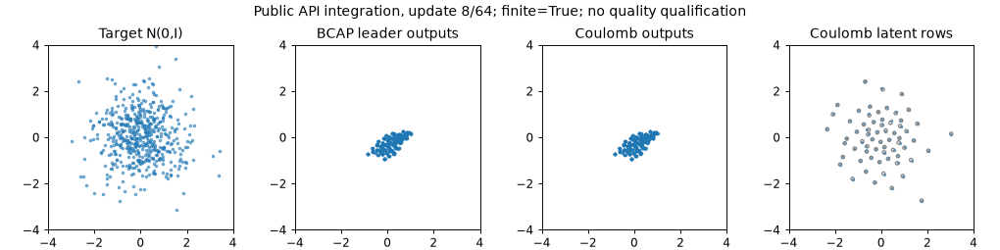

# Coulomb prior regularizer

An opt-in prior penalty combines softened inverse-distance repulsion with a
quadratic confining well anchored to the task's initialized prior geometry.
The hypothesis is that bounded local crowding and expansion can preserve usable
latent coverage while BCAP continues learning. Latent spacing alone does not
establish output density, rare-mode allocation, or a Tier 2 pass.

The baseline is the selected BCAP direction-blend leader, explicitly inherited
from `recipe-prior-refactor-bcap-pure-v1`. This feature changes only the prior
regularizer and its positive coefficient. The constructor draw, deterministic
initializer, location capacity, MoG width, masses, sample IDs, architectures,
training data, clocks and BCAP optimizer settings retain their task ownership.

## Public API

```python
from particlegan import get_recipe, init

recipe = get_recipe("bcap").replace(
    prior_regularizer="coulomb", prior_reg=.01,
    prior_coulomb_softening=.1,
    prior_coulomb_confinement=.35,
    prior_coulomb_neighbors=8,
)
prior = recipe.make_prior(sigma=.025, standardize=False)
init.deterministic_orthogonal_(prior, seed=0)
recipe.apply_prior_policy(prior)  # capture AFTER initialization
penalty = recipe.make_prior_regularizer(prior=prior)
loss = recipe.prior_regularization(prior.z, regularizer=penalty)
```

`GANTrainer` and current Forge hosts perform reference binding themselves.
Public component callers initialize their prior before binding its policy or
constructing optimizers. Rebinding keeps the original reference. Restore the
prior's complete state dict, including its two reference buffers, before
continuation. `CoulombPriorRegularizer` is also exported for direct use with
explicit fixed `center` and scalar `radius` tensors.

`prior_reg=0` and frozen priors perform no Coulomb work and create no reference
buffers. Default Recipe serialization omits the new default knobs, preserving
existing checkpoint/configuration packets. Existing VICReg diagnostics are
unchanged. The new regularizer uses the same host-selected rows, including the
trainer's full table for <=1,024 rows and unique G-phase sample IDs for larger
tables; it does not change optimizer sampled-row ownership.

## Energy and force units

Let `c0` be the initialized full-table centroid and `r0` its RMS radius,
`sqrt(mean(||z0-c0||²))`. Define `q=(z-c0)/max(r0,1e-6)`:

```text
E(q) = mean_(i,k) 1/sqrt(||q_i-q_(i+offset_k)||² + softening²)
       + confinement/2 * mean_i ||q_i||²
prior_loss = prior_reg * E(q) + prior_l2 * mean(z²)
```

The energy is dimensionless. The confining gradient points toward the fixed
centroid and penalizes growth in squared radius. Translation, expansion and
contraction do not change the reference. Multiple caller-owned tables use the
centroid and RMS radius of their declared union, reconstructed from saved
per-table initial moments.

The inverse-distance gradient is proportional to
`-delta/(||delta||²+softening²)^(3/2)`, scaled by the pair averaging and `1/r0`.
Exact collisions are finite and have zero repulsive gradient; symmetry is not
broken with noise or an arbitrary direction. A zero-radius initialized table
uses the explicit `1e-6` denominator floor and retains this limitation.

At most eight deterministic cyclic offsets are selected by default, evenly
spaced over `1..n-1`; self pairs are excluded and each row participates. Memory
is O(n*d) and arithmetic O(n*d*k), with a hard `1 <= k <= 64` bound. This is a
bounded index-based pair graph, not a nearest-neighbor search or a complete
Coulomb interaction. It consumes no RNG and introduces no new stream or cursor.

## Software verification

The [reproduction source](software_demo.py) executes 64 updates through the
public `GANTrainer` with protocol seed 0, identical deterministic initial model
and prior tensors, clean live sigma-.025 MoG sampling, and matched 32-sample
batches from a 2D standard Gaussian target. Both recipes use the BCAP leader's
fixed .012/.018/.030 rates, .001 DualNorm smoothing, non-saturating loss and
direction blend. The active arm uses `prior_reg=.01`. This is a bounded software
integration question with explicit small networks and a 64-row prior; its
numerical gate concerns finite training and exact continuation, not target
fidelity or the Tier 2 roster.

| Measurement | Score | Target |
| --- | ---: | --- |
| Equal initialized network and location tensors | true | true |
| Finite training observations | 8/8 | 8/8 |
| Positive raw auxiliary energy observations | 8/8 | 8/8 |
| Exact checkpoint continuation, including consumed streams | true | true |
| Final raw auxiliary energy | 1.225543618 | >0 |
| Final mean actual row displacement | .007959764 | diagnostic |
| Final max actual row displacement | .029702226 | diagnostic |

The software verdict is **PASS**. The [compact receipt](software-receipt.json)
records complete recipe settings, source hashes and the matched batch digest.
The 64-update replay restores the checkpoint after update 32, including its
actual evaluation draws. The initial demo attempt saved before that evaluation
and failed the stream-equality gate; its receipt remains in local logs. Moving
the snapshot to the complete consumed state repairs the demo cursor without
changing training outputs or the penalty.



The targeted suites pass **286 checks**, including formula/gradient units,
20,000-row bounded work, finite collision handling, disabled baseline parity,
post-initializer reference capture, exact continuation, rejection of malformed
reference checkpoints, sampled-row ownership, four behavioral hosts, search
identity, word-host construction and consumed state, source bindings and release compatibility. CUDA float64 value and
gradient parity is included in this count.

```sh
PYTHONPATH=. python -u reports/forge/prior-coulomb/software_demo.py \
  runs/prior-coulomb/software-demo-new
python -m pytest -q tests/test_coulomb_prior.py tests/test_recipe_owned_priors.py \
  tests/test_forge_techniques.py tests/test_forge_boundaries.py \
  tests/test_forge_behavior_adapters.py tests/test_forge_imageprofiles.py \
  tests/test_forge_vectorprofiles.py tests/test_forge_word_smoke_hold.py \
  tests/test_forge_search_space.py tests/test_release07_parity.py \
  tests/test_forge_word_joint.py tests/test_forge_word_provenance_cuda.py
```

A pre-existing current word-adapter receipt path called `recipe_owned_prior`
without importing it. The missing import is repaired for both comparator arms;
it changes neither trained updates nor numerical assertions. Current affected
host source hashes are refreshed, while legacy task cards and archived outcomes
retain their original bindings.

Raw stdout and event streams stay in ignored `runs/prior-coulomb/`.
Use `tail -F runs/prior-coulomb/software-demo-v2.log` for this execution.

## Starting values and falsifier

Search one global `prior_reg` value per candidate: **.001, .01, .1**, holding
softening .1, confinement .35 and eight offsets fixed. These are separate
positive strengths of the same structural regularizer. The matched disabled
leader is a separate control rather than an axis crossing mechanism activation.

For this demo's initialized 64-row table, the unweighted maximum auxiliary
row-gradient norm is .0520181. Analytically applying the leader's smoothed
row-normalization to the auxiliary force alone gives:

| `prior_reg` | Max auxiliary row gradient | Median auxiliary-only displacement | Max auxiliary-only displacement |
| ---: | ---: | ---: | ---: |
| .001 | .0000520181 | .000541342 | .001558435 |
| .01 | .000520181 | .005328219 | .013844364 |
| .1 | .005201806 | .026241049 | .029460557 |

These are force calculations on one fixed initialized table, not three training
experiments or estimates of combined GAN motion. Pair averaging, initial
radius, row count and GAN-force direction all change the effective scale. The
.1 arm approaches the .030 row-step cap even before the GAN gradient is added;
record actual sampled-row displacement and force ratios during the search.

A repair requires converting a matched failing Tier 2 task to its complete
PASS gate while preserving all six Tier 1 gates. If spacing/spread improves
without output precision, component density and required sustained windows
passing, the geometric hypothesis is insufficient. A rare-mode loss or failure
of a previously passing global gate is a regression of that whole recipe;
selecting different strengths per task is outside this comparison.
