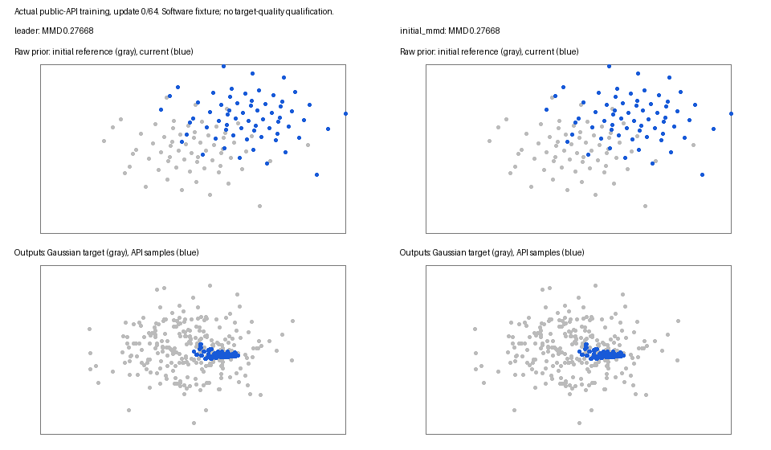

# Initial-distribution MMD prior tether

This feature adds `Recipe.prior_regularizer="initial_mmd"`. Its hypothesis is
that preserving the initial location distribution can limit prior/map
coadaptation while permitting useful particle exchange. It is a distribution
penalty, with no identity-position spring and no target-data or generator-output
term. It is ready for a bounded search against the exact BCAP direction-blend
leader. No Tier 2 training or new qualification is reported here.

The baseline is `recipe-prior-refactor-bcap-pure-v1`: BCAP, direction blend,
constant G/D/prior rates `.012/.018/.030`, zero-momentum DualNorm, smoothing
`.001`, native SVD, per-offset convolution, no EMA or additive training noise.
That source-bound leader passes 6/6 Tier 1 and 9/21 Tier 2 in the
[recipe-owned readout](../recipe-prior-refactor/README.md). A new comparison
must measure a matched control on the feature's source; archived passes do not
fill new cells. The compiled memory also records that a previous frozen-prior
cohort did not repair Gaussian retention, so distribution stability remains a
hypothesis rather than an established cause.

For current panel `X` and fixed initial panel `R`, the weighted penalty is

```text
prior_reg * max(0, mean(k(X,X)) + mean(k(R,R)) - 2 mean(k(X,R)))
k(x,y) = mean over a in {.25, 1, 4} of [a*s / (a*s + ||x-y||²)]
s = max(trace(population covariance of full initialized locations), 1e-4)
```

This is the biased empirical MMD squared, including self-pairs, rather than a
signed unbiased minibatch statistic. [Gretton et al.](https://www.jmlr.org/papers/v13/gretton12a.html)
give the underlying kernel discrepancy framework. The IMQ bandwidth ratios,
256-row limit, midpoint panel rule and degenerate-fixture scale floor are fixed
parts of this implementation. `prior_reg_target_std` and `prior_reg_eps` apply
only to VICReg and are explicitly inactive for this family in Forge searches.

Both panels retain all supplied rows for sizes up to 256. Larger tables use
256 evenly spaced midpoint indices with no random draws. Thus the reference is
a finite-panel approximation to the full initial empirical location law, and
the current panel approximates the caller-selected empirical rows. Permuting
the complete small panel leaves the objective unchanged; changing which rows
enter a larger thinned panel can change this approximation. Pair blocks are at
most 64 by 64, and kernel work is bounded by the panels rather than 20,000².
The kernel supplies gradients to current-panel rows only. The host's existing
sampling and optimizer ownership rules still determine which rows may move.
Standard `GANTrainer` uses full raw locations up to 1,024 entries and its
existing unique sampled rows above that size; caller-owned hosts retain their
existing selection rules. Fixed MoG widths and mixture weights are untouched.

`GANTrainer` captures the reference automatically after caller initialization.
Caller-owned code uses the same public factory explicitly:

```python
recipe = get_recipe("bcap", prior_regularizer="initial_mmd", prior_reg=1.0)
prior = recipe.make_prior(sigma=.025)
init.deterministic_orthogonal_(prior, seed=2)
regularizer = recipe.make_prior_regularizer(prior=prior)
loss = original_loss + recipe.prior_regularization(rows, regularizer=regularizer)
```

Three fixed reference buffers are stored on the prior, so native/Gaussian and
word prefix checkpoints restore the original reference rather than trained
locations. Joint prior hosts capture one combined initial panel, carried by
the first prior's checkpoint. Forward reads the prior's current buffers, so
moving the prior to another dtype/device keeps the binding current. Weight zero
and frozen priors capture no reference and do no MMD work. Weight zero preserves
the BCAP leader's network, optimizer, location and RNG states exactly.

All 27 required Tier 1/Tier 2 formulation contexts resolve the feature through
the public API; the [preflight receipt](host-preflight.json) also records 11
current recipe-owned task cards whose source pins were refreshed. Only their
current `evaluation.sources` hashes changed. Gates, architecture, initialization,
data/prior laws, sampling, budget and observation cadence are unchanged; archived
task cards and historical evidence remain unchanged. A missing module-level
`recipe_owned_prior` import in the pre-existing word adapter is repaired so the
current word receipt path can execute.

The [software fixture](software_toy.py) preregisters a narrower question:
after an explicit +1.5 displacement of initialized raw locations, does an
active tether reduce distribution drift while G/D actually train? Both arms
use protocol seed 0, the public deterministic initializer, 64 updates, identical
64-by-2 initial MoG locations, sigma `.025`, batch 64, network architecture,
Gaussian target batches and sampling. The sole candidate delta is
`initial_mmd` with `prior_reg=10`. The [receipt](software-receipt.json) records:

| Measurement | Score | Target |
| --- | ---: | --- |
| Active final/initial MMD | .454841 | ≤ .75 |
| Active final MMD | .125847 | < leader .249949 |
| Finite model/prior state | true | true |
| G and D update in both arms | true | true |

The fixture passes its declared mechanism gate. It supplies software evidence;
its artificial displacement, smaller architecture and 64-update budget cannot
qualify a Forge task or establish Gaussian target quality.



The [gradient probe](gradient-probe.json) suggests starting positive strengths
`.1, 1, 10`. At the fixture's declared initial displacement, unweighted maximum
row-gradient norm is `.00801`, versus DualNorm smoothing `.001`; these weights
span ratios `.80, 8.01, 80.07`. This is a scale probe, not quality selection.
DualNorm can turn a regularizer into a direction change without proportional
changes in step magnitude. Actual adversarial gradients and panel statistics
vary by task, so the forthcoming search must retain all full gates and
regressions under one global recipe per candidate.

Validation includes the explicit biased-kernel formula and gradients, gradcheck,
permutation/translation/scale behavior, 20,000-row panel bounds, collapsed
reference finiteness, disabled baseline parity, sampled-row ownership, original
reference checkpoint continuation, dtype conversion, word prefix restore and
behavioral hosts. Reproduction uses the project virtualenv:

```sh
PYTHONPATH=. /home/martyn/dev/ParticleGAN/.venv/bin/python -m pytest \
  tests/test_initial_mmd.py tests/test_recipe_owned_priors.py -q
PYTHONPATH=. /home/martyn/dev/ParticleGAN/.venv/bin/python -u \
  reports/forge/prior-mmd/software_toy.py --artifacts runs/prior-mmd/toy-new
tail -F runs/prior-mmd/integration.log runs/prior-mmd/toy.log
```

Bulk checkpoints and stdout remain in ignored `runs/prior-mmd`. The numerical
software readout, provenance, reproduction source and actual-training GIF are
the compact committed artifacts. No second goal leaderboard is generated.
