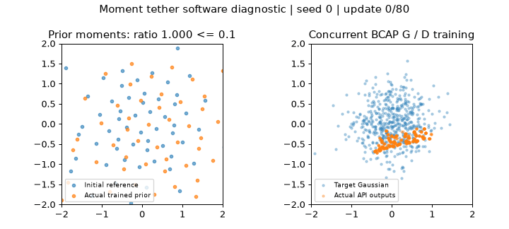

# Fixed initial moment tether for the learned prior

`Recipe.prior_regularizer="moment_tether"` adds a two-sided penalty on latent
mean and full covariance drift. This is an opt-in implementation with a
registered bounded coefficient search against the exact BCAP direction-blend leader.
No Tier 2 repair is claimed by this PR.

The BCAP leader passes 6/6 Tier 1 and 9/21 Tier 2 under the current
[recipe-owned prior contract](../recipe-prior-refactor/publication/README.md).
VICReg's variance floor does not oppose expansion or mean drift. Preserving
initial moments may reduce coadaptation and retention failure while allowing
particle relocation, permutation, non-Gaussian topology and higher-moment
changes. It cannot by itself guarantee output mass allocation or density.

The sole structural delta is `prior_regularizer="moment_tether"`; the strength
is the existing global `prior_reg`. The registered comparisons retain the complete
[leader recipe](../../../configs/forge/ideas/recipe-prior-refactor-bcap-pure-v1.json):
non-saturating BCAP, direction blend, zero-momentum DualNorm with smoothing .001,
G/E .012, D multiplier 1.5, prior multiplier 2.5, constant rates, no added noise,
EMA or transport. Forge API v1's bare `bcap` alias retains historical Adam;
the full leader overrides are required to reproduce the intended baseline.

## Mechanism and checkpoint ownership

After public deterministic initialization, `Recipe.apply_prior_policy(prior)`
captures fixed mean, covariance and row-count buffers on each active prior.
The buffers live in the prior's public state and survive scalar/Gaussian and
joint-word own-checkpoint continuation. Rebinding never recaptures trained
moments. No additional RNG stream or draw is consumed. Frozen and zero-weight
recipes create no buffers and perform no moment work.

With initial mean `mu0`, initial covariance `C0`, and
`v_i = max(C0_ii, 0) + prior_reg_eps`, the unweighted objective is:

```text
mean_i((mu_i - mu0_i)^2 / v_i)
  + mean_ij((C_ij - C0_ij)^2 / (v_i * v_j))
```

Covariance uses `max(n - 1, 1)`; epsilon has latent variance units and defaults
to `1e-4`. The dimensionless discrepancy is multiplied by `prior_reg` once.
The standard-deviation target is inactive. Diagonal normalization avoids matrix
inversion and handles tiny or rank-deficient initial priors. Multiple
behavioral priors use pooled initial moments with their original counts, which
matches their existing concatenated objective.

Each host retains its existing regularization rows. In particular, scalar
`GANTrainer` uses the whole table through 1024 rows and unique generator-sampled
rows above that threshold. Comparing a subset to full initial moments creates
sampling noise. The optimizer still updates only actual sampled prior rows;
dense auxiliary gradients confer no extra ownership. BCAP normalizes the
combined gradient, so the coefficient controls direction before normalization
and does not bound actual displacement.

Only current `recipe_owned_v1` task cards with edited host source bindings are
refreshed. Their prior source hashes/revisions are retained, and their target,
architecture, initial prior, budget, cadence, sampling and gates are unchanged.
The existing word adapter's missing module-scope `recipe_owned_prior` import is
also repaired. Archived task cards and receipts are untouched.

## Software acceptance

The focused acceptance suite passes **112 tests**; image/API/configuration-search
integration passes **316 tests**. Coverage includes analytical shifts,
expansion/contraction and shear with gradient checks; free particle permutation;
pooled/singleton references; zero-weight and frozen model/optimizer/RNG/checkpoint
parity; weight applied once; no RNG consumption; sampled-row ownership; exact
public context checkpoint continuation; and joint-word policy continuation.
All **27 required Tier 1/Tier 2 hosts preflight** for the positive-weight recipe.

The separate [public-API restoring-force toy](software_toy.py) uses seed 0 and
the public initializer. It has a declared 80-update budget and numerical gate,
with an explicit post-reference perturbation `z <- 1.35*z + [.4, -.3]` and a
fixed `N(0, .5^2 I)` target. Both G and D actually train alongside the prior.
This small perturbed-initial cohort tests restoring force and supplies no Forge
qualification. [Compact receipt](software-receipt.json).

| Measurement | Score | Target | Status |
| --- | ---: | ---: | --- |
| Final / initial moment discrepancy | 0.0598547145 | <= 0.1 | PASS |
| Final unweighted moment discrepancy | 0.0272880755 | diagnostic | — |
| Initial oracle discrepancy | 0 | == 0 | PASS |
| Initial perturbed discrepancy | 0.4559051991 | > 0 | PASS |
| Finite generated outputs | true | true | PASS |
| Fixed reference buffers unchanged | true | true | PASS |
| Both G and D trained | true | true | PASS |



## Starting-value search recommendation

The [prepared spec](../bcap-prior-search/covariance/spec.json) and
[registration](../bcap-prior-search/covariance/registration.json) declare three
positive global strengths **`prior_reg = [.001, .01, .1]`**, with a separate
same-source unchanged leader control. Their source digest is
`c63305181b75bbfae337143b6836397aa998cadbf172581859031a01c90892c2`.
All four arms preflight as ready; no scientific run has been submitted.
The full worst-case reservation is 172,080 seconds, with a 45,000-second control
cap and a 135,000-second three-candidate search cap. No Tier 3, retries or extra
seeds are authorized by this registration. At the toy's declared initial
perturbation, maximum weighted row-gradient norms are `6.41e-5`, `6.41e-4` and
`6.41e-3`, respectively. This brackets the optimizer's .001 smoothing scale
without claiming calibration on the research tasks. Initial exact full-table
equilibrium has zero force, so comparison should measure post-drift forces.

The falsifier is no sustained full-gate Tier 2 FAIL-to-PASS conversion at any
global strength, or loss of existing Tier 1 prerequisites. Retain every old pass
that becomes a fail; do not select a different weight per task. Ordinary search
must finish the current tier and pass all six Tier 1 requirements before Tier 2.
No new training beyond this declared software diagnostic has been launched.

Reproduce from the repository root:

```sh
PYTHONPATH=. python -m pytest -q tests/test_moment_tether.py tests/test_recipe_owned_priors.py tests/test_training.py tests/test_recipe_prior_task_migration.py tests/test_forge_techniques.py
PYTHONPATH=. python -m pytest -q tests/test_toy_api_images.py tests/test_forge_configuration_search.py tests/test_api_primitives.py
PYTHONPATH=. python -u reports/forge/prior-moment-tether/software_toy.py --output runs/software/prior-covariance/toy-reproduction
```

Original implementation base: `0337bbbc2300fd351e77e9a222b92401137fd421`.
Raw stdout/checkpoints remain ignored under `runs/software/prior-covariance/`;
`tail -f runs/software/prior-covariance/toy.log` follows the diagnostic.
