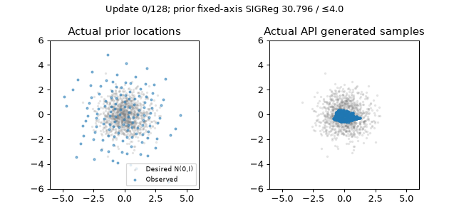

# SIGReg as an opt-in BCAP prior objective

`get_recipe("bcap", prior_regularizer="sigreg", prior_reg=0.001)` enables a
Gaussian characteristic-function constraint on learned prior locations. It
leaves the task's initial prior, capacity, kernel width, uniform weights,
sampling law and G/D architectures unchanged. Every other BCAP leader setting
comes from `configs/forge/ideas/recipe-prior-refactor-bcap-pure-v1.json`.
The historical direction-blend 9/21 Tier 2 result remains source-bound; this
feature's experiments require their own matched leader control.

The mathematical source is [LeJEPA MINIMAL.md](https://github.com/galilai-group/lejepa/blob/c293d291ca87cd4fddee9d3fffe4e914c7272052/MINIMAL.md),
commit `c293d291ca87cd4fddee9d3fffe4e914c7272052`, file blob
`6b0c4a61eed5d01ad06ea6759c78b2b5d6a46b24`. Its statistic is

```text
projection a: independent normal vector, normalized to unit length
phi(t) = exp(-t²/2)
empirical_phi(t) = mean_rows exp(i*t*rows@a)
statistic = N * mean_projections ∫[-3,3] |empirical_phi(t)-phi(t)|² * phi(t) dt
prior objective = prior_reg * statistic + prior_l2 * mean(rows²)
```

The integral uses 17 trapezoidal knots on [0,3], doubled by symmetry exactly as
in the linked implementation. This adaptation uses 32 projections instead of
256 to bound work on native tasks. `prior_sigreg_projections` and
`prior_sigreg_knots` declare those values. The upstream selected-row-count
multiplier is retained; the statistic is not divided by N a second time.
Unlike a variance floor, the penalty responds to mean shifts, expansion and
higher moments. Rows are never centered or standardized. It constrains a latent
Gaussian law, with no guarantee of correct generator output density or local
mode allocation; some passing finite-code tasks may need a deformed latent law.

The private projection stream is explicitly CPU Torch RNG, seed 0, independent
of constructor, target, latent-index, kernel-noise, output-noise and evaluation
streams. Each active call draws fresh directions, then evaluates on the rows'
device. Its complete state travels as `prior_regularizer.projection_rng_state`.
GANTrainer and current Forge component/word checkpoints retain this state;
own-word hold restores it before continuation. Caller-owned loops retain the
factory module and use `Recipe.prior_regularizer_checkpoint` and
`Recipe.restore_prior_regularizer`; calling a fresh factory every update restarts
its projection stream. Work scales as O(N×projections×knots), with no pairwise
particle matrix. N is the host's existing selected location set: full small
tables, unique G-phase sampled rows for GANTrainer tables over 1,024 locations,
and the original full/combined tables on component hosts.

Disabled SIGReg skips its forward call and draws nothing. Default VICReg's
historical unweighted diagnostic remains unchanged. Added default fields are
omitted from recipe packets, and inactive regularizers add no checkpoint field.
All current Tier 1/Tier 2 bindings admit this opt-in family. Only current
`recipe_owned_v1` cards' changed execution-source hashes are refreshed; numerical
gates, task budgets, target laws and archived source identities stay intact.
The implementation also repairs a pre-existing missing `recipe_owned_prior`
import in the older word-acquisition adapter branch; smoke/hold already dispatch
to the separate ladder before that branch.

Software acceptance: **177 feature/ownership/checkpoint tests and 468 host/API/search regression tests pass**, including the exact supplied-projection
quadrature and gradients, mean/expansion counterexamples, private RNG/weight
semantics, disabled baseline tensor/optimizer/stream parity, CPU and CUDA exact
public training continuation, invalid RNG checkpoint rejection, small/full and
large/sampled row laws, all four penalized behavioral hosts, joint-word resume,
all 27 current Tier 1/Tier 2 preflights and existing checkpoint/source guards.
An independent four-update probe on the unchanged `0337bbbc2` base and this
feature's default recipe produces byte-identical complete trainer checkpoints
and named RNG state; see the [receipt](baseline-parity.json) and
[reproduction source](baseline_parity.py). This is bounded software evidence,
not a rerun or regrading of the archived 9/21 result.

```sh
python -m pytest -q tests/test_sigreg.py tests/test_recipe_owned_priors.py \
  tests/test_training.py tests/test_forge_word_joint.py \
  tests/test_forge_word_smoke_hold.py tests/test_forge_boundaries.py \
  tests/test_forge_techniques.py
```

## Bounded public-API training demo

This deliberately separate feature fixture asks whether the broader initial
128×2 R2Normal table (std 2, MoG sigma .025) moves toward a standard Gaussian
while its 16-wide G/D train on N(0,I). It uses the leader recipe with SIGReg
weight .01, batch 64, 128 updates, protocol seed 0 and the public deterministic
initializer. It is an explicitly different task/resource cohort and grants no
Tier 1/Tier 2 qualification. Numerical bounds were declared before training;
normal oracle and destructive zero-table controls validate the scorer.

| Measurement | Score | Target |
|---|---:|---:|
| Fixed-axis SIGReg on final prior | 2.278539419 | ≤4 |
| Final / initial statistic | 0.073987869 | ≤0.1 |
| Checkpoint continuation state mismatches | 0 | 0 |
| Nonfinite trained parameters | 0 | 0 |
| Normal scorer control | 1.711029410 | ≤4 |
| Destructive zero-table control | 411.6967163 | >4 |

The initial prior statistic was 30.79612160. The GIF shows actual trained prior
locations and actual clean live API generated samples beside the declared
Gaussian target. Its prior objective passes; generated density is displayed
without claiming a generator fidelity gate. The [compact receipt](receipt.json)
records the resolved recipe, initial law, gates, initializer hashes and GIF hash.



```sh
PYTHONPATH=. python -u reports/forge/prior-sigreg/demo.py \
  --output runs/prior-sigreg/demo-new > runs/prior-sigreg/demo-new.log 2>&1
tail -F runs/prior-sigreg/demo-new.log
```

## Initial search declaration

Start with the logarithmic bracket `prior_reg = [0.0001, 0.001, 0.01]`, keeping
32 projections, 17 knots and all other leader fields fixed. Each coefficient
is one global recipe across all tasks. Positive coefficients preserve SIGReg's
mechanism; selecting `prior_regularizer="sigreg"` is a structural idea, and
VICReg-only target-std/eps axes are inactive. BCAP normalizes row gradients, so a
coefficient changes the combined force direction and is not a calibrated bound
on actual particle displacement.

The predicted useful signal is a failing task becoming a full sustained PASS
under its original bounds, with every Tier 1 prerequisite preserved. Merely
reducing this latent statistic, improving native nearest-cell occupancy, or
passing an endpoint without its terminal suffix does not meet that goal. Stop
the bounded bracket if none converts a failure or every candidate loses a
required Tier 1 gate; publish failures and all metric/target pairs. No paid
research has run in this feature PR. The separately
[prepared ordinary search](../bcap-prior-search/sigreg/spec.json) freezes its
three strengths, exact matched control, revision-9 view, full-tier gate policy,
45,000-second per-candidate and 180,000-second combined ceilings. Preparation
does not submit a job; root execution will use the committed source.
