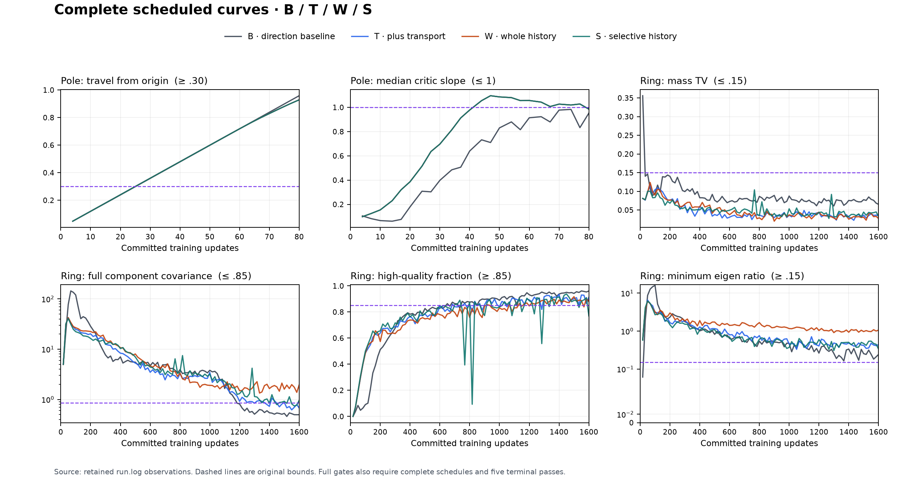
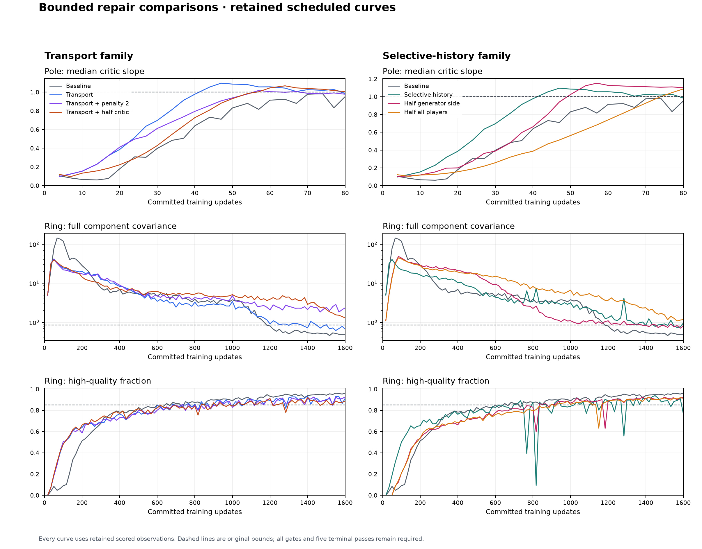

# Selective generator history: training results

**No transport/history candidate survived the complete two-task screen.**
The unchanged BCAP/DualNorm/direction-blend baseline B was the only arm to
pass both pole and Ring. All 16 diagnostic attempts completed their original
schedules. Two bounded repair rounds also failed; tuning this family stopped.
Fresh ordinary Tier 1 validation of B yielded **five of six required passes;
word is INCOMPLETE after its wall-time limit, and the separate clock audit
passes**. There is no complete six-task qualification or new default promotion.

The [machine-readable summary](training-summary.json) binds the certified
results, attempts, source, costs and receipt hashes. These are single-seed
results under the prescribed seed-0 deterministic initializer. They establish
the stated task qualification only, not reliability across random seeds,
architectures, longer horizons or unmeasured tasks.

**Core insights from our custom work.** The contribution is a measured account
of how these components interact, despite no new recipe passing both gates:

1. **Placement changes the meaning of history.** Our custom whole-gradient
   filter acts before normalization. On pole it ended at rho .711722, yet its
   recorded trajectory differed from transport alone by at most 1.32e-6.
   With positive scaling, normalization can remove almost all intended
   attenuation. This is not equivalent to the recovered historical caller,
   which scaled learning rates after normalization; that placement was not
   tested in this campaign.
2. **Coherence is not a safety signal.** Selective history on pole ended at
   rho .997980 and barely changed the trajectory, while retaining the same
   eleven critic-slope violations as transport alone. A coherent adversarial
   gradient can coexist with failure of the declared stability constraint.
   The initial hypothesis that this estimator would detect and suppress the
   offending behavior did not receive support. The endpoint rho is not a
   measurement of rho at each earlier violation.
3. **Mode allocation and mode shape are separate problems.** Transport
   improved Ring mass TV from .065186 to .035156, but worsened full covariance
   error from .496567 to .673336 and shortened the final passing streak from
   26 to 6. All variants finished with sixteen modes. Whole history's core
   covariance error .618462 hid full covariance error 1.941778. Counting modes
   or examining only the core can conceal the distributional failure.
4. **Attenuation can alter the balance between players and loss channels.**
   Whole history zeroed the network generator gradient on 1,122/1,600 Ring
   updates (70.125%), while the learned prior retained its ordinary clock.
   Selective history instead zeroed the adversarial channel 116 times while
   leaving transport fresh. This is a different intervention from uniformly
   slowing the joint system. Loss of useful shape correction is a plausible
   explanation for the quality failures, not an established temporal cause:
   per-update channel forces, realized displacements and rho were not saved.
5. **The measured failures did not yield to simple scalar repairs.** Doubling
   the penalty reduced pole violations from eleven to three, but still failed
   its required suffix and lost Ring. Halving generator/prior or critic rates
   also failed the joint gates. This bounded evidence weakens the proposed
   simple overshoot explanation; it does not prove that every step size,
   history placement or transport design must fail.

The design implication is to check what each intervention does to the
**realized normalized update and resulting output motion**, including learned
prior motion, instead of treating raw gradient magnitude or confidence as a
proxy. The existing implementation, curves, saved states and independent
audits support these scoped findings. They do not establish a new general
optimizer or identify the full causal sequence of Ring's collapse.

The original [v1 preflight](PREFLIGHT.md) and [draft roster](stage-roster.json)
remain unchanged and **BLOCKED**: several required original saved windows
were unavailable. Available-state disposable probes established a real
implementation effect but did not satisfy those missing prerequisites.
After reviewing that limitation, the user separately instructed “train it
make it work.” The [v2 amendment](TRAINING-AMENDMENT-v2.json) and later
registered studies authorize the fresh campaigns below. Their results do
not retroactively pass the v1 preflight. The original implementation review
is preserved as [IMPLEMENTATION-PREFLIGHT-READOUT.md](IMPLEMENTATION-PREFLIGHT-READOUT.md).

**Exact recipes.** The [executed baseline recipe](training-evidence/executed-baseline-recipe.json)
records the resolved settings, source, candidate revision, protocol, RNG,
runtime and compute cohort. B is the full card
[`recipe-prior-refactor-bcap-pure-v1`](../../../configs/forge/ideas/recipe-prior-refactor-bcap-pure-v1.json),
revision `458335d50aafb32a3c7aad52948dd206fba1a4af51abecbeff637722131acd8e`.
It uses non-saturating loss, BCAP coefficient 1 and cap 1 on every update,
full DualNorm with momentum 0, smoothing .001, native SVD and per-offset
convolution normalization, plus `direction_blend`. Constant effective rates
are G/E .012, D .018 and learned prior .030; both learning-rate floors are
1. Added input/output noise, EMA, transport and generator history are off;
prior regularization weights are zero. The card retains the original task
architecture, prior law, sampling law and authorized host adaptations. The
short preset name `bcap` alone is insufficient to reproduce this recipe.

| Arm | Exact candidate | Change from its measured parent |
|---|---|---|
| B | `recipe-prior-refactor-bcap-pure-v1` | Current unchanged baseline |
| T | `bcap-selective-history-transport-v1` | B + global/local-v2 transport, weights 1/1, 32 deterministic projections |
| W | `bcap-selective-history-whole-v1` | T + whole-generator-player gradient history |
| S | `bcap-selective-history-adversarial-v1` | T + adversarial-generator-player gradient history |
| TP | `bcap-transport-penalty2-v1` | T + BCAP coefficient 2 only |
| SH | `bcap-selective-history-halfjoint-v1` | S + G/E .006, prior .015; D remains .018 |
| TD | `bcap-transport-halfcritic-v1` | T + D .009 only; G/E .012, prior .030 |
| SHD | `bcap-selective-history-halfjoint-halfcritic-v1` | SH + D .009 only; G/E .006, prior .015 |

W and S are **new pre-normalization adaptations** of the recovered historical
estimator, whose old caller attenuated the update after normalization. The
estimator uses decay 7/8, effective sample count, unbiased variance, debiased
nonnegative signal and denominator epsilon 1e-16. W observes current total
gradient `g` and supplies `rho*g`. S observes original adversarial gradient
`a` and supplies exactly `g + (rho - 1)*a`. History starts empty; only the
effective generator player, including direct particle coordinates, is
transformed. Encoder and learned-prior roles remain fresh. Protected raw
normals stay current; the existing single joint optimizer step and direction
blend remain in place. These adaptations inherit no historical pass.

**Complete diagnostic outcomes.** Pole requires all 80 updates and 24 checks,
with travel at least .30 and median critic slope at most 1. Ring requires all
1,600 updates and 96 checks, at least 4,096 samples, 16 modes, mass TV at most
.15, HQ at least .85, full component covariance error at most .85 and minimum
component eigen ratio at least .15. Both require five final consecutive
jointly passing checks. Finite-state, role-update and RNG-isolation guards
also apply. A passing endpoint or an earlier isolated pass is insufficient.

| Arm | Pole passing checks / 24 | Pole suffix and grade | Ring passing checks / 96 | Ring suffix and grade | Final Ring full covariance / HQ |
|---|---:|---|---:|---|---|
| B | 17 | 17, **PASS** | 26 | 26, **PASS** | .496567 / .960938 |
| T | 6 | 1, FAIL | 12 | 6, **PASS** | .673336 / .912598 |
| W | 6 | 1, FAIL | 0 | 0, FAIL | 1.941778 / .880371 |
| S | 6 | 1, FAIL | 6 | 0, FAIL | .958363 / .770020 |
| TP | 14 | 4, FAIL | 0 | 0, FAIL | 2.357043 / .925781 |
| SH | 0 | 0, FAIL | 11 | 4, FAIL | .810155 / .919922 |
| TD | 9 | 0, FAIL | 0 | 0, FAIL | 1.298299 / .883545 |
| SHD | 6 | 0, FAIL | 0 | 0, FAIL | 1.184732 / .913574 |

Independent audits recomputed the complete curves and certified grades for
the [initial screen](training-evidence/initial/independent-result-audit.json),
[penalty/generator-rate repairs](training-evidence/repairs/independent-result-audit.json)
and [final critic-rate screen](training-evidence/final-critic/independent-result-audit.json).
An S+penalty-2 draft was withdrawn **before submission** once S also failed
Ring; the registered primary repair was T+penalty-2. No submitted experiment
was rewritten after seeing its result.



**What the interventions actually did.** Positive scalar multiplication
largely cancels in a scale-normalized update: in the homogeneous ideal,
`normalize(rho*g) = normalize(g)` for positive rho. Smoothing, stored moments
and zero rho can break exact equality. In the measured pole run, W's history
advanced 80 times, had no zero-rho step and ended at rho .711722; its entire
recorded trajectory differed from T by at most 1.32e-6. History was active,
but whole-gradient attenuation barely changed the normalized motion.

The code gives a more precise interpretation for this campaign's zero-momentum,
smoothed DualNorm. For whole-gradient W, a matrix singular value `s` receives weight
`rho*s / sqrt((rho*s)^2 + lambda^2)`, equivalently
`s / sqrt(s^2 + (lambda/rho)^2)` for positive rho, up to numerical cutoffs.
Here `lambda=.001`. Scaling therefore raises the effective smoothing scale
rather than uniformly shrinking every normalized direction: strong directions
change little, while weak directions can be suppressed. At rho zero the
gradient is removed. This algebra explains why a nominal confidence control
can have little effect in one regime and a large effect in another; the
saved data do not resolve its per-step spectral contribution to Ring failure.

S also advanced 80 history observations on pole, with no zero-rho step,
terminal rho .997980 and a largest T/S metric difference of .000410. Its
terminal adversarial stream was coherent under this estimator, so selective
attenuation barely addressed the actual failure. T/W/S each had eleven
scheduled critic-slope violations and zero direction blends or stalls. The
data do not support the initial hypothesis that suppressing unstable
adversarial gradients would repair pole. The terminal rho and cumulative
counters are not a stored rho time series.

On Ring, transport improved mass allocation while weakening sustained shape
relative to B. T's final mass TV was .035156 versus B's .065186, but full
covariance error was .673336 versus .496567, and its passing suffix was only
6 versus 26. Every variant finished with sixteen modes and low mass TV;
these marginal coverage measures did not repair within-component covariance
or HQ. W failed the full covariance bound at all 96 checks. Its final core
covariance .618462 looked acceptable while full covariance was 1.941778,
which illustrates why the full gate cannot be replaced by a trimmed core.

W's [final optimizer packet analysis](training-evidence/optimizer-state-analysis.json)
records 1,122 zero-rho steps of 1,600 (70.125%). On those steps the network
generator's total gradient is zero, while the learned prior retains its
ordinary 1,600-update clock. S records 116 zero-rho steps, terminal rho
.062425 and eleven direction blends; its transport contribution stays fresh
when adversarial rho is zero. S failed covariance at 90/96 checks and HQ at
59/96, including a transient HQ .093262 with only three quality modes at
update 817. Suppression of useful adversarial shape correction and the
changed balance of network/prior motion are plausible mechanisms. There is
no per-update channel-force or rho trace to establish their temporal cause.



Doubling the soft penalty reduced pole slope violations from eleven to three,
but left only four terminal passes and lost Ring completely. A stronger soft
restoring penalty does not guarantee a hard cap. Halving the generator side
left pole slope 1.101885 and Ring only four final passes. Halving the critic
rate in each selected parent still left terminal pole violations (1.005625
and 1.087393) and full covariance failure at all 96 Ring checks. These results
weaken the claim that a simple reduction in finite-step overshoot is sufficient
to resolve both tasks. They do not identify an asymptotic equilibrium or prove
the family impossible. No further rate tuning or transport/history arm was
advanced to ordinary Tier 1.

**Fresh ordinary baseline qualification: INCOMPLETE.** The separately registered
[`bcap-current-baseline-ordinary-tier1-20261015-v1`](../../../configs/forge/studies/bcap-current-baseline-ordinary-tier1-20261015-v1.json)
uses unchanged B and the ordinary `discriminator_stability` view. The
[completed independent audit](training-evidence/ordinary-tier1/independent-result-audit.json)
records five required passes and one incomplete task. No historical or
research-diagnostic receipt fills these fresh cells.

| Ordinary task | Certified outcome | Completed contract / retained evidence |
|---|---|---|
| Gaussian acquisition | **PASS** | All 1,000 updates; independently confirmed passes at 375 and 875 |
| Two-pole | **PASS** | All 80 updates; terminal suffix 17 |
| Unused-token hold | **PASS** | All 200 updates; terminal suffix 5 |
| AE/GAN hold | **PASS** | All 250 updates; terminal suffix 22 |
| Ring acquisition | **PASS** | All 1,600 updates; terminal suffix 26 |
| Five-word joint | **INCOMPLETE** | 900-second wall-time limit; full 20,001-update contract not completed |
| Clock audit, diagnostic | **PASS** | Four parity comparisons; excluded from the six required cells |

The word attempt `d3ab270c75ca4c5494f4fcd9016ff941` timed out with reason
`task wall-time budget exhausted`, charged 900.338864 seconds. Its retained
log contains eight scheduled primary/confirmation quality passes, from step
834 through 6,667. The last logged step is only a lower bound on work done,
not an exact final update count. Those observations establish useful partial
learning, but cannot replace the complete horizon, complete observation
schedule and required saved-state contract. GPU contention was observed
during execution; it is an operational limitation, not evidence that a
different optimizer would finish or pass. One exact unchanged operational
retry is prepared but **unexecuted pending resource isolation**. The original
timeout remains in the results. No time limit was extended and no new recipe
was submitted.

Gaussian's acquisition PASS also must not be read as endpoint retention:
its final CDF KS is .071842, above the .05 acquisition bound, while the
registered gate correctly accepts the earlier independently confirmed pairs.

Ordinary acquisition contracts differ from sustained gates. Gaussian needs
one scheduled primary/independent-confirmation pair satisfying finite
fraction 1, mean error at most .2 sigma, std ratio [.8,1.2] and CDF KS at most
.05, with 4,096 samples and all 1,000 updates complete. Word needs one such
pair with at least 1,024 samples, quality at least .95, exactly five modes,
mass TV at most .1, exact reconstruction and minimum reconstruction-token
probability at least .9; all 20,001 updates, 24 paired observations, four
optimizer clocks and the bound own-state artifact must be complete. Unused
token requires hold and concept movement each at least .85 over a terminal
five-check suffix after 200 updates. AE/GAN requires reconstruction MSE at
most .05 and hold error at most .35 over that suffix after 250 updates.
Ordinary pole/Ring retain the full gates stated above. Task-specific
certified graders, not a generic final-row threshold check, decide these
verdicts.

**Provenance, cost and reproduction.** Every trained arm uses scientific
source `39fad3b03e5178bcdc68cc17ba012ac4083d5887147bef91f0bbeee1205baea6`,
CPython 3.11.15, torch 2.11.0+cu128, NumPy 2.4.4, SciPy 1.17.1 and NVIDIA RTX
A6000 execution. No horizons, gates, evaluation cadence, sampling laws or
seed rules were relaxed. The implementation had 44 passing targeted tests
with no skips and four actual CUDA resume checks before training; these
software tests are distinct from the scientific results.

The completed diagnostic campaigns had **declared ceilings of 4,800 seconds**
(2,400 + 1,200 + 1,200), charged **556.464340 execution seconds**, sixteen
scientific attempts, zero scientific retries and **zero outstanding
reservations**. The ordinary campaign had its separate 2,520-second ceiling
and charged **1,077.388669 seconds**, including the timed-out word attempt.
Across all four campaigns, declared ceilings total 7,320 seconds and charged
execution totals **1,633.853009 seconds** for 23 attempts including the
diagnostic clock audit. No scientific or operational retry was executed;
outstanding reservations are zero. These totals describe completed attempts,
including one timeout, rather than 23 successful full training runs.
Charged execution is not total supervisor elapsed time or software/probe
time; hardware variation prevents a speed superiority claim. The single
coordinator interruption after initial B completion changed only deferred
memory compilation, then resumed the same queue: no model training was
interrupted or retried. Completion receipts remain available for
[initial](training-evidence/initial/completion.json),
[repairs](training-evidence/repairs/completion.json) and
[final critic](training-evidence/final-critic/completion.json) and
[ordinary baseline](training-evidence/ordinary-tier1/completion.json) campaigns.

The supported compact memory refresh completed successfully and preserves previously published qualification tables; it does not promote these new results. The [refresh readout](training-evidence/compact-compilation-readout.json) records nine pre-existing engineering catalog omissions. The broader historical rebuild was [deferred](training-evidence/full-compile-deferral.json) after its scope expanded to thousands of unrelated resolutions; no published leaderboard output was changed by that interrupted rebuild.

The exact ordinary registration can be inspected without training:

```bash
cd /ml2/hypergan/particlegan-selective-history-20261015
/ml2/hypergan/.venvs/particlegan-selective-history-20261015/bin/python \
  -m experiments.forge --root "$PWD" \
  --queue-root /ml2/hypergan/combination-training-20261015/queue \
  plan recipe-prior-refactor-bcap-pure-v1 \
  --study bcap-current-baseline-ordinary-tier1-20261015-v1
```

The executed submission used the same command with `enqueue` in place of
`plan`; its exact argument array and request `d6e4aac3dca9c827dc0f4300` are in
the [launch manifest](training-evidence/ordinary-tier1/launch-manifest.json).
The existing queue reuses exact compatible evidence. The preserved
[training driver](training-repro/run_registered_campaign.py) drains the
registered campaign with public `Queue(on_completion=None)`, and the
[summary script](training-repro/summarize_training.py) packages existing
certificates without constructing a model. Reproduction requires the bound
source, runtime and full candidate card, rather than a short preset alias.

The [media index](training-media/index.json) binds certified retained training
observations and selected frame indices. It lists 23 attempts and 22 GIFs;
the incomplete word attempt has an explicit omission. GIFs and the figures
above add no training updates or sampling draws. The [checkpoint inventory](training-evidence/checkpoints.json)
lists saved original tensors and their paths, sizes and hashes; the
task-specific payload governs continuation. A `.pt` extension alone does
not imply that a file can resume the full trainer.

**Latest leaderboard follow-up (2026-10-15).** B was strongest only among the
eight configurations in this experiment. BISPF was not trained in this
campaign. The newer [recorded leaderboard snapshot](training-evidence/latest-leaderboard-followup.json)
favors BISPF: both ordinary cohorts record 6/6 required Tier 1 passes, while
BISPF records 10/21 required Tier 2 passes versus BCAP's 9/21. The additional
ordinary pass is `mode_hold`. The headline 77 versus 71 sums overlapping
views; it is not six independent task improvements.

The newer [35-task attempt coverage snapshot](training-evidence/latest-leaderboard-followup.json)
records BISPF 19 PASS / 12 FAIL / 4 BLOCKED versus BCAP 17 PASS / 14 FAIL /
4 BLOCKED. Its only verdict improvements are `mode_hold` and diagnostic
`ring_hold`, with no recorded verdict regressions. The `ring_hold` diagnostic
does not add ordinary qualification credit. The BCAP and BISPF ordinary cohorts
have different source/runtime bindings and are both marked
stale against current contracts. These records support prioritizing BISPF
for a fresh controlled comparison; they do not establish current matched
superiority. A [dated snapshot](training-evidence/latest-leaderboard-followup.json)
preserves the selected rows and source hashes. This follow-up changes no
training result, gate or qualification in this campaign.

**Conclusion:** the measured transport/history extensions and their bounded
repairs failed the joint gates. B was strongest among our eight configurations,
with five fresh ordinary passes and incomplete word qualification. The broader
recorded evidence favors BISPF and supports that comparison ahead of further
history tuning. Any unchanged word retry still requires resource isolation;
do not promote a new default on this campaign's partial evidence. One research question remains: **which part
of the realized network and learned-prior output motion destroys within-mode
shape when transport improves marginal coverage?** Answering that requires
explicit per-channel force and output-displacement evidence, rather than
assuming another scalar attenuation or rate change will solve it.
