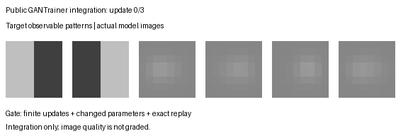

# Inverse-imaging extensions: software integration and evidence scope

PR #479 adds optional Sobolev backward filtering, Gaussian-splat image carriers,
and multi-query entropy/diversity penalties to the existing prior-manipulator
API. It adds no Recipe fields or default changes. Applications can combine a
frozen observation operator with a generated image; these helpers do not by
themselves establish inverse-image fidelity or recoverability.

## Two explicitly separate fixtures

The [original seed-42 fixture](https://github.com/255BITS/ParticleGAN/blob/721747de9056907d357aaaf22ec749a56d2af141/tests/test_dataless_tomographic_inverse_e2e.py)
uses a custom Adam loop, an identity-initialized particle table and a synthetic
Patch-ViT-like operator. Its six image-quality gates and optimization results
belong to that original fixture. It is not evidence that GANTrainer passes those
six gates. Its reproducibility test uses numerical tolerances, so it should not
be described as a proof of bitwise continuation.

The [public API integration](../../../../examples/inverse_imaging_smoke.py) is a
separate three-update software fixture. It uses protocol seed 0, the public
deterministic initializer, a learned MoG prior with a splat carrier, a Sobolev
backward filter and a fixed left/right image-mean observation operator. Target
observations are an equal mixture of `(0.5, -0.5)` and `(-0.5, 0.5)`, with Gaussian
noise of standard deviation 0.01. Constructor, data, training and evaluation
randomness are isolated; the caller-owned data stream is restored with the
trainer for replay. Fixed evaluation seeds isolate visible training changes.

Its declared numerical software gate is: all three updates complete with finite
losses, at least one generator parameter changes, and checkpoint continuation
matches the full trainer state and caller data stream exactly. It does not grade
image quality. A destructive control changes only the restored prior after an
otherwise identical update and confirms the replay gate rejects it.

[Result and recipe](result.json) · [source hashes and original evidence identity](source-receipt.json)



The recorded integration passes, with maximum generator parameter movement
`0.011689185164868832` and exact continuation. The GIF shows actual states; target
patterns give the observation goal, rather than a claim that the generated
images already match it. This is not Forge qualification or a matched trainer
comparison, and it is not a new scientific leaderboard.

## Integration repairs

- Preserve develop's canonical `unwrap_prior`, noise streams, strict-progress
  checks, configuration provenance and completed-update checkpoint contracts.
- Apply the network learning-rate schedule to manipulator router parameters;
  only storage-prior parameters receive the prior schedule.
- Include the new manipulators' actual settings in checkpoint configuration.
  Changing filter strength, geometry, entropy or repulsion settings is rejected.
- Bind the bare `SobolevGradFilter` module's lambda, order and Nyquist settings
  too. Public `GANTrainer` restoration rejects a different backward law before
  changing live state; matching fresh-object continuation remains exact.
- Declare deterministic initialization for splat parameters, preserving intended
  geometric coordinates and frozen detail layouts.
- Reject invalid filter/penalty settings rather than silently disabling them.
- Retain the existing Recipe field inventory and public import contract.

## Reproduce

From the repository root in the project environment:

```sh
PYTHONPATH=. OMP_NUM_THREADS=1 CUDA_VISIBLE_DEVICES='' \
  python examples/inverse_imaging_smoke.py --output runs/inverse-imaging-integration
python -m pytest -q tests/test_inverse_imaging_contract.py \
  tests/test_swappable_priors.py tests/test_wavefront.py tests/test_tomographic.py \
  tests/test_prior_manipulator_provenance.py tests/test_dataless_tomographic_inverse_e2e.py
```

The original custom optimizer remains a separate test fixture. No existing
research receipt, verdict, selected recipe, gate or task contract is regraded.
Bulk execution logs remain outside Git.
