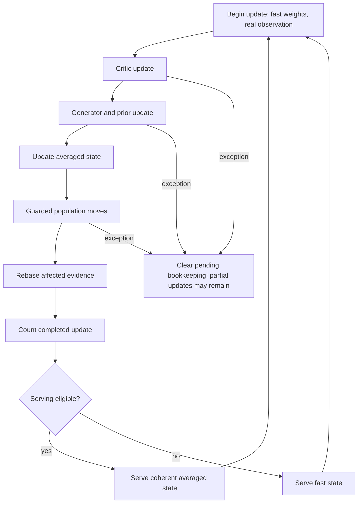

# Implicit state-machine audit

Audited `origin/develop` at `9fc54fab90a7d6da39db274b651dbf824fc3929a`, on
`audit/implicit-state-machines`, 2026-11-06. This is a software audit, not a
training-method comparison. No qualification results or application behavior changed.

The inventory below groups **67 stateful protocols** by their owner. Some have
state names, but their legal transitions and recovery rules are distributed across
callers, flags, counters, tensor metadata, files, or locks. Four already explicit
machines are listed separately to distinguish them from the hidden protocols.
These are families, not a count of every runtime instance or recipe variant.

## Findings to address first

1. **High: gradient-coherence history is absent from trainer checkpoints.**
   [`GANTrainer.__init__`](../../particlegan/training.py#L264) creates a
   `GradientCoherence` controller and the update consumes its accumulated means,
   weight, and gain. [`GANTrainer._state_dict`](../../particlegan/training.py#L653)
   and its loader never save or restore it, although the controller has its own
   [`state_dict` and loader](../../particlegan/gradient_response.py#L66).
   After two updates, restoring a fresh trainer loses the history. The next
   generator update differs by **0.015155419707298279** in maximum absolute
   parameter value for both `coherent_G_mean_v1` and `coherent_G_damped_v2`.
   The same control with response `none` resumes with **exactly zero difference**.
   A load into an already used trainer would retain that destination's old
   controller history instead. Save, validate, and restore this state with the
   other trainer-owned controls, with an explicit compatibility policy for older
   checkpoints that lack it.

2. **Medium: trainer checkpoints do not enforce the completed-update boundary.**
   [`UpdatePolicy.state_dict`](../../particlegan/policy.py#L1246) rejects a
   non-`ready` phase. [`GANTrainer.state_dict`](../../particlegan/training.py#L643)
   bypasses that guard and builds a flat checkpoint. Its public `generator_real`
   callback can therefore save during the `generator` phase: the receipt says
   **0 completed updates**, but the critic has **1 observed optimizer step**, and
   its parameters are temporarily frozen. A fresh trainer rejects that checkpoint
   with `checkpoint requires_grad does not match trainer`. Reject trainer
   checkpoint/restore requests while an update is active; do not rely on callers
   to infer the safe boundary.

3. **High priority design boundary: abort means bookkeeping cleanup, not rollback.**
   This is intentional in the current implementation, rather than an additional
   reproduced bug. [`abort_step`](../../particlegan/policy.py#L893) makes the
   policy `ready`, even when the critic or generator already advanced. Optimizer
   wrappers can restore parameters after failed adjustment while retaining
   advanced moments/clocks. Feature-cell failure can restore evidence counters
   while retaining partial row moves and stream consumption. A single `ready`
   flag consequently does not certify a scientifically complete update. Keep
   that distinction visible in error handling and continuation receipts; consider
   an explicit interrupted-update marker before allowing continuation or saving.

4. **Next refactoring targets:** the serving swap/certificate, particle-move
   transaction, and Forge's job/submission/lease/billing combination. They have
   the most consequential cross-owner invariants. Existing tests already cover
   many failure cases; centralize transition contracts before changing behavior.

## How to read the inventory

`Saved` means the owner exposes state that its surrounding checkpoint must carry.
`Derived` means recomputed from other evidence. `Ephemeral` means a call, scope,
callback, or process owns it and restoration requires rebuilding/rebinding it.
The state names in backticks are audit labels unless they appear literally in
the implementation. The arrows describe legal or intended transitions, not
claims that every transition has a dedicated enum or guard.

### Trainer, serving, and execution

| ID | Owner and entry point | Hidden states and transition triggers | Persistence / important invariant |
| --- | --- | --- | --- |
| I01 | [Training allowance](../../particlegan/training.py#L450) | `available → exhausted`; `extend_execution` reopens the external allowance. | Saved `max_steps`/`completed_steps`; execution extension does not move the recipe schedule horizon. |
| I02 | [D/G execution modes](../../particlegan/training.py#L458) | `D train/G eval → D eval/G train/D frozen → D gradients restored`. `_in_training_step` also selects training-only precision. | Ephemeral `.training`/`requires_grad`/execution flags; the D freeze has a `finally` restoration. Caller modes are not a single trainer phase field. |
| I03 | [Serving parameter swap](../../particlegan/policy.py#L1128) | `_fast is None` means live fast weights; otherwise live modules contain served averages and `_fast` holds training values. Release before training/checkpoint; reapply when eligible. | `_fast` is an ephemeral backup, not a second checkpointed model. Saved checkpoints must contain the training iterate. |
| I04 | [Independent served model](../../particlegan/policy.py#L128) | `snapshot selected → frozen inference instance → sampling stream advanced`; `fast/averaged` selection fixes one consistent model/table/controller bundle. | Snapshot-owned evaluation RNG; repeated sampling changes its stream without advancing training streams. Clean/noisy and independent/routed entry points have different guards. |
| I05 | [Trainer/policy checkpoint protocol](../../particlegan/training.py#L643), [policy restore](../../particlegan/policy.py#L1440) | `boundary → validate private copies → release serving → commit models/optimizers/controls/RNG → derive serving`. Rejected input should leave live state intact. | Saved nested state with recipe/topology/schema contracts. Trainer boundary guard and coherence history have the confirmed gaps above. |
| I06 | [Model RNG scope](../../particlegan/training.py#L385), [named RNG scopes](../../experiments/forge/rng.py#L18) | `caller RNG → model/named RNG installed → draw → owned stream captured → caller RNG restored`; nested preserve/fork scopes add a stack. | Explicit streams and alias relationships must survive checkpoints. Caller data cursors remain caller-owned. |
| I07 | [Noise and optimizer schedules](../../particlegan/policy.py#L25), [schedule application](../../particlegan/recipe_schedules.py#L24) | `warmup/annealing → floor or terminal value`; learned output scale adds `uninitialized optimizer → active learning → clamp/floor`. One `StepNoise` graph is shared across the two game halves. | Saved completed clock, initial hyperparameters, noise parameter/optimizer state; the per-update graph is ephemeral. |
| I08 | [Network plateau transition](../../particlegan/recipes.py#L1510) | `start_step=None → plateau marked → decay active → floor`; repeat same mark is allowed, changing it is rejected. | Saved start and duration; callers must include this optional controller in their own checkpoints. |

### Adaptive controllers and regularizers

| ID | Owner and entry point | Hidden states and transition triggers | Persistence / important invariant |
| --- | --- | --- | --- |
| I09 | [DataDriftController](../../particlegan/continuous.py#L30) | First observations initialize geometry/references. Mobility below `.1` closes; above `.3` reopens. Support/pair/game observations change trust and drive. | Saved variant-specific fields; hysteresis depends on `closed`, not just current mobility. DV12 diagnostic records also transition from deferred tensors to materialized values. |
| I10 | [SettleTest](../../particlegan/continuous.py#L394) | `unanchored → accumulating block → paired/quad evidence → window decision → next window`. Stationary halves scale, drift raises it, ambiguity extends blocks, reversal changes scale search. | Saved anchor, partial blocks, intrinsic time, decisive history. `restart`, `reopen`, and row-local `rebase` have different reset laws. |
| I11 | [SequentialSettleTest](../../particlegan/continuous.py#L675) | Adds `early look → crossed/not crossed → final look`; support exclusion/hold can defer descent, and release-rule/anchor guards can veto drift release. | Saved tester state; partial evidence and `b_anchor` affect future decisions even at the same LR. |
| I12 | [Population continuity](../../particlegan/population_continuity.py#L7) | `no descent certificate → covered stationary descent → live certificate → expired/revoked` after replacements or restart remove too many participating rows. | Saved participants, active flag, undo scale. Expiry undoes one descent without declaring drift. |
| I13 | [OptimizerSurprise](../../particlegan/continuous.py#L979) | `pending observations → armed/calm → abrupt excursion streak → fire → disarmed cooldown → calm rearm`. | Saved pending observations, references, streak and refractory clock. Decide consumes observations from the preceding applied steps. |
| I14 | [LossSurprise](../../particlegan/continuous.py#L1195) | `no baseline → calm → high-z streak → fire → cooldown → calm rearm`; `pending_loss` is consumed at the next decision. | Saved pending loss and detector history. The policy currently supplies generator adversarial loss, despite the class's critic-loss wording. |
| I15 | [SettledReopenGuard](../../particlegan/continuous.py#L1104) | `calm network witness → excursion witness latched → permitted/suppressed fire → cleared`; a KA2 objective-epoch change rebases detector statistics. | Saved network ownership, loss epoch, excursion. An ordinary LR release does not discard the latched witness. |
| I16 | [Anchor release latch](../../particlegan/policy.py#L941) | `anchor_event=None → event awaiting high blend → high seen → low blend completes release`. | Saved through the surprise object. This latch is separate from armed/cooldown state and critic `anchor_started`. |
| I17 | [K3P penalty/critic record](../../particlegan/grad_regularizers.py#L27), [KA2 handover](../../particlegan/ka2.py#L103) | `pre-observation/warmup → adaptive penalty blend → anchor started → EMA tracking/skipping/reseeding`; KA2's `w` switches with surprise hysteresis. | Optimizer-owned saved record and EMA. Actual penalty calls and optimizer steps are distinct clocks; lazy skips do not advance both. |
| I18 | [Critic spike guard](../../particlegan/k3p.py#L83) | `no moments / too few steps → eligible → ordinary or clipped proposal` on each backward/step cycle. | Readiness derives from Adam state; clipping diagnostics are not a standalone training phase. Must run before the optimizer consumes gradients. |
| I19 | [LatentRowDamping](../../particlegan/k3p.py#L140) | `not started → first sparse gradient/history seeded → active or bypassed`; `begin` temporarily changes Adam beta/moment, `end` restores it. | Saved counters/start flag plus separately owned row history. Temporary token/beta override is scoped with `finally`. |
| I20 | [DirectParticleResponse](../../particlegan/k3p.py#L238) | `no history → initialized history → temporary LR/beta response → original hyperparameters restored`, or bypassed without gradients. | Saved response state and optimizer-owned history; the temporary override uses an around-step token. |
| I21 | [GradientCoherence](../../particlegan/gradient_response.py#L13), [trainer use](../../particlegan/training.py#L556) | `packet=None → EMA packet allocated → gradient means/gain updated → LR temporarily scaled → restored`. | Controller serialization exists; trainer integration omits it. Confirmed resume divergence. |
| I22 | [BISPF thermal controller](../../particlegan/_bispf/thermal.py#L55), [critic record](../../particlegan/_bispf/critic.py#L77) | `uninitialized → residual history → cooling/frozen-gradient regime → reheated` on a larger residual. Engine also has a first-scale initialization buffer. | Saved cooler/record/engine buffers. Cooling is continuous, but initialization and the frozen threshold change allowed behavior discretely. |
| I23 | [Thermal reader ownership](../../particlegan/_bispf/thermal.py#L15) | `unbound reader → device-wide legacy channel` or `bound reader → critic-owned thermal source/publishing disabled`. | Live object binding is ephemeral; critic scale is saved. GANTrainer binds readers; unbound caller-owned loops intentionally share the legacy process channel. |

### Particle evidence, population changes, and routing

| ID | Owner and entry point | Hidden states and transition triggers | Persistence / important invariant |
| --- | --- | --- | --- |
| I24 | [RowEvidence](../../particlegan/row_evidence.py#L91) | `insufficient touches → testable → flagged/unflagged`; an impossible effective-sample threshold makes a declared no-op; row replacement resets lineage evidence. | Saved sufficient statistics/flags; raw table gradients must be observed before edits. Independent-row semantics are a binding contract. |
| I25 | [ParticleBirthDeath FIFO/reaction](../../particlegan/birth_death.py#L238) | `unallocated → shape locked/filling → full but cadence pending → ready → evaluate → move or wait/reset`. | Saved reservoir, cursor, fill, rows since evaluation, evidence and RNG. `ready` requires a full reservoir and a full turnover of new real rows. |
| I26 | [Frozen feature reference reaction](../../particlegan/feature_reference.py#L36) | `collect → freeze learned feature measurement → accumulate/evaluate support → apply copies → invalidate stale row evidence`. | Saved reservoir/evidence; learned feature ownership and row-local anchors must describe the same current representation. |
| I27 | [Feature backend selection](../../particlegan/feature_policy.py#L86) | `pending first real shape → knn/feature_cells/routed selected → frozen shape/ownership/rate mapping`. | Saved selection. Selection installs controls and can rescale base G/noise LRs; it is more than dispatch on an option string. |
| I28 | [Feature-cell reaction pipeline](../../particlegan/feature_cells.py#L287) | `ready → snapshot fit → mass/local copies → novel births → residual global copies → mean phase → support cleanup → certificate`. Each phase consumes shared reservations. | Saved reaction counters/serial/lineages; derived snapshot rebuilt. On failure evidence/counters are restored, but already moved rows and consumed RNG are retained and affected evidence reset. |
| I29 | [Mean transport witness/packet](../../particlegan/mean_transport.py#L426) | `initial → invalid/veto/firing → preview → accepted packet → commit or stale rejection`; row identities and model/buffer epochs constrain application. | Witness diagnostics saved; proposal packets/context are ephemeral and guarded against reuse or changed owners. Earlier phases consume the residual move budget. |
| I30 | [Paired-average serving certificate](../../particlegan/feature_cells.py#L153) | `ineligible → measured eligible → bounded-stale eligible → expired` at FIFO turnover or failed geometry/support conditions. | Saved `paired_average` stamp plus clock. Eligibility is jointly about current fast/EMA population, snapshot and age, not just last stationarity decision. |
| I31 | [Latent lineage](../../particlegan/latent_lineage.py), [geometry cache](../../particlegan/latent_geometry.py#L9), [cell query cache](../../particlegan/cell_snapshot.py#L231) | `unlinked → copy-linked → overwritten/evicted edges removed`; `uncached → computed → tensor-version changed → rebuild`. | Lineage saved; geometry caches derived from tensor identity/version. Cell repair updates query counts/assignments; stale geometry cannot authorize a later move. |
| I32 | [Routed fit/guard reservoirs](../../particlegan/routing.py#L548) | `unallocated → shape/dtype bound → separate pools filling → sufficient observations`; incoming fit/guard contexts must remain disjoint from retained opposite pools. | Saved pools/cursors/fill. A context crossing the information boundary is rejected before insertion. |
| I33 | [Routed evidence/probe cadence](../../particlegan/routing.py#L322), [probe scheduling](../../particlegan/routing.py#L689) | `gradient observed → evidence pending → probe due → deletion effect observed → fresh persistent row flagged`; stale/insufficient evidence cannot propose. | Saved evidence, latest gradient, probe cursor and observed-update clock. Evidence-only mode probes without mutation. |
| I34 | [Routed bank move](../../particlegan/routing.py#L689), [commit](../../particlegan/routing.py#L888) | `fit proposal → deletion/split candidate → separate guard checks for fast AND average → reject/commit → optimizer history transport/evidence rebase`. | Saved masses, bank/router rows, averaged rows, Adam history and evidence must move together. Clean output guard is an additional optional acceptance condition. |
| I35 | [Complete routed forward](../../particlegan/routing.py#L48) | `active at site 0 → each declared site exactly once/in order → finish validations → closed`. | Ephemeral `_active` + `_next`; complete forward closes in `finally`. Retained helpers cannot reuse a candidate after the forward. |
| I36 | [Activation-checkpoint replay](../../examples/e22_routed_replay.py#L22) | `original forward records noise → recompute scope creates private stream at original state → replay without diagnostics → release stream`. | Ephemeral context; backward must finish before optimizer/controller/bank/mode mutation. Lifecycle hooks remain outside the replay closure. |

### Optimizer and prior protocols

| ID | Owner and entry point | Hidden states and transition triggers | Persistence / important invariant |
| --- | --- | --- | --- |
| I37 | [Sampled-row ownership](../../particlegan/optim/dualnorm.py#L548) | `no authorized rows → union actual generator draws → consume in rownorm step → clear`, or abort. | Pending row IDs saved by optimizer. Dense gradients alone do not authorize moving unsampled rows. |
| I38 | [Protected-loss transaction](../../particlegan/optim/constraint_geometry.py#L55), [shared wrapper](../../particlegan/optim/dualnorm.py#L590) | `unbound → protected backward bound → precheck → base proposal → projection/blend → clear`; exception aborts pending inputs. | Pending protected gradients saved. Adjustment failure restores parameters, not base moments/clocks; base-update failure has no full rollback. |
| I39 | [Strict finite progress](../../particlegan/optim/strict_progress.py#L25) | `losses/evaluator bound → conflict detected → baseline replay verified → up to nine backtracks → accepted/stalled → cleared`. | Pending loss values saved; callback is ephemeral and must be rebound after restore. Probes may not consume ambient RNG. |
| I40 | [Finite critic cap](../../particlegan/optim/critic_cap.py#L10) | `no paired panels → penalty binds panels → baseline measured → one base step → finite trials → accepted/held → clear`. | Ephemeral panel callbacks; checkpointing requires a completed boundary. Trials guard ambient RNG and critic buffers. |
| I41 | [Prior proximal finalization](../../particlegan/optim/prior_proximal.py#L16), [origin normalization](../../particlegan/optim/dualnorm.py#L571) | Capture initial table before training; validate sampled rows → base/direction-blend update → spring restoration to initial rows. Optional origin sample is bound before one proposal and then cleared. | Initial references saved; final proximal move follows the base protection diagnostics, which do not describe the final restored displacement. |
| I42 | [CUDA polar cache](../../particlegan/optim/dualnorm.py#L174), [solver fallback](../../particlegan/optim/gram_svd_fallback.py#L234) | `uncaptured → workspace warmup/capture → replay/guard → converge or fail`; exact ambiguous-rank error alone permits SVD fallback → PASS/HOLD/error. | Cache ephemeral and discarded on restore/deepcopy; fallback counters saved. Numerical paths must not partially publish a solver result before validation. |
| I43 | [Initial MMD reference](../../particlegan/initial_mmd.py#L71), [moment tether](../../particlegan/moment_tether.py#L13) | `no reference → capture initialized prior → immutable reference reused on rebinding/continuation`; partial reference sets rejected. | Persistent prior buffers. Capture must happen after deterministic initialization and before training, not again after restoration. |
| I44 | [Simplex projection binding](../../particlegan/priors.py#L593) | `unsized/unbound → projection initialized once → width bound`; supplied initialization generator is consumed and released. | Projection/config saved, transient generator not retained. Unsized projection mode refuses sampling. |
| I45 | [Prior sampling law](../../particlegan/particle_prior.py#L206), [MoG noise state](../../particlegan/particle_prior.py#L306) | Code-law selection changes table versus fresh-normal code generation; sigma changes MoG noise-enabled state. Recipe prior policy freezes/unfreezes owned parameters. | Recipe/extra-state and requires-grad contract bind sampling and ownership. These are mutable configuration modes, not autonomous learning phases. |
| I46 | [Critic/head discovery](../../particlegan/birth_death.py#L114), [penalty binding](../../particlegan/grad_regularizers.py#L69), [cached image context](../../lib/image_particle_autoencoder.py#L67) | `no discovered heads/critic identity/context features → first valid binding/forward → cached representation`. | Mostly ephemeral caches, distinct from model weights. Rebinding/replacing modules or moving devices needs matching cache ownership; do not treat a warm cache as checkpoint evidence. |

### Forge execution and evidence workflows

| ID | Owner and entry point | Hidden states and transition triggers | Persistence / important invariant |
| --- | --- | --- | --- |
| I47 | [Queue job/worker lease](../../experiments/forge/queue.py#L486), [supervisor](../../experiments/forge/worker.py#L46), [collector](../../experiments/forge/queue.py#L670) | `pending → claimed/running → runner → optional independent grader → terminal receipt → collected`; timeout/cancel/crash are separate outcomes. Terminal absence plus released lease permits orphan recovery. | Queue JSON + execution lock + process identity + token-fenced terminal files. Job `terminal` and scientific PASS/FAIL are separate axes. |
| I48 | [Submission aggregation](../../experiments/forge/queue.py#L452) | `queued/running/paused/blocked/completed`; cancel withdraws, readout concludes. `_refresh` derives status from eligibility, reason, running jobs, and campaign pause, in that precedence. | Saved status/lifecycle pair, not constrained by the candidate transition function. Pausing blocks future claims, not already running workers. |
| I49 | [Budget and subscriber ownership](../../experiments/forge/queue.py#L469), [cancel/transfer](../../experiments/forge/queue.py#L842), [retry](../../experiments/forge/queue.py#L884) | `available → reserved by payer → execution → charged/released`; shared subscribers can withdraw or transfer allowed cost ownership. Explicit retry opens a new attempt. | Saved reservation, charges, attempts, subscribers and retry provenance. A job can outlive one submission; cancelling one subscriber must not automatically cancel shared work. |
| I50 | [Durable event outbox](../../experiments/forge/queue.py#L806) | `state event pending → appended/fsynced per target → target deduplicated by event ID → pending list cleared`. | Queue event list plus central/campaign/attempt JSONL files. Restart can replay delivery; stable IDs prevent duplicate logical events. |
| I51 | [Dedicated policy admission](../../experiments/forge/policy_execution.py#L72) | `registered → budget/device reservation → running → awaiting_certification/completed`, or `interrupted` after released lease; active deadline recovery fences descendants first. | Separate `policy_attempts` in shared queue state and supervisor receipts. Ordinary queue claims account for these reservations too. |
| I52 | [Attempt-coverage runner](../../experiments/forge/attempt_coverage.py#L426), [attempt worker](../../experiments/forge/attempt_worker.py#L18) | `PENDING → RUNNING → result status`; retained receipts can satisfy work; lost supervisors yield INTERRUPTED. Explicit requeue is limited to eligible interrupted work. | Own persisted jobs and execution leases. Research/remaining-attempt preparers feed this runner; a scientific failure is not implicitly retried. |
| I53 | [Tier/dependency progression](../../experiments/forge/queue.py#L342), [qualification](../../experiments/forge/views.py#L1004), [packaged Forge](../../particlegan_forge/tiers.py#L1000) | `unrun → dependency ready → evidence graded → tier passed → next tier admitted`; required/held/stretch roles change counting and progression separately. | Derived from source-bound receipts and view policy. Latest counted tier eligibility, held/stretch results, attempt status and raw gates are distinct. |
| I54 | [Configuration search](../../experiments/forge/configuration_search.py#L640) | `planned → frozen registration → enqueued → completed/reported`; trials qualify on tuning tiers before a configuration is selected and separately assessed on holdout. | Immutable spec/input digests and search summary; partial-selection and full-winner outcomes differ. Reporting must not silently adopt a default. |
| I55 | [Readout and revision lifecycle](../../experiments/forge/knowledge.py#L396), [dispositions](../../experiments/forge/lifecycle.py#L51) | `attempted but awaiting readout → exact attempt hashes concluded → later retry invalidates coverage`; abandon/supersede overlays immutable administrative closure. | Derived queue/evidence state plus immutable records. Reuse of compatible science cannot reopen another revision's administrative disposition. |
| I56 | [Admission declarations](../../experiments/forge/decision_contracts.py#L228), [studies](../../experiments/forge/studies.py#L208), [promotion](../../experiments/forge/promotion.py#L199), [calibration](../../experiments/forge/calibration.py#L683) | `draft/unregistered → ready/bound → frozen admitted execution → evaluated/concluded`; promoted/calibrated evidence must match the registered source/recipe/protocol/runtime. | Registration files and certificates. A declared status or matching training settings alone do not certify a compatible evidence cohort. |
| I57 | [FormulationContext ownership](../../experiments/forge/api.py#L454), [behavior binding](../../experiments/forge/behavior_adapters.py#L215) | `constructed → components initialized → host prior bound → trainer OR external policy owned → checkpointable`. Double ownership and unsupported host capabilities are rejected. | Context/named streams/trainer state must agree; external policy ownership does not automatically make a context trainer-checkpointable. |
| I58 | [Fresh-repeat guard](../../experiments/forge/canonical_full_atlas_repeat.py#L205), [two-pole counterpart](../../experiments/forge/canonical_two_pole_repeat.py#L161) | `pending → constructing → verified/failed`; only the exact verified owner may execute. | Ephemeral guard with durable initialization witness. No later factory retry can pretend to be the same fresh construction. |
| I59 | [Measurement/capture scopes](../../experiments/forge/canonical_ae_adapter.py#L321), [two-pole observer owner](../../experiments/forge/canonical_two_pole_adapter.py#L228), [phase timer](../../experiments/forge/telemetry.py#L26), [profile spans](../../experiments/forge/scaling_profile.py#L60), [CIFAR profiler](../../lib/cifar_speed.py#L7) | `idle → measuring/capturing → read retained intermediates → idle`; timers/spans nest, profilers have a bounded active window, hooks install/restore around scopes. | Ephemeral flags/stacks/callbacks plus saved observations. Observation must not rerun training updates or consume its streams. |
| I60 | [Artifact hydration](../../experiments/forge/artifact_resolver.py#L216), [retained media publication](../../experiments/forge/publication_storage.py#L85), [source freezing](../../experiments/forge/remaining_attempts.py#L22) | `missing → located → hash-verified → staged → published/hydrated`; existing matching content reuses, conflicting/unverified content fails. | Filesystem/hash receipts implement idempotence and publication boundary. Missing media is separate from a scientific verdict. |

### Interfaces and caller-owned applications

| ID | Owner and entry point | Hidden states and transition triggers | Persistence / important invariant |
| --- | --- | --- | --- |
| I61 | [Live Lander browser](../../lib/gym_lander_live.html#L37) | Product of `state null/loaded/done`, `playing`, `busy`, `failed`, `timer`: loading → paused → playing/stepping → terminal or failed → reset/reconnect. | In-memory browser state. Busy serializes requests; pause clears the timer but cannot undo an in-flight simulator step. |
| I62 | [LiveLander server](../../lib/gym_lander_live.py#L89) | `reset/new episode → valid expected step → policy action → simulator step → terminated/truncated`; controller switch selects/loads then resets under the same lock. | Server memory + model checkpoints. `(episode_id, step_count)` is an optimistic concurrency token; stale clients cannot advance a newer world. |
| I63 | [Episode rollout/outcome](../../lib/lunar_flight.py#L121), [Gym collection](../../lib/gym_data.py#L44) | `reset → airborne/contact trajectory → terminated or time-limited → classified outcome`; counterfactual collection replays to an anchor then branches action. | Saved transitions/seeds/contact diagnostics. Environment state and previous action are part of the trajectory, not interchangeable independent samples. |
| I64 | [Staged controller training](../../lib/lunar_training.py#L241), [pipeline orchestration](../../experiments/sparse_pipeline.sh#L1) | `world model loaded/frozen → behavior-cloning warmup → adversarial policy updates → evaluation/export`; script stages generate configs → execute → aggregate in declared order. | Loop position, checkpoints and output files own progression. The documented inference export is not automatically an optimizer-resume checkpoint. |
| I65 | [CIFAR restart/output reconciliation](../../experiments/train_cifar_ddgan.py#L154), [validation-selected transition checkpoint](../../experiments/train_gym_transition.py#L294) | `fresh output → train → atomic checkpoint → interrupted → validate resume → trim future metric rows → continue`; separate workflow replaces best-on-validation and exports final. | Caller-owned data cursor/RNG/optimizers/source provenance. Resume identity, selected inference checkpoint, and complete training continuation are separate contracts. |
| I66 | [Forge evidence browser](../../experiments/forge/test_performance_render.py#L606), [transition demo](../../lib/transition_demo.html#L35) | Filter/page/selection/hash state transitions: scope/cohort choices force compatible companion values, reset pages, clamp pagination and open a selected evidence row. Transition split changes scene options before redraw. | DOM/hash/in-memory view state; data filtering is synchronous. Ordinary plotting calculations are not additional machines. |
| I67 | [Toy audit capture/run](../../benchmarks/toy_audit/capture.py#L28), [public-API runner](../../benchmarks/toy_audit/api_run.py) | `idle → one current episode/fixture → train/observe → complete/error → record/media published → idle`. Nested capture rejected; fixture completed-step counters gate later measurement. | Saved receipts/frames plus ephemeral `current` and patch scopes. Other toy fixtures and historical runners are variants of this caller-owned loop/capture family. |

## Machines that already name their main states

These still interact with the protocols above, but adding a new enum alone would
not improve their core representation:

| ID | Machine | Existing state representation |
| --- | --- | --- |
| E01 | [UpdatePolicy hook sequence](../../particlegan/policy.py#L619) | `_phase`: `ready → critic → generator → generator_step → finish → ready`. Exceptions may call `abort_step → ready`, with no rollback. |
| E02 | [Candidate lifecycle contract](../../experiments/forge/contracts.py#L23) | `LIFECYCLE` transition table and `transition()`. Queue status/lifecycle aggregation also writes fields directly, so the table is not a universal guard for I48/I55. |
| E03 | [ConvergenceGate](../../benchmarks/toy100/k3p_convergence_gate.py#L6) | `SETTLING → HOLDING → PASS`, or terminal `NOT_CONVERGED` / `POST_CONVERGENCE_FAIL`; dense consecutive checks and no restart after completion. |
| E04 | [CI/release dependency graph](../../.github/workflows/release.yml#L15), [test/build jobs](../../.github/workflows/tests.yml) | GitHub Actions `needs`, immutable source SHA, concurrency groups, artifacts and release environment express validate → test/build → publish. No release was invoked by this audit. |

## Cross-owner transitions worth documenting explicitly



The central invariants are that served models use a coherent table/controller
snapshot; birth/death changes transport optimizer history and invalidate old
lineage evidence; and a job's process completion, collection, scientific grade,
billing, readout, and administrative closure are distinct transitions.

## Verification and coverage limits

- Searched all tracked application Python/shell/HTML and workflow paths in
  `particlegan`, `particlegan_forge`, `experiments`, `benchmarks`, `lib`,
  `examples`, `ops`, `scripts`, and `.github`. Used Python AST enumeration of
  mutable fields and branch tests, then inspected transition owners, callers,
  checkpoint methods, exception paths, and relevant existing tests. Both
  `.py`-embedded browser code and the two standalone HTML applications were included.
- Reviewed existing test coverage around trainer checkpoint/RNG restoration,
  E22 policy ordering/replay, feature-cell apply failure, optimizer abort,
  Forge queue leases/shared ownership, and live Lander sequencing. This is not
  a claim that those suites were all executed.
- Excluded `reports/**` reproduction archives, vendor code, and test fixtures as
  independent live application implementations. Retained historical trainers and
  one-shot experiment variants were grouped by their protocol family rather than
  treated as separate current application machines. Numerical EMA/moment recurrences,
  stateless model layers, pure graders, and result-label formatting were not counted
  individually. Pure grading results matter only where they gate a later workflow.
- This is a broad static inventory with targeted dynamic checks, not a proof that
  dynamic Python callbacks cannot introduce further protocols. GPU-only graph,
  operating-system crash, browser, and full scientific training paths were not
  executed. The reported correctness defects are supported by the CPU reproductions;
  other entries identify state contracts and review priorities, not alleged bugs.

Reproduce the two defects from the repository root:

```bash
CUDA_VISIBLE_DEVICES='' python -u -m reports.software-audits.reproduce_state_machines \
  > /tmp/particlegan-state-audit.log 2>&1
tail -f /tmp/particlegan-state-audit.log
```

The [reproduction source](reproduce_state_machines.py) uses public API training,
protocol seed 0, the public deterministic initializer, fixed CPU batches, and one
CPU thread. It performs three updates per branch to inspect software continuation;
it declares no scientific quality gate and needs no training GIF. Audited runtime:
Python `3.11.17`, PyTorch `2.14.1+cu130` running on CPU. Assertions deliberately demonstrate
the current defects and must be revised when they are fixed. Bulk logs remain local.
