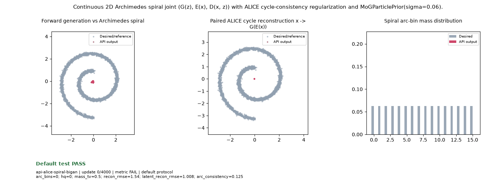

# `api-alice-spiral-bigan` — Archimedes spiral: continuous 2D manifold ALICE / BiGAN



- Legacy source identity: `develop-alice-spiral-bigan`
- Provider: `benchmarks/toy_audit/api_ring16.py`
- Public API components: `particlegan.Recipe`, `particlegan.GANTrainer`, `particlegan.MoGParticlePrior`, `particlegan.GANLoss.joint_g_loss`, `particlegan.init`
- Recipe: `bispf`
- Seed: `0`
- Updates: `4000 / 4000`
- Verdict: **PASS**
- Terminal 5-observation sustained pass: `True`
- Elapsed training/evaluation seconds: `61.48`

## Goal and Scope

- Goal: Continuous 2D Archimedes spiral joint (G(z), E(x), D(x, z)) with ALICE cycle-consistency regularization and MoGParticlePrior(sigma=0.06).
- Scope: Tier 4 continuous 2D manifold joint ALICE/BiGAN (G(z), E(x), D(x, z)) with cycle-consistency regularization.
- Sampling: Continuous 2D Archimedes spiral (theta in [pi/2, 3.5*pi], r=0.5+0.25*theta, sigma=0.06); MoGParticlePrior(sigma=0.06); paired ALICE cycle x -> G(E(x)) and z -> E(G(z))

## Declared Numerical Gate

```json
{
  "arc_bins_min": 15,
  "arc_consistency_min": 0.9,
  "hq_min": 0.85,
  "latent_recon_rmse_max": 0.25,
  "mass_tv_max": 0.16,
  "recon_rmse_max": 0.14
}
```

## Final Observation

```json
{
  "arc_bins": 16,
  "arc_consistency": 1.0,
  "hq": 0.993896484375,
  "latent_recon_rmse": 0.04513271898031235,
  "mass_tv": 0.03896462172269821,
  "recon_rmse": 0.055657606571912766
}
```

Failed bounds: `none`
