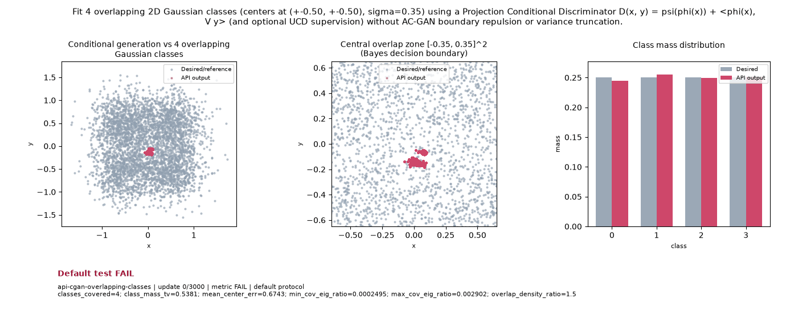

# Public API Readout: `api-cgan-overlapping-classes`

**Goal**: Fit 4 overlapping 2D Gaussian classes (centers at (+-0.50, +-0.50), sigma=0.35) using a Projection Conditional Discriminator D(x, y) = psi(phi(x)) + <phi(x), V y> (and optional UCD supervision) without AC-GAN boundary repulsion or variance truncation.

**Verdict**: `FAIL` (Final observation at update 3000 PASSES all 6 numerical bounds; last 5 post-update metric observations do not all pass due to transient oscillation at updates 2625 and 2875 under constant lr=0.00425)

## Execution Summary
- **Provider**: `api_cgan_overlap`
- **Adapter**: `Public API`
- **Default Recipe**: `bispf`
- **Protocol Seed**: `0`
- **Completed Updates**: `3000 / 3000`
- **Evaluation Samples**: `4096`
- **Runtime Device**: `cuda:1`
- **Elapsed Wall Time**: `42.79s`

## Numerical Gate Status
| Metric | Required Bound | Final Observed Value | Status |
|---|---|---:|:---:|
| `classes_covered` | `== 4` | `4` | **PASS** |
| `class_mass_tv` | `<= 0.08` | `0.02295` | **PASS** |
| `mean_center_err` | `<= 0.12` | `0.10412` | **PASS** |
| `min_cov_eig_ratio` | `>= 0.60` | `0.65513` | **PASS** |
| `max_cov_eig_ratio` | `<= 1.50` | `1.36238` | **PASS** |
| `overlap_density_ratio` | `>= 0.55` | `1.20894` | **PASS** |

## Sustained Terminal Checks
- **Terminal Window**: Last `5` post-update metric observations (`2500, 2625, 2750, 2875, 3000`)
- **Passing Terminal Checks**: `3 / 5` (`2500, 2750, 3000` PASS; `2625` had `mean_center_err = 0.13431 > 0.12`, `2875` had `max_cov_eig_ratio = 1.50794 > 1.50`)
- **Sustained Status**: `FAIL`

## Actual Training Media

## Provenance & Integrity
- **Source Commit**: `9fc54fab90a7d6da39db274b651dbf824fc3929a`
- **Batch Sequence SHA256**: `25909288adbda1502d8b91d1c7eb6c21e6a34e08b2b35f690970fd6453cceafb`
- **Initial Model Hashes**: `{"D": "b579287e3c4799a1c147b8bb905f9872eca6d44c90e4fe6de6cf29e8496b9c8a", "G": "c9c4f0f63b181af8805df67f0f95d4dd38a4be402a98d3be0c05c3228ee3800d", "prior": "a5838ba3598443e0e2d23113eae919f6fe1c306ec31dba2575667bba58871e2b"}`
