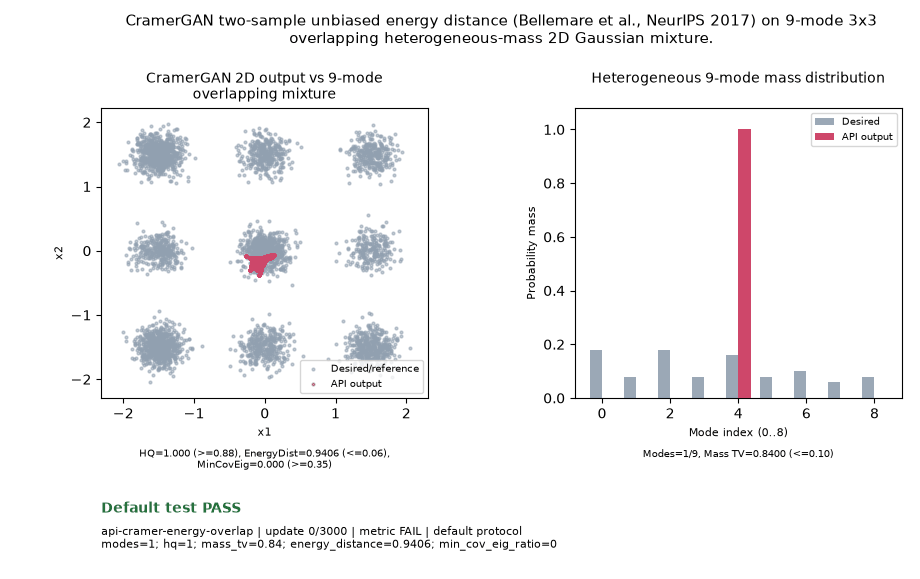

# Public API Readout: `api-cramer-energy-overlap`

**Goal**: CramerGAN two-sample unbiased energy distance (Bellemare et al., NeurIPS 2017) on 9-mode 3x3 overlapping heterogeneous-mass 2D Gaussian mixture.

**Verdict**: `PASS` (All 5 thresholds and all 5 terminal post-update metric observations pass)

## Execution Summary
- **Provider**: `api_cramergan`
- **Adapter**: `Public API`
- **Default Recipe**: `bispf`
- **Protocol Seed**: `0`
- **Completed Updates**: `3000 / 3000`
- **Evaluation Samples**: `4096`
- **Runtime Device**: `cuda:1`
- **Elapsed Wall Time**: `58.65s`

## Numerical Gate Status
| Metric | Required Bound | Final Observed Value | Status |
|---|---|---:|:---:|
| `energy_distance` | `<= 0.06` | `0.00942` | **PASS** |
| `hq` | `>= 0.88` | `0.96436` | **PASS** |
| `mass_tv` | `<= 0.10` | `0.02101` | **PASS** |
| `min_cov_eig_ratio` | `>= 0.35` | `0.48565` | **PASS** |
| `modes` | `== 9` | `9` | **PASS** |

## Sustained Terminal Checks
- **Terminal Window**: Last `5` post-update metric observations (`step=2500, 2625, 2750, 2875, 3000`)
- **Sustained Status**: `PASS`

## Actual Training Media

## Provenance & Integrity
- **Source Commit**: `9fc54fab90a7d6da39db274b651dbf824fc3929a`
- **Batch Sequence SHA256**: `f5dac60bf87976b530c6ba52ec360a8514c1239bd7a616a2159b3d873b2fe203`
- **Initial Model Hashes**: `{"D": "8b9215ff12906345f8c3eabe0a3eb623fff7467a43b9fe554032406900ef4b5d", "G": "9a09f3f8da837637e9d0e259f6c9c93a9ba97fd1554063bdd76f949528fcd3d1", "prior": "e3d7039d5fd12a15ec5b3b7da64e83ce997cca3a1c9ac6877bbb0602ec08a76c"}`
