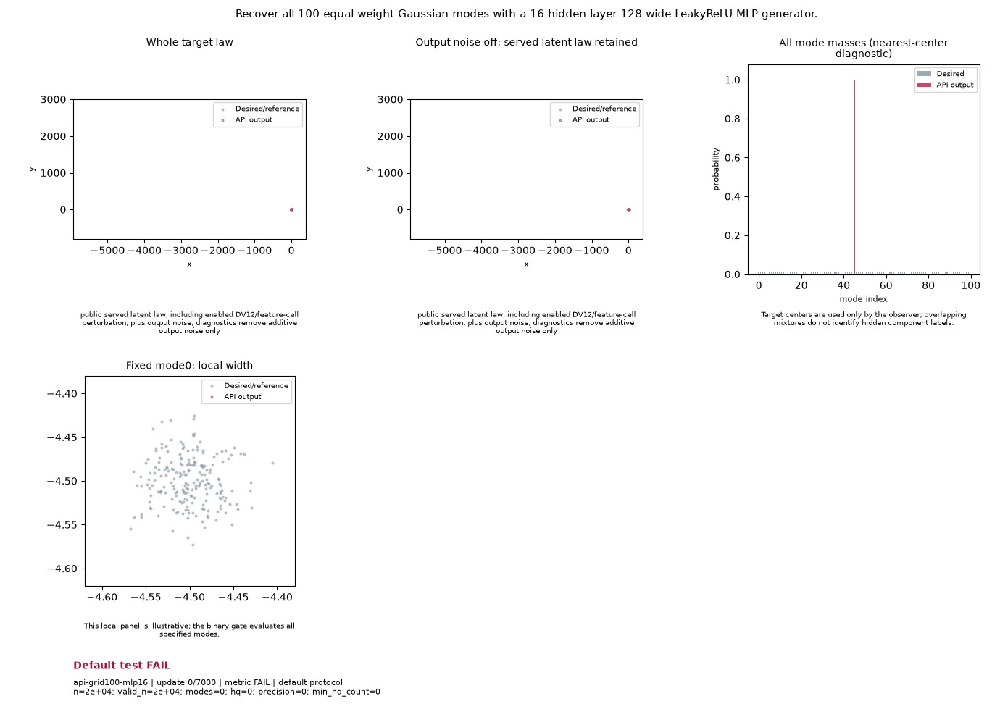

# Public API Readout: `api-grid100-mlp16`

**Goal**: Recover all 100 equal-weight Gaussian modes with a 16-hidden-layer 128-wide LeakyReLU MLP generator.

**Verdict**: `FAIL` (FAIL: accuracy_abs_cov_trace_bias <= 0.1; accuracy_center_rms_sigma <= 0.2; accuracy_mass_tv <= 0.06; accuracy_radial_ks <= 0.04; mass_tv <= 0.1; max_mode_mass <= 0.02; min_cov_eig_ratio >= 0.4; min_hq_mode_mass >= 0.005; min_radial_median_ratio >= 0.65; modes >= 100; precision >= 0.97; last 5 post-update metric observations do not all pass)

## Execution Summary
- **Provider**: `api_vectors`
- **Adapter**: `Public GANTrainer host with 16-hidden-layer 128-wide LeakyReLU(0.2) MLP generator and 3-layer Fourier-2 critic.`
- **Default Recipe**: `k3p`
- **Protocol Seed**: `0`
- **Completed Updates**: `7000 / 7000`
- **Evaluation Samples**: `20000`
- **Runtime Device**: `cuda:0`
- **Elapsed Wall Time**: `108.12s`

## Numerical Gate Status
| Metric | Required Bound | Final Observed Value | Status |
|---|---|---:|:---:|
| `accuracy` | `== {'abs_cov_trace_bias': 0.1, 'center_rms_sigma': 0.2, 'mass_tv': 0.06, 'radial_ks': 0.04}` | `N/A` | **FAIL** |
| `native` | `== {'all_finite': True, 'max_cov_eig_ratio': 1.7, 'max_mass_tv': 0.1, 'max_mode_mass': 0.02, 'max_radial_median_ratio': 1.4, 'min_cov_eig_ratio': 0.4, 'min_hq_mode_mass': 0.005, 'min_modes': 100, 'min_precision': 0.97, 'min_radial_median_ratio': 0.65, 'min_samples': 20000}` | `N/A` | **PASS** |

## Sustained Terminal Checks
- **Terminal Window**: Last `5` post-update metric observations
- **Sustained Status**: `FAIL`

## Actual Training Media

## Provenance & Integrity
- **Source Commit**: `de43f22f0fb743af73f61492de84f8d7d4a01fad`
- **Batch Sequence SHA256**: `afc9818cbbb858f0506a03b8d767d5203b495c1fde05ed6bcc0e6d2f67a68c18`
- **Initial Model Hashes**: `{"D": "08fba2e68b0c2cd7e5f0d4af6f426dc879852f95595620cd6240dfaf00547456", "G": "a2e191d14df2a5c70e087510ae82caed6ee02b5472c70534fc43d4bacceeba67", "prior": "cc220836d04e8c4694c2d095f75d528ee70bb7f06161fe0c27341e539edd1cab"}`
