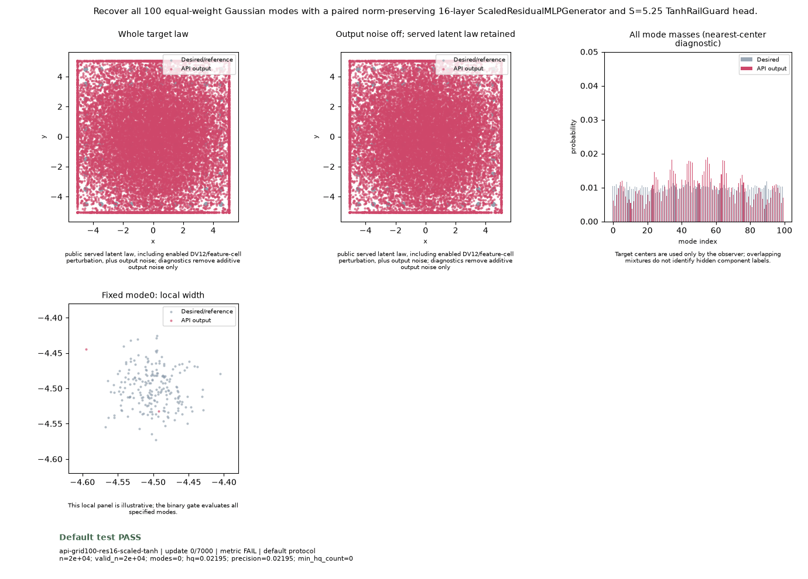

# Public API Readout: `api-grid100-res16-scaled-tanh`

**Goal**: Recover all 100 equal-weight Gaussian modes with a paired norm-preserving 16-layer ScaledResidualMLPGenerator and S=5.25 TanhRailGuard head.

**Verdict**: `PASS` (PASS: all numerical and sustained terminal bounds satisfied across the last 5 post-update metric observations)

## Execution Summary
- **Provider**: `api_vectors`
- **Adapter**: `Public GANTrainer host with 16-layer ScaledResidualMLPGenerator (paired norm-preserving residual transport) and S=5.25 TanhRailGuard head.`
- **Default Recipe**: `k3p`
- **Protocol Seed**: `0`
- **Completed Updates**: `7000 / 7000`
- **Evaluation Samples**: `20000`
- **Runtime Device**: `cuda:0`
- **Elapsed Wall Time**: `153.58s`

## Numerical Gate Status
| Metric | Required Bound | Final Observed Value | Status |
|---|---|---:|:---:|
| `accuracy` | `== {'abs_cov_trace_bias': 0.1, 'center_rms_sigma': 0.2, 'mass_tv': 0.06, 'radial_ks': 0.04}` | `center_rms_sigma=0.1093, mass_tv=0.0262, radial_ks=0.0048` | **PASS** |
| `native` | `== {'all_finite': True, 'max_cov_eig_ratio': 1.7, 'max_mass_tv': 0.1, 'max_mode_mass': 0.02, 'max_radial_median_ratio': 1.4, 'min_cov_eig_ratio': 0.4, 'min_hq_mode_mass': 0.005, 'min_modes': 100, 'min_precision': 0.75, 'min_radial_median_ratio': 0.65, 'min_samples': 20000}` | `modes=100, precision=0.9906, min_cov_eig_ratio=0.6677` | **PASS** |
| `saturated_fraction` | `<= 0.001` | `0.00000` | **PASS** |

## Sustained Terminal Checks
- **Terminal Window**: Last `5` post-update metric observations
- **Sustained Status**: `PASS`

## Actual Training Media

## Provenance & Integrity
- **Source Commit**: `18a97f05c80923036c2f39d249fc13210e350ae5`
- **Batch Sequence SHA256**: `afc9818cbbb858f0506a03b8d767d5203b495c1fde05ed6bcc0e6d2f67a68c18`
- **Initial Model Hashes**: `{"D": "93736fb16cf756b6fc87ac4600b9ec6a0d94c8d4920f6cb8a93cdf125751a042", "G": "2a81de8f1f7b9d1427260fa4842478cc2bec4b9e15df3947fd6a87554df16100", "prior": "11ba0eecabfc1c78adb44bec3e17a5304416d69248717f5753bc6a5299c4ca72"}`
