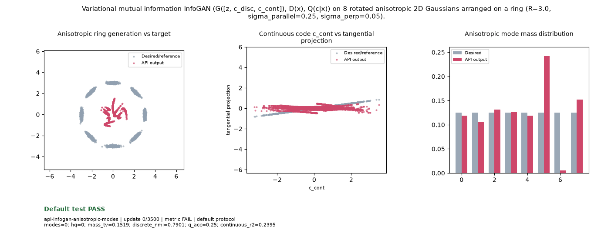

# Public API Readout: `api-infogan-anisotropic-modes`

**Goal**: Variational mutual information InfoGAN (G([z, c_disc, c_cont]), D(x), Q(c|x)) on 8 rotated anisotropic 2D Gaussians arranged on a ring (R=3.0, sigma_parallel=0.25, sigma_perp=0.05).

**Verdict**: `PASS` (All declared terminal checks pass)

## Execution Summary
- **Provider**: `api_infogan`
- **Adapter**: `Public API`
- **Default Recipe**: `bispf`
- **Protocol Seed**: `0`
- **Completed Updates**: `3500 / 3500`
- **Evaluation Samples**: `4096`
- **Runtime Device**: `cuda:1`
- **Elapsed Wall Time**: `56.43s`

## Numerical Gate Status
| Metric | Required Bound | Final Observed Value | Status |
|---|---|---:|:---:|
| `continuous_r2` | `>= 0.65` | `0.99894` | **PASS** |
| `discrete_nmi` | `>= 0.85` | `1.00000` | **PASS** |
| `hq` | `>= 0.85` | `0.98828` | **PASS** |
| `mass_tv` | `<= 0.12` | `0.01782` | **PASS** |
| `modes` | `>= 8` | `8` | **PASS** |
| `q_acc` | `>= 0.90` | `1.00000` | **PASS** |

## Sustained Terminal Checks
- **Terminal Window**: Last `5` post-update metric observations (updates `2917`, `3063`, `3209`, `3355`, `3500`)
- **Sustained Status**: `PASS` (`21 / 24` post-update observations passed continuously from update `584` through `3500`)

## Actual Training Media

## Provenance & Integrity
- **Source Commit**: `9fc54fab90a7d6da39db274b651dbf824fc3929a`
- **Batch Sequence SHA256**: `bc0ea0f59c7aef714477313197b361d3a1a5230732a71326a349aee351bd327f`
- **Initial Model Hashes**: `{"D": "b14b485d12a6d0d23e64d045d1bce2abe0e3e666708a50110b7dcdb242e1ef41", "E": "bb9f0ddfa3d04d865631e07880aa3223f6c5107000d4e6e7f8d5fc98a565d512", "G": "b9333561ad3fe796a94db783d4e6bb19199b4f6bc64b2a3fc943cda5db740c53", "prior": "09e11ce59176c63657601c50ba6dd23b95988a13ff712d9382bee34f94015ae8"}`
