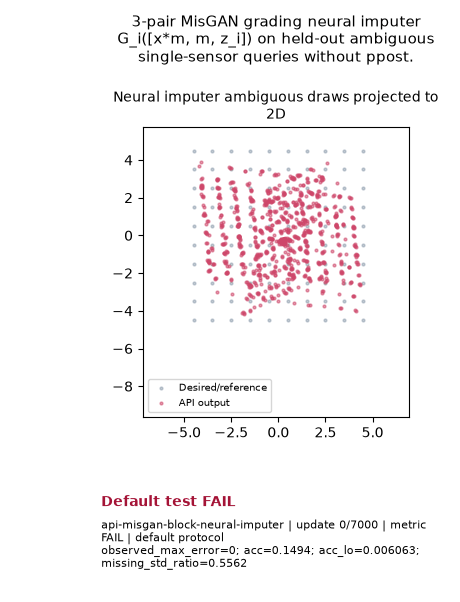

# Public API Readout: `api-misgan-block-neural-imputer`

**Goal**: 3-pair MisGAN grading neural imputer G_i([x*m, m, z_i]) on held-out ambiguous single-sensor queries without ppost.

**Verdict**: `FAIL` (FAIL: acc; acc_lo; last 5 post-update metric observations do not all pass)

## Execution Summary
- **Provider**: `api_conditionals`
- **Adapter**: `Public API`
- **Default Recipe**: `ka2`
- **Protocol Seed**: `0`
- **Completed Updates**: `7000 / 7000`
- **Evaluation Samples**: `4096`
- **Runtime Device**: `cpu`
- **Elapsed Wall Time**: `31.51s`

## Numerical Gate Status
| Metric | Required Bound | Final Observed Value | Status |
|---|---|---:|:---:|
| `acc_lo` | `>= 0.65` | `0.0001875` | **FAIL** |
| `acc` | `>= 0.95` | `0.13715` | **FAIL** |
| `missing_std_ratio` | `== [0.7, 1.3]` | `0.80315` | **PASS** |
| `observed_max_error` | `<= 1e-06` | `0` | **PASS** |

## Sustained Terminal Checks
- **Terminal Window**: Last `5` post-update metric observations
- **Sustained Status**: `FAIL`

## Actual Training Media

## Provenance & Integrity
- **Source Commit**: `de43f22f0fb743af73f61492de84f8d7d4a01fad`
- **Batch Sequence SHA256**: `N/A`
- **Initial Model Hashes**: `{"prior": "41b82d2fea2ab15328619376caa4d80f7c490400f3c890b380db2d64ea872d62"}`
