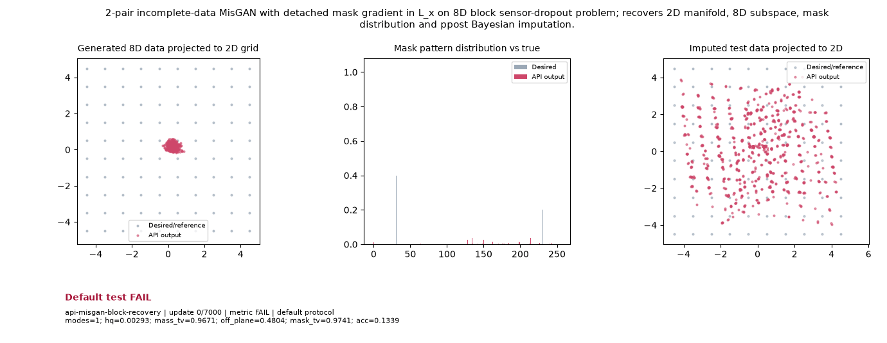

# Public API Readout: `api-misgan-block-recovery`

**Goal**: 2-pair incomplete-data MisGAN with detached mask gradient in L_x on 8D block sensor-dropout problem; recovers 2D manifold, 8D subspace, mask distribution and ppost Bayesian imputation.

**Verdict**: `FAIL` (FAIL: acc; acc_lo; hq; mask_tv; mass_tv; modes; off_plane; last 5 post-update metric observations do not all pass)

## Execution Summary
- **Provider**: `api_conditionals`
- **Adapter**: `Public API`
- **Default Recipe**: `ka2`
- **Protocol Seed**: `0`
- **Completed Updates**: `7000 / 7000`
- **Evaluation Samples**: `4096`
- **Runtime Device**: `cpu`
- **Elapsed Wall Time**: `39.40s`

## Numerical Gate Status
| Metric | Required Bound | Final Observed Value | Status |
|---|---|---:|:---:|
| `acc_lo` | `>= 0.7` | `0.0085` | **FAIL** |
| `acc` | `>= 0.96` | `0.12105` | **FAIL** |
| `hq` | `>= 0.9` | `0.020264` | **FAIL** |
| `mask_tv` | `<= 0.05` | `0.9563` | **FAIL** |
| `mass_tv` | `<= 0.1` | `0.7985` | **FAIL** |
| `modes` | `>= 100` | `3` | **FAIL** |
| `off_plane` | `<= 0.04` | `3.5515` | **FAIL** |

## Sustained Terminal Checks
- **Terminal Window**: Last `5` post-update metric observations
- **Sustained Status**: `FAIL`

## Actual Training Media

## Provenance & Integrity
- **Source Commit**: `de43f22f0fb743af73f61492de84f8d7d4a01fad`
- **Batch Sequence SHA256**: `N/A`
- **Initial Model Hashes**: `{"prior": "41b82d2fea2ab15328619376caa4d80f7c490400f3c890b380db2d64ea872d62"}`
