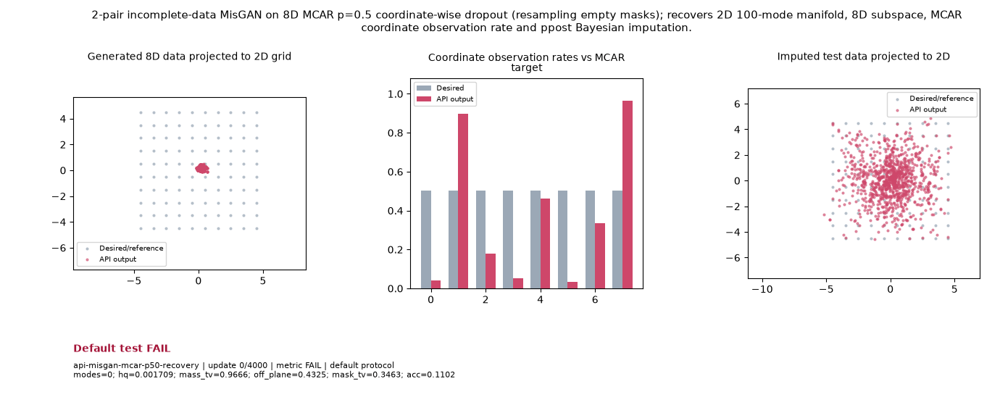

# Public API Readout: `api-misgan-mcar-p50-recovery`

**Goal**: 2-pair incomplete-data MisGAN on 8D MCAR p=0.5 coordinate-wise dropout (resampling empty masks); recovers 2D 100-mode manifold, 8D subspace, MCAR coordinate observation rate and ppost Bayesian imputation.

**Verdict**: `FAIL` (FAIL: acc; hq; impute_rmse; mask_tv; mass_tv; modes; off_plane; last 5 post-update metric observations do not all pass)

## Execution Summary
- **Provider**: `api_conditionals`
- **Adapter**: `Public API`
- **Default Recipe**: `bispf`
- **Protocol Seed**: `0`
- **Completed Updates**: `4000 / 4000`
- **Evaluation Samples**: `4096`
- **Runtime Device**: `cuda:0`
- **Elapsed Wall Time**: `81.16s`

## Numerical Gate Status
| Metric | Required Bound | Final Observed Value | Status |
|---|---|---:|:---:|
| `acc` | `>= 0.90` | `0.1184` | **FAIL** |
| `hq` | `>= 0.85` | `0.01294` | **FAIL** |
| `impute_rmse` | `<= 0.12` | `1.275` | **FAIL** |
| `mask_tv` | `<= 0.05` | `0.232` | **FAIL** |
| `mass_tv` | `<= 0.12` | `0.8897` | **FAIL** |
| `modes` | `>= 90` | `2` | **FAIL** |
| `off_plane` | `<= 0.05` | `3.916` | **FAIL** |

## Sustained Terminal Checks
- **Terminal Window**: Last `5` post-update metric observations
- **Sustained Status**: `FAIL`

## Actual Training Media

## Provenance & Integrity
- **Source Commit**: `9fc54fab90a7d6da39db274b651dbf824fc3929a`
- **Batch Sequence SHA256**: `N/A`
- **Initial Model Hashes**: `{"D": "5534daea2ff7e3f8d776a0103ae80bbff39b7bbd64d550f002187a1dbdeb5bfe", "G": "aab388bb377b22d85fc8e3bc9f9ccf91c5cee51e6882bee2ddef8f13fc2db799", "prior": "4a5ff131064fb92a76cdc02bb6266a68310cc7bc1151ac8e03bdd6dbc84efb19"}`
