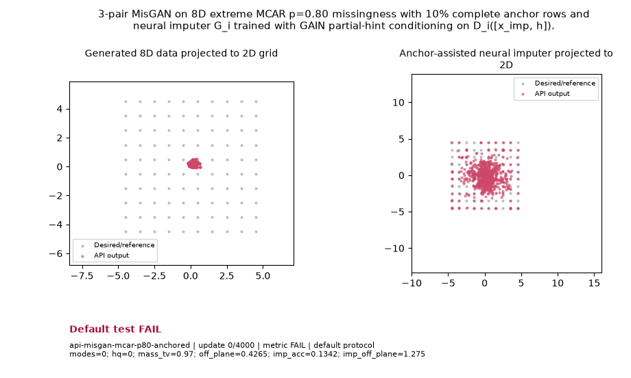

# Public API Readout: `api-misgan-mcar-p80-anchored`

**Goal**: 3-pair MisGAN on 8D extreme MCAR p=0.80 missingness with 10% complete anchor rows and neural imputer G_i trained with GAIN partial-hint conditioning on D_i([x_imp, h]).

**Verdict**: `FAIL` (FAIL: hq; imp_acc; imp_off_plane; impute_rmse; mass_tv; modes; off_plane; last 5 post-update metric observations do not all pass)

## Execution Summary
- **Provider**: `api_conditionals`
- **Adapter**: `Public API`
- **Default Recipe**: `bispf`
- **Protocol Seed**: `0`
- **Completed Updates**: `4000 / 4000`
- **Evaluation Samples**: `4096`
- **Runtime Device**: `cuda:0`
- **Elapsed Wall Time**: `109.10s`

## Numerical Gate Status
| Metric | Required Bound | Final Observed Value | Status |
|---|---|---:|:---:|
| `hq` | `>= 0.80` | `0.01367` | **FAIL** |
| `imp_acc` | `>= 0.65` | `0.1424` | **FAIL** |
| `imp_off_plane` | `<= 0.06` | `2.286` | **FAIL** |
| `impute_rmse` | `<= 0.18` | `1.073` | **FAIL** |
| `mass_tv` | `<= 0.15` | `0.6897` | **FAIL** |
| `modes` | `>= 80` | `3` | **FAIL** |
| `off_plane` | `<= 0.06` | `2.122` | **FAIL** |

## Sustained Terminal Checks
- **Terminal Window**: Last `5` post-update metric observations
- **Sustained Status**: `FAIL`

## Actual Training Media

## Provenance & Integrity
- **Source Commit**: `9fc54fab90a7d6da39db274b651dbf824fc3929a`
- **Batch Sequence SHA256**: `N/A`
- **Initial Model Hashes**: `{"D": "9f58204626a90fad9262a1a68fcc2a2b9da1a18eac9156dc43c230abd37d7578", "G": "cf06a374219845e6d7f5ac8a59eb319d4a1c8b5dc9d18d9582b581b30b6a9d90", "prior": "4a5ff131064fb92a76cdc02bb6266a68310cc7bc1151ac8e03bdd6dbc84efb19"}`
