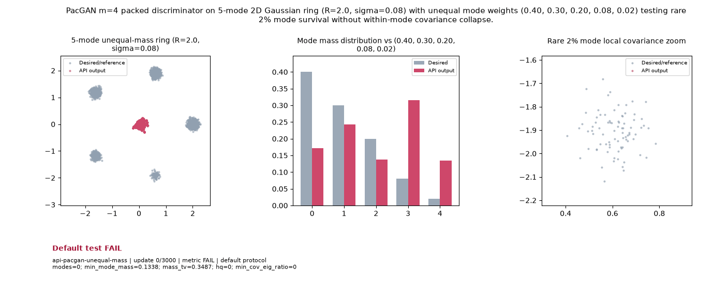

# Public API Readout: `api-pacgan-unequal-mass`

**Goal**: PacGAN m=4 packed discriminator on 5-mode 2D Gaussian ring (R=2.0, sigma=0.08) with unequal mode weights (0.40, 0.30, 0.20, 0.08, 0.02) testing rare 2% mode survival without within-mode covariance collapse.

**Verdict**: `FAIL` (FAIL: hq; min_cov_eig_ratio; modes; last 5 post-update metric observations do not all pass)

## Execution Summary
- **Provider**: `api_pacgan`
- **Adapter**: `Public API`
- **Default Recipe**: `bispf`
- **Protocol Seed**: `0`
- **Completed Updates**: `3000 / 3000`
- **Evaluation Samples**: `4096`
- **Runtime Device**: `cuda:0`
- **Elapsed Wall Time**: `37.91s`

## Numerical Gate Status
| Metric | Required Bound | Final Observed Value | Status |
|---|---|---:|:---:|
| `hq` | `>= 0.88` | `0.71704` | **FAIL** |
| `mass_tv` | `<= 0.1` | `0.00718` | **PASS** |
| `min_cov_eig_ratio` | `>= 0.2` | `0.10215` | **FAIL** |
| `min_mode_mass` | `>= 0.01` | `0.02100` | **PASS** |
| `modes` | `== 5` | `3` | **FAIL** |

## Sustained Terminal Checks
- **Terminal Window**: Last `5` post-update metric observations
- **Sustained Status**: `FAIL`

## Actual Training Media

## Provenance & Integrity
- **Source Commit**: `9fc54fab90a7d6da39db274b651dbf824fc3929a`
- **Batch Sequence SHA256**: `N/A`
- **Initial Model Hashes**: `{"D": "0c09b21764a393e6e59c2de938e0f89bbf4ac20bb2e7dcb00b22549ae69997c9", "G": "ec3870d352498202d56b3ebb3f71f6bcc6dfdcab43cfb34faac9e35479bbc6e3", "prior": "fbf2018cc24e897abb92d359d5b4ad5d3792dc396ea5808a69cdd3673e45ae06"}`
