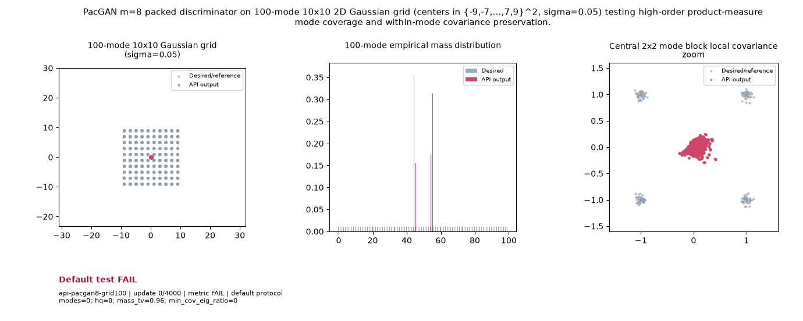

# Public API Readout: `api-pacgan8-grid100`

**Goal**: PacGAN m=8 packed discriminator on 100-mode 10x10 2D Gaussian grid (centers in {-9,-7,...,7,9}^2, sigma=0.05) testing high-order product-measure mode coverage and within-mode covariance preservation.

**Verdict**: `FAIL` (FAIL: hq; mass_tv; min_cov_eig_ratio; modes; last 5 post-update metric observations do not all pass)

## Execution Summary
- **Provider**: `api_pacgan`
- **Adapter**: `Public API`
- **Default Recipe**: `bispf`
- **Protocol Seed**: `0`
- **Completed Updates**: `4000 / 4000`
- **Evaluation Samples**: `4096`
- **Runtime Device**: `cuda:0`
- **Elapsed Wall Time**: `50.48s`

## Numerical Gate Status
| Metric | Required Bound | Final Observed Value | Status |
|---|---|---:|:---:|
| `hq` | `>= 0.85` | `0.01123` | **FAIL** |
| `mass_tv` | `<= 0.15` | `0.24351` | **FAIL** |
| `min_cov_eig_ratio` | `>= 0.15` | `0.00000` | **FAIL** |
| `modes` | `>= 95` | `0` | **FAIL** |

## Sustained Terminal Checks
- **Terminal Window**: Last `5` post-update metric observations
- **Sustained Status**: `FAIL`

## Actual Training Media

## Provenance & Integrity
- **Source Commit**: `9fc54fab90a7d6da39db274b651dbf824fc3929a`
- **Batch Sequence SHA256**: `N/A`
- **Initial Model Hashes**: `{"D": "1d4e2c389d587e10a286ce93bed36b124431b15227b7236b6a525d293f49c2d8", "G": "ec3870d352498202d56b3ebb3f71f6bcc6dfdcab43cfb34faac9e35479bbc6e3", "prior": "4d098c415792d1e8b6eeef6f701f98b236007a2175634ddae04e6c044263fcbd"}`
