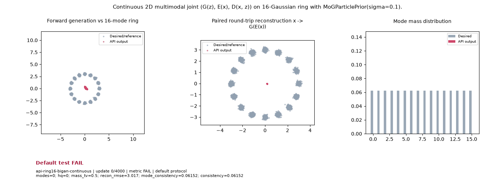

# Public API Readout: `api-ring16-bigan-continuous`

**Goal**: Continuous 2D multimodal joint (G(z), E(x), D(x, z)) on 16-Gaussian ring with MoGParticlePrior(sigma=0.1).

**Verdict**: `FAIL` (FAIL: hq; mass_tv; recon_rmse; last 5 post-update metric observations do not all pass)

## Execution Summary
- **Provider**: `api_ring16`
- **Adapter**: `Public API`
- **Default Recipe**: `bcap`
- **Protocol Seed**: `0`
- **Completed Updates**: `4000 / 4000`
- **Evaluation Samples**: `4096`
- **Runtime Device**: `cpu`
- **Elapsed Wall Time**: `29.18s`

## Numerical Gate Status
| Metric | Required Bound | Final Observed Value | Status |
|---|---|---:|:---:|
| `hq` | `>= 0.85` | `0.23828` | **FAIL** |
| `mass_tv` | `<= 0.15` | `0.15574` | **FAIL** |
| `mode_consistency` | `>= 0.98` | `0.99512` | **PASS** |
| `modes` | `>= 16` | `16` | **PASS** |
| `recon_rmse` | `<= 0.12` | `0.22041` | **FAIL** |

## Sustained Terminal Checks
- **Terminal Window**: Last `5` post-update metric observations
- **Sustained Status**: `FAIL`

## Actual Training Media

## Provenance & Integrity
- **Source Commit**: `de43f22f0fb743af73f61492de84f8d7d4a01fad`
- **Batch Sequence SHA256**: `N/A`
- **Initial Model Hashes**: `{"D": "0af8bac33b9bb579b84f5e85ff0344dfdbdf7c20ff2a5285b2f7597678532e7d", "E": "e683ea5061253361dd15867d52c71f951d0bb3b11f09e6c483a97266aa9749c8", "G": "21f8e7bb48c1e8e89d486575576858573ab6f042c43f0bb69e5cb97262cec996", "prior": "63df45759d32b076d4ce340ee48c325acb1e523275134b74040023ffbae52674"}`
