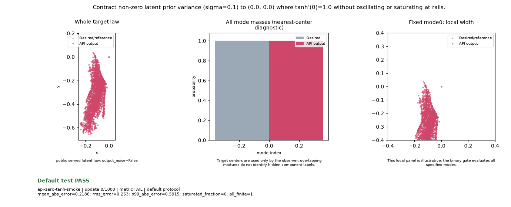

# Public API Readout: `api-zero-tanh-smoke`

**Goal**: Contract non-zero latent prior variance (sigma=0.1) to (0.0, 0.0) where tanh'(0)=1.0 without oscillating or saturating at rails.

**Verdict**: `PASS` (PASS: All criteria satisfied)

## Execution Summary
- **Provider**: `api_vectors`
- **Adapter**: `Public GANTrainer host with 2-layer MLP and nn.Tanh() output head; MoGParticlePrior(sigma=0.1).`
- **Default Recipe**: `k3p`
- **Protocol Seed**: `0`
- **Completed Updates**: `1000 / 1000`
- **Evaluation Samples**: `4096`
- **Runtime Device**: `cpu`
- **Elapsed Wall Time**: `4.47s`

## Numerical Gate Status
| Metric | Required Bound | Final Observed Value | Status |
|---|---|---:|:---:|
| `mean_abs_error` | `<= 0.005` | `0.0014169` | **PASS** |
| `rms_error` | `<= 0.01` | `0.0017973` | **PASS** |
| `p99_abs_error` | `<= 0.025` | `0.0044131` | **PASS** |
| `saturated_fraction` | `== 0.0` | `0` | **PASS** |

## Sustained Terminal Checks
- **Terminal Window**: Last `5` post-update metric observations
- **Sustained Status**: `PASS (all 5 passed)`

## Actual Training Media

## Provenance & Integrity
- **Source Commit**: `de43f22f0fb743af73f61492de84f8d7d4a01fad`
- **Batch Sequence SHA256**: `497cd27ea81f36e43edc7059c84a961626ea9393213e3b78d6e4350d2d0efea8`
- **Initial Model Hashes**: `{"D": "672dfa6da531419cdb7ec109ca7463582b9a0c88c4ded3c9e3cf5dac865c10f5", "G": "dd84fef44174cd9100787029c753244e8f469777decb14182622a3de8de66707", "prior": "96bc02424adf20c7c5f20911e29112262262399c0d263ef7b597cbfbac12fb4a"}`
