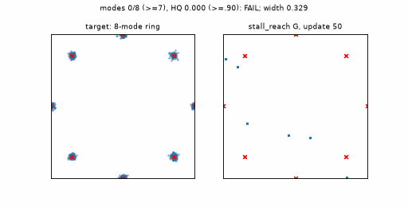
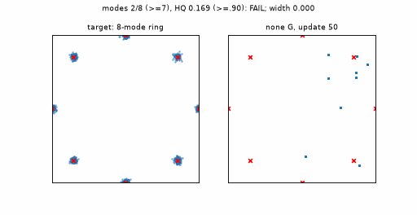

# Stall-reach critic read: 8-mode ring (public-API toy)

**Question.** With the BCAP direction-blend leader recipe
(`recipe-prior-refactor-bcap-pure-v1` overrides) plus
`generator_critic_read="stall_reach"` (closed PR #107), does the generator still
acquire and hold the 8-mode ring (radius 2, sigma .07)?

**Execution.** `GANTrainer` through the public API, 1200 updates, batch 128,
z_dim 4, 12 learned particles, `SimpleMLPGenerator(4, 96, 3)` /
`SimpleMLPDiscriminator(2, 96, 3, fourier 3)`, `deterministic_orthogonal_`
(G seed 0, D seed 1, R2 particle table), trainer seed 0, CPU, one thread.
Both arms below reproduce bitwise on rerun.
Source: [`benchmarks/toy_audit/stall_reach_ring8.py`](../../../../benchmarks/toy_audit/stall_reach_ring8.py).

**Gate (declared before training).** Final update: `modes >= 7` and
`hq >= 0.90` on 4096 clean live samples (HQ = within 3 sigma of a center).

| Arm | Final modes | Final HQ | Gate | Passing observations (of 24) | Widened updates | Stalled updates | Max width |
| --- | ---: | ---: | --- | ---: | ---: | ---: | ---: |
| `generator_critic_read="none"` (same toy) | 7 | 0.917 | PASS (first pass at 800) | 6 | - | - | - |
| `generator_critic_read="stall_reach"` | 6 | 0.747 | **FAIL** | 1 (update 1150) | 1200/1200 | 1093/1200 | 0.5 |

Both arms oscillate on this toy, and the gate reads only the final update, so
this is a weak, supporting signal. The decisive evidence is the Forge
ring16_acquisition loss in the [readout](../../../forge/stall-reach/README.md).
The read is widened from the first observation and stalled for most of
training: BCAP holds the critic's measured input slope near its cap
(median `u ≈ .90 ≥ .6` at the scheduled observations), so the 50-update
saturation window fires almost continuously. The width stays at
`REACH/kappa = .5`, about 7 sigma, and mode resolution degrades. PR #107's
original stall test also required G's own-curvature trust factor to collapse.
The current recipe has no trust factor, so the approved rebuild used slope
saturation alone, which is not selective under BCAP.

**Correction.** The first version of this toy built the particle table from
the global torch RNG (`recipe.make_prior()` without the deterministic
initializer), so its numbers (off path 7 modes / HQ 1.0; stall_reach 3 modes /
HQ .24, 964 stalled) did not reproduce: reruns of that code gave different
results each time. The toy now passes
`prior=deterministic_orthogonal_(recipe.make_prior())`, and the table above is
from that fixed version.

Off-path control: 

Reproduce: `python -m benchmarks.toy_audit.stall_reach_ring8 --output runs/stall-reach-ring8`
(add `--read none` for the control arm).
`tests/test_generator_critic_read.py::test_ring8_public_api_toy_runs_with_declared_gate`
runs a 100-update execution check.
